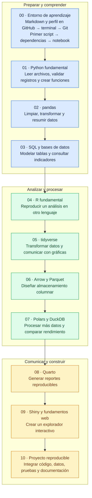

# DS Track

Ruta de aprendizaje práctica para manipulación, análisis, almacenamiento y
comunicación de datos.

El repositorio está diseñado para avanzar por etapas. Los fundamentos aparecen
antes que las herramientas de mayor escala, y cada nivel termina con un
resultado observable. Git ayuda a publicar y conservar el material, pero no es
un requisito para estudiar: el contenido también debe funcionar al descargarlo
como ZIP.

## Principios

- Bases antes que herramientas: Python, pandas, SQL y modelado primero.
- Una sola historia de datos: la cartera sintética crece con el recorrido.
- Aprender haciendo: explicación breve, práctica guiada, reto y proyecto.
- Comparar con evidencia: rendimiento, memoria, claridad y mantenibilidad.
- Datos seguros: nunca se versionan datos reales, secretos ni PII.
- Complejidad gradual: R, Parquet, Polars, DuckDB, Quarto y Shiny se incorporan
  cuando resuelven una necesidad ya entendida.

## Mapa del repositorio

| Ruta | Propósito |
| --- | --- |
| [`curriculum/`](curriculum/) | Módulos ordenados de aprendizaje |
| [`PROGRESS.md`](PROGRESS.md) | Módulo activo, siguiente paso y bitácora |
| [`labs/`](labs/) | Ejercicios breves y deliberados |
| [`projects/`](projects/) | Proyectos que integran varios módulos |
| [`datasets/`](datasets/) | Datos pequeños y sintéticos, generadores y diccionarios |
| [`templates/`](templates/) | Plantillas reutilizables para nuevo material |
| [`showcase/`](showcase/) | Resultados terminados para compartir |
| [`docs/`](docs/) | Arquitectura, reglas de contenido y seguridad |

La relación entre lecciones, práctica y proyectos se explica en
[`docs/learning-workflow.md`](docs/learning-workflow.md).

## Recorrido de aprendizaje

Cada paso desarrolla una capacidad que se aplica en el siguiente. El recorrido
empieza con tu perfil y termina con un proyecto que puedes reconstruir y explicar.

La publicación del perfil y el uso de Git son prácticas recomendadas. También
puedes seguir el recorrido con el material descargado como ZIP.

Consulta [`ROADMAP.md`](ROADMAP.md) para ver los resultados y criterios de
avance de cada nivel.

## Cómo estudiar

El recorrido también está pensado para aprender acompañado: una persona realiza
las prácticas y otra explica conceptos, revisa resultados y ayuda a resolver dudas.

Para cada módulo:

1. Lee sus objetivos y conceptos.
2. Ejecuta los ejemplos.
3. Resuelve los ejercicios sin mirar la solución.
4. Aplica lo aprendido al checkpoint de proyecto cuando exista.
5. Registra la evidencia y las dudas pendientes en `PROGRESS.md`.
6. Avanza cuando cumplas el criterio de salida, no solo por haber leído todo.

En una sesión acompañada, empieza con una explicación breve, realiza la práctica
y cierra explicando con tus propias palabras qué hiciste y por qué. Usa las
preguntas del lab para conversar y comprobar lo aprendido.

## Estado actual

La arquitectura inicial está lista y `00_getting_started` está en curso. El
avance diario y el siguiente paso se mantienen en [`PROGRESS.md`](PROGRESS.md).
