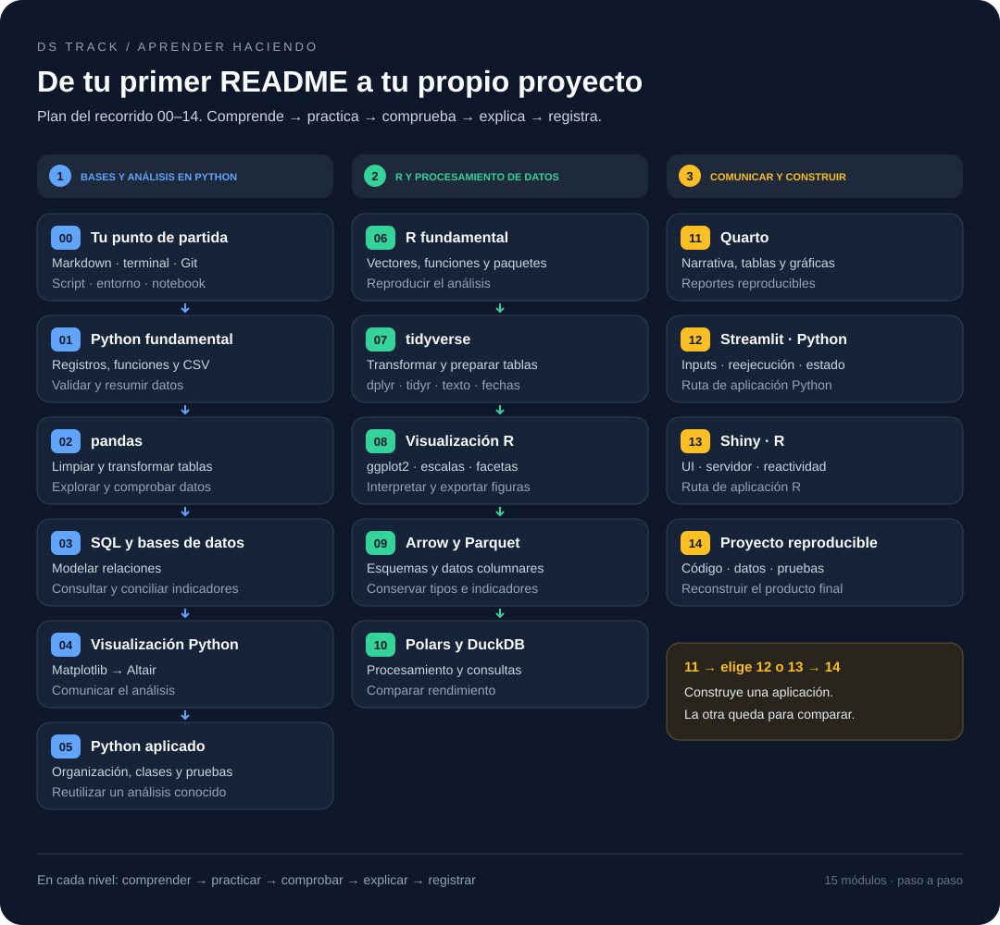

# DS Track

Ruta de aprendizaje práctica para manipulación, análisis, almacenamiento y
comunicación de datos.

El repositorio está diseñado para avanzar por etapas. Los fundamentos aparecen
antes que las herramientas de mayor escala, y cada nivel termina con un
resultado observable. Git ayuda a publicar y conservar el material, pero no es
un requisito para estudiar: el contenido también debe funcionar al descargarlo
como ZIP.

## Empieza aquí

Estudia una lección a la vez. Sigue este flujo en cada sesión:

1. **Comprende:** lee la lección y conversa sobre los conceptos y ejemplos.
   Anota lo que no entiendas para revisarlo con quien te acompaña.
2. **Practica:** realiza el lab asociado. Intenta resolverlo y usa la lección
   como referencia cuando lo necesites.
3. **Comprueba:** compara tu resultado con la evidencia y el criterio de salida
   del lab. Revisa los errores y vuelve a intentarlo si hace falta.
4. **Explica:** responde las preguntas de reflexión con tus propias palabras.
   Cuenta qué hiciste, por qué y cómo sabes que funcionó.
5. **Registra y continúa:** anota tu evidencia, dudas y siguiente paso en
   [PROGRESS.md](PROGRESS.md). Avanza cuando puedas demostrar la habilidad;
   si quedan conceptos esenciales pendientes, repásalos antes.

Si estudian juntos, quien acompaña puede explicar y dar pistas; quien aprende
realiza la práctica y explica su resultado. Cada sesión puede cubrir solo una
parte de la lección: no necesitas terminar un módulo de una vez.

### Tu primera sesión

Tu primera meta es escribir tu presentación en Markdown y crear tu perfil en
GitHub. Para esta primera lección solo necesitas un editor de texto y, si vas
a publicar el perfil, una cuenta de GitHub.

1. Lee [01 — Markdown y tu perfil en GitHub](curriculum/00_getting_started/01_github_profile/README.md)
   para entender Git, GitHub y los archivos `.md`.
2. Copia la [plantilla del perfil](templates/github-profile/PROFILE.md) y
   personaliza tu nombre, usuario y objetivos.
3. Completa el [lab 00.01 — Markdown y perfil](labs/00_getting_started/01_github_profile/README.md)
   y comprueba que tu README se ve correctamente.
4. Registra tu resultado y tus dudas en [PROGRESS.md](PROGRESS.md).

Después continúa con [02 — Terminal y rutas](curriculum/00_getting_started/02_terminal_paths/README.md)
y luego con [03 — Git e historial](curriculum/00_getting_started/03_git_workflow/README.md).
Consulta el [índice del nivel 0](curriculum/00_getting_started/README.md) para
seguir la secuencia completa.

## Principios

- Bases antes que herramientas: Python, pandas, SQL y modelado primero.
- Una sola historia de datos: la cartera sintética crece con el recorrido.
- Aprender haciendo: explicación breve, práctica guiada, reto y proyecto.
- Comparar con evidencia: rendimiento, memoria, claridad y mantenibilidad.
- Datos seguros: nunca se versionan datos reales, secretos ni PII.
- Complejidad gradual: R, Parquet, Polars, DuckDB, Quarto y Shiny se incorporan
  cuando resuelven una necesidad ya entendida.

## Mapa del repositorio

| Ruta | Propósito |
| --- | --- |
| [`curriculum/`](curriculum/) | Módulos ordenados de aprendizaje |
| [`PROGRESS.md`](PROGRESS.md) | Módulo activo, siguiente paso y bitácora |
| [`labs/`](labs/) | Ejercicios breves y deliberados |
| [`projects/`](projects/) | Proyectos que integran varios módulos |
| [`datasets/`](datasets/) | Datos pequeños y sintéticos, generadores y diccionarios |
| [`templates/`](templates/) | Plantillas reutilizables para nuevo material |
| [`showcase/`](showcase/) | Resultados terminados para compartir |
| [`docs/`](docs/) | Arquitectura, reglas de contenido y seguridad |

La relación entre lecciones, práctica y proyectos se explica en
[`docs/learning-workflow.md`](docs/learning-workflow.md).

## Recorrido de aprendizaje

Cada paso desarrolla una capacidad que se aplica en el siguiente. El recorrido
empieza con tu perfil y termina con un proyecto que puedes reconstruir y explicar.

La publicación del perfil y el uso de Git son prácticas recomendadas. También
puedes seguir el recorrido con el material descargado como ZIP.

Consulta [`ROADMAP.md`](ROADMAP.md) para ver los resultados y criterios de
avance de cada nivel.

## Cómo estudiar

Como apoyo, la [guía de Visual Studio Code](docs/vscode-guide.md) explica cómo
editar, previsualizar Markdown y ejecutar comandos, con atajos para Windows.

El recorrido también está pensado para aprender acompañado: una persona realiza
las prácticas y otra explica conceptos, revisa resultados y ayuda a resolver dudas.

Para cada módulo:

1. Lee sus objetivos y conceptos.
2. Ejecuta los ejemplos.
3. Resuelve los ejercicios sin mirar la solución.
4. Aplica lo aprendido al checkpoint de proyecto cuando exista.
5. Registra la evidencia y las dudas pendientes en `PROGRESS.md`.
6. Avanza cuando cumplas el criterio de salida, no solo por haber leído todo.

En una sesión acompañada, empieza con una explicación breve, realiza la práctica
y cierra explicando con tus propias palabras qué hiciste y por qué. Usa las
preguntas del lab para conversar y comprobar lo aprendido.

## Estado actual

El nivel 0 dispone de sus seis lecciones y labs para revisión y práctica. Python
fundamental dispone de sus seis lecciones, desde
[variables y tipos](curriculum/01_python_foundations/01_variables_types/README.md)
hasta [validación y resumen](curriculum/01_python_foundations/06_validation_summary/README.md).
pandas comienza con [Series y DataFrame](curriculum/02_pandas/01_series_dataframe/README.md),
[Leer, inspeccionar y exportar](curriculum/02_pandas/02_read_inspect_export/README.md),
[Seleccionar, filtrar y ordenar](curriculum/02_pandas/03_select_filter_sort/README.md),
[Tipos y columnas calculadas](curriculum/02_pandas/04_types_calculated_columns/README.md),
[Faltantes, duplicados y reglas](curriculum/02_pandas/05_missing_duplicates_rules/README.md),
[Texto y fechas](curriculum/02_pandas/06_text_dates/README.md),
[Agrupar y resumir](curriculum/02_pandas/07_group_summarize/README.md),
[Combinar tablas](curriculum/02_pandas/08_combine_tables/README.md),
[Cambiar la forma de una tabla](curriculum/02_pandas/09_reshape_tables/README.md) y
[Análisis y primera gráfica](curriculum/02_pandas/10_analysis_plot/README.md), con sus labs.
El módulo pandas tiene sus diez lecciones disponibles. SQL dispone de [sus nueve lecciones y labs](curriculum/03_sql_databases/README.md),
desde el modelo relacional hasta [Integración pandas y SQL](curriculum/03_sql_databases/09_pandas_sql/README.md),
con indicadores conciliados y gráfica. Visualización dispone de
[04.01 — Pregunta y elección de gráfico](curriculum/04_visualization_python/01_question_chart/README.md),
[04.02 — Matplotlib: Figure y Axes](curriculum/04_visualization_python/02_figure_axes/README.md),
[04.03 — Comparaciones y evolución](curriculum/04_visualization_python/03_comparisons_evolution/README.md),
[04.04 — Distribuciones y relaciones](curriculum/04_visualization_python/04_distributions_relationships/README.md),
[04.05 — Escalas, etiquetas y accesibilidad](curriculum/04_visualization_python/05_scales_labels_accessibility/README.md),
[04.06 — Composición y exportación](curriculum/04_visualization_python/06_composition_export/README.md),
[04.07 — Altair: visualización declarativa](curriculum/04_visualization_python/07_altair_declarative/README.md),
[04.08 — Interacción con Altair (opcional)](curriculum/04_visualization_python/08_altair_interaction/README.md) y
[04.09 — Cierre visual del análisis](curriculum/04_visualization_python/09_visual_closure/README.md),
con sus labs. Las nueve secciones de visualización están disponibles, con
interacción opcional. Python aplicado comienza con
[05.01 — Del notebook a módulos](curriculum/05_python_applied/01_notebook_to_modules/README.md),
con paquete local, script, notebook y lab, y
[05.02 — Configuración y registro](curriculum/05_python_applied/02_configuration_logging/README.md),
con argumentos, JSON, logging y lab, y
[05.03 — Errores y recursos](curriculum/05_python_applied/03_errors_resources/README.md),
con fallas controladas, cierre de recursos, JSON atómico y lab.
[05.04 — Pruebas de código y datos](curriculum/05_python_applied/04_testing/README.md)
añade unittest, casos conocidos, fronteras, vacíos, fallas e integración, con lab.
[05.05 — Tipos y contratos](curriculum/05_python_applied/05_types_contracts/README.md)
añade anotaciones, docstrings, parámetros opcionales y validación explícita,
con ejemplos comprobados y lab.
[05.06 — Clases, composición y dataclasses](curriculum/05_python_applied/06_classes_composition/README.md)
añade una ampliación opcional con objetos pequeños, configuración y lab.
[05.07 — Iteradores y generadores](curriculum/05_python_applied/07_iterators_generators/README.md)
añade consumo por lotes, conciliación, recursos y límites de memoria, con lab
opcional. [05.08 — Funciones como valores y decoradores](curriculum/05_python_applied/08_functions_decorators/README.md)
añade reenvío de argumentos, wraps y registro de etapas con errores conservados,
con lección/lab de extensión.
[05.09 — Medir antes de optimizar](curriculum/05_python_applied/09_measure_optimize/README.md)
añade mediciones repetidas, perfiles, memoria y comparación de contratos con lab
de extensión.
[05.10 — Integración con APIs](curriculum/05_python_applied/10_api_integration/README.md)
añade páginas JSON simuladas, límites, reintentos y normalización conciliada,
con pruebas y lab de extensión.
[05.11 — Cierre del proyecto Python](curriculum/05_python_applied/11_project_closure/README.md)
integra ejecución, figura, verificación de archivos y reconstrucción con lab.
Las once secciones de Python aplicado tienen material disponible.
El nivel 06 dispone de [06.01 — R, editor, scripts y paquetes](curriculum/06_r_foundations/01_r_session/README.md),
con script y lab, y de [06.02 — Objetos, vectores y tipos](curriculum/06_r_foundations/02_objects_vectors/README.md),
con ventas vectorizadas, coerción y reciclaje.
[06.03 — Seleccionar elementos](curriculum/06_r_foundations/03_subsetting/README.md)
añade posiciones, nombres, máscaras y estructura devuelta, con script y lab.
[06.04 — Lógica y valores faltantes](curriculum/06_r_foundations/04_logic_missing/README.md)
añade condiciones, pendientes y resúmenes con cobertura, con script y lab.
[06.05 — Listas y data frames](curriculum/06_r_foundations/05_lists_data_frames/README.md)
añade listas, tablas, selección con dimensiones conservadas y copia recalculada, con script y lab.
[06.06 — Funciones y control de flujo](curriculum/06_r_foundations/06_functions_control/README.md)
añade funciones reutilizables, decisiones con cobertura, ciclos y rechazos explícitos,
con scripts y lab.
[06.07 — Archivos y validación básica](curriculum/06_r_foundations/07_files_validation/README.md)
añade lectura textual, aceptados/rechazos conciliados y exportación comprobada,
con CSV propio, scripts y lab.
[06.08 — Proyectos y dependencias con renv](curriculum/06_r_foundations/08_projects_renv/README.md)
añade copia autocontenida, lockfile real, restauración y reconstrucción comprobada,
con preparador y lab.
[06.09 — Reproducir un resultado conocido](curriculum/06_r_foundations/09_known_result/README.md)
integra el cierre con referencia Python independiente, conciliación y verificador
sin escrituras. Las nueve secciones de R fundamental tienen material disponible.
[07.01 — Tibbles, importación y pipes](curriculum/07_tidyverse/01_tibbles_import_pipes/README.md)
añade lectura readr, controles y lab, extendiendo el proyecto renv.
[07.02 — Seleccionar, filtrar y ordenar](curriculum/07_tidyverse/02_select_filter_sort/README.md)
añade dplyr, condiciones con NA, desempates y vacíos, con script y lab en el IDE.
[07.03 — Transformar columnas](curriculum/07_tidyverse/03_transform_columns/README.md)
añade conversiones auditables, mutate, condiciones y cálculos con denominador
explícito sobre 40 filas, con funciones, script y lab sin dependencias nuevas.
[07.04 — Faltantes, duplicados y calidad](curriculum/07_tidyverse/04_missing_duplicates_quality/README.md)
añade claves, reglas y partición de 44 registros en aceptados/rechazos con
todos sus motivos, funciones/script y lab sin dependencias nuevas.
[07.05 — Agrupar y resumir](curriculum/07_tidyverse/05_group_summarize/README.md)
añade indicadores por corte/segmento, cobertura y denominadores sobre los aceptados,
con lección/lab y conciliación pandas; conserva el proyecto y las dependencias.
[07.06 — Unir tablas](curriculum/07_tidyverse/06_join_tables/README.md)
añade catálogo, cardinalidad y cobertura de coincidencias con lección/lab,
funciones/script y conciliación pandas/SQLite, sin nuevas dependencias.
[07.07 — Datos ordenados y reshape](curriculum/07_tidyverse/07_tidy_reshape/README.md)
añade lección/lab y vuelta largo/ancho comprobada, con claves y faltantes
conservados; incorpora tidyr al proyecto renv con respaldo de metadatos.
[07.08 — Texto, categorías y factores](curriculum/07_tidyverse/08_text_categories_factors/README.md)
añade normalización auditable, categorías pendientes y factores con niveles
controlados, con lección/lab y forcats en el mismo proyecto renv.
[07.09 — Fechas y cortes](curriculum/07_tidyverse/09_dates_cutoffs/README.md)
añade fechas interpretadas, reglas temporales, períodos y comparación de IDs
comunes, con lección/lab y lubridate en el proyecto renv.
[07.10 — Primera figura y cierre del análisis](curriculum/07_tidyverse/10_first_plot_closure/README.md)
añade lección/lab, ggplot2, tablas y figura reconstruidas con verificación de entrega.
Las diez secciones de 07 tienen material; el [cierre y los pendientes](docs/tidyverse-closure.md)
distinguen práctica, proyecto integrador y desarrollo posterior. 08.01 dispone de [lección y script](curriculum/08_visualization_r/01_question_grammar/README.md),
con [lab](labs/08_visualization_r/01_question_grammar/README.md) sobre pregunta,
datos, estéticas y capas. [08.02](curriculum/08_visualization_r/02_geometries_stats/README.md)
añade geometrías y estadísticas con [lab](labs/08_visualization_r/02_geometries_stats/README.md),
script y figuras. [08.03](curriculum/08_visualization_r/03_aesthetic_mapping/README.md)
añade mapeos, propiedades constantes y agrupación por ID con
[lab](labs/08_visualization_r/03_aesthetic_mapping/README.md), script y figura.
[08.04](curriculum/08_visualization_r/04_scales_coordinates/README.md) añade escalas,
unidades y coordenadas con [lab](labs/08_visualization_r/04_scales_coordinates/README.md),
script y figuras. [08.05](curriculum/08_visualization_r/05_facets_groups/README.md)
añade facetas, escalas y cobertura por grupo, con
[lab](labs/08_visualization_r/05_facets_groups/README.md), script y figuras.
[08.06](curriculum/08_visualization_r/06_labels_themes_accessibility/README.md) añade
etiquetas, temas y accesibilidad con [lab](labs/08_visualization_r/06_labels_themes_accessibility/README.md),
script y figuras. [08.07](curriculum/08_visualization_r/07_compose_figures/README.md)
añade composición de resumen/detalle, preparador, lockfile y
[lab](labs/08_visualization_r/07_compose_figures/README.md), con script y figuras;
[08.08](curriculum/08_visualization_r/08_reproducible_export/README.md) añade exportación
reproducible con script y lab: PNG esencial, dimensiones, configuración y
relectura; SVG/PDF opcionales.
[08.09](curriculum/08_visualization_r/09_visual_comparison/README.md) añade cierre visual,
conciliación independiente con Python y lab. Las nueve secciones de 08 tienen material, con
[lecturas abiertas de R](docs/r-reading-guide.md).
[09.01 — CSV, Parquet y Arrow](curriculum/09_arrow_parquet/01_csv_parquet_arrow/README.md)
añade lección, scripts de inspección, muestra y
[lab](labs/09_arrow_parquet/01_csv_parquet_arrow/README.md), sin dependencias nuevas.
[09.02 — Esquemas y tipos entre lenguajes](curriculum/09_arrow_parquet/02_schemas_types/README.md)
añade contrato, casos de frontera, evaluadores Python/R y lab, sin paquetes nuevos.
[09.03 — Leer y escribir desde Python](curriculum/09_arrow_parquet/03_python_read_write/README.md)
añade PyArrow, conversión/relectura con contrato, recorridos de entorno y lab.
[09.04 — Leer y escribir desde R](curriculum/09_arrow_parquet/04_r_read_write/README.md)
añade ejemplos completos, esquema explícito, lectura/escritura R y lab con renv local.
[09.05 — Intercambio Python y R](curriculum/09_arrow_parquet/05_python_r_exchange/README.md)
añade lectura cruzada, ejemplos completos y lab en ambos lenguajes, sin dependencias nuevas.
[09.06 — Lectura selectiva y datasets](curriculum/09_arrow_parquet/06_selective_datasets/README.md)
añade consulta de varios archivos, proyección/filtro y auditoría separada, con lab.
[09.07 — Metadatos, row groups y compresión](curriculum/09_arrow_parquet/07_metadata_compression/README.md)
añade ejemplos autónomos, inspección y mediciones comparables con lab, sin paquetes nuevos.
[09.08 — Particionamiento justificado](curriculum/09_arrow_parquet/08_justified_partitioning/README.md)
añade la ampliación opcional de particiones Hive con ejemplos completos y lab.
[09.09 — Cierre del contrato compartido](curriculum/09_arrow_parquet/09_shared_contract_closure/README.md)
añade entrega reconstruible, verificadores y lab con cruces Python/R.
Las nueve secciones de 09 tienen material; los [pendientes de integración](docs/storage-closure.md)
separan práctica del estudiante y proyecto todavía por desarrollar.
[10.01 — Pregunta, contrato y referencia](curriculum/10_polars_duckdb/01_question_contract_reference/README.md)
inicia el módulo 10 con muestra autónoma y lab, sin motores nuevos;
[10.02 — Polars: tablas y expresiones](curriculum/10_polars_duckdb/02_polars_tables_expressions/README.md)
añade operaciones inmediatas, muestra completa y lab con Polars 2.0.0,
conciliados en entornos locales.
[10.03 — Polars lazy y planes de consulta](curriculum/10_polars_duckdb/03_polars_lazy_plans/README.md)
añade ejemplos autónomos, scan/collect/explain, auditoría completa y lab.
[10.04 — Tipos, faltantes y uniones](curriculum/10_polars_duckdb/04_types_missing_joins/README.md)
añade conversiones, null/NaN, cobertura y uniones conciliadas con lab.
[10.05 — Streaming y límites de memoria](curriculum/10_polars_duckdb/05_streaming_memory/README.md)
añade extensión opcional con lotes, sink, planes físicos y observación del pico
residente; lab y salidas conciliadas.
[10.06 — DuckDB: SQL sobre Parquet](curriculum/10_polars_duckdb/06_duckdb_parquet/README.md)
añade SQL directo, planes/ejecución y archivos completos/partes conciliados con lab.
[10.07 — DuckDB desde Python y R](curriculum/10_polars_duckdb/07_duckdb_python_r/README.md)
añade consultas compartidas, parámetros, tipos y recursos con lección/lab.
[10.08 — Intercambio entre motores](curriculum/10_polars_duckdb/08_engine_interchange/README.md)
añade conversiones pandas/Arrow/Polars/DuckDB, tipos y materialización con lab.
10.09–10.10 siguen planificadas.
Los niveles 11–14 tienen secciones definidas
para reportes, una aplicación elegida y proyecto final. El
avance del material no acredita finalización de las prácticas del estudiante.
El [índice del curriculum](curriculum/README.md) incluye las rutas previstas de
Python aplicado, visualización y aplicaciones en Python y R en su orden de estudio. El
avance diario y el siguiente paso se mantienen en [`PROGRESS.md`](PROGRESS.md).
