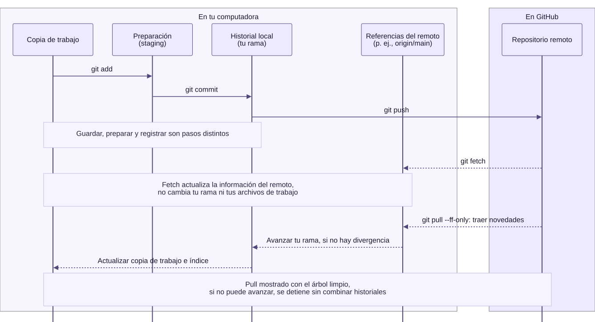

# 00.03 — Git: historial y actualización del perfil

<a id="03--git-historial-y-actualización-del-perfil"></a>

[Inicio](../../../README.md) / [Módulo 00](../README.md) / **Lección 00.03**

| Tu sesión | Qué prepararás o comprobarás |
| --- | --- |
| **Meta** | Conservar una actualización y distinguir archivo guardado, commit y publicación |
| **Necesitas** | Git; cuenta de GitHub y repositorio del perfil solo para publicar |
| **Evidencia** | Diff revisado, commit local y nota; comprobación remota si publicas |

[Preparación](#antes-de-empezar) · [Material de apoyo](#material-de-apoyo) · [Glosario](#glosario) · [Ir al lab](../../../labs/00_getting_started/03_git_workflow/README.md) · [Comprobar](#evidencia-y-criterio-de-salida)

## Propósito

Conservar una actualización del README comprendiendo cada paso y publicarla
si eliges el recorrido con GitHub.
Esta base servirá después para guardar tus scripts, consultas y documentación
junto con una explicación de sus cambios.

<a id="prerrequisitos"></a>

## Antes de empezar

Completa [Markdown y perfil](../01_github_profile/README.md) y
[terminal y rutas](../02_terminal_paths/README.md). Necesitas Git instalado;
no necesitas Python, pip ni uv. Primero ejecuta `git --version` en tu terminal.
Si no se reconoce el comando, utiliza con quien te acompaña la
[guía oficial de instalación de Git](https://git-scm.com/book/en/v2/Getting-Started-Installing-Git)
para tu sistema. En Windows, la distribución habitual es Git for Windows;
en macOS y Linux la guía explica sus opciones. Tras instalar, abre una terminal
nueva y repite la comprobación. No instales otra copia si el comando ya funciona.

Elige un recorrido después de leer el apartado 1:

| Recorrido | Qué necesitas | Por dónde continuar |
| --- | --- | --- |
| Actualizar tu perfil y publicarlo | Git, cuenta de GitHub y README del perfil creado en 00.01 | Apartados 2–7 |
| Practicar Git solo en tu equipo | Git y una carpeta nueva de práctica; no requiere cuenta ni conexión para los comandos locales | [Alternativa local sin GitHub](#alternativa-local-sin-github) |

Haber descargado **DS Track como ZIP** no impide usar Git en otro proyecto.
El ZIP trae los archivos, pero no el historial Git del repositorio. En esta
lección trabaja fuera de DS Track: clona tu perfil o crea la carpeta de práctica.
Si todavía no puedes preparar Git, lee los ejemplos y registra la ejecución
como pendiente; leerlos no equivale a haber creado un commit.

<a id="objetivos"></a>

## Qué vas a aprender

- Distinguir guardar un archivo, preparar cambios, hacer commit y publicar.
- Preparar una copia de trabajo: clonar el perfil o iniciar un repositorio local nuevo.
- Revisar los cambios y registrar una modificación; si publicas, comprobar el resultado en GitHub.
- Retomar una sesión reconociendo el estado del repositorio.

## Material de apoyo

| Recurso | Para qué sirve | Uso |
| --- | --- | --- |
| [Plantilla del perfil](../../../templates/github-profile/PROFILE.md) | Consultar la presentación que adaptaste en 00.01 | Consulta opcional |
| [Lección de Markdown](../01_github_profile/README.md) | Retomar cómo editar y previsualizar el README | Apoyo previo |
| [Diagrama de las áreas de Git](git-areas.svg) | Seguir los comandos entre áreas locales y remoto | Consulta visual; disponible también a tamaño completo |

Abre cada recurso cuando aparezca en el recorrido. Conserva los originales y
trabaja las modificaciones en tu copia personal.

## 1. Entender el recorrido de un cambio

### Qué problema resuelve Git

Imagina que guardas `reporte_final`, `reporte_final2` y `reporte_ahora_si`.
¿Cuál contiene la corrección? ¿Qué cambió respecto al anterior? Git permite
mantener los archivos de trabajo y registrar versiones en un historial, con
autor, fecha y mensaje. El mensaje debe explicar la intención: Git no sabe
por sí solo por qué tomaste una decisión ni si el resultado es correcto.

Git conserva el historial de los archivos que registras. Si modificas una
explicación o corriges un script, puedes consultar qué cambió y por qué.
El repositorio local está en tu computadora; el remoto está alojado en GitHub.

El recorrido general es editar y guardar → preparar → registrar en el historial
→ publicar, si tienes un remoto. Cada paso tiene una comprobación distinta:

| Momento | Qué ocurre | Cómo lo compruebas |
| --- | --- | --- |
| Archivo guardado | Tu editor escribe la modificación en el archivo local | `git diff` muestra cambios sin preparar en archivos ya registrados |
| Cambio preparado | Seleccionas lo que incluirá el próximo commit | `git diff --staged` muestra esa selección |
| Commit creado | Git registra los cambios preparados en el historial local | `git log --oneline -1` muestra el último commit |
| Publicación completada | Los commits se envían al remoto | Compruebas el archivo y el historial en GitHub |

El **área de preparación** es la selección de cambios para el próximo commit.
No es una publicación. Un commit tiene un identificador y un mensaje; el mensaje
explica la intención, por ejemplo «Agrega mis objetivos de aprendizaje».

### Las áreas por las que pasa un cambio



[Abrir el diagrama a tamaño completo](git-areas.svg) · [Fuente editable en Mermaid](git-areas.mmd)

**Lectura del diagrama:** editas en tu copia de trabajo; `add` prepara la
versión que quieres registrar y `commit` la incorpora al historial local.
Si eliges publicar, `push` envía los commits al remoto. En la práctica sin
GitHub llegas hasta el historial local. El área de preparación no es una
carpeta donde debas mover manualmente el README: Git mantiene esa selección.

Las flechas representan acciones, no el traslado del archivo: tu README sigue
en la copia de trabajo después del commit. Si vuelves a editarlo, esa nueva
edición no cambia lo que ya preparaste ni los commits anteriores.

La cuarta columna también está **en tu computadora**: contiene referencias
como `origin/main`, que recuerdan el estado conocido de una rama del remoto.
No es otro repositorio remoto ni una consulta en vivo a GitHub. `origin` es el
nombre habitual del remoto y `main` es un ejemplo de nombre de rama; el tuyo
puede ser distinto.

La parte inferior es una anticipación para cuando retomes el trabajo:
[`fetch`](https://git-scm.com/docs/git-fetch) trae novedades y actualiza esas
referencias sin modificar tu rama ni tus archivos de trabajo. En cambio,
[`pull --ff-only`](https://git-scm.com/docs/git-pull) trae las novedades y trata
de avanzar tu rama; si puede, actualiza también la copia de trabajo y el índice
(el área de preparación). Si los historiales divergen, se detiene sin combinarlos.
En esta práctica se usa con el árbol limpio, como explica el apartado 7;
no necesitas ejecutar fetch por separado antes de pull.

- `git diff` compara la copia de trabajo con el área de preparación: muestra
  cambios sin preparar en archivos seguidos.
- `git diff --staged` compara el área de preparación con el último commit:
  muestra lo que registrarías en el siguiente. Antes del primer commit,
  muestra el contenido nuevo preparado.

Ambas comparaciones son locales: no comprueban por sí solas qué se publicó
en GitHub. Un archivo nuevo no seguido aparece en `git status`, pero su
contenido aún no aparece en `git diff`.

> **Para conversar:** si guardas el README y cierras el editor, ¿ya existe un
> commit? ¿La copia de GitHub cambió?

### Usos cercanos al trabajo con datos

Puedes conservar versiones de un script que genera reportes, una consulta SQL
o las instrucciones para reconstruir una entrega. La revisión permite preguntar
«¿qué regla cambió?» antes de ejecutar la nueva versión.

Git también puede guardar versiones de libros de Excel, pero su comparación
habitual no muestra cambios de celdas ni de macros como un diff de texto.
Para revisar código VBA, una posibilidad posterior es exportar sus módulos
como texto. No necesitas hacerlo aquí ni añadir archivos grandes para practicar.
Guardar versiones tampoco comprueba las fórmulas ni sustituye una copia de respaldo.

## 2. Clonar el perfil una sola vez

Abre la terminal en la carpeta donde guardas tus proyectos, fuera de `ds_track`.
Sustituye `TU_USUARIO` por tu usuario real en ambos lugares de la URL y en `cd`.
Estos comandos de Git funcionan en PowerShell y Bash/Zsh; `cd` también está
disponible en ambos.

```text
# Comprueba que Git está disponible
git --version

# Descarga los archivos y el historial del perfil en una carpeta nueva
git clone https://github.com/TU_USUARIO/TU_USUARIO.git

# Entra en la carpeta creada por clone
cd TU_USUARIO

# Consulta el estado de esa copia local
git status

# Comprueba la dirección del remoto
git remote -v
```

`clone` configura normalmente el remoto con el nombre `origin`. Sus direcciones
para lectura (fetch) y publicación (push) deben corresponder a tu perfil.
Como el repositorio ya contiene un README, no necesitas ejecutar `git init`.
Si ya lo clonaste, entra en esa carpeta; no vuelvas a clonarlo en cada sesión.

Antes de editar, `git status` debería indicar que no hay cambios pendientes
(`working tree clean`). La descarga de un repositorio público puede funcionar
sin iniciar sesión; publicar requiere autenticarte con una cuenta con permiso.
Si te pide autenticación, sigue el método de inicio de sesión de tu instalación.
La contraseña de tu cuenta no se usa como contraseña de Git por HTTPS.

## 3. Configurar la identidad del autor

Dentro del repositorio, consulta la configuración:

```text
git config user.name
git config user.email
```

Si no hay un valor o quieres utilizar otro en este repositorio, sustituye los
marcadores antes de ejecutar:

```text
# Configura la identidad solo para este repositorio
git config user.name "TU_NOMBRE"
git config user.email "TU_CORREO_DE_AUTOR"
```

Usa un correo verificado de tu cuenta o el correo privado `noreply` que GitHub
muestra en sus ajustes de correo. La identidad queda en los commits; configurar
nombre y correo no inicia sesión ni concede permisos para publicar.

## 4. Editar y revisar antes de preparar

Abre el `README.md` de la carpeta clonada en tu editor, agrega o concreta un
objetivo real y guarda el archivo. Por ejemplo, una frase podría pasar de:

```text
Quiero aprender SQL.
```

a:

```text
Quiero consultar ventas con SQL y comprobar los totales.
```

Adapta tu propio objetivo; no necesitas reemplazar todo el perfil por este
ejemplo. Vuelve a la terminal de esa misma carpeta:

```text
# Identifica los archivos modificados
git status

# Revisa la diferencia respecto a lo que está preparado
git diff
```

El README aparecerá como modificado, todavía sin preparar. El **diff** es una
comparación de los cambios. En su contenido,
las líneas con `+` muestran adiciones y las que tienen `-` muestran eliminaciones.
Para el ejemplo, este sería el fragmento de contenido cambiado:

```diff
-Quiero aprender SQL.
+Quiero consultar ventas con SQL y comprobar los totales.
```

Git también muestra encabezados con nombres de archivo y posiciones; aquí
solo se presenta el fragmento para reconocer la frase anterior y la nueva.
Esos signos describen la diferencia; no forman parte del archivo.
Si aparece un visor con `(END)`, pulsa `q` para volver a la terminal.

## 5. Seleccionar y registrar el cambio

```text
# Prepara únicamente el README
git add README.md

# Comprueba la selección que incluirá el commit
git diff --staged
git status

# Registra esa selección con un mensaje que explique el cambio
git commit -m "Agrega mis objetivos de aprendizaje"

# Comprueba el último commit y el estado local
git log --oneline -1
git status
```

Después de `add`, el archivo aparece entre los cambios preparados
(`Changes to be committed`). Después del commit, ya no queda modificado si no
hiciste nuevas ediciones. Puede aparecer que tu rama (la línea de trabajo
del historial que estás usando) está por delante de
`origin`: el commit existe localmente y todavía falta publicarlo.

`git add README.md` selecciona un archivo concreto. No necesitas preparar toda
la carpeta con `git add .`. Si editas el README después de prepararlo, vuelve a
revisar y preparar la nueva edición antes del commit.

### El mismo cambio en tres momentos

| Momento | Qué deberías observar | Qué significa |
| --- | --- | --- |
| Después de guardar, antes de add | `git status` informa cambios sin preparar y `git diff` muestra la frase anterior y la nueva | El archivo cambió; todavía no seleccionaste esa edición |
| Después de add, antes del commit | `git diff --staged` muestra ese cambio; `git diff` queda vacío si no editaste otra vez | La edición está preparada, pero aún no registrada en un commit |
| Después del commit | `git log --oneline -1` muestra su identificador y mensaje; el estado queda limpio si no hay más cambios | La edición quedó en el historial local; publicar es otro paso |

**Predice antes de probar:** si editas y guardas otra frase después de `git add`,
¿entrará automáticamente en el commit?

<details>
<summary>Ver explicación del cambio posterior a add</summary>

No. El commit toma lo que preparaste. La nueva edición queda sin preparar
hasta que vuelvas a revisarla y hagas `git add README.md` otra vez. Un archivo
puede tener cambios preparados y sin preparar al mismo tiempo; contrasta
`git diff --staged` con `git diff`. No necesitas provocar ese caso para avanzar.

</details>

## 6. Publicar y comprobar

```text
# Envía los commits pendientes al remoto configurado
git push

# Consulta el estado después de publicar
git status
```

Abre tu repositorio en GitHub y comprueba la frase en el README y el mensaje en
su historial de commits. Después visita tu perfil. El commit publicado debe
coincidir con el que consultaste localmente.

> **Para comprobar:** ¿qué comando conserva el cambio localmente y cuál lo
> publica? ¿Cómo demostrarías que ocurrió cada acción?

## 7. Retomar el trabajo otro día

Entra en la carpeta que ya clonaste y consulta `git status`. Si no hay cambios
locales pendientes, trae las novedades que pudieron hacerse desde la web:

```text
# Revisa el estado antes de traer cambios
git status

# Actualiza la copia local si puede avanzar sin combinar historiales divergentes
git pull --ff-only
```

Si no hubo cambios remotos, puede indicar `Already up to date`.
Después repite editar → revisar → preparar → commit → push.
Si hay ediciones sin guardar en un commit o el comando indica que no puede
avanzar, revisa lo pendiente con quien te acompaña antes de continuar.

## Alternativa local sin GitHub

Este recorrido practica el historial sin publicar. No necesitas hacer también
el recorrido del perfil ni crear un remoto.

1. Crea con el explorador una carpeta **nueva y vacía**, por ejemplo
   `practica_git`, fuera de DS Track y de otros repositorios. Abre tu terminal
   en ella como aprendiste en 00.02. Aquí sí iniciarás un repositorio nuevo:

   ```text
   git --version
   git init
   git status
   ```

2. Configura el autor solo en esta carpeta. Sustituye los marcadores por tus
   datos; el correo identifica el commit, no es una contraseña ni inicia sesión.

   ```text
   git config user.name "TU_NOMBRE"
   git config user.email "TU_CORREO_DE_AUTOR"
   ```

3. En el editor, crea y guarda **README.md** dentro de esa carpeta con este texto:

   ```markdown
   # Mi práctica de Git

   Quiero aprender SQL.
   ```

4. Registra una primera versión:

   ```text
   git status
   git add README.md
   git diff --staged
   git commit -m "Agrega presentación inicial"
   ```

   Antes de add, el archivo es **no seguido** (`untracked`): todavía no está
   registrado por Git. `git diff` no muestra por defecto el contenido de esos
   archivos nuevos; `git status` sí los señala. Después de add puedes revisar
   todo el contenido nuevo con `git diff --staged`.

5. En el editor, cambia la frase por «Quiero consultar ventas con SQL y comprobar
   los totales.», guarda y ejecuta un comando a la vez:

   ```text
   git status
   git diff
   git add README.md
   git diff --staged
   git commit -m "Concreta mi objetivo de SQL"
   git log --oneline -2
   git status
   git remote -v
   ```

**Resultado esperado:** el diff muestra la frase anterior y la nueva; el
historial tiene dos commits y el estado queda limpio. Sus identificadores
dependen de tu ejecución. `git remote -v` no muestra direcciones porque no
configuraste ninguna. El nombre inicial de la rama puede variar según tu Git;
no necesitas cambiarlo para esta práctica.

No ejecutes `push` ni `pull` aquí. Otro día entra en esta misma carpeta y consulta
`git status` y `git log --oneline -2` para retomar. Conserva tu nota con los dos
identificadores y explica por qué esos commits todavía solo existen localmente.
Después realiza la variante local del lab.

## Cuando algo no funciona

| Situación | Qué revisar |
| --- | --- |
| `not a git repository` | Estás fuera de la carpeta clonada; comprueba tu ubicación |
| Git no conoce tu identidad | Configura nombre y correo dentro del repositorio |
| `nothing to commit` | Comprueba si guardaste el archivo correcto y preparaste su cambio |
| `git diff` está vacío después de add | Revisa `git diff --staged`: el cambio ya puede estar preparado |
| Un README nuevo no aparece en `git diff` | Consulta `git status`; si es no seguido, revisa su contenido en el editor y después con `git diff --staged` al prepararlo |
| `push` pide autenticación o rechaza permisos | Confirma tu cuenta y la URL con `git remote -v` |
| `push` rechaza cambios por novedades remotas | Consulta el estado; con el árbol limpio prueba `git pull --ff-only` y vuelve a publicar si tuvo éxito |

Si la actualización no puede avanzar, revisa el mensaje con quien te acompaña.
No uses `--force` para resolverlo. Ramas de trabajo, conflictos y pull requests
se estudiarán después; esta lección se centra en una actualización sencilla.

<a id="práctica-y-criterio-de-salida"></a>

## Práctica

Realiza el [lab 00.03](../../../labs/00_getting_started/03_git_workflow/README.md)
para modificar un README y revisar su historial en el recorrido que elegiste.

## Evidencia y criterio de salida

| Conserva | Comprueba | Explica |
| --- | --- | --- |
| README actualizado y commit del perfil | Diff preparado, último commit y versión publicada | Por qué guardar, preparar, registrar y publicar son pasos distintos |
| Si elegiste la práctica local: README y dos commits | Diferencia de la segunda edición, historial local y ausencia de remoto | Por qué puedes usar Git sin GitHub y qué parte no realizaste |
| Nota para retomar la sesión | Ubicación, estado del repositorio y remoto correcto | Cómo reconocer lo pendiente antes de actualizar |

Puedes cerrar el recorrido elegido cuando registres una modificación, expliques
guardar frente a preparar y hacer commit, y compruebes la selección y el historial.
En el perfil, añade la comprobación del commit publicado en GitHub. En la práctica
local, explica que no hubo publicación y que no hay remoto configurado.
Si todavía no tienes Git, registra la ejecución pendiente; no declares un commit
que no realizaste. Descargar DS Track como ZIP no determina qué recorrido elegir.

Quien aprende realiza la práctica y explica el resultado. Tu compañero pide identificar en qué copia está un cambio antes y después de publicarlo.
Guarda evidencia y dudas en tu copia de la
[bitácora personal de 00](../../../templates/learning-session/bitacora-00.md)
o en una nota propia. PROGRESS.md registra el desarrollo editorial del curso.
Todavía no hay proyecto de datos ni checkpoint asociado a esta lección.

## Glosario

| Término | Qué significa en esta lección |
| --- | --- |
| Repositorio | Archivos de un proyecto junto con el historial registrado por Git |
| Clonar | Crear una copia local de un repositorio existente, incluido su historial |
| Inicializar | Crear la estructura de Git para empezar un repositorio; aquí solo en la carpeta nueva de práctica |
| Copia de trabajo | Archivos que tienes disponibles para leer y editar en tu computadora |
| No seguido (untracked) | Archivo que Git todavía no ha incorporado a su seguimiento |
| Área de preparación (staging) | Selección de cambios que incluirá el próximo commit |
| Diff | Comparación que muestra diferencias entre versiones o estados de archivos |
| Commit | Registro de los cambios preparados, con identificador, autor y mensaje |
| Rama | Línea de trabajo del historial; aquí utilizas la que ya tiene el repositorio |
| Remoto | Referencia a otro repositorio con el que puedes intercambiar commits |
| origin | Nombre que clone suele dar al remoto de origen; no significa GitHub en todos los proyectos |
| Referencia de seguimiento del remoto | Nombre local como `origin/main` que recuerda el estado conocido de una rama del remoto |
| Fetch | Descarga de novedades del remoto sin actualizar por sí sola la rama en la que trabajas ni sus archivos |
| Push | Envío de commits locales al remoto configurado |
| Pull | Operación para traer e integrar novedades del remoto; aquí se usa `--ff-only` para evitar una combinación de historiales divergentes |
| Estado limpio | Git no informa cambios pendientes ni archivos nuevos sin seguimiento; los archivos ignorados pueden quedar fuera de ese informe y no se comprueba que el contenido sea correcto |

Retoma [Git frente a GitHub en 00.01](../01_github_profile/README.md#2-git-y-github-conservar-y-compartir)
si necesitas distinguir la herramienta de la plataforma.

## Referencias

- [Fundamentos de Git](https://git-scm.com/book/es/v2/Fundamentos-de-Git-Obteniendo-un-repositorio-Git).
- [Configuración inicial de Git](https://git-scm.com/book/es/v2/Inicio---Sobre-el-Control-de-Versiones-Configuraci%C3%B3n-inicial-de-Git).
- [Autenticación con GitHub](https://docs.github.com/en/authentication/keeping-your-account-and-data-secure/about-authentication-to-github).
- [Instalar Git según el sistema](https://git-scm.com/book/en/v2/Getting-Started-Installing-Git).
- [Crear un repositorio con git init](https://git-scm.com/docs/git-init).
- [Qué compara git diff](https://git-scm.com/docs/git-diff).
- [Comparación de texto y archivos binarios en Git](https://git-scm.com/docs/gitattributes#_diff).

<a id="siguiente-lección"></a>

## Siguiente paso

Después del lab y su comprobación, continúa con [00.04 — Tu primer script Python](../04_first_script/README.md).

[← Módulo 00](../README.md) · [Lab 00.03](../../../labs/00_getting_started/03_git_workflow/README.md) · [Siguiente →](../04_first_script/README.md)
