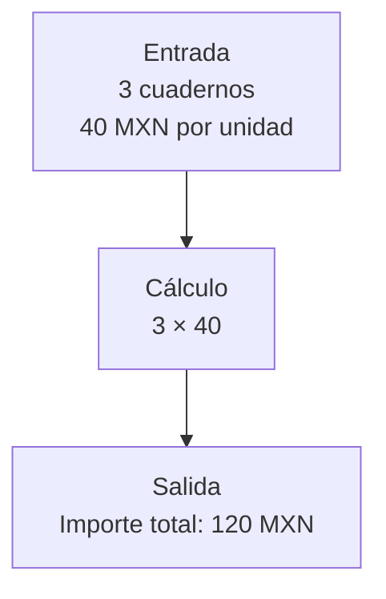

# 00.04 — Tu primer script Python

<a id="04--tu-primer-script-python"></a>

[Inicio](../../../README.md) / [Módulo 00](../README.md) / **Lección 00.04**

| Tu sesión | Qué prepararás o comprobarás |
| --- | --- |
| **Meta** | Ejecutar, modificar y comprobar un cálculo pequeño |
| **Necesitas** | Editor, terminal y Python 3; sin paquetes externos |
| **Evidencia** | Script modificado y nota con predicción, salida y error corregido |

[Preparación](#antes-de-empezar) · [Material de apoyo](#material-de-apoyo) · [Glosario](#glosario) · [Ir al lab](../../../labs/00_getting_started/04_first_script/README.md) · [Comprobar](#evidencia-y-criterio-de-salida)

## Propósito

Ejecutar un programa pequeño, comprender qué hace y modificarlo para obtener
otro resultado. Conectaremos la terminal con un cálculo de datos ficticios.

<a id="prerrequisitos"></a>

## Antes de empezar

- Haber practicado rutas y comandos en [00.02 — Terminal y rutas](../02_terminal_paths/README.md).
- Tener un editor de texto y Python 3 instalado.
- Git es opcional para conservar la modificación, como aprendiste en la lección 03.

Comprueba `python --version` o `python3 --version`. Si ninguno funciona, puedes
leer la explicación y predecir los resultados, pero la ejecución queda pendiente
hasta preparar Python. Consulta la [descarga oficial](https://www.python.org/downloads/)
con quien te acompaña. La instalación y los entornos se desarrollarán en la
lección 05. Este ejemplo no necesita pip, uv ni paquetes adicionales.

Si usarás VS Code, consulta la [guía del editor](../../../docs/vscode-guide.md)
para abrir el proyecto, guardar archivos y utilizar la terminal integrada.

<a id="objetivos"></a>

## Qué vas a aprender

- Distinguir un archivo `.py`, el editor y el intérprete de Python.
- Preparar una copia personal del script y ejecutarla desde su carpeta.
- Reconocer datos de entrada, un cálculo y la salida.
- Cambiar un valor, predecir el resultado y comprobarlo.

## Material de apoyo

| Recurso | Para qué sirve | Uso |
| --- | --- | --- |
| [Script de ejemplo](first_summary.py) | Leer entradas, cálculo e impresión del importe | Para el ejemplo |
| [Guía de VS Code](../../../docs/vscode-guide.md) | Abrir el proyecto, guardar y utilizar la terminal integrada | Apoyo opcional |

Abre cada recurso cuando aparezca en el recorrido. Conserva los originales y
trabaja las modificaciones en tu copia personal.

## 1. Qué es Python y qué es un script

Python es un lenguaje de programación. Escribes instrucciones en un archivo
de texto y el intérprete de Python las ejecuta. Un **script** es un programa
que puedes ejecutar; `.py` es la extensión habitual de su código fuente.

| Elemento | Su papel en esta práctica |
| --- | --- |
| Editor | Escribir y guardar el código |
| Archivo `first_summary.py` | Conservar las instrucciones |
| Terminal | Pedir la ejecución y ver su resultado |
| Intérprete `python` | Leer y ejecutar las instrucciones |

Guardar el archivo no ejecuta el programa. Ejecutarlo tampoco crea un commit:
son acciones distintas, como guardar y publicar el README en la lección anterior.

### Para qué sirve guardar un cálculo en un script

Imagina que hoy calculas el importe de tres cuadernos y mañana cambian las
unidades. Un script conserva los pasos para repetir el cálculo con otras
entradas y comprobar cómo se obtuvo el resultado. No tienes que reconstruir
las instrucciones de memoria cada vez.

Si conoces las macros de Excel, la idea de repetir instrucciones te resultará
familiar. Aquí las instrucciones están en un archivo Python y las ejecuta
su intérprete; no necesitas abrir Excel. Guardar los pasos ayuda a repetirlos,
pero no garantiza que la fórmula o los datos sean correctos: también los comprobarás.

## 2. Leer el ejemplo antes de ejecutarlo

Abre [first_summary.py](first_summary.py) para leerlo. Este es su contenido
completo, incluido todo lo que mostrará en la terminal:

```python
"""Primer resumen con datos ficticios, sin paquetes externos."""

# Datos de entrada: unidades vendidas de un mismo producto.
producto = "cuaderno"
unidades = 3
precio_unitario_mxn = 40

# Transformación: calcular el importe de la venta.
importe_mxn = unidades * precio_unitario_mxn

# Salida: mostrar el resultado en la terminal.
print("Mi primer resumen de datos")
print(f"Producto: {producto}")
print(f"Unidades: {unidades}")
print(f"Precio unitario: {precio_unitario_mxn} MXN")
print(f"Importe total: {importe_mxn} MXN")
```

Una **variable** da un nombre a un valor. `=` asigna ese valor; no representa una
pregunta de igualdad. El texto va entre comillas y los números de este ejemplo
se escriben sin comillas. `*` multiplica. Las líneas con `#` son comentarios.
La primera línea, entre comillas triples, documenta el propósito del archivo;
no imprime el texto ni realiza el cálculo.

`print(...)` muestra información. En una cadena con prefijo `f`, las llaves
insertan valores: `{importe_mxn}` se reemplaza por el resultado del cálculo.
El programa ejecuta estas instrucciones en orden, de arriba hacia abajo.

Aquí las entradas están escritas dentro del código; todavía no leemos un CSV
ni solicitamos datos al usuario. Cada ejecución usa esos valores y calcula de nuevo.

> **Antes de ejecutar:** ¿cuánto debería valer `importe_mxn`? ¿Qué unidad tiene?

### Entrada, cálculo y salida en este ejemplo



**Lectura del esquema:** `unidades` y `precio_unitario_mxn` aportan los valores;
la multiplicación calcula `importe_mxn` y `print` lo muestra. `producto` da
contexto a la venta, pero no interviene en esa multiplicación. Cambiar solo el
nombre del producto cambia su etiqueta, no el importe.

## 3. Ejecutar desde la terminal

### Preparar la copia que vas a ejecutar

1. Con el explorador de archivos, crea una carpeta personal, por ejemplo
   `practica_00_04`, fuera de la copia compartida de DS Track.
2. Copia allí el archivo [first_summary.py](first_summary.py), conservando el
   nombre y su extensión `.py`. Si lo creas desde el editor con el bloque
   anterior, guarda como texto UTF-8 y comprueba que no se llame `.py.txt`.
3. Abre **esa copia personal** en el editor. El archivo de la carpeta
   `curriculum/00_getting_started/04_first_script` queda como referencia.
4. Abre una terminal en tu carpeta personal, siguiendo el
   [recorrido de 00.02](../02_terminal_paths/README.md). Elige abajo el shell
   que utilizas; no necesitas completar ambos.

En esta práctica, editor y terminal deben apuntar a la **misma copia**.
Ejecutarás `first_summary.py` desde la carpeta que lo contiene, no desde la
raíz de DS Track. No copies las marcas de los bloques Markdown ni escribas
el código Python en PowerShell o Bash: el código va en el archivo `.py`.

### PowerShell

Desde tu carpeta personal, la que contiene la copia:

```powershell
# Confirma tu ubicación
Get-Location
# Comprueba que el script existe
Test-Path first_summary.py
# Ejecuta el archivo con Python
python first_summary.py
```

### Bash/Zsh

Desde tu carpeta personal, la que contiene la copia:

```bash
# Confirma tu ubicación
pwd
# Comprueba el archivo
test -e first_summary.py && echo "existe"
# Ejecuta el archivo con Python
python3 first_summary.py
```

Si tu instalación utiliza `python` en lugar de `python3`, sustituye el nombre
del ejecutable. El código del archivo es el mismo en ambos sistemas.
Si aparece el indicador `>>>`, abriste Python en modo interactivo: escribe
`exit()` para volver al shell y ejecuta el comando completo con el nombre del archivo.

### Resultado esperado

```text
Mi primer resumen de datos
Producto: cuaderno
Unidades: 3
Precio unitario: 40 MXN
Importe total: 120 MXN
```

El script muestra texto en la terminal. No crea un archivo de resultados ni
modifica el CSV de la lección 02.

## 4. Modificar, guardar y comprobar

1. En tu copia personal, cambia `unidades = 3` por `unidades = 5` en el editor.
2. Predice el nuevo importe antes de ejecutar.
3. Guarda el archivo y repite el comando de tu shell.
4. Comprueba que ahora aparecen cinco unidades y un importe de 200 MXN.

Modifica un valor a la vez para relacionar causa y resultado. Un cálculo que
termina sin error también puede estar equivocado: compáralo con tu predicción.

## 5. Leer un error sin perder el hilo

| Situación | Qué revisar |
| --- | --- |
| Comando no reconocido | Si Python está instalado y qué nombre tiene |
| `can't open file` | Ubicación, ruta y nombre del archivo |
| `SyntaxError` | La línea indicada: comillas, paréntesis y otros signos |
| `NameError` | Si escribiste el mismo nombre de variable y lo definiste antes |
| Sigue apareciendo el resultado anterior | Si guardaste el archivo y ejecutaste la copia correcta |

Como experimento, cambia una vez `unidades` por `unidadess` en la línea del
cálculo. Ejecuta, identifica el error y corrige el nombre. Vuelve a ejecutar
para confirmar que recuperaste el resultado esperado.

### Cómo leer ese error

El mensaje puede parecerse a este; la ruta y las marcas de posición dependen
de tu archivo y versión de Python:

```text
Traceback (most recent call last):
  File ".../first_summary.py", line 9, in <module>
    importe_mxn = unidadess * precio_unitario_mxn
NameError: name 'unidadess' is not defined
```

Léelo en este orden:

1. **Última línea:** `NameError` indica un nombre que Python no puede resolver.
   Aquí señala `unidadess`.
2. **Archivo y línea:** `File` y `line 9` te dicen dónde revisar; si añadiste
   líneas, el número puede cambiar. Confirma que es tu copia personal.
3. **Instrucción señalada:** compara `unidadess` con `unidades`, el nombre
   definido arriba. Corrígelo en el editor, guarda y vuelve a ejecutar.

Python puede añadir una sugerencia del nombre correcto. En este caso el error
detiene el programa antes de los `print`: no se produce un nuevo resumen válido.
Las salidas de ejecuciones anteriores pueden seguir visibles en la terminal;
no las confundas con el intento que falló.

## 6. De este ejemplo a la manipulación de datos

El patrón es **entrada → transformación → salida**. Más adelante las entradas
vendrán de CSV o bases de datos, las transformaciones operarán sobre muchos
registros y las salidas podrán ser tablas o reportes. Primero necesitamos poder
ejecutar y explicar un cálculo pequeño.

El verificador de la lección 02 es otro script, pero incorpora funciones,
importaciones y búsqueda de rutas. Por ahora observa que también termina
mostrando información; estudiaremos esos conceptos en Python fundamental.

<a id="práctica-y-criterio-de-salida"></a>

## Práctica

Realiza el [lab 00.04](../../../labs/00_getting_started/04_first_script/README.md) para cambiar entradas, anticipar importes y reconocer un error.

## Evidencia y criterio de salida

| Conserva | Comprueba | Explica |
| --- | --- | --- |
| Tu copia del script modificado | Resultado calculado manualmente y ejecución de la copia guardada | Qué son entrada, transformación y salida |
| Una nota sobre el error provocado y corregido | La nueva ejecución recupera el resultado esperado | Diferencia entre editor, archivo, terminal e intérprete |

Puedes avanzar cuando ejecutes el script, modifiques sus entradas, compruebes
el cálculo y expliques entrada, transformación y salida con tus palabras.
Leer la explicación sin ejecutar no sustituye esa comprobación.

Quien aprende realiza la práctica y explica el resultado. Tu compañero cambia una cantidad y te pide anticipar el importe y comprobar qué archivo ejecutaste.
Guarda evidencia y dudas en tu copia de la
[bitácora personal de 00](../../../templates/learning-session/bitacora-00.md)
o en una nota propia. PROGRESS.md registra el desarrollo editorial del curso.
Todavía no hay proyecto de datos ni checkpoint asociado a esta lección.

## Glosario

| Término | Qué significa en esta lección |
| --- | --- |
| Script | Programa guardado en un archivo que puedes volver a ejecutar |
| Código fuente | Instrucciones escritas como texto; aquí, el contenido del archivo `.py` |
| Intérprete | Programa que ejecuta las instrucciones Python; lo inicias con `python` o `python3` |
| Variable | Nombre asociado a un valor, como `unidades` a `3` |
| Asignación | Instrucción con `=` que asocia un valor a un nombre |
| Cadena de texto | Valor textual escrito entre comillas, como `"cuaderno"` |
| Comentario | Texto que empieza con `#` en el ejemplo y explica el código sin ejecutarse |
| Entrada | Datos de partida; aquí están escritos dentro del archivo |
| Transformación | Operación que obtiene un resultado a partir de entradas; aquí, multiplicar unidades por precio |
| Salida | Información que produce el programa; aquí se muestra en la terminal |
| `print(...)` | Llamada que muestra información en la terminal; en este ejemplo, texto y valores calculados |
| Cadena f | Texto con prefijo `f` que inserta valores dentro de llaves |
| Traceback | Mensaje que muestra dónde ocurrió un error durante la ejecución |
| `NameError` | Error al utilizar un nombre que Python no encuentra definido |

Para editor, terminal y shell, consulta el [glosario de 00.02](../02_terminal_paths/README.md#glosario).

## Referencias

- [Introducción a Python](https://docs.python.org/es/3/tutorial/introduction.html).
- [Uso del intérprete](https://docs.python.org/es/3/tutorial/interpreter.html).
- [Cómo leer errores de Python](https://docs.python.org/es/3/tutorial/errors.html).

<a id="siguiente-lección"></a>

## Siguiente paso

Después del lab y su comprobación, continúa con [00.05 — Entornos y dependencias](../05_environment/README.md).

[← Módulo 00](../README.md) · [Lab 00.04](../../../labs/00_getting_started/04_first_script/README.md) · [Siguiente →](../05_environment/README.md)
