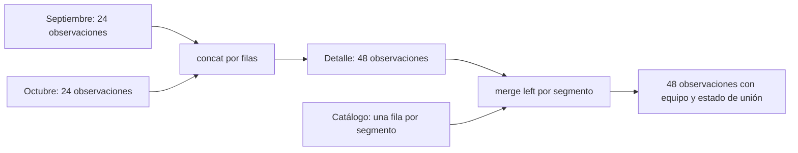
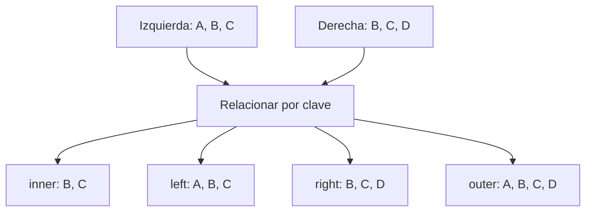
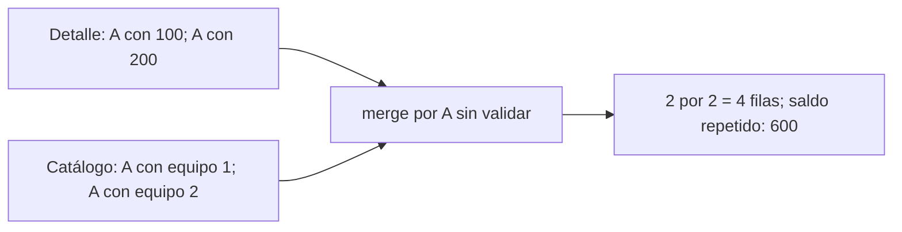

# 08 — Combinar tablas

## Propósito, prerrequisitos y objetivos

Combinar registros y agregar información de otra tabla sin multiplicar filas ni
perder importes inadvertidamente. Completa [Agrupar y resumir](../07_group_summarize/README.md)
y su lab; usa el mismo entorno con pandas 2.3.3.

Al terminar podrás distinguir concat de merge, elegir claves y tipo de unión,
validar cardinalidad y conservar registros sin coincidencia. Los diagramas Mermaid
se muestran en GitHub; en un editor sin soporte también puedes leer las tablas
y explicaciones que los acompañan.

## 1. Dos necesidades diferentes

| Pregunta | Operación | Qué debes comprobar |
| --- | --- | --- |
| ¿Cómo reunir observaciones de dos cortes? | concat por filas | Columnas, tipos y clave completa |
| ¿Cómo agregar el equipo asociado a un segmento? | merge por clave | Unicidad del catálogo y coincidencias |
| ¿Cómo comparar el saldo de un ID entre cortes? | merge por ID sobre dos tablas de corte | Una fila por ID en cada corte |

No combinamos por posición visual: la primera fila de una tabla no tiene por qué
corresponder a la primera de otra. Cada operación responde una pregunta y tiene
un contrato de filas distinto.



concat apila observaciones. merge relaciona sus claves con el catálogo para
agregar columnas. En este ejemplo el merge conserva 48 filas porque elegimos
left y exigimos que el catálogo tenga como máximo una coincidencia por segmento.

## 2. Entradas y claves de esta práctica

Reutilizamos [cartera_resumen.csv](../07_group_summarize/cartera_resumen.csv): 48
observaciones sintéticas de 24 IDs en septiembre/octubre, con saldos y segmentos
faltantes documentados en 07. No duplicamos ni modificamos esa fuente.

Añadimos [catalogo_segmentos.csv](catalogo_segmentos.csv), con cuatro filas:

| segmento | equipo ficticio |
| --- | --- |
| consumo | equipo_A |
| servicios | equipo_B |
| comercio | equipo_C |
| agricultura | equipo_D |

Educación no está en el catálogo; hay observaciones sin segmento. Agricultura
está en el catálogo, pero no tiene observaciones en el detalle. Es deliberado:
permite comprobar coincidencias en ambos sentidos.

El catálogo es estático para esta práctica. Si la asignación de equipo cambiara
con el tiempo, necesitarías una clave temporal o una regla de vigencia; unir
únicamente por segmento no demostraría que el equipo corresponde a ese corte.

| Tabla | Unidad de fila | Clave |
| --- | --- | --- |
| Detalle de ambos cortes | Crédito observado en una fecha | id_credito + fecha_corte |
| Catálogo | Asignación de equipo a un segmento | segmento |
| Un solo corte | Crédito observado en ese corte | id_credito, dentro de ese corte |

## 3. concat: apilar registros compatibles

```python
septiembre = fuente.loc[fuente["fecha_corte"] == pd.Timestamp("2026-09-30")].copy()
octubre = fuente.loc[fuente["fecha_corte"] == pd.Timestamp("2026-10-31")].copy()
detalle = pd.concat([septiembre, octubre], ignore_index=True)
```

concat con su eje predeterminado axis=0 apila filas. ignore_index=True crea
etiquetas consecutivas; no cambia id_credito ni detecta claves duplicadas.
El [script completo](combine_tables.py) comprueba columnas y tipos de ambas
partes, y vuelve a comprobar la clave después de apilarlas.

Por defecto concat alinea las columnas por nombre y puede conservar columnas
presentes solo en una parte, dejando faltantes en la otra. join="inner" conservaría
solo columnas comunes; no lo uses para ocultar un campo inesperado. Nuestro
contrato exige exactamente el mismo esquema en ambas partes.

Concatenar septiembre dos veces produce observaciones duplicadas, aunque el
índice nuevo sea único. verify_integrity de concat comprueba etiquetas del eje
concatenado; no sustituye duplicated sobre la clave de negocio.

axis=1 coloca columnas lado a lado alineando índices. Es útil en otros casos,
pero **no relaciona automáticamente IDs** y puede desalinear datos si los índices
representan filas distintas. Para relacionar claves de columnas utilizamos merge.

## 4. merge: declarar con qué campos relacionar

```python
enriquecido = detalle.merge(
    catalogo, on="segmento", how="left",
    validate="many_to_one", indicator="estado_union",
)
```

detalle es la tabla izquierda y catalogo la derecha. on declara la columna de
relación; how el tipo de unión; validate el contrato de multiplicidad;
indicator añade evidencia de coincidencia.

Declara on explícitamente. Si lo omites, pandas puede utilizar todos los nombres
comunes como claves, incluyendo campos que solo eran atributos. Si los nombres
de clave difieren, utiliza left_on y right_on, tras comprobar tipos y significado.

IDs "001" y 1 no son automáticamente equivalentes. Normaliza con reglas de
[02.06](../06_text_dates/README.md), conserva originales y revisa la clave después.
El índice no participa cuando se unen columnas con columnas.

## 5. inner, left, right y outer

Primero un ejemplo de claves únicas, sin duplicados ni ausencias:



| Unión | Qué conserva | Qué falta donde no hay coincidencia |
| --- | --- | --- |
| inner | Coincidencias de ambos lados | Las filas sin coincidencia quedan fuera |
| left | Filas de la izquierda y sus coincidencias | Atributos de la derecha |
| right | Filas de la derecha y sus coincidencias | Atributos de la izquierda |
| outer | Claves de ambos lados y sus coincidencias | Atributos del lado ausente |

El diagrama muestra **claves**, no garantiza esas cantidades de filas si una
clave se repite. Un left puede aumentar filas; un inner puede reducirlas o
multiplicarlas. El resultado depende también de la cardinalidad.

Con nuestra muestra y el catálogo válido:

| Unión por segmento | Filas resultantes | Saldo conocido del resultado |
| --- | --- | --- |
| left | 48 | 93900 MXN |
| inner | 40 | 83400 MXN |
| right | 41 | 83400 MXN |
| outer | 49 | 93900 MXN |

right y outer incorporan una fila de agricultura sin observación de crédito,
con saldo desconocido. No contar esa fila como un crédito observado. El saldo
de inner no es el total del detalle: excluye educación y segmentos ausentes.

## 6. Cardinalidad: cuántas coincidencias puede haber

| validate | Exigencia sobre claves de unión |
| --- | --- |
| one_to_one | Únicas a ambos lados |
| one_to_many | Únicas a la izquierda; pueden repetirse a la derecha |
| many_to_one | Pueden repetirse a la izquierda; únicas a la derecha |
| many_to_many | Permite repetición a ambos lados; no comprueba unicidad |

Muchos créditos pueden compartir consumo; el catálogo debe tener una sola fila
para consumo. Por eso elegimos many_to_one. one_to_one sería incorrecto para
este catálogo, aunque ID/corte sea una clave única del detalle.

### Cómo se multiplica una clave



| ID | Saldo | Equipo tras una unión sin validar |
| --- | --- | --- |
| A | 100 | equipo 1 |
| A | 100 | equipo 2 |
| A | 200 | equipo 1 |
| A | 200 | equipo 2 |

El detalle tenía 300, pero las coincidencias repiten cada saldo dos veces.
No surgieron nuevos créditos ni nuevos importes: se multiplicaron relaciones.
validate="many_to_one" detiene la unión ante un catálogo repetido con MergeError.
No se arregla cambiando a many_to_many ni borrando una versión sin evidencia.

Una relación uno a muchos puede ser legítima, como un crédito con varios pagos.
En ese resultado, sumar el saldo repetido por pago no conserva su unidad original.
Separa medidas y decide si necesitas primero resumir pagos por crédito/corte.

## 7. indicator: conservar evidencia de coincidencia

| Valor | Significado |
| --- | --- |
| both | La clave encontró coincidencia a ambos lados |
| left_only | Solo hay fila de la izquierda |
| right_only | Solo hay fila de la derecha |

El script utiliza el nombre estado_union. pandas crea el indicador como category;
para su exportación lo convierte a string. En nuestro left hay **40 both y 8
left_only**: seis observaciones de educación y dos sin segmento.

```python
sin_catalogo = enriquecido.loc[enriquecido["estado_union"] == "left_only"].copy()
```

Esas ocho filas conservan un saldo conocido de **10500 MXN**. No las eliminamos,
no inventamos equipo y no reemplazamos las cantidades desconocidas por cero.
Una coincidencia both tampoco garantiza que todos los atributos del catálogo
estén completos: un equipo vacío y una clave sin coincidencia son casos distintos.

Un left no puede mostrar filas exclusivas del catálogo. Para auditarlas, usa un
outer con indicador o revisa qué claves del catálogo no están en el detalle.

### Claves ausentes requieren una política

En pandas, claves nulas de ambos lados **pueden coincidir entre sí**, a diferencia
del comportamiento habitual de una unión SQL. No asumir que NA siempre queda sin
coincidencia. Nuestro catálogo prohíbe segmento ausente; las observaciones sin
segmento permanecen left_only. Si otra práctica permite claves incompletas,
sepáralas antes de unir y documenta cómo se incorporan al resultado.

## 8. Comparar cortes y elegir sufijos

Para comparar el mismo ID entre dos fechas, primero delimitamos cada corte y
unimos por ID, con validate="one_to_one". Las columnas de saldo se solapan:

```python
comparacion = septiembre[["id_credito", "saldo_mxn"]].merge(
    octubre[["id_credito", "saldo_mxn"]],
    on="id_credito", how="outer", validate="one_to_one",
    suffixes=("_sep", "_oct"), indicator="presencia",
)
comparacion["cambio_saldo_mxn"] = comparacion["saldo_mxn_oct"] - comparacion["saldo_mxn_sep"]
```

suffixes indica a qué corte pertenece cada saldo. No combinar ambos valores
rellenando el desconocido con cero. La muestra tiene **24 IDs en ambos cortes**,
pero solo **19 cambios evaluables**, porque cinco IDs carecen de al menos un saldo.
El cambio total sobre esa misma base de 19 es **2200 MXN**.

Restar directamente los totales conocidos de octubre y septiembre daría 46700 −
47200 = −500. Son bases diferentes por sus faltantes; no coincide con la suma
de cambios de los mismos 19 IDs. Antes de interpretar un cambio, acuerda población
y disponibilidad de ambos operandos.

Si faltara un ID en octubre, su presencia sería left_only; un ID nuevo sería
right_only. Esto expresa presencia en archivos, no acredita por sí solo cierre,
alta o saldo cero. No inferir eventos de negocio solo por ausencia de una fila.

## 9. Comprobar filas y valores antes de confiar en el resultado

El programa concatena 24 + 24, verifica la clave completa y asigna numero_registro
para rastrear cada observación. Después del left exige:

- Las mismas 48 observaciones y los mismos números de registro.
- Todas las columnas originales sin cambios, incluidas sus ausencias.
- El mismo saldo conocido: 93900 MXN, con seis saldos todavía desconocidos.
- Filas sin catálogo disponibles en una salida aparte.

Comparar solo una suma no detectaría todos los errores: una pérdida y una
duplicación podrían compensarse. La comparación del detalle por numero_registro
comprueba que se conservaron los valores de cada observación.

No aplicar esa igualdad de conteos a cualquier unión: inner y outer tienen otros
contratos. Primero predice qué entradas deben conservarse y qué multiplicidad es
legítima; luego verifica el resultado contra esa decisión.

## 10. Ejecutar el ejemplo

### PowerShell

Desde la raíz, con el entorno preparado:

```powershell
# Apilar, enriquecer y comparar cortes; verificar exportaciones
python curriculum\02_pandas\08_combine_tables\combine_tables.py
# Revisar observaciones que no encontraron equipo
Get-Content curriculum\02_pandas\08_combine_tables\output\sin_catalogo.csv -Encoding utf8
```

### Bash/Zsh

```bash
python curriculum/02_pandas/08_combine_tables/combine_tables.py
cat curriculum/02_pandas/08_combine_tables/output/sin_catalogo.csv
```

### uv

Con la configuración raíz:

```text
uv run --locked python curriculum/02_pandas/08_combine_tables/combine_tables.py
```

Se generan detalle_enriquecido.csv, sin_catalogo.csv y comparacion_cortes.csv.
El programa relee con tipos declarados y compara exactamente cada tabla. No hay
dependencias nuevas ni necesidad de ejecutar la lección 7 para generar la entrada:
su muestra ya está versionada.

Las salidas se reemplazan y quedan ignoradas por Git. Si falla una ejecución,
podrían quedar archivos previos o parciales; confirma las comprobaciones antes
de usar la salida. Ninguna salida debe reemplazar el detalle o el catálogo fuente.

## Ampliaciones y errores frecuentes

left_on/right_on permiten nombres de clave diferentes; una lista en on permite
claves compuestas. Para un catálogo por segmento/corte, ambos campos formarían
la relación. Unirlo solo por segmento puede multiplicar filas o mezclar vigencias.
join por índices, cross y merge_asof quedan para profundización posterior.

| Situación | Qué revisar |
| --- | --- |
| Más filas y saldo después del left | Claves repetidas del catálogo y validate |
| Equipos inesperadamente ausentes | Tipos, normalización y valores de clave |
| IDs relacionados por posición | concat axis=1 frente a merge por clave |
| Columnas _x/_y difíciles de interpretar | suffixes y selección previa de campos |
| Un catálogo incompleto pasó validate | validate verifica multiplicidad, no cobertura |
| NA encontró otro NA | Política de claves ausentes antes de la unión |

## Práctica, criterio de salida y siguiente paso

Realiza el [lab 02.08](../../../labs/02_pandas/08_combine_tables/README.md). Puedes
avanzar cuando predigas filas, justifiques claves/cardinalidad, identifiques
coincidencias faltantes y pruebes que el left conserva el detalle.
No hay checkpoint implementado; el proyecto de limpieza sigue previsto.

Continúa con el [alcance de 09 — Cambiar la forma de una tabla](../README.md#09-cambiar-la-forma-de-una-tabla),
todavía por desarrollar, antes de su futuro lab.

## Referencias oficiales

- [Merge, validate, indicator y claves nulas](https://pandas.pydata.org/pandas-docs/version/2.3/reference/api/pandas.merge.html).
- [Concat y alineación de ejes](https://pandas.pydata.org/pandas-docs/version/2.3/reference/api/pandas.concat.html).
