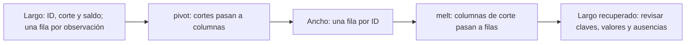
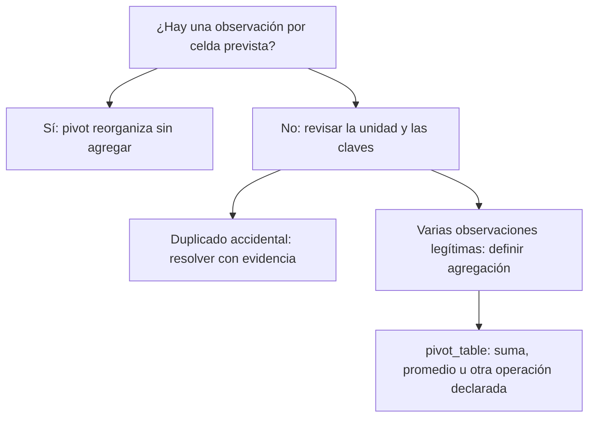
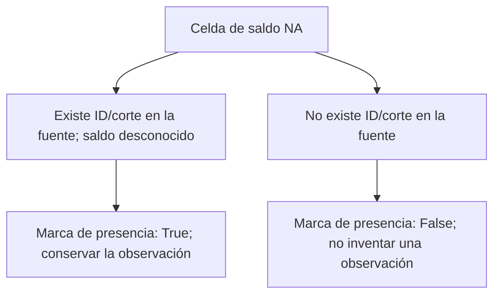

# 09 — Cambiar la forma de una tabla

## Propósito, prerrequisitos y objetivos

Pasar de formato largo a ancho y volver, conservando el significado de filas,
claves y faltantes. Completa [Combinar tablas](../08_combine_tables/README.md)
y su lab; utiliza el mismo entorno con pandas 2.3.3.

Esta sección es práctica: integra selección, tipos, agrupación y uniones. Al
terminar podrás usar pivot y melt, explicar cuándo pivot_table agrega valores y
comprobar una vuelta largo → ancho → largo. MultiIndex, stack y unstack quedan
como profundización; no son requisitos para el cierre del módulo.

## 1. Largo y ancho describen cómo se organizan las variables

En nuestra práctica, largo tiene una observación por **ID + corte**:

| id_credito | corte | saldo_mxn |
| --- | --- | --- |
| 001 | 2026-09-30 | 1100 |
| 001 | 2026-10-31 | 1300 |
| 005 | 2026-09-30 | NA |
| 005 | 2026-10-31 | 1700 |

Ancho tiene una fila por ID y una columna de saldo por corte:

| id_credito | 2026-09-30 | 2026-10-31 |
| --- | --- | --- |
| 001 | 1100 | 1300 |
| 005 | NA | 1700 |

El saldo desconocido de 005 sigue desconocido. El cambio de disposición no
completa datos, valida importes ni agrega nuevas observaciones.



Largo suele facilitar filtros, agrupaciones y gráficos por fecha. Ancho facilita
ver dos cortes lado a lado. El formato adecuado depende de la pregunta: no existe
uno que sea mejor para todos los usos.

## 2. Entrada y alcance de lo que conservamos

Reutilizamos [cartera_resumen.csv](../07_group_summarize/cartera_resumen.csv),
con sus 48 observaciones sintéticas de 24 créditos en dos cortes. No necesitas
ejecutar otra lección para producir la entrada: la muestra está versionada.

El [script completo](reshape_tables.py) crea una **proyección de tres campos**:
id_credito, corte y saldo_mxn. La comprobación de vuelta conserva esa proyección;
no reconstruye segmento ni dias_atraso porque no se incluyeron en ella. La fuente
completa permanece intacta para cualquier análisis posterior.

El campo corte se obtiene de fecha_corte con dt.strftime("%Y-%m-%d") y se almacena
como string. Son etiquetas conocidas de columnas, no fechas temporales para calcular
duraciones. La conversión de fechas se explicó en [02.06](../06_text_dates/README.md).

## 3. Una celda necesita una clave única

```python
ancho = largo.pivot(index="id_credito", columns="corte", values="saldo_mxn")
```

| Argumento | Función en este ejemplo |
| --- | --- |
| index | Qué identifica cada fila: ID |
| columns | Qué valores se convierten en columnas: cortes |
| values | Qué medida ocupa las celdas: saldo |

La combinación **ID + corte** debe identificar como máximo un valor. pivot no
elige entre dos registros para la misma celda y no calcula una suma para resolverlos:
produce ValueError si esa combinación se repite, incluso si ambos saldos son iguales.

Antes de pivot, el script verifica claves completas, unicidad y los dos cortes
admitidos. Rechaza otros cortes en vez de omitirlos silenciosamente.

### Índice y nombres de columnas

Después del pivot, ID está en el índice y el eje de columnas tiene el nombre corte.
Para exportar como una tabla plana:

```python
ancho = ancho.rename_axis(columns=None).reset_index()
```

rename_axis elimina el **nombre del eje**, no las etiquetas de sus columnas.
reset_index devuelve ID como columna. El CSV se escribe con index=False para
no agregar otro índice numérico. Hay 24 filas y tres columnas exportables: ID y dos cortes.

El script también usa reindex(columns=CORTES) para conservar el orden y esquema
acordados, incluso si una entrada no contiene observaciones de uno de los cortes.
Crear la columna de ese corte no significa crear observaciones: sus celdas quedan NA.

## 4. melt: convertir columnas seleccionadas en registros

```python
recuperado = ancho.melt(
    id_vars="id_credito",
    value_vars=["2026-09-30", "2026-10-31"],
    var_name="corte", value_name="saldo_mxn",
)
```

| Argumento | Función |
| --- | --- |
| id_vars | Campos que se mantienen como identificadores |
| value_vars | Columnas que se despliegan a filas |
| var_name | Nombre de la columna con las etiquetas de origen |
| value_name | Nombre de la columna con los valores de las celdas |

En la muestra completa se obtienen 24 × 2 = **48 filas**. Cada columna de corte
aporta una fila por ID, incluidas las celdas con saldo NA. Declara value_vars:
si lo omites, otras columnas podrían desplegarse como si fueran la misma medida.

melt no conoce automáticamente qué unidad describe cada medida. Mezclar en una
sola columna saldo_mxn y dias_atraso exige conservar una etiqueta de variable y
sus unidades; no sumarlos como si fueran cantidades comparables.

## 5. pivot y pivot_table no resuelven la misma tarea



| Operación | ¿Agrega varios registros por celda? | ¿Permite recuperar el detalle original? |
| --- | --- | --- |
| pivot | No | Puede ser reversible para los campos elegidos, con claves y presencia conservadas |
| melt | No; despliega las celdas seleccionadas | Depende de qué identificadores y medidas se conservaron |
| pivot_table | Sí, según aggfunc | El resumen no contiene todo el detalle agregado |

Si agrupas por segmento/corte hay muchos créditos en una celda. Una suma de sus
saldos conocidos es una decisión legítima de resumen. Si se duplicó por accidente
ID/corte, sumar ambos saldos ocultaría el problema. La función no distingue esas
intenciones: debes definir unidad, clave y operación antes de utilizarla.

## 6. Una tabla de segmentos y cortes

```python
def sumar_conocidos(serie):
    return serie.sum(min_count=1)

resumen = trabajo.pivot_table(
    index="segmento", columns="corte", values="saldo_mxn",
    aggfunc=sumar_conocidos, dropna=False, observed=True,
)
```

aggfunc declara la operación. El valor predeterminado es mean, no sum:
omitirlo cambiaría el significado del indicador. La función sumar_conocidos mantiene
NA cuando no hay ningún saldo conocido, como educación en octubre.

Antes de este resumen, el script convierte segmento NA en **(sin segmento)** como
etiqueta de presentación. Comprueba que esa etiqueta no sea ya una categoría real
para evitar fusionarlas. Se modifica una copia, no el detalle original; la etiqueta
significa categoría desconocida, no un nuevo segmento de negocio.

dropna=False evita la omisión de columnas completamente NA y hace explícita la
política sobre claves ausentes; observed=True controla combinaciones observadas
cuando las claves son categóricas. Con varias claves pueden aparecer combinaciones
sin observación: por eso no basta con contar las celdas de una tabla ancha.

| Segmento | Septiembre | Octubre |
| --- | --- | --- |
| (sin segmento) | 1700 | 2300 |
| comercio | 14500 | 15500 |
| consumo | 10400 | 15900 |
| educacion | 6500 | NA |
| servicios | 14100 | 13000 |

Los totales conocidos son 47200 y 46700, como en 07. La tabla no conserva cada
ID: sus cinco filas resumen observaciones. Melt sobre este resumen recuperaría
**indicadores por segmento/corte**, no los 48 registros del detalle.

## 7. No rellenar todas las celdas vacías con cero

En ancho, dos situaciones pueden compartir la misma apariencia NA:



En la muestra base existen las 48 combinaciones ID/corte y seis saldos son
desconocidos. Si retiras 001 de octubre en una copia, siguen 24 IDs y dos columnas,
pero solo **47 observaciones**. La celda 001/octubre también pasa a NA; ya no describe
una observación con importe ausente, sino ausencia de esa observación en la entrada.

fill_value=0 en pivot_table reemplazaría faltantes del resultado por cero, sin
demostrar que la fuente observó cero. Un saldo cero verdadero, como 004/octubre,
debe permanecer cero. No usarlo para completar una fotografía ausente.

## 8. Marcas de presencia para una vuelta fiel

El script crea una tabla compañera con la misma forma:

```python
marcas = largo.assign(observado=True).pivot(
    index="id_credito", columns="corte", values="observado"
)
marcas = marcas.reindex(columns=CORTES).astype("boolean").fillna(False)
```

assign añade la columna observado en una nueva tabla. True significa que existía
esa fila en largo, aunque su saldo fuera NA. False marca una combinación ausente
tras pivot/reindex. fillna(False) se aplica **a la presencia**, nunca a saldos.

Al volver, se hace melt tanto de saldos como de marcas y se relacionan por ID/corte
con validate="one_to_one". Se comprueba que ambas tablas describan las mismas
celdas; solo se conservan aquellas con observado=True.

No hagas dropna sobre saldo después de melt para eliminar celdas estructuralmente
vacías: también borrarías las seis observaciones reales con saldo desconocido.
La marca permite distinguirlas. Si recibes solo un ancho con NA, sin fuente ni
marcas, puede ser imposible deducir por qué está vacía cada celda.

Esta técnica amplía el caso básico completo. Puedes comenzar con el pivot/melt
de 48 filas y después estudiar el caso de una observación ausente.

## 9. Verificar la vuelta y exportar

La función comprobar_vuelta ordena largo original y recuperado por ID/corte,
normaliza sus índices y compara exactamente claves, valores y tipos. Cambiar
el orden de presentación es admisible; perder una fila o alterar un importe no.

Resultados conocidos de la muestra base:

| Comprobación | Resultado |
| --- | --- |
| Largo original / recuperado | 48 / 48 filas |
| Ancho de saldos | 24 filas, ID + dos columnas de corte |
| Saldos presentes / desconocidos | 42 / 6 |
| Total de saldos conocidos | 93900 MXN |
| Observaciones de saldo cero | Una: 004/octubre |

Conservar la suma no prueba por sí solo una vuelta correcta: dos errores pueden
compensarse. La comparación exacta conserva también las observaciones con NA.
La suma conocida de dos cortes es una comprobación del proceso, no una cartera
única vigente, como se explicó en las secciones anteriores.

Se generan cuatro CSV en output: saldo_ancho.csv, presencia_ancho.csv,
saldo_largo_recuperado.csv y saldo_segmento_corte.csv. Se escriben sin índice,
se releen con los tipos declarados y se comparan exactamente. Las etiquetas de
corte de los anchos son texto; no se requiere un encabezado de varios niveles.

## 10. Ejecutar el ejemplo

### PowerShell

Desde la raíz, con el entorno preparado:

```powershell
# Reorganizar, recuperar y comprobar las cuatro exportaciones
python curriculum\02_pandas\09_reshape_tables\reshape_tables.py
# Ver los dos cortes lado a lado
Get-Content curriculum\02_pandas\09_reshape_tables\output\saldo_ancho.csv -Encoding utf8
```

### Bash/Zsh

```bash
python curriculum/02_pandas/09_reshape_tables/reshape_tables.py
cat curriculum/02_pandas/09_reshape_tables/output/saldo_ancho.csv
```

### uv

Con la configuración raíz:

```text
uv run --locked python curriculum/02_pandas/09_reshape_tables/reshape_tables.py
```

No hay nuevas dependencias. La fuente permanece intacta; output está ignorado por
Git. Las salidas se reemplazan: si falla una ejecución, podrían quedar resultados
anteriores o parciales. Espera la confirmación de comprobaciones antes de usarlos.

## Errores frecuentes, práctica y siguiente paso

| Situación | Qué revisar |
| --- | --- |
| Pivot indica claves duplicadas | Unidad de fila y combinación index/columns |
| Desaparecieron registros al volver | dropna sobre medidas en lugar de marcas de presencia |
| El ancho exportado perdió IDs | reset_index antes de escribir index=False |
| Los valores parecen promedios | aggfunc omitido en pivot_table |
| Se inventaron ceros | fill_value/fillna y significado de ausencia |
| Se mezclaron medidas con unidades distintas | value_vars, etiqueta de variable y contrato |

Realiza el [lab 02.09](../../../labs/02_pandas/09_reshape_tables/README.md).
Puedes avanzar cuando justifiques claves de celdas, distingas reorganización de
agregación y compruebes la vuelta con valores conocidos y desconocidos.
No hay checkpoint implementado; el proyecto de limpieza sigue previsto.

Continúa con el [alcance de 10 — Análisis y primera gráfica](../README.md#10-analisis-y-primera-grafica),
todavía por desarrollar, antes de su futuro lab.

## Referencias oficiales

- [DataFrame.pivot](https://pandas.pydata.org/pandas-docs/version/2.3/reference/api/pandas.DataFrame.pivot.html).
- [melt y sus identificadores](https://pandas.pydata.org/pandas-docs/version/2.3/reference/api/pandas.melt.html).
- [pivot_table y agregación](https://pandas.pydata.org/pandas-docs/version/2.3/reference/api/pandas.pivot_table.html).
