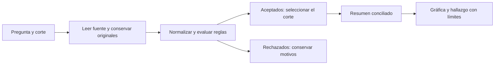
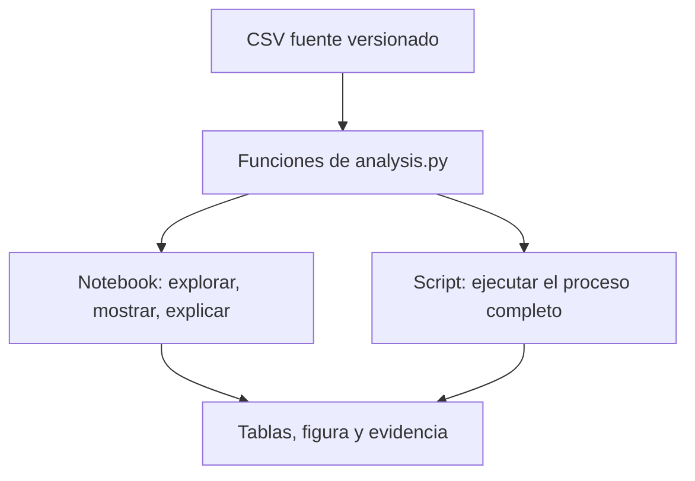
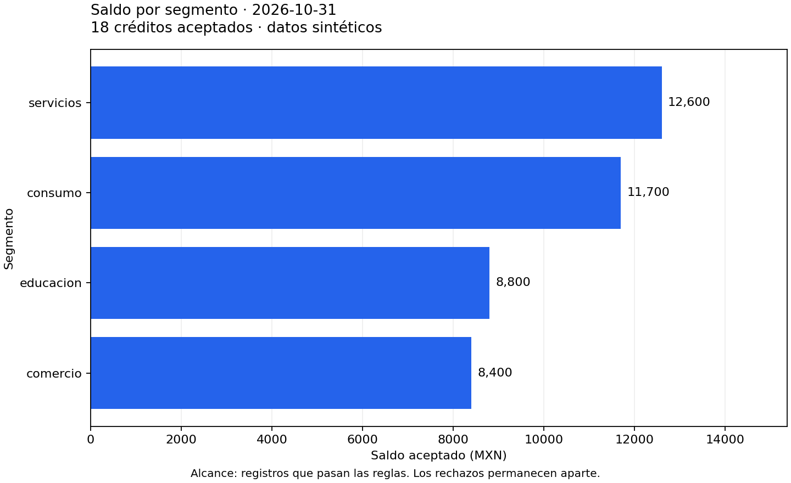

# 02.10 — Análisis y primera gráfica

<a id="10--análisis-y-primera-gráfica"></a>

[Inicio](../../../README.md) / [Módulo 02](../README.md) / **Lección 02.10**

| Tu sesión | Qué prepararás o comprobarás |
| --- | --- |
| **Meta** | Reconstruir un análisis y comunicar un hallazgo con una gráfica conciliada |
| **Necesitas** | Entorno con pandas y Matplotlib; soporte de kernel para el notebook |
| **Evidencia** | Notebook, figura e interpretación propia comprobados |

[Preparación](#antes-de-empezar) · [Material de apoyo](#material-de-apoyo) · [Ir al lab](../../../labs/02_pandas/10_analysis_plot/README.md) · [Comprobar](#evidencia-y-criterio-de-salida)

<a id="propósito-prerrequisitos-y-objetivos"></a>

## Propósito

Cerrar pandas con una pregunta, un proceso comprobado y un hallazgo que puedas
explicar.

## Antes de empezar

Completa [02.09 — Cambiar la forma de una tabla](../09_reshape_tables/README.md) y su lab.
Usa el mismo entorno con pandas 2.3.3 como referencia. Trabaja desde la raíz
de DS Track, con tu editor y el shell elegido. La entrada se enlaza más abajo;
no necesitas producir archivos de lecciones anteriores para leer esta muestra.

Retoma [00.06 — Tu primer notebook](../../00_getting_started/06_first_notebook/README.md).
El apartado 2 prepara pandas, Matplotlib y el kernel según tu gestor. Conserva
el mismo entorno al elegir kernel y comprueba sus versiones; no instales las
alternativas juntas. El diseño visual se profundiza en el módulo 04.

## Qué vas a aprender

- Definir pregunta, corte, universo y reglas antes de calcular.
- Conservar rechazos y conciliar el resumen con las observaciones aceptadas.
- Construir una figura desde el mismo resumen, con unidades y límites.
- Ejecutar desde una sesión limpia y escribir una interpretación propia con evidencia.

## Material de apoyo

| Recurso | Para qué sirve | Uso |
| --- | --- | --- |
| [Script de ejemplo](analysis.py) | Reconstruir lectura, reglas, resumen, figura y exportaciones | Para el ejemplo |
| [CSV de entrada](../06_text_dates/cartera_texto_fechas.csv) | Reutilizar las 48 observaciones de 02.06 sin alterar su fuente | Entrada incluida |
| [Notebook del análisis](first_analysis.ipynb) | Explorar con el kernel del entorno del apartado 2, reiniciar y ejecutar todo | Para el cierre y su lab |

Abre los recursos cuando aparezcan en el recorrido. Lee el código antes de
ejecutarlo y contrasta sus resultados esperados. Conserva los originales y
trabaja las variantes en tu copia. Los datos compartidos se reutilizan desde
su ubicación actual, sin duplicarlos.

## 1. La pregunta antes del código

**¿Qué segmento concentra más saldo entre los registros aceptados del corte
2026-10-31?** Una barra representa el saldo total de un segmento en esa fecha.
El denominador de participación es el saldo aceptado del mismo corte.

Trabajamos con [cartera_texto_fechas.csv](../06_text_dates/cartera_texto_fechas.csv),
los 48 registros sintéticos de 02.06. No duplicamos ni alteramos esa fuente.
Se elige esta muestra porque permite integrar normalización, fechas y reglas,
además del resumen; no hay información de personas reales.



Que el programa genere una imagen no acredita un análisis correcto. La figura
se dibuja desde el resumen que ya se comprobó contra sus observaciones.

## 2. Preparar el entorno y el kernel

El ejemplo se verificó con **pandas 2.3.3 y Matplotlib 3.10.7**. Matplotlib es la
biblioteca que dibuja y guarda la figura. Para ejecutar el notebook necesitas
además un kernel Python, proporcionado aquí por ipykernel 6.30.1.

La configuración raíz declara Matplotlib junto a pandas; el grupo notebooks
incluye ipykernel. No necesitas instalar nbclient ni un servidor Jupyter para
seguir el recorrido en VS Code. Conserva el gestor elegido en
[Entornos y dependencias](../../00_getting_started/05_environment/README.md).

### uv: configuración del proyecto

```text
uv sync --locked --group notebooks
uv run --locked --group notebooks python -c "import pandas, matplotlib, ipykernel; print(pandas.__version__, matplotlib.__version__)"
```

sync prepara el entorno; la segunda línea comprueba paquetes e intérprete. Si ya
está preparado, no reinstales. Selecciona ese mismo intérprete en Select Kernel.

### venv/pip: dentro del entorno activado

```text
python -m pip install "pandas==2.3.3" "matplotlib==3.10.7" "ipykernel==6.30.1"
```

### Conda: dentro del entorno de aprendizaje

```text
conda install -c conda-forge pandas matplotlib ipykernel
```

Conda resuelve sus propias versiones: compruébalas y anótalas. La referencia
exacta de este ejemplo está en pyproject.toml/uv.lock; no mezcles gestores sobre
el mismo entorno ni instales en base. La instalación prepara paquetes; seleccionar
kernel determina qué Python ejecuta las celdas.

## 3. Contrato y política de revisión

La entrada tiene ID, segmento, fecha_corte, fecha_alta y saldo_mxn; el diccionario
está en [02.06](../06_text_dates/README.md#1-una-muestra-de-dos-cortes).
Cada fila pretende describir un crédito en un corte; ID/corte debe ser único.

| Aspecto | Decisión del análisis |
| --- | --- |
| ID | Quitar espacios exteriores, conservar ceros; tres dígitos |
| Segmento | Quitar espacios, minúsculas y alias educación → educacion |
| Catálogo | consumo, servicios, comercio y educacion |
| Fechas | Forma YYYY-MM-DD y fecha calendario interpretable |
| Relación temporal | Alta no posterior al corte |
| Saldo | Entero presente y no negativo |
| Clave repetida | Apartar todas las observaciones involucradas |

Se conservan campos _original y todos los motivos. Un campo formado solo por
espacios es ausente. No adivinamos la categoría de microcredito ni corregimos
una fecha imposible. Los importes de esta fuente se leen como Int64; un texto
incompatible detendría la lectura y requeriría el flujo de conversión de 02.04.

Esta política coincide con los resultados de 02.06 para su muestra: **36 aceptados
y 12 rechazados** entre los dos cortes. Un rechazado puede tener una fecha sin
interpretar: no siempre podemos asignarlo con certeza a un período. Se conservan
todos los rechazos, no solo los que parecen pertenecer al corte elegido.

Aceptado significa que pasó estas reglas, no que se verificaron todas las
propiedades de una cartera real. No cambiamos valores para que la gráfica resulte atractiva.

## 4. Funciones reutilizables y notebook de exploración

| Archivo | Responsabilidad |
| --- | --- |
| [analysis.py](analysis.py) | Lectura, reglas, separación, resumen, figura y exportación |
| [first_analysis.ipynb](first_analysis.ipynb) | Ejecutar por celdas, revisar tablas y escribir la interpretación |
| assets/saldo_octubre.png | Vista de referencia generada con la muestra y corte iniciales |
| output | Resultados de tus ejecuciones, ignorados por Git |

El notebook importa las funciones del archivo local analysis.py; no copia otra
implementación de las reglas. La primera celda prepara rutas desde la raíz o una
carpeta interna del proyecto. No requiere rutas personales ni cambiar archivos de configuración.

La instrucción `%matplotlib inline` de esa celda indica al kernel que muestre las
figuras dentro del notebook. Es una instrucción de IPython, no sintaxis para copiar
al archivo .py; el script guarda su figura directamente.



Usa el notebook para comprender y experimentar; usa el script para comprobar
que el proceso completo funciona en una sola ejecución. Ambos deben responder
la misma pregunta y producir el mismo resumen cuando utilizan las mismas entradas.

## 5. Seleccionar el corte y resumir

```python
aceptados, rechazados = limpiar_y_separar(fuente)
seleccion, resumen = resumir_corte(aceptados, "2026-10-31")
```

resumir_corte delimita la fecha, cuenta créditos y suma saldo por segmento.
Como las claves aceptadas son únicas y el saldo es obligatorio, en este corte
size representa créditos observados y la suma se basa en todos sus importes.

| Segmento | Créditos aceptados | Saldo MXN | Participación aproximada |
| --- | --- | --- | --- |
| servicios | 5 | 12600 | 30.36 % |
| consumo | 5 | 11700 | 28.19 % |
| educacion | 4 | 8800 | 21.20 % |
| comercio | 4 | 8400 | 20.24 % |
| Total | 18 | 41500 | 100 % antes de redondear |

El script comprueba conteos y saldo contra seleccion. La participación es
saldo del segmento / saldo aceptado del corte × 100, no una tasa de atraso.
Un total cero conserva cantidades cero, pero deja participación NA porque no
hay denominador positivo. Un corte sin aceptados produce un resumen vacío.

## 6. Crear la primera figura con Matplotlib

En el notebook, las funciones preparadas devuelven la figura y sus ejes:

```python
fig, ax = crear_grafica(resumen, corte, len(seleccion))
plt.show()
```

Dentro de crear_grafica, los pasos principales son:

```python
fig, ax = plt.subplots(figsize=(9, 5.5), layout="constrained")
barras = ax.barh(resumen["segmento"], resumen["saldo_mxn"].astype(float))
ax.invert_yaxis()
ax.set_xlabel("Saldo aceptado (MXN)")
ax.set_ylabel("Segmento")
ax.set_xlim(left=0)
```

- subplots crea la figura completa (fig) y el área de dibujo (ax).
- barh dibuja barras horizontales: categorías en vertical e importes en horizontal.
- invert_yaxis coloca arriba el primer segmento del resumen ordenado.
- Las etiquetas declaran medida y unidad; el título declara fecha y población.
- El eje de importes comienza en cero para comparar longitudes de barras.

La conversión a float sirve para dibujar; la tabla mantiene importes Int64.
La función completa añade cifras, una cuadrícula discreta y una nota de alcance.
No agrupa de nuevo ni altera los datos para dibujar.



Esta imagen es una referencia del corte inicial. Tu salida se regenera al cambiar
datos o corte; no confundas una imagen anterior con el resultado actual.

## 7. Mostrar, guardar y cerrar son acciones distintas

```python
fig.savefig(salida / "saldo_segmentos.png", dpi=160)
plt.close(fig)
```

show permite verla en el notebook; savefig guarda esa figura; close libera sus
recursos. Guardar la imagen no guarda automáticamente los datos ni tu explicación.
El script usa el motor Agg para guardar sin abrir ventanas; el notebook utiliza
el motor de presentación de su kernel. No necesitas memorizar motores para avanzar.

Cuando no hay aceptados, la figura muestra **“Sin observaciones aceptadas para
este corte”**. No se inventan barras ni se declara saldo cero observado. Si hay
créditos con saldo cero, sí existen observaciones: la figura y la nota lo distinguen.

## 8. Escribir un hallazgo con evidencia y límites

Una explicación útil responde cuatro puntos:

1. Pregunta y población: registros aceptados del corte de octubre.
2. Resultado: servicios tiene el mayor saldo aceptado, 12600 MXN.
3. Evidencia: 5 créditos y 30.36 % del saldo aceptado de 41500 MXN.
4. Límites: no incluye los rechazos ni identifica la causa del importe mayor.

La barra mayor no demuestra mayor saldo promedio, más riesgo o mayor crecimiento.
Se requerirían otras medidas y bases comparables. También puede haber empate:
la función de hallazgo menciona todos los segmentos con el máximo, sin inventar
un ganador por el orden de las categorías.

Por ejemplo, comercio tiene 8400 entre cuatro créditos: promedio 2100; servicios
tiene 12600 entre cinco: promedio 2520. Estos promedios requieren su propio cálculo;
no son las longitudes que muestra la gráfica de totales.

El notebook incluye una celda para **tu interpretación**. El texto generado es
un borrador verificable, no reemplaza explicar las decisiones con tus palabras.

## 9. Ejecutar el script o el notebook

### PowerShell

Desde la raíz, con el entorno preparado:

```powershell
# Ejecutar el análisis completo con el corte inicial
python curriculum\02_pandas\10_analysis_plot\analysis.py
# Cambiar la pregunta a septiembre
python curriculum\02_pandas\10_analysis_plot\analysis.py --corte 2026-09-30
```

### Bash/Zsh

```bash
python curriculum/02_pandas/10_analysis_plot/analysis.py
python curriculum/02_pandas/10_analysis_plot/analysis.py --corte 2026-09-30
```

### uv

```text
uv run --locked python curriculum/02_pandas/10_analysis_plot/analysis.py
```

--corte es una opción de este script, definida con argparse de la biblioteca
estándar. No cambia la fuente. Desde el notebook cambia la variable corte y
**reinicia y ejecuta todas las celdas**, no solo la que dibuja.

Para el notebook: ábrelo en VS Code, elige el kernel del entorno preparado,
reinicia y usa Run All. Comprueba importaciones, partición, resumen y figura;
después escribe tu explicación. Un notebook con una salida antigua no prueba
que el código actual se ejecute correctamente.

## 10. Qué se exporta y cómo comprobarlo

El script escribe cuatro tablas, la figura y hallazgo.md en output. El notebook
usa output/notebook para separar su práctica. Las tablas se releen y comparan
con tolerancia para porcentajes; la figura se dibuja desde el mismo resumen.

hallazgo.md del script registra versiones y SHA-256 de la fuente. El hash es una
huella para identificar el archivo utilizado: no valida sus reglas ni sustituye
la conciliación. La interpretación propia se conserva en la celda Markdown del
notebook; su nota exportada contiene el borrador generado con el contexto de práctica.

Las salidas se reemplazan: un fallo puede dejar resultados previos o parciales.
Espera la confirmación final antes de utilizarlos. No hay publicación automática
de datos ni resultados; la fuente permanece intacta y output queda ignorado.

<a id="práctica-y-cierre-del-módulo"></a>

## Práctica

Realiza el [lab 02.10](../../../labs/02_pandas/10_analysis_plot/README.md) para
reconstruir el análisis en notebook y explicar tu propia figura y hallazgo.

## Evidencia y criterio de salida

| Conserva | Comprueba | Explica |
| --- | --- | --- |
| Notebook con pregunta e interpretación propia | Ejecución desde kernel limpio y entorno identificado | Qué responde la figura, con qué corte y universo |
| Tablas, figura y nota de reglas/procedencia | Aceptados, rechazos, resumen y barras conciliados | Qué queda fuera y por qué una imagen o una huella no validan el análisis |

Puedes cerrar el módulo cuando reconstruyas la ejecución, justifiques las reglas,
conserves rechazos, concilies el resumen y expliques la figura con sus límites.

Quien aprende modifica y ejecuta su copia y explica lo que comprobó.
Tu compañero elige una barra y pide rastrear su valor hasta el resumen y los registros aceptados.
Guarda evidencia, ayudas y dudas en una nota personal junto a tu práctica;
PROGRESS.md registra el desarrollo editorial del curso. El material disponible
no acredita por sí solo aprendizaje completado.

El proyecto de limpieza y sus checkpoints siguen previstos, sin proyecto
asociado implementado ni práctica adicional de proyecto obligatoria.

<a id="referencias-oficiales"></a>

## Referencias

- [Barras horizontales](https://matplotlib.org/3.10.7/api/_as_gen/matplotlib.axes.Axes.barh.html).
- [Figuras y ejes con subplots](https://matplotlib.org/3.10.7/api/_as_gen/matplotlib.pyplot.subplots.html).
- [Guardar figuras](https://matplotlib.org/3.10.7/api/_as_gen/matplotlib.pyplot.savefig.html).

## Siguiente paso

Después del lab y su comprobación, continúa con [03.01 — Modelo relacional y SQLite](../../03_sql_databases/01_relational_sqlite/README.md)
antes de realizar su lab.

SQL ya dispone de sus nueve lecciones y labs; el proyecto y sus checkpoints
siguen pendientes.

[← Módulo 02](../README.md) · [Lab 02.10](../../../labs/02_pandas/10_analysis_plot/README.md) · [Siguiente →](../../03_sql_databases/01_relational_sqlite/README.md)
