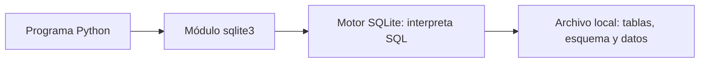
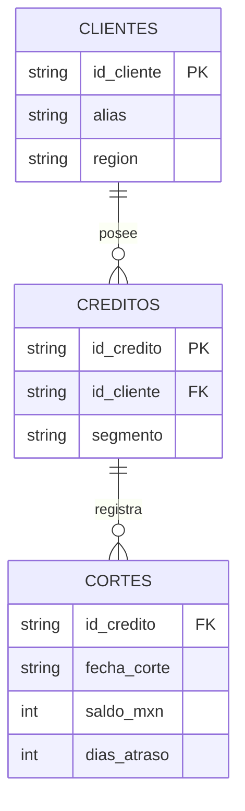
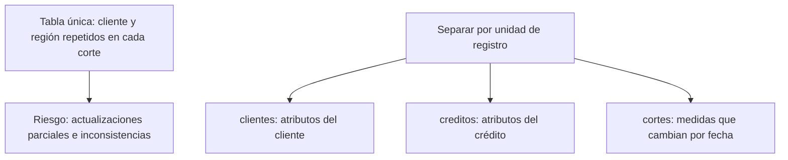

# 03.01 — Modelo relacional y SQLite

<a id="01--modelo-relacional-y-sqlite"></a>

[Inicio](../../../README.md) / [Módulo 03](../README.md) / **Lección 03.01**

| Tu sesión | Qué prepararás o comprobarás |
| --- | --- |
| **Meta** | Reconocer tablas, claves y relaciones en una base preparada |
| **Necesitas** | Python con sqlite3; fuentes incluidas |
| **Evidencia** | Nota de unidades y relaciones con exploración comprobada |

[Preparación](#antes-de-empezar) · [Material de apoyo](#material-de-apoyo) · [Ir al lab](../../../labs/03_sql_databases/01_relational_sqlite/README.md) · [Comprobar](#evidencia-y-criterio-de-salida)

<a id="propósito-prerrequisitos-y-objetivos"></a>

## Propósito

Entender qué representa una tabla, cómo se identifica una fila y cómo se relacionan
tablas antes de escribir consultas.

## Antes de empezar

Completa el [cierre de pandas](../../02_pandas/10_analysis_plot/README.md)
y su lab; conserva tu entorno de Python. Esta práctica usa **sqlite3 de la biblioteca
estándar**: no requiere pandas, paquetes nuevos, un servidor ni una aplicación gráfica.

SELECT y filtros se desarrollan en 03.02; crear el esquema y cargar datos,
en 03.03; las uniones, en 03.05. No necesitas memorizar el preparador para
explicar el modelo. Los CSV y el esquema están incluidos en esta lección.

## Qué vas a aprender

- Distinguir SQL, SQLite y sqlite3 y explicar el papel de cada uno.
- Identificar la unidad de fila de clientes, créditos y cortes.
- Justificar claves primarias, foráneas y una relación uno a muchos.
- Explorar una base preparada y distinguir NULL de cero.

## Material de apoyo

| Recurso | Para qué sirve | Uso |
| --- | --- | --- |
| [Script de ejemplo](relational_sqlite.py) | Preparar y explorar la muestra conservando una base existente | Para el recorrido |
| [Esquema](schema.sql) | Consultar tablas y restricciones del ejemplo | Consulta guiada |
| [Clientes](data/clientes.csv) | Leer los 16 clientes ficticios | Fuente incluida |
| [Créditos](data/creditos.csv) | Relacionar los 24 créditos con clientes | Fuente incluida |
| [Cortes](data/cortes.csv) | Inspeccionar 48 observaciones crédito/fecha | Fuente incluida |

Abre cada recurso cuando aparezca en el recorrido. Lee el script y el SQL antes
de ejecutarlos; contrasta resultados con las fuentes y ejemplos conocidos.
Las bases y entregas se preparan en las rutas indicadas, conservando los
originales y los destinos existentes. No copies ni publiques bases de práctica
como parte del material del curso.

## 1. ¿Por qué pasar de archivos a una base de datos?

Con CSV y pandas aprendiste a representar, validar y analizar observaciones.
Una base relacional permite reunir tablas con un esquema, declarar relaciones y
aplicar restricciones durante las escrituras. SQL expresa preguntas sobre esas tablas.

| Herramienta o formato | Qué aporta en este recorrido |
| --- | --- |
| CSV | Intercambiar una tabla como texto; no conserva por sí solo tipos o relaciones |
| DataFrame | Trabajar con una tabla en el proceso de Python |
| Base SQLite | Persistir varias tablas, su esquema y restricciones en un archivo local |
| SQL | Expresar consultas y operaciones sobre una base |

Una base no vuelve correctos todos los datos automáticamente: solo comprueba
las restricciones definidas y habilitadas. Tampoco reemplaza tu diccionario ni
las reglas de validación aprendidas. Más adelante conciliaremos SQL y pandas.

## 2. SQL, SQLite y sqlite3 son cosas distintas

| Nombre | Qué es | Ejemplo de uso |
| --- | --- | --- |
| SQL | Lenguaje para consultar y administrar datos relacionales | Pedir columnas de una tabla |
| SQLite | Motor de base de datos integrado en la aplicación | Guardar y consultar tablas locales |
| sqlite3 de Python | Módulo que permite comunicarse con ese motor | Abrir conexión y ejecutar una consulta |
| Archivo .sqlite | Contenedor de la base de esta práctica | cartera_demo.sqlite dentro de output |



SQLite no necesita un proceso de servidor separado para esta práctica. Su
archivo no es un CSV: no se inspecciona como texto con Get-Content o cat.
La extensión elegida es una convención, no lo que convierte un archivo en base.

SQLite es útil para aprender, análisis local y aplicaciones integradas. Si se
necesitan muchos escritores simultáneos o acceso centralizado de múltiples
clientes, un motor con servidor puede ser más adecuado. Aprender SQL aquí no
implica que toda su sintaxis sea idéntica en PostgreSQL o SQL Server.

El script muestra sqlite3.sqlite_version, versión del motor utilizado por Python.
Puede variar entre instalaciones; no necesariamente coincide con la herramienta
sqlite3 de terminal, si la tienes. No hace falta instalar esa herramienta ahora.

## 3. Base, tabla, fila, columna y esquema

Una **base** contiene varias tablas y objetos. Una **tabla** describe una clase
de registros. Una **fila** representa una unidad concreta. Una **columna** describe
un atributo. El **esquema** declara nombres, tipos, claves y restricciones.

Antes de elegir columnas, termina la frase: **“Una fila de esta tabla representa…”**.
Un crédito no es lo mismo que un cliente ni una observación del crédito en una fecha.

Nuestra base tiene tres tablas de datos completamente ficticios:

| Tabla | Una fila representa | Cantidad en la muestra |
| --- | --- | --- |
| clientes | Un cliente ficticio | 16 |
| creditos | Un crédito perteneciente a un cliente | 24 |
| cortes | Una observación de un crédito en una fecha | 48 |

Los alias cliente_001… son etiquetas de práctica, no nombres de personas.
El ejemplo reutiliza importes y atrasos de la muestra de 02.07, pero crea un
modelo nuevo: segmento es aquí un atributo estable del crédito. No convierte
silenciosamente los segmentos ausentes del archivo anterior en información conocida;
las categorías de créditos se declaran como datos sintéticos de esta base.

## 4. Clave primaria: identificar una fila

La clave primaria (PRIMARY KEY) identifica de forma única cada fila de una tabla.
Puede ser una columna o una combinación. No tiene que ser un número consecutivo
ni la posición física de almacenamiento.

| Tabla | Clave primaria | Por qué |
| --- | --- | --- |
| clientes | id_cliente | C001 identifica un cliente ficticio |
| creditos | id_credito | 001 identifica un crédito ficticio |
| cortes | id_credito + fecha_corte | Un crédito puede tener varias observaciones temporales |

En cortes, 001/2026-09-30 y 001/2026-10-31 son filas distintas y válidas.
Repetir 001/2026-09-30 violaría la clave compuesta. Usar solo id_credito como
clave de cortes impediría guardar su historia; usar solo fecha_corte impediría
guardar varios créditos en el mismo corte.

El esquema de práctica declara NOT NULL para los campos de sus claves. En SQLite
hay particularidades históricas de PRIMARY KEY en tablas ordinarias: no asumimos
que escribir PRIMARY KEY sobre texto basta por sí solo para prohibir NULL.
Su sintaxis y comprobaciones se explicarán en la lección 03.

## 5. Clave foránea: relacionar una fila con otra tabla

Una clave foránea (FOREIGN KEY) referencia una clave de otra tabla:

- creditos.id_cliente apunta a clientes.id_cliente.
- cortes.id_credito apunta a creditos.id_credito.



En el diagrama, `||` representa uno y `o{` cero o varios. Cada crédito referencia
exactamente un cliente en nuestro esquema, y cada corte exactamente un crédito.
Un cliente puede tener varios créditos; un crédito, varias observaciones. El
esquema permite que un padre todavía no tenga hijos, aunque esta muestra sí los tiene.
La clave primaria de CORTES es la combinación ID/fecha indicada en la tabla anterior.

Que una columna se llame id_cliente no crea automáticamente una relación. Hay
que declararla y hacer que el motor la compruebe. En SQLite la aplicación debe
habilitar y comprobar **PRAGMA foreign_keys = ON en cada conexión**, antes de
escribir. El preparador lo hace; declararla en el esquema no basta si está deshabilitada.

Una clave foránea comprueba existencia de la referencia; no demuestra, por ejemplo,
que el cliente asignado sea la persona correcta en una fuente real.

## 6. Un ejemplo que puedes seguir con los ojos

| clientes.id_cliente | alias | region |
| --- | --- | --- |
| C001 | cliente_001 | norte |

| creditos.id_credito | id_cliente | segmento |
| --- | --- | --- |
| 001 | C001 | consumo |
| 002 | C001 | consumo |

| cortes.id_credito | fecha_corte | saldo_mxn | dias_atraso |
| --- | --- | --- | --- |
| 001 | 2026-09-30 | 1100 | 10 |
| 001 | 2026-10-31 | 1300 | 10 |
| 002 | 2026-09-30 | 1200 | 20 |
| 002 | 2026-10-31 | 1400 | 20 |

C001 tiene dos créditos y estos cuatro cortes. **Cuatro observaciones no significan
cuatro clientes ni cuatro créditos distintos**. La unidad importa al contar y sumar,
como en pandas. Sumar saldos de varias fechas no produce una cartera vigente única.

## 7. Separar tablas evita ciertas inconsistencias

Si copiaras la región del cliente en cada corte, cambiarla requeriría modificar
muchas filas. Si cambias solo algunas, el mismo cliente tendría regiones incompatibles.
Aquí region se guarda una vez en clientes y las otras tablas conservan su referencia.



Es una primera idea de normalización: ubicar atributos en la tabla cuya clave
identifica a qué pertenecen. No se trata de crear muchas tablas arbitrariamente.
Tampoco elimina toda repetición: id_credito aparece legítimamente en varios cortes.

En una fuente real, región o segmento podrían cambiar con el tiempo. Nuestro
modelo los declara estables; conservar una historia de esos atributos necesitaría
otro diseño. No interpretamos este esquema simple como solución universal.

## 8. Tipos, fechas y NULL en esta base

| Campo | Almacenamiento de la práctica | Decisión |
| --- | --- | --- |
| Identificadores | TEXT | Conservar C001 y ceros de 001 |
| fecha_corte | TEXT, YYYY-MM-DD | Fecha calendario validada antes de cargar |
| saldo_mxn | INTEGER o NULL | Pesos enteros no negativos; ausencia permitida |
| dias_atraso | INTEGER o NULL | Días enteros no negativos; ausencia permitida |

SQLite tiene tipado flexible: declarar INTEGER no equivale siempre a aplicar
todas las reglas del dominio. El esquema preparado incluye comprobaciones de
tipo y rango para sus cantidades. STRICT es otra posibilidad, que no exigimos aquí.
SQLite no tiene un tipo de fecha dedicado obligatorio: elegimos texto ISO para
esta muestra, sin horas ni zonas. Un texto con esa forma aún necesita validación calendario.

NULL significa ausencia de valor en la base. Los campos CSV vacíos de cantidades
se cargan como None de Python, que sqlite3 representa como NULL. No se convierten
en cero. Hay seis saldos y ocho atrasos ausentes; 004/octubre contiene saldo cero
conocido. La comparación con NULL y IS NULL se estudiará en la lección 02.

## 9. Preparar y explorar sin instalar otra herramienta

[relational_sqlite.py](relational_sqlite.py) genera output/cartera_demo.sqlite desde
los [CSV sintéticos](data/) y [schema.sql](schema.sql). Son entradas versionadas;
el archivo de base generado queda ignorado por Git. La construcción es apoyo
preparado: no necesitas dominar CREATE TABLE o INSERT para esta primera lección.

El script verifica cada tabla contra sus entradas, las relaciones y la integridad,
confirma la carga, cierra la conexión y vuelve a abrir. Luego inspecciona en solo
lectura. Si la base ya existe, la comprueba sin modificarla; si no coincide, se
detiene y permite elegir otra ruta. No borra ni reinicia tus cambios automáticamente.

### PowerShell

Desde la raíz:

```powershell
# Preparar y mostrar tablas, claves y dos observaciones de 001
python curriculum\03_sql_databases\01_relational_sqlite\relational_sqlite.py
# Crear otra copia de práctica sin reemplazar la anterior
python curriculum\03_sql_databases\01_relational_sqlite\relational_sqlite.py --database curriculum\03_sql_databases\01_relational_sqlite\output\otra_practica.sqlite
```

### Bash/Zsh

```bash
python curriculum/03_sql_databases/01_relational_sqlite/relational_sqlite.py
python curriculum/03_sql_databases/01_relational_sqlite/relational_sqlite.py --database curriculum/03_sql_databases/01_relational_sqlite/output/otra_practica.sqlite
```

### uv

Con el entorno del proyecto:

```text
uv run --locked python curriculum/03_sql_databases/01_relational_sqlite/relational_sqlite.py
```

Resultado: clientes 16, creditos 24, cortes 48; dos observaciones de 001 con saldo
1100 y 1300. El motor utilizado durante la validación fue SQLite 3.51.1; el tuyo
puede variar. Una ejecución nueva carga los datos una vez; repetirla no duplica filas.

Si falla una preparación, puede quedar un archivo incompleto. La ejecución siguiente
lo detecta en vez de tratarlo como una base válida. Usa otra ruta para una nueva
práctica; no borres una base que contiene cambios que quieres conservar.

## 10. Conexión y primera lectura guiada

Para explorar desde Python, este fragmento presupone que ya generaste la base.
La ruta relativa se interpreta desde la raíz del proyecto:

```python
from pathlib import Path
import sqlite3

ruta = Path("curriculum/03_sql_databases/01_relational_sqlite/output/cartera_demo.sqlite")
conexion = sqlite3.connect(ruta.resolve().as_uri() + "?mode=ro", uri=True)
try:
    filas = conexion.execute(
        "SELECT id_credito, fecha_corte, saldo_mxn FROM cortes WHERE id_credito = ? ORDER BY fecha_corte",
        ("001",),
    ).fetchall()
    print(filas)
finally:
    conexion.close()
```

connect abre una conexión; mode=ro exige un archivo existente y permite solo lectura.
Una conexión ordinaria a una ruta equivocada podría crear una base vacía; este
recorrido evita confundirla con la esperada. execute envía la consulta, fetchall
recoge filas como tuplas y close libera la conexión incluso ante un error.

La consulta dice: obtener tres campos de cortes, para ID 001, ordenados por fecha.
`?` es un lugar reservado para un dato; ("001",) es una tupla de un elemento.
No construimos valores SQL pegando texto del usuario. SELECT/WHERE/ORDER BY y
parámetros se practicarán con más detalle en la lección 02.

La salida tiene dos filas: 001/2026-09-30/1100 y 001/2026-10-31/1300. Sin un
ORDER BY no debes depender del orden de lectura. Todavía no escribimos joins.

<a id="errores-frecuentes-práctica-y-siguiente-paso"></a>

## Errores frecuentes

| Situación | Qué revisar |
| --- | --- |
| Confundir SQL y SQLite | Lenguaje frente a motor |
| Contar cortes como clientes | Unidad de registro de cada tabla |
| Dos filas con el mismo crédito se consideran duplicadas | Si tienen cortes distintos |
| Una relación inexistente se acepta | FOREIGN KEY declarada y habilitada por conexión |
| Base vacía inesperada | Ruta utilizada y modo de apertura |
| Conexión que queda abierta | Cierre explícito; with de Connection no sustituye close |

## Práctica

Realiza el [lab 03.01](../../../labs/03_sql_databases/01_relational_sqlite/README.md) para
explicar el modelo y comprobar las unidades y relaciones de la muestra.

## Evidencia y criterio de salida

| Conserva | Comprueba | Explica |
| --- | --- | --- |
| Nota o esquema propio de las tres tablas | Unidades y claves de clientes, créditos y cortes | Por qué un crédito puede aparecer en dos fechas sin ser un duplicado |
| Registro de exploración de la base | Contenido de la muestra preparada y conexiones cerradas | Qué significan NULL, cero y las relaciones declaradas |

Puedes avanzar cuando expliques las tres unidades, claves y relaciones,
explores la base preparada y distingas NULL de cero.

Quien aprende realiza la práctica en su copia y explica las decisiones.
Tu compañero señala una fila de cortes y pide identificar su crédito, su cliente y su clave completa.
Conserva consultas, resultados pertinentes, ayudas y dudas en una nota personal;
PROGRESS.md registra el desarrollo editorial del curso. El material disponible
no acredita por sí solo aprendizaje completado.

El proyecto 02_credit_database y sus checkpoints siguen pendientes; no hay una
entrega adicional de proyecto implementada para esta lección.

<a id="referencias-oficiales"></a>

## Referencias

- [Usos y límites de SQLite](https://www.sqlite.org/whentouse.html).
- [Claves foráneas y su activación](https://www.sqlite.org/foreignkeys.html).
- [Tipos y almacenamiento](https://www.sqlite.org/datatype3.html).
- [sqlite3 de Python 3.12](https://docs.python.org/3.12/library/sqlite3.html).

## Siguiente paso

Después del lab y su comprobación, continúa con [03.02 — Primeras consultas](../02_first_queries/README.md)
antes de realizar su lab.

[← Módulo 03](../README.md) · [Lab 03.01](../../../labs/03_sql_databases/01_relational_sqlite/README.md) · [Siguiente →](../02_first_queries/README.md)
