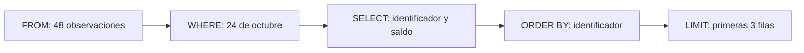

# 03.02 — Primeras consultas

<a id="02--primeras-consultas"></a>

[Inicio](../../../README.md) / [Módulo 03](../README.md) / **Lección 03.02**

| Tu sesión | Qué prepararás o comprobarás |
| --- | --- |
| **Meta** | Expresar una selección SQL y justificar sus filas y su orden |
| **Necesitas** | Python con sqlite3; fuentes incluidas |
| **Evidencia** | Consultas y parámetros con resultados comprobados |

[Preparación](#antes-de-empezar) · [Material de apoyo](#material-de-apoyo) · [Ir al lab](../../../labs/03_sql_databases/02_first_queries/README.md) · [Comprobar](#evidencia-y-criterio-de-salida)

<a id="propósito-prerrequisitos-y-objetivos--esencial"></a>

## Propósito

Expresar preguntas pequeñas con SQL y comprobar qué filas responden a ellas.

## Antes de empezar

Completa [03.01 — Modelo relacional y SQLite](../01_relational_sqlite/README.md)
y su lab. Usa la misma base ficticia de 16 clientes, 24 créditos y 48 cortes;
no necesitas instalar paquetes. Una fila de cortes sigue siendo un crédito en
una fecha, aunque selecciones solo algunas columnas.

La muestra conserva 16 clientes, 24 créditos y 48 observaciones. Una fila
de cortes representa un crédito en una fecha aunque selecciones menos columnas.
Agregaciones y joins se desarrollan en 03.04 y 03.05; aquí se consulta sin modificarla.

## Qué vas a aprender

- Seleccionar columnas y usar alias sin cambiar la unidad de registro.
- Combinar filtros y parámetros con condiciones explícitas.
- Ordenar con desempate, limitar resultados y explicar DISTINCT.
- Distinguir NULL, cero y selección vacía y cerrar la conexión.

## Material de apoyo

| Recurso | Para qué sirve | Uso |
| --- | --- | --- |
| [Script de ejemplo](first_queries.py) | Ejecutar selecciones parametrizadas en lectura y comprobar resultados | Para el recorrido |
| [Preparador de la muestra](../01_relational_sqlite/relational_sqlite.py) | Preparar o comprobar la base si hace falta | Preparación |
| [Fuentes CSV](../01_relational_sqlite/data/) | Consultar clientes, créditos y cortes originales | Consulta compartida |

Abre cada recurso cuando aparezca en el recorrido. Lee el script y el SQL antes
de ejecutarlos; contrasta resultados con las fuentes y ejemplos conocidos.
Las bases y entregas se preparan en las rutas indicadas, conservando los
originales y los destinos existentes. No copies ni publiques bases de práctica
como parte del material del curso.

## 1. De la pregunta a SELECT y FROM

Pregunta: ¿qué saldos conocemos de las primeras tres observaciones de octubre,
ordenadas por identificador?

```sql
SELECT id_credito AS credito, saldo_mxn
FROM cortes
WHERE fecha_corte = '2026-10-31'
ORDER BY id_credito
LIMIT 3;
```

SELECT elige las columnas del resultado; FROM identifica la tabla; WHERE decide
qué filas cumplen la condición. AS cambia el nombre de una columna del resultado,
no modifica el esquema ni los datos. Las comas separan columnas. El punto y coma
termina la sentencia. Escribimos palabras de SQL en mayúsculas por legibilidad.
Los textos llevan comillas simples y los números se escriben sin ellas. Los IDs
son texto: '001' conserva sus ceros. SELECT * devuelve todas las columnas, pero
nombrarlas hace explícito qué necesitas.

| credito | saldo_mxn |
| --- | --- |
| 001 | 1300 |
| 002 | 1400 |
| 003 | 1500 |



Es una guía para interpretar el resultado, no una promesa del orden físico de
trabajo del motor. En palabras: elegimos octubre, mostramos dos campos, ordenamos
y tomamos tres filas. SELECT consulta sin cambiar las tablas.

## 2. Filtrar y combinar condiciones

```sql
SELECT id_credito, saldo_mxn, dias_atraso
FROM cortes
WHERE fecha_corte = '2026-10-31' AND dias_atraso >= 30
ORDER BY dias_atraso DESC, id_credito ASC;
```

Las comparaciones incluyen =, <>, <, <=, > y >=. AND requiere ambas condiciones;
OR acepta al menos una; NOT niega una condición. Usa paréntesis para expresar
la intención: AND tiene prioridad sobre OR.

```sql
SELECT id_credito, fecha_corte, dias_atraso
FROM cortes
WHERE fecha_corte = '2026-10-31'
  AND (dias_atraso = 0 OR dias_atraso >= 30)
ORDER BY id_credito;
```

Sin esos paréntesis, la condición `fecha_corte = '2026-10-31' AND dias_atraso = 0
OR dias_atraso >= 30` también acepta atrasos de septiembre. La versión agrupada
devuelve 13 filas de octubre. El filtro >= 30 devuelve nueve: 004, 009, 014, 019
(con 40 días), luego 003, 008, 013, 018, 023 (con 30 días).

## 3. Orden, empates y LIMIT

ASC ordena ascendente y es el valor predeterminado; DESC, descendente. Una segunda
columna desempata. Al consultar varios cortes usa `ORDER BY fecha_corte, id_credito`:
el identificador solo no distingue sus dos fechas. Sin ORDER BY el orden no está
garantizado, aunque parezca estable. LIMIT 3 restringe a tres filas; no toma una
muestra aleatoria ni significa los tres mayores sin ordenar por la medida.

Las fechas YYYY-MM-DD validadas de esta base pueden ordenarse como texto en orden
cronológico. Esa propiedad no se traslada a fechas como 31/10/2026.

## 4. NULL, cero y lógica con valores ausentes

```sql
SELECT id_credito
FROM cortes
WHERE fecha_corte = '2026-10-31' AND saldo_mxn IS NULL
ORDER BY id_credito;
```

Devuelve 022, 023 y 024. `saldo_mxn = 0` devuelve solo 004. Para conocidos utiliza
IS NOT NULL. No uses `= NULL` ni `<> NULL`: una comparación ordinaria con NULL
produce desconocido. WHERE conserva solo las condiciones verdaderas, por lo que
`dias_atraso >= 30` y `NOT (dias_atraso >= 30)` excluyen ambos los atrasos ausentes.

Si la pregunta incluye atrasados **o desconocidos**, exprésala:

```sql
SELECT id_credito, dias_atraso
FROM cortes
WHERE fecha_corte = '2026-10-31'
  AND (dias_atraso >= 30 OR dias_atraso IS NULL)
ORDER BY id_credito;
```

Devuelve 12 filas, incluyendo 006, 012 y 024 con atraso desconocido. No significa
que esas tres estén atrasadas. sqlite3 entrega NULL como None de Python; pandas
usa representaciones como NA/NaN según el tipo. Recupera la idea de
[faltantes y máscaras en 02.03](../../02_pandas/03_select_filter_sort/README.md),
pero escribe la condición SQL de forma explícita.

## 5. DISTINCT cambia qué representa el resultado

```sql
SELECT DISTINCT fecha_corte
FROM cortes
ORDER BY fecha_corte;
```

Devuelve dos filas: 2026-09-30 y 2026-10-31. DISTINCT elimina repeticiones de la
combinación completa de columnas seleccionadas. Si añades id_credito obtienes
48 pares distintos. Ya no estás mostrando observaciones completas cuando seleccionas
solo fechas distintas. No uses DISTINCT para ocultar problemas de claves o joins.

## 6. Ejecutar desde Python y cerrar la conexión

[first_queries.py](first_queries.py) abre exclusivamente una base existente en
solo lectura, ejecuta seis consultas y cierra en finally incluso si hay errores.
No prepara ni reinicia la base. Puedes leer y adaptar una consulta del script:

```python
sql = "SELECT id_credito FROM cortes WHERE fecha_corte = ? ORDER BY id_credito"
cursor = conexion.execute(sql, ("2026-10-31",))
filas = cursor.fetchall()
```

execute envía una sentencia y sus parámetros; fetchall recupera las filas como
lista de tuplas. Una lista vacía es un resultado válido. El `?` ocupa el lugar de
un **valor**; no lo pongas entre comillas. La coma en `(valor,)` crea una tupla de
un elemento. No construyas SQL interpolando valores con f-strings. Los parámetros
no sustituyen nombres de tablas o columnas. En el script, cursor.description
permite recuperar los nombres de columnas, incluido el alias credito.
El bloque with de una Connection controla transacciones; no sustituye close.

### PowerShell

Desde la raíz, con tu entorno elegido activo. Si ya preparaste la base, ejecuta
solo el segundo comando; si existe, el preparador la comprueba sin reemplazarla.

```powershell
python curriculum\03_sql_databases\01_relational_sqlite\relational_sqlite.py
python curriculum\03_sql_databases\02_first_queries\first_queries.py
# Para consultar otra copia existente:
python curriculum\03_sql_databases\02_first_queries\first_queries.py --database curriculum\03_sql_databases\01_relational_sqlite\output\otra_practica.sqlite
```

### Bash/Zsh

```bash
python curriculum/03_sql_databases/01_relational_sqlite/relational_sqlite.py
python curriculum/03_sql_databases/02_first_queries/first_queries.py
# Otra copia existente:
python curriculum/03_sql_databases/02_first_queries/first_queries.py --database curriculum/03_sql_databases/01_relational_sqlite/output/otra_practica.sqlite
```

Con uv, antepone `uv run --locked` a cada comando python. No cambies de gestor ni
reinstales dependencias para esta lección. Salida esperada: primeros 3, atrasados 9,
sin_saldo 3, cero 1, fechas 2 y vacio 0 filas. None indica ausencia, no error.

<a id="errores-habituales-práctica-y-criterio-de-salida"></a>

## Errores habituales

| Situación | Comprobación |
| --- | --- |
| no such table | Revisa la ruta y que sea la base preparada de 03.01 |
| Falta la base | Prepárala o elige una copia existente; no se crea al consultar |
| = NULL no devuelve filas | Usa IS NULL |
| Aparecen cortes de otra fecha | Revisa paréntesis y AND/OR |
| Un top cambia entre ejecuciones | Ordena y añade una clave de desempate |
| No hay filas | Comprueba condiciones y parámetros; puede ser correcto |

## Práctica

Realiza el [lab 03.02](../../../labs/03_sql_databases/02_first_queries/README.md) para
variar filtros y orden y contrastar qué pregunta responde cada consulta.

## Evidencia y criterio de salida

| Conserva | Comprueba | Explica |
| --- | --- | --- |
| SQL, parámetros y resultados | Columnas, IDs y orden esperados, incluido un filtro vacío | Qué población expresa la condición y qué cambia con DISTINCT |
| Nota de apertura y cierre | Base correcta y conexión cerrada | Por qué NULL no equivale a cero y una selección vacía puede ser válida |

Puedes avanzar cuando justifiques unidad, columnas, filtros, orden y resultado;
distingas cero, desconocido y selección vacía; y cierres tu conexión.

Quien aprende realiza la práctica en su copia y explica las decisiones.
Tu compañero propone un empate o un saldo desconocido y pide anticipar la selección y el orden.
Conserva consultas, resultados pertinentes, ayudas y dudas en una nota personal;
PROGRESS.md registra el desarrollo editorial del curso. El material disponible
no acredita por sí solo aprendizaje completado.

El proyecto 02_credit_database y sus checkpoints siguen pendientes; no hay una
entrega adicional de proyecto implementada para esta lección.

<a id="referencias-primarias"></a>

## Referencias

Ejemplos propios sobre la muestra del proyecto, contrastados con:

- [SELECT, DISTINCT, ORDER BY y LIMIT de SQLite](https://www.sqlite.org/lang_select.html).
- [Comparaciones, precedencia y NULL](https://www.sqlite.org/lang_expr.html).
- [sqlite3 de Python 3.12: parámetros, URI y cierre](https://docs.python.org/3.12/library/sqlite3.html).

## Siguiente paso

Después del lab y su comprobación, continúa con [03.03 — Crear tablas y cargar datos](../03_create_load/README.md)
antes de realizar su lab.

[← Módulo 03](../README.md) · [Lab 03.02](../../../labs/03_sql_databases/02_first_queries/README.md) · [Siguiente →](../03_create_load/README.md)
