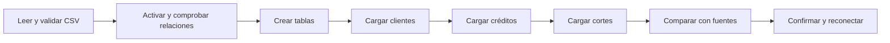

# 03.03 — Crear tablas y cargar datos

<a id="03--crear-tablas-y-cargar-datos"></a>

[Inicio](../../../README.md) / [Módulo 03](../README.md) / **Lección 03.03**

| Tu sesión | Qué prepararás o comprobarás |
| --- | --- |
| **Meta** | Construir una base nueva con restricciones y carga comprobada |
| **Necesitas** | Python con sqlite3; fuentes incluidas |
| **Evidencia** | SQL, código y nota de carga, rechazos y persistencia |

[Preparación](#antes-de-empezar) · [Material de apoyo](#material-de-apoyo) · [Ir al lab](../../../labs/03_sql_databases/03_create_load/README.md) · [Comprobar](#evidencia-y-criterio-de-salida)

<a id="propósito-prerrequisitos-y-objetivos--esencial"></a>

## Propósito

Construir una base cuyo contenido respete reglas explícitas.

## Antes de empezar

Completa
[03.01 — Modelo relacional y SQLite](../01_relational_sqlite/README.md) y
[03.02 — Primeras consultas](../02_first_queries/README.md), con sus labs.
Recupera también [lectura CSV](../../01_python_foundations/05_csv_files/README.md)
y [validación](../../01_python_foundations/06_validation_summary/README.md).
Usamos sqlite3 de la biblioteca estándar; no hay dependencias nuevas.

Trabaja con una base nueva de práctica, separada de la de 03.01. Las entradas
son los mismos CSV ficticios: 16 clientes, 24 créditos y 48 observaciones
crédito/fecha. El preparador comprueba destinos existentes y los conserva.

## Qué vas a aprender

- Traducir parte del contrato a CREATE TABLE y restricciones explícitas.
- Distinguir tipos declarados, afinidad y valores almacenados.
- Cargar desde CSV con parámetros y relaciones habilitadas.
- Comprobar persistencia, rechazos y equivalencia con las fuentes conservadas.

## Material de apoyo

| Recurso | Para qué sirve | Uso |
| --- | --- | --- |
| [Script de ejemplo](create_load.py) | Crear y comprobar la base de práctica contra los CSV de origen | Para el recorrido |
| [Esquema de carga](schema.sql) | Leer CREATE TABLE y restricciones de esta práctica | Para el recorrido |
| [Fuentes CSV](../01_relational_sqlite/data/) | Consultar las tres tablas originales | Entradas compartidas |

Abre cada recurso cuando aparezca en el recorrido. Lee el script y el SQL antes
de ejecutarlos; contrasta resultados con las fuentes y ejemplos conocidos.
Las bases y entregas se preparan en las rutas indicadas, conservando los
originales y los destinos existentes. No copies ni publiques bases de práctica
como parte del material del curso.

## 1. Del contrato al esquema

Un **contrato** describe qué significa cada campo y qué valores admite.
Un **esquema** expresa parte de ese contrato mediante tablas y restricciones.
CREATE TABLE define la estructura; INSERT incorpora registros.

| Tabla | Unidad y clave | Regla |
| --- | --- | --- |
| clientes | Un cliente; id_cliente | Identificador, alias y región obligatorios |
| creditos | Un crédito; id_credito | Debe referirse a un cliente existente |
| cortes | Un crédito en una fecha; id_credito + fecha_corte | Crédito existente; saldo y atraso enteros no negativos o desconocidos |

Los IDs son texto para conservar ceros. Las fechas usan texto YYYY-MM-DD,
validado en Python. El saldo de esta muestra está en **pesos mexicanos enteros**;
no representa centavos ni autoriza redondear datos reales. Si otro contrato
incluye centavos, habrá que elegir y documentar su representación.

```sql
CREATE TABLE clientes (
    id_cliente TEXT PRIMARY KEY NOT NULL,
    alias TEXT NOT NULL,
    region TEXT NOT NULL
);

CREATE TABLE creditos (
    id_credito TEXT PRIMARY KEY NOT NULL,
    id_cliente TEXT NOT NULL,
    segmento TEXT NOT NULL,
    FOREIGN KEY (id_cliente) REFERENCES clientes(id_cliente)
);
```

Entre paréntesis declaramos columnas, tipos y reglas; las comas separan
declaraciones. FOREIGN KEY nombra el campo que apunta a otra tabla;
REFERENCES indica tabla y columna de destino. Crear primero clientes hace
visible la dependencia. No copies alias y región en cada crédito: consulta
sus relaciones cuando estudiemos joins.

## 2. Qué garantiza cada restricción

| Restricción | Significado | Ejemplo de rechazo |
| --- | --- | --- |
| PRIMARY KEY | Identifica una fila sin repetir la clave | Dos clientes C001 |
| NOT NULL | Impide ausencia del valor | Alias None al cargar desde Python |
| UNIQUE | Impide repetir una clave alternativa | Dos códigos de origen iguales, si el contrato los declara únicos |
| CHECK | Exige que una expresión no resulte falsa | Un saldo negativo |
| FOREIGN KEY | Exige una referencia existente para valores no nulos | Crédito con cliente inexistente |

NOT NULL no prohíbe una cadena vacía ni espacios. CHECK no rechaza por sí solo
un resultado NULL: si el campo es obligatorio también necesita NOT NULL.
En tablas ordinarias de SQLite, una clave primaria de texto no implica siempre
NOT NULL; por eso lo escribimos explícitamente. UNIQUE permite varios NULL.

No imponemos UNIQUE a alias o región: el contrato no dice que sean únicos.
Para probar una clave alternativa en una tabla temporal en memoria:

```sql
CREATE TABLE fuentes (
    id_fuente TEXT PRIMARY KEY NOT NULL,
    codigo_origen TEXT NOT NULL UNIQUE
);
INSERT INTO fuentes VALUES ('F1', 'sistema_a');
INSERT INTO fuentes VALUES ('F2', 'sistema_a');
```

La segunda inserción se rechaza. UNIQUE expresa una decisión del dominio;
no debe añadirse solo porque una muestra no contiene repeticiones.

## 3. Tipos de SQLite y reglas de los cortes

SQLite almacena valores NULL, INTEGER, REAL, TEXT y BLOB (datos binarios).
En estas tablas ordinarias, el tipo declarado establece una **afinidad**:
orienta conversiones, pero no impide cualquier valor de otro tipo.
Declarar INTEGER por sí solo no garantiza un entero no negativo.

```sql
CREATE TABLE cortes (
    id_credito TEXT NOT NULL,
    fecha_corte TEXT NOT NULL,
    saldo_mxn INTEGER CHECK (
        saldo_mxn IS NULL OR
        (typeof(saldo_mxn) = 'integer' AND saldo_mxn >= 0)
    ),
    dias_atraso INTEGER CHECK (
        dias_atraso IS NULL OR
        (typeof(dias_atraso) = 'integer' AND dias_atraso >= 0)
    ),
    PRIMARY KEY (id_credito, fecha_corte),
    FOREIGN KEY (id_credito) REFERENCES creditos(id_credito)
);
```

La clave compuesta permite dos fechas para 001, pero impide repetir 001 en la
misma fecha. typeof devuelve la clase almacenada después de aplicar afinidad:
el texto '10' puede convertirse a entero y aceptarse; 1.5 o 'desconocido' se
rechazan por CHECK. No es una validación del formato original del CSV.
None de Python se guarda como NULL; cero se guarda como entero conocido.

El esquema completo está en [schema.sql](schema.sql). Las fechas válidas y el
formato del CSV se comprueban antes de cargar en el script; la base no garantiza
por sí sola que una fecha textual sea válida. Otros programas que escriban
deben respetar ese contrato. Tablas STRICT son una ampliación futura.

## 4. Activar relaciones antes de escribir

La comprobación de claves foráneas se activa **por conexión**, antes de abrir
la transacción de carga:

```python
import sqlite3

conexion = sqlite3.connect(":memory:", isolation_level=None)
conexion.execute("PRAGMA foreign_keys = ON")
assert conexion.execute("PRAGMA foreign_keys").fetchone() == (1,)
```

PRAGMA consulta o configura aspectos de SQLite; no es una consulta de negocio.
:memory: crea una base temporal que desaparece al cerrar. Activar foreign_keys
dentro de una transacción no cambia su estado; comprueba siempre el resultado.
Declarar la relación y activar su comprobación son pasos distintos.



En palabras: validar entradas, preparar reglas, cargar padres antes que hijos,
comprobar y confirmar. Reconectar comprueba que los datos quedaron guardados.

## 5. INSERT, parámetros y carga desde CSV

INSERT INTO nombra la tabla y columnas; VALUES describe los valores:

```python
sql = "INSERT INTO clientes (id_cliente, alias, region) VALUES (?, ?, ?)"
conexion.execute(sql, ("C001", "cliente_001", "norte"))
```

Los marcadores reciben valores en el orden de las columnas; no llevan comillas.
Recupera los [parámetros de 03.02](../02_first_queries/README.md#6-ejecutar-desde-python-y-cerrar-la-conexión).
Para varias filas, executemany repite la misma sentencia sobre una colección:

```python
filas = [("C001", "cliente_001", "norte"), ("C002", "cliente_002", "centro")]
conexion.executemany(sql, filas)
```

Este bloque sustituye a la inserción individual; no ejecutes ambos sobre las
mismas claves. No interpolamos valores con f-strings ni usamos INSERT OR IGNORE
para esconder rechazos. Un error del lote requiere decidir qué conservar.

[create_load.py](create_load.py) lee los CSV de 03.01, verifica encabezados y
fechas, convierte importes/atrasos a int y campos numéricos vacíos a None.
Conserva IDs como texto y las fuentes intactas. Luego carga clientes, creditos
y cortes. Las filas inválidas detienen esta carga didáctica; no hay imputación
ni eliminación silenciosa. No se trata de un importador general para datos reales.

## 6. Confirmar, cerrar y comprobar — práctica

Una **transacción** agrupa cambios: COMMIT confirma; ROLLBACK revierte los
cambios pendientes. Introducimos lo mínimo para que un fallo no deje media carga;
UPDATE, DELETE y recuperación se profundizan en 03.08.

El script usa isolation_level=None, disponible desde Python 3.11, para manejar
BEGIN/COMMIT/ROLLBACK explícitamente. Dentro de BEGIN crea tablas con execute y
carga filas; ante una excepción revierte. Evita executescript en ese bloque
porque puede confirmar una transacción pendiente con el modo usado. Finalmente
cierra la conexión. close y confirmar son acciones diferentes.

Para leer el programa por partes: read_sources prepara entradas; create_schema
define tablas; load_rows inserta; verify compara; prepare coordina la base en
disco. create_schema usa sqlite3.complete_statement para reconocer el final de
cada sentencia sin confundir los comentarios. verify consulta sqlite_master,
el catálogo interno de SQLite, para comparar las definiciones con un esquema
de referencia en memoria. Esas comprobaciones auxiliares pueden estudiarse
después de dominar CREATE TABLE e INSERT; no necesitas reproducir todo el
programa de memoria para completar el lab.

Antes de confirmar compara **todas las filas y valores** con las fuentes:
16/24/48 es necesario, pero no basta. Ejecuta PRAGMA foreign_key_check (lista
vacía esperada) y PRAGMA integrity_check ('ok' esperado). Estos PRAGMA revisan
integridad técnica; no acreditan todas las reglas del negocio. Después abre
la base en solo lectura y repite la comparación para comprobar persistencia.

Prueba seis rechazos en una base en memoria: claves simple y compuesta repetidas,
alias ausente, cliente inexistente, saldo negativo y saldo fraccionario.
IntegrityError señala violación de restricciones; el programa exige que cada
intento falle y que el contenido final siga igual.

Si la ruta ya existe, solo compara esquema y contenido en lectura. Si difieren,
se detiene y pide otra ruta; no borra, recarga ni repara tu trabajo. Una creación
fallida puede dejar un archivo vacío con la transacción revertida: consérvalo
para investigar y elige otra ruta tras corregir el problema.

### PowerShell

Desde la raíz, con el entorno elegido activo:

```powershell
python curriculum\03_sql_databases\03_create_load\create_load.py
# Repetir comprueba la base existente sin cambios:
python curriculum\03_sql_databases\03_create_load\create_load.py
# Para una nueva práctica:
python curriculum\03_sql_databases\03_create_load\create_load.py --database curriculum\03_sql_databases\03_create_load\output\otra_carga.sqlite
```

### Bash/Zsh

```bash
python curriculum/03_sql_databases/03_create_load/create_load.py
python curriculum/03_sql_databases/03_create_load/create_load.py
python curriculum/03_sql_databases/03_create_load/create_load.py --database curriculum/03_sql_databases/03_create_load/output/otra_carga.sqlite
```

Con uv antepone `uv run --locked` a cada comando python. No cambies de gestor
ni reinstales paquetes. Se muestran seis rechazos comprobados y 16/24/48 filas
conciliadas. La primera ejecución informa creación y persistencia; la segunda,
base existente sin cambios. La salida local queda en output, excluido de Git.

<a id="errores-habituales-lab-y-criterio-de-salida"></a>

## Errores habituales

| Situación | Acción |
| --- | --- |
| FOREIGN KEY constraint failed | Revisa referencia y orden de carga |
| UNIQUE constraint failed | Revisa la clave; no ocultes el error con IGNORE |
| NOT NULL constraint failed | Revisa campos obligatorios y conversión de ausencias |
| CHECK constraint failed | Revisa rango y clase almacenada |
| La base existe pero difiere | Conserva el archivo y usa otra ruta |
| Un entero acepta '10' | Recuerda afinidad; valida el formato original aparte |

## Práctica

Realiza el [lab 03.03](../../../labs/03_sql_databases/03_create_load/README.md) para
cargar una base separada y comprobar restricciones y persistencia.

## Evidencia y criterio de salida

| Conserva | Comprueba | Explica |
| --- | --- | --- |
| SQL, script y nota de carga | Filas guardadas contra fuentes y restricciones rechazadas | Qué garantiza cada restricción y qué validación queda fuera del esquema |
| Evidencia textual al reconectar | Persistencia y conservación de entradas y destinos previos | Por qué cargar, confirmar, cerrar y verificar son pasos distintos |

Puedes continuar cuando expliques las restricciones, demuestres carga y
persistencia, justifiques los rechazos y conserves las entradas.

Quien aprende realiza la práctica en su copia y explica las decisiones.
Tu compañero propone una referencia inexistente y pide explicar en qué comprobación debe detectarse.
Conserva consultas, resultados pertinentes, ayudas y dudas en una nota personal;
PROGRESS.md registra el desarrollo editorial del curso. El material disponible
no acredita por sí solo aprendizaje completado.

El proyecto 02_credit_database y sus checkpoints siguen pendientes; no hay una
entrega adicional de proyecto implementada para esta lección.

<a id="referencias-primarias"></a>

## Referencias

Ejemplos propios sobre los datos ficticios del proyecto, contrastados con:

- [CREATE TABLE y restricciones de SQLite](https://www.sqlite.org/lang_createtable.html).
- [Afinidad y clases de almacenamiento](https://www.sqlite.org/datatype3.html).
- [Activación y comprobación de claves foráneas](https://www.sqlite.org/foreignkeys.html).
- [INSERT de SQLite](https://www.sqlite.org/lang_insert.html).
- [sqlite3 de Python 3.11: parámetros y transacciones](https://docs.python.org/3.11/library/sqlite3.html).

## Siguiente paso

Después del lab y su comprobación, continúa con [03.04 — Agregaciones e indicadores](../04_aggregations/README.md)
antes de realizar su lab.

[← Módulo 03](../README.md) · [Lab 03.03](../../../labs/03_sql_databases/03_create_load/README.md) · [Siguiente →](../04_aggregations/README.md)
