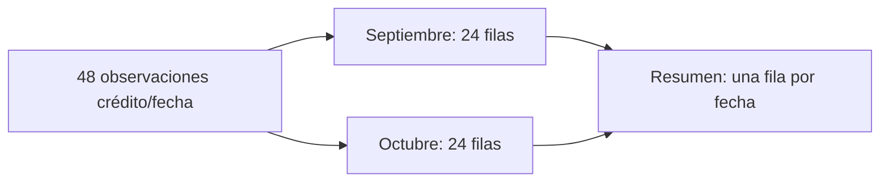
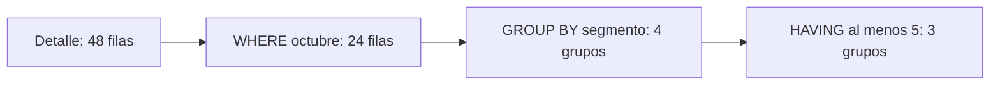

# 03.04 — Agregaciones e indicadores

<a id="04--agregaciones-e-indicadores"></a>

[Inicio](../../../README.md) / [Módulo 03](../README.md) / **Lección 03.04**

| Tu sesión | Qué prepararás o comprobarás |
| --- | --- |
| **Meta** | Resumir con universo, denominadores y cobertura explícitos |
| **Necesitas** | Python con sqlite3; fuentes incluidas |
| **Evidencia** | SQL y nota de indicadores conciliados con el detalle |

[Preparación](#antes-de-empezar) · [Material de apoyo](#material-de-apoyo) · [Ir al lab](../../../labs/03_sql_databases/04_aggregations/README.md) · [Comprobar](#evidencia-y-criterio-de-salida)

<a id="propósito-prerrequisitos-y-objetivos--esencial"></a>

## Propósito

Pasar del detalle a un resumen sin cambiar el significado de la pregunta.

## Antes de empezar

Completa [03.03 — Crear tablas y cargar datos](../03_create_load/README.md) y
su lab; recupera [filtros y NULL de 03.02](../02_first_queries/README.md) y
[agrupación en pandas](../../02_pandas/07_group_summarize/README.md).
Usamos sqlite3 estándar y la misma cartera ficticia: 24 créditos observados en
dos fechas, 48 filas en cortes. No necesitas instalar paquetes.

## Qué vas a aprender

- Distinguir COUNT de filas, valores conocidos y claves distintas.
- Agrupar y contrastar SUM, AVG, MIN y MAX con NULL.
- Separar selección de filas con WHERE y de grupos con HAVING.
- Construir tasas con numerador, denominador y cobertura y conciliarlas con el detalle.

## Material de apoyo

| Recurso | Para qué sirve | Uso |
| --- | --- | --- |
| [Script de ejemplo](aggregations.py) | Contrastar agregaciones y tasas con referencias independientes | Para el recorrido |
| [Preparador de la muestra](../01_relational_sqlite/relational_sqlite.py) | Preparar o comprobar la base si hace falta | Preparación |
| [Fuentes CSV](../01_relational_sqlite/data/) | Consultar clientes, créditos y cortes originales | Consulta compartida |

Abre cada recurso cuando aparezca en el recorrido. Lee el script y el SQL antes
de ejecutarlos; contrasta resultados con las fuentes y ejemplos conocidos.
Las bases y entregas se preparan en las rutas indicadas, conservando los
originales y los destinos existentes. No copies ni publiques bases de práctica
como parte del material del curso.

## 1. Formular el indicador antes de calcular

Una **agregación** resume varias filas en uno o varios resultados. Un **indicador**
añade significado: define universo, medida, unidad, regla y base de cálculo.
Antes de preguntar cuánto, explica qué estás contando o sumando.

Pregunta: ¿cuántas observaciones tenemos en octubre, qué saldo conocemos y qué
proporción tiene al menos 30 días de atraso entre los atrasos conocidos?

| Decisión | Contrato de esta práctica |
| --- | --- |
| Universo | Observaciones del 2026-10-31 |
| Unidad del detalle | Crédito/fecha; no persona |
| Saldo | Pesos mexicanos enteros, o NULL |
| Atraso confirmado | dias_atraso >= 30; incluye 30 exactos |
| Denominador de la tasa | Observaciones con dias_atraso conocido |
| Cobertura de atraso | Atrasos conocidos / todas las observaciones del corte |

La regla de 30 días es didáctica; no declara una definición regulatoria de mora.
No confundir un indicador por número de créditos con uno ponderado por saldo.
Las referencias a cartera en estos ejemplos son completamente ficticias.

## 2. COUNT: filas, valores y créditos distintos

```sql
SELECT COUNT(*) AS observaciones,
       COUNT(saldo_mxn) AS saldos_conocidos,
       COUNT(DISTINCT id_credito) AS creditos_distintos
FROM cortes
WHERE fecha_corte = '2026-10-31';
```

COUNT(*) cuenta filas; COUNT(saldo_mxn) solo valores no NULL. Cero es conocido y
sí se cuenta. COUNT(DISTINCT id_credito) cuenta identificadores distintos no NULL.
En octubre: 24 observaciones, 21 saldos conocidos y 24 créditos distintos.
Hay tres saldos ausentes: 24 − 21.

Sin filtrar fechas hay 48 observaciones, pero 24 créditos distintos: una fila
de cortes no es un crédito único en todo el histórico. Tampoco es un cliente:
algunos tienen varios créditos. COUNT(1) cuenta una constante no nula por fila,
igual que COUNT(*) aquí; usa * para expresar con claridad que cuentas registros.

## 3. SUM, AVG, MIN y MAX con NULL

```sql
SELECT COUNT(*) AS observaciones,
       COUNT(saldo_mxn) AS saldos_conocidos,
       SUM(saldo_mxn) AS suma_conocida_mxn,
       AVG(saldo_mxn) AS promedio_conocido_mxn,
       MIN(saldo_mxn) AS minimo_conocido_mxn,
       MAX(saldo_mxn) AS maximo_conocido_mxn
FROM cortes
WHERE fecha_corte = '2026-10-31';
```

Resultado: 24, 21, 46 700, aproximadamente 2 223.81, 0 y 3 300.
SUM suma conocidos; AVG promedia sobre los 21 conocidos, incluyendo el cero.
MIN y MAX buscan extremos conocidos; no identifican qué fila los produjo.
Las funciones omiten NULL y devuelven NULL si no hay valores conocidos,
salvo COUNT, que devuelve cero. sqlite3 entrega NULL como None.

La suma conocida no acredita el saldo completo de la cartera: faltan tres
importes. Dividir 46 700 entre 24 respondería otra pregunta y trataría ausencias
como si aportaran cero. No imputamos ese valor.

SUM de estos enteros pequeños es entero; AVG produce un resultado real.
Si un conjunto de enteros supera el rango admitido por SQLite, SUM puede fallar
por desbordamiento. Trabajar con decimales reales exige considerar precisión;
no se resuelve redondeando entradas sin una regla. Aquí redondeamos solo al
presentar y comprobamos cálculos sin redondearlos previamente.

**Extensión:** TOTAL es una función de SQLite que devuelve 0.0 si no hay conocidos.
También `COALESCE(SUM(saldo_mxn), 0)` sustituiría el resultado ausente por cero.
COALESCE devuelve el primer argumento no NULL. Ninguna de esas expresiones
recupera datos desconocidos; no las usamos para presentar saldos como completos.

## 4. GROUP BY cambia la unidad del resultado

```sql
SELECT fecha_corte,
       COUNT(*) AS observaciones,
       COUNT(saldo_mxn) AS saldos_conocidos,
       SUM(saldo_mxn) AS suma_conocida_mxn
FROM cortes
GROUP BY fecha_corte
ORDER BY fecha_corte;
```

| fecha_corte | observaciones | saldos_conocidos | suma_conocida_mxn |
| --- | --- | --- | --- |
| 2026-09-30 | 24 | 21 | 47 200 |
| 2026-10-31 | 24 | 21 | 46 700 |

GROUP BY forma un grupo por combinación de campos y calcula un resultado por
grupo. La nueva unidad es fecha de corte. ORDER BY ordena el resultado; GROUP BY
no garantiza presentación ordenada.



En palabras: separamos filas por fecha, resumimos cada conjunto y obtenemos
dos filas. Se pierde detalle en el resumen; conserva la fuente para explicar
casos individuales. En SELECT escribe claves agrupadas y agregados. Evita
añadir id_credito sin agruparlo: SQLite puede admitir esa columna y recuperar
un valor de alguna fila, que no representa al grupo completo.

Para contar créditos por segmento sin joins, puedes usar la tabla creditos:

```sql
SELECT segmento, COUNT(*) AS creditos
FROM creditos
GROUP BY segmento
ORDER BY segmento;
```

Son comercio 5, consumo 10, educacion 3 y servicios 6. Esta tabla no tiene los
saldos por fecha: no inventes esa columna ni supongas que el orden de filas
permite relacionarla con cortes.

### Práctica: indicadores por fecha y segmento

El ejemplo [aggregations.py](aggregations.py) lee creditos y cortes desde la base
en solo lectura. Construye otra tabla, **detalle**, exclusivamente en memoria:
cada observación conserva sus campos y añade segmento mediante un diccionario
Python que busca por id_credito. Recupera las
[listas y diccionarios](../../01_python_foundations/02_lists_dicts/README.md).
Los joins SQL se enseñan en 03.05; esta preparación permite practicar grupos
sin adelantar su sintaxis ni modificar el esquema existente.

En detalle puedes escribir `GROUP BY fecha_corte, segmento`: hay ocho grupos,
cuatro por fecha. segmento es obligatorio en esta tabla. En datos donde la
clave de grupo pueda ser NULL, SQLite agrupa juntas esas ausencias; no las
excluye automáticamente como algunos valores predeterminados de pandas.

## 5. WHERE selecciona filas; HAVING selecciona grupos

Sobre la tabla temporal detalle del ejemplo:

```sql
SELECT segmento, COUNT(*) AS registros,
       COUNT(saldo_mxn) AS saldos_conocidos
FROM detalle
WHERE fecha_corte = '2026-10-31'
GROUP BY segmento
HAVING COUNT(*) >= 5
ORDER BY segmento;
```

WHERE elige las observaciones de octubre antes de resumir. HAVING conserva
grupos con al menos cinco filas después de calcular el agregado. Devuelve
comercio (5), consumo (10) y servicios (6); educacion tiene 3 y no supera el filtro.
La frontera incluye cinco exactos. No escribas `WHERE COUNT(*) >= 5`.



Esta es una guía lógica de lectura, no una descripción obligatoria del plan
físico del motor. Si filtras `saldo_mxn IS NOT NULL` en WHERE, eliminas las
observaciones con saldo ausente antes de calcular todos los indicadores; ya no
mides cobertura sobre los 24 registros originales. Filtra únicamente si esa
es la población que declara tu pregunta.

## 6. CASE y conteos condicionales

CASE elige un valor por fila: WHEN evalúa una condición; THEN entrega un valor;
ELSE cubre los demás casos; END cierra la expresión. Evalúa las ramas en orden.
Una clasificación conserva explícitamente los atrasos desconocidos:

```sql
SELECT id_credito,
       CASE
           WHEN dias_atraso IS NULL THEN 'desconocido'
           WHEN dias_atraso >= 30 THEN 'al_menos_30'
           ELSE 'menos_de_30'
       END AS grupo_atraso
FROM cortes
WHERE fecha_corte = '2026-10-31'
ORDER BY id_credito;
```

Para contar confirmados, CASE sin ELSE devuelve NULL cuando no se cumple:

```sql
SELECT COUNT(dias_atraso) AS atrasos_conocidos,
       COUNT(CASE WHEN dias_atraso >= 30 THEN 1 END) AS atrasos_30_confirmados
FROM cortes
WHERE fecha_corte = '2026-10-31';
```

Obtienes 21 conocidos y 9 confirmados. COUNT solo cuenta los 1; las demás filas
producen NULL. Esos nueve no clasifican los tres atrasos desconocidos como sanos.
`COUNT(CASE WHEN ... THEN 1 ELSE 0 END)` sería incorrecto para contar confirmados:
COUNT también cuenta ceros. `SUM(CASE WHEN ... THEN 1 ELSE 0 END)` cuenta unos
si hay filas, pero sin filas devuelve NULL; aquí preferimos COUNT para el conteo.

## 7. Tasas, denominadores y cobertura

```sql
SELECT COUNT(*) AS registros,
       COUNT(dias_atraso) AS atrasos_conocidos,
       COUNT(CASE WHEN dias_atraso >= 30 THEN 1 END) AS atrasos_30_confirmados,
       100.0 * COUNT(dias_atraso) / NULLIF(COUNT(*), 0)
           AS cobertura_atraso_pct,
       100.0 * COUNT(CASE WHEN dias_atraso >= 30 THEN 1 END)
           / NULLIF(COUNT(dias_atraso), 0) AS atraso_30_pct_conocidos
FROM cortes
WHERE fecha_corte = '2026-10-31';
```

NULLIF(a, b) devuelve NULL cuando a y b son iguales; en otro caso devuelve a.
Transforma un denominador cero en ausencia de tasa definida. SQLite devuelve
NULL al dividir por cero; escribimos NULLIF para hacer explícita la regla.
100.0 promueve el cálculo real: `9 / 21` entre enteros se trunca a cero;
`100.0 * 9 / 21` da aproximadamente 42.8571.

Para octubre: cobertura 21/24 = **87.5 %**; atraso confirmado entre conocidos
9/21 ≈ **42.86 %**. El 9/24 = 37.5 % sería la proporción de confirmados sobre
todas las observaciones, otra medida. No la presentes como una clasificación
de quienes tienen atraso desconocido. Siempre entrega numerador, denominador,
definición y cobertura junto con la tasa.

En septiembre, educacion tiene tres observaciones y ningún atraso conocido:
confirmados = 0, cobertura = 0 %, tasa entre conocidos = NULL. Cero confirmados
no demuestra cero atrasados en ese grupo. En octubre, educacion tiene dos
atrasos conocidos, uno confirmado: 50 %, con cobertura de 2/3. Sus tres saldos
son desconocidos y SUM(saldo_mxn) sigue siendo NULL.

**Extensión:** no promedies directamente las tasas de segmentos para obtener
la tasa de todo el corte. Suma los numeradores y los denominadores, y calcula
de nuevo la división. Tampoco promedies promedios de saldo sin ponderar por
su cantidad de saldos conocidos. Los grupos tienen tamaños distintos.

## 8. Vacío, todo desconocido y cero

| Caso | Filas | Conocidos de saldo | SUM(saldo) | Tasa con atraso conocido |
| --- | --- | --- | --- | --- |
| No hay observaciones | 0 | 0 | NULL | NULL |
| Dos observaciones, todo desconocido | 2 | 0 | NULL | NULL |
| Una observación, saldo 0 y atraso 0 | 1 | 1 | 0 | 0 % |

Una agregación sin GROUP BY devuelve una fila aunque WHERE no seleccione
datos. En cambio, agrupar una entrada vacía produce cero grupos y ninguna fila.
Por eso distingue `[(0, 0, None)]` de `[]` cuando consultes desde Python.
La tabla existente con todos los valores NULL sigue teniendo registros:
no es una selección vacía.

El script comprueba estos casos y la frontera 29/30 en bases nuevas en memoria,
comparando cada indicador SQL con cálculos en Python. No modifica la base original.

## 9. Ejecutar y conciliar — práctica

El programa abre exclusivamente un archivo existente con mode=ro, verifica
créditos y observaciones contra sus CSV y consulta una misma instantánea mediante
BEGIN. Cierra conexiones en finally. La tabla detalle se carga con parámetros
en otra conexión en memoria; desaparece al cerrar.

MEASURES contiene columnas calculadas compartidas por consultas de fecha y
segmento. La reutilización de texto SQL es fija; los valores de filtro van como
parámetros. reference calcula los resultados desde las fuentes en Python;
check_rows compara enteros/NULL exactamente y reales con una tolerancia pequeña.
También concilia cantidades y sumas entre grupos y detalle. No necesitas
memorizar esas funciones auxiliares para practicar las consultas.

### PowerShell

Desde la raíz, con el entorno elegido activo. Si la base ya existe, ejecuta
solo aggregations.py; el preparador comprueba bases existentes sin reemplazarlas.

```powershell
python curriculum\03_sql_databases\01_relational_sqlite\relational_sqlite.py
python curriculum\03_sql_databases\04_aggregations\aggregations.py
# Otra base compatible ya existente:
python curriculum\03_sql_databases\04_aggregations\aggregations.py --database curriculum\03_sql_databases\03_create_load\output\carga_practica.sqlite
```

### Bash/Zsh

```bash
python curriculum/03_sql_databases/01_relational_sqlite/relational_sqlite.py
python curriculum/03_sql_databases/04_aggregations/aggregations.py
python curriculum/03_sql_databases/04_aggregations/aggregations.py --database curriculum/03_sql_databases/03_create_load/output/carga_practica.sqlite
```

El tercer comando requiere esa copia creada en 03.03. Con uv, antepone
`uv run --locked` a cada comando python; conserva tu gestor y entorno.
Esperas dos grupos por fecha, ocho por fecha/segmento, tres con HAVING y cuatro
casos de frontera comprobados. Los indicadores impresos se identifican por
nombre; cursor.description recupera los encabezados del resultado, como en 03.02.
La base, CSV y dependencias raíz se conservan intactos.

<a id="errores-habituales-lab-y-criterio-de-salida"></a>

## Errores habituales

| Situación | Qué revisar |
| --- | --- |
| COUNT de saldos no da 24 | NULL no es conocido; cero sí |
| Se obtiene tasa 0 pese a confirmados | Evita división entre enteros |
| Tasa NULL | Revisa el denominador; puede no haber conocidos |
| COUNT con ELSE 0 cuenta todos | Cuenta solo valores no NULL o suma indicadores con su contrato |
| Aparece un ID junto a un grupo | No selecciones columnas sin agrupar ni agregar |
| Los grupos no suman todo el detalle | Revisa filtros y conciliación antes de presentar |

## Práctica

Realiza el [lab 03.04](../../../labs/03_sql_databases/04_aggregations/README.md) para
reconstruir indicadores y explicar sus bases conocidas y desconocidas.

## Evidencia y criterio de salida

| Conserva | Comprueba | Explica |
| --- | --- | --- |
| Consultas, parámetros y definición de indicadores | Grupos, conteos y sumas contra el detalle | Unidad, universo, numerador y denominador |
| Nota de cero, vacío y desconocido | Cobertura y resultados con NULL y sin filas | Por qué contar filas no equivale a contar saldos conocidos |

Puedes avanzar cuando justifiques unidad, universo y denominadores, concilies
los grupos y distingas cero, vacío y desconocido.

Quien aprende realiza la práctica en su copia y explica las decisiones.
Tu compañero elige una tasa y pide reconstruir su numerador, denominador y cobertura.
Conserva consultas, resultados pertinentes, ayudas y dudas en una nota personal;
PROGRESS.md registra el desarrollo editorial del curso. El material disponible
no acredita por sí solo aprendizaje completado.

El proyecto 02_credit_database y sus checkpoints siguen pendientes; no hay una
entrega adicional de proyecto implementada para esta lección.

<a id="referencias-primarias"></a>

## Referencias

Ejemplos propios sobre las muestras de DS Track, contrastados con:

- [SQLite: funciones de agregación](https://www.sqlite.org/lang_aggfunc.html).
- [SQLite SELECT: GROUP BY, HAVING y columnas sin agrupar](https://www.sqlite.org/lang_select.html).
- [SQLite: CASE, operadores y NULL](https://www.sqlite.org/lang_expr.html).
- [SQLite: NULLIF y COALESCE](https://www.sqlite.org/lang_corefunc.html).
- [sqlite3 de Python 3.12: consultas y cierre](https://docs.python.org/3.12/library/sqlite3.html).

## Siguiente paso

Después del lab y su comprobación, continúa con [03.05 — Relacionar tablas con joins](../05_joins/README.md)
antes de realizar su lab.

[← Módulo 03](../README.md) · [Lab 03.04](../../../labs/03_sql_databases/04_aggregations/README.md) · [Siguiente →](../05_joins/README.md)
