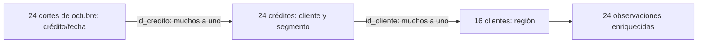
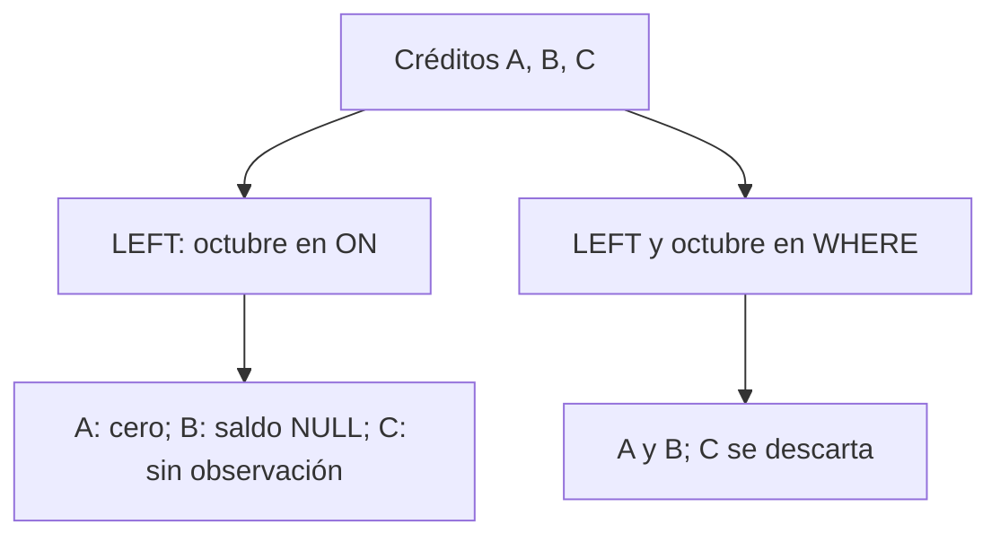
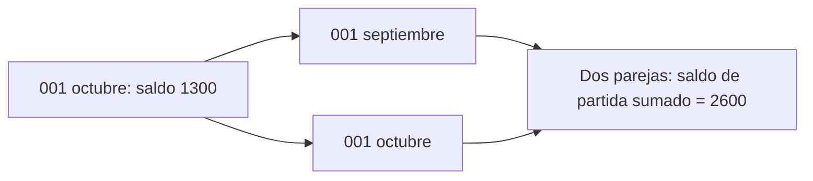

# 05 — Relacionar tablas con joins

## Propósito, prerrequisitos y objetivos — esencial

Responder preguntas que requieren columnas de varias tablas sin perder registros
ni multiplicar importes por accidente. Completa
[03.01 — Modelo relacional](../01_relational_sqlite/README.md),
[03.02 — Primeras consultas](../02_first_queries/README.md) y
[03.03 — Crear tablas y cargar datos](../03_create_load/README.md) y
[03.04 — Agregaciones e indicadores](../04_aggregations/README.md), con sus labs.
Recupera [las uniones de pandas](../../02_pandas/08_combine_tables/README.md).

Al terminar podrás elegir INNER JOIN o LEFT JOIN, escribir condiciones completas,
identificar registros sin correspondencia, distinguir NULL de una falta de unión
y conciliar claves, filas y saldos. Usamos sqlite3 estándar y la base ficticia de
03.01: 16 clientes, 24 créditos y 48 observaciones de dos fechas. Las consultas
abren esa base en solo lectura; los casos adicionales se construyen en memoria.

## 1. Antes del join: pregunta, unidad y cardinalidad

Pregunta: ¿a qué región pertenece cada saldo de octubre? cortes tiene saldo y
fecha; creditos identifica al cliente; clientes aporta región. Un join relaciona
filas mediante una condición, normalmente entre claves. No pega tablas por
posición ni por su orden visual.

La **cardinalidad** describe cuántas correspondencias puede tener una fila:

| Relación y dirección | Correspondencias | Unidad resultante |
| --- | --- | --- |
| Cada corte → su crédito | Exactamente una, con las claves y referencias de esta base | Crédito/fecha |
| Cada crédito → su cliente | Exactamente una | Crédito |
| Cada cliente → sus créditos | Cero, uno o varios en el modelo | Cliente/crédito, o cliente sin crédito si se conserva |
| Cada crédito → sus cortes | Cero, uno o varios | Crédito/fecha, o crédito sin observación si se conserva |

La dirección importa: unir 24 créditos con sus clientes no debería aumentar
filas; partir de 16 clientes puede producir 24 filas legítimamente. La clave
foránea garantiza la referencia del hijo, pero no obliga a cada padre a tener
hijos. En la muestra todos los clientes tienen crédito; no supongas que siempre
será así. Una clave primaria asegura unicidad en su tabla, no en cualquier
resultado que la use.



En palabras: cada observación encuentra un crédito y ese crédito un cliente;
añadimos atributos sin cambiar la unidad crédito/fecha. El diagrama explica
las correspondencias, no el orden físico de ejecución del motor.

Antes de escribir, anota: tabla de partida, clave del resultado, campos de unión,
qué registros conservarás y cuántas coincidencias esperas por fila.

## 2. INNER JOIN, ON y alias de tablas

```sql
SELECT o.id_credito, o.fecha_corte, o.saldo_mxn,
       c.id_cliente, c.segmento, p.region
FROM cortes AS o
INNER JOIN creditos AS c ON c.id_credito = o.id_credito
INNER JOIN clientes AS p ON p.id_cliente = c.id_cliente
WHERE o.fecha_corte = '2026-10-31'
ORDER BY o.id_credito;
```

INNER JOIN conserva parejas que cumplen ON; si una fila no tiene pareja, no
aparece. AS o, AS c y AS p dan nombres cortos a las tablas dentro de esta consulta.
`o.id_credito` significa la columna id_credito de cortes. Califica columnas para
evitar ambigüedad y para dejar claro de dónde vienen. Los alias no renombran la base.
WHERE selecciona octubre; ORDER BY hace reproducible la presentación.

La primera fila es `('001', '2026-10-31', 1300, 'C001', 'consumo', 'norte')`.
Se esperan 24 filas; la combinación crédito/fecha sigue siendo única.
Con la muestra original, ambas relaciones encuentran pareja para cada corte.
En datos externos, INNER JOIN puede esconder referencias ausentes: compruébalas
antes de aceptar el resultado.

JOIN sin la palabra INNER expresa la misma unión interna en estos ejemplos.
Usamos INNER JOIN explícito al aprender. ON decide qué parejas corresponden;
no depende de que las columnas tengan el mismo nombre.

## 3. LEFT JOIN conserva la tabla de partida

Pregunta: ¿qué clientes tenemos, incluyendo quienes no tengan crédito?

```sql
SELECT p.id_cliente, c.id_credito
FROM clientes AS p
LEFT JOIN creditos AS c ON c.id_cliente = p.id_cliente
ORDER BY p.id_cliente, c.id_credito;
```

LEFT JOIN devuelve las parejas encontradas y, para cada fila izquierda sin pareja,
una fila con los campos derechos en NULL. Con dos créditos para C001 aparecen
dos filas; no significa que existan dos clientes C001. La muestra devuelve 24
filas para 16 clientes, porque todos tienen uno o dos créditos.

Para detectar clientes sin crédito:

```sql
SELECT p.id_cliente
FROM clientes AS p
LEFT JOIN creditos AS c ON c.id_cliente = p.id_cliente
WHERE c.id_credito IS NULL
ORDER BY p.id_cliente;
```

El resultado original es vacío. Se examina la **clave derecha no nula**:
si hubo correspondencia, id_credito no puede ser NULL por su contrato.
No uses una medida nullable como saldo para detectar ausencia de pareja.
Esta forma se conoce como antiunión: conserva los registros sin correspondencia.
EXISTS y NOT EXISTS se desarrollarán en 03.06.

## 4. ON y WHERE responden preguntas distintas

Pregunta A: todos los créditos, junto con su observación de octubre si existe.

```sql
SELECT c.id_credito, o.id_credito AS id_observado, o.saldo_mxn
FROM creditos AS c
LEFT JOIN cortes AS o
  ON o.id_credito = c.id_credito AND o.fecha_corte = '2026-10-31'
ORDER BY c.id_credito;
```

La fecha en ON limita las parejas del corte. Los créditos sin observación de
octubre siguen presentes. Pregunta B: solo créditos con observación de octubre.
Si movemos esa condición a `WHERE o.fecha_corte = '2026-10-31'`, las filas sin
pareja se descartan porque su fecha derecha es NULL. En este caso el filtro
hace que el resultado conserve únicamente correspondencias.

La muestra original tiene octubre para todos los créditos: ambas versiones
parecen equivalentes. Para revelar la diferencia, usamos este caso mínimo en
memoria, sin alterar la base guardada:

| Crédito | Observación existente | Saldo |
| --- | --- | --- |
| A | Octubre | 0 |
| B | Octubre | NULL |
| C | Solo septiembre | 100 |

Resultado al filtrar octubre en ON:

| id_credito | id_observado | saldo_mxn | Interpretación |
| --- | --- | --- | --- |
| A | A | 0 | Observación presente y saldo conocido |
| B | B | NULL | Observación presente y saldo desconocido |
| C | NULL | NULL | No hay observación de octubre |

Con el filtro en WHERE quedan A y B. B no desaparece: la fecha es conocida
aunque el saldo sea NULL. La ausencia de registro y la ausencia de una medida
son situaciones distintas. No rellenes ambas con cero para hacer una suma.



Si un crédito tiene septiembre, `WHERE fecha = octubre OR fecha IS NULL`
tampoco recupera automáticamente C: hubo pareja en septiembre y el join no
generó una fila adicional NULL. Para conservar todos los créditos con su
observación de una fecha, coloca esa fecha en ON.

## 5. Una unión puede multiplicar filas sin dar error

Ejemplo deliberadamente incorrecto si buscamos una fila por crédito en octubre:

```sql
SELECT a.id_credito, a.fecha_corte, a.saldo_mxn, b.fecha_corte
FROM cortes AS a
INNER JOIN cortes AS b ON b.id_credito = a.id_credito
WHERE a.fecha_corte = '2026-10-31'
ORDER BY a.id_credito, b.fecha_corte;
```

Es una **autounión**: la misma tabla aparece con dos alias. Cada fila de octubre
encuentra dos filas derechas del mismo crédito, septiembre y octubre. Produce
48 filas y repite cada saldo de octubre dos veces. El SQL es válido, pero no
responde a la unidad que habíamos declarado.

Para unir la misma observación usa la clave completa:

```sql
ON b.id_credito = a.id_credito AND b.fecha_corte = a.fecha_corte
```

En esa consulta particular, recuperar la misma fila no añade información útil;
sirve para comprobar el efecto de la clave completa. Si buscamos comparar
septiembre con octubre, hay que definir fechas y campos de cada lado; no
sumar repetidamente el saldo de partida. Esa comparación se profundiza en 03.07.



En general, si una clave aparece m veces a la izquierda y n veces a la derecha,
una igualdad sobre esa clave produce m × n parejas. Es legítimo cuando la
pregunta pide esas parejas; es un error cuando esperabas una fila por observación.
Unir dos tablas hijas por cliente, por ejemplo créditos y contactos, también
puede repetir cada crédito una vez por contacto.

DISTINCT no corrige el modelo: compara las columnas seleccionadas, puede esconder
filas repetidas en la presentación y no restaura la semántica de una suma.
SUM(DISTINCT saldo_mxn) tampoco es una reparación: dos créditos pueden tener
el mismo saldo y ambos importes deben contribuir. Define claves y unidad primero.

## 6. Comprobar un join — práctica esencial

Para una unión que añade atributos por relaciones muchos a uno:

1. Compara claves y valores de partida antes/después, además de cantidades.
2. Comprueba la unicidad de la clave del resultado.
3. Cuenta correspondencias ausentes mediante una clave derecha obligatoria.
4. Concilia saldos conocidos y cantidad de saldos ausentes sobre la misma fecha.
5. Revisa casos vacíos y parejas múltiples; no aceptes un total sin su cobertura.

El script [joins.py](joins.py) compara la consulta con una referencia independiente
calculada desde los CSV en Python. Conserva las observaciones originales,
verifica claves y prueba septiembre, octubre y una fecha sin registros.
Un total coincidente por sí solo podría ocultar una fila perdida y otra duplicada.

### Conteos y suma después de unir

Recupera los [agregados de 03.04](../04_aggregations/README.md):

COUNT(*) cuenta filas; COUNT(columna) cuenta valores no NULL; SUM(columna)
suma valores conocidos y devuelve NULL si no hay ninguno. GROUP BY construye
un grupo por combinación de columnas; selecciona aquí solo claves agrupadas y
agregados, evitando columnas cuyo valor no esté determinado por el grupo.

```sql
SELECT p.id_cliente,
       COUNT(*) AS filas_resultado,
       COUNT(c.id_credito) AS creditos_encontrados
FROM clientes AS p
LEFT JOIN creditos AS c ON c.id_cliente = p.id_cliente
GROUP BY p.id_cliente
ORDER BY p.id_cliente;
```

Un cliente sin crédito daría filas_resultado = 1 y creditos_encontrados = 0:
la fila conservada por LEFT no es un crédito. En la muestra, C001–C008 tienen
dos créditos y C009–C016 uno. Para conciliar octubre:

```sql
SELECT COUNT(*) AS observaciones,
       COUNT(saldo_mxn) AS saldos_conocidos,
       SUM(saldo_mxn) AS suma_conocida_mxn
FROM cortes
WHERE fecha_corte = '2026-10-31';
```

Obtienes 24 observaciones, 21 saldos conocidos y una suma conocida de 46 700 MXN;
faltan tres importes. La suma
conocida no es el saldo completo de la cartera. Ejecuta el mismo conteo y suma
sobre la unión correcta usando o.saldo_mxn: deben conciliar sobre esa misma base.
La consulta agregada sin GROUP BY devuelve una fila aun cuando no haya datos:
COUNT es cero y SUM es NULL. Una consulta de detalle vacía devuelve cero filas.

### Indicadores por región — práctica

Una vez comprobada la unión de detalle, puedes resumir atributos de otras tablas:

```sql
SELECT p.region, COUNT(*) AS observaciones,
       COUNT(DISTINCT c.id_cliente) AS clientes_distintos,
       COUNT(o.saldo_mxn) AS saldos_conocidos,
       SUM(o.saldo_mxn) AS suma_conocida_mxn
FROM cortes AS o
INNER JOIN creditos AS c ON c.id_credito = o.id_credito
INNER JOIN clientes AS p ON p.id_cliente = c.id_cliente
WHERE o.fecha_corte = '2026-10-31'
GROUP BY p.region
ORDER BY p.region;
```

El resultado ahora tiene una fila por región. COUNT(*) cuenta observaciones,
no clientes: un cliente con dos créditos aporta dos filas al corte.
COUNT(DISTINCT c.id_cliente) cuenta clientes distintos dentro del grupo;
la suma sigue usando una aportación por observación. Concilia los grupos con
24 observaciones, 16 clientes distintos en estas regiones excluyentes, 21 saldos
conocidos y 46 700 MXN conocidos. En otras clasificaciones un cliente puede
pertenecer a varios grupos; no supongas que sus conteos distintos sean aditivos.

## 7. Ejecución y resultados esperados

El programa abre una base existente con mode=ro y no la prepara automáticamente.
Usa parámetros para fechas, una transacción de lectura para consultar una misma
instantánea y finally para cerrar. BEGIN no autoriza escrituras en una conexión
de solo lectura. El caso A/B/C usa otra conexión, en memoria, que también se cierra.

### PowerShell

Desde la raíz, con tu entorno elegido activo. Ejecuta el preparador solo si falta
la base de 03.01; una base existente se comprueba sin reemplazarla.

```powershell
python curriculum\03_sql_databases\01_relational_sqlite\relational_sqlite.py
python curriculum\03_sql_databases\05_joins\joins.py
# Para una copia existente compatible:
python curriculum\03_sql_databases\05_joins\joins.py --database curriculum\03_sql_databases\03_create_load\output\carga_practica.sqlite
```

### Bash/Zsh

```bash
python curriculum/03_sql_databases/01_relational_sqlite/relational_sqlite.py
python curriculum/03_sql_databases/05_joins/joins.py
python curriculum/03_sql_databases/05_joins/joins.py --database curriculum/03_sql_databases/03_create_load/output/carga_practica.sqlite
```

El tercer comando requiere haber creado esa copia en 03.03. Con uv, antepone
`uv run --locked` a cada comando python. No reinstales dependencias ni cambies
de gestor. Los resultados conocidos corresponden a la muestra original: el
programa se detiene si cambian los saldos o atributos que comprueba. Si copias el
script a otra carpeta, adapta SOURCE y elige --database.

Salida: 24 observaciones por fecha existente; fecha inexistente, cero. LEFT
clientes/créditos, 24 filas y lista vacía de clientes sin crédito. La unión
incompleta produce 48 filas; el caso temporal conserva 3 con ON y 2 con WHERE.

## Extensiones y errores habituales

**Extensión:** USING(id_credito) abrevia una igualdad cuando ambos lados tienen
ese nombre; ON hace explícitos los campos y admite nombres diferentes. Evita
NATURAL JOIN al comenzar: decide la unión por todos los nombres comunes y un
cambio de columnas puede alterar su significado. CROSS JOIN genera todas las
combinaciones (24 × 16 = 384 para créditos/clientes); úsalo solo si eso es lo
que pide la pregunta. RIGHT y FULL JOIN quedan como comparación posterior;
este lab se resuelve con INNER y LEFT.

SQL no ofrece el argumento validate de pandas.merge: comprueba la unicidad
del lado derecho y las claves del resultado. Las claves NULL no coinciden con
igualdad ordinaria de SQL; pandas.merge puede emparejar claves nulas. Recupera
esa diferencia antes de trasladar una unión entre herramientas.

| Situación | Qué revisar |
| --- | --- |
| ambiguous column name | Califica el campo con alias de tabla |
| Se pierde una fila en INNER | Busca referencias sin pareja |
| LEFT devuelve más filas | Cuenta parejas por clave; conservar no significa una fila por clave |
| WHERE elimina créditos sin observación | Decide si el filtro derecho pertenece a ON |
| No se distingue saldo ausente de registro ausente | Selecciona una clave derecha obligatoria |
| El saldo crece después del join | Revisa multiplicidad y clave completa |

## Lab, criterio de salida y continuidad

Realiza el [lab 03.05](../../../labs/03_sql_databases/05_joins/README.md).
Puedes continuar cuando expliques unidad y cardinalidad, conserves el universo
elegido, detectes ausencia con una clave derecha y demuestres conciliación sin
DISTINCT para esconder errores. No hay checkpoint de proyecto implementado.
Después, el
[plan de 03.06 — Subconsultas y CTE](../README.md#06-subconsultas-y-cte)
describe la siguiente sección; todavía no hay lección ni lab de 03.06.

## Referencias primarias

Ejemplos propios sobre las muestras de DS Track, contrastados con:

- [SQLite SELECT: joins, ON, USING y filtros](https://www.sqlite.org/lang_select.html).
- [SQLite: COUNT y SUM](https://www.sqlite.org/lang_aggfunc.html).
- [sqlite3 de Python: parámetros, URI y cierre](https://docs.python.org/3.12/library/sqlite3.html).
- [pandas.merge: validación y claves nulas](https://pandas.pydata.org/pandas-docs/version/2.3/reference/api/pandas.merge.html).
