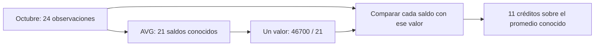
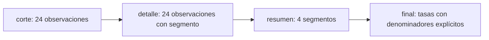

# 06 — Subconsultas y CTE

## Propósito, prerrequisitos y objetivos — práctica

Dividir una pregunta SQL en partes que puedas leer, comprobar y explicar.
Completa [03.05 — Relacionar tablas con joins](../05_joins/README.md) y su lab;
recupera [agregados y denominadores de 03.04](../04_aggregations/README.md).
Necesitas reconocer SELECT, WHERE, alias, NULL, GROUP BY y claves de unión.
Usamos sqlite3 estándar y la base ficticia de 03.01; no hay dependencias nuevas.

Al terminar podrás distinguir una subconsulta que devuelve un valor, una lista
o una tabla; usar EXISTS para preguntar por presencia; reconocer una referencia
correlacionada; y organizar selección, agrupación e indicadores mediante WITH.
Compararás alternativas contra los mismos registros, sin modificar las entradas.

Esta lección es más extensa porque introduce varias formas de composición.
Puedes estudiarla en tres sesiones: **A**, secciones 1–5; **B**, secciones 6–8;
**C**, secciones 9–11 y lab. Las extensiones no bloquean el siguiente módulo.
CTE recursivas y optimización avanzada quedan fuera del criterio de salida.

## 1. Una pregunta puede necesitar otra pregunta

En 03.04 calculaste el promedio conocido de octubre. En 03.02 filtraste valores.
Ahora queremos combinar ambas operaciones:

> ¿Qué créditos tienen saldo conocido mayor que el promedio conocido de octubre?

La pregunta pequeña es «¿cuál es ese promedio?». La principal es «¿qué saldos
lo superan?». Una **subconsulta** es un SELECT dentro de otra sentencia SQL.
Permite usar el resultado de una pregunta como parte de otra.



En palabras: calculamos una referencia sobre los saldos conocidos y comparamos
con ella las observaciones del mismo corte. El diagrama organiza la explicación;
no promete un orden físico de ejecución del motor.

Antes de componer consultas, anota la **forma del resultado intermedio**:

| Necesitas | Forma | Uso habitual |
| --- | --- | --- |
| Un promedio o conteo | Un valor | Subconsulta escalar en una expresión |
| Saber si hay pareja | Verdadero/falso | EXISTS o NOT EXISTS |
| IDs que cumplen una regla | Una columna con varios valores | IN |
| Un resumen que consultar después | Filas y columnas | Subconsulta en FROM o CTE |

No son sintaxis intercambiables: cada posición espera una forma distinta.

## 2. Subconsulta escalar: una referencia de un valor

```sql
SELECT o.id_credito, o.saldo_mxn
FROM cortes AS o
WHERE o.fecha_corte = '2026-10-31'
  AND o.saldo_mxn > (
      SELECT AVG(r.saldo_mxn)
      FROM cortes AS r
      WHERE r.fecha_corte = '2026-10-31'
  )
ORDER BY o.id_credito;
```

Lee desde adentro para entender la dependencia:

1. La subconsulta selecciona octubre y calcula AVG sobre sus conocidos.
2. Su resultado es un solo valor, aproximadamente 2 223.8095 MXN.
3. La consulta exterior selecciona también octubre y compara cada saldo con él.
4. WHERE conserva solo comparaciones verdaderas; saldos NULL no cumplen.
5. Ordenamos por ID para comprobar el resultado.

Obtienes 011–021, once filas. 010 tiene 2 200 y no supera el promedio; 011
tiene 2 300 y sí. La referencia y el detalle usan **la misma fecha**. Omitir la
fecha en la subconsulta calcularía el promedio del histórico y cambiaría la
pregunta. No copies manualmente el promedio redondeado como límite: conserva
la precisión del cálculo y el vínculo con los datos.

AVG sin GROUP BY devuelve una fila. Si no hay registros o todos los saldos
son NULL, el valor es NULL y ninguna comparación `saldo > NULL` es verdadera.
Esto produce una selección vacía, no un promedio cero.

### ¿Qué ocurre si la subconsulta devuelve varias filas?

Una subconsulta escalar debe estar diseñada para devolver un valor. En SQLite,
si devuelve varias filas se toma la primera; otros motores pueden rechazarla.
No dependas de esa diferencia ni de una primera fila sin orden.

```sql
SELECT (SELECT saldo_mxn
        FROM cortes
        WHERE id_credito = '001' AND fecha_corte = '2026-10-31') AS saldo;
```

La clave completa garantiza como máximo una observación; devuelve 1300.
Si usas solo id_credito, hay dos fechas y la consulta deja de expresar un valor
único. LIMIT 1 tampoco resuelve una clave incompleta salvo que la pregunta pida
explícitamente elegir una fila y hayas definido su orden/desempate.
Si una subconsulta escalar no produce filas, su valor es NULL.

## 3. IN: pertenecer a una lista obtenida con SQL

Pregunta: ¿qué clientes tienen al menos un crédito con 30 o más días de atraso
conocido en octubre?

```sql
SELECT p.id_cliente
FROM clientes AS p
WHERE p.id_cliente IN (
    SELECT c.id_cliente
    FROM creditos AS c
    INNER JOIN cortes AS o ON o.id_credito = c.id_credito
    WHERE o.fecha_corte = '2026-10-31' AND o.dias_atraso >= 30
)
ORDER BY p.id_cliente;
```

La subconsulta devuelve una columna con IDs; IN pregunta si el ID exterior
pertenece a ese resultado. Puede haber IDs repetidos en la lista: eso no duplica
las filas exteriores. No necesitas DISTINCT dentro de este IN para obtener
una fila por cliente, porque la tabla exterior ya tiene una clave única.

Resultado: C002, C004, C005, C007, C010, C011 y C015, siete clientes.
Hay nueve créditos confirmados, pero algunos pertenecen al mismo cliente.
IN compara valores; no añade columnas de la consulta interior. Si necesitas
mostrar qué crédito o cuál saldo produjo la coincidencia, usa un join y define
la unidad de ese detalle.

## 4. EXISTS: preguntar si hay al menos una fila

La misma selección puede expresarse así:

```sql
SELECT p.id_cliente
FROM clientes AS p
WHERE EXISTS (
    SELECT 1
    FROM creditos AS c
    INNER JOIN cortes AS o ON o.id_credito = c.id_credito
    WHERE c.id_cliente = p.id_cliente
      AND o.fecha_corte = '2026-10-31'
      AND o.dias_atraso >= 30
)
ORDER BY p.id_cliente;
```

EXISTS pregunta si la subconsulta produce alguna fila. Devuelve 1 o 0 en SQLite.
SELECT 1 comunica que importa la presencia; no cuenta filas ni exige que exista
un valor 1 almacenado. SELECT o.saldo_mxn también haría verdadera la existencia
de una fila cuyo saldo fuera NULL: EXISTS no examina el valor proyectado.

Esta subconsulta es **correlacionada** porque usa `p.id_cliente`, definido en
la consulta exterior. Para entenderla, imagina cada cliente y pregunta si existe
un crédito suyo con la regla del corte. `c.id_cliente = p.id_cliente` establece
esa relación. Si la omites, la pregunta interior es global: si hay algún atraso
confirmado en toda la cartera, todos los clientes exteriores podrían pasar.

El alias exterior p es visible dentro de la subconsulta; los alias interiores
c y o pertenecen a su bloque. Califica los campos incluso cuando SQL podría
resolverlos por nombre: evita correlaciones accidentales y ambigüedades.
«Para cada cliente» es una lectura lógica, no una medición de cuántas veces
SQLite ejecutará físicamente cada operación.

### EXISTS frente a un join

```sql
SELECT DISTINCT p.id_cliente
FROM clientes AS p
INNER JOIN creditos AS c ON c.id_cliente = p.id_cliente
INNER JOIN cortes AS o ON o.id_credito = c.id_credito
WHERE o.fecha_corte = '2026-10-31' AND o.dias_atraso >= 30
ORDER BY p.id_cliente;
```

El join genera parejas cliente/crédito/corte: nueve filas antes de DISTINCT.
La pregunta pide clientes, por lo que esta proyección distinta es deliberada
y válida; no intenta esconder un join incorrecto. EXISTS expresa directamente
esa presencia y conserva una fila por cliente exterior. Ni EXISTS ni IN
eliminan duplicados que ya existieran en la entrada exterior.

Las tres formas entregan los mismos siete IDs aquí. No afirmamos que una sea
más rápida por su sintaxis: esa comparación necesitaría datos y mediciones.

## 5. NOT EXISTS, NOT IN y NULL

Para preguntar por clientes sin ningún crédito que cumpla la regla anterior,
cambia EXISTS por NOT EXISTS manteniendo la misma correlación. Obtienes nueve
clientes de la muestra. Eso significa **sin atraso confirmado por esa consulta**;
no demuestra que todos sus atrasos sean conocidos ni que no tengan créditos.

La negación de presencia es distinta de asumir que todo valor ausente es cero.
Con una fecha inexistente, EXISTS selecciona cero clientes y NOT EXISTS
conserva los 16: no hay evidencia de una coincidencia en esa fecha.

### Un caso pequeño para ver la trampa de NOT IN

El script crea en memoria candidatos A, B, C y una selección con A y NULL.
No modifica la cartera. Queremos candidatos sin un ID coincidente:

```sql
SELECT id
FROM candidatos
WHERE id NOT IN (SELECT id FROM seleccion)
ORDER BY id;
```

Devuelve cero filas. A está en la lista y falla la negación; para B y C no
hay coincidencia conocida, pero NULL impide afirmar que no pertenecen.
El resultado lógico es desconocido y WHERE lo descarta.

```sql
SELECT c.id
FROM candidatos AS c
WHERE NOT EXISTS (
    SELECT 1 FROM seleccion AS s WHERE s.id = c.id
)
ORDER BY c.id;
```

Devuelve B y C. Para cada candidato no hay ninguna igualdad verdadera en la
selección; la fila NULL no produce una pareja por igualdad ordinaria.
Esto es la antiunión vista con LEFT JOIN en 03.05, expresada por presencia.

| Candidato | IN con A, NULL | NOT IN con A, NULL | NOT EXISTS por igualdad |
| --- | --- | --- | --- |
| A | Verdadero | Falso | Falso |
| B | Desconocido | Desconocido | Verdadero |
| C | Desconocido | Desconocido | Verdadero |

Si la columna seleccionada está garantizada NOT NULL y las claves exteriores
tampoco son NULL, esta trampa no aparece. Filtrar los NULL de la lista puede
ser adecuado si responde a tu contrato, pero no sustituye analizar ausencias
exteriores. Con igualdad normal, una clave exterior NULL tampoco encuentra
pareja en NOT EXISTS; decide primero qué significa una clave faltante.

**Extensión:** una lista vacía hace IN falso y NOT IN verdadero en SQLite.
No construyas manualmente `IN ()` para una lista Python vacía: elige una consulta
o regla de selección explícita. En esta lección usamos subconsultas, no listas
de marcadores generadas por texto.

## 6. Subconsulta en FROM: consultar un resumen como tabla

Ahora queremos obtener una tasa por segmento sin repetir sus conteos en toda
la expresión. Primero construimos el resumen; después calculamos la tasa:

```sql
SELECT r.segmento, r.registros, r.atrasos_conocidos, r.confirmados,
       100.0 * r.confirmados / NULLIF(r.atrasos_conocidos, 0)
           AS tasa_conocidos_pct
FROM (
    SELECT c.segmento, COUNT(*) AS registros,
           COUNT(o.dias_atraso) AS atrasos_conocidos,
           COUNT(CASE WHEN o.dias_atraso >= 30 THEN 1 END) AS confirmados
    FROM cortes AS o
    INNER JOIN creditos AS c ON c.id_credito = o.id_credito
    WHERE o.fecha_corte = '2026-10-31'
    GROUP BY c.segmento
) AS r
ORDER BY r.segmento;
```

La subconsulta produce una tabla derivada: cuatro filas, una por segmento.
AS r nombra esa entrada para el SELECT exterior. Sus columnas son las claves
y alias del resumen interior; el ID de cada crédito ya no forma parte de esa
tabla. La unidad exterior sigue siendo segmento.

Separar capas permite usar confirmados y atrasos_conocidos como columnas
ya definidas. Evita intentar usar un alias recién creado dentro de otra
expresión hermana del mismo SELECT. Aunque SQLite admita algunos usos de alias
en otras cláusulas, las capas hacen explícita la dependencia y facilitan portarla.

Subconsulta en FROM y subconsulta escalar tienen paréntesis, pero producen
formas diferentes: una se usa como tabla; la otra como valor.

## 7. WITH y CTE: dar nombre a un resultado intermedio

CTE significa *Common Table Expression*, o expresión de tabla común.
Una CTE ordinaria nombra un resultado de consulta para usarlo dentro de una
sola sentencia. No crea una tabla guardada ni cambia la base.

La consulta anterior puede reorganizarse:

```sql
WITH resumen AS (
    SELECT c.segmento, COUNT(*) AS registros,
           COUNT(o.dias_atraso) AS atrasos_conocidos,
           COUNT(CASE WHEN o.dias_atraso >= 30 THEN 1 END) AS confirmados
    FROM cortes AS o
    INNER JOIN creditos AS c ON c.id_credito = o.id_credito
    WHERE o.fecha_corte = '2026-10-31'
    GROUP BY c.segmento
)
SELECT segmento, registros, atrasos_conocidos, confirmados,
       100.0 * confirmados / NULLIF(atrasos_conocidos, 0) AS tasa_conocidos_pct
FROM resumen
ORDER BY segmento;
```

WITH comienza la sentencia; resumen es el nombre elegido; AS (...) contiene
el SELECT que describe sus columnas. El SELECT final consume ese resultado.
El punto y coma va al final de toda la sentencia, no entre WITH y su SELECT.
Después no puedes ejecutar `SELECT * FROM resumen` como otra sentencia:
el nombre dejó de existir. Para consultar una etapa repite su WITH y cambia
el SELECT final, conservando los filtros de la pregunta.

| segmento | registros | atrasos_conocidos | confirmados | tasa_conocidos_pct |
| --- | --- | --- | --- | --- |
| comercio | 5 | 5 | 2 | 40 |
| consumo | 10 | 9 | 4 | ≈ 44.44 |
| educacion | 3 | 2 | 1 | 50 |
| servicios | 6 | 5 | 2 | 40 |

Es el mismo cálculo que la tabla derivada. Cambiar la estructura no autoriza
cambiar el universo, denominadores o tratamiento de NULL.

## 8. Varias CTE: seleccionar → relacionar → resumir → presentar

Para un reporte verificable añadimos saldos conocidos y cobertura. Escribimos
una sola cláusula WITH, con CTE separadas por comas:

```sql
WITH corte AS (
    SELECT id_credito, saldo_mxn, dias_atraso
    FROM cortes
    WHERE fecha_corte = '2026-10-31'
), detalle AS (
    SELECT o.id_credito, o.saldo_mxn, o.dias_atraso, c.segmento
    FROM corte AS o
    INNER JOIN creditos AS c ON c.id_credito = o.id_credito
), resumen AS (
    SELECT segmento,
           COUNT(*) AS registros,
           COUNT(saldo_mxn) AS saldos_conocidos,
           SUM(saldo_mxn) AS suma_conocida_mxn,
           COUNT(dias_atraso) AS atrasos_conocidos,
           COUNT(CASE WHEN dias_atraso >= 30 THEN 1 END) AS confirmados
    FROM detalle
    GROUP BY segmento
)
SELECT segmento, registros, saldos_conocidos, suma_conocida_mxn,
       atrasos_conocidos, confirmados,
       100.0 * confirmados / NULLIF(atrasos_conocidos, 0) AS tasa_conocidos_pct,
       100.0 * atrasos_conocidos / NULLIF(registros, 0) AS cobertura_atraso_pct
FROM resumen
ORDER BY segmento;
```

Cada etapa tiene una responsabilidad y una unidad que puedes comprobar:

| Etapa | Responsabilidad | Unidad y filas de octubre |
| --- | --- | --- |
| corte | Seleccionar fecha y campos necesarios | Una observación por crédito en esa fecha; 24 |
| detalle | Añadir segmento con una relación muchos a uno | Misma observación; 24 |
| resumen | Agregar sin perder cobertura | Un segmento; 4 |
| SELECT final | Calcular y presentar tasas | Un segmento; 4 |



En palabras: restringimos la fecha, añadimos un atributo, agrupamos y calculamos
indicadores sobre esos conteos. Es una cadena de dependencias para leer la
consulta; no garantiza que el motor guarde ni ejecute cada etapa por separado.
Define primero los pasos de los que dependen los siguientes y usa nombres
que describan su contenido. No llames tabla1, tabla2 a etapas con funciones claras.

El script conserva 46 700 MXN conocidos y 21 saldos conocidos entre los cuatro
grupos. educacion tiene tres registros y ningún saldo conocido: su SUM es NULL,
aunque su tasa de atraso entre los dos conocidos sea 50 %.
En septiembre ese segmento tiene cero atrasos conocidos: tasa NULL y cobertura
0 %. No filtres todos los NULL en corte solo para obtener números en todas las
columnas; cambiarías el universo antes de medir cobertura.

### Cómo inspeccionar una etapa

Prueba esta consulta corta antes del reporte completo:

```sql
WITH corte AS (
    SELECT id_credito, saldo_mxn, dias_atraso
    FROM cortes WHERE fecha_corte = '2026-10-31'
)
SELECT COUNT(*) AS registros, COUNT(saldo_mxn) AS saldos_conocidos,
       SUM(saldo_mxn) AS suma_conocida_mxn
FROM corte;
```

Esperas (24, 21, 46700). Para inspeccionar detalle incluye también su definición
y selecciona sus claves; para resumen incluye las tres definiciones y selecciona
sus grupos. Al modificar el SELECT final mantén la sentencia completa.
Comprueba unicidad y valores antes de agrupar: una CTE también puede contener
un join que multiplique filas, y el agregado ocultaría su origen.

## 9. Comparar alternativas con evidencia

[queries.py](queries.py) incluye las versiones escalar/CTE del filtro sobre
promedio, IN/EXISTS/join para clientes y tabla derivada/CTE para el reporte.
Las contrasta con referencias calculadas directamente desde los CSV en Python.
Verifica también que corte y detalle tengan las mismas observaciones y valores.

Comparar no significa convertir todo a set. Un conjunto quitaría duplicados
y podría esconder una multiplicación de filas. Conserva tuplas completas,
ordena por una clave explícita y compara cantidades, columnas, NULL y valores.
Los reales se comparan con tolerancia pequeña; redondea solo para presentar.

Con otra fecha o umbral, todas las versiones de **la misma pregunta** deben
seguir coincidiendo. Cambiar un filtro solo en una versión invalida la comparación.
El script prueba septiembre, octubre, fecha inexistente y umbral 100.
En la fecha inexistente no hay grupos ni créditos sobre promedio, pero
NOT EXISTS conserva los 16 clientes. Con umbral 100 nadie confirma atraso;
esto no modifica los promedios de saldo porque son otra medida.

### Parámetros con nombre desde Python

Para reutilizar una fecha en varios bloques, el script usa parámetros nombrados:

```python
parametros = {"fecha": "2026-10-31", "umbral": 30}
filas = conexion.execute(CLIENTS_EXISTS, parametros).fetchall()
```

En SQL se escriben :fecha y :umbral, sin comillas. En el diccionario las claves
no llevan dos puntos. Un nombre repetido recibe el mismo valor en la sentencia;
esto evita pasar fechas diferentes por accidente en un filtro y su referencia.
Como con los ? de 03.02, los parámetros representan valores, no tablas ni columnas.
CLIENTS_EXISTS es una constante SQL del script, no una tabla.

### PowerShell

Desde la raíz y con tu entorno elegido activo. Si ya existe la base de 03.01,
ejecuta solo el segundo comando; el preparador conserva bases existentes.

```powershell
python curriculum\03_sql_databases\01_relational_sqlite\relational_sqlite.py
python curriculum\03_sql_databases\06_subqueries_cte\queries.py
# Otra copia compatible existente:
python curriculum\03_sql_databases\06_subqueries_cte\queries.py --database curriculum\03_sql_databases\03_create_load\output\carga_practica.sqlite
```

### Bash/Zsh

```bash
python curriculum/03_sql_databases/01_relational_sqlite/relational_sqlite.py
python curriculum/03_sql_databases/06_subqueries_cte/queries.py
python curriculum/03_sql_databases/06_subqueries_cte/queries.py --database curriculum/03_sql_databases/03_create_load/output/carga_practica.sqlite
```

El tercer comando requiere la copia creada en 03.03. Con uv, antepone
`uv run --locked` a cada comando python; no cambies de gestor ni reinstales
paquetes. La conexión al archivo usa mode=ro y una transacción de lectura;
se cierra en finally. Los casos NULL viven en otra base en memoria que se cierra.
El programa compara entradas con las fuentes y falla si difieren, sin repararlas.

## 10. Extensiones: referencias por grupo y rendimiento

**Referencia correlacionada por grupo:** «mayor que el promedio de su segmento»
es diferente de «mayor que el promedio de todo octubre». Puedes construir
primero una CTE con un promedio por segmento y unirla al detalle por segmento.
La clave del resumen debe ser única para que cada observación encuentre una
sola referencia. También podría expresarse con una subconsulta correlacionada;
no la elijas antes de aclarar si la referencia es global o por grupo.
Esta ampliación se practica de forma opcional en el lab.

**CTE y rendimiento:** WITH mejora la organización cuando los nombres y etapas
ayudan. No garantiza más velocidad, menor memoria ni ejecución única de cada
etapa. SQLite puede integrar o materializar resultados según el plan; pistas
MATERIALIZED/NOT MATERIALIZED y EXPLAIN QUERY PLAN se estudian cuando exista
una necesidad medible. No hace falta usarlas para completar esta lección.

**CTE recursivas:** permiten recorrer jerarquías o generar secuencias a partir
de una base y una regla repetida. No son necesarias para los ejemplos actuales.
Se profundizarán con una pregunta que justifique la repetición y su criterio
de terminación; escribir WITH no implica usar recursión.

## 11. Errores habituales, lab y criterio de salida

| Situación | Qué revisar |
| --- | --- |
| Todos los clientes pasan EXISTS | Puede faltar la correlación con el cliente exterior |
| NOT IN no devuelve los IDs esperados | Inspecciona NULL y la lista interior |
| Una referencia escalar elige un saldo arbitrario | Usa clave completa o agregado que exprese la pregunta |
| no such table: resumen | La CTE solo existe en su sentencia; incluye WITH |
| syntax error cerca del SELECT final | Revisa comas, paréntesis y punto y coma |
| El indicador cambia al reorganizar SQL | Compara filtros, claves, multiplicidad y denominadores |
| CTE parece correcta pero saldo se duplica | Inspecciona el detalle antes de resumir |

Realiza el [lab 03.06](../../../labs/03_sql_databases/06_subqueries_cte/README.md).
Puedes continuar cuando identifiques la forma de cada subconsulta, justifiques
presencia y correlación, compruebes cada etapa y demuestres equivalencia sin
ocultar duplicados ni NULL. El proyecto y sus checkpoints siguen pendientes.
Después consulta el [03.07 — Ventanas para comparar registros](../07_windows/README.md). Su idea central será comparar
filas conservando el detalle, en contraste con agrupar.

## Referencias primarias

Ejemplos propios del proyecto, contrastados con:

- [SQLite: WITH y CTE ordinarias/recursivas](https://www.sqlite.org/lang_with.html).
- [SQLite: subconsultas escalares, IN y EXISTS](https://www.sqlite.org/lang_expr.html).
- [SQLite SELECT: entradas derivadas, agregación y joins](https://www.sqlite.org/lang_select.html).
- [SQLite: comportamiento de AVG, SUM y COUNT](https://www.sqlite.org/lang_aggfunc.html).
- [sqlite3 de Python 3.12: parámetros nombrados y cierre](https://docs.python.org/3.12/library/sqlite3.html).
