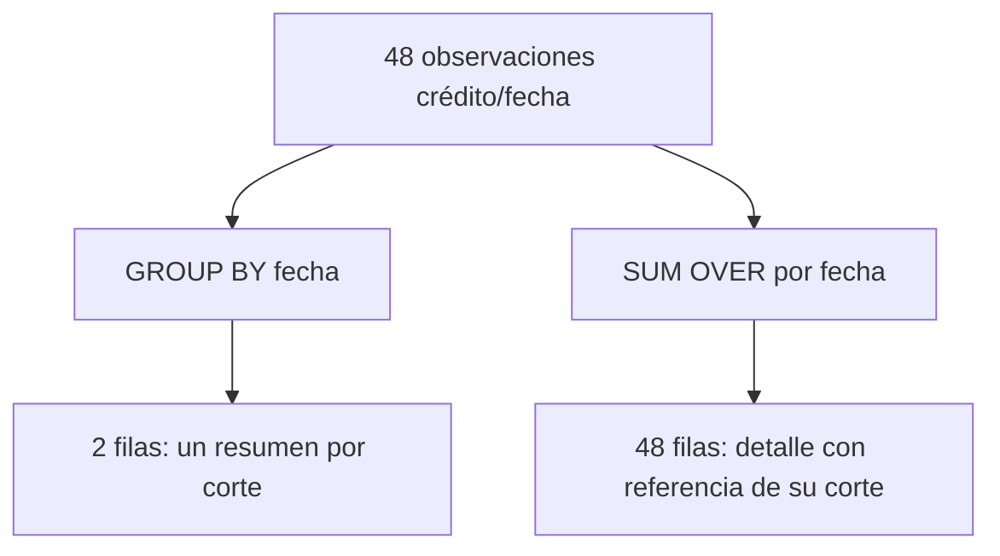
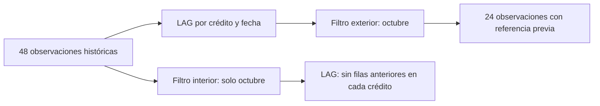
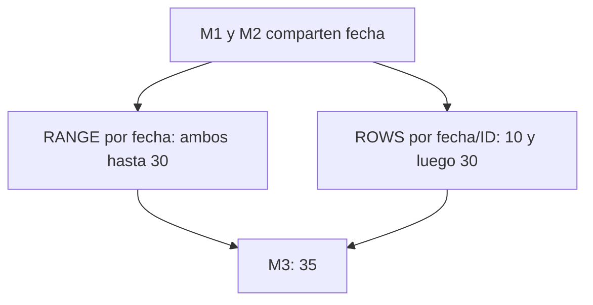

# 07 — Ventanas para comparar registros

## Propósito, prerrequisitos y objetivos — práctica

Comparar filas relacionadas sin perder el detalle que necesitas para explicar
el resultado. Completa [03.06 — Subconsultas y CTE](../06_subqueries_cte/README.md)
y su lab; recupera [agregación de 03.04](../04_aggregations/README.md) y
[cardinalidad de 03.05](../05_joins/README.md).
Debes reconocer claves, fechas, NULL, alias, GROUP BY y consultas por etapas.
Usamos sqlite3 estándar y la base ficticia de 03.01, sin dependencias nuevas.

Al terminar podrás leer OVER, definir particiones y orden, numerar registros,
recuperar la observación anterior y declarar el marco de un acumulado.
Comprobarás claves, valores, ausencias y cobertura; no solo cantidades.

La lección puede dividirse en tres sesiones: **A**, secciones 1–4; **B**,
secciones 5–7; **C**, secciones 8–10 y lab. Ranking con empates y otras funciones
quedan como extensiones; no necesitas dominar todos los marcos para continuar.
Las ventanas existen en SQLite desde 3.25.0; el script comprueba la versión
del motor integrado en Python. No confundas esa versión con la de Python.

## 1. GROUP BY resume; una ventana añade información al detalle

Pregunta de 03.04: ¿qué suma conocida tiene cada corte?

```sql
SELECT fecha_corte, COUNT(*) AS registros, SUM(saldo_mxn) AS suma_conocida_mxn
FROM cortes
GROUP BY fecha_corte
ORDER BY fecha_corte;
```

Produce dos filas, una por fecha. Los 48 registros originales se reducen a dos
resúmenes. Ahora queremos ver cada observación y la suma conocida de su corte:

```sql
SELECT id_credito, fecha_corte, saldo_mxn,
       COUNT(*) OVER (PARTITION BY fecha_corte) AS registros_corte,
       COUNT(saldo_mxn) OVER (PARTITION BY fecha_corte) AS saldos_conocidos,
       SUM(saldo_mxn) OVER (PARTITION BY fecha_corte) AS suma_conocida_mxn
FROM cortes
ORDER BY fecha_corte, id_credito;
```

Obtienes 48 filas. En cada observación de octubre aparecen registros_corte = 24,
saldos_conocidos = 21 y suma_conocida_mxn = 46 700. El saldo individual se conserva.
SUM sin OVER agrega filas; SUM con OVER calcula sobre una ventana y devuelve
ese resultado en cada fila de detalle correspondiente.



En palabras: agrupar cambia la unidad; añadir una función de ventana a una
consulta de detalle conserva esa unidad. Los joins y filtros que preparan la
entrada sí pueden cambiar filas antes de la ventana: compruébalos primero.

**No sumes los totales repetidos.** Sumar suma_conocida_mxn de las 24 filas de
octubre daría 24 veces el mismo total. Es una referencia del corte, no una
aportación nueva por crédito. Para conciliar, usa el resumen por fecha o una
referencia por corte después de verificar que todas sus filas muestran lo mismo.

## 2. Leer OVER: partición, orden y marco

Una **ventana** describe sobre qué filas calcula una función. OVER contiene
su definición. Hay tres decisiones distintas:

| Componente | Pregunta | Ejemplo |
| --- | --- | --- |
| PARTITION BY | ¿Qué filas pertenecen al mismo conjunto? | Historia de cada id_credito |
| ORDER BY dentro de OVER | ¿En qué secuencia se comparan? | fecha_corte ascendente |
| Marco, cuando lo usa la función | ¿Qué parte de la partición aporta a la fila actual? | Desde la primera fila hasta la actual |

Sin PARTITION BY, la entrada completa forma una partición. OVER () permite,
por ejemplo, añadir una suma sobre toda la entrada de la consulta. En esta base
mezclar los dos cortes no produce el saldo de una fecha; define el universo.

El orden **dentro** de OVER define la operación. El ORDER BY **exterior** define
cómo se muestran las filas. Uno no sustituye al otro. Puedes numerar saldos en
orden descendente y presentar IDs ascendentemente; los números conservan el
orden de la ventana aunque la tabla visible tenga otro orden.

Un orden útil debe resolver empates cuando la función necesita distinguir
posiciones. En cortes, dentro de cada crédito, fecha_corte es única por su
clave compuesta; en un ranking de saldos, distintos créditos pueden empatar.
Si incorporas eventos con la misma fecha, necesitarás una clave adicional
para decidir el orden o una regla que conserve los empates.

## 3. ROW_NUMBER: una posición por fila

Pregunta: ¿cuál es la observación más reciente de cada crédito?

```sql
WITH ordenadas AS (
    SELECT id_credito, fecha_corte, saldo_mxn,
           ROW_NUMBER() OVER (
               PARTITION BY id_credito ORDER BY fecha_corte DESC
           ) AS posicion
    FROM cortes
)
SELECT id_credito, fecha_corte, saldo_mxn
FROM ordenadas
WHERE posicion = 1
ORDER BY id_credito;
```

ROW_NUMBER asigna 1, 2, 3… dentro de cada partición. DESC coloca primero la
fecha más reciente. La CTE conserva inicialmente las 48 filas con su posición;
la consulta exterior selecciona la primera de cada crédito y devuelve 24 filas.
Todos tienen octubre en la muestra, incluidos 022–024 con saldo NULL.

¿Por qué hay dos capas? Las ventanas se calculan después del filtro WHERE de
su propio bloque. En SQLite no se usan directamente en WHERE; primero calcula
posicion y luego filtra en el SELECT exterior, como aprendiste con CTE en 03.06.
No escribas `WHERE ROW_NUMBER() OVER (...) = 1` en la misma capa.

La pregunta es **última observación**, no **último saldo conocido**. Si filtras
saldo_mxn IS NOT NULL antes de numerar, eliminas observaciones desconocidas y
puedes seleccionar una fecha más antigua: 022 y 023 regresarían a septiembre;
024 desaparecería. Eso sería otra pregunta y necesita otro nombre.

### Top N por segmento — práctica

```sql
WITH ordenadas AS (
    SELECT c.segmento, o.id_credito, o.saldo_mxn,
           ROW_NUMBER() OVER (
               PARTITION BY c.segmento
               ORDER BY o.saldo_mxn DESC, o.id_credito
           ) AS posicion
    FROM cortes AS o
    INNER JOIN creditos AS c ON c.id_credito = o.id_credito
    WHERE o.fecha_corte = '2026-10-31' AND o.saldo_mxn IS NOT NULL
)
SELECT segmento, id_credito, saldo_mxn, posicion
FROM ordenadas
WHERE posicion <= 3
ORDER BY segmento, posicion;
```

Seleccionamos una fecha **antes** de ordenar porque buscamos el top de ese
corte. Excluimos saldos desconocidos de forma deliberada: no podemos ordenarlos
como importes conocidos. El ID desempata saldos iguales y hace reproducible
la selección. No significa que un ID menor tenga mayor relevancia económica.

En octubre devuelve nueve filas: comercio 021/020/019, consumo 010/009/008 y
servicios 016/015/014. educacion no aparece porque no tiene saldo conocido;
no significa que no tenga créditos ni que sus saldos sean menores que todos.
En septiembre educacion aporta solo dos filas conocidas. Top 3 significa
**hasta tres filas por segmento con datos**, no tres garantizadas.

## 4. LAG: recuperar la observación anterior

Pregunta: ¿qué saldo tenía este mismo crédito en su observación anterior?

```sql
SELECT id_credito, fecha_corte, saldo_mxn,
       LAG(fecha_corte) OVER (
           PARTITION BY id_credito ORDER BY fecha_corte
       ) AS fecha_anterior,
       LAG(saldo_mxn) OVER (
           PARTITION BY id_credito ORDER BY fecha_corte
       ) AS saldo_anterior
FROM cortes
ORDER BY id_credito, fecha_corte;
```

LAG devuelve un valor de una fila anterior dentro de la partición. Sin indicar
desplazamiento usa una posición anterior. El orden ascendente de fechas define
la historia: para 001, septiembre precede a octubre. La primera observación de
cada crédito no tiene fila anterior y recibe NULL.

| id_credito | fecha_corte | saldo_mxn | fecha_anterior | saldo_anterior |
| --- | --- | --- | --- | --- |
| 001 | 2026-09-30 | 1100 | NULL | NULL |
| 001 | 2026-10-31 | 1300 | 2026-09-30 | 1100 |
| 005 | 2026-09-30 | NULL | NULL | NULL |
| 005 | 2026-10-31 | 1700 | 2026-09-30 | NULL |

LAG(saldo) NULL tiene dos explicaciones posibles: no existe fila anterior, o
sí existe y su saldo es desconocido. Por eso recuperamos también fecha_anterior,
un campo obligatorio de la observación original. No detectes existencia solo
con una medida nullable.

Sin PARTITION BY id_credito podrías comparar el saldo de un crédito con otro.
Sin un orden correcto, «anterior» pierde el significado temporal. El ORDER BY
exterior no arregla una ventana mal definida.

### Anterior disponible no significa mes anterior

Si un crédito tiene septiembre y diciembre, LAG en diciembre devuelve septiembre.
No inventa octubre/noviembre ni exige periodicidad mensual. Recupera la fecha
anterior y comprueba la regla temporal de tu pregunta. Comparar contra una fecha
exacta puede requerir un join por crédito y fecha acordada, como en 03.05.
Aquí el contrato es «observación previa disponible».

LAG tampoco salta los valores NULL. Si la secuencia es septiembre 100, octubre
NULL y diciembre 130, el saldo anterior de diciembre es NULL de octubre, no 100.
SQLite no ofrece una opción IGNORE NULLS en LAG. Calcular «último conocido»
requiere otra consulta y otro contrato; no elimines filas sin decirlo.

**Extensión:** `LAG(saldo_mxn, 2)` retrocede dos posiciones; no significa dos
meses. Un tercer argumento, por ejemplo `LAG(saldo_mxn, 1, 0)`, aporta un valor
cuando la fila anterior no existe; no reemplaza un NULL de una fila que sí existe.
No lo usamos porque cero no representa ausencia de observación.

## 5. Calcular diferencias sin convertir desconocidos en cero

Para mostrar solo octubre conservando septiembre como referencia, calcula
primero la historia y filtra después:

```sql
WITH historia AS (
    SELECT id_credito, fecha_corte, saldo_mxn,
           LAG(fecha_corte) OVER (
               PARTITION BY id_credito ORDER BY fecha_corte
           ) AS fecha_anterior,
           LAG(saldo_mxn) OVER (
               PARTITION BY id_credito ORDER BY fecha_corte
           ) AS saldo_anterior
    FROM cortes
)
SELECT id_credito, fecha_corte, saldo_mxn, fecha_anterior, saldo_anterior,
       saldo_mxn - saldo_anterior AS cambio_mxn,
       100.0 * (saldo_mxn - saldo_anterior) / NULLIF(saldo_anterior, 0)
           AS cambio_pct
FROM historia
WHERE fecha_corte = '2026-10-31'
ORDER BY id_credito;
```

Si pones el filtro de octubre dentro de historia, la ventana recibe solo octubre:
cada crédito queda con una fila y todos los valores anteriores son NULL.
La selección final sigue teniendo 24 registros, así que contar filas no detecta
el cambio de significado. Comprueba fechas y valores recuperados.



En palabras: la ubicación del filtro define qué historia ve la ventana. No es
solo una elección de estilo ni una promesa del orden físico de ejecución.

| Crédito | Anterior MXN | Actual MXN | Cambio MXN | Cambio porcentual |
| --- | --- | --- | --- | --- |
| 001 | 1100 | 1300 | 200 | ≈ 18.18 % |
| 004 | 1400 | 0 | −1400 | −100 % |
| 005 | NULL | 1700 | NULL | NULL |
| 022 | 3200 | NULL | NULL | NULL |
| 024 | NULL | NULL | NULL | NULL |

NULL en cualquier operando impide calcular la diferencia conocida. Con saldo
anterior cero puedes calcular el cambio absoluto, pero el cambio porcentual
no tiene denominador definido: NULLIF deja el porcentaje en NULL. Actual cero
y anterior positivo sí permite un porcentaje, como el −100 % de 004.

El script añade un estado con CASE: sin_anterior, ambos_desconocidos,
actual_desconocido, anterior_desconocido o comparable. En octubre hay **19 pares
comparables** y cinco con algún saldo desconocido. Los 24 registros de septiembre
no tienen observación anterior en esta muestra. «Comparable» significa que
ambos saldos son conocidos; no garantiza porcentaje definido si la base es cero.

## 6. Qué demuestra la suma de cambios — práctica

No compares sumas de cortes con cobertura diferente como si fueran la suma de
variaciones de los mismos créditos conocidos. Incluso cuando ambos cortes
tienen 21 saldos conocidos, pueden ser **distintos IDs**.

En la muestra septiembre y octubre tienen 21 conocidos cada uno, pero solo
19 créditos tienen saldo conocido en ambos. Los saldos conocidos totales pasan
de 47 200 a 46 700; su diferencia −500 no describe exclusivamente esos 19 pares.
005 y 009 se vuelven conocidos; 022 y 023 pasan a desconocidos.

Para conciliar los cambios comparables, selecciona los mismos pares con ambos
valores conocidos y verifica:

```text
suma de cambios de pares comparables
= suma actual de esos mismos pares − suma anterior de esos mismos pares
```

Esa igualdad usa la misma base; no recupera saldos desconocidos. Conserva los
cinco casos no comparables y explica su cobertura antes de narrar una variación.
El lab comprueba esta conciliación y distingue la suma del cambio absoluto de
un promedio de porcentajes, que respondería otra pregunta.

## 7. Marco: qué filas aporta una agregación de ventana

Para SUM con OVER, además de partición y orden debes pensar en el **marco**:
qué filas se incluyen para el cálculo de cada fila actual.

Ejemplo: recorrer los créditos de un solo corte por ID e ir sumando sus
aportaciones conocidas al saldo conocido del corte:

```sql
SELECT id_credito, saldo_mxn,
       SUM(saldo_mxn) OVER (
           ORDER BY id_credito
           ROWS BETWEEN UNBOUNDED PRECEDING AND CURRENT ROW
       ) AS aporte_conocido_acumulado_mxn,
       COUNT(saldo_mxn) OVER (
           ORDER BY id_credito
           ROWS BETWEEN UNBOUNDED PRECEDING AND CURRENT ROW
       ) AS conocidos_hasta_fila
FROM cortes
WHERE fecha_corte = '2026-10-31'
ORDER BY id_credito;
```

ROWS define posiciones de filas: UNBOUNDED PRECEDING empieza en la primera
de la partición; CURRENT ROW termina en la actual, incluyéndola. Como aquí
filtramos una fecha y cada ID es único, el orden no tiene empates.

| ID de octubre | Saldo MXN | Aporte conocido acumulado MXN | Conocidos hasta fila |
| --- | --- | --- | --- |
| 001 | 1300 | 1300 | 1 |
| 002 | 1400 | 2700 | 2 |
| 003 | 1500 | 4200 | 3 |
| 004 | 0 | 4200 | 4 |

Cero contribuye cero y aumenta el conteo conocido. Los NULL no añaden importe
ni aumentan ese conteo; un prefijo con todo desconocido tiene SUM NULL y
COUNT(saldo) cero. Al final de octubre obtienes 46 700 MXN y 21 conocidos.
El acumulado no afirma que los ausentes valgan cero.

Este recorrido por ID explica **cómo se forma un total del corte**, no una
evolución temporal del saldo. Sumar saldos de septiembre y octubre del mismo
crédito contaría dos existencias en fechas distintas; no es un movimiento de
dinero acumulado. Para un acumulado temporal aditivo usa importes de movimientos
definidos por un contrato, como el caso siguiente.

## 8. Empates y el marco predeterminado

Construimos en memoria tres movimientos ficticios, separados de la cartera:

| id | fecha | importe_mxn |
| --- | --- | --- |
| M1 | 2026-10-01 | 10 |
| M2 | 2026-10-01 | 20 |
| M3 | 2026-10-02 | 5 |

```sql
SELECT id, fecha, importe_mxn,
       SUM(importe_mxn) OVER (ORDER BY fecha) AS marco_predeterminado,
       SUM(importe_mxn) OVER (
           ORDER BY fecha, id
           ROWS BETWEEN UNBOUNDED PRECEDING AND CURRENT ROW
       ) AS acumulado_fila_a_fila
FROM movimientos
ORDER BY fecha, id;
```

| ID | Marco predeterminado | ROWS con fecha e ID |
| --- | --- | --- |
| M1 | 30 | 10 |
| M2 | 30 | 30 |
| M3 | 35 | 35 |

En SQLite el marco predeterminado es RANGE BETWEEN UNBOUNDED PRECEDING AND
CURRENT ROW. Con ORDER BY fecha, las filas con la misma fecha son **pares**
(*peers*): ambas se incluyen en el marco actual y reciben 30. No es un error
si preguntas por el acumulado hasta esa fecha incluyendo todos sus movimientos.

Para un recorrido fila a fila usamos ROWS y un desempate, fecha + id. ROWS
sin desempate permitiría distintas posiciones entre movimientos de la misma
fecha; declarar ROWS por sí solo no decide cuál va primero.
Si añades ID al orden de RANGE también cambias qué filas son pares. No agregues
un desempate a una ventana cuya pregunta requiere tratar los empates juntos.



En palabras: una versión acumula por el valor de orden y sus pares; la otra
por posiciones con orden completo. GROUPS y EXCLUDE son profundización.
No todas las funciones usan el marco igual: LAG y ROW_NUMBER no se limitan
por ese marco como SUM. En SQLite LAG toma la posición anterior incluso si
declaras un marco que solo incluya la fila actual.

## 9. Ejecución y comprobaciones

[windows.py](windows.py) contrasta las consultas con recorridos y grupos en
Python sobre los CSV originales. Comprueba diferencias, porcentajes, estados,
últimas observaciones, top por segmento, totales repetidos y aportes acumulados.
Los reales se comparan con tolerancia; claves, enteros y NULL exactamente.

Las consultas al archivo se abren con mode=ro sobre una misma instantánea de
lectura y se cierran en finally. Una ruta inexistente no crea una base vacía;
una base distinta de las fuentes se conserva y se rechaza para estos resultados
conocidos. El ejemplo de movimientos usa otra conexión en memoria y desaparece
al cerrar. No se guardan clasificaciones ni posiciones dentro de la cartera.

### PowerShell

Desde la raíz, con tu entorno elegido activo. Si la base ya existe, ejecuta
solo windows.py; el preparador comprueba archivos existentes sin reemplazarlos.

```powershell
python curriculum\03_sql_databases\01_relational_sqlite\relational_sqlite.py
python curriculum\03_sql_databases\07_windows\windows.py
# Otra copia compatible ya existente:
python curriculum\03_sql_databases\07_windows\windows.py --database curriculum\03_sql_databases\03_create_load\output\carga_practica.sqlite
```

### Bash/Zsh

```bash
python curriculum/03_sql_databases/01_relational_sqlite/relational_sqlite.py
python curriculum/03_sql_databases/07_windows/windows.py
python curriculum/03_sql_databases/07_windows/windows.py --database curriculum/03_sql_databases/03_create_load/output/carga_practica.sqlite
```

El tercer comando requiere esa copia creada en 03.03. Con uv antepone
`uv run --locked` a cada comando python; conserva el gestor y no reinstales
dependencias. El programa imprime 24 comparaciones por fecha existente,
cero en una fecha inexistente, top conocidos y ejemplos de octubre con sus
estados. Comprueba además los totales y muestra el contraste de marcos.

## 10. Extensiones y errores habituales

**Ranking con empates:** ROW_NUMBER numera todas las filas de forma consecutiva;
RANK da el mismo rango a empates y deja huecos posteriores; DENSE_RANK comparte
rango sin dejar huecos. Para saldos 100, 100 y 80 en orden descendente:

| Función | Posiciones/rangos |
| --- | --- |
| ROW_NUMBER, con ID para desempatar | 1, 2, 3 |
| RANK, ordenando solo saldo | 1, 1, 3 |
| DENSE_RANK, ordenando solo saldo | 1, 1, 2 |

Top 2 filas y top 2 niveles de saldo no son lo mismo. Si añades el ID al ORDER BY
de RANK, saldos iguales con distinto ID ya no son pares; decide qué pregunta
quieres responder antes de copiar el desempate.

**Ventana móvil:** ROWS BETWEEN 1 PRECEDING AND CURRENT ROW incluye la fila
actual y hasta una anterior. AVG omite NULL: acompaña el promedio con COUNT
de valores conocidos. Dos posiciones no garantizan dos meses ni dos conocidos.
LEAD consulta posiciones posteriores; FIRST_VALUE/LAST_VALUE requieren especial
atención al marco. No son requisitos para completar este lab.

| Situación | Qué revisar |
| --- | --- |
| LAG devuelve NULL para todo octubre | ¿Filtraste octubre antes de construir historia? |
| Se compara con otro crédito | ¿Falta PARTITION BY id_credito? |
| Un top cambia con empates | ¿El orden tiene un desempate apropiado? |
| Último registro devuelve un saldo antiguo | ¿Eliminaste NULL antes de numerar? |
| Acumulado salta varias filas | ¿El marco incluye pares del valor de orden? |
| El total es muchas veces mayor | ¿Sumaste una referencia repetida por ventana? |
| Error de ventana en WHERE | Calcula en CTE y filtra en una capa exterior |

Realiza el [lab 03.07](../../../labs/03_sql_databases/07_windows/README.md).
Puedes avanzar cuando expliques partición, orden y marco, conserves detalle y
justifiques filas anteriores, empates y cambios sin imputar cero. La cobertura
de comparación debe acompañar a los resultados. No hay checkpoint de proyecto
implementado. Continúa con el
[plan de 03.08 — Escrituras y transacciones](../README.md#08-escrituras-y-transacciones),
todavía sin lección ni siguiente lab disponible.

## Referencias primarias

Ejemplos propios sobre las muestras ficticias del proyecto, contrastados con:

- [SQLite: ventanas, marcos, ranking y LAG](https://www.sqlite.org/windowfunctions.html).
- [SQLite SELECT: filtros, agregación y orden](https://www.sqlite.org/lang_select.html).
- [SQLite: SUM, COUNT y valores desconocidos](https://www.sqlite.org/lang_aggfunc.html).
- [SQLite: CASE y operadores](https://www.sqlite.org/lang_expr.html).
- [sqlite3 de Python 3.12: versión del motor, URI y cierre](https://docs.python.org/3.12/library/sqlite3.html).
