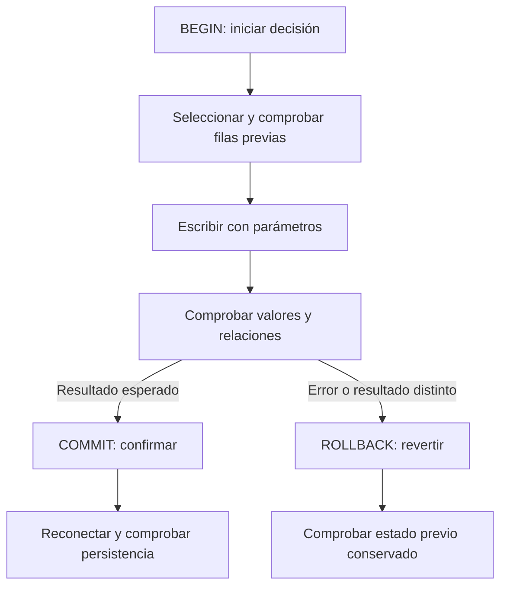

# 08 — Escrituras y transacciones

## Propósito, prerrequisitos y objetivos — esencial

Cambiar datos de forma deliberada, comprobar el alcance de cada escritura y
decidir qué se confirma o se revierte. Completa
[03.07 — Ventanas para comparar registros](../07_windows/README.md) y su lab;
recupera [restricciones y carga de 03.03](../03_create_load/README.md),
[filtros de 03.02](../02_first_queries/README.md) y
[claves y relaciones de 03.05](../05_joins/README.md).
Usamos sqlite3 estándar: no necesitas instalar paquetes.

Al terminar podrás usar UPDATE y DELETE con una selección previa, agrupar
escrituras en una transacción, manejar errores, comprobar persistencia y
repetir una carga con una regla explícita. El cierre requiere explicar las
decisiones, además de obtener el resultado esperado.

La lección puede dividirse en tres sesiones: **A**, secciones 1–4; **B**,
secciones 5–7; **C**, secciones 8–10 y lab. SAVEPOINT, UPSERT y concurrencia
son ampliaciones; no necesitas dominarlas para completar el criterio esencial.

## 1. Preparar un lugar de práctica separado

Hasta ahora consultamos la base de 03.01 en solo lectura. Aquí **la fuente
permanece en solo lectura** y las escrituras ocurren en otra base local.
No cambies el modo de conexión de un ejemplo anterior para escribir sobre ella.

[transactions.py](transactions.py) utiliza la API backup de sqlite3 para
crear una copia SQLite nueva. Verifica el contenido y esquema de la fuente
contra los CSV antes de copiar. La copia predeterminada vive en
output/transacciones_practica.sqlite, dentro de esta lección y excluida de Git.
Los CSV y la base de 03.01 se conservan.

El destino debe ser distinto de la fuente. Si ya existe, el programa solo
comprueba el estado final esperado en lectura y termina; no borra, recarga ni
continúa escribiendo automáticamente. Si difiere, se detiene y conserva el
archivo para revisión. Una nueva sesión utiliza una ruta nueva mediante
--practice. Esto evita que repetir el programa duplique cambios o reinicie tu trabajo.

Una copia guarda un estado de los datos; no es una autorización para usar datos
privados en el repositorio. Toda esta práctica usa la cartera ficticia conocida.
No se distribuye el archivo generado: conserva consultas y evidencia textual.

## 2. Una transacción reúne una decisión

Una **transacción** agrupa operaciones que deben confirmarse juntas o revertirse
si no cumplen el resultado esperado:

```text
abrir conexión → activar reglas → BEGIN → seleccionar → escribir → comprobar
                                                        ↓ correcto: COMMIT
                                                        ↓ fallo: ROLLBACK
cerrar conexión → reconectar → comprobar estado confirmado
```

BEGIN inicia; COMMIT confirma los cambios pendientes; ROLLBACK los revierte.
Ver un cambio en tu conexión no demuestra que ya esté confirmado.
Una vez confirmado, ROLLBACK no deshace ese commit: corregir después requiere
otra operación y una nueva transacción con su propia justificación.



En palabras: declaramos una unidad de cambio, comprobamos su resultado y
tomamos una decisión. Una transacción no sustituye una regla de negocio:
puede confirmar un dato incorrecto si las restricciones y comprobaciones lo admiten.

### Las propiedades ACID, con ejemplos pequeños

| Propiedad | Idea | Qué observamos aquí |
| --- | --- | --- |
| Atomicidad | Confirmar todo el grupo o revertirlo | Si falla la carga, no queda una primera fila parcial |
| Consistencia | Respetar restricciones al confirmar | Claves, relaciones y valores válidos; también comprobaciones del programa |
| Aislamiento | Otras conexiones no ven cambios pendientes en el modo normal de esta práctica | Un lector separado sigue viendo 1300 durante el ensayo de 999 |
| Durabilidad | Los cambios confirmados se conservan | Reconectar recupera 1350 después de COMMIT |

La comprobación al reconectar demuestra persistencia en la ejecución normal;
no es un ensayo de corte de energía ni de recuperación ante daños del disco.
SQLite tiene reglas de aislamiento y bloqueo propias; aquí usamos dos conexiones
locales breves sin configuraciones de lectura de cambios no confirmados.

## 3. Elegir un control de transacciones explícito en Python

El proyecto admite Python desde 3.11. Este ejemplo conserva el control explícito
introducido en 03.03: **isolation_level=None, BEGIN por SQL y commit/rollback
de la conexión**. No dejamos que sqlite3 abra BEGIN implícitamente.

En Python 3.11 puedes abrir la copia existente así:

```python
conexion = sqlite3.connect(ruta_copia, isolation_level=None)
```

En Python 3.12 o posterior, para fijar el mismo modo:

```python
conexion = sqlite3.connect(
    ruta_copia,
    isolation_level=None,
    autocommit=sqlite3.LEGACY_TRANSACTION_CONTROL,
)
```

Son alternativas según la versión, no dos conexiones necesarias. El helper
connect del script elige opciones compatibles y utiliza una URI con mode=rw:
abre un destino que ya existe, sin crear un archivo accidental por una ruta
equivocada. El destino nuevo se reserva y copia antes de abrirlo para la práctica.

Con isolation_level=None en modo legado, una sentencia de escritura ejecutada
**sin BEGIN explícito** se confirma automáticamente al completarse. Eso sería
inadecuado para un lote cuya segunda sentencia puede fallar. Por eso cada
unidad de escritura del ejemplo inicia una transacción antes de modificar.

Desde Python 3.12 también existen los modos autocommit=True y autocommit=False.
Con True, los métodos commit/rollback no tienen efecto; si abres una transacción
por SQL, la terminas por SQL. Con False, sqlite3 mantiene una transacción abierta
y abre otra tras commit/rollback. No mezclamos esos modelos con el de este
ejemplo ni dependemos del valor predeterminado de versiones futuras.

### Activar relaciones antes de BEGIN

```python
conexion.execute("PRAGMA foreign_keys = ON")
if conexion.execute("PRAGMA foreign_keys").fetchone() != (1,):
    raise RuntimeError("No se habilitaron las claves foráneas")
conexion.execute("BEGIN IMMEDIATE")
```

Las claves foráneas se comprueban por conexión, como en 03.03. Activarlas
cuando ya hay una transacción abierta no cambia su estado. El helper del
script lo hace inmediatamente después de conectar, antes de BEGIN.

BEGIN IMMEDIATE inicia una transacción de escritura y solicita su reserva
desde el comienzo. Ayuda a mantener selección previa y modificación dentro
de una decisión sin que otro escritor cambie la fila entre ambas. Puede fallar
si otro escritor mantiene el bloqueo; no garantiza ausencia de conflictos.
BEGIN simple es diferido: puede comenzar a leer y solicitar escritura después.
No anidamos BEGIN: una conexión que ya tiene transacción debe terminarla o usar
SAVEPOINT en una ampliación deliberada.

## 4. UPDATE: cambiar un valor con alcance comprobado

La corrección ficticia de esta práctica declara que el saldo de 001 en octubre
debe pasar de 1300 a 1350 MXN. No inferimos que todo saldo deba subir 50 ni
imputamos ausencias. Primero consultamos la clave completa:

```sql
SELECT id_credito, fecha_corte, saldo_mxn, dias_atraso
FROM cortes
WHERE id_credito = '001' AND fecha_corte = '2026-10-31';
```

UPDATE nombra la tabla; SET indica columnas y valores nuevos; WHERE selecciona
las filas. Sobre la copia y dentro de una transacción:

```sql
UPDATE cortes
SET saldo_mxn = 1350
WHERE id_credito = '001' AND fecha_corte = '2026-10-31' AND saldo_mxn = 1300;
```

La clave crédito/fecha limita a una observación. La condición del valor anterior
expresa que esta corrección solo se aplica al estado revisado. Si la fila no
existe o ya no tiene 1300, no debe afectarse otra fila «parecida».
Sin WHERE se modificarían todas las filas de la tabla: no es una corrección
individual. Con solo id_credito modificarías sus dos fechas en esta muestra.

Desde Python usamos parámetros y comprobamos el resultado:

```python
cursor = conexion.execute(
    """UPDATE cortes SET saldo_mxn = ?
       WHERE id_credito = ? AND fecha_corte = ? AND saldo_mxn = ?""",
    (1350, "001", "2026-10-31", 1300),
)
if cursor.rowcount != 1:
    raise ValueError("No se modificó exactamente la fila esperada")
```

rowcount ayuda a comprobar cuántas filas afectó esta sentencia simple; no
demuestra por sí solo que los valores finales sean correctos ni cuenta todos
los efectos posibles de triggers. Vuelve a seleccionar la fila, comprueba
campos intactos y reconcilia el estado que requiere tu contrato. Aquí atraso
sigue siendo 10, clientes y créditos no cambian, y octubre conserva 24 filas.

### Ensayar y revertir primero

El script inicia BEGIN IMMEDIATE, cambia temporalmente 1300 a 999, consulta el
estado y ejecuta rollback. Una segunda conexión de lectura ve 1300 durante el
ensayo; después del rollback la conexión escritora también vuelve a 1300.
Este ensayo comprueba el mecanismo, no una corrección del dominio.

La corrección verdadera usa otra transacción y confirma 1350. Al reconectar,
esa fila conserva 1350; la suma conocida de octubre pasa de 46 700 a 46 750,
con los mismos 21 saldos conocidos. La fuente original sigue mostrando 1300.
No consultes la copia modificada con scripts anteriores que exigen exactamente
la muestra original: su rechazo sería coherente con esos ejemplos.

## 5. Un fallo no siempre revierte todo automáticamente

Caso: primero corregir un saldo y después insertar un crédito con un cliente
inexistente. La segunda sentencia viola FOREIGN KEY y produce IntegrityError.
En estas restricciones inmediatas y con la política predeterminada, falla esa
sentencia, pero los cambios previos de la transacción pueden seguir pendientes.
No captures la excepción para continuar y confirmar media operación.

Patrón que usamos sobre una conexión ya configurada:

```python
conexion.execute("BEGIN IMMEDIATE")
try:
    # Aquí van escrituras y comprobaciones de la misma decisión.
    conexion.execute("UPDATE cortes SET saldo_mxn = ? WHERE id_credito = ? AND fecha_corte = ?",
                     (1350, "001", "2026-10-31"))
    conexion.execute("INSERT INTO creditos VALUES (?, ?, ?)",
                     ("prueba", "cliente_inexistente", "consumo"))
    conexion.commit()
except Exception:
    if conexion.in_transaction:
        conexion.rollback()
    raise
finally:
    conexion.close()
```

Este bloque es un ensayo deliberadamente fallido: ejecútalo solo sobre una copia
o base temporal, como en el lab. El programa principal captura ese IntegrityError
esperado, comprueba la reversión y sigue con otra decisión independiente.
Una excepción inesperada se propaga después de revertir; no se presenta como éxito.

in_transaction indica si SQLite mantiene una transacción activa. Si una operación
o error ya la terminó, evitamos una reversión innecesaria. Incluimos commit
dentro del try porque confirmar también puede fallar. Un mensaje impreso antes
de commit no prueba que la operación haya terminado correctamente.

### Ejecutar varias filas no define por sí solo la atomicidad

executemany repite una sentencia. Sin una transacción que agrupe el lote, en
nuestro modo explícito algunas filas podrían quedar confirmadas antes del error.
BEGIN + comprobaciones + commit/rollback definen la unidad de carga.
Las reglas pueden requerir rechazos por fila, como en Python fundamental, pero
ese es otro contrato: aquí el lote se acepta completo o no se confirma nada nuevo.

## 6. Carga repetible: misma clave, mismos valores

**Idempotencia** significa que repetir la misma operación deja el mismo estado
final. No equivale a ignorar cualquier error ni a sobrescribir lo existente.
La regla de nuestra carga es:

| Situación | Decisión |
| --- | --- |
| Clave crédito/fecha nueva | Insertar después de validar |
| Misma clave y todos los valores iguales | Aceptar como repetición, sin insertar |
| Misma clave con algún valor distinto | Rechazar conflicto y revertir el lote |
| Lote vacío | Cero inserciones; estado intacto |

El lote de práctica añade noviembre para 001 (1400, atraso 0) y 002 (1500,
atraso 0). load_batch valida formatos y valores, inicia BEGIN IMMEDIATE y,
para cada fila, busca la clave completa. Inserta si falta; compara la tupla
completa si existe. Si difiere, produce ValueError y rollback.
Esta función gestiona su propia transacción y requiere una conexión sin otra
transacción pendiente; rechaza el intento de anidarla sin revertir trabajo ajeno.

Primera carga: dos filas nuevas; repetición exacta: cero. Los desconocidos se
conservan como None/NULL y la igualdad no convierte ausencias a cero.
Duplicados idénticos dentro del mismo lote también se reconocen; duplicados
con valores distintos son conflicto. Esa decisión está declarada, no implícita.

El script prueba un lote que comienza añadiendo 003 en noviembre y luego
entra en conflicto con 001 de noviembre. La carga debe revertir también la
primera inserción: 003 no queda persistido. Comprobar solo «hubo una excepción»
no bastaría; compara el estado completo después.

### UPDATE absoluto y relativo no se repiten igual

`SET saldo_mxn = 1350` expresa un valor objetivo; `SET saldo_mxn = saldo_mxn + 50`
incrementaría otra vez al repetir. Nuestra corrección exige además el valor
anterior 1300, por lo que repetirla afectaría cero filas y requiere revisión:
no declaramos éxito solo porque el estado final parece correcto.

**Extensión:** INSERT OR IGNORE puede ocultar restricciones y no compara todos
los valores del registro repetido; no es nuestra regla de carga. UPSERT permite
declarar una acción ON CONFLICT para una clave única, pero debes decidir qué
conflictos se aceptan y cuáles requieren corrección. INSERT OR REPLACE puede
eliminar una fila previa e insertar otra; no lo enseñamos como actualización
normal ni como sustituto de revisar relaciones.

## 7. DELETE: retirar una fila con un motivo concreto

El lote añadió dos observaciones de noviembre para demostrar carga. Declaramos
que la de 002 se insertó solo para el ensayo y debe retirarse; no estamos
eliminando saldos desconocidos ni registros de cartera originales.

```sql
SELECT id_credito, fecha_corte, saldo_mxn, dias_atraso
FROM cortes
WHERE id_credito = '002' AND fecha_corte = '2026-11-30';
```

Debe devolver exactamente (002, 2026-11-30, 1500, 0). Después, dentro de BEGIN:

```sql
DELETE FROM cortes
WHERE id_credito = '002' AND fecha_corte = '2026-11-30';
```

DELETE elimina filas; no elimina la tabla ni cambia solo una celda. Para dejar
una medida ausente necesitarías UPDATE a NULL con una regla que lo justifique.
Sin WHERE, DELETE retiraría todas las filas; con una clave incompleta podría
afectar otros cortes. Un resultado de cero filas afectadas puede significar
una ruta/clave equivocada o que la fila ya no está; revisa el contrato.

El programa ensaya DELETE y rollback para comprobar que la fila reaparece;
después la selecciona nuevamente en otra transacción, elimina una fila, comprueba
su ausencia, confirma y reconecta. Queda noviembre de 001, conservado como
evidencia de una inserción persistente.

### Relaciones al borrar

Eliminar un cliente con créditos puede violar la referencia. El esquema de
esta muestra no declara borrado en cascada; no asumimos que DELETE de clientes
elimine sus hijos. En cada conexión de escritura mantén foreign_keys activo.
Antes de retirar una entidad, revisa dependencias y la regla de conservación.
Diseñar cascadas o borrados por lotes es una ampliación posterior.

## 8. Confirmar, cerrar y verificar son acciones diferentes

| Acción | Responsabilidad |
| --- | --- |
| commit | Confirmar una transacción pendiente en el modo elegido |
| rollback | Revertir cambios pendientes |
| close | Liberar la conexión; no sustituye confirmar |
| Reconectar y SELECT | Comprobar datos confirmados y persistencia |

Cerrar con cambios pendientes no es una estrategia para guardar. En este modo,
cerrar una transacción no confirmada descarta sus cambios; escribimos rollback
explícito para que la intención quede visible y se pueda comprobar.

El contexto `with conexion:` gestiona confirmación/reversión de una transacción
pendiente en el modo correspondiente, pero no cierra la conexión ni garantiza
crear BEGIN en nuestro modo explícito. Si no hubo BEGIN, las escrituras podrían
haberse confirmado por separado. El bloque try/except/finally del ejemplo
muestra por separado inicio, decisión y cierre. No uses un with como sustituto
de entender la configuración de sqlite3.

Evita executescript dentro de una transacción pendiente en el modo legado usado:
puede confirmarla antes de ejecutar el script. Para las decisiones de esta
lección usamos execute/executemany y límites explícitos; no concatenamos DML
y una sentencia COMMIT dentro de texto que luego parezca protegido por rollback.

### Estado final conocido de la copia

- 16 clientes y 24 créditos, sin cambios.
- 49 cortes: los 48 originales y noviembre de 001.
- Octubre de 001 corregido a 1350; atraso conservado en 10.
- Noviembre de 001: 1400, atraso 0.
- No quedan noviembre de 002, noviembre de 003 ni el crédito con cliente inexistente.

El programa compara todas las filas, esquema, integridad y relaciones, no solo
esos conteos. Reconecta tras los commits y verifica también la fuente intacta.
Si una ejecución se interrumpe después de un commit anterior, la copia puede
quedar en un estado parcial entre decisiones: ese commit ya ocurrió. La próxima
ejecución no la reinicia; conserva el archivo para revisar y usa otra ruta nueva
si quieres repetir el ensayo completo. La transacción agrupa cada decisión,
no convierte toda la demostración en un solo cambio atómico.

## 9. Ejecutar la práctica

### PowerShell

Desde la raíz, con tu entorno elegido activo. Si ya existe la fuente de 03.01,
ejecuta solo el segundo comando; el preparador conserva bases existentes.

```powershell
python curriculum\03_sql_databases\01_relational_sqlite\relational_sqlite.py
python curriculum\03_sql_databases\08_transactions\transactions.py
# Repetir comprueba el estado final sin nuevas escrituras:
python curriculum\03_sql_databases\08_transactions\transactions.py
# Una nueva sesión conserva la copia previa y crea otra:
python curriculum\03_sql_databases\08_transactions\transactions.py --practice curriculum\03_sql_databases\08_transactions\output\segunda_sesion.sqlite
```

### Bash/Zsh

```bash
python curriculum/03_sql_databases/01_relational_sqlite/relational_sqlite.py
python curriculum/03_sql_databases/08_transactions/transactions.py
python curriculum/03_sql_databases/08_transactions/transactions.py
python curriculum/03_sql_databases/08_transactions/transactions.py --practice curriculum/03_sql_databases/08_transactions/output/segunda_sesion.sqlite
```

Con uv, antepone `uv run --locked` a cada comando python. Mantén tu gestor y
entorno; no instales en base. --source permite elegir una copia original compatible
existente, por ejemplo la de 03.03, pero --practice debe seguir siendo otra ruta.
No es necesario ejecutar todas las alternativas para completar el lab.

Salida esperada: UPDATE reversible, lote fallido revertido, corrección confirmada,
carga de dos filas y repetición de cero, conflicto sin carga parcial, DELETE
reversible y confirmado, estado final 16/24/49 y fuente intacta. En la segunda
ejecución solo informa verificación de la práctica existente.

## 10. Extensiones y errores habituales

### SAVEPOINT: revertir una parte deliberada

BEGIN no se anida. SAVEPOINT nombra un punto dentro de una transacción;
ROLLBACK TO vuelve a él, conservando cambios anteriores de esa transacción;
RELEASE retira ese punto. Un ejemplo exclusivamente en memoria está en la
extensión del lab. Si el savepoint está dentro de un BEGIN, RELEASE no confirma
la transacción exterior; aún debes decidir commit o rollback. No uses reversión
parcial cuando el contrato exige que todo el lote sea indivisible.

### Bloqueos y visibilidad

SQLite permite un escritor a la vez. Un bloqueo puede producir OperationalError
con database is locked o database is busy; no equivale a una fila inválida.
Termina las transacciones breves, cierra recursos y revisa otras conexiones.
timeout indica cuánto se espera antes del error, no garantiza éxito. Reintentos,
WAL y una política de concurrencia se amplían cuando exista esa necesidad.

En nuestra demostración el lector separado se cierra antes del commit. Un
lector con una transacción abierta puede conservar su instantánea o interferir
con la confirmación según el modo de journal; no asumimos que reciba cada cambio
en tiempo real. Reconectar permite comprobar el estado confirmado actualizado.

| Situación | Qué revisar |
| --- | --- |
| UPDATE/DELETE afecta cero filas | Ruta, clave y condición del valor anterior |
| Se modifican varios cortes | ¿Falta fecha en la clave del WHERE? |
| La primera fila del lote queda tras un error | ¿Hubo BEGIN y rollback de todo el lote? |
| foreign key constraint failed | Activa reglas y comprueba la referencia o dependencia |
| cannot start a transaction within a transaction | Revisa el modo y la transacción activa |
| ROLLBACK no deshace un cambio | ¿La escritura ya estaba confirmada? |
| with no agrupa operaciones | Revisa configuración y BEGIN explícito |
| Copia existente no coincide con estado final | Consérvala para revisar; no reinicies ni sobrescribas |

Realiza el [lab 03.08](../../../labs/03_sql_databases/08_transactions/README.md).
Puedes continuar cuando demuestres selección previa, alcance comprobado,
confirmación/reversión, carga repetible y persistencia con las fuentes intactas.
No hay checkpoint de proyecto implementado. Después consulta el
[03.09 — Integración pandas y SQL](../09_pandas_sql/README.md).

## Referencias primarias

Ejemplos propios del proyecto, contrastados con:

- [sqlite3 de Python 3.12: control de transacciones, backup y contexto](https://docs.python.org/3.12/library/sqlite3.html).
- [SQLite: BEGIN, COMMIT, ROLLBACK y bloqueos](https://www.sqlite.org/lang_transaction.html).
- [SQLite UPDATE](https://www.sqlite.org/lang_update.html) y [DELETE](https://www.sqlite.org/lang_delete.html).
- [SQLite: conflictos y ABORT](https://www.sqlite.org/lang_conflict.html).
- [SQLite: claves foráneas](https://www.sqlite.org/foreignkeys.html).
- [SQLite: SAVEPOINT](https://www.sqlite.org/lang_savepoint.html) y [UPSERT](https://www.sqlite.org/lang_upsert.html).
