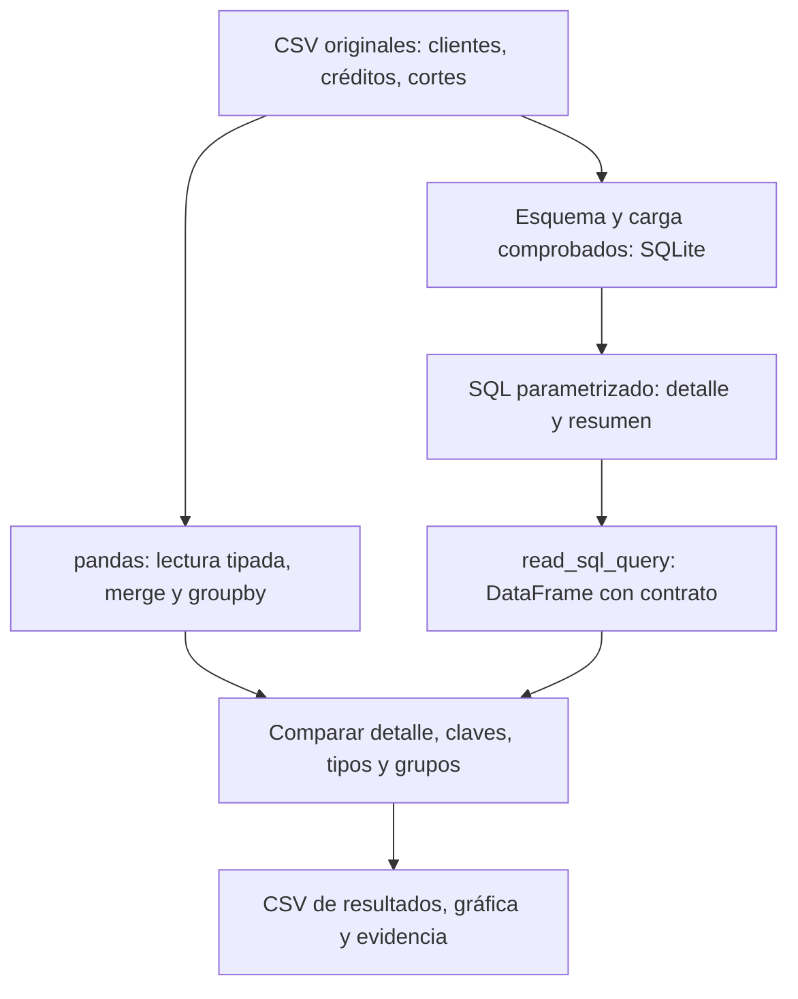
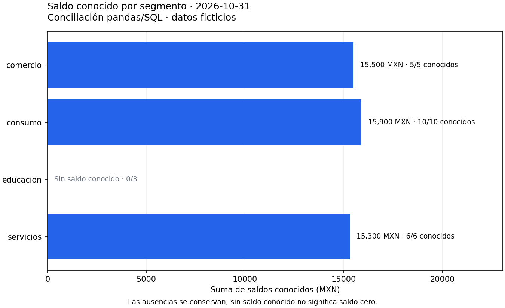

# 09 — Integración pandas y SQL

## Propósito, prerrequisitos y objetivos — práctica de cierre

Reconstruir una base ficticia, consultar desde pandas y demostrar que dos
recorridos independientes responden la misma pregunta. Completa
[03.08 — Escrituras y transacciones](../08_transactions/README.md) y sus
prerrequisitos; recupera [el cierre de pandas](../../02_pandas/10_analysis_plot/README.md).
La muestra de este cierre es la de SQL, no el CSV de 02.10: preguntas y métodos
se reutilizan, pero no suponemos que muestras distintas tengan idénticos totales.

Al terminar podrás pasar parámetros a read_sql_query, declarar tipos, comparar
claves y valores, conciliar un indicador y comunicarlo con una figura.
Usamos sqlite3, pandas 2.3.3 y Matplotlib 3.10.7 como referencias declaradas en
la configuración raíz. No hay nuevas dependencias ni servidor de base de datos.
El notebook es opcional: el cierre esencial se realiza con scripts y SQL guardado.

Puedes distribuir la actividad en tres sesiones: **A**, preparar y leer;
**B**, calcular y conciliar; **C**, exportar, representar y explicar.
Desarrollar estas nueve lecciones no acredita que el estudiante haya completado
el módulo: hacen falta sus prácticas y evidencias.

## 1. Una pregunta y dos recorridos comprobables

Pregunta: ¿qué saldo conocemos por segmento en octubre y qué proporción de
atrasos conocidos tiene al menos 30 días? Declaramos:

- Universo: observaciones del 2026-10-31, una fila por crédito/fecha.
- Saldo: pesos mexicanos enteros o desconocido; cero es conocido.
- Confirmados: dias_atraso >= 30, una regla didáctica, no una definición regulatoria.
- Tasa: confirmados / atrasos conocidos; sin denominador, tasa ausente.
- Cobertura: atrasos conocidos / todas las observaciones del grupo.



En palabras: la referencia pandas parte de los CSV y la referencia SQL de la
base reconstruida. Se reúnen después de calcular, para comprobar datos y
semántica antes de presentar. Calcular dos veces desde el mismo resumen SQL
no sería una verificación independiente de su agrupación.

## 2. Reconstrucción reproducible y conservación

Reutilizamos [create_load.py de 03.03](../03_create_load/create_load.py) con
--database para preparar una base separada en output/cartera_integracion.sqlite.
El esquema y las tres entradas siguen versionados en 03.01. La base contiene
16 clientes, 24 créditos y 48 observaciones en dos fechas.

Si el archivo existe, el preparador comprueba esquema y contenido en lectura;
no reinicia ni borra cambios. Para reconstruir otra vez desde cero, usa una
**ruta nueva**, conservando la anterior. La copia modificada en 03.08 contiene
otro estado y no sirve como muestra original de este cierre.

[integration.py](integration.py) abre exclusivamente una base existente en
mode=ro, comprueba sus tres tablas contra los CSV y consulta una misma
instantánea mediante BEGIN. Cierra la conexión en finally. No escribe tablas
ni modifica la fuente; únicamente exporta resultados si eliges --output.

La base es reproducible por entradas, esquema y pasos de carga. No necesitamos
que dos archivos SQLite tengan bytes idénticos; comprobamos sus filas, claves,
tipos y reglas. La reproducibilidad del análisis requiere además SQL, parámetros,
versiones y decisiones del indicador.

## 3. Leer una consulta SQL como DataFrame

[detail.sql](detail.sql) conserva la consulta de detalle: une cortes → créditos
→ clientes por sus claves y filtra :fecha. Sus columnas son ID, fecha, saldo,
atraso, cliente, segmento y región; el orden final es por ID.

```python
import sqlite3
import pandas as pd

conexion = sqlite3.connect(ruta_base.resolve().as_uri() + "?mode=ro", uri=True)
try:
    detalle = pd.read_sql_query(
        sql_detalle,
        conexion,
        params={"fecha": "2026-10-31"},
        dtype={"id_credito": "string", "fecha_corte": "string",
               "saldo_mxn": "Int64", "dias_atraso": "Int64",
               "id_cliente": "string", "segmento": "string", "region": "string"},
    )
finally:
    conexion.close()
```

ruta_base es un Path y sql_detalle es el texto leído de detail.sql; el script
resuelve ambos desde su carpeta. read_sql_query ejecuta SQL y devuelve un
DataFrame; no traduce la consulta a operaciones pandas. params entrega valores
al controlador sqlite3: no pongas comillas alrededor de :fecha ni construyas
el filtro mediante f-strings. Con ? usarías una tupla y respetarías su orden.

La conexión sqlite3 está admitida directamente; no necesitamos SQLAlchemy
para SQLite en esta práctica. Otros motores requieren su controlador y una
ruta compatible, no sustituir el nombre del archivo por una URL cualquiera.

## 4. Tipos y claves no son detalles de presentación

| Campo | Contrato en este análisis | Motivo |
| --- | --- | --- |
| id_credito, id_cliente | string | Conserva identificadores y ceros |
| fecha_corte | string YYYY-MM-DD validada | Misma representación en CSV y SQL |
| saldo_mxn, dias_atraso | Int64 nullable | Enteros conocidos y NA sin imputación |
| tasas | Float64 nullable | Decimales o tasa indefinida |

El tipo de una columna DataFrame no crea restricciones en SQLite ni convierte
un CSV en datos válidos. La carga y las comprobaciones de claves siguen siendo
necesarias. El índice 0, 1, 2… que recibe el DataFrame tampoco es la clave del
dominio: crédito/fecha identifica observaciones.

Para este cierre mantenemos fechas como texto validado. Si necesitas funciones
temporales, convierte de forma explícita en ambos recorridos, por ejemplo
pd.to_datetime(..., format='%Y-%m-%d', errors='raise'), y compara la nueva
representación. read_sql_query también admite parse_dates; no asumas que
SQLite entrega una fecha nativa solo porque el texto parece una fecha.

SQL NULL llega a pandas como una ausencia que depende del tipo elegido; aquí
usamos NA en columnas nullable. No confundas None, NaN y NA con cero ni cambies
tipos para ocultar una diferencia. La muestra usa enteros pequeños; otros contratos
monetarios o valores de gran magnitud requieren revisar precisión y representación.

## 5. Referencia independiente desde CSV y pandas

El script lee los CSV con dtype explícito, keep_default_na=False y na_values=[''].
Comprueba campos y claves; recupera las
[reglas de lectura de 02.02](../../02_pandas/02_read_inspect_export/README.md).
Filtra la fecha y relaciona tablas con merge:

```python
detalle = observaciones.merge(
    creditos, on="id_credito", how="left", validate="many_to_one", indicator=True
)
```

LEFT permite comprobar si algo no encontró crédito mediante _merge. El programa
exige que todas las observaciones encuentren pareja, elimina esa columna y
relaciona clientes con la misma comprobación. Solo entonces compara con INNER
JOIN de SQL: ambas rutas deben conservar exactamente el mismo universo.

No basta con comparar sumas: una fila duplicada y otra perdida pueden compensarse.
Compara columnas originales y atributos añadidos. Antes de merge, las claves
son obligatorias y únicas según su tabla. Esto evita además que claves nulas
se emparejen en pandas como pueden hacerlo en merge, a diferencia de igualdad SQL.
Recupera [las diferencias de uniones](../05_joins/README.md).

## 6. Resumir con reglas equivalentes

[summary.sql](summary.sql) agrega por segmento con COUNT, SUM y CASE; conserva
conteos, suma conocida, confirmados, tasa y cobertura. El recorrido pandas
aplica las mismas reglas con groupby, sin leer ese resultado para calcular:

| Regla | SQL | pandas |
| --- | --- | --- |
| Contar observaciones | COUNT(*) | size |
| Contar conocidos | COUNT(columna) | count |
| Suma conocida, ausente si no hay conocidos | SUM(saldo_mxn) | sum(min_count=1) |
| Confirmados | COUNT(CASE WHEN atraso >= umbral THEN 1 END) | Conteo de condiciones verdaderas |
| Tasa sin base conocida | División con NULLIF(base, 0) | Base enmascarada cuando es cero |

sum de pandas puede dar cero con todo ausente si no declaras min_count=1.
Eso cambiaría la suma de educacion en octubre de desconocida a cero. Esta
conciliación requiere igualar la semántica, no solo nombres de funciones.

El programa usa fillna(False) **solo para contar confirmaciones verdaderas**
en un indicador auxiliar; no reemplaza dias_atraso ni etiqueta los desconocidos
como no atrasados. El denominador sigue siendo count(dias_atraso), acompañado
de cobertura. Conocidos y confirmados se concilian por separado.

## 7. Comparar resultados con contrato explícito

El script normaliza columnas, tipos, orden por claves e índice antes de comparar.
Esto no limpia datos ni oculta diferencias; fija la representación acordada.
No usa set para eliminar duplicados ni check_dtype=False para ignorar tipos.

pd.testing.assert_frame_equal compara detalle, enteros y ausencias exactamente.
Las tasas reales se comparan con rtol/atol pequeños, porque cálculos decimales
equivalentes pueden variar en sus últimos dígitos. Redondea solo al mostrar,
no antes de conciliar. Un assertion que falla detiene la entrega para investigar.

Octubre debe producir:

| Segmento | Registros | Saldos conocidos | Suma conocida MXN | Atrasos conocidos | Confirmados | Tasa entre conocidos |
| --- | --- | --- | --- | --- | --- | --- |
| comercio | 5 | 5 | 15 500 | 5 | 2 | 40 % |
| consumo | 10 | 10 | 15 900 | 9 | 4 | ≈ 44.44 % |
| educacion | 3 | 0 | NA | 2 | 1 | 50 % |
| servicios | 6 | 6 | 15 300 | 5 | 2 | 40 % |

Total: 24 observaciones, 21 saldos conocidos y 46 700 MXN conocidos. Atrasos:
21 conocidos y 9 confirmados; tasa conjunta ≈ 42.86 %, cobertura 87.5 %.
No promedies directamente las tasas de segmentos; usa numeradores y
denominadores del mismo universo, como en 03.04.

Con septiembre hay también cuatro grupos; educacion no tiene atraso conocido,
por lo que su tasa es NA y cobertura 0 %. Con fecha inexistente ambos recorridos
entregan detalle y resumen vacíos con las mismas columnas y tipos; no se inventan
grupos de saldo cero. Un umbral 100 mantiene grupos y sumas, pero da cero
confirmados entre conocidos de octubre.

## 8. Representar solo el resultado conciliado

Retomamos barras horizontales y Figure/Axes del
[primer análisis gráfico de pandas](../../02_pandas/10_analysis_plot/README.md).
La figura usa el resumen conciliado, con fecha, unidades, datos ficticios y
cantidad conocida/observada. educacion se etiqueta como sin saldo conocido;
no dibujamos una barra cero que afirmaría otra cosa.



Lectura: consumo tiene la mayor **suma conocida** (15 900 MXN), seguido de
comercio (15 500) y servicios (15 300). No podemos situar educacion respecto
de ellos por saldo: faltan sus tres importes. Esta gráfica tampoco representa
la tasa de atraso; ese indicador permanece en la tabla.

La misma función produce una figura con un mensaje explícito para cortes
vacíos. El siguiente módulo profundizará en preguntas, escalas y diseño visual;
este cierre requiere una figura interpretable sobre cálculos ya comprobados.

## 9. Recorrido reproducible por shell

Desde la raíz, con tu entorno elegido adecuado. El primer comando prepara
o comprueba la base; el segundo verifica sin exportar; el tercero crea una
entrega en **carpeta nueva**. No se sobrescriben resultados anteriores.

### PowerShell

```powershell
python curriculum\03_sql_databases\03_create_load\create_load.py --database curriculum\03_sql_databases\09_pandas_sql\output\cartera_integracion.sqlite
python curriculum\03_sql_databases\09_pandas_sql\integration.py
python curriculum\03_sql_databases\09_pandas_sql\integration.py --output curriculum\03_sql_databases\09_pandas_sql\output\mi_entrega_octubre
# Otros casos, sin crear salidas:
python curriculum\03_sql_databases\09_pandas_sql\integration.py --date 2026-09-30
python curriculum\03_sql_databases\09_pandas_sql\integration.py --date 2099-01-31
python curriculum\03_sql_databases\09_pandas_sql\integration.py --threshold 100
```

### Bash/Zsh

```bash
python curriculum/03_sql_databases/03_create_load/create_load.py --database curriculum/03_sql_databases/09_pandas_sql/output/cartera_integracion.sqlite
python curriculum/03_sql_databases/09_pandas_sql/integration.py
python curriculum/03_sql_databases/09_pandas_sql/integration.py --output curriculum/03_sql_databases/09_pandas_sql/output/mi_entrega_octubre
python curriculum/03_sql_databases/09_pandas_sql/integration.py --date 2026-09-30
python curriculum/03_sql_databases/09_pandas_sql/integration.py --date 2099-01-31
python curriculum/03_sql_databases/09_pandas_sql/integration.py --threshold 100
```

Con uv antepone `uv run --locked` a cada comando python. Si ya tienes un
entorno Conda o venv/pip adecuado, utiliza ese recorrido; no mezcles gestores
ni reinstales solo por repetir. --database permite otra base original compatible.
El programa se detiene si existe la carpeta de entrega; usa un nombre nuevo
o ejecuta sin --output para verificar sin generar otra entrega.

La entrega incluye detalle.csv, resumen.csv, saldo_conocido.png y evidencia.txt.
El resumen se vuelve a leer y comparar con tipos declarados: un CSV no conserva
el esquema automáticamente. evidencia.txt registra corte, umbral, cobertura de
saldo y alcance; añade tu interpretación y decisiones, no solo el mensaje de éxito.

## 10. Ampliaciones y errores habituales

**Escribir un DataFrame con to_sql:** es una herramienta distinta de read_sql_query.
if_exists='replace' elimina la tabla antes de recrearla, por lo que puede perder
claves y restricciones. append no hace una carga idempotente; index=True escribe
el índice por defecto. Además, pandas documenta limitaciones de rollback de
inserciones al pasar una conexión sqlite3. No usamos to_sql para sustituir el
esquema y las transacciones que ya comprobaste en 03.03/03.08.

**Lectura por chunks:** read_sql_query con chunksize devuelve un iterador; la
conexión debe permanecer abierta mientras lo consumes. Concatenar todos los
chunks vuelve a materializar todo; no garantiza memoria acotada. Esta muestra
pequeña se lee completa; particiones y motores se profundizan en 09–10.

| Situación | Qué revisar |
| --- | --- |
| La base no coincide con los CSV | ¿Elegiste la copia modificada de 03.08? Consérvala; usa una base original |
| Cambia 001 a 1 | Declara ID como texto desde lectura |
| Un grupo ausente se convierte a cero | Revisa min_count y rellenos |
| Coinciden totales pero no detalle | Revisa claves, uniones y multiplicidad |
| Fallan tipos al comparar | Declara un contrato para ambos recorridos |
| La gráfica contradice la tabla | Usa el resumen conciliado, sin repetir el cálculo |
| Ya existe la entrega | Conserva la carpeta; verifica sin exportar o elige otra nueva |

Realiza el [lab 03.09](../../../labs/03_sql_databases/09_pandas_sql/README.md).
Puedes cerrar el aprendizaje del módulo cuando reconstruyas, consultes,
concilies, expliques la figura y demuestres también las escrituras controladas
de 03.08. El proyecto 02_credit_database y sus checkpoints siguen pendientes;
esta práctica integrada no los presenta como implementados.
Después continúa con el [plan de 04 — Visualización en Python](../../04_visualization_python/README.md):
su primera lección aún está pendiente de desarrollo.

## Referencias primarias

Ejemplos propios sobre las muestras del proyecto, contrastados con:

- [pandas 2.3: read_sql_query](https://pandas.pydata.org/pandas-docs/version/2.3/reference/api/pandas.read_sql_query.html).
- [assert_frame_equal](https://pandas.pydata.org/pandas-docs/version/2.3/reference/api/pandas.testing.assert_frame_equal.html).
- [GroupBy.sum y min_count](https://pandas.pydata.org/pandas-docs/version/2.3/reference/api/pandas.core.groupby.SeriesGroupBy.sum.html).
- [DataFrame.to_sql y sus límites](https://pandas.pydata.org/pandas-docs/version/2.3/reference/api/pandas.DataFrame.to_sql.html).
- [Matplotlib 3.10.7: barras horizontales](https://matplotlib.org/3.10.7/api/_as_gen/matplotlib.axes.Axes.barh.html).
- [sqlite3 de Python](https://docs.python.org/3.12/library/sqlite3.html).
