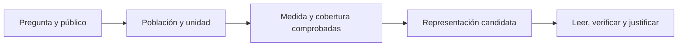
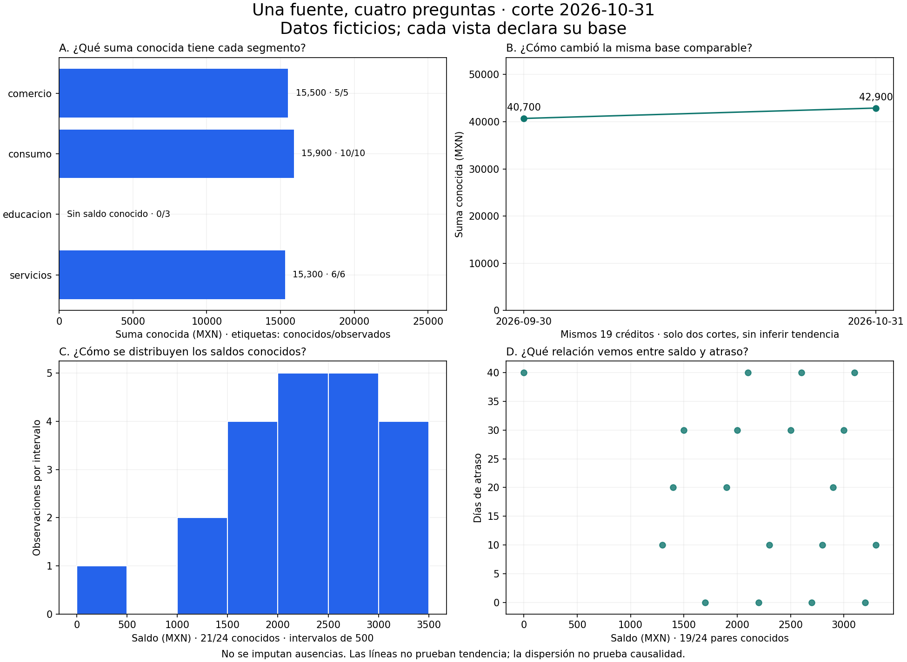

# 04.01 — Pregunta y elección de gráfico

<a id="01--pregunta-y-elección-de-gráfico"></a>

[Inicio](../../../README.md) / [Módulo 04](../README.md) / **Lección 04.01**

| Tu sesión | Qué prepararás o comprobarás |
| --- | --- |
| **Meta** | Elegir una representación desde una pregunta y sus bases |
| **Necesitas** | Indicadores comprobados; lectura de figuras sin programarlas |
| **Evidencia** | Ficha, boceto y justificación con observación y límite |

[Preparación](#antes-de-empezar) · [Material de apoyo](#material-de-apoyo) · [Ir al lab](../../../labs/04_visualization_python/01_question_chart/README.md) · [Comprobar](#evidencia-y-criterio-de-salida)

<a id="propósito-prerrequisitos-y-objetivos--esencial"></a>

## Propósito

Elegir una representación que permita responder una pregunta concreta y explicar
qué muestran los datos.

## Antes de empezar

Completa el [cierre SQL 03.09](../../03_sql_databases/09_pandas_sql/README.md)
y su lab; recupera la [primera gráfica de pandas](../../02_pandas/10_analysis_plot/README.md).
Los indicadores deben estar comprobados antes de diseñar su representación.

No necesitas escribir nuevas funciones
de Matplotlib para completar esta lección ni instalar otra biblioteca.
Figure/Axes se desarrollan en 04.02; histogramas y dispersión se profundizan
en 04.04. Aquí observas ejemplos y decides qué información comunica cada uno.

Sesiones sugeridas: **A**, pregunta y contrato, secciones 1–3;
**B**, lectura de ejemplos, secciones 4–6; **C**, propuesta y revisión, secciones
7–9 y lab. La regeneración con Python y las ampliaciones son opcionales.

## Qué vas a aprender

- Declarar público, pregunta, población, unidad, medida y cobertura.
- Distinguir comparación, evolución, distribución y relación.
- Justificar una figura o tabla y contrastar una alternativa.
- Escribir una observación limitada a lo que la muestra permite afirmar.

## Material de apoyo

| Recurso | Para qué sirve | Uso |
| --- | --- | --- |
| [Cuatro preguntas](assets/cuatro_preguntas.png) | Leer vistas y bases sobre la misma muestra | Para observar |
| [Script de regeneración](choice_examples.py) | Reproducir las vistas si eliges programarlas | Opcional |

Las figuras incluidas sirven para observar y contrastar. Abre el script cuando
el recorrido lo indique para regenerar o practicar; conserva las fuentes y
las entregas anteriores y utiliza los destinos de práctica indicados.

## 1. Empezar por una pregunta que pueda comprobarse

«Quiero un gráfico de cartera» no declara qué comparar ni qué medida usar.
«¿Qué segmento tiene la mayor suma de saldos conocidos en octubre?» sí permite
preparar una tabla, revisar cobertura y elegir una representación.

Antes de dibujar, escribe una ficha:

| Campo | Ejemplo de esta práctica |
| --- | --- |
| Público | Persona que revisa el análisis acompañada, sin asumir experiencia técnica |
| Pregunta | ¿Qué suma conocida tiene cada segmento en octubre? |
| Población observada | Los 24 registros crédito/fecha del 2026-10-31 |
| Unidad del detalle | Una observación por crédito en esa fecha |
| Unidad de la figura | Un segmento por barra |
| Medida y unidad | SUM de saldos conocidos, MXN |
| Ausencias | Tres saldos desconocidos; no se imputan |
| Resultado buscado | Comparar magnitudes y explicar qué no sabemos |

La **población observada** es el conjunto que incluyes, no todos los clientes
que podrían existir. La **unidad** dice qué representa una fila o marca.
La audiencia determina cuánto contexto necesita la lectura, sin cambiar datos
para adaptar el mensaje. Describe la intención antes de elegir colores o estilos.



En palabras: aclaramos la pregunta, construimos su medida y solo después
seleccionamos un gráfico. Puedes volver atrás si los datos no responden lo
que pretendías; ninguna figura recupera una variable que no fue observada.

## 2. Identificar qué significa cada variable

| Tipo | Idea | Campos del recorrido |
| --- | --- | --- |
| Categoría sin orden natural | Nombres de grupos, sin distancia numérica | segmento, region |
| Categoría ordenada | Niveles con un orden acordado | rangos de atraso definidos por una regla |
| Cantidad | Magnitud con unidad y operaciones justificadas | saldo_mxn, dias_atraso |
| Tiempo | Fecha que ubica una observación | fecha_corte |
| Identificador | Clave para reconocer una entidad | id_credito, id_cliente |

Un ID escrito con dígitos no es una cantidad: el crédito 020 no vale el doble
que el 010. No calcules su promedio ni lo uses como tiempo. Los segmentos son
categorías, no períodos: conectarlos con una línea podría sugerir continuidad
que no existe. Los rangos de atraso tienen orden, pero no necesariamente la
misma distancia entre etiquetas; los días de atraso sí son una cantidad.

La representación usa **marcas**, como barras o puntos, y **señales visuales**,
como posición o longitud, para mostrar una variable. Una barra de saldo usa
su longitud desde cero; un punto de dispersión usa dos posiciones, una por
variable. El color puede ayudar a distinguir grupos, pero no sustituye etiquetas.
Las codificaciones de Altair se estudiarán después de dominar estas decisiones.

## 3. Una medida distinta responde otra pregunta

La muestra SQL tiene dos cortes y 48 filas históricas. Octubre contiene 24
observaciones, 21 saldos conocidos y cuatro segmentos. No confundas:

- Suma por segmento: magnitud conocida de sus saldos.
- Conteo de créditos: tamaño del grupo en ese corte.
- Promedio entre saldos conocidos: suma conocida / conocidos.
- Tasa de atraso: confirmados / atrasos conocidos, acompañada de cobertura.

Consumo suma 15 900 MXN entre diez saldos conocidos; comercio suma 15 500
entre cinco. Sus promedios conocidos son 1 590 y 3 100 MXN respectivamente.
Consumo tiene mayor suma conocida, pero comercio mayor promedio conocido.
Ningún gráfico «mejor» resuelve esa diferencia: son preguntas distintas.

Una tasa 50 % en educacion viene de 1/2 atrasos conocidos, con tres registros
observados. No la presentes como si fuera la misma cantidad de evidencia que
una tasa calculada sobre cientos de observaciones. Tampoco conviertas suma
desconocida de saldo en cero porque el atraso sí tenga valores conocidos.
Recupera [denominadores y cobertura](../../03_sql_databases/04_aggregations/README.md).

## 4. Cuatro familias de preguntas

Esta tabla orienta la elección; no es una regla automática basada solo en tipos.

| Quieres observar | Entrada necesaria | Representación candidata | Qué revisar |
| --- | --- | --- | --- |
| Comparar categorías | Una medida por categoría | Barras o puntos por grupo | Medida, orden, base y ausencias |
| Comparar en el tiempo | Valores fechados comparables | Puntos por fecha y, si procede, línea | Misma unidad, períodos y cobertura |
| Describir una distribución | Valores individuales de una medida | Histograma; puntos individuales si hay pocos | Conocidos, intervalos, forma y extremos |
| Explorar una relación | Dos medidas de la misma observación | Dispersión | Pares completos, unidades y superposición |
| Consultar valores exactos | Tabla pequeña con contrato claro | Tabla | Encabezados, unidades y precisión |

Una tabla es una elección válida cuando necesitas localizar un valor exacto
o explicar denominadores. Puede acompañar un gráfico. No necesitas construir
una figura por cada tabla si no añade una lectura útil.

### Ejemplos propios sobre la cartera ficticia



El script conserva las entradas y prepara una base distinta para cada pregunta.
Los paneles no son cuatro versiones del mismo indicador: cada uno responde
algo diferente. La combinación permite comparar decisiones, no exige construir
paneles múltiples para toda actividad.

### A — Comparar categorías: barras de suma conocida

Cada barra representa un segmento. El eje horizontal mide MXN; las etiquetas
incluyen saldos conocidos/observaciones. Comercio 15 500, consumo 15 900 y
servicios 15 300 tienen sus saldos conocidos completos en octubre. educacion
se conserva con «sin saldo conocido · 0/3», sin dibujar una barra cero.

Puedes afirmar que consumo tiene la mayor suma **conocida** entre esos grupos
con datos. No puedes ubicar educacion por saldo ni inferir por qué un grupo
tiene mayor suma. La base cero permite interpretar longitudes de barras.
El orden alfabético facilita encontrar grupos aquí; si la pregunta fuera un
ranking, podría ser útil ordenar las magnitudes conocidas sin esconder ausencias.
No reordenes categorías con orden natural como si fueran nombres arbitrarios.

### B — Tiempo: los mismos pares comparables

La vista compara suma conocida de **los mismos 19 créditos** con saldo en
septiembre y octubre: 40 700 y 42 900 MXN. El incremento de esa base es 2 200.
Otros cinco créditos quedan fuera de esa comparación por algún saldo ausente,
y deben seguir identificados en su evidencia.

Los totales conocidos de cada corte eran 47 200 y 46 700, con 21 conocidos
en ambos, pero distintos IDs. Su diferencia −500 responde otra pregunta.
Recupera [la base comparable de 03.07](../../03_sql_databases/07_windows/README.md).

Dos puntos unidos muestran la comparación de dos fechas, no acreditan una
tendencia sostenida, una predicción ni valores observados entre ellas. La unión
visual no crea datos intermedios. Para períodos faltantes, decide si mostrar
un hueco o declarar explícitamente la conexión entre observaciones disponibles.
No rellenes una fecha faltante con saldo cero para completar una línea.

### C — Distribución: observar valores individuales

El histograma agrupa los 21 saldos conocidos de octubre en intervalos de
500 MXN, entre 0 y 3500. Cada barra cuenta observaciones de un intervalo;
no representa un segmento ni su suma. Los tres saldos ausentes no entran en
los intervalos y se informa la base 21/24.

El saldo cero está incluido como observación conocida. Los límites de intervalos
afectan la forma visible; el script comprueba que cubran todos los saldos de
esta muestra. No tomes los intervalos como una regla de limpieza ni elimines
un extremo porque «rompe» la figura. En 04.04 compararemos intervalos y otras
formas de describir variabilidad; aquí basta justificar que necesitas detalle.

Una media o cuatro sumas de segmento no permiten reconstruir esta distribución.
Por eso no usarías solo el resumen de 03.09 para preparar el histograma.

### D — Relación: dos medidas de la misma fila

Cada punto muestra saldo en el eje horizontal y atraso en días en el vertical
de una observación de octubre. Necesitas ambos valores conocidos: 19 pares
de 24 registros. No cruces una lista ordenada de saldos con otra lista ordenada
de atrasos; perderías la correspondencia del crédito.

Esta base de 19 **no es la misma** que la comparación temporal de B. B excluye
005, 009, 022, 023 y 024; D excluye 006, 012, 022, 023 y 024. Igualar cantidades
no demuestra que compares las mismas personas o créditos.

La dispersión permite explorar posiciones conjuntas y revisar patrones.
No prueba que aumentar saldo provoque atraso ni que exista una regla general
fuera de esta muestra sintética. Puntos coincidentes pueden ocultarse unos
tras otros; no interpretes el número de marcas visibles como conteo comprobado.

## 5. Composición y porcentajes: definir el todo

Una proporción necesita explicar qué parte y qué todo se comparan. No mezcles
porcentajes con denominadores distintos para construir un reparto del 100 %.
Las tasas de atraso por segmento no son partes de un mismo total; sumarlas
no tiene una interpretación de cartera completa.

Si mostraras participación de saldo por segmento sobre 46 700 MXN, el título
debería decir «participación en el saldo **conocido**», no «distribución de toda
la cartera». educacion no tiene importes observados para atribuirle participación
cero. Una figura circular completa podría ocultar esa ausencia; una tabla o
barras con cobertura son más fáciles de justificar para esta pregunta.
No prohibimos un tipo por su nombre: exigimos que el universo y su composición
sean válidos y que la lectura no oculte categorías desconocidas.

## 6. Observar, explicar y causar son afirmaciones distintas

«Entre los pares comparables, la suma pasó de 40 700 a 42 900» describe una
comparación observada. «Cambió porque mejoró la economía» introduce una
explicación que los campos actuales no contienen. «Subir el saldo causará más
atraso» requiere otra pregunta, diseño y evidencia.

Para una lectura inicial, usa tres frases:

1. **Observación:** qué valores o patrón muestra la vista, con su base.
2. **Alcance:** qué registros, fechas y medidas están incluidos o ausentes.
3. **Pregunta pendiente:** qué información adicional haría falta para explicar.

No añadas una línea de tendencia, correlación o intervalo estadístico solo
porque una herramienta lo permita. Este módulo comienza con descripción;
inferencia y modelos requieren conceptos que aún no hemos desarrollado.

## 7. Revisar una propuesta antes de programarla

Comprueba la ficha con quien te acompaña:

- ¿La pregunta especifica período, población y medida?
- ¿Qué representa exactamente una barra, punto o fila?
- ¿La tabla de entrada tiene esa unidad, sin duplicados introducidos por joins?
- ¿Las bases y ausencias aparecen junto al resultado?
- ¿Se entiende el orden, las unidades y la comparación sin explicar el código?
- ¿La afirmación que redactaste se limita a lo observado?

Si falta alguno, ajusta pregunta o preparación antes de añadir estilo. Escalas,
etiquetas, accesibilidad y exportación se profundizan en 04.05–04.06. Aquí
deben bastar títulos explícitos, unidades y una base que puedas justificar.

## 8. Regenerar las vistas — opcional

[choice_examples.py](choice_examples.py) reutiliza cortes.csv y creditos.csv de
03.01; no necesita abrir ni modificar SQLite. Valida claves, relaciona con merge
y prepara las cuatro bases. Su código gráfico es un ejemplo de consulta, no
sintaxis que debas dominar antes de 04.02/04.04. No instala dependencias nuevas;
usa pandas y Matplotlib del entorno elegido, con referencias del curso 2.3.3
y 3.10.7. La verificación local utilizó 2.3.3 y 3.10.6 ya disponibles.

### PowerShell

Desde la raíz y con tu entorno elegido adecuado:

```powershell
python curriculum\04_visualization_python\01_question_chart\choice_examples.py
python curriculum\04_visualization_python\01_question_chart\choice_examples.py --output curriculum\04_visualization_python\01_question_chart\output\mi_revision
# Casos opcionales sin generar archivos:
python curriculum\04_visualization_python\01_question_chart\choice_examples.py --date 2026-09-30
python curriculum\04_visualization_python\01_question_chart\choice_examples.py --date 2099-01-31
```

### Bash/Zsh

```bash
python curriculum/04_visualization_python/01_question_chart/choice_examples.py
python curriculum/04_visualization_python/01_question_chart/choice_examples.py --output curriculum/04_visualization_python/01_question_chart/output/mi_revision
python curriculum/04_visualization_python/01_question_chart/choice_examples.py --date 2026-09-30
python curriculum/04_visualization_python/01_question_chart/choice_examples.py --date 2099-01-31
```

Con uv antepone `uv run --locked` a cada comando python. Mantén tu gestor;
no reinstales solo para estudiar esta elección. --output requiere carpeta nueva
y conserva las entregas existentes. Guarda figura y tablas de las bases para
revisión. Sin --output solo comprueba y muestra cantidades. Una fecha vacía
produce vistas con mensajes de ausencia; septiembre no tiene un corte previo
en esta muestra y no se inventa una comparación temporal.

<a id="9-práctica-criterio-de-salida-y-continuidad"></a>

## Práctica

Realiza el [lab 04.01](../../../labs/04_visualization_python/01_question_chart/README.md) para
definir una ficha, proponer un boceto y justificar la representación.

## Evidencia y criterio de salida

| Conserva | Comprueba | Explica |
| --- | --- | --- |
| Ficha y boceto propios | Público, pregunta, unidad, población, medida y cobertura | Por qué la representación responde esa pregunta y qué alternativa consideraste |
| Observación y límite | La afirmación se respalda en los valores mostrados | Por qué observar un patrón no demuestra su causa |

Puedes avanzar cuando redactes una ficha verificable, elijas una representación
con sus bases, justifiques una alternativa y escribas una observación con su
limitación. Un boceto y la ficha bastan; no necesitas programar cuatro gráficos.

Quien aprende realiza y explica la práctica; su compañero revisa.
Tu compañero propone otra representación y pide contrastar qué facilita o dificulta leer.
Guarda evidencia, ayudas y dudas en una nota personal junto a tu práctica.
PROGRESS.md conserva el desarrollo editorial; disponer del material no acredita
por sí solo aprendizaje completado.

No hay proyecto ni checkpoint implementado asociado a esta lección.

<a id="referencias-primarias-y-lecturas-abiertas"></a>

## Referencias

Ejemplos y figuras propios sobre DS Track. La selección se apoya en las obras
abiertas de sus autores; no se copiaron figuras ni muestras de esos libros:

- Claus O. Wilke, *Fundamentals of Data Visualization*: [cantidades](https://clauswilke.com/dataviz/visualizing-amounts.html), [histogramas](https://clauswilke.com/dataviz/histograms-density-plots.html), [tiempo](https://clauswilke.com/dataviz/time-series.html) y [asociaciones](https://clauswilke.com/dataviz/visualizing-associations.html).
- Yan Holtz y Conor Healy, [From Data to Viz](https://www.data-to-viz.com/): formatos de datos, preguntas y precauciones de interpretación.
- [Matplotlib: barras horizontales](https://matplotlib.org/3.10.7/api/_as_gen/matplotlib.axes.Axes.barh.html), para regenerar el ejemplo.

## Siguiente paso

Después de la práctica y su comprobación, continúa con [04.02 — Matplotlib: Figure y Axes](../02_figure_axes/README.md).

[← Módulo 04](../README.md) · [Lab 04.01](../../../labs/04_visualization_python/01_question_chart/README.md) · [Siguiente →](../02_figure_axes/README.md)
