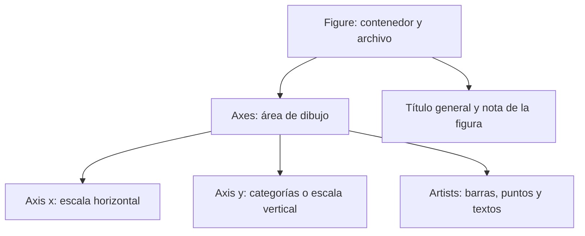
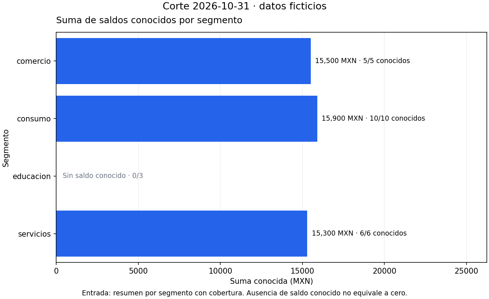
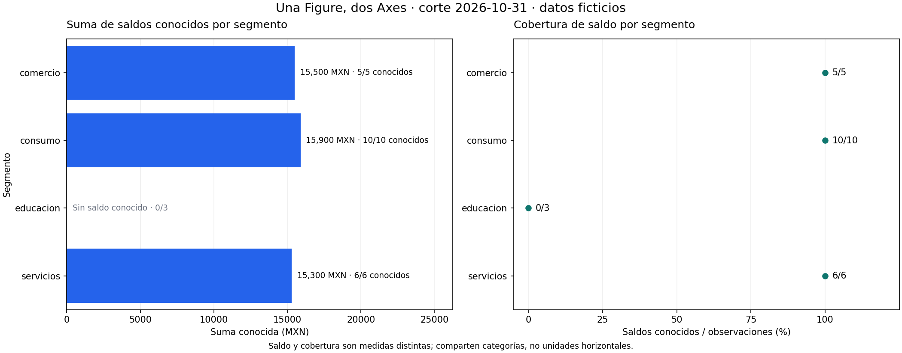

# 02 — Matplotlib: Figure y Axes

## Propósito, prerrequisitos y objetivos — esencial

Construir una figura desde datos comprobados y controlar dónde se dibuja,
qué se etiqueta y qué archivo se guarda. Completa
[04.01 — Pregunta y elección de gráfico](../01_question_chart/README.md) y su lab;
recupera [funciones de Python](../../01_python_foundations/04_functions/README.md)
y [el cierre pandas/SQL](../../03_sql_databases/09_pandas_sql/README.md).

Al terminar podrás distinguir Figure, Axes y Axis; crear una figura con
subplots; dibujar mediante métodos del Axes; guardar con fig.savefig y cerrar
la figura que usaste. No necesitas aprender a diseñar clases para utilizar
los objetos que entrega Matplotlib.

Usamos pandas y Matplotlib del entorno elegido. Sus referencias declaradas
son 2.3.3 y 3.10.7; la verificación local utilizó 2.3.3 y 3.10.6 disponibles,
sin modificar entornos ni agregar dependencias. La API se contrastó con la
guía oficial de 3.10.7. No confundas «versión de referencia» con «más reciente».

Sesiones sugeridas: **A**, secciones 1–4; **B**, secciones 5–7; **C**, guardado,
comprobación y lab. La figura con dos Axes es una extensión; una figura sencilla
guardada correctamente basta para el criterio esencial.

## 1. Datos antes que objetos gráficos

[resumen_octubre.csv](resumen_octubre.csv) conserva una muestra pequeña del
resumen conciliado de 03.09, con su fecha añadida como metadato explícito.
No se vuelve a limpiar cartera ni se cambian las fuentes anteriores.

| Segmento | Registros | Saldos conocidos | Suma conocida MXN |
| --- | --- | --- | --- |
| comercio | 5 | 5 | 15 500 |
| consumo | 10 | 10 | 15 900 |
| educacion | 3 | 0 | Ausente |
| servicios | 6 | 6 | 15 300 |

Contrato: una fecha y una fila por segmento; conteos enteros, registros positivos,
conocidos entre cero y registros; suma ausente si no hay saldos conocidos.
El archivo tiene cuatro filas porque la figura resume cuatro categorías; las
24 observaciones originales permanecen en las lecciones de SQL.

La pregunta sigue siendo «¿qué suma conocida tiene cada segmento?». La tabla
totaliza 24 registros, 21 saldos conocidos y 46 700 MXN conocidos.
educacion debe seguir visible como categoría sin saldo conocido; no se le asigna cero.

## 2. Figure, Axes y Axis: nombres parecidos, responsabilidades distintas

| Objeto | Responsabilidad | Nombre que usaremos |
| --- | --- | --- |
| Figure | Contenedor completo: tamaño, uno o más paneles, título general y archivo | fig |
| Axes | Un área de dibujo con marcas, etiquetas, título y coordenadas | ax |
| Axis | El eje horizontal o vertical del Axes, con marcas y escala | ax.xaxis / ax.yaxis |
| Artist | Objeto gráfico que Matplotlib dibuja | Barra, punto, texto, entre otros |

**Axes** es el nombre de un tipo de objeto: un solo Axes puede contener los
dos ejes x e y. No significa necesariamente «varios gráficos». Una Figure
puede tener un Axes o varios. Axis, en singular, se refiere a un eje concreto.
No tienes que construir manualmente esos objetos para comenzar.



En palabras: la figura reúne el contenido; cada área controla su propio dibujo;
los ejes ubican valores y los objetos gráficos los representan. El esquema
explica responsabilidades, no necesitas memorizar todas las clases internas.

## 3. Crear una Figure con un Axes

```python
import matplotlib.pyplot as plt

fig, ax = plt.subplots(figsize=(9, 5.5), layout="constrained")
```

import trae el módulo pyplot y plt es su alias habitual. subplots crea la
Figure y sus áreas de dibujo; sin indicar filas/columnas crea un solo Axes.
El resultado contiene dos objetos y los asignamos a fig y ax, como los retornos
de funciones que ya conoces. Los nombres son variables, no palabras reservadas.
Si solo ensayaste esta creación vacía, ciérrala con plt.close(fig) antes de
comenzar el siguiente ejemplo, que crea su propia figura.

figsize indica ancho y alto en pulgadas. layout='constrained' permite ajustar
espacios para títulos y etiquetas; no garantiza que cualquier texto largo quepa
en cualquier tamaño. Siempre abre la salida para revisarla.

Usamos pyplot para crear y cerrar, y los objetos explícitos para dibujar y guardar.
Esto evita depender de cuál figura o área haya quedado «actual» por una celda
anterior. La interfaz implícita de pyplot también existe, pero mezclarlas sin
control puede enviar un título o una marca al panel equivocado.

## 4. Dibujar y etiquetar con métodos del Axes

Una introducción breve con los tres segmentos cuyo saldo sí es conocido:

```python
segmentos = ["comercio", "consumo", "servicios"]
saldos = [15500, 15900, 15300]

fig, ax = plt.subplots(figsize=(9, 5.5), layout="constrained")
barras = ax.barh(segmentos, saldos, color="#2563eb")
ax.set_title("Suma conocida · segmentos con saldo observado · octubre 2026")
ax.set_xlabel("Suma conocida (MXN)")
ax.set_ylabel("Segmento")
ax.set_xlim(left=0)
```

Esta introducción no es todavía la figura final: omite educacion deliberadamente
para mostrar la llamada básica. El ejemplo completo conserva su categoría,
ausencia y cobertura; no presentes este bloque como todo el corte.

`ax.barh(...)` es un **método**, una operación del objeto ax. Recibe categorías
y magnitudes en el mismo orden. Devuelve un contenedor de barras que guardamos
en barras; puede usarse para añadir etiquetas después. No recalcula el resumen.
El título y etiquetas también son métodos del mismo Axes.

```python
ax.bar_label(barras, labels=["15 500", "15 900", "15 300"], padding=6)
ax.grid(axis="x", alpha=0.2)
ax.set_axisbelow(True)
```

bar_label añade una etiqueta a cada barra; padding separa texto y extremo en
puntos gráficos, no en pesos. grid activa líneas de referencia horizontales
o verticales según el eje; alpha controla transparencia. set_axisbelow sitúa
la cuadrícula detrás de las marcas. El color no cambia valores ni cobertura.
Al terminar este ensayo introductorio, usa plt.close(fig) antes de crear
la figura completa; no dejes la figura anterior abierta al reasignar fig.

## 5. Reconstruir la figura completa sin rellenar ausencias

[figure_axes.py](figure_axes.py) separa tres responsabilidades:

1. read_summary lee y valida tipos, claves, fecha, conteos y ausencias.
2. draw_balance recibe un Axes y dibuja sobre él, sin guardar ni cerrar.
3. create_single crea una Figure, llama al dibujo y devuelve fig y ax.

La separación permite reutilizar el dibujo en un panel sin crear otra figura
por accidente. Recupera parámetros/retorno de 01.04: ax es un argumento más,
y el resultado sigue siendo un objeto que puedes configurar.



El script usa posiciones 0–3 para conservar las cuatro categorías; las tres
sumas conocidas producen barras. La fila restante recibe un texto de ausencia.
El orden de posiciones y etiquetas coincide porque el resumen se ordena y
su índice se reinicia antes de dibujar.

set_yticks recibe posiciones y etiquetas. Los límites verticales descendentes
sitúan la primera categoría arriba; también existe ax.invert_yaxis para invertir
un eje. La suma cero conocida sería una barra de longitud cero con etiqueta
numérica y conteo conocido, distinta del mensaje de suma ausente.

### Título del panel frente a título de toda la figura

ax.set_title pertenece al área de dibujo. fig.suptitle añade un título general,
útil cuando hay más de un panel. fig.supxlabel se usa aquí para una nota común
debajo de la figura, con fuente y alcance; no reemplaza las unidades de cada Axes.

La figura mantiene el contrato de 04.01: importe conocido, cobertura y datos
ficticios. No atribuye a educacion saldo cero ni una posición en el ranking monetario.

## 6. Caso vacío y caso con todo desconocido

Una tabla con encabezados pero sin filas significa que no hay grupos para
dibujar. El script coloca un mensaje usando coordenadas relativas al Axes:

```python
ax.text(0.5, 0.5, "Sin observaciones en la tabla de entrada",
        ha="center", va="center", transform=ax.transAxes)
ax.set_axis_off()
```

transform=ax.transAxes interpreta 0.5/0.5 como el centro del área, no como
saldo de 0.5 MXN y categoría 0.5. ha/va alinean el texto; set_axis_off oculta
ejes que no tienen datos para representar. No se inventan barras cero.

Una tabla con filas pero con todos sus saldos desconocidos no está vacía:
conserva segmentos y conteos, con mensajes sin saldo conocido. Por eso la
condición summary.empty y la condición suma.isna() se tratan por separado.

## 7. Una Figure con dos Axes — extensión

```python
fig, axes = plt.subplots(1, 2, figsize=(14, 5.5), layout="constrained")
draw_balance(axes[0], resumen)
draw_coverage(axes[1], resumen)
fig.suptitle("Saldo conocido y cobertura · datos ficticios")
```

Ahora subplots crea una fila y dos columnas. axes contiene dos Axes; [0] y [1]
seleccionan cada panel. No llames axes.set_title: debes elegir uno de sus objetos.
Con una cuadrícula 2×2, el resultado predeterminado es una matriz y se accede
con axes[fila, columna]. Con un solo panel se recibe un Axes directamente.



La vista izquierda tiene MXN y la derecha cobertura de saldo en porcentaje.
educacion tiene cobertura 0 % porque hay cero conocidos entre tres observaciones;
eso no significa que su saldo sea cero. Las categorías y sus posiciones se
mantienen alineadas, pero los ejes horizontales no comparten unidad ni escala.
La composición se profundiza en 04.06; no necesitas generar esta segunda
figura para completar el lab esencial.

## 8. Guardar, mostrar y cerrar

```python
fig, ax = create_single(resumen)
try:
    fig.savefig(ruta_salida, dpi=150)
finally:
    plt.close(fig)
```

savefig guarda **esa Figure**; el Axes no guarda por sí solo un archivo de
toda la figura. La extensión .png determina el formato en este ejemplo.
dpi indica resolución raster: una figura de 9×5.5 pulgadas guardada a 150 dpi,
sin recortar su tamaño, produce 1350×825 píxeles. No añade información al indicador.

plt.close(fig) libera esa figura del registro de pyplot; no borra el archivo
guardado. finally asegura el cierre aunque guardar falle. Evitamos close('all')
en una función reutilizable porque podría cerrar figuras ajenas de la sesión.
Guardar no cierra automáticamente; si generas varias sin cerrar, se acumulan
objetos y consumo de memoria. Cerrar antes de continuar evita estado oculto.

plt.show muestra figuras en un entorno interactivo; no crea por sí solo un PNG.
En un notebook puedes ver la figura al final de una celda, pero verla no acredita
que esté guardada. Guarda antes de show cuando lo uses y controla el cierre.
Para revisar cómo ejecutar desde cero, recupera
[el primer notebook](../../00_getting_started/06_first_notebook/README.md).

El script elige Agg, un backend de archivos, antes de importar pyplot en su
recorrido de ejecución. Así no abre ventanas y funciona también sin escritorio.
No cambies a Agg a mitad de una sesión con figuras interactivas abiertas.
Para este recorrido abre los PNG generados; no esperes una ventana de show.

**Extensión:** puedes guardar fig.savefig('figura.svg') para salida vectorial.
Los formatos, tamaños y destinos se profundizan en 04.06; un PNG legible basta
ahora. El layout ayuda, pero verificar texto, unidades y valores sigue siendo tu tarea.

## 9. Ejecución y salidas

Desde la raíz, con el entorno elegido adecuado. El primer comando verifica
la tabla sin crear figuras; el segundo guarda en carpeta nueva.

### PowerShell

```powershell
python curriculum\04_visualization_python\02_figure_axes\figure_axes.py
python curriculum\04_visualization_python\02_figure_axes\figure_axes.py --output curriculum\04_visualization_python\02_figure_axes\output\mi_figura
# Extensión: también crear la Figure con dos Axes:
python curriculum\04_visualization_python\02_figure_axes\figure_axes.py --output curriculum\04_visualization_python\02_figure_axes\output\mis_paneles --two-panels
```

### Bash/Zsh

```bash
python curriculum/04_visualization_python/02_figure_axes/figure_axes.py
python curriculum/04_visualization_python/02_figure_axes/figure_axes.py --output curriculum/04_visualization_python/02_figure_axes/output/mi_figura
python curriculum/04_visualization_python/02_figure_axes/figure_axes.py --output curriculum/04_visualization_python/02_figure_axes/output/mis_paneles --two-panels
```

Con uv antepone `uv run --locked` a cada comando python; conserva tu gestor.
No reinstales si el entorno ya es adecuado. --input permite otra tabla con
el mismo contrato de cinco columnas; no acepta directamente los ocho campos
del resumen de 03.09 sin seleccionar columnas y añadir su fecha.

La entrega incluye resumen_usado.csv y saldo_conocido.png; con --two-panels,
también saldo_y_cobertura.png. Las carpetas existentes se conservan: usa otro
nombre para otra entrega o ejecuta sin --output para verificar. No se escriben
cambios sobre el CSV de entrada ni sobre ninguna base SQLite.

## 10. Errores habituales, lab y criterio de salida

| Situación | Qué revisar |
| --- | --- |
| Confundes Axes con dos ejes | Axes es el área; Axis es un eje concreto |
| Título aparece en otro panel | Usa el Axes explícito, no el estado actual |
| Un array de Axes no tiene set_title | Selecciona axes[0] o axes[fila, columna] |
| PNG queda vacío o distinto | Guarda fig antes de cerrar y revisa qué objeto creaste |
| Etiquetas se cortan | Revisa tamaño, espacio y salida real |
| Ausencia aparece como cero | No rellenes la suma; comprueba cobertura |
| Se acumulan figuras al repetir | Cierra cada fig creada por tu función |

Realiza el [lab 04.02](../../../labs/04_visualization_python/02_figure_axes/README.md).
Puedes avanzar cuando construyas una Figure con Axes explícito, conserves
contrato y ausencias, guardes el archivo correcto y cierres tus figuras.
Los proyectos y checkpoints visuales siguen pendientes. Continúa con el
[plan de 04.03 — Comparaciones y evolución](../README.md#03-comparaciones-y-evolucion),
todavía sin lección ni siguiente lab disponible.

## Referencias primarias

Ejemplos propios sobre el resumen comprobado del proyecto, contrastados con:

- [Matplotlib 3.10.7: objetos e interfaz explícita](https://matplotlib.org/3.10.7/users/explain/quick_start.html).
- [Figure.savefig](https://matplotlib.org/stable/api/_as_gen/matplotlib.figure.Figure.savefig.html).
- [pyplot.close](https://matplotlib.org/stable/api/_as_gen/matplotlib.pyplot.close.html).
- [Barras horizontales en 3.10.7](https://matplotlib.org/3.10.7/api/_as_gen/matplotlib.axes.Axes.barh.html).
Las páginas stable pueden mostrar otra versión; la referencia de esta lección
permanece en 3.10.7.
