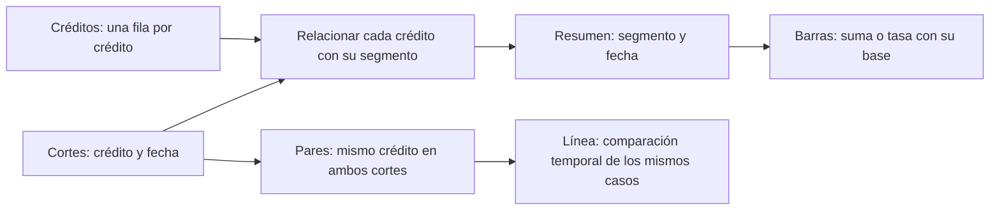
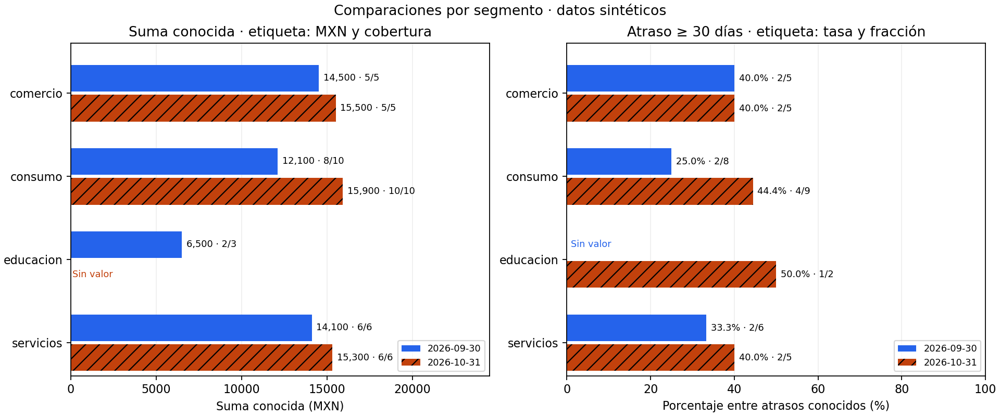
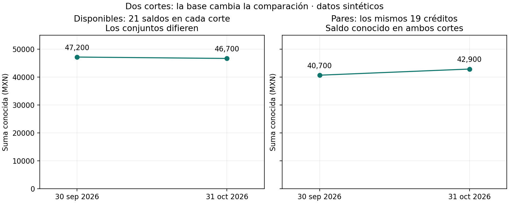
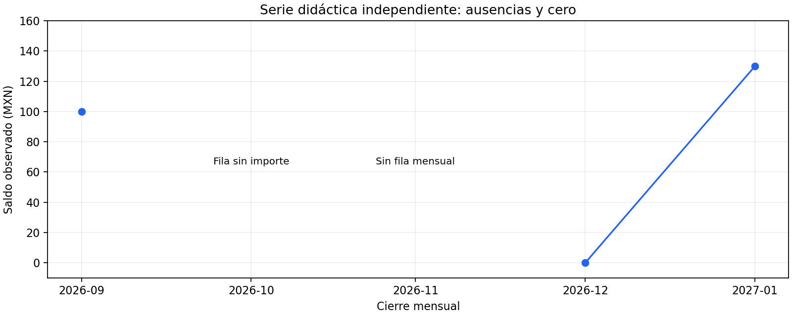

# 04.03 — Comparaciones y evolución

[Inicio](../../../README.md) / [Módulo 04](../README.md) / **Lección 04.03**

| Tu sesión | Qué prepararás o comprobarás |
| --- | --- |
| **Meta** | Comparar categorías y fechas con unidades y bases explícitas |
| **Necesitas** | Entorno con pandas/Matplotlib; fuentes compartidas y serie incluida |
| **Evidencia** | Tablas, código e interpretación de una comparación y una evolución |

[Preparación](#antes-de-empezar) · [Material de apoyo](#material-de-apoyo) · [Ir al lab](../../../labs/04_visualization_python/03_comparisons_evolution/README.md) · [Comprobar](#evidencia-y-criterio-de-salida)

<a id="propósito-y-prerrequisitos"></a>

## Propósito

Construir barras para comparar categorías y líneas para observar cambios en el
tiempo. Antes de interpretar una altura o una pendiente, comprobar qué mide,
qué unidad utiliza y qué observaciones entran en cada comparación.

## Antes de empezar

Completa [04.02 — Figure y Axes](../02_figure_axes/README.md) y su lab.
Reutilizaremos [agregaciones e indicadores SQL](../../03_sql_databases/04_aggregations/README.md)
y [la conciliación pandas/SQL](../../03_sql_databases/09_pandas_sql/README.md).
Puedes repasar [uniones](../../02_pandas/08_combine_tables/README.md),
[reorganización](../../02_pandas/09_reshape_tables/README.md) y
[fechas](../../02_pandas/06_text_dates/README.md) en pandas. Aquí se explica la preparación
necesaria para los gráficos; no necesitas otra biblioteca.

**Esencial:** barras agrupadas, orden estable, medidas y denominadores, fechas,
comparaciones con la misma base, ausencias y cero. **Ampliación:** variaciones
relativas e índice base 100. No se requiere estadística inferencial.

<a id="objetivos-y-contrato-de-los-datos"></a>

## Qué vas a aprender

- Asociar cada marca a una fila del resumen y explicar su unidad.
- Comparar dos cortes sin cambiar las posiciones de los segmentos.
- Distinguir suma, promedio, tasa y cobertura; reconocer sus diferentes preguntas.
- Dibujar fechas ordenadas y conservar huecos sin inventar observaciones.
- Explicar el cambio observado y los límites de una comparación de dos fechas.

## Material de apoyo

| Recurso | Para qué sirve | Uso |
| --- | --- | --- |
| [Script de ejemplo](comparisons.py) | Preparar bases y construir barras y líneas | Para el recorrido |
| [Serie mensual](serie_mensual.csv) | Explorar fechas, huecos y cero observado | Entrada incluida |
| [Fuentes de SQL](../../03_sql_databases/01_relational_sqlite/data/) | Consultar créditos y cortes originales | Entradas compartidas |

Las figuras incluidas sirven para observar y contrastar. Abre el script cuando
el recorrido lo indique para regenerar o practicar; conserva las fuentes y
las entregas anteriores y utiliza los destinos de práctica indicados.

## Contexto y datos del recorrido

Las fuentes son los CSV originales de
[créditos y cortes](../../03_sql_databases/01_relational_sqlite/README.md):
24 créditos y 48 observaciones, una por crédito y fecha. Los cortes son
2026-09-30 y 2026-10-31. Los saldos se expresan en MXN; el atraso, en días.
Los segmentos son etiquetas, no números ni etapas de una secuencia.

El [script comparisons.py](comparisons.py) lee esos CSV sin modificarlos ni
recrear la base SQLite. Une cada corte a su segmento con una relación muchos
a uno y comprueba claves. Un resumen contiene una fila por segmento y fecha.
Los ejemplos y figuras son propios y usan datos sintéticos.



Sin renderizador: primero relacionamos cortes con créditos. Después elegimos
agrupar por segmento/fecha o comparar el mismo crédito entre fechas. Esas
operaciones producen tablas diferentes y responden preguntas diferentes.

## 1. Elegir la medida antes de dibujar

| Pregunta | Medida | Unidad y base |
| --- | --- | --- |
| ¿Dónde hay más saldo registrado? | Suma de saldos conocidos | MXN; mostrar conocidos/observaciones |
| ¿Cuál es el saldo medio conocido? | Suma conocida / cantidad conocida | MXN por saldo conocido |
| ¿Qué proporción tiene atraso de al menos 30 días? | Casos con atraso ≥ 30 / atrasos conocidos | Porcentaje; mostrar numerador/denominador |
| ¿Cuánto del atraso podemos evaluar? | Atrasos conocidos / observaciones | Porcentaje de cobertura |

Una suma combina tamaño del grupo e importes. En octubre, consumo suma
15 900 MXN entre 10 saldos conocidos; comercio, 15 500 MXN entre 5. El mayor
total no implica mayor promedio: 1 590 frente a 3 100 MXN por saldo conocido.
El promedio tampoco describe por sí solo la variabilidad; esa pregunta se
desarrollará en 04.04.

Para atraso, ausente significa que no sabemos si el crédito cumple el umbral.
No lo clasificamos como cero días ni como sano. La tasa usa únicamente
atrasos conocidos y se acompaña de cobertura. Si el denominador es cero,
la tasa es desconocida, aunque el conteo de casos confirmados sea cero.

| Segmento, octubre | Saldo conocido (MXN) | Cobertura de saldo | Atraso ≥ 30 / conocidos | Tasa | Cobertura de atraso |
| --- | ---: | ---: | ---: | ---: | ---: |
| comercio | 15 500 | 5/5 | 2/5 | 40,0 % | 5/5 |
| consumo | 15 900 | 10/10 | 4/9 | 44,4 % | 9/10 |
| educacion | Sin saldo conocido | 0/3 | 1/2 | 50,0 % | 2/3 |
| servicios | 15 300 | 6/6 | 2/5 | 40,0 % | 5/6 |

Educacion tiene la mayor tasa entre casos evaluables, con solo dos atrasos
conocidos. Eso describe la muestra disponible; no prueba mayor riesgo en una
población ni explica causas. Un solo caso adicional podría cambiar mucho una
fracción pequeña. No presentamos estos porcentajes como estimaciones precisas
del conjunto desconocido.

## 2. Barras: posición, longitud y orden

Una barra horizontal sitúa el segmento en el eje vertical y el importe en el
horizontal. Su longitud empieza en cero: cortar ese origen distorsionaría la
comparación de longitudes. Los nombres largos suelen leerse mejor en horizontal.

Para una sola fecha podemos ordenar por importe, si queremos ver un ranking.
Para comparar fechas necesitamos **un orden común**. Aquí elegimos alfabético:
comercio, consumo, educacion, servicios. También podría fijarse con un criterio
de negocio o con el valor de una fecha de referencia, documentando cómo se
colocan empates y ausencias. No ordenar cada corte por separado: la misma
posición terminaría representando segmentos distintos.

Las barras agrupadas colocan dos barras cerca de cada segmento. Su separación
pequeña identifica fechas; la separación grande identifica segmentos.

```python
import matplotlib.pyplot as plt

# Mini ejemplo completo: dos segmentos con todos los valores conocidos.
segmentos = ["comercio", "consumo"]
posiciones = [0, 1]
fig, ax = plt.subplots(figsize=(7, 4), layout="constrained")
ax.barh([p - 0.18 for p in posiciones], [14500, 12100],
        height=0.32, label="2026-09-30")
ax.barh([p + 0.18 for p in posiciones], [15500, 15900],
        height=0.32, label="2026-10-31", hatch="//")
ax.set_yticks(posiciones, segmentos)
ax.invert_yaxis()
ax.set_xlim(left=0)
ax.set_xlabel("Suma de saldos conocidos (MXN)")
ax.set_title("Dos segmentos · cobertura distinta entre cortes")
ax.legend()
fig.savefig("mini_barras.png", dpi=160)  # Elige un nombre nuevo al practicar.
plt.close(fig)
```

`p - 0.18` y `p + 0.18` desplazan cada barra respecto al centro de su categoría.
`height=0.32` controla grosor, no importe. `label` alimenta la leyenda y `hatch`
añade una trama, para distinguir fechas también sin color. Este mini ejemplo
muestra la mecánica: la figura completa añade las coberturas que hacen falta
para interpretarlo.



El panel izquierdo mide MXN y etiqueta conocidos/observaciones; el derecho
mide porcentaje y etiqueta casos/atrasos conocidos. Sus escalas horizontales
son distintas y están identificadas. No comparar longitudes entre paneles.
En educacion/octubre no se dibuja barra de saldo; se muestra «Sin valor».
En educacion/septiembre tampoco hay tasa: cero atrasos conocidos.

Las fechas son dos fotografías de la cartera. **No apilar septiembre encima
de octubre:** el saldo de un crédito en ambas fechas no son dos partes de un
único saldo. Apilar puede servir para componentes que suman un total dentro
de la misma fecha, si son excluyentes y la suma tiene sentido. No enseña mejor
una comparación solo por ahorrar espacio.

## 3. Preparar los valores sin rellenar ausencias

En `prepare()` se calcula la suma con `sum(min_count=1)`: un grupo sin ningún
saldo conocido conserva ausencia. `count()` cuenta valores conocidos y
`len(part)` todas las observaciones. La condición `ge(30)` significa «mayor
o igual a 30»; sumar sus verdaderos cuenta casos confirmados.

Para dibujar una fecha se seleccionan sus filas y se alinean categorías. Este
fragmento supone que `resumen` contiene la primera tabla devuelta por prepare() y que
`segmentos` es la lista común de los cuatro segmentos:

```python
parte = resumen.loc[resumen["fecha_corte"].eq("2026-10-31")]
parte = parte.set_index("segmento").reindex(segmentos)
valores = parte["suma_conocida_mxn"].astype("Float64").astype(float)
validos = valores.notna()
```

`set_index` usa segmento como etiqueta de fila. `reindex` pide esas etiquetas
en ese orden; si falta una, deja valores ausentes. `notna()` identifica valores
conocidos. El script dibuja barras únicamente para ellos y escribe un mensaje
en las posiciones ausentes. Convertir a flotante permite representar ausencias
como `NaN`, compatible con Matplotlib. No usamos `fillna(0)` para los importes.

No basta con comprobar que «la gráfica se ve bien»: coteja longitudes, etiquetas,
filas y unidades con la tabla. Una columna equivocada también puede generar
una figura limpia.

## 4. Líneas: el tiempo tiene un orden y una distancia

`ax.plot(fechas, valores, marker="o")` dibuja marcas en las observaciones y las
conecta. Una marca representa un dato; un segmento de línea ayuda a seguir la
secuencia. No demuestra que se midieran todos los días intermedios.

Convierte texto a fecha, ordena cronológicamente y conserva la separación real
entre fechas. Si usas nombres de meses como categorías, septiembre→octubre y
octubre→diciembre ocuparían el mismo espacio aunque los intervalos difieran.
Ordenar por valor destruiría la secuencia temporal.

```python
import pandas as pd
import matplotlib.pyplot as plt

tabla = pd.DataFrame({"fecha": ["2026-10-31", "2026-09-30"],
                      "saldo_mxn": [42900, 40700]})
tabla["fecha"] = pd.to_datetime(tabla["fecha"], format="%Y-%m-%d")
tabla = tabla.sort_values("fecha")
fig, ax = plt.subplots(layout="constrained")
ax.plot(tabla["fecha"], tabla["saldo_mxn"], marker="o")
ax.set_xticks(tabla["fecha"], tabla["fecha"].dt.strftime("%Y-%m-%d"))
ax.set_ylabel("Suma conocida de los mismos 19 créditos (MXN)")
ax.set_title("Dos cortes comparables · datos sintéticos")
ax.set_ylim(0, 55000)
fig.savefig("mini_linea.png", dpi=160)
plt.close(fig)
```

El script completo calcula esos importes desde las fuentes. Las etiquetas
explícitas bastan con pocas fechas; una serie larga requiere seleccionar marcas
de fecha legibles. No necesitamos rotar cientos de etiquetas para mostrar todos
los puntos. Más adelante revisaremos formato y escalas con detalle.

## 5. La misma cantidad de casos no garantiza la misma base



| Base | Septiembre (MXN) | Octubre (MXN) | Diferencia |
| --- | ---: | ---: | ---: |
| Todos los saldos disponibles de cada corte: 21 y 21 | 47 200 | 46 700 | −500 MXN |
| Los mismos 19 créditos conocidos en ambos cortes | 40 700 | 42 900 | +2 200 MXN |

Ambas sumas son correctas. La primera responde cuánto saldo **conocemos** en
cada fecha. Algunos créditos pasan de conocido a ausente y otros de ausente a
conocido. Aunque los conteos sean iguales, no son los mismos créditos.
La segunda mide cambio dentro de un conjunto comparable: los 19 pares.
No describe los otros cinco créditos ni demuestra el cambio del saldo total
real de los 24.

Para construir pares, `pivot` coloca el crédito como fila y cada fecha como
columna. La clave crédito/fecha debe ser única. `dropna()` sobre esas dos
columnas selecciona únicamente pares completos, conservando las fuentes.
Esto se enlaza con las comparaciones por registro de
[ventanas SQL](../../03_sql_databases/07_windows/README.md).

Dos cortes permiten decir «la suma de estos pares aumentó entre estas fechas».
No bastan para afirmar una tendencia sostenida, estacionalidad, causa o
pronóstico. Sumar saldos de septiembre y octubre también contaría estados del
mismo crédito dos veces. Una serie de saldos es una medida de existencias;
pagos efectuados durante cada mes serían flujos y requerirían otras entradas.

## 6. Ausente, período sin fila y cero

Para explorar huecos usamos [serie_mensual.csv](serie_mensual.csv), una muestra
didáctica **independiente** de la cartera. No agregamos meses ficticios a los
cortes originales. Su contrato es un saldo al cierre de cada mes, entre septiembre
de 2026 y enero de 2027:

| Fecha esperada | Fila en CSV | Importe |
| --- | --- | ---: |
| 2026-09-30 | Sí | 100 MXN |
| 2026-10-31 | Sí | Ausente |
| 2026-11-30 | No | Desconocido |
| 2026-12-31 | Sí | 0 MXN |
| 2027-01-31 | Sí | 130 MXN |



Una fila sin importe y un mes sin fila requieren investigación diferente.
Ambos dejan un hueco en la línea; ninguno significa saldo cero. Diciembre sí
tiene una observación conocida de cero y se dibuja en cero.

La función `calendar()` prepara una cuadrícula de cierres mensuales:

```python
tabla["fila_presente"] = True
tabla = tabla.set_index("fecha").sort_index()
esperadas = pd.date_range(tabla.index.min(), tabla.index.max(), freq="ME")
serie = tabla.reindex(esperadas)
serie["fila_presente"] = serie["fila_presente"].eq(True)
```

`freq="ME"` pide finales de mes, incluyendo meses de distinta duración. El
calendario proviene del contrato, no de adivinar la frecuencia. La cuadrícula
abarca la primera y última fecha disponibles; para evaluar meses anteriores
o posteriores necesitaríamos declarar otros límites. No crea mediciones:
añade posiciones vacías para hacer visibles huecos dentro del período.
Solo el indicador de presencia se completa como verdadero/falso; el importe
conserva ausencia.

`plot` interrumpe el trazo cuando recibe `NaN`. Si quitáramos octubre y noviembre
antes de dibujar, conectaría septiembre con diciembre sin mostrar los huecos.
Si solo dibujáramos las filas presentes, noviembre seguiría oculto. Por eso
primero se alinea el calendario y después se dibuja. Interpolar o arrastrar el
último saldo exigiría una regla justificada y señalar valores estimados; no es
una reparación automática de una figura.

## 7. Ejecutar y comprobar el ejemplo completo

Usa el entorno ya elegido en [00.05](../../00_getting_started/05_environment/README.md).
Las referencias del proyecto siguen siendo pandas 2.3.3 y Matplotlib 3.10.7.
Se verificó localmente con pandas 2.3.3 y Matplotlib 3.10.6; no se cambiaron
dependencias. No necesitas instalar de nuevo si tu entorno ya funciona.

Desde la raíz del repositorio, elige **un** recorrido según tu gestor.
La carpeta de salida debe ser nueva: el script rechaza una que ya exista.

### PowerShell

```powershell
# Entorno Conda o venv/pip previamente activado:
python curriculum/04_visualization_python/03_comparisons_evolution/comparisons.py --output curriculum/04_visualization_python/03_comparisons_evolution/output/primera

# Alternativa si elegiste uv, ejecutar en lugar del comando anterior:
uv run --locked python curriculum/04_visualization_python/03_comparisons_evolution/comparisons.py --output curriculum/04_visualization_python/03_comparisons_evolution/output/primera
```

### Bash/Zsh

```bash
# Entorno Conda o venv/pip previamente activado:
python curriculum/04_visualization_python/03_comparisons_evolution/comparisons.py --output curriculum/04_visualization_python/03_comparisons_evolution/output/primera

# Alternativa para uv, en lugar del comando anterior:
uv run --locked python curriculum/04_visualization_python/03_comparisons_evolution/comparisons.py --output curriculum/04_visualization_python/03_comparisons_evolution/output/primera
```

Se guardan segmentos.png, bases.png y huecos.png, junto con comparaciones.csv,
pares.csv, totales.csv y calendario.csv. Las tablas permiten revisar qué datos
se dibujaron. `Agg` permite generar imágenes sin abrir ventanas; cada Figure se
guarda y se cierra de forma explícita. No se cierran figuras ajenas.

Comprueba ocho filas de resumen, 19 pares, los totales anteriores y cinco meses
en calendario.csv. Revisa los PNG al tamaño de lectura: unidades, leyendas,
etiquetas sin recortes y correspondencia con las tablas. Una salida incompleta
tras un error requiere revisión; para repetir usa otra carpeta, conservando
la evidencia anterior.

## 8. Ampliación: diferencia, porcentaje y puntos porcentuales

En los pares: diferencia = 42 900 − 40 700 = 2 200 MXN. Cambio relativo =
100 × 2 200 / 40 700 ≈ 5,41 %. El denominador es el saldo inicial de los
mismos casos. Si fuera cero, el cambio relativo no estaría definido.
Un índice base 100 expresaría septiembre como 100 y octubre como 105,41:
sirve para comparar cambios relativos, pero oculta tamaños absolutos y exige
una base conocida, positiva y comparable.

La tasa de atraso conocida de consumo pasa de 2/8 = 25 % a 4/9 ≈ 44,44 %.
La diferencia es **19,44 puntos porcentuales**. El cambio relativo de esa tasa
es aproximadamente 77,78 %, otra medida. No escribir «subió 19,44 %» para la
resta de porcentajes. Además cambia la base de atrasos conocidos: no atribuir
esa diferencia únicamente al empeoramiento de los mismos casos.

<a id="práctica-errores-habituales-y-criterio-de-salida"></a>

## Errores habituales

Si las barras cambian de categoría, revisa el orden común. Si una tasa es cero
con denominador cero, revisa su cálculo. Si una línea atraviesa un período sin
datos, revisa calendario y ausencias. Si una pendiente parece enorme, revisa
escala, intervalo y unidad. Si totales y pares discrepan, comprueba identidad
de los créditos antes de sospechar que la gráfica es incorrecta.

## Práctica

Realiza el [lab 04.03](../../../labs/04_visualization_python/03_comparisons_evolution/README.md) para
contrastar una comparación por segmento y una temporal.

## Evidencia y criterio de salida

| Conserva | Comprueba | Explica |
| --- | --- | --- |
| Tablas y código de ambas comparaciones | Categorías estables, fechas, unidades y bases | Qué pregunta responde una suma, una tasa o una comparación de pares |
| Interpretación propia | Los huecos y ausencias no se convierten en ceros | Qué límites tiene comparar dos cortes y qué casos son comparables |

Antes de avanzar, reconstruye y explica al menos una comparación por segmento
y una temporal, señala unidades/bases y distingue huecos de cero. Entrega tablas
y código junto con una interpretación limitada a lo observado.

Quien aprende realiza y explica la práctica; su compañero revisa.
Tu compañero elige dos puntos o barras y pregunta si representan la misma población y medida.
Guarda evidencia, ayudas y dudas en una nota personal junto a tu práctica.
PROGRESS.md conserva el desarrollo editorial; disponer del material no acredita
por sí solo aprendizaje completado.

No hay proyecto ni checkpoint implementado asociado a esta lección.

<a id="referencias-y-atribución"></a>

## Referencias

La explicación se apoya en las fuentes primarias siguientes; el código, los
ejemplos y las figuras se crearon para DS Track. La documentación estable puede
mostrar versiones posteriores a las referencias declaradas del proyecto.

- [Matplotlib: barras agrupadas](https://matplotlib.org/stable/gallery/lines_bars_and_markers/barchart.html), para posiciones y etiquetas.
- [Matplotlib: valores NaN y líneas interrumpidas](https://matplotlib.org/stable/gallery/lines_bars_and_markers/masked_demo.html), para el comportamiento de los huecos.
- [pandas: reindex](https://pandas.pydata.org/docs/reference/api/pandas.DataFrame.reindex.html), para alinear una cuadrícula sin completar importes.
- [Claus O. Wilke: series temporales, Fundamentals of Data Visualization](https://clauswilke.com/dataviz/time-series.html), libro abierto para razonar sobre secuencias y conexiones.

## Siguiente paso

Después de la práctica y su comprobación, continúa con [04.04 — Distribuciones y relaciones](../04_distributions_relationships/README.md).

[← Módulo 04](../README.md) · [Lab 04.03](../../../labs/04_visualization_python/03_comparisons_evolution/README.md) · [Siguiente →](../04_distributions_relationships/README.md)
