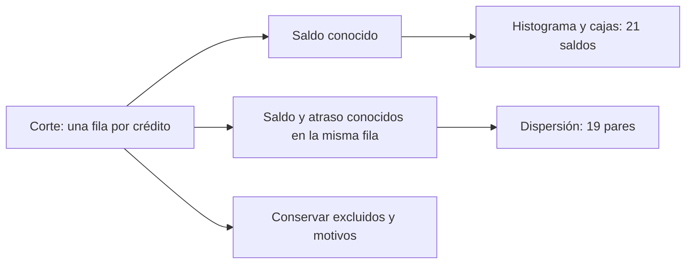
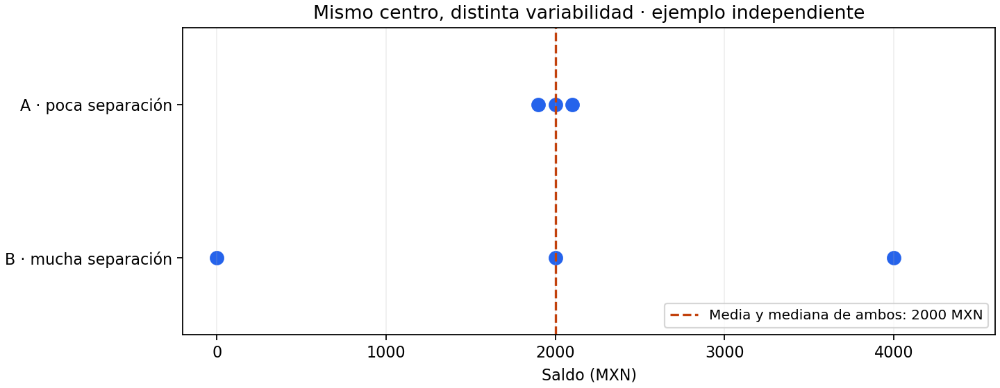
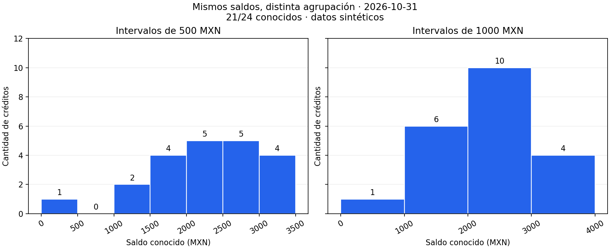
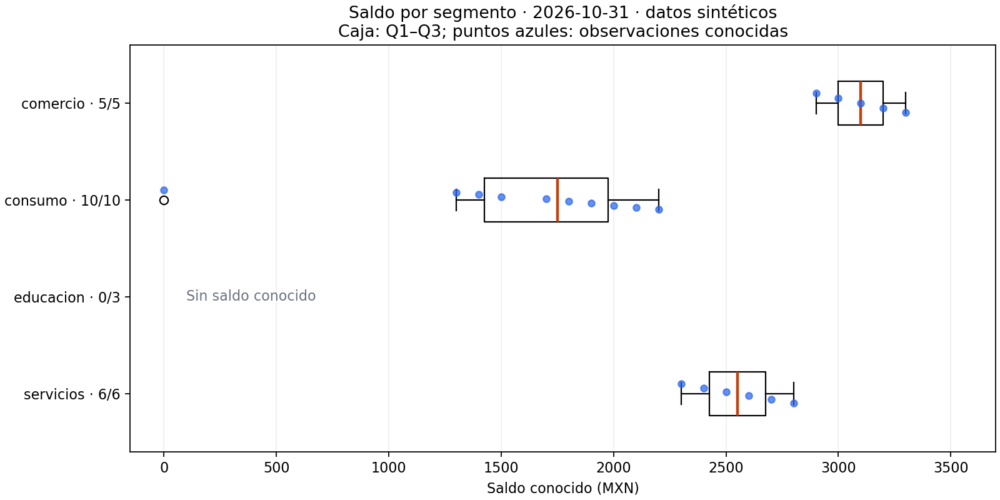
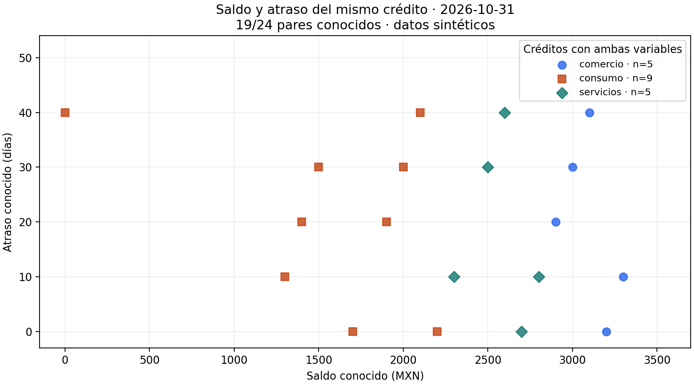

# 04.04 — Distribuciones y relaciones

[Inicio](../../../README.md) / [Módulo 04](../README.md) / **Lección 04.04**

| Tu sesión | Qué prepararás o comprobarás |
| --- | --- |
| **Meta** | Explorar variabilidad y relaciones conservando las bases de cada figura |
| **Necesitas** | Pandas/Matplotlib y los CSV compartidos de SQL |
| **Evidencia** | Histogramas, cajas y dispersión con tablas y límites explicados |

[Preparación](#antes-de-empezar) · [Material de apoyo](#material-de-apoyo) · [Ir al lab](../../../labs/04_visualization_python/04_distributions_relationships/README.md) · [Comprobar](#evidencia-y-criterio-de-salida)

<a id="propósito-y-prerrequisitos"></a>

## Propósito

Observar la variabilidad que ocultan una suma o un promedio y explorar cómo
se relacionan dos variables del mismo registro. Construiremos histogramas,
diagramas de caja y gráficos de dispersión, con unidades y cobertura explícitas.

## Antes de empezar

Completa [04.03 — Comparaciones y evolución](../03_comparisons_evolution/README.md)
y su lab. Reutiliza [Figure y Axes](../02_figure_axes/README.md),
[agrupación en pandas](../../02_pandas/07_group_summarize/README.md) y
[selección de filas](../../02_pandas/03_select_filter_sort/README.md).
No necesitas modelos estadísticos ni experiencia con NumPy.

**Esencial:** centro y dispersión, intervalos, cuartiles, bigotes, pares conocidos,
valores extremos y asociación frente a causalidad. **Ampliación:** frecuencias
relativas, densidad y comparación entre cortes. No se requiere ajustar una curva.

<a id="objetivos-y-entradas"></a>

## Qué vas a aprender

- Elegir una distribución para una variable o una dispersión para dos variables.
- Conciliar las frecuencias de un histograma con los valores conocidos.
- Explicar caja, mediana, bigotes y puntos exteriores sin llamarlos errores.
- Mantener emparejadas las variables de cada crédito al dibujar una dispersión.
- Describir patrones con sus límites, sin presentar asociación como causa.

## Material de apoyo

| Recurso | Para qué sirve | Uso |
| --- | --- | --- |
| [Script de ejemplo](distributions.py) | Preparar distribuciones y pares con controles | Para el recorrido |
| [Fuentes de SQL](../../03_sql_databases/01_relational_sqlite/data/) | Consultar créditos y cortes sin alterar SQLite | Entradas compartidas |
| [Histogramas de referencia](assets/histogramas.png) | Comparar intervalos sobre los mismos saldos | Para observar |

Las figuras incluidas sirven para observar y contrastar. Abre el script cuando
el recorrido lo indique para regenerar o practicar; conserva las fuentes y
las entregas anteriores y utiliza los destinos de práctica indicados.

## Contexto y datos del recorrido

Usaremos los [CSV sintéticos originales de SQL](../../03_sql_databases/01_relational_sqlite/README.md).
Hay 24 créditos y dos cortes, 48 observaciones. En esta sección seleccionamos
**2026-10-31**: una fila por crédito. No mezclamos los dos saldos de un crédito
como si fueran créditos distintos.

El [script distributions.py](distributions.py) conserva las fuentes y la base
SQLite. Lee tipos explícitos, comprueba la clave crédito/fecha y une cada corte
a un único segmento. Luego crea vistas para cada pregunta:

| Vista de octubre | Base | Valores ausentes |
| --- | ---: | --- |
| Histograma de saldo | 21 saldos entre 24 créditos | 3 saldos ausentes |
| Cajas por segmento | 5, 10, 0 y 6 saldos conocidos | educacion conserva su categoría con 0/3 |
| Dispersión saldo/atraso | 19 pares entre 24 créditos | 5 créditos sin al menos una variable |

El atraso también tiene 21 valores conocidos. Los tres atrasos ausentes y los
tres saldos ausentes se solapan en un crédito: la unión de ausencias contiene
cinco, no seis. Cada figura usa la base que permite responder su pregunta.



Sin renderizador: desde el mismo corte se selecciona saldo conocido para
distribuciones o ambas variables conocidas para dispersión. Las exclusiones
se conservan con sus motivos, aunque no tengan coordenadas para dibujarse.

## 1. Centro y variabilidad son preguntas distintas

Un centro resume dónde se sitúan los datos. La **media** suma los valores y divide
entre su cantidad; la **mediana** ocupa el centro de la lista ordenada. Con una
cantidad par, promediamos los dos centrales. La **variabilidad** describe cuánto
se separan los valores entre sí o respecto a ese centro.



Este ejemplo independiente tiene tres valores por grupo:

- A: 1 900, 2 000 y 2 100 MXN; media y mediana 2 000; rango 200 MXN.
- B: 0, 2 000 y 4 000 MXN; media y mediana 2 000; rango 4 000 MXN.

El rango es máximo menos mínimo. Ambos centros coinciden, pero una persona que
solo reciba «saldo promedio 2 000» perdería la diferencia de variabilidad.
El rango depende mucho de los extremos; más adelante usaremos el intervalo
central del 50 % de datos para complementar la lectura.

Antes de interpretar una distribución, pregunta: ¿qué observación entra?
¿Qué variable y unidad se representan? ¿Qué parte está ausente? ¿El resumen
oculta grupos distintos? Las muestras pequeñas permiten ver cada dato;
no necesitan una curva suave que sugiera precisión adicional.

## 2. Histograma: contar valores dentro de intervalos

Un histograma agrupa una variable numérica por intervalos. El eje horizontal
contiene saldos en MXN; el vertical, cantidad de créditos conocidos dentro
de cada intervalo. Cada barra representa un rango de saldos, no un segmento.

En las [barras de 04.03](../03_comparisons_evolution/README.md), las categorías
tenían nombres y se podían reordenar. Los intervalos de un histograma conservan
su orden numérico y su anchura tiene significado. No ordenar sus barras de
mayor a menor altura: perderías la ubicación de los saldos.

Para octubre elegimos bordes cada 500 MXN:

| Intervalo de saldo (MXN) | Créditos |
| --- | ---: |
| [0, 500) | 1 |
| [500, 1 000) | 0 |
| [1 000, 1 500) | 2 |
| [1 500, 2 000) | 4 |
| [2 000, 2 500) | 5 |
| [2 500, 3 000) | 5 |
| [3 000, 3 500] | 4 |
| Total conocido | 21 |

`[a, b)` incluye a y excluye b. Así, 1 500 va al intervalo [1 500, 2 000),
no al anterior. Matplotlib incluye el límite derecho del último intervalo.
El cero observado pertenece al primero. Los tres saldos ausentes no entran
en ningún intervalo ni se convierten en ceros.



La vista de 500 MXN distingue más detalles; la de 1 000 reúne más valores
en cada barra y parece menos fragmentada. Los saldos no cambiaron. Pocas barras
pueden esconder separaciones; demasiadas pueden hacer que una muestra pequeña
parezca una colección de picos. Conviene mirar al menos dos agrupaciones y
conservar los valores para comprobar la lectura.

Podemos afirmar que hay un saldo cero, ningún conocido entre 500 y 1 000 MXN,
y 20 conocidos entre 1 300 y 3 300 MXN. No sabemos dónde caerían los tres
ausentes. Tampoco hay evidencia suficiente para declarar una distribución
«normal», varios subgrupos reales o una pauta poblacional a partir de estos
intervalos y esta muestra sintética.

### Dibujar y recuperar las frecuencias

Este mini ejemplo completo permite ver a qué intervalo va un valor en el borde:

```python
import matplotlib.pyplot as plt

saldos = [0, 1300, 1500, 2000, 3500]
bordes = [0, 500, 1000, 1500, 2000, 2500, 3000, 3500]
fig, ax = plt.subplots(layout="constrained")
conteos, limites, barras = ax.hist(saldos, bins=bordes, edgecolor="white")
print(conteos.tolist())  # [1, 0, 1, 1, 1, 0, 1]
print(sum(conteos))      # 5 conocidos
ax.set_xlabel("Saldo conocido (MXN)")
ax.set_ylabel("Cantidad de créditos")
ax.set_title("Intervalos con bordes explícitos · ejemplo independiente")
fig.savefig("mini_histograma.png", dpi=160)  # Usa un nombre nuevo.
plt.close(fig)
```

`bins` acepta una lista de bordes, no las alturas. `hist` devuelve conteos,
límites y objetos de barras, útiles para verificar y etiquetar la figura.
El script completo exporta intervalos_500.csv e intervalos_1000.csv. La función
`interval_counts` usa `numpy.histogram` y rechaza valores fuera de los bordes:
un rango demasiado pequeño podría excluirlos silenciosamente de un histograma.
NumPy se utiliza aquí para operaciones numéricas y está disponible como
dependencia de pandas/Matplotlib; no requiere una instalación adicional.

## 3. Diagrama de caja: resumir el centro y la separación

Una caja permite comparar distribuciones entre grupos sin depender de bordes
de histograma. Hay que conocer qué representa cada parte:

| Elemento | Significado con la configuración de este ejemplo |
| --- | --- |
| Q1 | Cuartil inferior, percentil 25 |
| Línea de la caja | Mediana, percentil 50 |
| Q3 | Cuartil superior, percentil 75 |
| Longitud de la caja | IQR = Q3 − Q1; separación del tramo central |
| Límites de referencia | Q1 − 1,5 × IQR y Q3 + 1,5 × IQR |
| Bigotes | Valores observados más extremos dentro de esos límites |
| Puntos fuera de bigotes | Observaciones que quedan más allá de esos bigotes |

Los bigotes **no son automáticamente mínimo y máximo**, ni intervalos de
confianza. Sus puntas corresponden a valores observados, no necesariamente
a los límites calculados. El tramo Q1–Q3 resume aproximadamente el 50 % central;
con muestras pequeñas, empates e interpolación no significa que exactamente
la mitad de los puntos deba caer estrictamente dentro.

### Calcular antes de interpretar

Los diez saldos conocidos de consumo, ordenados, son:
0, 1 300, 1 400, 1 500, 1 700, 1 800, 1 900, 2 000, 2 100, 2 200 MXN.

Con interpolación lineal, los cuartiles son Q1 = 1 425, mediana = 1 750,
Q3 = 1 975 MXN. Para entender Q1, con posiciones desde cero, su ubicación
es (10 − 1) × 0,25 = 2,25: un cuarto del camino entre posiciones 2 y 3,
es decir 1 400 + 0,25 × (1 500 − 1 400) = 1 425. No hace falta que un crédito
tenga ese saldo. Hay otras convenciones de cuartiles; al comparar herramientas
conviene documentar el método, sobre todo con pocos valores.

IQR = 550 MXN. Los límites son 600 y 2 800 MXN; los bigotes llegan a 1 300
y 2 200, los valores observados más extremos dentro de los límites. El cero
queda fuera. La media 1 590 es menor que la mediana 1 750 por el efecto de ese
valor bajo; no reemplazamos una por otra ni eliminamos el cero para acercarlas.



El script superpone puntos azules para conservar el detalle. Una pequeña
separación vertical facilita verlos: no modifica saldos ni añade una variable.
La mediana se marca en naranja. Un punto azul puede coincidir con el símbolo
de un valor fuera de bigotes: sigue siendo una sola observación, no dos.

Comercio tiene mediana 3 100 e IQR 200 MXN; servicios, mediana 2 550 e IQR
250; consumo, mediana 1 750 e IQR 550. Así distinguimos nivel central y
separación. Educacion conserva su etiqueta 0/3 y un mensaje, sin caja inventada.
La longitud de una caja no representa número de créditos: los tamaños se leen
en las fracciones. No podemos describir la distribución de educacion con sus
saldos ausentes ni comparar su mediana como si fuera cero.

```python
import matplotlib.pyplot as plt

consumo = [0, 1300, 1400, 1500, 1700, 1800, 1900, 2000, 2100, 2200]
fig, ax = plt.subplots(figsize=(8, 3), layout="constrained")
partes = ax.boxplot([consumo], orientation="horizontal", whis=1.5,
                   tick_labels=["consumo · 10 conocidos"], showfliers=True)
ax.set_xlabel("Saldo conocido (MXN)")
ax.set_title("Caja y bigotes: un cero observado fuera de bigotes")
fig.savefig("mini_caja.png", dpi=160)
plt.close(fig)
```

`orientation` existe desde Matplotlib 3.10. `whis=1.5` declara la regla de
bigotes y `showfliers=True` conserva los puntos exteriores. `tick_labels`
nombra los grupos. En el script completo se fijan posiciones comunes incluso
cuando un grupo no tiene valores.

### Un valor extremo merece revisión, no borrado automático

«Fuera de bigotes» es una clasificación dependiente de la muestra y de la regla.
No equivale a error, fraude ni caso inválido. El saldo cero pertenece al crédito
004 y aparece explícitamente en la fuente. El gráfico no dice si es una
liquidación, un ajuste u otro evento; habría que consultar el significado y
la evidencia. La combinación saldo cero/atraso 40 también merece revisión,
pero no autoriza a corregir el registro por su apariencia.

Si se confirma un error, aplica una regla documentada y conserva fuente,
rechazos y conciliación, como en
[validación y reglas](../../02_pandas/05_missing_duplicates_rules/README.md).
Si el valor es válido, conservarlo es parte de describir la variabilidad.
Con un solo valor o todos iguales, una caja puede colapsar; eso requiere
mostrar el tamaño y los puntos, no inventar dispersión.

## 4. Dispersión: dos variables del mismo registro

Una dispersión coloca una variable numérica en cada eje. Aquí un punto es un
crédito en octubre: saldo en MXN en horizontal y atraso en días en vertical.
No es una línea temporal ni representa promedios de segmentos.



Antes de dibujar, seleccionamos **las mismas filas** con ambas variables:

```python
# Fragmento: corte es el DataFrame ya filtrado a una fecha.
pares = corte.dropna(subset=["saldo_mxn", "dias_atraso"])
fig, ax = plt.subplots(layout="constrained")
ax.scatter(pares["saldo_mxn"].astype(float),
           pares["dias_atraso"].astype(float), alpha=0.8)
ax.set_xlabel("Saldo conocido (MXN)")
ax.set_ylabel("Atraso conocido (días)")
```

No quitar ausencias de cada columna por separado: sus índices y cantidades
podrían diferir, o podrías emparejar el saldo de un crédito con el atraso de otro.
Tampoco ordenar cada columna de manera independiente. El emparejamiento
depende de la clave del registro, no de la posición tras dos transformaciones.

Se excluyen de esta vista 006, 012, 022, 023 y 024. El script exporta esos casos
con indicadores de saldo/atraso ausentes. **Los 19 pares son dentro de la misma
fecha**; no son los 19 pares entre fechas de 04.03. La cantidad coincide,
pero la selección responde a otro contrato y contiene créditos distintos.

El color y la forma distinguen segmentos; no cambian coordenadas. Educacion
no tiene pares de saldo/atraso y no aparece como nube: no concluir que tiene
atraso cero. Si varios registros coinciden en ambas coordenadas, sus marcas
se superponen: contar puntos visibles puede subestimar el número de filas.
Transparencia ayuda a ver acumulación, pero no garantiza recuperar un conteo.
Para muchas observaciones podríamos agrupar en celdas o usar densidades como
ampliación posterior. Aquí basta conservar tabla y tamaños.

## 5. Leer una relación sin convertirla en una explicación causal

Recorre la nube con preguntas concretas:

1. ¿Los puntos tienden a subir, bajar o no muestran una dirección clara?
2. ¿La forma es aproximadamente recta, curva, agrupada o dominada por extremos?
3. ¿Cambia la separación vertical según el saldo? ¿Hay huecos o superposición?
4. ¿Se distinguen segmentos y bases de distinto tamaño?
5. ¿Qué no puede verse por ausencias, selección o agregación?

Una dirección positiva significa que valores mayores de X tienden a acompañarse
de valores mayores de Y; negativa, de valores menores de Y. «Tienden» permite
separación entre puntos: no exige que cada incremento de X aumente Y. Una nube
sin dirección lineal clara todavía puede tener una forma curva o grupos que
merecen examinarse. Ninguna dirección decide por sí sola qué variable explica
a la otra.

En esta muestra, los atrasos se repiten en bandas de 0, 10, 20, 30 y 40 días
porque los datos se construyeron así. Se observan distintos atrasos en saldos
próximos; no hay un aumento estricto del atraso con cada incremento del saldo.
No afirmamos que el saldo cause atraso ni que se pueda predecir con esta nube.
La escala discreta y el origen sintético también limitan la interpretación.

Una asociación puede deberse a otras variables, selección de casos, diferencias
entre grupos o una relación en sentido inverso. Un coeficiente de correlación
resume principalmente asociación lineal y no reemplaza mirar la nube:
puede ocultar curvas, grupos y puntos influyentes. No necesitamos calcularlo
para completar esta sección. Ninguno de estos gráficos demuestra causalidad.

Los promedios por segmento tampoco describen todas las relaciones individuales:
agregar elimina información. No conectar los puntos con `plot` para «ver una
tendencia»: el orden de las filas no es un recorrido temporal ni una relación
causal. Una línea de ajuste requeriría otro objetivo y supuestos explícitos.

## 6. Reconstruir, exportar y comprobar

Utiliza el entorno elegido en [00.05](../../00_getting_started/05_environment/README.md).
Referencias del proyecto: pandas 2.3.3 y Matplotlib 3.10.7. Los ejemplos se
comprobaron con pandas 2.3.3 y Matplotlib 3.10.6 locales. No se modificaron
dependencias ni el entorno global. Usa un gestor, con el entorno ya activado.

Desde la raíz del repositorio, elige un recorrido. `--output` exige carpeta
nueva y `--cut` selecciona fecha; no reinicia ni escribe la base SQLite.

### PowerShell

```powershell
# Conda o venv/pip previamente activado:
python curriculum/04_visualization_python/04_distributions_relationships/distributions.py --cut 2026-10-31 --output curriculum/04_visualization_python/04_distributions_relationships/output/octubre

# Alternativa si elegiste uv: ejecutar en lugar del comando anterior.
uv run --locked python curriculum/04_visualization_python/04_distributions_relationships/distributions.py --cut 2026-10-31 --output curriculum/04_visualization_python/04_distributions_relationships/output/octubre
```

### Bash/Zsh

```bash
# Conda o venv/pip previamente activado:
python curriculum/04_visualization_python/04_distributions_relationships/distributions.py --cut 2026-10-31 --output curriculum/04_visualization_python/04_distributions_relationships/output/octubre

# Alternativa para uv: ejecutar en lugar del comando anterior.
uv run --locked python curriculum/04_visualization_python/04_distributions_relationships/distributions.py --cut 2026-10-31 --output curriculum/04_visualization_python/04_distributions_relationships/output/octubre
```

Se generan cuatro PNG: histogramas, cajas, dispersion y mismo_centro. Siete
CSV permiten comprobar el corte, saldos, pares, excluidos, dos agrupaciones de
intervalos y resumen de cajas. El último PNG es el ejemplo independiente de
seis valores descrito arriba, no una transformación de la cartera.

`Agg` genera imágenes sin ventanas; cada Figure se guarda y cierra. Las salidas
no sustituyen las fuentes. Si falla una exportación, revisa su carpeta antes
de repetir y usa otra nueva. Para una fecha sin registros se producen mensajes
de ausencia y tablas vacías; eso no es evidencia de una cartera con saldo cero.

Comprueba 24 filas de corte = 19 pares + 5 excluidos. Las frecuencias suman
21, no 24 ni 19. Revisa cuartiles y bigotes de consumo en resumen_cajas.csv.
Finalmente abre los PNG al tamaño de lectura y coteja coordenadas, unidades,
tamaños, leyenda y etiquetas con las tablas.

## 7. Ampliación: conteo, proporción y densidad

Con grupos de tamaños distintos, más altura puede significar más observaciones,
no mayor concentración relativa. Una frecuencia relativa divide el conteo de
cada intervalo entre el total conocido de la muestra. En [2 000, 2 500),
5/21 ≈ 23,81 % de los saldos conocidos de octubre; no 5/24 ni porcentaje de MXN.

`density=True` tiene otro significado: altura = conteo / (total × anchura).
Con intervalo de 500 MXN, la altura sería 5 / (21 × 500) ≈ 0,000476 por MXN.
**El área**, altura por anchura, da la proporción 5/21. Las alturas no son
porcentajes y no necesariamente suman uno. Con anchuras desiguales, un
histograma de conteos puede confundir la lectura de áreas: usa intervalos
iguales en esta práctica; una vista de densidad exige explicar la unidad.

Si comparas septiembre con octubre, usa los mismos bordes, unidades y medida
vertical; declara las coberturas. Incluso con 21 saldos por fecha, no son
todos los mismos créditos, como vimos en 04.03. Esta ampliación describe
distribuciones disponibles; no estima automáticamente cambios individuales.

<a id="práctica-criterio-de-salida-y-continuidad"></a>

## Práctica

Realiza el [lab 04.04](../../../labs/04_visualization_python/04_distributions_relationships/README.md) para
explicar una distribución y una relación desde sus tablas.

## Evidencia y criterio de salida

| Conserva | Comprueba | Explica |
| --- | --- | --- |
| Código, tablas y figuras de tu práctica | Frecuencias, cuartiles, pares y cobertura | Qué muestran un histograma, una caja y una dispersión |
| Interpretación y exclusiones | Los puntos conservan las variables del mismo registro | Por qué un valor exterior puede ser válido y asociación no implica causa |

Puedes avanzar cuando expliques al menos un histograma, una caja y una
dispersión desde sus tablas: unidad, base, centro/variabilidad o relación,
ausencias y límites. Conserva un valor exterior válido y justifica por qué
las variables de dispersión permanecen emparejadas.

Quien aprende realiza y explica la práctica; su compañero revisa.
Tu compañero señala un punto exterior y pide rastrearlo a su registro sin eliminarlo automáticamente.
Guarda evidencia, ayudas y dudas en una nota personal junto a tu práctica.
PROGRESS.md conserva el desarrollo editorial; disponer del material no acredita
por sí solo aprendizaje completado.

No hay proyecto ni checkpoint implementado asociado a esta lección.

<a id="referencias-y-atribución"></a>

## Referencias

Código, muestras explicativas y figuras propios de DS Track. Las decisiones
se contrastaron con estas fuentes primarias; no se copiaron capítulos ni figuras.
Las páginas stable pueden mostrar versiones posteriores a las declaradas.

- [Matplotlib: hist](https://matplotlib.org/stable/api/_as_gen/matplotlib.axes.Axes.hist.html), para bordes, frecuencias y densidad.
- [Matplotlib 3.10.7: boxplot](https://matplotlib.org/3.10.7/api/_as_gen/matplotlib.axes.Axes.boxplot.html), para orientación, bigotes y puntos exteriores.
- [Matplotlib: scatter](https://matplotlib.org/stable/api/_as_gen/matplotlib.axes.Axes.scatter.html), para coordenadas y marcas.
- [Claus O. Wilke: histogramas y densidades](https://clauswilke.com/dataviz/histograms-density-plots.html) y [asociaciones](https://clauswilke.com/dataviz/visualizing-associations.html), capítulos del libro abierto Fundamentals of Data Visualization.

## Siguiente paso

Después de la práctica y su comprobación, continúa con [04.05 — Escalas, etiquetas y accesibilidad](../05_scales_labels_accessibility/README.md).

[← Módulo 04](../README.md) · [Lab 04.04](../../../labs/04_visualization_python/04_distributions_relationships/README.md) · [Siguiente →](../05_scales_labels_accessibility/README.md)
