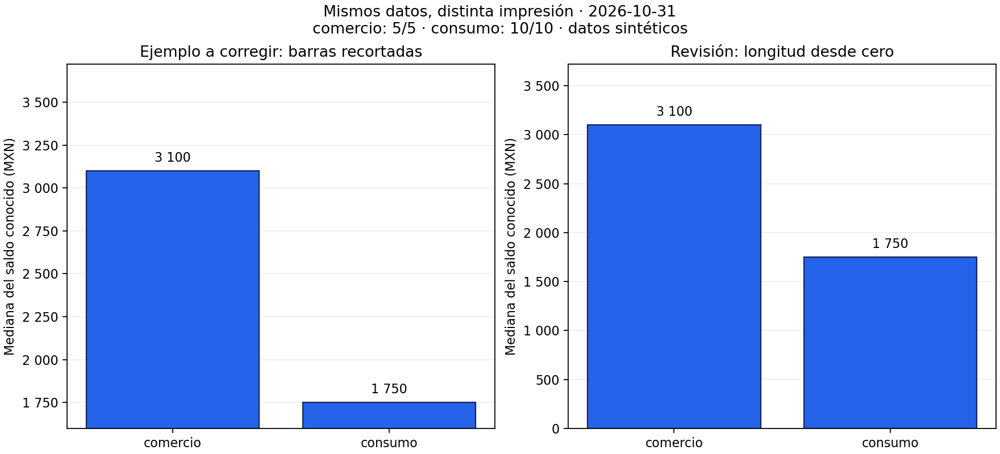
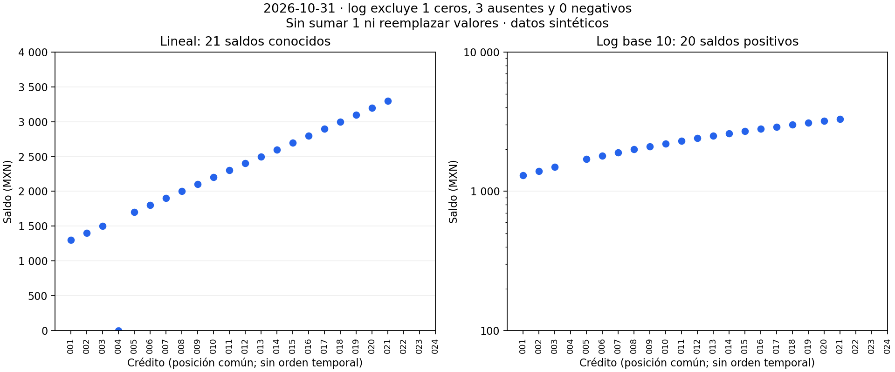
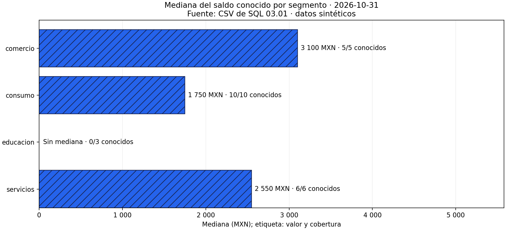
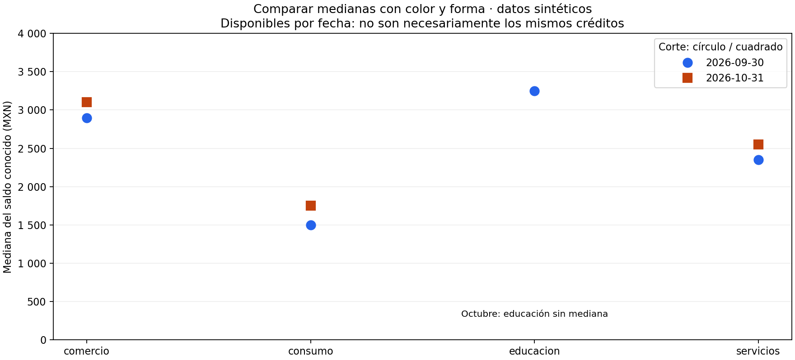
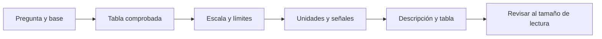

# 04.05 — Escalas, etiquetas y accesibilidad

## Propósito y prerrequisitos

Revisar una figura antes de comunicarla: comprobar qué mide, qué parte de los
datos muestra y cómo sus ejes, etiquetas y señales afectan la interpretación.
Una figura puede usar valores correctos y aun así sugerir una conclusión incorrecta.

Completa [04.04 — Distribuciones y relaciones](../04_distributions_relationships/README.md)
y su lab. Reutiliza [Figure y Axes de 04.02](../02_figure_axes/README.md)
y las [bases de comparación de 04.03](../03_comparisons_evolution/README.md).
No necesitas calcular logaritmos a mano ni conocer estadística inferencial.

**Esencial:** límites, escala lineal y logarítmica, unidades, cobertura, señales
adicionales al color y descripción textual. **Práctica:** corregir una figura y
justificar cada decisión. **Ampliación:** revisar contraste en un destino web;
no se exige certificar accesibilidad ni construir una aplicación.

## Objetivos, datos y resultados esperados

Al terminar podrás:

- Detectar barras recortadas y distinguir un acercamiento legítimo de una
  comparación de longitudes engañosa.
- Explicar distancias aditivas en escala lineal y razones en escala logarítmica.
- Conservar ceros, negativos y ausencias cuando no puedan dibujarse en log.
- Escribir títulos, unidades y etiquetas que identifiquen la medida y su base.
- Comunicar categorías con formas, texto o tramas además de color.
- Acompañar una figura con su tabla y una descripción comprensible sin verla.

Usamos los [CSV sintéticos de SQL 03.01](../../03_sql_databases/01_relational_sqlite/README.md),
con 24 créditos por corte. Para octubre, 21 saldos son conocidos: uno es cero
y 20 son positivos; tres están ausentes. El [script scales.py](scales.py)
reutiliza la lectura y los cuartiles de 04.04, sin modificar CSV ni SQLite.
La reutilización interna del script no es un ejercicio de organización de
paquetes; ese tema pertenece al [módulo 05](../../05_python_applied/README.md).

| Segmento, octubre | Mediana conocida (MXN) | Saldos conocidos / registros |
| --- | ---: | ---: |
| comercio | 3 100 | 5/5 |
| consumo | 1 750 | 10/10 |
| educacion | Sin mediana | 0/3 |
| servicios | 2 550 | 6/6 |

Cada crédito aporta un saldo en ese corte.
Las medianas describen los datos conocidos, no garantizan la mediana de todo
el segmento. Aquí los datos son ficticios: no permiten conclusiones sobre una
cartera real. La cobertura tampoco equivale a un intervalo de confianza.

## 1. Límites del eje: la longitud de una barra tiene una base

La **escala** establece cómo se transforma un valor en una posición. Los
**límites** indican qué rango se ve. Las **marcas** señalan posiciones del eje
y su **formato** decide cómo se escriben. Son decisiones diferentes.



Los dos paneles representan exactamente 3 100 y 1 750 MXN. En el izquierdo,
el límite inferior es 1 600; las longitudes visibles son 1 500 y 150: la primera
parece diez veces la segunda. En el derecho las barras empiezan en cero y su
razón es 3 100 / 1 750 ≈ 1,77. La diferencia sigue siendo **1 350 MXN**.
Cambiar límites no aumenta el saldo ni cambia esa diferencia.

En barras de importes no negativos, usa origen cero: se compara longitud desde
una base. Si existen valores negativos, incluye cero y los valores a ambos
lados; no fuerces límites que oculten parte del dato. Para examinar diferencias
pequeñas puedes elegir puntos con un rango acotado, explicitarlo y ofrecer una
vista de contexto. No presentar barras recortadas como comparación proporcional.

En líneas o dispersión no siempre es necesario partir de cero: interesa posición
o cambio, no longitud de una barra. Un acercamiento debe indicar sus límites,
conservar los puntos relevantes y no sugerir una magnitud mayor sin contexto.
La pendiente visual también depende de la relación entre ancho y alto del panel;
un ángulo pronunciado no es una medida de crecimiento por sí mismo.

```python
# ax es el Axes creado con plt.subplots, como en 04.02.
ax.set_ylim(0, 4000)  # Rango visible; no altera los valores de las barras.
ax.set_ylabel("Mediana del saldo conocido (MXN)")
```

Al comparar paneles con la misma medida, usa límites comunes si quieres comparar
posiciones o longitudes directamente. Con escalas distintas, decláralas y evita
leer una altura igual como valor igual. No uses dos ejes verticales para sugerir
asociación ajustando sus rangos; en esta práctica preferimos paneles separados.

## 2. Lineal: diferencias; logarítmica: razones

En una escala **lineal**, incrementos iguales ocupan distancias iguales:
1 000 → 2 000 y 2 000 → 3 000 avanzan 1 000 MXN cada vez.
En una escala **logarítmica**, factores iguales ocupan distancias iguales:
100 → 1 000 y 1 000 → 10 000 multiplican por diez. También 100 → 200 y
1 000 → 2 000 duplican el valor y tienen la misma distancia logarítmica.
La base 10 es habitual; cambiar la base no convierte razones en diferencias.



El panel lineal muestra los 21 conocidos, incluido cero. El logarítmico muestra
20 positivos; mantiene las posiciones de los créditos para poder cotejar ambos
paneles. No conecta puntos: la posición de crédito no es una secuencia temporal.
El cero sigue en corte.csv y en excluidos_log.csv con su motivo.

Una escala log real requiere valores **estrictamente positivos**. Cero no tiene
logaritmo finito y los negativos no pertenecen a ese dominio. Un ausente sigue
siendo desconocido. No sumar 1, reemplazar cero por un número pequeño ni borrar
filas para que «funcione»: esas acciones cambian la medida o esconden su base.

```python
# selected es el corte preparado: una fila por crédito.
positivos = selected.loc[selected["saldo_mxn"].gt(0).fillna(False)].copy()
ax.scatter(range(len(positivos)), positivos["saldo_mxn"].astype(float))
ax.set_yscale("log", base=10)
ax.set_ylabel("Saldo (MXN), escala log base 10")
```

Este fragmento muestra la selección, pero no constituye la entrega completa:
debes conservar los excluidos con motivos, como hace scales.py. Matplotlib puede
enmascarar o recortar valores no positivos según su configuración; no sustituye
la comprobación de datos. Cambiar el eje tampoco cambia la mediana aritmética
calculada sobre los valores originales ni transforma el CSV en logaritmos.

Log puede ayudar cuando hay varios órdenes de magnitud y la pregunta trata
de razones. Los positivos de este corte están entre 1 300 y 3 300 MXN: no hay
una necesidad fuerte de log, y excluir el cero cuesta información. Para describir
todos los saldos conocidos elegimos la vista lineal. El panel log es una comparación
didáctica. Otras escalas para negativos son una ampliación, no una reparación automática.

## 3. Etiquetas: nombrar medida, unidad y base

Un título útil responde «¿qué se representa, de quién y cuándo?». Evita «Resultados»
o «El segmento más riesgoso»: las medianas de saldo no miden riesgo por sí solas.
Indica fuente, corte y origen sintético. En los ejes escribe la unidad; en una tasa
declara denominador, como en 04.03. «Porcentaje» sin base es insuficiente.



Lectura sin imagen: comercio tiene mediana conocida 3 100 MXN (5/5); consumo,
1 750 (10/10); servicios, 2 550 (6/6). Educación no tiene mediana: ninguno de
sus tres saldos es conocido. No hay una barra de cero para educación. Las tramas,
los nombres y las etiquetas siguen transmitiendo información sin depender del azul.

Las marcas del eje también requieren una decisión. «3 100» es el mismo valor
que «3100», mientras «3,1 miles de MXN» cambia la unidad de presentación y debe
nombrarla. No dividir el dato dos veces. Redondear la etiqueta no debe redondear
la tabla de comprobación ni ocultar diferencias relevantes.

```python
from matplotlib.ticker import FuncFormatter

def formato_mxn(valor, posicion):
    # posicion es el argumento que entrega Matplotlib; aquí no se utiliza.
    return f"{valor:,.0f}".replace(",", " ")

ax.xaxis.set_major_formatter(FuncFormatter(formato_mxn))
ax.set_xlabel("Mediana del saldo conocido (MXN)")
```

`FuncFormatter` recibe una función que devuelve el texto de cada marca.
Se cambia su escritura, no la posición ni la unidad de los datos. En este ejemplo
usamos espacios para miles y el texto nombra MXN. Para decimales, explicita una
convención coherente y no combines coma de miles y coma decimal.

## 4. Accesibilidad: varias señales y una alternativa textual

Color puede facilitar la lectura, pero no debe ser la única forma de identificar
una categoría. Combina nombres con formas de puntos, estilos de línea o tramas
de barras. Evita depender de rojo/verde para «malo/bueno» sin criterio definido.
Una paleta no garantiza por sí sola accesibilidad.



En esta comparación septiembre se identifica con círculo y octubre con cuadrado,
además de color y fecha en la leyenda. No unimos segmentos nominales con líneas.
La tabla medianas_por_corte.csv conserva valores y cobertura por fecha:

| Segmento | Septiembre: mediana MXN (conocidos/registros) | Octubre: mediana MXN (conocidos/registros) |
| --- | --- | --- |
| comercio | 2 900 (5/5) | 3 100 (5/5) |
| consumo | 1 500 (8/10) | 1 750 (10/10) |
| educacion | 3 250 (2/3) | Sin mediana (0/3) |
| servicios | 2 350 (6/6) | 2 550 (6/6) |

La figura permite localizar esas posiciones;
que ambos cortes tengan 21 saldos conocidos no garantiza los mismos créditos.
No interpretar las diferencias como movimientos individuales sin usar los pares
de [04.03](../03_comparisons_evolution/README.md).

```python
ax.plot(posiciones, medianas_septiembre, linestyle="None", marker="o",
        color="#2563eb", label="2026-09-30")
ax.plot(posiciones, medianas_octubre, linestyle="None", marker="s",
        color="#c2410c", label="2026-10-31")
ax.legend(title="Corte: círculo / cuadrado")
```

Aquí `posiciones` corresponde al orden común de segmentos, y cada lista de
medianas conserva una ausencia como NaN; no son variables creadas por este
fragmento. El script completo prepara esos datos. `marker` elige forma y
`linestyle="None"` evita unir categorías. Para series temporales sí puedes
combinar marcador y estilo de línea sin conectar huecos de datos.

Revisa el resultado al tamaño real de lectura: texto legible, fondo y señales
distinguibles, etiquetas sin superposición. La lectura en escala de grises ayuda
a detectar dependencia del color, pero no comprueba todas las deficiencias de
visión ni reemplaza una revisión de contraste.

Una figura PNG no ofrece por sí sola una tabla accesible. Acompáñala con:

1. Texto alternativo breve que identifique pregunta y hallazgo principal.
2. Una descripción cercana con valores, unidades, ausencias y límites.
3. La tabla correspondiente en un formato consultable; aquí CSV y la tabla Markdown.

En Markdown, `` define
el texto alternativo. «Gráfico» o
el nombre del archivo no explican su propósito. Para una figura compleja, deja el
detalle en texto cercano en lugar de meter una tabla entera en el texto alternativo.
La descripción de etiquetas.png de esta lección sirve como ejemplo.

**Ampliación:** si llevas la figura a una página web, revisa los criterios de
contraste aplicables a texto y elementos gráficos en su contexto. Tramas y formas
no dispensan de contraste; tampoco se declara conformidad WCAG por una inspección
visual. Esta sección ofrece prácticas concretas, no una certificación.

## 5. Revisar cobertura e incertidumbre antes de afirmar

Una etiqueta precisa no corrige una población incorrecta. «Mediana del saldo
conocido» tiene alcance distinto de «mediana del segmento». Por ejemplo, en un
grupo hipotético con 4/5 conocidos ignoramos dónde se ubica el saldo restante.
Con 0/3, como educación en octubre, no hay mediana conocida;
con una selección vacía no hay registros, una situación distinta.

No inventes barras de error para decorar la figura. Un intervalo de confianza
requiere un método y supuestos que no se enseñan aquí; los bigotes de 04.04 no
son intervalos de confianza. En esta práctica comunicamos cobertura y limitaciones
observadas, sin cuantificar incertidumbre que no hemos calculado.

Antes de compartir, recorre este flujo:



Sin renderizador: primero comprueba pregunta y datos; después decide ejes,
etiquetas y señales, escribe la alternativa textual y revisa la entrega real.
Si una escala excluye registros, vuelve a la base y documenta el motivo.

Errores habituales: ocultar extremos con límites; mostrar ausencia como cero;
usar log por estética; comparar paneles con rangos distintos sin avisar; dar
demasiados decimales; confiar solo en una leyenda de colores; afirmar causalidad
o riesgo a partir de saldos. Corrige la decisión y conserva la evidencia original.

## 6. Reconstruir y comprobar

Usa el entorno elegido en [00.05](../../00_getting_started/05_environment/README.md),
ya activado. Referencias del proyecto: pandas 2.3.3 y Matplotlib 3.10.7; verificación
local con pandas 2.3.3 y Matplotlib 3.10.6. No hacen falta nuevas dependencias.
Desde la raíz, elige un solo recorrido. `--output` exige carpeta nueva y `--cut`
selecciona el corte para origen, lineal_log y etiquetas. senales conserva la
comparación de las dos fechas de las fuentes originales.

### PowerShell

```powershell
# Conda o venv/pip ya activado:
python curriculum/04_visualization_python/05_scales_labels_accessibility/scales.py --cut 2026-10-31 --output curriculum/04_visualization_python/05_scales_labels_accessibility/output/octubre

# Alternativa para uv: ejecutar en lugar del comando anterior.
uv run --locked python curriculum/04_visualization_python/05_scales_labels_accessibility/scales.py --cut 2026-10-31 --output curriculum/04_visualization_python/05_scales_labels_accessibility/output/octubre
```

### Bash/Zsh

```bash
# Conda o venv/pip ya activado:
python curriculum/04_visualization_python/05_scales_labels_accessibility/scales.py --cut 2026-10-31 --output curriculum/04_visualization_python/05_scales_labels_accessibility/output/octubre

# Alternativa para uv: ejecutar en lugar del comando anterior.
uv run --locked python curriculum/04_visualization_python/05_scales_labels_accessibility/scales.py --cut 2026-10-31 --output curriculum/04_visualization_python/05_scales_labels_accessibility/output/octubre
```

Se generan cuatro PNG y cinco CSV: corte, medianas, positivos_log, excluidos_log
y medianas_por_corte. Comprueba 24 = 20 positivos + 4 excluidos; los cuatro son
un cero y tres ausentes. En la vista lineal hay 21 saldos conocidos. Recalcula las
medianas ordenando los valores de cada segmento como en 04.04 y coteja las figuras.
La carpeta debe ser nueva: si ya existe, el script se detiene para conservarla.
No se escribe ni se reinicia la base SQLite.

## Práctica, criterio de salida y continuidad

Realiza el [lab 04.05](../../../labs/04_visualization_python/05_scales_labels_accessibility/README.md).
Puedes avanzar cuando corrijas una representación problemática, compruebes que
mantiene datos y medida, expliques la escala y conserves exclusiones. Entrega
figura, tabla, descripción y justificación de cobertura y señales accesibles.

No hay checkpoint de proyecto implementado. Continúa con el
[plan de 04.06 — Composición y exportación](../README.md#06-composicion-y-exportacion),
todavía pendiente. Las secciones 04.06–04.09 no cuentan como material terminado.

## Referencias y atribución

Ejemplos, código y figuras propios de DS Track. Se consultaron fuentes primarias
para las APIs y las prácticas de comunicación; no se copiaron figuras ni capítulos.

- [Matplotlib 3.10.7: escala logarítmica](https://matplotlib.org/3.10.7/gallery/scales/log_demo.html): dominio positivo, base y comportamiento de valores no positivos.
- [Matplotlib: formato de marcas](https://matplotlib.org/stable/gallery/ticks/tick-formatters.html): FuncFormatter; stable puede mostrar una versión posterior a la referencia.
- [W3C WAI: uso de color](https://www.w3.org/WAI/WCAG22/Understanding/use-of-color.html): comunicar información mediante señales adicionales.
- [W3C WAI: imágenes complejas](https://www.w3.org/WAI/tutorials/images/complex/): descripción breve y equivalente textual detallado.
- [Claus O. Wilke: sistemas de coordenadas y ejes](https://clauswilke.com/dataviz/coordinate-systems-axes.html), libro abierto Fundamentals of Data Visualization.
