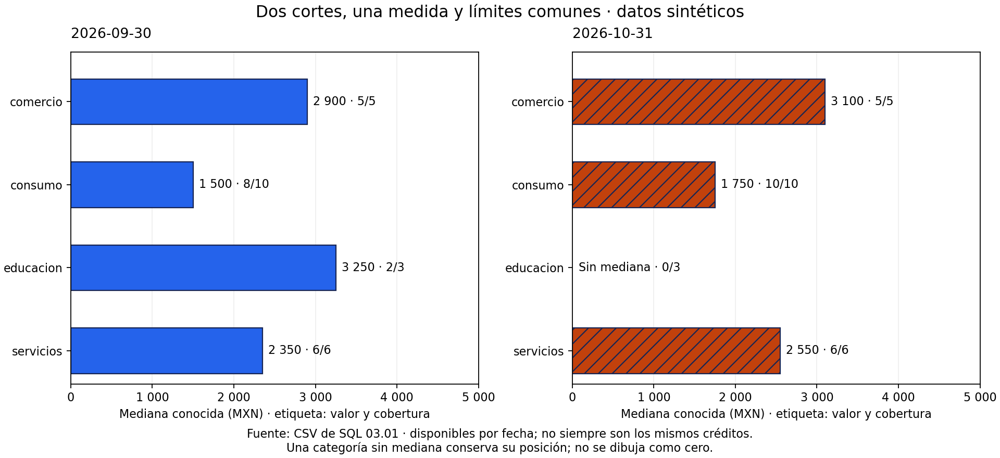
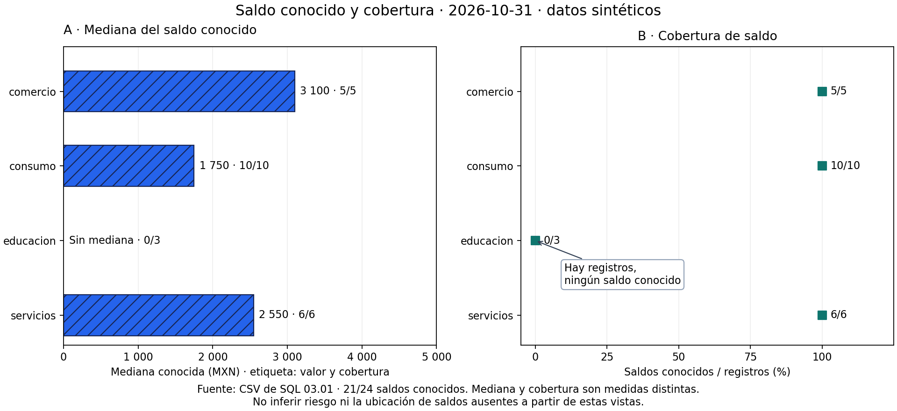

# 04.06 — Composición y exportación

## Propósito y prerrequisitos

Preparar una figura que otra persona pueda leer fuera de tu sesión de trabajo.
Componer significa organizar varias vistas con una relación clara; exportar
significa guardar una entrega con tamaño, formato y contexto adecuados para su
destino. Una figura guardada sin errores todavía necesita revisión de lectura.

Completa [04.05 — Escalas, etiquetas y accesibilidad](../05_scales_labels_accessibility/README.md)
y su lab. Reutiliza [Figure y Axes de 04.02](../02_figure_axes/README.md),
[comparaciones de 04.03](../03_comparisons_evolution/README.md) y
[medianas de 04.04](../04_distributions_relationships/README.md).
No necesitas una herramienta de diseño ni aprender otra biblioteca de gráficos.

**Práctica principal:** vistas múltiples, ejes comparables, anotaciones,
espacio, PNG/SVG y cierre de figuras. **Ampliación:** recorte ajustado, fondos
transparentes y exportación para impresión. Las ampliaciones no bloquean avanzar.

## Objetivos, entradas y entrega

Al terminar podrás:

- Elegir una composición según la comparación que necesita el público.
- Compartir ejes cuando representan lo mismo y conservar unidades distintas.
- Añadir una anotación que explique un dato sin cubrirlo ni inventarlo.
- Relacionar pulgadas, píxeles y resolución para dimensionar un PNG.
- Elegir entre PNG y SVG y revisar el archivo en su destino.
- Exportar desde una Figure identificada, conservar entregas anteriores y cerrar recursos.
- Compartir código, tablas y lectura textual junto con la imagen.

El [script composition.py](composition.py) lee los
[CSV sintéticos originales de SQL 03.01](../../03_sql_databases/01_relational_sqlite/README.md).
Reutiliza el lector y los cuartiles de 04.04; no recalcula limpieza con otra regla
ni modifica la base SQLite. La organización interna del script se profundizará
en [Python aplicado](../../05_python_applied/README.md), no es una nueva tarea de esta sección.

Hay 24 créditos por corte. Las tablas comprobadas para las composiciones son:

| Segmento | Septiembre: mediana MXN (conocidos/registros) | Octubre: mediana MXN (conocidos/registros) |
| --- | --- | --- |
| comercio | 2 900 (5/5) | 3 100 (5/5) |
| consumo | 1 500 (8/10) | 1 750 (10/10) |
| educacion | 3 250 (2/3) | Sin mediana (0/3) |
| servicios | 2 350 (6/6) | 2 550 (6/6) |

Cada fecha tiene 21 saldos conocidos entre 24 registros, pero no necesariamente
los mismos créditos. La comparación describe medianas disponibles: no estima
un cambio individual ni mide riesgo. La mediana es un valor central, no una suma.
Los tres ausentes de octubre pertenecen a educación; el cero de consumo sigue
siendo un saldo conocido válido.

La entrega incluirá dos composiciones, PNG a dos resoluciones, SVG, tablas de
comprobación, registro de formatos y una nota de lectura. Los archivos de práctica
se generan en `output/`; las vistas curadas de esta lección se conservan en `assets/`.

## 1. Antes de crear paneles, define qué relación mostrarás

Varios gráficos juntos no forman automáticamente una explicación. Decide qué
pregunta responde cada panel y por qué conviene verlos juntos. En esta práctica:

| Composición | Pregunta del primer panel | Pregunta del segundo | Relación |
| --- | --- | --- | --- |
| Comparación entre cortes | ¿Qué medianas conocidas había en septiembre? | ¿Cuáles hay en octubre? | Misma medida y segmentos; distintas fechas |
| Figura de entrega | ¿Cuál es la mediana conocida de octubre? | ¿Qué proporción de saldos conocemos? | Medida y cobertura sobre el mismo corte |

Una disposición horizontal facilita seguir un segmento de izquierda a derecha.
En una columna estrecha, dos paneles apilados pueden resultar más legibles;
hay que reorganizarlos desde código, no comprimir una figura ancha hasta que
las letras sean diminutas. Más paneles exigen más espacio y más atención: no
agregar un histograma o una dispersión solo porque caben.

El orden de lectura también orienta la explicación. Usa títulos de panel o
letras A/B cuando necesites referirte a cada vista en el texto. Mantén nombres
y orden de segmentos comunes. Si ordenas cada panel por su valor, una misma
fila puede representar segmentos distintos y dificultar la comparación.

## 2. Una medida en dos fechas: límites comunes



Lectura sin imagen: las medianas conocidas son las de la tabla anterior.
Los dos paneles tienen el mismo rango horizontal, de 0 a 5 000 MXN, y el
mismo orden vertical. Septiembre usa barras lisas y octubre, barras con trama;
las fechas escritas identifican cada panel. Educación no tiene barra de octubre.

En esta composición **compartimos x** porque ambos ejes horizontales muestran
la misma medida, unidad y escala. **Compartimos y** porque las posiciones
verticales representan los mismos segmentos. El rango deja espacio para
etiquetas y todas las barras parten de cero, como se justificó en 04.05.

```python
import matplotlib.pyplot as plt

fig, axes = plt.subplots(
    1, 2,                    # Una fila, dos columnas.
    figsize=(12, 5.5),        # Tamaño total de la Figure en pulgadas.
    sharex=True, sharey=True,
    layout="constrained",
)
izquierda = axes[0]
derecha = axes[1]
izquierda.set_xlim(0, 5000)   # El límite se comparte con el otro Axes.
```

`axes` contiene los dos Axes; sus posiciones no son datos. Este fragmento prepara
la estructura, pero aún no dibuja las medianas. La función `comparison_figure`
del script dibuja tablas ya preparadas con `draw_medians`, sin cambiar sus valores.

Compartir ejes enlaza límites y escalas; no concilia automáticamente las bases.
Necesitas verificar la medida y la población antes de dibujar. Además, Matplotlib
puede ocultar etiquetas repetidas en ejes compartidos: no desaparecieron datos.
El ejemplo las vuelve a mostrar con `ax.tick_params(axis="y", labelleft=True)`
para que ambos paneles puedan leerse directamente.

No compares alturas o longitudes de paneles con límites distintos sin avisarlo.
Tampoco unas las barras de educación entre fechas como si un saldo ausente fuera
cero. Si la pregunta pide movimientos de los mismos créditos, vuelve a los
[pares conocidos de 04.03](../03_comparisons_evolution/README.md).

## 3. Medida y cobertura: compartir categorías, conservar unidades



El panel A muestra medianas en MXN. El B muestra porcentajes de saldos conocidos
entre registros. Se comparten las categorías verticales, **no el eje horizontal**:
3 100 MXN y 100 % no son magnitudes comparables. Una posición igual en los dos
paneles no significa valor igual ni asociación causal.

```python
fig, axes = plt.subplots(
    1, 2, figsize=(12, 5.5), sharey=True, layout="constrained"
)
axes[0].set_xlabel("Mediana conocida (MXN)")
axes[1].set_xlabel("Saldos conocidos / registros (%)")
# No se añade sharex=True: los ejes horizontales tienen unidades distintas.
```

La cobertura de octubre es 100 % para comercio, consumo y servicios y 0 %
para educación. Globalmente es 21/24 = 87,5 %. No promediar sin ponderación
los cuatro porcentajes de grupo: (100 + 100 + 0 + 100)/4 = 75 % responde
otra pregunta, asignando el mismo peso a grupos de tamaños distintos.

El panel B dibuja 0 % para educación porque existen tres registros y conocemos
cero saldos. El panel A no dibuja mediana cero: no puede calcularla sin valores.
Si no hubiera registros, la cobertura sería indefinida, pues el denominador
sería cero. El script muestra «Sin registros» y conserva una ausencia numérica.

El rango de cobertura se extiende de −5 a 125 para dar margen a puntos y texto,
pero las marcas numéricas van de 0 a 100. Ese margen no autoriza coberturas
negativas ni superiores al 100 %; los conteos proceden de las tablas verificadas.
Los valores de mediana tampoco son porcentajes de cartera.

## 4. Anotaciones: separar el dato y la explicación

Una anotación conecta una afirmación breve con un dato concreto. En la entrega,
la flecha apunta al 0 % de educación y explica «Hay registros, ningún saldo
conocido». No apunta a una mediana inventada y no afirma que el saldo sea cero.

```python
axes[1].annotate(
    "Hay registros,\nningún saldo conocido",
    xy=(0, 2),                # Dato: cobertura 0 %, segmento en posición 2.
    xytext=(28, -42),          # Desplazar el texto respecto al dato.
    textcoords="offset points",
    arrowprops={"arrowstyle": "->"},
)
```

`xy` señala la posición del dato en el Axes. `xytext` ubica el texto; aquí se
interpreta en **puntos de desplazamiento** gracias a `textcoords`. Un punto
tipográfico es 1/72 de pulgada. Así movemos la explicación sin sumar MXN ni
porcentajes al dato. `\n` divide la explicación en dos líneas; la flecha enlaza
ambas ubicaciones. Cambiar el desplazamiento solo mueve el texto.

Para un mensaje general, puedes usar coordenadas relativas al panel, como en
04.02: `ax.text(0.5, 0.5, "Sin registros", transform=ax.transAxes)` coloca texto
en el centro del Axes. No confundir esas coordenadas 0–1 con datos porcentuales.
Un título general pertenece a la Figure, mientras una anotación de cobertura
pertenece al Axes que muestra cobertura.

Escribe pocas anotaciones y comprueba que la flecha señala el dato correcto.
No cubras puntos, valores o leyendas; no resaltes como «anomalía» un valor que
no revisaste. Una anotación puede atraer atención, pero no aporta por sí sola
evidencia causal ni estadística. El texto extenso vive junto a la figura.

## 5. Espacio para títulos, ejes y etiquetas

`layout="constrained"` ayuda a distribuir espacio entre paneles y sus elementos.
No garantiza legibilidad a cualquier tamaño: un texto largo o demasiados paneles
pueden exceder el espacio disponible. Revisa el resultado después de guardar.
En esta práctica usamos esa estrategia desde `plt.subplots`; no añadimos
`tight_layout()` después, pues puede desactivar el ajuste elegido.

La composición tiene tres niveles de texto:

- `ax.set_title(...)`: identifica la pregunta de un panel.
- `fig.suptitle(...)`: nombra el conjunto y el corte.
- `fig.supxlabel(...)`: coloca aquí una nota común debajo, con fuente y límite.
  Aunque el nombre alude a una etiqueta global de x, el ejemplo lo usa para una
  nota breve; cada panel conserva su etiqueta de unidad.

Las etiquetas numéricas tienen espacio a la derecha porque el límite deja
margen. No extenderlo tanto que todas las diferencias sean imperceptibles.
Si los nombres son largos, las barras horizontales permiten leerlos sin girar
palabras; una abreviatura requiere explicación. Si falta espacio, amplía o
reorganiza la composición antes de reducir demasiado la letra.

Al revisar la entrega mira bordes y cruces: títulos cortados, notas fuera del
lienzo, flechas sobre etiquetas, números que chocan con un punto y etiquetas
de ejes de un panel que invaden al otro. No basta con que el código termine.

## 6. Tamaño, resolución y píxeles: tres decisiones relacionadas

`figsize=(ancho, alto)` usa **pulgadas**. En un PNG, `dpi` fija cuántos píxeles
se generan por pulgada nominal. Sin recorte adicional:

```text
ancho en píxeles = ancho en pulgadas × dpi
alto en píxeles  = alto en pulgadas × dpi
```

Si el producto no es entero, el raster se limita a una cantidad entera de
píxeles; el script registra la parte entera esperada y se comprueba el archivo.
Los tamaños y resoluciones predeterminados de esta práctica dan productos enteros.

Nuestra Figure mide 12 × 5,5 pulgadas. Al exportarla:

| Archivo | Tamaño nominal | Resolución PNG | Dimensiones esperadas |
| --- | --- | ---: | --- |
| entrega_160.png | 12 × 5,5 pulgadas | 160 dpi | 1 920 × 880 píxeles |
| entrega_320.png | 12 × 5,5 pulgadas | 320 dpi | 3 840 × 1 760 píxeles |
| entrega.svg | 12 × 5,5 pulgadas | No fija una cuadrícula de píxeles para estas formas | Escalable; tamaño declarado y viewBox |

Duplicar dpi duplica cada dimensión del PNG y cuadruplica el número de píxeles.
El tamaño del archivo en bytes no necesariamente se cuadruplica: depende de
compresión y contenido. Tampoco aparecen nuevos registros o mayor precisión
analítica. Si ambos PNG se muestran con el mismo ancho en pantalla, la letra
ocupa aproximadamente el mismo espacio; el segundo aporta más detalle de dibujo.

Por ejemplo, si la figura se presenta a 960 píxeles de ancho, el primer PNG
aporta dos píxeles de imagen por cada píxel de ese ancho de presentación; el
segundo aporta cuatro. La apariencia final depende también del dispositivo y
de cómo el visor redimensiona. Aumentar dpi no arregla una composición ilegible
que se encoge demasiado en el destino.

La letra se define en puntos tipográficos, no como un número fijo de píxeles.
Cambiar `figsize` da más o menos espacio al contenido; cambiar dpi cambia el
detalle del raster. Para ajustar una figura a una columna estrecha, prueba una
composición vertical con textos adecuados, no solo una exportación de más dpi.

Para impresión, sigue el tamaño y resolución solicitados por el destino;
300 dpi es una referencia habitual para raster, no una regla universal ni un
requisito de este lab. Centímetros / 2,54 = pulgadas, si tu entrega se mide en
centímetros. Esta sección se completa con revisión en pantalla.

## 7. PNG o SVG según el destino

| Formato | Qué conserva | Ventaja en esta práctica | Qué comprobar |
| --- | --- | --- | --- |
| PNG | Cuadrícula de píxeles | Fácil de insertar en visores, Markdown y presentaciones | Dimensiones y lectura al tamaño final |
| SVG | Formas y trazados vectoriales | Ampliar líneas, barras y texto sin una cuadrícula fija | Compatibilidad, tipografía y contenido al abrirlo |

SVG no es un CSV ni convierte la figura en un análisis interactivo. Puede
contener imágenes rasterizadas si el gráfico las usa; nuestras barras y puntos
se exportan como elementos vectoriales. Cambiar dpi no aumenta la resolución
de esos trazados, aunque sí puede afectar componentes rasterizados en otras figuras.
Un SVG con miles de objetos tampoco tiene garantizado menor tamaño que un PNG.

Puedes abrir la [versión SVG de la figura de entrega](assets/entrega.svg)
para contrastarla con la vista PNG de esta lección antes de regenerarla.

Según la configuración de Matplotlib, el texto del SVG puede guardarse como
trazados de letras. Eso preserva su forma sin depender igual de una fuente
instalada, pero no garantiza texto seleccionable, fácil de editar ni accesibilidad
automática. Acompaña ambos formatos con [descripción y tabla, como en 04.05](../05_scales_labels_accessibility/README.md).

No renombres un PNG a `.svg` para cambiar el formato. `savefig` puede inferirlo
por la extensión o recibir `format`; si ambos se contradicen, la extensión puede
resultar engañosa. El ejemplo usa extensiones coherentes y fondo blanco explícito
para que texto y tramas se revisen sobre un fondo conocido.

**Ampliación:** `transparent=True` permite fondos transparentes en contextos
adecuados, pero hay que comprobar contraste sobre el fondo de destino. Para
esta entrega usamos `transparent=False`; no cambiamos colores según una suposición
sobre dónde la persona abrirá la figura.

## 8. Guardar la Figure correcta y cerrar después

Guarda con `fig.savefig(...)`: tienes una referencia explícita a la composición.
Al generar varias figuras, depender de «la figura actual» puede exportar otra
vista. Conserva la separación practicada en 04.02: preparar tabla → dibujar →
guardar → cerrar. La función que dibuja no necesita escribir CSV ni cerrar el Axes.

```python
# fig ya contiene la composición revisada; usa una carpeta de entrega nueva.
try:
    fig.savefig("entrega_160.png", dpi=160, facecolor="white", transparent=False)
    fig.savefig("entrega_320.png", dpi=320, facecolor="white", transparent=False)
    fig.savefig("entrega.svg", facecolor="white", transparent=False)
finally:
    plt.close(fig)
```

El mismo objeto puede guardarse en varios formatos antes de cerrarlo. `finally`
asegura el cierre incluso si falla el guardado. Cerrar libera la referencia que
mantiene pyplot; no borra las imágenes ni los CSV y no reinicia el entorno.
Usa `plt.close(fig)`, no `plt.close("all")`, para conservar otras figuras de la sesión.
Guardar tampoco requiere abrir una ventana con `plt.show()`.

En el script, cada entrega exige una carpeta nueva: no sobrescribe una anterior.
Guarda los datos usados, lectura.md y formatos.csv, que registra formato,
pulgadas, dpi cuando aplica, píxeles esperados y bytes. Así puedes explicar
qué compartiste y con qué parámetros sin depender de memoria de la sesión.

**Ampliación sobre recorte:** `bbox_inches="tight"` intenta ajustar el borde
al contenido y `pad_inches` controla el margen. Eso puede cambiar las dimensiones
finales respecto a `figsize × dpi`; no promete el mismo tamaño nominal. Tampoco
resuelve superposiciones entre textos. El ejemplo conserva el lienzo completo
sin recorte, mediante una configuración local de guardado; no modifica ajustes
globales de tu sesión.

## 9. Reconstruir y revisar los archivos

Usa el entorno elegido en [00.05](../../00_getting_started/05_environment/README.md),
ya activado. Referencias: pandas 2.3.3 y Matplotlib 3.10.7. La comprobación local
usa pandas 2.3.3 y Matplotlib 3.10.6; no se agregan dependencias. Desde la raíz
del repositorio, elige un recorrido completo.

### PowerShell

```powershell
# Conda o venv/pip ya activado:
python curriculum/04_visualization_python/06_composition_export/composition.py --cut 2026-10-31 --dpi 160 --output curriculum/04_visualization_python/06_composition_export/output/octubre

# Alternativa para uv: ejecutar en lugar del comando anterior.
uv run --locked python curriculum/04_visualization_python/06_composition_export/composition.py --cut 2026-10-31 --dpi 160 --output curriculum/04_visualization_python/06_composition_export/output/octubre
```

### Bash/Zsh

```bash
# Conda o venv/pip ya activado:
python curriculum/04_visualization_python/06_composition_export/composition.py --cut 2026-10-31 --dpi 160 --output curriculum/04_visualization_python/06_composition_export/output/octubre

# Alternativa para uv: ejecutar en lugar del comando anterior.
uv run --locked python curriculum/04_visualization_python/06_composition_export/composition.py --cut 2026-10-31 --dpi 160 --output curriculum/04_visualization_python/06_composition_export/output/octubre
```

Se generan tres PNG, un SVG, cuatro CSV (corte, resumen, comparacion y formatos)
y lectura.md. `--cut` elige la fecha de entrega y su resumen; comparacion conserva
septiembre/octubre. `--dpi` elige la primera resolución PNG y se exporta también
el doble. Para otra ejecución, usa otra carpeta nueva. Las vistas curadas de
la lección corresponden a octubre con 160 dpi.

Comprobación gradual:

1. Concilia corte.csv: 24 registros, 21 conocidos y 3 ausentes. El cero cuenta como conocido.
2. Comprueba las medianas de resumen.csv contra los saldos del corte y la tabla inicial.
3. Recalcula cobertura por segmento y global; distingue 0/3 de 0/0.
4. Coteja paneles, etiquetas y flecha con esas tablas. Verifica límites comunes
   en comparacion y unidades separadas en entrega.
5. Abre ambos PNG y consulta dimensiones en tu visor o propiedades del archivo;
   verifica formatos.csv. Abre entrega.svg en un visor compatible, por ejemplo
   un navegador, y amplía para revisar texto, tramas y flecha.
6. Revisa al tamaño de presentación final, además de ampliar. Conserva lectura.md
   junto con las imágenes y las tablas. Si falla una exportación, la existencia
   de una carpeta parcial no demuestra una entrega completa.

## Práctica, criterio de salida y continuidad

Realiza el [lab 04.06](../../../labs/04_visualization_python/06_composition_export/README.md).
Puedes avanzar cuando expliques por qué cada panel existe, compruebes sus datos
y ejes, exportes una entrega legible y cotejes formatos y dimensiones. Entrega
código, tabla, imagen y comentario de población, medida, fuente y límites.

No hay checkpoint de proyecto implementado. Continúa con el
[04.07 — Altair: visualización declarativa](../07_altair_declarative/README.md). Interacción pertenece a 04.08 y sigue siendo
opcional; no necesitas instalar Altair para completar esta sección.

## Referencias y atribución

Código, composiciones y explicaciones propios de DS Track. Se consultaron las
fuentes primarias de Matplotlib; las páginas stable pueden mostrar versiones
posteriores a la referencia 3.10.7. No se copiaron imágenes ni ejemplos completos.

- [Matplotlib 3.10.7: ajuste de composición](https://matplotlib.org/3.10.7/users/explain/axes/constrainedlayout_guide.html).
- [Matplotlib: guardar una Figure](https://matplotlib.org/stable/api/_as_gen/matplotlib.figure.Figure.savefig.html).
- [Matplotlib: anotaciones y coordenadas](https://matplotlib.org/stable/users/explain/text/annotations.html).
- [Matplotlib: unidades del tamaño de figura](https://matplotlib.org/stable/gallery/subplots_axes_and_figures/figure_size_units.html).
