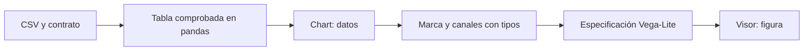
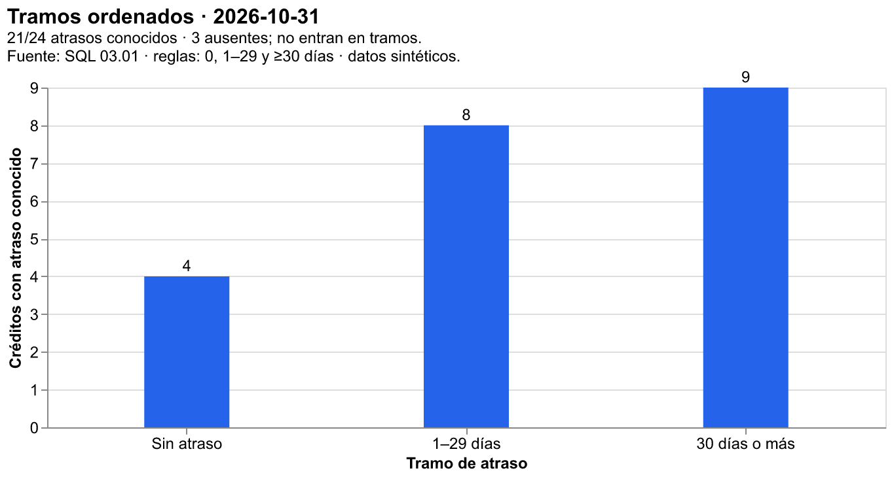
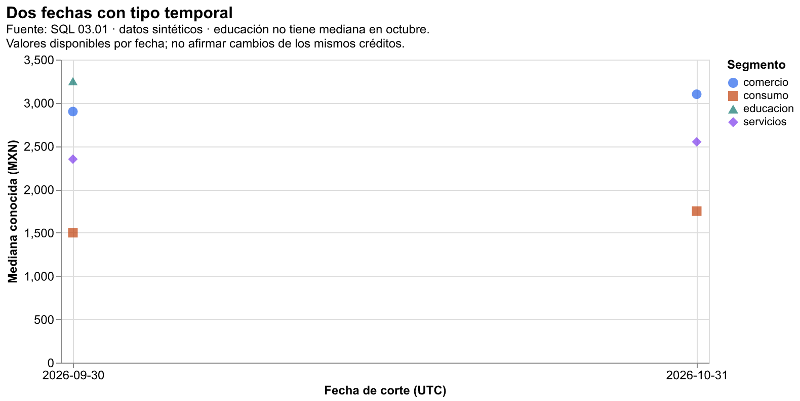
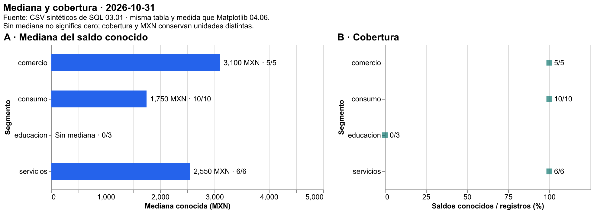
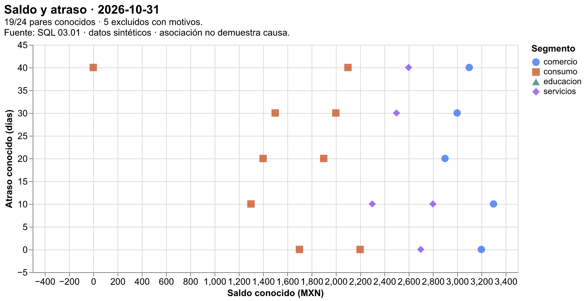

# 04.07 — Altair: visualización declarativa

## Propósito y prerrequisitos

Expresar una figura mediante datos, marcas y codificaciones visuales. Con Altair
describes qué columna corresponde a una posición, color o forma; una biblioteca
de renderizado interpreta esa descripción y dibuja el resultado. Conservaremos
los indicadores ya comprobados en Matplotlib para comparar herramientas sobre
la misma pregunta, población y unidad.

Completa [04.06 — Composición y exportación](../06_composition_export/README.md)
y su lab. Reutiliza [escalas y accesibilidad de 04.05](../05_scales_labels_accessibility/README.md),
[pares de 04.04](../04_distributions_relationships/README.md) y
[bases de comparación de 04.03](../03_comparisons_evolution/README.md).
Necesitas selección y agrupación en pandas; no necesitas escribir JavaScript.

**Práctica principal:** Chart, marcas, canales, tipos N/O/Q/T, tablas preparadas,
composición y comprobación frente a Matplotlib. **Ampliación:** agregación dentro
del gráfico, exportación sin conexión y PNG/SVG. Parámetros, selección y filtros
interactivos se desarrollan en 04.08; no necesitas construirlos aquí.

## Objetivos, datos y versiones de referencia

Al terminar podrás:

- Explicar cómo una tabla, una marca y sus canales forman una especificación.
- Elegir tipo nominal, ordinal, cuantitativo o temporal por su significado.
- Dibujar indicadores preparados sin agregar accidentalmente otra medida.
- Conservar una categoría sin valor y comprobar coordenadas de pares conocidos.
- Distinguir sintaxis válida de resultados analíticos correctos.
- Exportar JSON/HTML y explicar sus requisitos de apertura; PNG/SVG son ampliación.

El [script declarative.py](declarative.py) reutiliza lectura y resumen de 04.06
sobre los [CSV sintéticos de SQL 03.01](../../03_sql_databases/01_relational_sqlite/README.md).
No descarga un dataset de demostración ni cambia las reglas de limpieza.
Para octubre de 2026:

| Vista | Unidad y medida | Base comprobada |
| --- | --- | --- |
| Medianas y cobertura | Mediana conocida en MXN y conocidos/registros en % | 24 registros; 21 saldos conocidos |
| Dispersión | Saldo y atraso del mismo crédito/corte | 19 pares; 5 exclusiones |
| Tramos de atraso | Conteo de créditos por categoría ordenada | 21 atrasos conocidos; 3 ausentes |
| Fechas | Mediana por segmento y corte | 8 grupos de dos fechas; 7 medianas conocidas |

Referencias declaradas y comprobadas: **Altair 6.3.0**, **pandas 2.3.3** y
**Matplotlib 3.10.7**. El grupo opcional **chart-export** fija
**vl-convert-python 1.9.0.post1**. Son versiones del curso, no una promesa de
ser siempre las más recientes. La documentación oficial puede mostrar una
compilación posterior. Las APIs utilizadas se ejecutaron con estas referencias.

Altair está en pyproject.toml y uv.lock. chart-export añade un convertidor
para HTML con bibliotecas incorporadas y archivos estáticos; no requiere
instalar Node.js, un controlador de navegador ni altair_saver.
Conserva el gestor elegido en [00.05](../../00_getting_started/05_environment/README.md).
Los recorridos completos de preparación, comprobación y ejecución están más abajo.
No instales en base ni mezcles gestores sobre el mismo entorno.

## 1. De la tabla a la figura: qué significa «declarativa»

En Matplotlib dibujamos sobre un Axes y controlamos sus elementos. En Altair
creamos una descripción: «usa barras; su longitud representa mediana_mxn;
su posición vertical representa segmento». Ambos enfoques permiten expresar
una misma medida. Cambiar de biblioteca no valida los datos automáticamente.



Sin renderizador: prepara y comprueba la tabla, declara cómo se representa cada
campo, genera una especificación y ábrela con un visor que pueda dibujarla.
La comprobación debe acompañar todo el flujo, no terminar al crear Chart.

**Vega-Lite** es la gramática que describe el gráfico. **Altair** ofrece su
interfaz en Python. **Vega y el visor** llevan esa especificación a una imagen
en el navegador; vl-convert permite convertirla también desde Python.
JSON guarda datos estructurados como claves, listas y valores: aquí conserva
la descripción del gráfico y sus datos incorporados. No es una captura de pantalla.

Crear `alt.Chart(tabla)` no muestra por sí solo una ventana en una terminal.
En un notebook compatible, una última expresión con el Chart puede mostrarse;
asignarlo a una variable no obliga a dibujarlo. El ejemplo usa archivos HTML
para que la práctica no dependa de un notebook ni de un estado oculto.

## 2. Chart, marca y codificación, paso a paso

Primero crea la tabla comprobada. Este fragmento usa las funciones del script
y puede ejecutarse desde la carpeta de la lección con el entorno preparado:

```python
import altair as alt
from declarative import prepare, read_detail

tablas = prepare(read_detail(), "2026-10-31")
resumen = tablas["resumen"]
con_mediana = resumen.loc[resumen["mediana_mxn"].notna()].copy()

base = alt.Chart(con_mediana)           # Una fila por segmento conocido.
barras = base.mark_bar()               # Elige la marca, no una agregación.
grafico = barras.encode(
    x=alt.X("mediana_mxn:Q", title="Mediana conocida (MXN)"),
    y=alt.Y("segmento:N", title="Segmento",
            sort=["comercio", "consumo", "educacion", "servicios"]),
).properties(width=450, height=240)
```

Una **marca** es el elemento con el que representas una observación o resumen:
barra, punto, línea o texto. Una **codificación** vincula un campo de la tabla
con una propiedad visual. Un **canal** es esa propiedad: x, y, color, shape o
tooltip, entre otros. Aquí x recibe la mediana y y recibe el segmento.

`alt.X` y `alt.Y` crean configuraciones de canal; no debes diseñar una clase
de Python para usarlas. `"mediana_mxn:Q"` combina nombre y tipo; no renombra
la columna. `properties` ajusta tamaño o título. Encadenar métodos dentro de
paréntesis permite continuar la expresión en varias líneas.

Puedes escribir los pasos juntos como `alt.Chart(...).mark_bar().encode(...)`.
La tabla permanece igual: construir una especificación no cambia sus valores.
No supongas que cambiar de marca responde la misma pregunta. Una dispersión
representa pares; una línea sugiere un recorrido y necesita orden con significado.
No unir segmentos nominales para crear una tendencia artificial.

Este fragmento introductorio muestra solo grupos con mediana. La entrega completa
añade mensajes para los grupos sin valor y un panel de cobertura; no borrar
educación del relato porque no puede tener barra.

## 3. Tipos visuales: el significado importa más que dtype

| Tipo | Código | Significado | Campo de esta práctica |
| --- | --- | --- | --- |
| Nominal | N | Categorías distintas sin orden inherente | segmento, id_credito |
| Ordinal | O | Categorías con un orden definido | tramo_atraso |
| Cuantitativo | Q | Magnitud numérica con diferencias medibles | saldo_mxn, dias_atraso, creditos |
| Temporal | T | Fechas o instantes representados en el tiempo | fecha_corte |

Los identificadores 001 y 004 distinguen créditos: restarlos no produce una
medida útil, aunque parezcan números. Por eso id_credito usa N. El atraso original
en días es Q; al agruparlo en tramos obtenemos una categoría O. Una columna de
texto con fechas puede representarse como T, pero la conversión y validación
previas siguen siendo necesarias. Los cuatro códigos no sustituyen los tipos
y reglas de pandas enseñados en [02.04](../../02_pandas/04_types_calculated_columns/README.md).

Altair puede inferir tipos desde un DataFrame; esa inferencia no conoce el
significado de un ID ni tu regla de orden. Aquí los declaramos explícitamente.
`alt.X("saldo_mxn:Q")` equivale a
`alt.X("saldo_mxn", type="quantitative")`. Usa una forma coherente al estudiar.

### Nominal no significa «imposible de ordenar»

Puedes ordenar segmentos para facilitar lectura, conservando su tipo N.
El orden comercio → consumo → educación → servicios organiza la presentación;
no afirma una jerarquía. Si cambias a O sin justificación, puedes sugerir una
progresión que los datos no definen. `sort` explicita el orden común de las vistas.

### Ordinal: categorías ordenadas, no distancias iguales



Los tramos siguen reglas: 0; 1–29; 30 días o más. Sus conteos son **4, 8 y 9**:
suman los 21 atrasos conocidos. Los tres ausentes quedan en excluidos_atraso.csv;
no se clasifican como «Sin atraso». Un tramo vacío tendría conteo cero,
que tampoco significa atraso desconocido.

```python
alt.Chart(tablas["tramos"]).mark_bar().encode(
    x=alt.X("tramo_atraso:O",
            sort=["Sin atraso", "1–29 días", "30 días o más"]),
    y=alt.Y("creditos:Q", title="Créditos con atraso conocido"),
)
```

El eje ordinal sitúa categorías separadas; la distancia gráfica entre ellas
no mide igual cantidad de días y la última no tiene límite superior. No es
un histograma de intervalos de igual anchura. Cambiar O a Q no convierte sus
nombres en números ni permite obtener un promedio válido de códigos de tramo.

### Temporal: mostrar fechas con su calendario



La vista temporal coloca las dos fechas en un eje T. Su tabla tiene ocho
grupos: en septiembre las medianas son 2900, 1500, 3250 y 2350; en octubre,
3100, 1750, ausente y 2550, en el orden común de segmentos. Se dibujan siete
puntos, no una mediana cero para educación. Son las mismas cifras de 04.06.

El script convierte fecha_corte con formato explícito y usa escala UTC para
conservar los cortes al mostrar estas fechas sin hora. No significa que los
datos describan eventos horarios. En datos con horas, zona de origen y
conversión requerirían un contrato propio; T no lo resuelve automáticamente.

```python
# comparacion ya contiene fecha_corte como datetime validado.
alt.Chart(tablas["comparacion"]).mark_point().encode(
    x=alt.X("fecha_corte:T", scale=alt.Scale(type="utc")),
    y="mediana_mxn:Q",
    color="segmento:N",
    shape="segmento:N",
)
```

En el script completo seleccionamos medianas conocidas y explicamos la ausencia.
Usar N para las fechas las convertiría en categorías separadas con separación
categórica; no comunicaría distancias de calendario en una serie irregular.
No dibujamos líneas aquí: dos cortes y bases cambiantes no acreditan una
tendencia individual. Una agregación temporal como «mes» también cambiaría
la agrupación y exige una decisión explícita.

## 4. Misma tabla y medida que Matplotlib



La composición reproduce la tabla de [04.06](../06_composition_export/README.md):
comercio 3100 MXN (5/5), consumo 1750 (10/10), educación sin mediana (0/3)
y servicios 2550 (6/6). El panel de cobertura muestra 100, 100, 0 y 100 %.
La forma o el aspecto de las letras puede cambiar entre motores; esos cambios
no autorizan otra población, denominador o medida.

El script declara barras para medianas válidas, texto en otra capa para valores
y mensajes, y cuadrados para cobertura. **Una capa** superpone marcas sobre
la misma vista: `alt.layer(barras, textos, mensajes)`. El operador `+` también
puede expresar esa relación. No suma las medianas: compone sus representaciones.

**Una concatenación** coloca vistas lado a lado:
`alt.hconcat(medianas, cobertura)`. Después se declaran escalas horizontales
independientes y categorías verticales compartidas con
`resolve_scale(x="independent", y="shared")`. Es la misma decisión conceptual
de 04.06: MXN y porcentaje requieren unidades separadas.

En `medians_chart`, `alt.Scale(domain=[0, right], ...)` define el rango; right
es al menos 5000 y vale 5000 con estos datos. Si crece la mediana, el script
amplía ese límite para dejar espacio a las etiquetas. El dominio son valores
de datos, no tamaño en píxeles. En cambio,
`width=450` y `height=240` definen el área de dibujo, a la que se añaden títulos,
ejes y leyendas. El PNG completo no tiene por qué medir 450 × 240 píxeles.

La marca `color="#2563eb"` establece un color constante. `color="segmento:N"`
en encode vincula una columna a colores y normalmente produce una leyenda.
Confundir ambas formas puede llevar a buscar una columna cuyo nombre sea un color.
El script usa color y forma conjuntamente en dispersión y fechas; texto y
categorías escritas permiten leer la composición sin depender solo del color.

## 5. Pares conocidos, forma y tooltip



Cada punto representa un crédito de octubre con saldo y atraso conocidos en
**la misma fila**. Por ejemplo, el crédito 004 se ubica en (0 MXN, 40 días).
Hay 19 puntos entre 24 registros; cinco exclusiones se conservan con los
indicadores saldo_ausente y atraso_ausente. No eliminar nulos por separado
para luego emparejar dos listas con posiciones diferentes.

```python
alt.Chart(tablas["pares"]).mark_point(filled=True).encode(
    x=alt.X("saldo_mxn:Q", title="Saldo conocido (MXN)"),
    y=alt.Y("dias_atraso:Q", title="Atraso conocido (días)"),
    color="segmento:N",
    shape="segmento:N",
    tooltip=["id_credito:N", "saldo_mxn:Q", "dias_atraso:Q"],
)
```

`shape` añade una señal distinta del color. `tooltip` declara la información
que puede aparecer al pasar el cursor sobre una marca en un visor compatible;
no filtra ni selecciona créditos. Un PNG no ofrece ese comportamiento. Las
etiquetas y la tabla deben permitir la lectura básica sin depender del cursor.
La leyenda conserva los cuatro segmentos, pero educación no tiene pares en
octubre: aparecer en la leyenda no demuestra observaciones dibujadas.

Una especificación válida puede omitir marcas cuyos campos sean inválidos;
no confiar en esa omisión como política de calidad. Aquí seleccionamos y
conciliamos pares antes del gráfico. No reemplazamos ausencias por cero y no
afirmamos causalidad. Las líneas, regresión o suavizado requerirían otra
pregunta y supuestos; no se añaden para decorar la nube.

## 6. Preparar un resumen no es agregar dentro del gráfico

En la práctica principal, pandas prepara una fila por segmento y corte.
Altair recibe mediana_mxn, registros y conocidos y los representa. La
codificación `x="mediana_mxn:Q"` no solicita otra agregación.

Como ampliación, Vega-Lite también puede calcular un resumen desde el detalle:

```python
desde_detalle = alt.Chart(tablas["corte"]).mark_bar().encode(
    x=alt.X("median(saldo_mxn):Q", title="Mediana conocida (MXN)"),
    y=alt.Y("segmento:N", sort=["comercio", "consumo", "educacion", "servicios"]),
)
```

`median(...)` en la codificación pide una agregación, agrupada aquí por segmento.
Su resultado se calcula al interpretar la especificación: no aparece
automáticamente como una nueva columna en tu DataFrame de Python. Para esta
base debe coincidir con las tres medianas conocidas; la comprobación de la
sección contrasta también ese resultado renderizado.

Ese fragmento no reemplaza la entrega completa: necesita fuente, cobertura y
mensaje de educación. Añadir canales de categoría puede cambiar las claves
de agrupación. Combinar fechas o pasar un resumen diferente también puede
cambiar qué filas se agregan. Pregunta siempre «¿qué representa una fila de
entrada y qué representa una marca de salida?».

No sumar medianas de varios grupos para obtener la mediana total ni calcular
una mediana de medianas para reconstruir el indicador del detalle. Tampoco
mezclar `count()` de filas con conteo de valores conocidos sin revisar ausencias.
Para aprender esta herramienta elegimos tablas explícitas y verificables;
las transformaciones visuales se incorporan cuando se pueda justificar su base.

## 7. Especificación, visor y exportación

`grafico.to_dict(validate=True)` comprueba si la descripción cumple el esquema
de Vega-Lite. `grafico.to_json()` o guardar `.json` produce JSON. La validación
detecta opciones o tipos de configuración incompatibles; no sabe si confundiste
saldo total con mediana, si usaste un denominador incorrecto o si el ID es Q.

```python
grafico.save("grafico.json")
grafico.save("grafico.html")
```

En el recorrido básico el HTML contiene los datos de la figura, pero carga
las bibliotecas JavaScript desde una CDN, un servicio que distribuye archivos
en la web. Necesita conexión y un visor que permita ejecutar esas bibliotecas.
Una terminal de texto no renderiza JSON; una previsualización de Markdown puede
bloquear JavaScript aunque un navegador sí lo ejecute. Una vista vacía exige
revisar el archivo y el visor, además de los datos.

Con el grupo opcional chart-export puedes usar `grafico.save(..., inline=True)`
para incorporar las bibliotecas al HTML. En este ejemplo los datos también
están incorporados: la combinación permite abrirlo sin red. Si otra figura
apuntara a datos por URL, incorporar bibliotecas no descargaría ni incorporaría
automáticamente esos datos. El HTML suele pesar más que la especificación JSON.

`--bundle` guarda HTML sin CDN y añade PNG/SVG con vl-convert. El PNG usa
`scale_factor=2`, que escala el renderizado; no es el mismo parámetro dpi de
Matplotlib. SVG conserva elementos vectoriales de estas figuras. Los archivos
estáticos no tienen tooltip. No hacen falta navegador automatizado, Node.js ni
altair_saver para esas conversiones.

Los datos incorporados se pueden inspeccionar en JSON o HTML: ocultar un campo
del tooltip no lo vuelve privado. Las figuras de este curso usan únicamente
datos sintéticos. Un cambio de renderer tampoco certifica accesibilidad;
acompaña la entrega con tabla y texto como se practicó en 04.05.

El transformador habitual de Altair limita por defecto tablas grandes
incorporadas (5000 filas). Esta muestra es pequeña. Desactivar el límite no
garantiza rendimiento ni memoria acotada: primero define el resumen que
responde tu pregunta. Procesar datasets mayores pertenece a otros módulos.

## 8. Preparar, comprobar y ejecutar con el gestor elegido

Usa **solo uno** de los gestores. Si tus paquetes ya son adecuados, empieza
por comprobarlos y evita reinstalar. Conda y venv deben estar activados en el
entorno de aprendizaje de 00.05. Para uv, la raíz ya contiene los requisitos;
`sync --locked` aplica el lockfile y `run --locked` lo conserva al ejecutar.
No uses `uv add` para repetir requisitos que ya se declararon.

### PowerShell

Desde la raíz y con tu entorno de aprendizaje elegido:

```powershell
# Opción Conda: solo si faltan los paquetes, dentro del entorno activado.
conda install -c conda-forge altair=6.3.0
# Ampliación de exportación, si la quieres:
conda install -c conda-forge vl-convert-python=1.9.0.post1

# Opción venv/pip: usar en lugar de Conda, con el venv activado.
python -m pip install "altair==6.3.0"
# Ampliación de exportación, si la quieres:
python -m pip install "vl-convert-python==1.9.0.post1"

# Comprobar y ejecutar con Conda O venv/pip, después de elegir solo uno:
python -c "import altair, pandas; print(altair.__version__, pandas.__version__)"
python curriculum/04_visualization_python/07_altair_declarative/declarative.py --output curriculum/04_visualization_python/07_altair_declarative/output/octubre
# Ampliación, con el convertidor preparado y otra carpeta nueva:
python curriculum/04_visualization_python/07_altair_declarative/declarative.py --bundle --output curriculum/04_visualization_python/07_altair_declarative/output/octubre_bundle

# Opción uv: recorrido alternativo completo, sin los gestores anteriores.
uv sync --locked
uv run --locked python -c "import altair, pandas; print(altair.__version__, pandas.__version__)"
uv run --locked python curriculum/04_visualization_python/07_altair_declarative/declarative.py --output curriculum/04_visualization_python/07_altair_declarative/output/octubre
# Ampliación opcional:
uv sync --locked --group chart-export
uv run --locked --group chart-export python curriculum/04_visualization_python/07_altair_declarative/declarative.py --bundle --output curriculum/04_visualization_python/07_altair_declarative/output/octubre_bundle
```

### Bash/Zsh

Desde la raíz y con tu entorno de aprendizaje elegido:

```bash
# Opción Conda: solo si faltan paquetes, dentro del entorno activado.
conda install -c conda-forge altair=6.3.0
# Ampliación opcional:
conda install -c conda-forge vl-convert-python=1.9.0.post1

# Opción venv/pip: usar en lugar de Conda, con el venv activado.
python -m pip install "altair==6.3.0"
# Ampliación opcional:
python -m pip install "vl-convert-python==1.9.0.post1"

# Comprobar y ejecutar con Conda O venv/pip, después de elegir solo uno:
python -c "import altair, pandas; print(altair.__version__, pandas.__version__)"
python curriculum/04_visualization_python/07_altair_declarative/declarative.py --output curriculum/04_visualization_python/07_altair_declarative/output/octubre
python curriculum/04_visualization_python/07_altair_declarative/declarative.py --bundle --output curriculum/04_visualization_python/07_altair_declarative/output/octubre_bundle

# Opción uv: recorrido alternativo completo.
uv sync --locked
uv run --locked python -c "import altair, pandas; print(altair.__version__, pandas.__version__)"
uv run --locked python curriculum/04_visualization_python/07_altair_declarative/declarative.py --output curriculum/04_visualization_python/07_altair_declarative/output/octubre
# Ampliación opcional:
uv sync --locked --group chart-export
uv run --locked --group chart-export python curriculum/04_visualization_python/07_altair_declarative/declarative.py --bundle --output curriculum/04_visualization_python/07_altair_declarative/output/octubre_bundle
```

### CMD / Anaconda Prompt, recorrido Conda

Con el entorno de aprendizaje activado, desde la raíz:

```bat
REM Instalar solo si falta Altair en el entorno elegido; nunca en base.
conda install -c conda-forge altair=6.3.0
python -c "import altair, pandas; print(altair.__version__, pandas.__version__)"
python curriculum/04_visualization_python/07_altair_declarative/declarative.py --output curriculum/04_visualization_python/07_altair_declarative/output/octubre
REM Ampliacion opcional: preparar convertidor y usar otra carpeta.
conda install -c conda-forge vl-convert-python=1.9.0.post1
python curriculum/04_visualization_python/07_altair_declarative/declarative.py --bundle --output curriculum/04_visualization_python/07_altair_declarative/output/octubre_bundle
```

Conda resuelve sus paquetes según plataforma y canales; si no ofrece una versión
exacta, consulta y registra una alternativa compatible, sin cambiar a pip en
el mismo entorno por ensayo. La verificación de esta sección utilizó uv y un
entorno local separado para respetar el entorno existente. No se modificó base.

## 9. Archivos y comprobación de la entrega

El recorrido básico genera cuatro HTML, cuatro especificaciones JSON, siete
CSV (corte, resumen, pares, excluidos_pares, tramos, excluidos_atraso y comparacion),
lectura.md y versiones.json. `--bundle` añade cuatro PNG y cuatro SVG, y el
HTML lleva bibliotecas incorporadas. Las imágenes curadas de esta lección usan
esa ampliación; basta reconstruir HTML para completar la práctica principal.

`--cut` elige el corte para medianas, pares y tramos. fechas sigue mostrando
septiembre/octubre de las fuentes. Cada ejecución exige carpeta nueva y conserva
las entregas previas. No escribe ni reinicia SQLite. Abre un HTML con un navegador
compatible; un navegador no necesita instalar Altair para leer un archivo ya generado.

Comprueba en este orden:

1. Concilia 24 registros, 21 saldos conocidos, 21 atrasos conocidos y 19 pares.
2. Comprueba medianas y cobertura contra 04.06, y los 19 pares contra 04.04.
3. Suma tramos: 4 + 8 + 9 = 21; los tres atrasos ausentes permanecen separados.
4. Revisa campos, tipos, marcas y escalas de las especificaciones JSON. Verifica
   que no haya una agregación inesperada ni referencias a otros datasets.
5. Abre las figuras y coteja posiciones, fechas, leyendas y mensajes con CSV.
   Para --bundle, prueba el HTML sin conexión y las versiones estáticas.
6. Conserva lectura.md y añade una descripción para tramos, pares y fechas:
   la nota generada describe principalmente medianas y cobertura.

Errores habituales: campo mal escrito; ID tratado como magnitud; tipo ordinal
sin orden; cadena de fechas sin validar; agregar una tabla ya resumida sin
revisar unidad; asumir que JSON validado significa análisis correcto; culpar
a los datos cuando el visor bloquea JavaScript. Localiza qué etapa falló y
conserva la tabla original al corregir.

## Práctica, criterio de salida y continuidad

Realiza el [lab 04.07](../../../labs/04_visualization_python/07_altair_declarative/README.md).
Puedes avanzar cuando expliques datos, marca, canal y tipo de una figura;
compruebes sus valores frente al análisis anterior y reconstruyas una entrega
que otra persona pueda abrir y leer. Debes justificar ausencias y agregación,
no solo conseguir que aparezcan barras.

No hay checkpoint de proyecto implementado. Continúa con el
[04.08 — Interacción con Altair](../08_altair_interaction/README.md),
disponible y opcional. Si omites esa ampliación, consulta el
[04.09 — Cierre visual del análisis](../09_visual_closure/README.md),
disponible sin exigir interacción.

## Referencias y atribución

Ejemplos, datos de práctica, código y figuras propios de DS Track. La investigación
se apoyó en fuentes primarias de Vega-Altair y Vega-Lite, cuyos equipos desarrollan
las herramientas; no se copiaron ejemplos de sus datasets ni imágenes de la galería.

- [Altair: versiones publicadas](https://github.com/vega/altair/releases) y [distribución 6.3.0](https://pypi.org/project/altair/6.3.0/).
- [Codificaciones y tipos](https://altair-viz.github.io/user_guide/encodings/index.html) y [marcas](https://altair-viz.github.io/user_guide/marks/index.html).
- [Datos](https://altair-viz.github.io/user_guide/data.html), [agregación](https://altair-viz.github.io/user_guide/transform/aggregate.html) y [fechas](https://altair-viz.github.io/user_guide/times_and_dates.html).
- [Guardar gráficos](https://altair-viz.github.io/user_guide/saving_charts.html) y [visores](https://altair-viz.github.io/user_guide/display_frontends.html).
- [Vega-Lite: datos inválidos](https://vega.github.io/vega-lite/docs/invalid-data.html) y [vl-convert-python](https://pypi.org/project/vl-convert-python/1.9.0.post1/).
