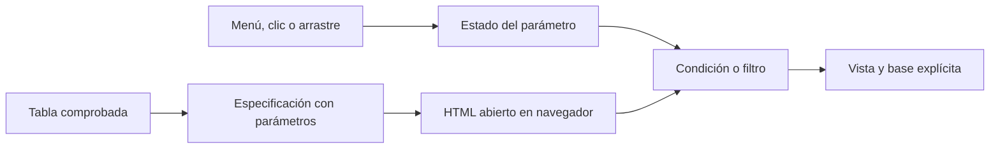
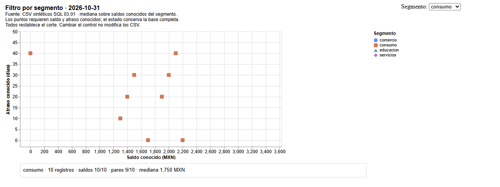
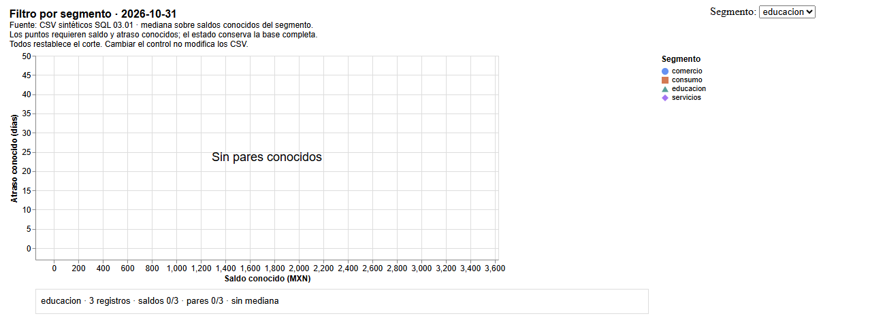
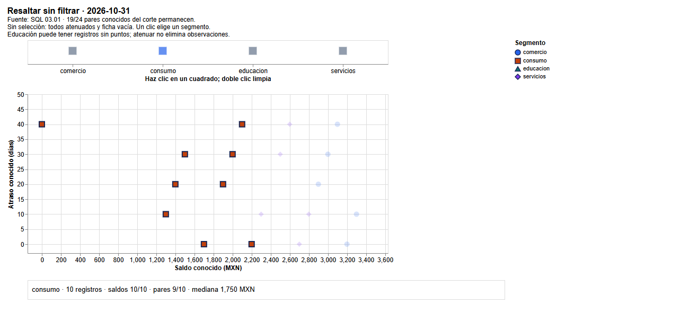
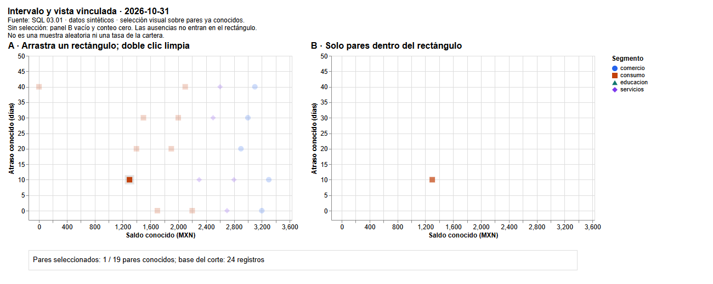

# 04.08 — Interacción con Altair

## Propósito y prerrequisitos

Explorar un indicador conocido mediante controles y selecciones, dejando claro
qué población se muestra después de cada acción. Una interacción puede cambiar
el aspecto de una marca o las filas que llegan a una vista: esas decisiones
no son equivalentes y deben poder comprobarse.

Esta sección es **extensión opcional**. Completa
[04.07 — Visualización declarativa](../07_altair_declarative/README.md)
y su lab, especialmente datos, marcas, canales, tipos y exportación HTML.
Reutiliza [bases de comparación de 04.03](../03_comparisons_evolution/README.md)
y [pares conocidos de 04.04](../04_distributions_relationships/README.md).
No necesitas JavaScript, un servidor ni una aplicación Streamlit.

## Objetivos, datos y versiones

Al terminar podrás:

- Diferenciar un parámetro variable de una selección de puntos o intervalo.
- Vincular un menú a un parámetro y filtrar una vista con una regla explícita.
- Resaltar sin confundir atenuación con exclusión.
- Explicar selección vacía, restablecimiento, población y denominadores.
- Compartir un HTML interactivo y registrar evidencia de un estado concreto.

El [script interaction.py](interaction.py) reutiliza prepare y read_detail de
04.07. Conserva las fuentes sintéticas de SQL 03.01 y sus reglas de ausencia.
No vuelve a limpiar los datos ni escribe SQLite. Las versiones comprobadas
son **Altair 6.3.0**, **pandas 2.3.3** y, para la ampliación de exportación,
**vl-convert-python 1.9.0.post1**. Son referencias del curso, no una afirmación
de ser las versiones más recientes. No se agregan dependencias respecto a 04.07.

Octubre de 2026 tiene 24 registros, 21 saldos conocidos y 19 pares conocidos.
La tabla de control incluye cada segmento, aunque no tenga puntos:

| Opción | Registros | Saldos conocidos | Pares conocidos | Mediana conocida (MXN) |
| --- | ---: | ---: | ---: | ---: |
| Todos | 24 | 21 | 19 | 2300 |
| comercio | 5 | 5 | 5 | 3100 |
| consumo | 10 | 10 | 9 | 1750 |
| educacion | 3 | 0 | 0 | Sin mediana |
| servicios | 6 | 6 | 5 | 2550 |

La mediana usa **todos los saldos conocidos de la opción**, no solo las filas
que tienen también atraso. Por ejemplo, consumo tiene 10 saldos conocidos
y nueve pares. Filtrar una dispersión no autoriza a sustituir su base por
la de otro indicador. La mediana global 2300 se calcula desde el detalle;
no es la mediana ni la suma de las medianas de segmentos.

## 1. El estado de una figura

Un **estado** describe una configuración concreta: opción del menú, segmento
seleccionado o límites de un rectángulo. Un **evento** es una acción que puede
cambiarlo, como elegir una opción, hacer clic o arrastrar. El visor interpreta
la especificación y actualiza la figura en el navegador.



Sin renderizador: se prepara una tabla y una descripción con parámetros. Al
abrir el HTML, una acción cambia un parámetro; una condición o filtro utiliza
ese estado para actualizar las marcas. Los CSV originales permanecen iguales.

En estos ejemplos el navegador trabaja con datos incorporados. Cambiar el
menú no vuelve a ejecutar Python, no consulta SQLite y no guarda un CSV nuevo.
Recargar el HTML devuelve el estado inicial; no presupongas que recuerda el
último clic. La reejecución de una aplicación pertenece a otros módulos.

| Acción | Efecto en las marcas | Pregunta de comprobación |
| --- | --- | --- |
| Tooltip | Presenta información del punto | ¿De qué fila son sus valores? |
| Condición de opacidad | Resalta o atenúa puntos que permanecen | ¿Cuántos siguen presentes? |
| Filtro por parámetro | Conserva solo filas que cumplen una regla | ¿Qué base queda? |
| Intervalo vinculado | Filtra otra vista con el rectángulo seleccionado | ¿Qué pares están dentro y cuáles fuera? |

Un tooltip ya estaba en 04.07. No equivale a seleccionar ni filtrar. Tampoco
crear una selección produce por sí solo un análisis correcto: debes declarar
cómo afecta a la vista y contrastar los resultados.

## 2. Parámetro variable: un menú de segmentos

Una variable de Python como `grupo = "consumo"` se utiliza cuando ejecutas
el código. Un **parámetro variable de Altair** queda en la especificación:
su valor puede cambiar después en el navegador.

Este ejemplo se ejecuta desde la carpeta de la lección, con el entorno elegido:

```python
import altair as alt
from interaction import prepare, read_detail, OPTIONS

tablas = prepare(read_detail(), "2026-10-31")
control = alt.binding_select(options=OPTIONS, name="Segmento: ")
segmento = alt.param(name="segmento_demo", value="Todos", bind=control)

regla = (segmento == "Todos") | (alt.datum.segmento == segmento)
vista = alt.Chart(tablas["pares"]).mark_point(filled=True).encode(
    x="saldo_mxn:Q", y="dias_atraso:Q", color="segmento:N",
    shape="segmento:N", tooltip=["id_credito:N", "saldo_mxn:Q", "dias_atraso:Q"],
).transform_filter(regla).add_params(segmento)
```

`binding_select` describe el menú; options contiene Todos y los cuatro
segmentos. `name` del control es su etiqueta visible. `alt.param` declara
el nombre interno y el valor inicial. `add_params` incorpora el parámetro
a la figura; definirlo en una variable sin agregarlo no basta.

`alt.datum.segmento` describe el campo de una fila que interpretará el visor.
No selecciona una Series en pandas. La regla dice «Todos está elegido **o**
el segmento de esta fila coincide». Aquí `|` combina expresiones declarativas;
los paréntesis conservan la agrupación. No reemplazarlo por el `or` de Python.
Los filtros con máscaras de pandas se explicaron en
[02.03](../../02_pandas/03_select_filter_sort/README.md).

`transform_filter` elimina filas de esa vista según la regla, sin modificar
la tabla de Python ni el archivo original. Las escalas del ejemplo completo
se calculan con el corte completo y se conservan al cambiar de opción.
Así no confundimos cambio de escala con cambio de saldo o atraso.

El fragmento enseña el mecanismo. La entrega completa añade ficha de estado,
fuente y mensaje vacío; úsala para la práctica.



### Estado, ausencia y restablecimiento

Al abrir filtro.html, Todos muestra 19 puntos y una ficha con 24 registros,
21 saldos conocidos y mediana 2300 MXN. Elegir consumo muestra nueve puntos,
pero la ficha informa 10 registros y mediana 1750 sobre 10 saldos.
Todos restablece el corte completo.

Elegir educación muestra **Sin pares conocidos**: hay tres registros, ningún
saldo conocido, ningún par y ninguna mediana. No significa que la fuente no
tenga filas. Con `--cut 2026-11-30` no hay registros en la fuente: el mensaje
es **Sin registros** y tampoco hay cobertura definida. 0/0 no es 0 %.



La ficha utiliza resumen_segmentos.csv, con una fila preparada por opción.
La dispersión utiliza pares.csv. El mismo parámetro gobierna ambas vistas,
pero sus bases tienen significado distinto. La ficha permanece visible
cuando la dispersión no tiene puntos, evitando que el silencio del visor
se interprete como mediana cero.

## 3. Selección de puntos: resaltar sin eliminar

Una **selección de puntos** captura valores de campos a partir de una acción.
No tiene que representar un solo crédito: aquí fields elige segmento, por
lo que seleccionar consumo identifica sus nueve pares conocidos.

```python
eleccion = alt.selection_point(
    name="eleccion_demo", fields=["segmento"],
    on="click", toggle=False, clear="dblclick", empty=False,
)
opacidad = alt.when(eleccion).then(alt.value(1)).otherwise(alt.value(0.18))
resaltado = alt.Chart(tablas["pares"]).mark_point(filled=True).encode(
    x="saldo_mxn:Q", y="dias_atraso:Q", color="segmento:N", shape="segmento:N",
    opacity=opacidad,
).add_params(eleccion)
```

`on="click"` define el evento; `toggle=False` hace que un clic reemplace la
selección anterior, sin acumular segmentos. `clear="dblclick"` la limpia.
`empty=False` hace que una selección vacía no cumpla el predicado para ninguna
fila. En este ejemplo todos los puntos empiezan atenuados.

Una **condición** decide cómo representar cada fila. `alt.when(...).then(...)
.otherwise(...)` expresa «si cumple la selección, usa opacidad 1; en otro caso,
0.18». `alt.value` representa una constante visual. El navegador aplica esta
condición; no es un `if` que Python vuelva a ejecutar después de cada clic.
Usamos `when` con la API de referencia; ejemplos antiguos pueden usar
`condition`, `selection_single` o `add_selection` y no deben mezclarse sin
consultar versiones.

En el fragmento se puede elegir desde un punto. La entrega utiliza un panel
con **cuatro cuadrados de control** y agrega la selección allí. La dispersión
y la ficha la reutilizan. Esto permite elegir educación aunque no tenga pares:
un control construido solo con puntos conocidos impediría hacerlo.



Después de seleccionar consumo siguen presentes **19 puntos**; nueve se
resaltan y diez se atenúan. El script también usa borde para los seleccionados
y conserva forma por segmento. La ficha filtrada informa solo el segmento
elegido. Filtrar la ficha no equivale a filtrar la dispersión.

Sin selección, la ficha está vacía y todos los puntos atenuados; el subtítulo
explica ese estado. Un doble clic sobre el control limpia la elección. Si
usaras `empty=True`, una selección vacía actuaría como cumplimiento para
todas las filas. Esa opción cambia lo que significa «nada elegido»; siempre
debe explicarse, especialmente antes de conectar un filtro.

## 4. Intervalo y vistas vinculadas — profundización de esta extensión

Una **selección de intervalo** captura límites al arrastrar un rectángulo.
El panel A conserva todos los pares; el B representa solo los que quedan
dentro. La selección se define en A y se utiliza para filtrar B.

```python
ventana = alt.selection_interval(
    name="ventana_demo", encodings=["x", "y"], empty=False, clear="dblclick",
)
base = alt.Chart(tablas["pares"]).mark_point(filled=True).encode(
    x="saldo_mxn:Q", y="dias_atraso:Q", color="segmento:N", shape="segmento:N",
)
origen = base.add_params(ventana)
destino = base.transform_filter(ventana)
vinculadas = alt.hconcat(origen, destino)
```

Sin selección B está vacío por `empty=False`. Arrastrar alrededor del crédito
001, con (1300 MXN, 10 días), deja un punto en B si el rectángulo no incluye
otros. A conserva 19. Doble clic en A limpia el intervalo y B vuelve a cero.
Puedes mover el rectángulo; no dibujes la selección sobre la propia vista
filtrada, donde perderías los puntos necesarios para escoger otra región.



El contador de la entrega distingue **pares seleccionados / 19 pares conocidos**
y la **base del corte de 24 registros**. Es un conteo visual, no una tasa de
morosidad ni una estimación sobre toda la cartera. Las ausencias no tienen
coordenadas y no pueden seleccionarse por rectángulo; siguen documentadas
en excluidos_pares.csv. Elegir una región por su apariencia tampoco produce
una muestra aleatoria ni demuestra causalidad.

### Cómo conservar un contador cero

El script calcula el conteo en el visor porque depende del rectángulo actual.
En el contador, cada par pesa 1 y se suma peso después del filtro. Una fila
auxiliar de peso 0 se conserva siempre, incluso con selección vacía, para
que exista un resultado agregado de cero. Esa fila se usa **solo en el contador**:
no se dibuja, no se guarda como crédito en pares.csv ni participa en medianas.
Es un recurso de presentación y no una observación inventada de la cartera.
No es necesario reproducir esta parte para explicar selección y filtro.

El orden de transformación importa: filtrar y luego agregar responde sobre
la selección. Agregar todo y luego filtrar un resumen podría responder otra
pregunta. Revisa [agregación de 04.07](../07_altair_declarative/README.md#6-preparar-un-resumen-no-es-agregar-dentro-del-gráfico)
antes de cambiar transformaciones. En el menú principal las medianas están
preparadas por pandas; el rectángulo no las vuelve a calcular.

## 5. Preparar y ejecutar

Usa el gestor de [00.05](../../00_getting_started/05_environment/README.md)
y la preparación de [04.07](../07_altair_declarative/README.md#8-preparar-comprobar-y-ejecutar-con-el-gestor-elegido).
No hay paquetes nuevos. Si el entorno ya es adecuado, compruébalo y ejecuta.
No instales en base ni mezcles gestores sobre un mismo entorno.

### PowerShell

Desde la raíz, con Conda O venv/pip activado:

```powershell
python -c "import altair, pandas; print(altair.__version__, pandas.__version__)"
python curriculum/04_visualization_python/08_altair_interaction/interaction.py --output curriculum/04_visualization_python/08_altair_interaction/output/octubre
# Ampliación: con el convertidor de 04.07 ya preparado, otra carpeta nueva.
python curriculum/04_visualization_python/08_altair_interaction/interaction.py --bundle --output curriculum/04_visualization_python/08_altair_interaction/output/octubre_bundle
```

Recorrido alternativo uv, sin los gestores anteriores:

```powershell
uv sync --locked
uv run --locked python -c "import altair, pandas; print(altair.__version__, pandas.__version__)"
uv run --locked python curriculum/04_visualization_python/08_altair_interaction/interaction.py --output curriculum/04_visualization_python/08_altair_interaction/output/octubre
# Ampliación opcional:
uv sync --locked --group chart-export
uv run --locked --group chart-export python curriculum/04_visualization_python/08_altair_interaction/interaction.py --bundle --output curriculum/04_visualization_python/08_altair_interaction/output/octubre_bundle
```

### Bash/Zsh

Desde la raíz, con Conda O venv/pip activado:

```bash
python -c "import altair, pandas; print(altair.__version__, pandas.__version__)"
python curriculum/04_visualization_python/08_altair_interaction/interaction.py --output curriculum/04_visualization_python/08_altair_interaction/output/octubre
# Ampliación: convertidor ya preparado y carpeta nueva.
python curriculum/04_visualization_python/08_altair_interaction/interaction.py --bundle --output curriculum/04_visualization_python/08_altair_interaction/output/octubre_bundle
```

Recorrido alternativo uv:

```bash
uv sync --locked
uv run --locked python -c "import altair, pandas; print(altair.__version__, pandas.__version__)"
uv run --locked python curriculum/04_visualization_python/08_altair_interaction/interaction.py --output curriculum/04_visualization_python/08_altair_interaction/output/octubre
# Ampliación opcional:
uv sync --locked --group chart-export
uv run --locked --group chart-export python curriculum/04_visualization_python/08_altair_interaction/interaction.py --bundle --output curriculum/04_visualization_python/08_altair_interaction/output/octubre_bundle
```

### CMD / Anaconda Prompt

Desde la raíz y con el entorno Conda activado:

```bat
python -c "import altair, pandas; print(altair.__version__, pandas.__version__)"
python curriculum/04_visualization_python/08_altair_interaction/interaction.py --output curriculum/04_visualization_python/08_altair_interaction/output/octubre
REM Ampliacion: con el convertidor preparado y carpeta nueva.
python curriculum/04_visualization_python/08_altair_interaction/interaction.py --bundle --output curriculum/04_visualization_python/08_altair_interaction/output/octubre_bundle
```

## 6. Entrega, evidencia y comprobación

Cada ejecución exige una carpeta nueva. Genera filtro/resaltado/intervalo en
HTML y JSON, corte.csv, pares.csv, excluidos_pares.csv, resumen_segmentos.csv,
lectura.md y versiones.json. `--cut` cambia el corte completo de las tres
vistas. `--bundle` incorpora bibliotecas al HTML y añade PNG/SVG del estado
**inicial**, con sufijo _inicial. Una carpeta parcial no acredita una entrega.

El HTML básico necesita red para cargar bibliotecas; la entrega incorporada
usa estos datos locales y puede abrirse sin conexión. Quien abre el HTML no
necesita Python. Una previsualización que bloquee JavaScript puede no dibujar
la figura: prueba un navegador compatible y revisa visor, archivo y datos.

PNG/SVG iniciales no incluyen menú ni interacción funcional. Tampoco guardan
los clics que alguien haga después en el HTML. Para comunicar un resultado
concreto conserva captura y texto con opción elegida, rectángulo o IDs
seleccionados, corte, medidas y bases. Guarda también el HTML reconstruible.
Los CSV generados contienen las tablas de entrada, no una descarga automática
de lo que esté seleccionado en el navegador.

Comprueba antes de interpretar:

1. Contrasta conteos, exclusiones y medianas con los CSV originales.
2. Prueba Todos, consumo y educación; verifica ejes fijos y ficha coherente.
3. Comprueba que resaltar consumo mantiene 19 puntos y solo nueve se destacan.
4. Limpia cada selección y explica su estado vacío.
5. Selecciona un par por rectángulo y coteja ID/coordenadas con pares.csv.
6. Revisa el corte vacío y distingue falta de filas de falta de valores.
7. Si eliges --bundle, prueba los controles sin red y revisa la entrega estática.

Errores habituales: crear un parámetro sin agregarlo; usar el nombre de una
variable Python como si fuera campo; no explicar selección vacía; confundir
puntos atenuados con eliminados; cambiar denominadores al filtrar; construir
controles solo con pares conocidos; enviar una captura sin el estado que la
produjo. Un JSON válido no prueba que los controles respondan correctamente.

El menú se puede operar con teclado en un navegador compatible; clic y
arrastre requieren otra forma de interacción. No se presupone accesibilidad
completa por incorporar un control. Las tablas y la explicación textual
permiten comprobar resultados sin depender del cursor, color o rectángulo.

## Práctica, criterio de salida y continuidad

Realiza el [lab 04.08](../../../labs/04_visualization_python/08_altair_interaction/README.md)
si eliges esta extensión. Puedes cerrarla cuando distingas filtro y resaltado,
compruebes bases y ausencias, expliques el estado inicial/restablecimiento
y conserves una evidencia reproducible de una interacción.

No hay checkpoint de proyecto implementado. Sigue con el
[plan de 04.09 — Cierre visual del análisis](../README.md#09-cierre-visual-del-analisis),
todavía pendiente. Omitir interacción no bloquea ese cierre ni Python aplicado.
La disponibilidad del material no acredita completar prácticas del estudiante.

## Referencias y atribución

Ejemplos, datos, código y capturas propios de DS Track. Se consultaron fuentes
primarias de los equipos Vega-Altair y Vega-Lite; no se copiaron sus datasets
ni ejemplos de galería. Las páginas de documentación pueden mostrar una
compilación posterior a la referencia ejecutada.

- [Altair: parámetros, condiciones y filtros](https://altair-viz.github.io/user_guide/interactions/parameters.html).
- [Altair: controles vinculados](https://altair-viz.github.io/user_guide/interactions/bindings_widgets.html).
- [Altair: guardar gráficos](https://altair-viz.github.io/user_guide/saving_charts.html).
- [Vega-Lite: selecciones](https://vega.github.io/vega-lite/docs/selection.html) y [filtros](https://vega.github.io/vega-lite/docs/filter.html).
