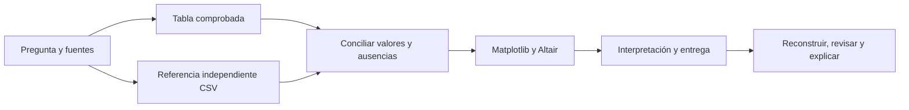
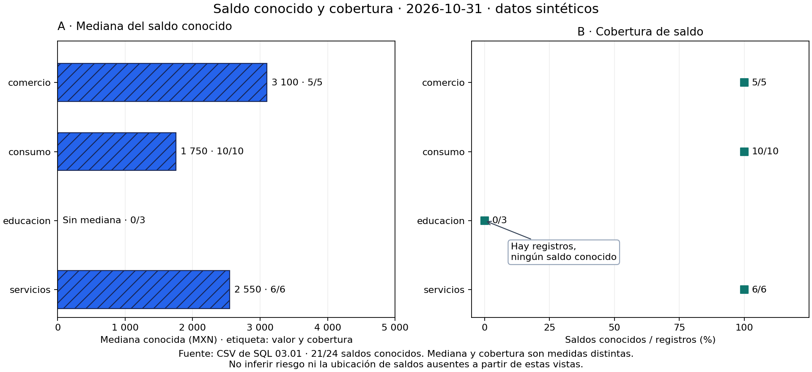

# 04.09 — Cierre visual del análisis

## Propósito y prerrequisitos

Entregar un resultado que otra persona pueda leer, comprobar y reconstruir:
una pregunta concreta, indicadores conciliados, una figura estática, una vista
declarativa y una interpretación que reconozca sus límites. El cierre conecta
las decisiones de visualización con una entrega completa.

Completa [04.01 — Pregunta y elección](../01_question_chart/README.md),
las prácticas Matplotlib hasta [04.06](../06_composition_export/README.md)
y [04.07 — Altair declarativo](../07_altair_declarative/README.md), con sus
labs y prerrequisitos de pandas/SQL. [04.08 — Interacción](../08_altair_interaction/README.md)
es opcional y no bloquea este cierre. No necesitas notebook, Quarto, aplicación
web ni publicación en línea.

**Práctica de cierre:** datos, figuras, texto y reconstrucción. **Extensión:**
HTML sin conexión y un explorador con estado explícito. Organizar paquetes,
logging, pruebas formales y contratos corresponde a Python aplicado, módulo 05.

## Objetivos y pregunta de la entrega

Al terminar podrás:

- Relacionar pregunta, población, unidad, indicador y representación.
- Conciliar valores y ausencias contra una referencia independiente.
- Comparar Matplotlib y Altair sobre la misma tabla sin cambiar la medida.
- Escribir un hallazgo con evidencia, cobertura y límites.
- Reconstruir desde las fuentes y revisar una entrega fuera de la sesión original.

Pregunta de ejemplo: **¿qué mediana de saldo conocido tiene cada segmento
en octubre de 2026 y con qué cobertura?** Público: una persona que revisa
el análisis y no escribió el código. Unidad: un crédito en un corte; mediana
en MXN y cobertura como saldos conocidos / registros del segmento.

El [script closure.py](closure.py) reutiliza lectura y tablas de 04.07,
la composición de 04.06 y, solo si se pide, el menú de 04.08. Las fuentes
son cortes.csv y creditos.csv sintéticos de SQL 03.01. La relación crédito →
segmento basta para esta pregunta; no se necesita copiar clientes.csv ni
recrear SQLite. Se conservan fuentes, reglas y entregas previas.

Versiones comprobadas: **pandas 2.3.3**, **Matplotlib 3.10.7**, **Altair 6.3.0**
y **vl-convert-python 1.9.0.post1** para exportación ampliada. No se agregan
dependencias. Son referencias del curso, no una afirmación de ser las más recientes.

## 1. Qué debe poder hacer quien recibe el resultado

Una figura puede ser correcta y aun así dejar preguntas sin respuesta:
¿de qué fecha?, ¿saldo total o mediana?, ¿qué pasó con los ausentes?, ¿cómo
se reconstruye? La entrega responde esas preguntas con piezas conectadas.

| Pieza | Responsabilidad | Comprobación |
| --- | --- | --- |
| Pregunta y ficha | Definir público, fecha, población, unidad y medida | Explicar qué representa cada fila y marca |
| Fuentes conservadas | Permitir reproducir el mismo corte | Conservar IDs, valores y ausencias |
| Tabla de indicadores | Hacer visibles números y bases | Conciliar contra los CSV |
| Figuras | Comunicar la medida y su cobertura | Cotejar ejes, etiquetas y mensajes con la tabla |
| Interpretación | Afirmar solo lo que sostienen los datos | Vincular cada hallazgo con valores y límites |
| Instrucciones | Permitir reconstrucción y revisión independiente | Ejecutar en otra carpeta con el entorno elegido |



Sin renderizador: primero se define la pregunta y se conservan las fuentes.
El análisis y una referencia por otro camino calculan los mismos indicadores.
Solo después de conciliarlos se construyen figuras, texto e instrucciones;
otra persona reconstruye y coteja el resultado.

Reconstruir significa obtener las mismas filas, valores, ausencias y bases
siguiendo el procedimiento. No exige PNG con bytes idénticos: motores,
fuentes tipográficas o metadatos pueden variar. Esa diferencia no autoriza
otra mediana, otro denominador ni una figura ilegible.

## 2. Conciliar antes de dibujar

Para octubre la base comprobada es:

| Segmento | Registros | Saldos conocidos | Mediana (MXN) | Cobertura |
| --- | ---: | ---: | ---: | ---: |
| comercio | 5 | 5 | 3100 | 100 % |
| consumo | 10 | 10 | 1750 | 100 % |
| educacion | 3 | 0 | Sin mediana | 0 % |
| servicios | 6 | 6 | 2550 | 100 % |
| Todos | 24 | 21 | 2300 | 87,5 % |

La mediana global se calcula desde los 21 saldos conocidos. No se obtiene
sumando ni tomando la mediana de las medianas de segmentos. La cobertura
global es 21/24, no el promedio simple de los cuatro porcentajes.

El script calcula el análisis con las funciones de pandas ya estudiadas.
Su referencia lee los CSV mediante `csv.DictReader`, relaciona el segmento
por ID y calcula medianas con `statistics.median`, de la biblioteca estándar.
No utiliza el resumen de pandas como entrada de la referencia. Revisar una
tabla contra una copia de sí misma no sería una comprobación independiente.

`statistics.median` ordena valores para obtener el central o la media de los
dos centrales. Requiere valores conocidos: con lista vacía no calculamos
una mediana. No enviamos ausencias como NaN ni sustituimos el campo vacío
por cero. El texto `"0"` en el CSV sí se convierte a un saldo válido.
Revisa [lectura CSV de 01.05](../../01_python_foundations/05_csv_files/README.md)
y [ausencias de 02.05](../../02_pandas/05_missing_duplicates_rules/README.md).

Desde la carpeta de esta lección, con el entorno elegido, puedes inspeccionar
las piezas sin exportar nada:

```python
from closure import read_detail, prepare, reference, reconcile, SOURCE

tablas = prepare(read_detail(), "2026-10-31")
esperado = reference(SOURCE, "2026-10-31")
indicadores, comprobaciones = reconcile(tablas["resumen"], tablas["corte"], esperado)
print(indicadores[["segmento", "registros", "conocidos", "mediana_mxn"]])
print(comprobaciones["coincide"].all())
```

Resultado: los cinco grupos de la tabla anterior y True. Hay **20 comprobaciones**:
cuatro campos — registros, conocidos, mediana y cobertura — por cinco grupos.
conciliacion.csv conserva ambos valores y el resultado de cada comparación.
Dos ausencias de la misma medida pueden coincidir; ausencia y cero no coinciden.
Los conteos deben conciliar y los porcentajes admiten una tolerancia numérica
muy pequeña por representación decimal; no se usa para justificar diferencias
analíticas. Una discrepancia detiene la entrega antes de crear su carpeta.

Conciliar datos no certifica todas las decisiones: una figura podría usar
el campo equivocado aunque la tabla sea correcta. Por eso después se revisan
representación e interpretación, como en 04.01 y 04.05.

## 3. Una tabla, dos representaciones



La figura estática usa barras de mediana y puntos de cobertura. Mantiene
origen cero en las barras, categorías comunes y unidades horizontales separadas.
La trama, el texto y los conteos ayudan a leerla sin depender solo del color.
Educación conserva su posición y el mensaje de ausencia.


La vista declarativa representa **el mismo resumen.csv**. Las capas de texto
no agregan otra medida, y el panel de cobertura usa su propio eje. Cambiar
el motor puede modificar apariencia, distribución de espacio o formatos;
comprueba valores, unidades y mensajes antes de comparar longitudes.
Las figuras reutilizan los criterios de
[04.05](../05_scales_labels_accessibility/README.md) y
[04.06](../06_composition_export/README.md).

La entrega básica ya contiene PNG/SVG de Matplotlib y HTML/JSON de Altair.
Las imágenes Altair curadas de esta lección se generaron con la extensión
--bundle; producirlas no es requisito adicional del cierre básico.

## 4. Interpretación: hallazgo, evidencia y límite

Una interpretación útil combina tres piezas, sin convertir observación en causa:

1. **Hallazgo:** «Entre los segmentos con saldo conocido, comercio tiene
   la mayor mediana en octubre».
2. **Evidencia y base:** «3100 MXN sobre 5/5 saldos conocidos; consumo tiene
   1750 sobre 10/10 y servicios 2550 sobre 6/6».
3. **Límite:** «Educación tiene tres registros sin saldo conocido; no podemos
   ordenar su mediana ni inferir riesgo real con esta muestra ficticia».

No escribir «educación tiene saldo cero», «comercio es más riesgoso» ni
«el saldo de cada crédito creció». La pregunta compara medianas disponibles
en un corte; no afirma totales, causa ni cambios individuales. Cobertura
0 % no ubica los saldos ausentes en la escala.

El script genera informe.md con ficha, tabla, lectura, límites y enlaces
relativos a las figuras. Es **un punto de partida para revisar**, no una
acreditación automática de comprensión. Debes escribir una interpretación
propia, cotejar sus cifras y explicar por qué elegiste esa representación.
En un corte sin saldos conocidos, el informe no inventa un segmento ganador.
En un corte sin registros informa que mediana y cobertura no están definidas.

## 5. Preparar, ejecutar y reconstruir

Usa el gestor elegido en [00.05](../../00_getting_started/05_environment/README.md)
y las dependencias ya preparadas en 04.07. No hay paquetes nuevos. No instales
en base ni mezcles gestores. Si el entorno ya funciona, comprueba versiones.

### PowerShell

Desde la raíz, con Conda O venv/pip activado:

```powershell
python -c "import pandas, matplotlib, altair; print(pandas.__version__, matplotlib.__version__, altair.__version__)"
python curriculum/04_visualization_python/09_visual_closure/closure.py --output curriculum/04_visualization_python/09_visual_closure/output/octubre
# Reconstrucción desde las copias conservadas, en otra carpeta:
python curriculum/04_visualization_python/09_visual_closure/closure.py --source curriculum/04_visualization_python/09_visual_closure/output/octubre/fuentes --output curriculum/04_visualization_python/09_visual_closure/output/reconstruida
# Extensiones, con convertidor ya preparado en 04.07 y carpeta nueva:
python curriculum/04_visualization_python/09_visual_closure/closure.py --bundle --interactive --output curriculum/04_visualization_python/09_visual_closure/output/ampliada
```

Recorrido alternativo uv, sin los gestores anteriores:

```powershell
uv sync --locked
uv run --locked python curriculum/04_visualization_python/09_visual_closure/closure.py --output curriculum/04_visualization_python/09_visual_closure/output/octubre
uv run --locked python curriculum/04_visualization_python/09_visual_closure/closure.py --source curriculum/04_visualization_python/09_visual_closure/output/octubre/fuentes --output curriculum/04_visualization_python/09_visual_closure/output/reconstruida
# Extensiones opcionales:
uv sync --locked --group chart-export
uv run --locked --group chart-export python curriculum/04_visualization_python/09_visual_closure/closure.py --bundle --interactive --output curriculum/04_visualization_python/09_visual_closure/output/ampliada
```

### Bash/Zsh

Desde la raíz, con Conda O venv/pip activado:

```bash
python -c "import pandas, matplotlib, altair; print(pandas.__version__, matplotlib.__version__, altair.__version__)"
python curriculum/04_visualization_python/09_visual_closure/closure.py --output curriculum/04_visualization_python/09_visual_closure/output/octubre
python curriculum/04_visualization_python/09_visual_closure/closure.py --source curriculum/04_visualization_python/09_visual_closure/output/octubre/fuentes --output curriculum/04_visualization_python/09_visual_closure/output/reconstruida
# Extensiones: convertidor ya preparado y carpeta nueva.
python curriculum/04_visualization_python/09_visual_closure/closure.py --bundle --interactive --output curriculum/04_visualization_python/09_visual_closure/output/ampliada
```

Recorrido alternativo uv:

```bash
uv sync --locked
uv run --locked python curriculum/04_visualization_python/09_visual_closure/closure.py --output curriculum/04_visualization_python/09_visual_closure/output/octubre
uv run --locked python curriculum/04_visualization_python/09_visual_closure/closure.py --source curriculum/04_visualization_python/09_visual_closure/output/octubre/fuentes --output curriculum/04_visualization_python/09_visual_closure/output/reconstruida
# Extensiones opcionales:
uv sync --locked --group chart-export
uv run --locked --group chart-export python curriculum/04_visualization_python/09_visual_closure/closure.py --bundle --interactive --output curriculum/04_visualization_python/09_visual_closure/output/ampliada
```

### CMD / Anaconda Prompt

Desde la raíz y con el entorno Conda activado:

```bat
python -c "import pandas, matplotlib, altair; print(pandas.__version__, matplotlib.__version__, altair.__version__)"
python curriculum/04_visualization_python/09_visual_closure/closure.py --output curriculum/04_visualization_python/09_visual_closure/output/octubre
python curriculum/04_visualization_python/09_visual_closure/closure.py --source curriculum/04_visualization_python/09_visual_closure/output/octubre/fuentes --output curriculum/04_visualization_python/09_visual_closure/output/reconstruida
REM Extensiones: convertidor preparado y carpeta nueva.
python curriculum/04_visualization_python/09_visual_closure/closure.py --bundle --interactive --output curriculum/04_visualization_python/09_visual_closure/output/ampliada
```

--source indica una carpeta con cortes.csv y creditos.csv; por defecto utiliza
los originales del curso. Las copias de fuentes/ conservan **ambos cortes**
y la relación de segmentos: corte.csv contiene solo la fecha seleccionada
y no reemplaza esas entradas. --cut permite otra fecha con formato YYYY-MM-DD.
--dpi cambia resolución del PNG Matplotlib y exige entero positivo.
Cada ejecución requiere carpeta nueva y conserva las anteriores.

## 6. Revisar la entrega completa

| Archivo | Qué aporta |
| --- | --- |
| fuentes/cortes.csv, fuentes/creditos.csv | Copias exactas de entradas sintéticas |
| corte.csv, resumen.csv | Detalle seleccionado y tabla usada por ambas figuras |
| referencia_csv.csv, indicadores.csv | Referencia independiente y resultado incluido el global |
| conciliacion.csv | Veinte comparaciones de valores y ausencias |
| matplotlib.png, matplotlib.svg, formatos.csv | Figura estática y registro de dimensiones |
| altair.html, altair.json | Vista declarativa y especificación con datos |
| informe.md, RECONSTRUIR.md | Lectura e instrucciones de reconstrucción/revisión |
| entrega.json | Corte, opciones y versiones usadas; revisión visual pendiente |

--bundle incorpora bibliotecas al HTML y añade altair.png/svg. --interactive
añade explorador.html/json de 04.08; no altera la figura principal ni sus
medianas. El HTML básico requiere conexión; el incorporado puede abrirse
sin red con estos datos. JSON no es una imagen, y un visor que bloquee
JavaScript puede no dibujar HTML aunque los valores sean correctos.

Para leer informe.md con sus enlaces, conserva la carpeta completa.
Para **reconstruir** necesitas también el repositorio con los scripts de
04.06–04.09 y el entorno adecuado; copiar solo la carpeta de salida no
incluye automáticamente el código ni instala paquetes. Git es útil para
identificar una revisión, pero el material también debe funcionar desde ZIP.

entrega.json se escribe después de los guardados. Su presencia no certifica
que nadie borró archivos después ni que la interpretación sea correcta.
Una ejecución interrumpida puede dejar una carpeta parcial: revisa archivos,
abre figuras y registra lo ocurrido antes de presentar una entrega.

En la revisión independiente:

1. Abre el informe sin consultar la memoria de quien lo creó; identifica
   pregunta, fuente, fecha, unidad, medida y población.
2. Coteja la tabla con fuentes, indicadores y conciliación; distingue cero,
   ausencias y grupos vacíos.
3. Abre PNG/SVG y HTML; comprueba posiciones, mensajes, ejes y legibilidad.
4. Reconstruye usando las copias y otra carpeta; compara valores y bases.
5. Explica un hallazgo y un límite con tus palabras, y registra evidencia.

Si añades interacción, conserva estado inicial, opción elegida y base de
cualquier captura. Un menú cambia la vista en el navegador, no los CSV.
Una imagen estática no conserva controles funcionales. Son criterios de
04.08 y no requisitos de este cierre.

## Práctica, criterio de salida y continuidad

Realiza el [lab 04.09](../../../labs/04_visualization_python/09_visual_closure/README.md).
Puedes cerrar el módulo cuando reconstruyas la entrega, concilies indicadores,
justifiques representación y ausencias, y expliques hallazgo y límites.
Quien acompaña revisa; quien aprende realiza y explica. Desarrollar el material
no acredita haber completado estas prácticas.

No hay proyecto/checkpoint implementado asociado. Este cierre es una práctica
de integración, no un nuevo proyecto obligatorio ni una entrega en showcase.
Continúa con el [plan de 05.01 — Del notebook a módulos](../../05_python_applied/README.md#01-del-notebook-a-modulos),
todavía pendiente: reutilizarás el análisis para separar responsabilidades
y evitar importaciones mediante rutas manuales. No se requiere dominar clases
o decoradores antes de continuar.

## Referencias y atribución

Ejemplos, datos, código y figuras propios de DS Track. Las APIs reutilizadas
se comprobaron con las versiones del curso. Se consultaron fuentes primarias
de los equipos Python, Matplotlib y Vega-Altair; no se copiaron capítulos
ni figuras de sus galerías. Las páginas stable pueden mostrar otras versiones.

- [Python: lectura y escritura CSV](https://docs.python.org/3.11/library/csv.html).
- [Python: mediana y tratamiento de NaN](https://docs.python.org/3.11/library/statistics.html#statistics.median).
- [Matplotlib: guardar una Figure](https://matplotlib.org/stable/api/_as_gen/matplotlib.figure.Figure.savefig.html).
- [Altair: guardar gráficos y HTML incorporado](https://altair-viz.github.io/user_guide/saving_charts.html).
