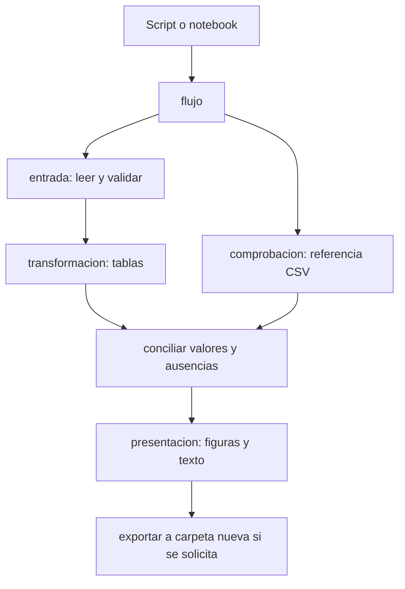

# 05.01 — Del notebook a módulos

[Inicio](../../../README.md) / [Módulo 05](../README.md) / **Lección 05.01**

| Tu sesión | Qué prepararás o comprobarás |
| --- | --- |
| **Meta** | Reutilizar el análisis desde módulos, un script y un notebook |
| **Necesitas** | Entorno de pandas/visualización; kernel del notebook comprobado |
| **Evidencia** | Mapa de responsabilidades y comparación de ambos consumidores |

[Preparación](#antes-de-empezar) · [Material de apoyo](#material-de-apoyo) · [Ir al lab](../../../labs/05_python_applied/01_notebook_to_modules/README.md) · [Comprobar](#evidencia-y-criterio-de-salida)

<a id="propósito-y-prerrequisitos"></a>

## Propósito

Reutilizar un análisis sin copiar sus funciones entre celdas y scripts. Vamos a
separar lectura, transformación, comprobación y presentación en archivos que
puedas importar, y a ejecutar el mismo recorrido desde un script y un notebook.
La reorganización debe conservar los resultados conocidos.

## Antes de empezar

Completa [04.09 — Cierre visual del análisis](../../04_visualization_python/09_visual_closure/README.md)
y su lab, con los prerrequisitos de pandas/SQL. Recupera
[funciones y mutabilidad de 01.04](../../01_python_foundations/04_functions/README.md),
[notebooks de 00.06](../../00_getting_started/06_first_notebook/README.md) y
[entorno y dependencias de 00.05](../../00_getting_started/05_environment/README.md).
Puedes dividir esta sección en tres sesiones: módulo pequeño, paquete del análisis
y reutilización/comprobación. No necesitas dominar clases ni decoradores.

**Esencial:** módulos, importaciones, paquetes regulares, responsabilidades y
entrada protegida. **Práctica:** mismo análisis en script y notebook.
**Extensión:** diagnosticar búsqueda de módulos y caché de importaciones.
Argumentos de terminal, logging y configuración se desarrollarán en 05.02;
pruebas formales, en 05.04. No agregamos dependencias al proyecto.

<a id="objetivos-observables"></a>

## Qué vas a aprender

- Explicar la diferencia entre archivo, módulo, paquete y script.
- Importar una función y reconocer de qué archivo proviene.
- Separar el cálculo de las acciones de lectura, dibujo y escritura.
- Ejecutar una entrada explícita sin exportar al importar el paquete.
- Usar las mismas funciones en notebook/script sin modificar `sys.path`.
- Conciliar registros, medianas, cobertura y ausencias con 04.09.

## Material de apoyo

| Recurso | Para qué sirve | Uso |
| --- | --- | --- |
| [Módulo pequeño](medidas_demo.py) | Contrastar ejecutar e importar | Para el recorrido |
| [Transformación](analisis_cartera/transformacion.py) | Leer el cálculo reutilizable | Para el recorrido |
| [Flujo](analisis_cartera/flujo.py) | Seguir preparación y comprobaciones | Para el recorrido |
| [Script](ejecutar.py) | Ejecutar el análisis como consumidor | Para el recorrido |
| [Notebook](exploracion.ipynb) | Reutilizar el paquete con el mismo kernel; reiniciar y ejecutar todo | Para el recorrido |

Abre los recursos cuando aparezcan en el recorrido. El paquete compartido vive
en 05.01 y se reutiliza sin copiar sus módulos; conserva las fuentes y entregas
anteriores. Lee las comprobaciones y los resultados esperados antes de ejecutar.

## 1. Por qué reorganizar un análisis que ya funciona

Un notebook reúne explicación, exploración y resultados. Eso ayuda a investigar:
puedes mirar una tabla, cambiar un filtro y comparar una figura. Sin embargo,
copiar una función a otro notebook produce dos versiones que pueden divergir.
Si corriges una regla en una copia, la otra conserva el error.

Además, una celda puede utilizar una variable creada mucho antes. Si no sabes
qué entrada necesita el cálculo, será difícil ejecutarlo fuera de ese kernel.
Extraer una función exige expresar esa entrada mediante argumentos y devolver
su resultado. El notebook queda como lector y explorador de esas funciones.

En 04.09 ya usamos un script. El título describe también la transición desde
el [notebook de pandas 02.10](../../02_pandas/10_analysis_plot/README.md): ambos
formatos se benefician de un cálculo compartido. No convertiremos toda celda
en módulo ni toda función en un archivo. Agruparemos tareas que cambian por
la misma razón y describiremos sus dependencias.

Por ejemplo, cambiar la ubicación de los CSV afecta la lectura; cambiar un
color afecta la presentación. Ninguna de esas decisiones debe cambiar la
mediana. Esa separación permite revisar una responsabilidad a la vez.

## 2. Un archivo que podemos ejecutar e importar

Un **módulo** proporciona nombres que otro código puede utilizar. En este
primer caso es un archivo `.py`: [medidas_demo.py](medidas_demo.py). Un
**script** es un archivo que elegimos ejecutar como programa. El mismo archivo
puede cumplir ambos papeles; no son dos extensiones distintas.

Primero lee el ejemplo reducido:

```python
from statistics import median

def resumir_saldos(saldos):
    conocidos = [saldo for saldo in saldos if saldo is not None]
    n, k = len(saldos), len(conocidos)
    return {
        "registros": n,
        "conocidos": k,
        "mediana_mxn": median(conocidos) if k else None,
        "cobertura_pct": 100 * k / n if n else None,
    }
```

La lista por comprensión crea una lista nueva con valores conocidos; `is not
None` conserva el cero. `n, k = ...` asigna dos cantidades. Cada expresión
`valor if condición else alternativa` selecciona un resultado sin llamar a
`median` ni dividir cuando falta una base. Son las mismas reglas de ausencia y
base de 04.09, representadas aquí con listas y `None`, no con tipos pandas.
La entrada debe ser una lista de números no negativos o `None` de este ejemplo;
esta función mínima no es un validador general de datos.

Desde Python o una celda, con la carpeta de la lección como directorio de
trabajo, prueba:

```python
import medidas_demo

resultado = medidas_demo.resumir_saldos([0, 100, None, 300])
print(resultado)
```

Resultado: 4 registros, 3 conocidos, mediana 100 y cobertura 75 %. La función
retorna un diccionario; quien llama decide si imprimirlo. `import medidas_demo`
incorpora el nombre del módulo a tu sesión. El punto permite acceder al nombre
`resumir_saldos` que vive dentro del módulo.

Cada módulo tiene su espacio de nombres: los nombres definidos allí. La
variable local `conocidos` vive dentro de la llamada y no aparece como variable
de tu notebook. Esto ayuda a evitar dependencias de celdas anteriores.

También puedes seleccionar un nombre:

```python
from medidas_demo import resumir_saldos
resultado = resumir_saldos([0, 100, None, 300])
```

Ahora llamas sin prefijo. Esta variante también carga el módulo; no evita
ejecutar su inicialización. `import medidas_demo as medidas` usa un alias
local y permite `medidas.resumir_saldos(...)`. Elige una forma que haga clara
la procedencia; evita `import *`, que mezcla nombres y puede ocultar los tuyos.

## 3. Qué ocurre al importar y por qué existe la protección de entrada

Importar ejecuta el código del nivel superior del módulo: lo que está fuera
de las funciones. La instrucción `def` crea la función, pero no ejecuta su
cuerpo. En cambio, una llamada escrita fuera de ella sí se ejecutaría:

```python
# Ejemplo de una decisión que no queremos en un módulo reutilizable:
print("Leyendo archivos...")
# datos = pd.read_csv("cortes.csv")
# exportar(datos)
```

Si otro archivo importa ese módulo, aparecería el mensaje y se activarían las
acciones que estuvieran descomentadas. No hace falta llamar una función desde
el notebook para que suceda. Un import no es una operación de copiar texto.

En medidas_demo.py la demostración queda dentro de `main()`:

```python
def main():
    print(resumir_saldos([0, 100, None, 300]))

if __name__ == "__main__":
    main()
```

`__name__` es un nombre que Python establece. Al importar este módulo, su
valor es `"medidas_demo"`; al ejecutarlo como programa principal, es
`"__main__"`. La condición decide si llamar `main()`. `main` es un nombre
convencional de función: Python no lo invoca automáticamente.

| Acción | `__name__` de medidas_demo.py | ¿Se llama su `main()`? |
| --- | --- | --- |
| `import medidas_demo` | `medidas_demo` | No |
| `python medidas_demo.py` | `__main__` | Sí |
| `python -m medidas_demo` | `__main__` | Sí |

La protección solo cubre el bloque indentado. Una lectura o una llamada a
exportar escrita antes de ella sigue ocurriendo al importar. Nuestra regla
concreta: importar define funciones y constantes, sin leer CSV, dibujar,
imprimir resultados, analizar argumentos ni crear entregas. Python puede
crear su caché técnica `__pycache__`; eso no es una entrega de datos.

## 4. Un paquete organiza varios módulos relacionados

El ejemplo pequeño cabe en un módulo. El análisis completo tiene tareas
distintas. Un **paquete regular** permite agrupar módulos en una carpeta con
`__init__.py`. Ese archivo inicializa el paquete; aquí solo contiene una
descripción para mantener su importación sencilla. Hay otros tipos de paquetes,
como los paquetes de espacio de nombres, que no necesitamos en esta sección.

```text
01_notebook_to_modules/
├── medidas_demo.py
├── ejecutar.py
├── exploracion.ipynb
└── analisis_cartera/
    ├── __init__.py
    ├── __main__.py
    ├── reglas.py
    ├── entrada.py
    ├── transformacion.py
    ├── comprobacion.py
    ├── presentacion.py
    └── flujo.py
```

El módulo educativo 05 es una etapa del curso; el módulo Python `entrada.py`
es código importable. Tampoco confundas este paquete local con una distribución
instalada mediante pip: para esta práctica basta la carpeta de la lección.
Publicar paquetes o añadir un sistema de construcción queda fuera del objetivo.

Desde un consumidor externo al paquete:

```python
from analisis_cartera.entrada import read_detail
from analisis_cartera.transformacion import summarize
```

Es una importación absoluta: identifica paquete y módulo. Dentro de flujo.py:

```python
from .entrada import read_detail
from .transformacion import summarize
```

El punto inicial indica el paquete actual, no una ruta del disco ni el
directorio desde el que lanzaste Python. Es una importación relativa. Por eso
no ejecutamos `python analisis_cartera/flujo.py`: ese archivo necesita el
contexto del paquete. Importarlo o ejecutar la entrada con `-m` lo proporciona.

## 5. Separar responsabilidades sin cambiar la pregunta

La pregunta sigue siendo: ¿qué mediana de saldo conocido tiene cada segmento
en octubre de 2026 y con qué cobertura? Las fuentes son los CSV de SQL 03.01,
o las copias conservadas en tu entrega de 04.09.

| Archivo | Responsabilidad | Entrada → resultado |
| --- | --- | --- |
| reglas.py | Orden de segmentos y campos conciliados | Constantes compartidas |
| entrada.py | Leer CSV, comprobar claves/tipos y relacionar | Carpeta → detalle |
| transformacion.py | Seleccionar corte, mediana y cobertura | Detalle + fecha → dos tablas |
| comprobacion.py | Referencia CSV/statistics y conciliación | Fuentes/tablas → controles |
| presentacion.py | Dibujar la misma tabla y redactar el informe | Tablas → figuras/texto |
| flujo.py | Coordinar y exportar cuando se pide | Fuentes + destino → entrega |
| __main__.py | Elegir valores iniciales y llamar al flujo | Ejecución del paquete |

La referencia independiente no calcula la mediana a través de summarize:
usa `csv` y `statistics` como en 04.09. Si ambas rutas compartieran el mismo
cálculo erróneo, la conciliación podría aceptar ese error.



Sin renderizador: los dos consumidores llaman al mismo flujo. La lectura
produce detalle, la transformación produce un resumen y otra ruta produce una
referencia. Se concilian antes de entregar figuras. Ningún módulo de cálculo
importa al script que lo ejecuta; evitamos un ciclo de dependencias.

Abre [transformacion.py](analisis_cartera/transformacion.py) y sigue summarize:
filtra el corte con `.copy()`, recorre los segmentos conocidos, calcula sobre
valores no ausentes y devuelve `selected, summary`. La tupla devuelve dos
resultados; `selected, summary = summarize(detail, cut)` los asigna a dos
nombres. `.copy()` conserva el detalle recibido. En esta sección el núcleo
se concentra en mediana/cobertura: no necesita calcular cuartiles ni construir
pares para un explorador. Esas actividades permanecen en las lecciones previas.

Abre [flujo.py](analisis_cartera/flujo.py). `build_analysis(source, cut)` lee,
transforma y concilia, y devuelve un diccionario de cinco tablas; no escribe
salidas. `export(source, output, cut)` llama ese recorrido, crea una carpeta
nueva y guarda tablas, fuentes, informe, Matplotlib PNG/SVG y Altair JSON/HTML.
La construcción de una Figure es una acción: se realiza al llamar, no al importar.

## 6. Directorio de trabajo, búsqueda de módulos y rutas de datos

Python debe encontrar la carpeta que contiene el paquete. Al ejecutar un
archivo, normalmente incluye su carpeta en la búsqueda; con `python -m` o
una sesión interactiva normal, incluye el directorio de trabajo. También
busca bibliotecas del entorno elegido. No busca automáticamente en todas las
subcarpetas de un repositorio.

Dos preguntas diferentes:

- **¿Dónde encuentra Python el código?** Para nuestro paquete local, en la
  carpeta de la lección desde la que iniciamos la sesión.
- **¿Dónde están los datos?** En una ruta que pasamos a read_detail o export.
  Una ruta relativa se interpreta desde el directorio de trabajo.

`Path.cwd()` muestra el directorio de trabajo; `__file__` identifica el archivo
de un módulo. En __main__.py, `Path(__file__).resolve().parents[1]` ubica la
lección, con independencia del directorio de lanzamiento. `resolve()` obtiene
una ruta absoluta y `parents[1]` sube dos niveles desde el archivo. Luego la
entrada construye rutas conocidas dentro del repositorio. Un notebook no
dispone normalmente de su propio `__file__`; por eso comprobamos su carpeta
de trabajo de manera explícita.

En 04 se ajustaba `sys.path` para compartir scripts entre lecciones; se conservan
esas muestras históricas. El paquete de 05.01 no hace esos ajustes, no modifica
PYTHONPATH y no requiere una instalación editable. Para otra estructura de
proyecto habrá que elegir cómo hacer disponible el paquete, no pegar rutas
personales en cada notebook.

### PowerShell: recorrido completo

Abre una terminal en la raíz de DS Track y usa tu entorno ya preparado.
No vuelvas a crearlo si sus bibliotecas son adecuadas.

```powershell
Set-Location curriculum/05_python_applied/01_notebook_to_modules
python -c "import sys; print(sys.executable)"
python -c "import medidas_demo; print(medidas_demo.__name__)"
python medidas_demo.py
python -c "import analisis_cartera.flujo; print('Importación lista')"
python -m analisis_cartera
```

La importación solo imprime tu mensaje explícito. La última orden crea
`output/entrega_modular` y anuncia 20 conciliaciones. Para ejecutar desde la raíz
también puedes usar `python curriculum/05_python_applied/01_notebook_to_modules/ejecutar.py`.
Las dos entradas usan el mismo destino: ejecuta solo una para la entrega inicial.
Repetirla produce FileExistsError y conserva lo anterior.

### Bash/Zsh: recorrido completo

Abre una terminal en la raíz y activa el entorno elegido como en 00.05.

```bash
cd curriculum/05_python_applied/01_notebook_to_modules
python -c "import sys; print(sys.executable)"
python -c "import medidas_demo; print(medidas_demo.__name__)"
python medidas_demo.py
python -c "import analisis_cartera.flujo; print('Importación lista')"
python -m analisis_cartera
```

La alternativa desde la raíz es
`python curriculum/05_python_applied/01_notebook_to_modules/ejecutar.py`.
El resultado y la regla de carpeta nueva son los mismos.

### Anaconda Prompt (CMD): recorrido completo

Con el entorno del curso activado y la terminal en la raíz:

```bat
cd curriculum\05_python_applied\01_notebook_to_modules
python -c "import sys; print(sys.executable)"
python -c "import medidas_demo; print(medidas_demo.__name__)"
python medidas_demo.py
python -c "import analisis_cartera.flujo; print('Importación lista')"
python -m analisis_cartera
```

También puedes ejecutar desde la raíz
`python curriculum\05_python_applied\01_notebook_to_modules\ejecutar.py`.
No ejecutes ambas alternativas para el mismo destino.

**Si usas uv:** desde la raíz, `uv run --locked python
curriculum/05_python_applied/01_notebook_to_modules/ejecutar.py` ejecuta con la
configuración raíz. Para Jupyter usa el grupo notebooks y kernel descritos en
00.06; ese grupo ya está declarado. No mezcles gestores en un mismo entorno.

## 7. Reutilizar desde el notebook

Abre [exploracion.ipynb](exploracion.ipynb) con el kernel elegido. La primera
celda muestra intérprete y carpeta y detiene la ejecución si no estás en la
carpeta de la lección. Corrige el directorio de inicio del servidor/kernel o
abre la lección como carpeta de trabajo; no agregues rutas a `sys.path` para
silenciar el problema. Si necesitas iniciar Jupyter, sigue 00.06.

El notebook importa build_analysis y delivery_figure: no contiene copias de
sus definiciones. Muestra tablas, revisa cifras de octubre y dibuja la misma
Figure. Importa `display` de IPython, el entorno interactivo del kernel, para
mostrarla dentro del notebook y cierra la figura que creó. No escribe otra
entrega automáticamente.

Para explorar las copias de 04.09, pasa a build_analysis la carpeta `fuentes`
de esa entrega; desde la lección, la ruta debe referirse a esa ubicación real.
También puedes usar una ruta absoluta construida por ti, sin publicarla dentro
del notebook. Para otra fecha cambia el argumento `cut`, no el código del cálculo.

### Cambié un módulo, pero el notebook conserva el resultado anterior

Python normalmente conserva módulos ya importados durante la sesión. Volver
a ejecutar el mismo `import` no garantiza cargar tus cambios del disco.
Reinicia el kernel y ejecuta todas las celdas en orden. Eso elimina además las
variables creadas en pruebas anteriores. Limpiar las salidas visibles no reinicia
el kernel. reload es una ampliación y puede dejar referencias antiguas a funciones
importadas con `from`; para esta práctica elegimos reiniciar.

## 8. Qué se conserva y cómo comprobarlo

Usa las tablas de 04.09 y las nuevas sobre las mismas fuentes y fecha. Deben
coincidir por valores y ausencias, no solo por aspecto visual:

| Segmento | Registros | Conocidos | Mediana (MXN) | Cobertura |
| --- | ---: | ---: | ---: | ---: |
| comercio | 5 | 5 | 3100 | 100 % |
| consumo | 10 | 10 | 1750 | 100 % |
| educacion | 3 | 0 | Ausente | 0 % |
| servicios | 6 | 6 | 2550 | 100 % |
| Todos | 24 | 21 | 2300 | 87,5 % |

El saldo cero del crédito 004 sigue participando. El corte sin registros conserva
los cuatro segmentos, con medianas y coberturas no definidas; un segmento con
registros pero ningún saldo conocido tiene cobertura 0 %. La mediana global
se obtiene del detalle conocido, no de medianas de segmentos.

Prueba además una lista vacía, todos ausentes y una mediana de medio MXN con
medidas_demo. En el análisis completo compara el detalle antes/después de
summarize para comprobar que no se modifica. La conciliación CSV produce 20
comparaciones; no reemplaza revisar la figura y explicar el hallazgo.

El núcleo conserva PNG/SVG Matplotlib y JSON/HTML Altair de 04.09. HTML básico
necesita conexión; no migramos el explorador ni HTML incorporado en esta primera
reorganización. Esas ampliaciones y sus entregas se conservan en 04.08/04.09.
No se exige que imágenes tengan bytes idénticos. La carpeta nueva protege
entregas anteriores; una interrupción aún puede dejar archivos parciales.

## 9. Errores habituales y cómo razonar sobre ellos

| Síntoma | Qué revisar |
| --- | --- |
| ModuleNotFoundError: analisis_cartera | Directorio de inicio; que la carpeta padre del paquete esté disponible |
| ModuleNotFoundError: pandas | Intérprete/kernel y dependencias del entorno elegido |
| attempted relative import with no known parent package | Se ejecutó un archivo interno; usar el consumidor o `python -m analisis_cartera` |
| Se exporta al importar | Buscar llamadas al nivel superior, también en __init__.py |
| Un cambio no aparece en el notebook | Reiniciar kernel y ejecutar todo |
| FileExistsError | El destino ya existe; usar otra carpeta mediante export, conservar la anterior |
| Importación circular | Revisar si entrada/transformación importan flujo o la entrada principal |

Evita archivos locales llamados `pandas.py`, `statistics.py` o `json.py`:
pueden ocultar bibliotecas del entorno. `print(medidas_demo.__file__)` muestra
la procedencia del módulo importado. Cambiar de entorno y cambiar de carpeta
resuelven problemas distintos; diagnostica antes de instalar paquetes.

<a id="práctica-evidencia-y-criterio-de-salida"></a>

## Práctica

Realiza el [lab 05.01](../../../labs/05_python_applied/01_notebook_to_modules/README.md) para
separar responsabilidades y comprobar el mismo análisis desde ambos consumidores.

## Evidencia y criterio de salida

| Conserva | Comprueba | Explica |
| --- | --- | --- |
| Mapa de módulos y explicación de import/main | Qué archivo aporta cada función y qué se ejecuta al importar | Por qué separar cálculo, lectura y presentación |
| Script y notebook de tu práctica | Mismas tablas, bases y ausencias tras ejecución completa | Cómo evitaste copiar funciones y depender del estado del notebook |

Puedes avanzar cuando expliques qué se ejecuta al importar, identifiques las
entradas/salidas de una transformación, uses la misma función desde ambos
consumidores y demuestres que la reorganización conserva bases y ausencias.

Quien aprende realiza la práctica y explica las decisiones; su compañero revisa.
Tu compañero pide rastrear una función del notebook hasta su módulo y comprobarla tras reiniciar el kernel.
Guarda evidencia, ayudas y dudas en una nota personal junto a tu práctica.
PROGRESS.md registra el desarrollo editorial, no tu expediente de aprendizaje.
No hay proyecto ni checkpoint implementado asociado en projects/; esta práctica
reutiliza el paquete educativo sin dar por completado un proyecto del catálogo.

<a id="referencias-y-atribución"></a>

## Referencias

Ejemplos propios de DS Track. Lectura extraída de 04.04; figuras de 04.06/04.07
y referencia/informe de 04.09, conservando las muestras anteriores. La nueva
transformación calcula solo los indicadores de esta pregunta. Documentación
consultada el 2026-10-14 para Python 3.11, mínimo declarado; comprobaciones con
Python 3.12.12, pandas 2.3.3, Matplotlib 3.10.7 y Altair 6.3.0. Son referencias
del curso. No se copian capítulos ni ejemplos de las fuentes.

- [Python: módulos, nombres e importaciones](https://docs.python.org/3.11/tutorial/modules.html).
- [Python: entorno principal y __main__.py](https://docs.python.org/3.11/library/__main__.html).
- [Python: ejecución mediante -m](https://docs.python.org/3.11/using/cmdline.html#cmdoption-m).
- [Python: sistema de importación y paquetes](https://docs.python.org/3.11/reference/import.html).
- [Python: pathlib y directorio de trabajo](https://docs.python.org/3.11/library/pathlib.html).
- [Python: funciones locales y espacios de nombres](https://docs.python.org/3.11/tutorial/classes.html#python-scopes-and-namespaces).

## Siguiente paso

Después de la práctica y su comprobación, la continuación del núcleo es
[05.02 — Configuración y registro de ejecución](../02_configuration_logging/README.md).

[← Módulo 05](../README.md) · [Lab 05.01](../../../labs/05_python_applied/01_notebook_to_modules/README.md) · [Siguiente →](../02_configuration_logging/README.md)
