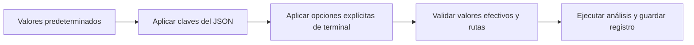

# 05.02 — Configuración y registro de ejecución

## Propósito y prerrequisitos

Ejecutar el análisis conocido para otra fecha o carpeta sin editar la mediana,
la lectura ni el dibujo. También queremos explicar qué entrada, parámetros,
reglas y versiones produjo cada entrega, y reconocer una ejecución incompleta.

Completa [05.01 — Del notebook a módulos](../01_notebook_to_modules/README.md)
y su lab. Recupera [terminal y rutas de 00.02](../../00_getting_started/02_terminal_paths/README.md),
[entornos/dependencias de 00.05](../../00_getting_started/05_environment/README.md)
y el [cierre visual 04.09](../../04_visualization_python/09_visual_closure/README.md).
La pregunta y sus indicadores siguen siendo los mismos; ahora cambia la forma
de indicar entradas y conservar contexto.

**Esencial:** argumentos, rutas, configuración efectiva y logging.
**Práctica:** septiembre/octubre y conciliación de entregas.
**Extensión:** precedencia y diagnóstico con DEBUG. No necesitas un nuevo
notebook, otra instalación ni un paquete de configuración externo. Se utiliza
la biblioteca estándar y el paquete del análisis de 05.01. Errores, recursos
y escritura atómica se profundizarán en 05.03; pruebas formales, en 05.04.

## Objetivos observables

- Distinguir un parámetro de función de una opción de terminal.
- Utilizar la ayuda y reconocer valores, tipos y errores de argumentos.
- Interpretar rutas relativas según una base explícita.
- Combinar valores predeterminados, archivo JSON y terminal sin ambigüedad.
- Distinguir mensaje de diagnóstico, tabla analítica y registro de ejecución.
- Ejecutar dos cortes y comprobar qué configuración produjo cada resultado.

## 1. Qué debe poder cambiar y qué debe permanecer estable

En 05.01 la función export ya recibe source, output, cut y dpi. La entrada
principal elegía sus valores dentro del código. Eso alcanza para una primera
ejecución, pero obliga a editar un archivo para cambiar el destino o corte.
Queremos pasar esos valores desde fuera del cálculo.

Un **parámetro** es un nombre en la definición de una función; un **argumento**
es el valor recibido en una llamada. `cut` es un parámetro de export y
`"2026-09-30"` puede ser su argumento. Una **opción de terminal**, como `--cut`,
es texto que el consumidor interpreta y convierte en ese argumento. Python
no conecta automáticamente un nombre de función con una opción de terminal.

| Puede variar por ejecución | Sigue siendo una regla del análisis |
| --- | --- |
| Carpeta de fuentes | Una fila representa crédito/corte |
| Carpeta nueva de salida | No sobrescribir entregas anteriores |
| Fecha de corte | Mediana calculada sobre saldos conocidos |
| Resolución PNG | Cero conocido distinto de saldo ausente |
| Nivel de mensajes | Cobertura con denominador explícito |

Cambiar dpi modifica la imagen exportada, no la mediana. Cambiar el nivel de
mensajes modifica lo que ves en la consola, no las filas analizadas. Cambiar
la fecha sí cambia la selección; hay que comprobar los resultados sobre esa
base. Una opción para imputar saldos sería una nueva regla analítica y necesitaría
su justificación, no solo un interruptor en la terminal.

## 2. Leer argumentos con argparse, en un ejemplo pequeño

Abre [argumentos_demo.py](argumentos_demo.py), que no lee fuentes ni exporta.
Su función main contiene:

```python
parser = argparse.ArgumentParser(description=__doc__, allow_abbrev=False)
parser.add_argument("--cut", default="2026-10-31", help="Fecha del ejemplo")
parser.add_argument("--dpi", type=int, default=160, help="Entero del ejemplo")
args = parser.parse_args(argv)
```

ArgumentParser construye un objeto que describe las opciones permitidas.
`add_argument` añade cada descripción; `parse_args` interpreta los valores.
Utilizar estos objetos no requiere diseñar tus propias clases. El resultado,
llamado Namespace, permite acceder a atributos como `args.cut` y `args.dpi`.

En la terminal todos los valores llegan inicialmente como texto. `type=int`
convierte dpi: `--dpi 120` produce el entero 120; `--dpi alto` falla antes de
usar ese dato. La demostración convierte, pero no comprueba dpi positivo ni
fecha real: `--dpi -1` puede convertirse y aun así ser inapropiado para exportar.
El consumidor completo sí valida esas reglas.

`default` elige un valor cuando omites la opción. `help` describe su propósito.
`__doc__` proporciona la descripción del archivo. `--help` o `-h` muestra la
ayuda y termina sin ejecutar el análisis. `allow_abbrev=False` exige los
nombres completos, por ejemplo --output en lugar de una abreviatura accidental.

La nueva entrada acepta opciones con nombre y valor. Una opción posicional,
en cambio, se interpreta por su lugar en el comando; no la necesitamos aquí.
Tampoco usamos banderas booleanas en este consumidor. En 04.09 --bundle era
una bandera sin valor; no todas las opciones tienen esa misma forma.

El nombre `--log-level` llega al código como `args.log_level`: argparse cambia
el guion por un guion bajo en el atributo. `choices` limita sus valores a los
niveles indicados en la ayuda. No significa que el nivel configure también
reglas de validación o cobertura.

En main, `argv=None` permite que parse_args lea la terminal; si pasas una lista
de textos, interpreta esa lista. Esto facilita comprobar entradas sin simular
teclado. No ejecutes parse_args al importar: un notebook tiene sus propios
argumentos y no es el lugar para consumirlos por accidente.

## 3. El consumidor nuevo y el paquete compartido

Conservamos ejecutar.py y `python -m analisis_cartera` como ejemplos de 05.01.
La entrada nueva es
[ejecutar_configurado.py](../01_notebook_to_modules/ejecutar_configurado.py).
Desde la carpeta del paquete también puedes usar `python -m analisis_cartera.cli`.
Ambas entradas llaman la misma función main de
[cli.py](../01_notebook_to_modules/analisis_cartera/cli.py).

| Pieza | Qué hace |
| --- | --- |
| argumentos_demo.py | Muestra interpretación y ayuda sin exportar |
| configuracion.py, en el paquete de 05.01 | Combina valores y valida configuración |
| cli.py, en ese paquete | Interpreta terminal, prepara logging y llama export |
| ejecutar_configurado.py | Entrada por archivo, con protección de main |
| septiembre.json y octubre.json | Configuraciones pequeñas de dos cortes |
| flujo.py y sus dependencias | Conservan el análisis y exportación de 05.01 |

No copiamos la mediana a otro módulo ni añadimos rutas manuales a sys.path.
Los archivos nuevos del paquete se introducen en esta sección; el consumidor
anterior y las muestras previas conservan su comportamiento.

El análisis sigue usando pandas 2.3.3, Matplotlib 3.10.7 y Altair 6.3.0 como
referencias. La configuración del entorno está en pyproject.toml/uv.lock o
los archivos del gestor que elegiste. septiembre.json describe una ejecución,
no instala paquetes ni reemplaza el registro de dependencias.

## 4. Un archivo JSON para una configuración repetible

[octubre.json](octubre.json) contiene:

```json
{
  "source": "../../03_sql_databases/01_relational_sqlite/data",
  "output": "output/octubre",
  "cut": "2026-10-31",
  "dpi": 160,
  "log_level": "INFO"
}
```

JSON representa datos. Un objeto agrupa pares de clave/valor entre llaves:
las claves son texto con comillas dobles; dpi es un número, sin comillas.
Los pares se separan por comas, sin una coma después del último. JSON no
admite comentarios como `# explicación`. En esta práctica no ponemos claves
repetidas, campos desconocidos ni valores null para reemplazar una decisión.
El lector rechaza esas entradas cuando corresponda; no usa eval ni ejecuta el JSON.

| Clave | Significado | Predeterminado si falta |
| --- | --- | --- |
| source | Carpeta con creditos.csv/cortes.csv | Fuentes sintéticas de SQL 03.01 |
| output | Carpeta nueva de entrega | Ninguno: debes indicarla en JSON o terminal |
| cut | Fecha de selección | 2026-10-31 |
| dpi | Resolución positiva del PNG | 160 |
| log_level | Umbral de mensajes del consumidor | INFO |

La resolución efectiva se construye en este orden:



Sin renderizador: comenzamos con valores base, reemplazamos las claves presentes
en el archivo y después las opciones explícitas. La terminal tiene prioridad.
Se comprueba el resultado antes de crear una entrega. Una opción omitida no
reemplaza el valor del archivo. Por eso las opciones del consumidor completo
usan None al interpretar y aplican los predeterminados durante la combinación.

Ejemplo: el JSON indica dpi 160; agregar `--dpi 120` produce dpi 120 y
origen `terminal`. Si omites --dpi, conserva 160 con origen `archivo`.
Si falta en ambos, es 160 con origen `predeterminado`. El código comprueba
`is not None`, no si el valor es verdadero: dpi 0 explícito debe rechazarse,
no desaparecer como si lo hubieras omitido.

El archivo debe ser un objeto de claves conocidas. Sus rutas se interpretan
al leerlo, antes de aplicar opciones; una ruta null/vacía no es un valor válido
aunque pensabas reemplazarla. Se validan fecha/dpi/nivel efectivos tras combinar.
No se permite una clave repetida con dos valores: unique_object recibe los
pares del lector JSON y comprueba su unicidad. Es un detalle del lector;
no necesitas reescribirlo para realizar la práctica.

## 5. Rutas: declarar respecto de qué carpeta

Una ruta relativa necesita una base. Si solo dices `output/octubre`, esa
ubicación puede cambiar según dónde abras la terminal. El consumidor aplica
una convención explícita:

| Ruta recibida | Base para interpretarla |
| --- | --- |
| --config | Directorio de trabajo de la terminal |
| source/output dentro del JSON | Carpeta que contiene ese JSON |
| --source/--output explícitos | Directorio de trabajo de la terminal |
| Ruta absoluta | Su propia ubicación |
| Fuentes predeterminadas | Ubicación del paquete mediante __file__ |

En octubre.json, `../../03_sql_databases/...` parte de
02_configuration_logging: sube a 05_python_applied y después a curriculum.
Por eso funciona aunque lances el consumidor desde la raíz o desde otra
carpeta, siempre que indiques correctamente la ubicación del archivo JSON.
Si copias ese JSON a otra carpeta, cambia la base de sus rutas: revísalas.

`Path.cwd()` obtiene el directorio de trabajo; `resolve()` normaliza una ruta
absoluta. Normalizar no garantiza que el archivo exista: después comprobamos
las dos fuentes. El destino debe ser nuevo. `expanduser()` admite `~` como
referencia a tu carpeta de usuario; los ejemplos curados no la necesitan.

Para rutas con espacios, rodea el valor completo con comillas:
`--output "curriculum/05_python_applied/02_configuration_logging/output/otra entrega"`.
Las barras `/` de los JSON funcionan también en Windows con pathlib.
Si escribes barras invertidas en JSON, requieren escape `\\`; usar `/`
evita confundir las reglas del archivo con las de la terminal.

Las rutas de código siguen lo explicado en 05.01. Cambiar --source no ayuda
a Python a encontrar el paquete: modifica datos de entrada, no la búsqueda
de módulos. Tampoco cambia el intérprete ni instala bibliotecas.

## 6. Logging: conocer el recorrido de una ejecución

Una tabla responde cuánto saldo conocemos; un mensaje informa qué está
haciendo el programa. Usamos print en argumentos_demo para mostrar un resultado
didáctico. En el consumidor completo, logging permite clasificar eventos y
elegir el detalle de consola sin editar cada llamada.

```python
import logging

LOGGER = logging.getLogger(__name__)

# Dentro de main, después de resolver la configuración:
logging.basicConfig(
    level=logging.WARNING,
    format="%(levelname)s | %(name)s | %(message)s",
)
LOGGER.setLevel(settings["log_level"])
LOGGER.info("Inicio: corte=%s dpi=%s", settings["cut"], settings["dpi"])
```

getLogger obtiene un emisor identificado por el nombre del módulo. Crearlo
no imprime ni configura la consola. basicConfig prepara el destino/formato
básicos durante la entrada explícita; setLevel decide qué eventos del consumidor
se emiten. El emisor del consumidor tiene nivel propio; los mensajes que admite
llegan al destino de consola configurado. Las bibliotecas que heredan el nivel
raíz mantienen WARNING, evitando
que DEBUG del consumidor despliegue todos sus mensajes internos.

En el formato `%(levelname)s`, `%(name)s` y `%(message)s` indican qué campos
mostrar. En una llamada como `LOGGER.info("Corte=%s", cut)`, el segundo
argumento proporciona el valor del marcador; no es el mismo formato de
configuración. La sustitución se realiza al procesar el evento.

| Nivel | Uso en la práctica |
| --- | --- |
| DEBUG | Diagnóstico: procedencia de valores; detalles de una falla |
| INFO | Inicio, fuentes, destino, conciliaciones y finalización |
| WARNING | Resultado con base vacía o cobertura incompleta que debes interpretar |
| ERROR | Una falla impide completar esta ejecución |
| CRITICAL | Situación grave; no emitimos este nivel en el ejemplo |

El nivel configurado es un **umbral**. INFO incluye INFO, WARNING, ERROR
y CRITICAL; WARNING omite INFO y DEBUG. DEBUG permite todos los niveles.
Seleccionar ERROR no convierte las advertencias en errores ni exige otra
cobertura. Sigue ejecutando el mismo análisis y guardando las mismas tablas.

Un mensaje esperado para octubre es `WARNING ... Cobertura parcial: 21/24
saldos conocidos`. No indica que se imputaron los tres ausentes ni que se
detuvo la ejecución. El resultado puede estar correctamente conciliado y
necesitar una explicación de cobertura.

Los mensajes de esta entrada van a **stderr**, el canal de diagnóstico; la
consola puede mostrarlos junto a stdout, el canal usado por print. Que un
mensaje use stderr no significa que la ejecución haya fallado. La severidad,
el código de salida y los archivos completados aportan información distinta.

basicConfig no sustituye una configuración de logging que ya tenga manejadores,
por ejemplo dentro de un notebook. Esta sección ejecuta un proceso nuevo por
comando. No usamos force=True para borrar la configuración de quien nos llama.
Los destinos múltiples y rotación de archivos son ampliaciones posteriores.

## 7. Mensajes, configuración efectiva y evidencia

Cada entrega conserva los archivos de 05.01 y añade **ejecucion.json**:

- Valores efectivos: fuentes/destino normalizados, corte, dpi y nivel.
- Procedencia por campo: predeterminado, archivo o terminal.
- Archivo de configuración usado, si hubo uno.
- Versiones reales de Python, pandas, Matplotlib y Altair.
- Reglas aplicadas y número de comprobaciones, con revisión visual pendiente.

Este registro se escribe aunque el umbral esconda INFO. No debes inferir la
fecha ejecutada a partir del nombre de la carpeta: octubre.json con --cut
2026-09-30 ejecuta septiembre aunque olvidaras cambiar output. Mira el valor
efectivo y el contenido de las tablas, y elige un nombre claro para tu entrega.

Las rutas absolutas del registro documentan tu ejecución local; pueden revelar
la ubicación de tu carpeta. Los ejemplos JSON versionados usan rutas relativas.
Las salidas están ignoradas: revisa y adapta el contexto local antes de compartir
una entrega. El registro no incorpora credenciales ni necesita datos reales.

Registrar una versión no la instala ni asegura por sí solo reproducibilidad.
Conserva las fuentes, la versión del código y los archivos del gestor elegido.
La referencia independiente y las veinte conciliaciones siguen comprobando
valores/ausencias; ni un mensaje de éxito ni el JSON acreditan revisión visual
o aprendizaje del estudiante.

## 8. Ejecutar dos cortes: recorridos completos

Parte de la raíz del repositorio, con el entorno del curso activado. Los comandos
no crean otro entorno ni cambian bibliotecas. Ejecuta una sola variante de shell.
septiembre.json y octubre.json indican destinos nuevos dentro de esta lección.
Si esos destinos existen, conserva su contenido y usa --output con otros nombres.

### PowerShell

```powershell
$analysisEntry = "curriculum/05_python_applied/01_notebook_to_modules/ejecutar_configurado.py"
$lessonConfigRoot = "curriculum/05_python_applied/02_configuration_logging"
python -c "import sys; print(sys.executable)"
python "$lessonConfigRoot/argumentos_demo.py" --help
python "$lessonConfigRoot/argumentos_demo.py" --cut 2026-09-30 --dpi 120
python $analysisEntry --help
python $analysisEntry --config "$lessonConfigRoot/septiembre.json"+$LASTEXITCODE
python $analysisEntry --config "$lessonConfigRoot/octubre.json"
$LASTEXITCODE
python $analysisEntry --config "$lessonConfigRoot/octubre.json" --cut 2026-09-30 --dpi 120 --log-level WARNING --output "$lessonConfigRoot/output/septiembre_120"
$LASTEXITCODE
```

### Bash/Zsh

```bash
analysis_entry="curriculum/05_python_applied/01_notebook_to_modules/ejecutar_configurado.py"
lesson_config_root="curriculum/05_python_applied/02_configuration_logging"
python -c "import sys; print(sys.executable)"
python "$lesson_config_root/argumentos_demo.py" --help
python "$lesson_config_root/argumentos_demo.py" --cut 2026-09-30 --dpi 120
python "$analysis_entry" --help
python "$analysis_entry" --config "$lesson_config_root/septiembre.json"
echo $?
python "$analysis_entry" --config "$lesson_config_root/octubre.json"
echo $?
python "$analysis_entry" --config "$lesson_config_root/octubre.json" --cut 2026-09-30 --dpi 120 --log-level WARNING --output "$lesson_config_root/output/septiembre_120"
echo $?
```

### Anaconda Prompt (CMD)

```bat
set "analysis_entry=curriculum/05_python_applied/01_notebook_to_modules/ejecutar_configurado.py"
set "lesson_config_root=curriculum/05_python_applied/02_configuration_logging"
python -c "import sys; print(sys.executable)"
python "%lesson_config_root%/argumentos_demo.py" --help
python "%lesson_config_root%/argumentos_demo.py" --cut 2026-09-30 --dpi 120
python "%analysis_entry%" --help
python "%analysis_entry%" --config "%lesson_config_root%/septiembre.json"
echo %ERRORLEVEL%
python "%analysis_entry%" --config "%lesson_config_root%/octubre.json"
echo %ERRORLEVEL%
python "%analysis_entry%" --config "%lesson_config_root%/octubre.json" --cut 2026-09-30 --dpi 120 --log-level WARNING --output "%lesson_config_root%/output/septiembre_120"
echo %ERRORLEVEL%
```

Si elegiste uv, desde la raíz puedes ejecutar
`uv run --locked python curriculum/05_python_applied/01_notebook_to_modules/ejecutar_configurado.py --config curriculum/05_python_applied/02_configuration_logging/octubre.json`.
Conserva el gestor y configuración de tu entorno; no necesitas el grupo notebooks
ni chart-export para este consumidor.

Las lecturas de código de salida deben ir inmediatamente después de Python.
0 indica terminación normal; los errores de argumentos/configuración producen
2, y una falla de exportación esperada produce 1. --help también termina con 0,
pero no genera una entrega. No confundas código 0 con una prueba de aprendizaje.

## 9. Interpretar y comparar los resultados

Compara indicadores.csv de las dos entregas. Son bases disponibles por fecha,
no una prueba de cambios causales ni necesariamente un panel de créditos idénticos.

| Segmento | Septiembre: mediana / conocidos / registros | Octubre: mediana / conocidos / registros |
| --- | --- | --- |
| comercio | 2900 / 5 / 5 | 3100 / 5 / 5 |
| consumo | 1500 / 8 / 10 | 1750 / 10 / 10 |
| educacion | 3250 / 2 / 3 | Ausente / 0 / 3 |
| servicios | 2350 / 6 / 6 | 2550 / 6 / 6 |
| Todos | 2300 / 21 / 24 | 2300 / 21 / 24 |

Ambos cortes tienen cobertura global 87,5 %, pero distinta distribución de
ausencias. Igualdad global no implica igualdad de segmentos. Abre las figuras
con su tabla y conserva esta diferencia en la explicación.

La tercera ejecución usa la configuración de octubre con fecha/dpi/destino
de terminal. Debe conservar los indicadores de septiembre, con PNG de
1440 × 660 píxeles (12 × 5,5 pulgadas a 120 dpi). El PNG a 160 dpi mide
1920 × 880. SVG no usa ese parámetro para fijar una cuadrícula de píxeles;
recupera [exportación de 04.06](../../04_visualization_python/06_composition_export/README.md).
Los niveles de consola no alteran las figuras ni la conciliación.

Para reconstruir desde las copias de una entrega, usa --source apuntando a su
subcarpeta fuentes, el mismo corte/dpi y --output con otra carpeta nueva.
RECONSTRUIR.md conserva el recorrido por función de 05.01; ejecucion.json
añade el contexto del consumidor configurable. El HTML básico requiere conexión;
interacción y HTML incorporado siguen siendo ampliaciones de 04.08/04.09.

## 10. Comprobar entradas inválidas y límites del registro

Antes de exportar se rechazan destino omitido/existente, fuente inexistente,
fecha imposible o mal formada, dpi no positivo y nivel desconocido. La
conversión y la validación son tareas distintas: `--dpi 0` es convertible,
pero no cumple la regla. JSON con dpi true se rechaza; un booleano no describe
una resolución aunque Python lo relacione con números enteros.

Una fecha válida sin registros, como 2026-11-30 en esta muestra, permite una
entrega con advertencia y bases vacías. Una fecha imposible como 2026-02-30
se rechaza. Esta diferencia conserva el significado del resultado.

Si una falla ocurre durante la exportación, el consumidor anuncia ERROR y
termina con 1 para fallas de datos/archivos previstas. La carpeta puede quedar
parcial. entrega.json pertenece al cierre de export de 05.01; ejecucion.json
se escribe después y describe la finalización de esta entrada. Una falla al
escribir este último puede dejar entrega.json sin ejecucion.json. No es una
transacción sobre todos los archivos ni una escritura atómica.

El mensaje final se emite después de escribir el registro. En un nivel WARNING
no lo verás, aunque la ejecución termine correctamente. Revisa código de
salida y archivos; no busques solo la palabra éxito. Excepciones inesperadas
pueden producir un traceback: no las convertimos indiscriminadamente en una
ejecución satisfactoria. Profundizaremos su manejo y conservación en 05.03.

## Práctica, evidencia y criterio de salida

Realiza el [lab 05.02](../../../labs/05_python_applied/02_configuration_logging/README.md).
Conserva las dos entregas, una tercera con opciones explícitas, tabla comparativa
y explicación de parámetros/procedencia, mensajes y códigos de salida.
Registra evidencia propia y dudas en PROGRESS.md; no hay proyecto/checkpoint
implementado asociado todavía.

Puedes avanzar cuando ejecutes sin editar la transformación, expliques desde
qué base se interpretó cada ruta, demuestres la precedencia con un registro
y distingas cobertura parcial, configuración inválida y exportación incompleta.

## Siguiente paso y referencias

Continúa con el [plan 05.03 — Errores y gestión de recursos](../README.md#03-errores-y-gestion-de-recursos),
todavía sin lección ni lab. Volver al [índice de Python aplicado](../README.md).

Ejemplos propios de DS Track; análisis y figuras de 05.01, con referencia CSV
independiente conservada de 04.09. Documentación consultada el 2026-10-14 para
Python 3.11; comprobaciones con Python 3.12.12 y las versiones declaradas del
curso. No se copiaron ejemplos ni capítulos. Se reconoce el tutorial argparse
de Tshepang Lekhonkhobe y la documentación del equipo Python.

- [Python: tutorial de argparse](https://docs.python.org/3.11/howto/argparse.html).
- [Python: referencia de argparse](https://docs.python.org/3.11/library/argparse.html).
- [Python: introducción a logging](https://docs.python.org/3.11/howto/logging.html).
- [Python: loggers y basicConfig](https://docs.python.org/3.11/library/logging.html).
- [Python: lectura y escritura JSON](https://docs.python.org/3.11/library/json.html).
- [Python: pathlib](https://docs.python.org/3.11/library/pathlib.html).
- [Python: sys.exit y códigos de salida](https://docs.python.org/3.11/library/sys.html#sys.exit).
