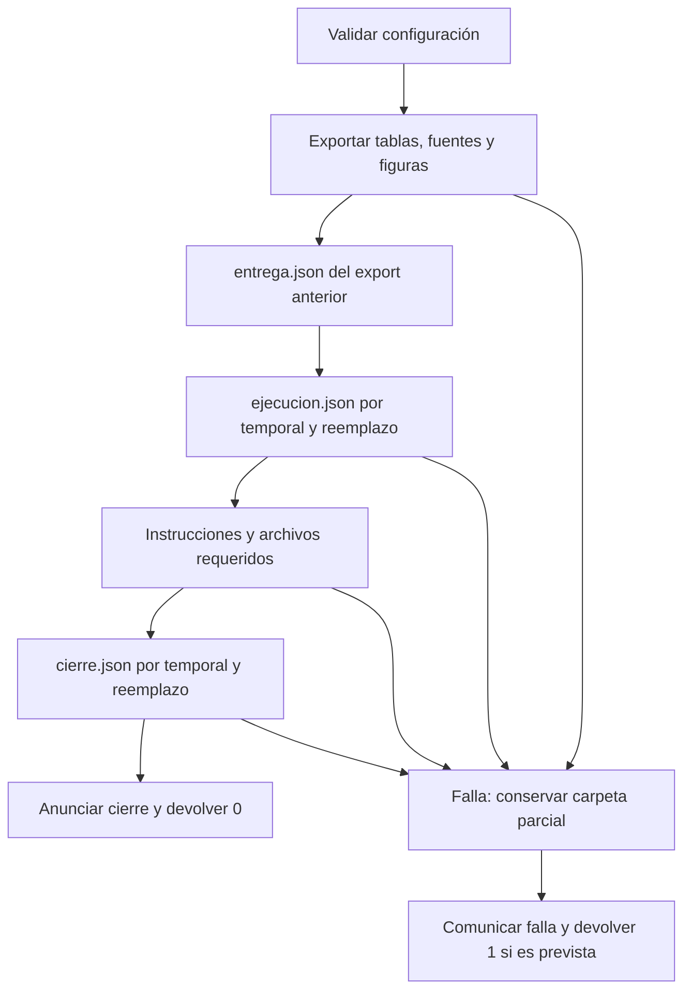

# 05.03 — Errores y gestión de recursos

## Propósito y prerrequisitos

Detener un recorrido cuando ya no puede producir un resultado válido, explicar
la falla y liberar los recursos utilizados. Conservar fuentes y entregas previas,
y distinguir una carpeta parcial de una ejecución que alcanzó su cierre.

Completa [05.02 — Configuración y registro](../02_configuration_logging/README.md)
y su lab. Recupera [funciones de 01.04](../../01_python_foundations/04_functions/README.md),
[lectura CSV de 01.05](../../01_python_foundations/05_csv_files/README.md),
[validación de 01.06](../../01_python_foundations/06_validation_summary/README.md)
y [transacciones SQL de 03.08](../../03_sql_databases/08_transactions/README.md).
No necesitas nuevas dependencias, notebook ni una base SQLite persistente.

**Esencial:** excepciones específicas, propagación, with/finally y cierre de
recursos. **Práctica:** fallas controladas y escritura atómica de un archivo.
**Extensión:** excepciones propias y gestores personalizados; no bloquean avanzar.
La automatización de casos mediante unittest se desarrolla en 05.04.

## Objetivos observables

- Interpretar tipo, mensaje y recorrido de una excepción.
- Capturar solo errores para los que existe una respuesta definida.
- Propagar o añadir contexto sin convertir una falla en un resultado inventado.
- Cerrar archivos, conexiones y figuras cuando una operación falla.
- Conservar un JSON anterior si no se completa su reemplazo.
- Reconocer los límites de un cierre por etapas y documentar una carpeta parcial.

## 1. Una excepción no es una fila rechazada ni un saldo ausente

En las lecciones de calidad preservamos filas aceptadas/rechazadas con una
regla. En 05.02 una fecha válida sin registros producía una tabla vacía con
advertencia. Son resultados definidos por el análisis, no razones para inventar
una mediana o detener siempre el programa.

Una excepción interrumpe la operación que no pudo completarse: abrir una
fuente inexistente, convertir texto incompatible o escribir en un destino
que no puede recibir el archivo. El código posterior de ese bloque no se
ejecuta hasta encontrar un manejador apropiado; si no existe, la falla llega
a quien llamó y puede terminar el proceso.

| Situación | Respuesta definida en el recorrido |
| --- | --- |
| Saldo ausente en una fila válida | Conservar ausencia y explicar cobertura |
| Corte válido sin registros | Resumen vacío con bases no definidas |
| Fecha imposible | Rechazar configuración antes de exportar |
| Clave de crédito sin correspondencia | Detener análisis; la relación no es válida |
| Escritura fallida | Conservar carpeta parcial y no anunciar cierre |
| Nombre de variable equivocado | Corregir el código; no fabricar una tabla vacía |

También hay errores de sintaxis, detectados al interpretar código, por ejemplo
un `if` sin dos puntos. No se resuelven agregando un except alrededor del
análisis: primero el archivo debe poder interpretarse. El manejo de excepciones
no sustituye corregir el programa ni validar entradas.

## 2. Leer el tipo y seguir el recorrido

Prueba en una sesión de Python `int("pendiente")`. La última línea muestra
ValueError y un mensaje: la conversión no acepta ese texto. Las líneas
anteriores del traceback muestran las llamadas y lugares que llevaron a la
operación. Empieza por la causa y luego ubica tu función dentro del recorrido.

| Tipo | Qué puede representar aquí |
| --- | --- |
| ValueError | Fecha, dato o configuración con valor incompatible |
| FileNotFoundError | Fuente o metadato requerido no disponible |
| FileExistsError | Un destino reservado para una entrega nueva ya existe |
| PermissionError | El sistema no permite abrir/escribir el recurso |
| OSError | Familia de fallas del sistema de archivos/sistema operativo |
| TypeError / NameError | Uso incompatible o nombre no definido; puede ser un defecto de código |
| sqlite3.ProgrammingError | Consulta sobre una conexión ya cerrada, en la demostración |

FileNotFoundError, FileExistsError y PermissionError pertenecen a la familia
OSError. Si capturas OSError primero, capturas también esos casos. Coloca antes
un caso específico cuando su respuesta sea distinta. No es necesario memorizar
una jerarquía completa: identifica qué operación protegiste y qué puedes hacer.

## 3. try, except, else y finally tienen tareas diferentes

Ejemplo pequeño que conserva un error de conversión:

```python
def convertir_saldo(texto):
    try:
        saldo = int(texto)
    except ValueError as exc:
        raise ValueError(f"Saldo entero inválido: {texto!r}") from exc
    else:
        return saldo
```

try protege la conversión. `except ValueError as exc` recibe la excepción
compatible y le asigna el nombre exc. else se ejecuta si ese try termina sin
excepción. `!r` muestra la representación del valor, útil para distinguir texto
vacío o espacios. Esta función demuestra conversión, no todas las reglas de
la cartera: aceptar un entero no basta para validar un saldo del contrato.

`raise ... from exc` añade contexto y conserva la causa original. El traceback
puede mostrar las dos excepciones. Un `raise` sin argumento dentro de except
propaga la misma falla sin reemplazarla. No necesitas un except en cada función:
puedes dejar que la falla llegue al consumidor que sabe comunicar el problema.

finally realiza una limpieza al abandonar el bloque, tanto por terminación
normal como por excepción. Por ejemplo, el guardado de la Figure de 05.01
usa `finally: plt.close(fig)`. Colocar un mensaje de éxito en finally sería
incorrecto: ese bloque también se ejecuta al fallar.

Evita devolver un resultado desde finally: puede reemplazar un retorno o
suprimir una excepción pendiente. Y no conviertas una excepción cualquiera
en cero, lista vacía o mensaje de éxito. Eso vuelve indistinguibles una base
realmente vacía y un cálculo que nunca pudo completarse.

## 4. Quién maneja el error y quién lo propaga

El paquete reutilizable no termina el intérprete con sys.exit. Devuelve un
resultado o propaga una excepción. La entrada de terminal traduce las fallas
previstas a un mensaje y un código de salida, como aprendimos en 05.02.

La nueva entrada, [ejecutar_seguro.py](../01_notebook_to_modules/ejecutar_seguro.py),
llama [cli_segura.py](../01_notebook_to_modules/analisis_cartera/cli_segura.py):

```python
try:
    tables = run_delivery(settings, origins, config_path, args.simulate_failure)
except (OSError, ValueError) as exc:
    LOGGER.error("Entrega sin cerrar; conservar y revisar %s: %s", settings["output"], exc)
    LOGGER.debug("Causa y recorrido de la falla", exc_info=True)
    return 1
```

Se responden fallas de archivos y datos previstas en este recorrido. DEBUG
permite ver traceback y causa mediante exc_info. Una excepción inesperada
como NameError no se convierte automáticamente en código 0: se propaga para
corregirla. Tampoco capturamos indiscriminadamente BaseException, que incluye
la interrupción de la persona y la salida del intérprete.

El bloque de configuración sigue terminando con 2 si las opciones o rutas
son inválidas; --help termina con 0 sin ejecutar. Una falla prevista durante
la entrega produce 1; el cierre normal produce 0. Con un umbral CRITICAL,
ERROR puede no verse: el código de salida sigue informando el fracaso.

Evitar except demasiado amplio no significa que ValueError siempre sea un
problema del usuario: también puede descubrir un defecto interno. Conserva el
recorrido de diagnóstico y revisa qué operación falló. Excepciones propias
pueden distinguir dominios cuando haya una necesidad concreta.

## 5. Un recurso abierto debe tener un responsable de cerrarlo

Un recurso es algo adquirido que requiere liberación: un archivo abierto,
una conexión, un temporal o una Figure. No dependas de que el intérprete
eventualmente lo retire, especialmente en un notebook de larga duración.

Para un archivo, reutilizamos with:

```python
with path.open(encoding="utf-8") as handle:
    data = json.load(handle)
```

Al salir de ese bloque, el gestor del archivo lo cierra, incluso si el JSON
no se puede interpretar. Si abrirlo ya falla, no hay un archivo abierto que
cerrar. El with de un archivo no arregla un JSON inválido ni conserva por sí
solo el contenido anterior de un destino abierto en modo escritura.

La demostración [recursos_demo.py](recursos_demo.py) convierte texto inválido
dentro de with y luego muestra `handle.closed == True`. Usa un temporal propio
dentro de una carpeta nueva; el gestor retira ese temporal al salir y conserva
la carpeta del ejercicio. No opera sobre las fuentes del análisis.

### SQLite: transacción y cierre son operaciones diferentes

El with de una conexión SQLite maneja confirmación/reversión de una transacción
cuando corresponde; **no cierra la conexión**. `contextlib.closing` llama close
al salir. El ejemplo usa una base en memoria y ambos gestores:

```python
with closing(sqlite3.connect(":memory:")) as connection:
    with connection:
        connection.execute("CREATE TABLE demo (valor INTEGER)")
        connection.execute("INSERT INTO demo VALUES (1)")
        raise ValueError("Falla didáctica dentro de la transacción")
```

El bloque interno atiende la transacción; el externo cierra la conexión incluso
con la excepción. No se afirma que todo DDL se revierta: recupera el control
de transacciones de 03.08. Aquí interesa comprobar que después la conexión
cerrada no admite consultas, sin modificar una base persistente.

Para figuras conservamos el try/finally de export en 05.01: cierra la Figure
que recibió después de crearla, sin cerrar figuras ajenas. Si una función
falla durante su propia creación de recursos, esa función también debe
atenderlos; no basta un finally situado después de una llamada que no retornó.

## 6. Por qué un archivo puede quedar truncado

Abrir un destino existente en modo `w` puede truncarlo antes de completar la
escritura. Si después falla la serialización, la escritura o el proceso, ya
no tienes necesariamente el JSON anterior ni un JSON nuevo completo. Cerrar
el archivo correctamente no restaura ese contenido.

Para reemplazar **un archivo**, [recursos.py](../01_notebook_to_modules/analisis_cartera/recursos.py)
implementa write_json_atomic:

1. Serializa el objeto antes de abrir archivos; rechaza valores no serializables
   y números JSON no finitos.
2. Crea un temporal único en la misma carpeta que el destino.
3. Escribe, hace flush y fsync, y cierra el temporal mediante with.
4. Reemplaza el destino mediante os.replace cuando el temporal está listo.
5. Retira el temporal propio al salir; una falla de limpieza se informa sin
   ocultar la falla principal.

flush entrega los datos pendientes del búfer de Python al sistema; fsync pide
sincronizar el archivo. La operación de reemplazo separa la escritura de la
visibilidad del nombre final. Mantener temporal y destino en la misma carpeta
evita intentar un movimiento entre sistemas de archivos. El cierre previo
también permite reemplazar el temporal en Windows.

Si falla antes de replace, el archivo anterior conserva su contenido. Si el
reemplazo termina, el destino contiene el nuevo JSON. La atomicidad se refiere
a la operación de reemplazo admitida por el sistema de archivos, no a todas
las instrucciones del programa. No garantiza persistencia total ante pérdida
de energía: este ejemplo no sincroniza el directorio ni controla el almacenamiento.
Una terminación abrupta puede dejar el temporal porque finally no llegó a ejecutarse.

La función **reemplaza deliberadamente** un destino anterior cuando tiene éxito.
No ofrece exclusión entre escritores concurrentes ni una regla de no sobrescribir.
En el flujo del curso, la carpeta nueva impide reutilizar una entrega anterior;
la demostración de JSON permite observar un reemplazo sobre un archivo propio.

### Demostración de conservación del JSON anterior

En una sesión de Python iniciada en 01_notebook_to_modules:

```python
from pathlib import Path
from analisis_cartera.recursos import write_json_atomic, read_json

folder = Path("../03_errors_resources/output/json_demo")
folder.mkdir(parents=True, exist_ok=False)
target = folder / "estado.json"
write_json_atomic(target, {"version": 1})
try:
    write_json_atomic(target, {"version": 2}, simulate_failure=True)
except OSError as exc:
    print(exc)
print(read_json(target))
write_json_atomic(target, {"version": 2})
print(read_json(target))
```

Después de la falla se conserva `{"version": 1}`; después del reemplazo normal,
`{"version": 2}`. simulate_failure es una ayuda didáctica que provoca OSError
después de escribir/cerrar el temporal y antes de reemplazar. No requiere
cambiar permisos ni llenar el disco. Omítela en el recorrido normal.

## 7. Cerrar una entrega que se construye por etapas

Conservamos los consumidores de 05.01/05.02. La entrada de 05.03 reutiliza el
mismo export y agrega [cierre.py](../01_notebook_to_modules/analisis_cartera/cierre.py).
No se copiaron transformaciones ni se ajusta sys.path.



Sin renderizador: se validan opciones, se llama export y luego se guarda el
registro. Solo después de comprobar archivos requeridos se escribe cierre.json
y se anuncia finalización. Una falla evita alcanzar ese cierre y conserva lo
que ya se produjo para poder revisar la causa. No elimina ni reinicia la carpeta.

| Archivo/estado | Qué acredita en el consumidor de 05.03 |
| --- | --- |
| Sin carpeta | No hay una entrega creada allí |
| Carpeta sin cierre.json | No alcanzó el cierre de esta entrada |
| entrega.json | Export anterior alcanzó su metadato final |
| ejecucion.json | Se guardó el contexto de esta ejecución |
| cierre.json válido y archivos requeridos presentes | Se alcanzaron las etapas de cierre |

inspect_delivery(output) distingue sin_iniciar, incompleta y completada.
Lee el cierre y comprueba la presencia de los archivos requeridos; no vuelve
a conciliar tablas ni detecta cualquier modificación posterior de su contenido.
Un marcador solo no prueba integridad, legibilidad, interpretación o aprendizaje.
Una entrega completada sigue necesitando la revisión del receptor.

La carpeta completa **no es una transacción**. CSV, figuras e informe siguen
guardándose por etapas como en 05.01. El JSON atómico reduce el riesgo de un
registro final truncado; no vuelve atómicos esos archivos ni elimina resultados
parciales. Copiar toda la entrega, verificar sus tablas y revisar su cierre
es parte de recibirla. Recuperación automática y concurrencia quedan fuera
de esta sección.

## 8. Ejecutar, provocar una falla y volver a intentar

Desde la raíz, activa el entorno elegido y realiza el recorrido completo de
un solo shell. Los destinos deben ser nuevos; si existen, cambia sus nombres.
Las simulaciones son fallas controladas del ejemplo, no fallas del equipo.

### PowerShell

```powershell
$safeEntry = "curriculum/05_python_applied/01_notebook_to_modules/ejecutar_seguro.py"
$lessonRoot = "curriculum/05_python_applied/03_errors_resources"
python $safeEntry --help
python $safeEntry --output "$lessonRoot/output/normal"
$LASTEXITCODE
python $safeEntry --output "$lessonRoot/output/falla_registro" --simulate-failure record --log-level DEBUG
$LASTEXITCODE
python $safeEntry --output "$lessonRoot/output/falla_cierre" --simulate-failure before-close
$LASTEXITCODE
python "$lessonRoot/recursos_demo.py" --output "$lessonRoot/output/recursos"
python $safeEntry --source "$lessonRoot/output/normal/fuentes" --output "$lessonRoot/output/reconstruccion" --cut 2026-10-31 --dpi 160
$LASTEXITCODE
```

### Bash/Zsh

```bash
safe_entry="curriculum/05_python_applied/01_notebook_to_modules/ejecutar_seguro.py"
lesson_root="curriculum/05_python_applied/03_errors_resources"
python "$safe_entry" --help
python "$safe_entry" --output "$lesson_root/output/normal"
echo $?
python "$safe_entry" --output "$lesson_root/output/falla_registro" --simulate-failure record --log-level DEBUG
echo $?
python "$safe_entry" --output "$lesson_root/output/falla_cierre" --simulate-failure before-close
echo $?
python "$lesson_root/recursos_demo.py" --output "$lesson_root/output/recursos"
python "$safe_entry" --source "$lesson_root/output/normal/fuentes" --output "$lesson_root/output/reconstruccion" --cut 2026-10-31 --dpi 160
echo $?
```

### Anaconda Prompt (CMD)

```bat
set "safe_entry=curriculum/05_python_applied/01_notebook_to_modules/ejecutar_seguro.py"
set "lesson_root=curriculum/05_python_applied/03_errors_resources"
python "%safe_entry%" --help
python "%safe_entry%" --output "%lesson_root%/output/normal"
echo %ERRORLEVEL%
python "%safe_entry%" --output "%lesson_root%/output/falla_registro" --simulate-failure record --log-level DEBUG
echo %ERRORLEVEL%
python "%safe_entry%" --output "%lesson_root%/output/falla_cierre" --simulate-failure before-close
echo %ERRORLEVEL%
python "%lesson_root%/recursos_demo.py" --output "%lesson_root%/output/recursos"
python "%safe_entry%" --source "%lesson_root%/output/normal/fuentes" --output "%lesson_root%/output/reconstruccion" --cut 2026-10-31 --dpi 160
echo %ERRORLEVEL%
```

Con uv, desde la raíz usa
`uv run --locked python curriculum/05_python_applied/01_notebook_to_modules/ejecutar_seguro.py --output curriculum/05_python_applied/03_errors_resources/output/normal`.
No mezcles gestores ni agregues dependencias para este recorrido.

También puedes usar --config con septiembre.json/octubre.json de 05.02 y
--output nuevo para esta lección. Desde 01_notebook_to_modules,
`python -m analisis_cartera.cli_segura` admite las mismas opciones. Lee el
código inmediatamente después del comando, como en 05.02. Las simulaciones
record y before-close deben terminar con 1; normal y reconstrucción, con 0.

## 9. Qué revisar en cada carpeta

En la normal se conservan 24 registros, 21 conocidos, mediana global 2300 MXN,
cobertura 87,5 % y 20 conciliaciones. El saldo cero participa y educación
conserva mediana ausente, cobertura 0 % y tres registros. Las figuras y tablas
deben coincidir con 05.01/05.02 sobre las mismas fuentes, corte y resolución.
El HTML básico requiere conexión; las ampliaciones de 04.08/04.09 se conservan.

| Simulación | Archivos que pueden estar ya presentes | Qué falta para cerrar |
| --- | --- | --- |
| after-export | Datos, figuras y entrega.json | Registro, instrucciones nuevas y cierre |
| record | Lo anterior; temporal propio retirado al atender la falla | ejecucion.json y cierre |
| before-close | También ejecucion.json e instrucciones nuevas | cierre.json |

El dato parcial no necesariamente está equivocado; lo que falta es completar
el procedimiento de entrega. No copies cierre.json de otra carpeta ni conviertas
la falla en una ejecución completada editando el marcador. Reintenta con una
carpeta nueva después de comprender la causa y conserva la anterior como evidencia.

Si el temporal propio no puede retirarse, se informa la limpieza pendiente sin
ocultar la causa original. Examina la ruta y retíralo solo después de confirmar
su origen; no borres temporales ajenos. Una interrupción abrupta no garantiza
ejecutar finally, y un marcador final no evita daños posteriores a los archivos.

## Extensión: excepciones propias y gestores personalizados

Una excepción específica del dominio puede expresar, por ejemplo, que una
entrega no pasó su contrato, diferenciándola de otros ValueError. Definirla
requiere una clase que derive de Exception. Puedes repasar objetos y composición
en [05.06 — Clases, composición y dataclasses](../06_classes_composition/README.md),
una ampliación opcional. La herencia de excepciones es una profundización
adicional; no hace falta envolver cada error ni ocultar su causa.

Un gestor propio permite adquirir/liberar un recurso con un contrato definido.
contextlib.contextmanager utiliza una función generadora y un decorador: esos
conceptos se desarrollarán en 05.07/05.08. Reutilizar with y closing basta aquí.
No crear gestores propios es una decisión de alcance, no un bloqueo para avanzar.

## Práctica, criterio de salida y continuidad

Realiza el [lab 05.03](../../../labs/05_python_applied/03_errors_resources/README.md).
Conserva entregas normal/parciales/reconstruida, comparación de tablas y notas
que identifiquen etapa, causa, recursos liberados y siguiente intento. Registra
tu explicación y evidencia en PROGRESS.md; todavía no hay proyecto/checkpoint
implementado asociado.

Puedes avanzar cuando distingas error de dato ausente, expliques qué se captura
y qué se propaga, compruebes cierre de recursos y conservación del JSON anterior,
y reconozcas los límites del marcador final y de la escritura atómica.

Continúa con [05.04 — Pruebas de código y datos](../04_testing/README.md),
con casos conocidos y una colección unittest sobre el mismo paquete. Volver al [índice de Python aplicado](../README.md).

## Referencias y atribución

Ejemplos propios de DS Track; análisis/figuras conservados de 05.01, configuración
de 05.02 y referencia independiente de 04.09. Documentación consultada el
2026-10-14 para Python 3.11. Verificación con Python 3.12.12, pandas 2.3.3,
Matplotlib 3.10.7 y Altair 6.3.0; sin nuevas dependencias ni ejemplos copiados.

- [Python: errores, excepciones, encadenamiento y limpieza](https://docs.python.org/3.11/tutorial/errors.html).
- [Python: excepciones incorporadas](https://docs.python.org/3.11/library/exceptions.html).
- [Python: with y finally](https://docs.python.org/3.11/reference/compound_stmts.html).
- [Python: archivos temporales](https://docs.python.org/3.11/library/tempfile.html).
- [Python: os.replace y fsync](https://docs.python.org/3.11/library/os.html).
- [Python: búferes y flush](https://docs.python.org/3.11/library/io.html#io.IOBase.flush).
- [Python: closing y gestores de contexto](https://docs.python.org/3.11/library/contextlib.html).
- [Python: gestor de conexión SQLite](https://docs.python.org/3.11/library/sqlite3.html#how-to-use-the-connection-context-manager).
