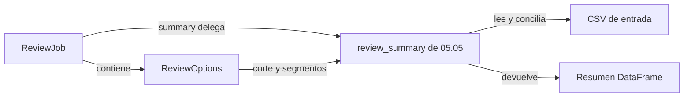

# 05.06 — Clases, composición y dataclasses

## Propósito y prerrequisitos

Representar datos relacionados y sus operaciones cuando una estructura propia
ayude a entender el programa. Aprenderemos a leer y crear objetos pequeños;
también a justificar cuándo una función o un diccionario bastan.

Esta sección es **práctica opcional**. Completa primero
[05.05 — Tipos y contratos](../05_types_contracts/README.md) y su lab.
Recupera [diccionarios de 01.02](../../01_python_foundations/02_lists_dicts/README.md),
[funciones de 01.04](../../01_python_foundations/04_functions/README.md) y
[pruebas de 05.04](../04_testing/README.md). Reutilizaremos el paquete de
[05.01](../01_notebook_to_modules/README.md), conservando sus consumidores.

**Base de esta ampliación:** clase, instancia, atributos, métodos y self.
**Práctica:** estado propio/compartido, dataclass, validación y composición.
**Extensión:** fábricas de valores y límites de frozen. Diseñar jerarquías,
propiedades, metaclases o patrones avanzados queda para una necesidad posterior.
No exige paquetes nuevos ni bloquea el cierre esencial de Python aplicado.

## Objetivos observables

- Comparar una función, un diccionario y un objeto para una necesidad concreta.
- Explicar cómo se inicializa una instancia y cómo un método recibe self.
- Distinguir dos instancias de dos nombres que apuntan al mismo objeto.
- Crear una dataclass con campos y validaciones explícitas.
- Componer una solicitud con sus opciones sin copiar el algoritmo del análisis.
- Comprobar conservación de fuentes, resultados, ausencias y configuración.

## 1. Elegir una representación antes de escribir class

Queremos calcular la cobertura de dos conocidos sobre tres registros.
Ya tenemos la función comprobada coverage_pct:

```python
from analisis_cartera.contratos import coverage_pct

print(coverage_pct(2, 3))
counts = {"known": 2, "total": 3}
print(coverage_pct(counts["known"], counts["total"]))
```

Ambas llamadas producen aproximadamente 66,6667 %. La función basta para
una operación aislada. El diccionario reúne datos con claves; puede ser útil
para una estructura flexible o una entrada leída desde JSON. Debemos comprobar
sus claves y valores: escribir `counts["knwon"]` provoca KeyError.

Una clase puede reunir datos con operaciones que tienen sentido para ese tipo
de objeto. Añade nombres y responsabilidades, pero también código que hay que
entender y mantener. No vuelve más correcto un cálculo por el hecho de usarla.

| Necesidad | Elección razonable | Pregunta para justificarla |
| --- | --- | --- |
| Calcular una cobertura aislada | Función | ¿Necesito conservar un objeto después? |
| Recibir un objeto JSON con claves variables | Diccionario y validación | ¿Las claves pueden variar entre entradas? |
| Conservar opciones con campos estables | dataclass | ¿Los campos forman un concepto que reutilizo? |
| Reunir estado y operaciones relacionadas | Clase pequeña | ¿Se entiende qué representa y de qué es responsable? |
| Transformar miles de filas tabulares | Funciones de pandas ya conocidas | ¿Aporta algo envolver cada fila o tabla? |

En este material los DataFrames siguen siendo tablas. Los objetos nuevos
representan conteos y opciones de revisión, no un reemplazo de pandas.

## 2. Una clase manual pequeña

Abre [objetos.py](../01_notebook_to_modules/analisis_cartera/objetos.py).
La primera clase del archivo contiene este comportamiento:

```python
class CoverageCounts:
    def __init__(self, known: int, total: int) -> None:
        coverage_pct(known, total)
        self.known = known
        self.total = total

    def percentage(self) -> float | None:
        return coverage_pct(self.known, self.total)
```

`class CoverageCounts:` define un tipo propio. La indentación indica qué
funciones pertenecen a esa clase. El nombre describe conteos de cobertura.
Definir la clase no crea todavía una pareja concreta de conteos.

```python
from analisis_cartera.objetos import CoverageCounts

counts = CoverageCounts(2, 3)
print(counts.known)          # 2
print(counts.total)          # 3
print(counts.percentage())   # aproximadamente 66,6667
```

`CoverageCounts(2, 3)` crea una **instancia**. Python prepara un nuevo objeto
y llama a su inicializador `__init__`; no necesitamos estudiar __new__ aquí.
`__init__` recibe los argumentos, comprueba los conteos con la función de 05.05
y establece atributos en esa instancia. Debe devolver None; no devuelvas self.

Un **atributo** es un dato accesible mediante el punto, como counts.known.
Un **método** es una operación vinculada al objeto, como counts.percentage().
El punto permite encontrar el nombre; los paréntesis ejecutan la operación.
Un nombre mal escrito también puede producir un error en una clase, por ejemplo
AttributeError. La ventaja es reunir un concepto y su interfaz, no eliminar
la necesidad de revisar nombres, tipos y reglas.

## 3. self, parámetros y atributos no son el mismo nombre

En `self.known = known`, el nombre de la derecha es el parámetro de esta llamada;
el de la izquierda queda guardado en el objeto. self representa la instancia
actual. Es una convención de nombre que seguimos de forma uniforme.

Al llamar `counts.percentage()`, Python proporciona counts como self. Para esta
clase, también podríamos escribir `CoverageCounts.percentage(counts)`; la forma
con el objeto y el punto es la habitual. No debes pasar counts dos veces.

```python
first = CoverageCounts(2, 3)
second = CoverageCounts(0, 3)
print(first.percentage())    # aproximadamente 66,6667
print(second.percentage())   # 0.0
```

Es la misma receta con dos estados distintos. La clase no contiene “el último
conteo usado”; cada instancia guarda sus propios atributos porque asignamos
`self.known` y `self.total` dentro del inicializador.

Ahora puedes releer las pruebas de 05.04: la clase hereda de unittest.TestCase,
sus métodos reciben self y setUp prepara atributos para cada caso. Allí usamos
la interfaz de un framework; aquí estamos diseñando un objeto del problema.

## 4. Estado mutable, alias y resultados que se vuelven obsoletos

Los atributos de CoverageCounts son públicos y pueden reasignarse:

```python
first = CoverageCounts(2, 3)
alias = first
second = CoverageCounts(2, 3)
alias.known = 1
print(first.known)       # 1: alias y first nombran el mismo objeto
print(second.known)      # 2: second es otra instancia
```

Asignar `alias = first` no copia el objeto. Cambiarlo mediante cualquiera de
esos nombres se observa desde el otro. `first is alias` pregunta por identidad;
`==` compara según la regla de igualdad del tipo. Para esta clase manual no
definimos igualdad por campos: dos instancias distintas conservan la comparación
por identidad que heredan de object. No uses == como sustituto universal de is.

Validar solo al construir tampoco protege todos los cambios posteriores:
`alias.known = 4` deja el estado fuera de 0 <= known <= total. El método
percentage vuelve a llamar coverage_pct y rechaza ese estado con ValueError.
La instancia mutable no garantiza ser válida en todo momento.

No almacenamos además un atributo percentage_result: cambiar known dejaría ese
resultado desactualizado si nadie lo recalcula. El método deriva el porcentaje
desde el estado actual. La función sigue siendo la responsable de la regla.

## 5. Atributos de clase y de instancia: cuidado con las listas compartidas

Este ejemplo independiente muestra un error frecuente:

```python
class SharedNotes:
    notes = []

a = SharedNotes()
b = SharedNotes()
a.notes.append("revisar base")
print(b.notes)  # ['revisar base']
```

notes se creó en el cuerpo de la clase. Como ninguna instancia tiene todavía
un atributo propio de ese nombre, ambas encuentran la misma lista de la clase.
append modifica esa lista; no crea una lista distinta para a.

Para notas propias por instancia, créalas al inicializar:

```python
class OwnNotes:
    def __init__(self) -> None:
        self.notes = []

a = OwnNotes()
b = OwnNotes()
a.notes.append("revisar base")
print(b.notes)  # []
```

Los dos ejemplos se pueden ejecutar por separado. Un atributo de clase puede
ser apropiado para información compartida intencionalmente; una lista de trabajo
individual debe pertenecer a la instancia. Nombres con un guion bajo inicial
indican uso interno por convención, pero no hacen al dato inaccesible ni inmutable.

## 6. Cuando el trabajo repetido son los campos: dataclass

Ahora queremos conservar opciones con nombres estables: corte y segmentos.
Podemos escribir a mano el inicializador, la representación y la igualdad.
La biblioteca estándar ofrece dataclass para generar parte de ese trabajo.

Ejemplo introductorio, deliberadamente sin validación:

```python
from dataclasses import dataclass

@dataclass
class SimpleOptions:
    cut: str = "2026-10-31"

first = SimpleOptions()
second = SimpleOptions(cut="2026-10-31")
print(first)              # SimpleOptions(cut='2026-10-31')
print(first == second)    # True: compara sus campos
print(first is second)    # False: son dos objetos
```

`@dataclass` usa un decorador existente: recibe la clase y agrega comportamiento
según sus campos. Aprender a crear decoradores propios pertenece a 05.08 y no
es requisito para usar este. En la configuración habitual se generan __init__,
__repr__ y __eq__, entre otros detalles; no necesitas escribir esos métodos ahora.
__repr__ produce una representación útil para inspeccionar; __eq__ define ==.

Las anotaciones identifican campos, pero no validan sus valores. En el ejemplo,
`SimpleOptions(cut=31)` se construye aunque incumpla str. La lección de contratos
sigue vigente: la validación se programa explícitamente. Una dataclass es una
clase con ayuda para representar datos, no un lector de CSV ni un esquema tabular.

## 7. ReviewOptions: campos con reglas explícitas

La dataclass real del paquete empieza así; consulta el archivo para ver el
cuerpo de validación completo:

```python
@dataclass(frozen=True)
class ReviewOptions:
    cut: str = DEFAULT_CUT
    segments: tuple[str, ...] | None = None
```

DEFAULT_CUT es la constante "2026-10-31" ya conocida. `tuple[str, ...]` describe
una tupla de longitud variable con elementos de texto; no es la tupla de dos
tablas con posiciones fijas que devuelve summarize. Una tupla de un elemento
se escribe `("comercio",)` con coma. `()` es la tupla vacía.

| Campo | Regla |
| --- | --- |
| cut | Texto con fecha válida YYYY-MM-DD; predeterminado fijo, no fecha actual |
| segments=None | Todos los grupos |
| segments=() | Ningún grupo, conservando lectura y validación |
| Tupla explícita | Nombres únicos del catálogo, en el orden solicitado |

La clase define `__post_init__(self) -> None`. El __init__ generado establece
los campos y después llama ese método; allí comprobamos tipos, fecha, catálogo
y duplicados. No lo llamas manualmente para que una instancia recién creada
sea válida. No definimos un __init__ propio en estas dataclasses.

```python
from analisis_cartera.objetos import ReviewOptions

options = ReviewOptions(segments=("educacion", "comercio"))
print(options.cut)       # 2026-10-31
print(options.segments)  # ('educacion', 'comercio')
```

Aquí cut=None y segments=["comercio"] se rechazan con TypeError. Es una
interfaz de configuración que exige corte explícito como texto y selección
inmutable como tupla. La función review_summary de 05.05 conserva su interfaz
anterior, que sí admite cut=None y selección como lista. El objeto adaptará
su tupla a esa lista al delegar; no cambiamos los consumidores anteriores.

## 8. frozen, replace y el contenido de los campos

Con frozen=True, una asignación normal como
`options.cut = "2026-09-30"` lanza FrozenInstanceError. Para preparar una
variación sin alterar la configuración anterior, usamos replace:

```python
from dataclasses import replace

original = ReviewOptions(segments=("comercio",))
september = replace(original, cut="2026-09-30")
print(original.cut)    # 2026-10-31
print(september.cut)   # 2026-09-30
```

replace construye otra instancia y vuelve a pasar por __post_init__.
Una fecha o selección inválida también se rechaza en esa nueva construcción.
No es una modificación silenciosa del original ni una copia recursiva de todo
objeto contenido. Los campos no cambiados se reutilizan.

frozen limita la reasignación de atributos; no congela automáticamente una lista
guardada en ellos. Este ejemplo muestra ese límite y una fábrica de valores:

```python
from dataclasses import dataclass, field

@dataclass(frozen=True)
class Notes:
    labels: list[str] = field(default_factory=list)

a = Notes()
b = Notes()
a.labels.append("revisar")
print(a.labels)  # ['revisar']: se modificó la lista interior
print(b.labels)  # []: cada instancia recibió su propia lista
```

`field(default_factory=list)` pide crear una lista cuando se necesite el valor
predeterminado. Se pasa list sin paréntesis para que se llame entonces.
No uses `labels: list[str] = []`: dataclasses rechaza ese predeterminado mutable.
La fábrica evita compartirlo; no vuelve inmutable a la lista.

ReviewOptions combina frozen con campos de texto, None o tuplas de textos
validados. No guarda listas ni DataFrames. Esto permite reutilizar opciones
sin que una selección exterior cambie por append. No generalices esa propiedad
a una dataclass que contenga otros objetos mutables.

## 9. Composición: una solicitud contiene sus opciones

ReviewJob representa una revisión que se puede ejecutar. Contiene una fuente
y una instancia de ReviewOptions. Esa relación se llama **composición**:



Sin renderizador: una solicitud guarda ruta/opciones; al pedir summary, entrega
esos parámetros a la función ya comprobada. La función lee y concilia antes de
devolver la tabla. La solicitud no guarda las filas ni una conexión abierta.

En objetos.py, ReviewJob usa otra dataclass con frozen y estos campos:

```python
source: str | Path
options: ReviewOptions = field(default_factory=ReviewOptions)
```

La fuente es obligatoria. La fábrica crea opciones por defecto cuando no se
proporcionan. Si pasas options, el trabajo conserva esa referencia; no duplica
automáticamente el objeto. Compartir estas opciones validadas de solo lectura
es intencional. No hay listas de trabajo ocultas entre solicitudes.

Su método summary convierte la tupla en lista y llama review_summary.
Conserva el significado de None frente a tupla vacía. En particular, no usa
`segments or None`, que confundiría () con pedir todos los grupos.

ReviewJob **contiene** ReviewOptions; no necesita heredar de ella.
La herencia define un tipo a partir de otro y resulta útil en interfaces como
TestCase; una fuente de datos y sus opciones no requieren esa relación.
Para esta necesidad basta composición con funciones existentes.

## 10. Construir un objeto no ejecuta el análisis

```python
from pathlib import Path
from analisis_cartera.objetos import ReviewJob, ReviewOptions

source = Path("../../03_sql_databases/01_relational_sqlite/data")
job = ReviewJob(source, ReviewOptions(segments=("educacion", "comercio")))
summary = job.summary()
```

Este ejemplo supone una sesión en 01_notebook_to_modules. La construcción
comprueba la forma de ruta/opciones, sin abrir CSV ni crear carpetas. summary()
ejecuta la lectura y la conciliación, y puede lanzar los errores de la función
de 05.05. Una ruta puede dejar de existir o sus archivos cambiar después de
construir job; la validación de datos ocurre al usarlos.

Las rutas relativas se interpretan desde el directorio de trabajo **al ejecutar
summary**, como en la función anterior. Si necesitas conservar una referencia
absoluta al crear el trabajo, prepara antes `source.resolve()` de forma explícita.
No prometemos que frozen conserve el contenido de los archivos externos.

Cada llamada relee y devuelve una tabla nueva: job no es una caché. Cambiar
la tabla recibida no cambia las opciones ni el resultado de la próxima lectura
de una fuente intacta. La selección de segmentos conserva medianas/cobertura
de cada grupo; no recalcula un total global a partir de lo mostrado.

La clase organiza una solicitud reutilizable; la función mantiene el cálculo.
Cuando solo necesitas una revisión, llamar review_summary directamente sigue
siendo una opción clara. Para aprender esta alternativa no reescribimos CLI,
notebook, lectores ni exportadores anteriores.

## 11. Ejecutar y comprobar

Usa el entorno elegido en [00.05](../../00_getting_started/05_environment/README.md)
con las dependencias existentes. El módulo dataclasses pertenece a Python.
Los recorridos empiezan en la raíz de DS Track con ese entorno activo.

### PowerShell

```powershell
python -c "import sys, pandas, matplotlib, altair; print(sys.executable); print(pandas.__version__, matplotlib.__version__, altair.__version__)"
Set-Location curriculum/05_python_applied/01_notebook_to_modules
python ejecutar_objetos.py
$LASTEXITCODE
python -m unittest discover -s pruebas_0506 -t . -p "test_*.py" -v
$LASTEXITCODE
python -m unittest discover -s pruebas_0505 -t . -p "test_*.py" -v
$LASTEXITCODE
python -m unittest discover -s pruebas_0504 -t . -p "test_*.py" -v
$LASTEXITCODE
Set-Location ../../..
```

### Bash/Zsh

```bash
python -c "import sys, pandas, matplotlib, altair; print(sys.executable); print(pandas.__version__, matplotlib.__version__, altair.__version__)"
cd curriculum/05_python_applied/01_notebook_to_modules
python ejecutar_objetos.py
echo $?
python -m unittest discover -s pruebas_0506 -t . -p 'test_*.py' -v
echo $?
python -m unittest discover -s pruebas_0505 -t . -p 'test_*.py' -v
echo $?
python -m unittest discover -s pruebas_0504 -t . -p 'test_*.py' -v
echo $?
cd ../../..
```

### CMD / Anaconda Prompt

```bat
python -c "import sys, pandas, matplotlib, altair; print(sys.executable); print(pandas.__version__, matplotlib.__version__, altair.__version__)"
cd curriculum\05_python_applied\01_notebook_to_modules
python ejecutar_objetos.py
echo %ERRORLEVEL%
python -m unittest discover -s pruebas_0506 -t . -p "test_*.py" -v
echo %ERRORLEVEL%
python -m unittest discover -s pruebas_0505 -t . -p "test_*.py" -v
echo %ERRORLEVEL%
python -m unittest discover -s pruebas_0504 -t . -p "test_*.py" -v
echo %ERRORLEVEL%
cd ..\..\..
```

El [script](../01_notebook_to_modules/ejecutar_objetos.py) muestra aproximadamente
66,6667 con función/clase, opciones legibles, igualdad True y reasignación
bloqueada. Con los CSV originales: educación 3 registros/0 conocidos sin mediana,
comercio 5/5 con mediana 3100 MXN. La tupla vacía produce forma (0, 8) y las
opciones originales conservan educación/comercio. No exporta entregas.

La colección de 05.06 tiene **13 métodos**; las de 05.05 y 05.04 conservan sus
**12 y 21**. Todas terminan con OK y código 0. Si agregaste los ejercicios
anteriores, habrá un método más en cada colección correspondiente; conserva
tu trabajo. Cero pruebas descubiertas no cumple la comprobación.

Las pruebas nuevas usan la fixture de seis observaciones de 05.04. Allí
comercio tiene 3 registros/2 conocidos y mediana 0,5, y servicios no tiene filas.
Comprueban alias, estado inválido, opciones, replace, composición, fuentes
intactas, relectura, vacíos y equivalencia con review_summary. El lab incorpora
otro caso de variación para comparar septiembre y octubre.

## Práctica, criterio de salida y continuidad

Realiza el [lab 05.06](../../../labs/05_python_applied/06_classes_composition/README.md).
Puedes cerrar esta ampliación cuando expliques self/estado, elijas una
representación con una razón concreta y compruebes que la composición conserva
resultados. No hay proyecto/checkpoint implementado asociado. Registra evidencia
y dudas en PROGRESS.md; material disponible no acredita aprendizaje.

Si sigues las ampliaciones, continúa con el
[05.07 — Iteradores y generadores](../07_iterators_generators/README.md),
disponible como extensión con consumo, lotes y conciliación. El [cierre 05.11](../11_project_closure/README.md)
está disponible con lab. Las ampliaciones 05.06–05.10 no bloquean el núcleo ni R.
Volver al [índice de Python aplicado](../README.md).

## Referencias y atribución

Ejemplos propios de DS Track sobre las funciones y datos de 05.01–05.05.
Consulta de documentación primaria: 2026-10-15. Sintaxis compatible con Python
3.11; comprobación local con Python 3.12.12 y el entorno existente de pandas
2.3.3, Matplotlib 3.10.7 y Altair 6.3.0. Sin dependencias nuevas ni ejemplos
copiados de las fuentes.

- [Python: clases, atributos, métodos y estado compartido](https://docs.python.org/3.11/tutorial/classes.html).
- [Python: dataclasses](https://docs.python.org/3.11/library/dataclasses.html), campos y métodos generados.
- [Python: inicialización posterior](https://docs.python.org/3.11/library/dataclasses.html#post-init-processing).
- [Python: instancias frozen](https://docs.python.org/3.11/library/dataclasses.html#frozen-instances).
- [Python: fábricas de valores](https://docs.python.org/3.11/library/dataclasses.html#default-factory-functions).
- [Python: dataclasses.replace](https://docs.python.org/3.11/library/dataclasses.html#dataclasses.replace).
- [Python: isinstance](https://docs.python.org/3.11/library/functions.html#isinstance).
