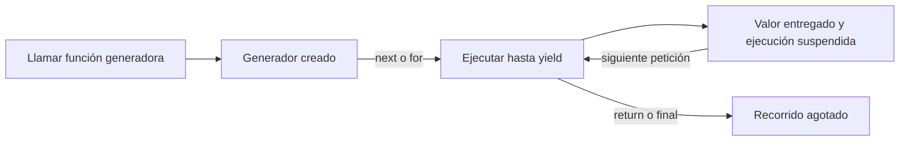

# 05.07 — Iteradores y generadores

[Inicio](../../../README.md) / [Módulo 05](../README.md) / **Lección 05.07**

| Tu sesión | Qué prepararás o comprobarás |
| --- | --- |
| **Meta** | Consumir registros por lotes conservando el último y sus indicadores |
| **Necesitas** | Contratos y recursos anteriores; ampliación opcional |
| **Evidencia** | Lotes conciliados y explicación de consumo, errores y memoria |

[Preparación](#antes-de-empezar) · [Material de apoyo](#material-de-apoyo) · [Ir al lab](../../../labs/05_python_applied/07_iterators_generators/README.md) · [Comprobar](#evidencia-y-criterio-de-salida)

> **Ampliación opcional:** si no eliges esta práctica, puedes ir al
> [05.11 — Cierre del proyecto Python](../11_project_closure/README.md),
> después de completar el núcleo 05.01–05.05.

<a id="propósito-y-prerrequisitos"></a>

## Propósito

Consumir una secuencia paso a paso, agrupar registros en lotes y comprobar que
el cambio de recorrido conserva los indicadores. Aprenderemos qué se ejecuta
al pedir el siguiente elemento, qué ocurre al agotar el recorrido y qué datos
permanecen en memoria.

## Antes de empezar

Esta sección es una **extensión opcional**. Completa
[05.05 — Tipos y contratos](../05_types_contracts/README.md) y recupera
[ciclos de 01.03](../../01_python_foundations/03_conditions_loops/README.md),
[CSV de 01.05](../../01_python_foundations/05_csv_files/README.md),
[recursos de 05.03](../03_errors_resources/README.md) y
[pruebas de 05.04](../04_testing/README.md). 05.06 está disponible, pero no necesitas
diseñar clases para crear los generadores de esta lección.

**Base de la extensión:** iterable, iterador, consumo, yield y agotamiento.
**Práctica:** último lote, CSV, validación y conciliación con lectura completa.
**Ampliación:** límites de memoria, errores tardíos y recursos con salida temprana.
No añadimos dependencias, grandes datasets ni una medición de rendimiento;
medir tiempo/memoria pertenece a 05.09.

<a id="objetivos-observables"></a>

## Qué vas a aprender

- Distinguir un objeto iterable de un iterador que ya avanzó.
- Usar iter, next y for sin perder ni volver a contar elementos.
- Explicar cuándo empieza y se reanuda una función con yield.
- Procesar lotes incluyendo el último, aunque esté incompleto.
- Conservar cero, ausencia, claves y resultados al recorrer los CSV por partes.
- Identificar quién cierra el archivo y qué estructuras impiden prometer memoria constante.

## Material de apoyo

| Recurso | Para qué sirve | Uso |
| --- | --- | --- |
| [Iteración compartida](../01_notebook_to_modules/analisis_cartera/iteracion.py) | Leer consumo y agrupación en lotes | Para el recorrido |
| [Ejecutor por lotes](../01_notebook_to_modules/ejecutar_lotes.py) | Contrastar con lectura completa | Para el recorrido |
| [Pruebas de iteración](../01_notebook_to_modules/pruebas_0507/) | Revisar agotamiento, fronteras y conciliación | Para el recorrido |

Abre los recursos cuando aparezcan en el recorrido. El paquete compartido vive
en 05.01 y se reutiliza sin copiar sus módulos; conserva las fuentes y entregas
anteriores. Lee las comprobaciones y los resultados esperados antes de ejecutar.

## 1. for ya utiliza el protocolo de iteración

En `for value in [10, 20, 30]`, Python obtiene un recorrido y pide sus valores
sucesivos. Conviene separar dos conceptos:

| Concepto | Pregunta | Ejemplo |
| --- | --- | --- |
| Iterable | ¿De este objeto puedo obtener un recorrido con iter? | Lista, range, archivo abierto, generador |
| Iterador | ¿Este recorrido entrega el siguiente valor con next? | iter(lista), lector CSV, generador |

Muchos iterables permiten obtener un recorrido nuevo cada vez; una lista es
un ejemplo. Sin embargo, un iterador también es iterable y suele ser de un solo
uso: obtener iter de él devuelve ese mismo recorrido. No deduzcas “se puede
reiniciar” solo por la palabra iterable.

```python
values = [10, 20, 30]
walk = iter(values)
print(next(walk))          # 10
print(next(walk))          # 20
print(list(walk))          # [30]: consume lo que queda
print(list(walk))          # []: ya está agotado
print(list(iter(values)))  # [10, 20, 30]: nuevo recorrido sobre la lista
```

Sin más valores, next lanza StopIteration. for reconoce ese fin normal y
termina el ciclo. `next(walk, "fin")` permite un valor alternativo al agotarse;
elige uno que no se confunda con un dato real. No trata cualquier excepción
como fin: una falla de lectura debe seguir siendo visible.

`range(5)` se puede recorrer varias veces y no guarda una lista con cinco
enteros; no es por sí mismo un iterador para next. `next(iter(range(5)))` sí
obtiene el primer valor. Para usar este protocolo no necesitas escribir tus
propios métodos __iter__ o __next__.

## 2. Dos nombres pueden compartir el avance

```python
walk = iter([1, 2, 3])
alias = walk
print(next(alias))       # 1
print(next(walk))        # 2
print(iter(walk) is walk)  # True
```

La asignación no copia ni reinicia el recorrido. Si inspeccionas un elemento
con next, el siguiente for empezará después de él. También list, sum, sorted
y otras operaciones pueden consumir un iterador; imprimirlo como objeto no
muestra necesariamente los datos que faltan.

Para repetir una lectura necesitas una fuente que permita crear otro recorrido:
por ejemplo, abrir de nuevo el CSV. Reabrir no garantiza una instantánea idéntica
si alguien cambió el archivo; conservar las fuentes sigue siendo parte del trabajo.

## 3. yield: producir un valor y suspender la función

```python
def squares(values):
    print("Empieza el recorrido")
    for value in values:
        yield value * value

walk = squares([2, 3])
print("Generador creado")
print(next(walk))
print(list(walk))
print(list(walk))
```

Resultado, en este orden:

```text
Generador creado
Empieza el recorrido
4
[9]
[]
```

La presencia de yield hace que squares sea una **función generadora**. Llamarla
crea un objeto generador; su cuerpo comienza al consumirlo. yield entrega un
valor y suspende la ejecución, conservando variables locales y posición.
La próxima petición continúa después de ese yield. Al llegar al final o a
un return sin valor, el recorrido termina.

No escribas `raise StopIteration` dentro de un generador para terminarlo;
usa return. Una StopIteration que escapa indebidamente del cuerpo se convierte
en RuntimeError. El consumidor for ya sabe reconocer el final normal.



Sin renderizador: crear → pedir → ejecutar/entregar → suspender → pedir otra
vez. Agotar ese objeto no lo vuelve a crear. Un generador no es otro hilo ni
significa que las tareas se ejecuten en paralelo.

## 4. Expresión generadora y materialización

```python
eager = [value * 2 for value in range(3)]
deferred = (value * 2 for value in range(3))
print(eager)           # [0, 2, 4]
print(next(deferred))  # 0
print(list(deferred))  # [2, 4]
```

Los corchetes construyen una lista; los paréntesis de la segunda línea crean
un recorrido generador. **Materializar** significa reunir resultados en una
estructura como list. Al hacer `list(deferred)` consumes el resto y lo guardas.
Si luego necesitas volver a recorrerlo, conserva esa lista o crea otro generador.

Esto no implica que toda expresión del generador se evalúe después: la expresión
iterable más externa se evalúa al crearlo; el trabajo que produce los valores
se va ejecutando al consumir. Evita atribuir a “diferido” una garantía sobre
cualquier efecto de la expresión completa.

Si values ya era una lista enorme, envolverla en un generador no libera esa
lista. Y `list(generador)` puede volver a reunir toda la entrada. Lo que importa
es el recorrido completo y sus objetos vivos, no solo una palabra de la sintaxis.

## 5. Agrupar en lotes sin perder el último

Abre [iteracion.py](../01_notebook_to_modules/analisis_cartera/iteracion.py).
iter_batches recibe un iterable y entrega listas de hasta size elementos:

```python
from analisis_cartera.iteracion import iter_batches

print(list(iter_batches([1, 2, 3, 4, 5], 2)))
# [[1, 2], [3, 4], [5]]
print(list(iter_batches([], 2)))  # []
```

Aquí list es apropiado porque el ejemplo es pequeño y queremos inspeccionarlo.
En el procesamiento de archivos consumimos un lote, lo procesamos y pedimos
el siguiente, sin guardar una lista de todos los lotes.

La función valida un size entero positivo, excluyendo bool; después utiliza
iter y `itertools.islice`. Este es el núcleo, con items y size ya recibidos:

```python
iterator = iter(items)
while True:
    batch = list(islice(iterator, size))
    if not batch:
        return
    yield batch
```

islice toma hasta size elementos del estado actual del iterador. list reúne
solo ese lote. Si no llegó ninguno, termina; si llegaron menos que size, se
entregan también. Cada lote usa una lista nueva, de modo que el siguiente no
vacía ni reutiliza el contenedor anterior. Los elementos no se copian profundamente.

En la firma aparecen Iterable e Iterator de collections.abc. La anotación
`Iterator[list]` describe una secuencia de listas. Dejamos sin precisar el tipo
de sus elementos para reutilizar el ejemplo con números o filas CSV; no es una
garantía estática de un esquema de registros. No necesitamos introducir TypeVar aquí.
Usamos islice porque está disponible en Python 3.11; itertools.batched llegó en 3.12.

## 6. Momento del error y avance parcial

```python
walk = iter_batches([1, 2], 0)  # crear no ejecuta la validación del cuerpo
```

La llamada crea un generador; `next(walk)` lanza ValueError por size cero.
Para atender ese error, protege la operación de consumo. Rodear solo la creación
con try/except no captura una falla que todavía no ocurrió.

batch_indicators, la función que veremos después, es una función normal y
comprueba batch_size al llamarla. Diferenciar estos contratos permite entender
por qué dos interfaces que usan lotes pueden fallar en momentos distintos.

Si la fuente falla a mitad de construir un lote, iter_batches propaga el error.
El lote incompleto de esa llamada no se entrega; los valores ya pedidos sí
fueron consumidos. Si la fuente simplemente se agota, el último lote corto
sí se entrega. Son situaciones diferentes: final normal y recorrido interrumpido.

Haber recibido dos lotes válidos no demuestra que el resto del CSV sea válido.
Por eso el ejemplo de indicadores no publica un resultado hasta terminar la
lectura, y no exporta tablas parciales como si fueran una entrega completada.

## 7. CSV y responsabilidad sobre el archivo

Desde una sesión en 01_notebook_to_modules:

```python
import csv
from pathlib import Path
from analisis_cartera.iteracion import iter_batches

path = Path("../../03_sql_databases/01_relational_sqlite/data/cortes.csv")
with path.open(encoding="utf-8", newline="") as handle:
    reader = csv.DictReader(handle, strict=True)
    for batch in iter_batches(reader, 7):
        print("Primer lote:", len(batch))  # 7
        break
    print("Dentro de with:", handle.closed)  # False
print("Fuera de with:", handle.closed)       # True
```

DictReader produce diccionarios conforme consume el archivo; los campos llegan
como texto y no se convierten automáticamente en números. Conserva "001" como
identificador textual. newline="" deja al módulo csv manejar los saltos de línea.
Un registro CSV puede incluir comas o saltos dentro de campos entrecomillados:
no lo reemplaces con split(",") ni confundas un lote de registros con líneas físicas.

break sale del for, pero no cierra por sí solo el archivo. Aquí lo cierra el
with del llamador, tanto al salir normalmente como ante una excepción.
iter_batches no es dueño del archivo y no lo cierra: puede consumir muchas
clases de iterables. Su método close termina ese generador, pero no promete
cerrar cualquier recurso del iterable recibido.

No devuelvas un DictReader desde una función que ya salió del with de su archivo:
el lector quedaría vinculado a un archivo cerrado. En otros diseños, un generador
que abre un archivo puede mantenerlo abierto mientras está suspendido. Si se
interrumpe el consumo, hay que cerrar explícitamente ese generador o usar un
responsable de cierre como closing, visto en 05.03. No dependas de cuándo el
recolector retire un objeto. Aquí mantenemos la propiedad del archivo explícita.

## 8. Indicadores de la cartera por lotes

batch_indicators lee los mismos creditos.csv y cortes.csv de las secciones
anteriores. No sustituye al lector completo ni cambia sus consumidores.

```python
from analisis_cartera.iteracion import batch_indicators

source = Path("../../03_sql_databases/01_relational_sqlite/data")
indicators = batch_indicators(source, "2026-10-31", batch_size=7)
print(indicators)
```

source admite str/Path; cut omitido o None conserva el corte fijo 2026-10-31.
batch_size es entero positivo por nombre. La función retorna las cinco columnas
segmento, registros, conocidos, mediana_mxn y cobertura_pct, para cuatro grupos
y Todos. La comparación adecuada es con `build_analysis(...)["indicadores"]`;
no devuelve todo el detalle ni las ocho columnas del resumen de presentación.

El recorrido realiza estos pasos:

1. Valida parámetros y carga el catálogo crédito → segmento en un diccionario.
2. Abre cortes.csv y obtiene listas de registros con iter_batches.
3. Valida campos, fecha, clave única, correspondencia y valores de cada fila.
4. Para el corte elegido acumula registros por grupo y saldos conocidos.
5. Al terminar el archivo calcula medianas/cobertura y devuelve la tabla.

La unidad sigue siendo un crédito en un corte. `seen`, un conjunto de claves
crédito/fecha, atraviesa los lotes: un duplicado en otro lote también se rechaza.
Validamos filas de otros cortes y dias_atraso aunque no entren en la mediana;
filtrar antes de validar ocultaría problemas del archivo completo.

Este lector exige cabeceras en su orden, mismo número de campos por registro,
fechas normalizadas y enteros no negativos o campo vacío. Para los enteros solo
admite dígitos ASCII hasta el máximo de Int64: no interpreta espacios, signos,
decimales ni guiones bajos como números. Es una gramática explícita; no promete
aceptar todas las conversiones que pudiera admitir pandas. Conservamos las
muestras anteriores y comprobamos equivalencia de sus resultados.

CSV con cabeceras y sin filas es válido; archivo sin cabecera o esquema distinto
se rechaza. Campos faltantes/adicionales producen ValueError; sintaxis como
comillas sin cierre produce csv.Error con strict=True. Los errores de lectura
se propagan. Los dos archivos están protegidos por with; no se escriben fuentes
ni entregas, y la función no devuelve una tabla de éxito ante una falla tardía.

## 9. Qué puede acumularse y qué no

Conteos y sumas pueden combinarse desde lotes: se suman sus aportaciones sobre
la misma población. Una tasa debe reconstruirse desde sus numeradores y
denominadores, no promediando porcentajes con bases distintas.

La mediana requiere especial cuidado. Compara una fuente [0, 0, 100] con lotes
de tamaño 2: sus medianas son 0 y 100, cuyo promedio es 50. La mediana global
es 0. Promediar medianas, incluso pensando en tamaños, no es un método general
para reconstruir la mediana exacta. La mediana de Todos tampoco se obtiene
promediando las de segmentos.

Nuestro ejemplo conserva saldos conocidos y aplica statistics.median. Conserva
el cero mediante `balance is not None`, no mediante `if balance`. Los registros
con saldo ausente cuentan en el denominador, y un grupo sin registros tiene
mediana y cobertura ausentes. Los grupos permanecen en el resultado aunque
no recibieran filas.

Al devolver la mediana usamos float, como en el recorrido conocido. Los saldos
del curso son pequeños; representar importes muy grandes como float puede
perder precisión. El uso de listas completas evita una mediana aproximada por
lotes, pero no elimina los límites de representación numérica. No certificamos
equivalencia monetaria para todos los enteros Int64 ni medimos rendimiento aquí.

## 10. Inventario de memoria: leer por lotes no basta

| Estructura que permanece viva | Para qué se conserva | Cómo puede crecer |
| --- | --- | --- |
| Catálogo de créditos | Relacionar crédito y segmento | Número de créditos |
| Lote actual y referencias del recorrido | Procesar registros actuales | Tamaño del lote y de sus campos |
| Conjunto seen | Detectar duplicados entre lotes | Número de claves de todos los cortes |
| Listas de saldos conocidos | Obtener medianas sin aproximación por lotes | Conocidos del corte seleccionado |
| all_values y ordenamientos temporales | Mediana global y cálculo de medianas | Copias/referencias adicionales de esos saldos |
| Tabla final | Comunicar cinco grupos de indicadores | Cinco filas en este ejemplo |

No guardamos todos los diccionarios CSV ni un DataFrame completo de detalle,
pero seen y los saldos pueden crecer con la fuente. batch_size limita el número
de registros del lote, no su tamaño en bytes ni la memoria de todo el análisis.
Además, el archivo puede usar buffers y una fila puede contener texto largo.

Si guardas cada batch en otra lista, vuelves a conservar la entrada. Si el
origen ya era una lista completa, sigue ocupando memoria mientras haya una
referencia. Un generador puede retener variables grandes cuando se suspende.
El criterio para hablar de memoria es identificar los objetos vivos y medir
cuando haga falta, no asumir que yield o “lazy” la hacen constante.

Para memoria realmente acotada habría que revisar también catálogo, claves,
algoritmo de mediana y destino de resultados. Alternativas con almacenamiento
externo, consultas o cuantiles aproximados exigen otros contratos. No las
introducimos como soluciones intercambiables en esta extensión.

## 11. Ejecutar y conciliar

Usa el entorno elegido en [00.05](../../00_getting_started/05_environment/README.md)
con pandas, Matplotlib y Altair disponibles. Los recorridos empiezan en la raíz.
csv e itertools pertenecen a Python; no se instala un paquete para usarlos.

### PowerShell

```powershell
python -c "import sys, pandas, matplotlib, altair; print(sys.executable); print(pandas.__version__, matplotlib.__version__, altair.__version__)"
Set-Location curriculum/05_python_applied/01_notebook_to_modules
python ejecutar_lotes.py
$LASTEXITCODE
python -m unittest discover -s pruebas_0507 -t . -p "test_*.py" -v
$LASTEXITCODE
python -m unittest discover -s . -t . -p "test_*.py" -v
$LASTEXITCODE
Set-Location ../../..
```

### Bash/Zsh

```bash
python -c "import sys, pandas, matplotlib, altair; print(sys.executable); print(pandas.__version__, matplotlib.__version__, altair.__version__)"
cd curriculum/05_python_applied/01_notebook_to_modules
python ejecutar_lotes.py
echo $?
python -m unittest discover -s pruebas_0507 -t . -p 'test_*.py' -v
echo $?
python -m unittest discover -s . -t . -p 'test_*.py' -v
echo $?
cd ../../..
```

### CMD / Anaconda Prompt

```bat
python -c "import sys, pandas, matplotlib, altair; print(sys.executable); print(pandas.__version__, matplotlib.__version__, altair.__version__)"
cd curriculum\05_python_applied\01_notebook_to_modules
python ejecutar_lotes.py
echo %ERRORLEVEL%
python -m unittest discover -s pruebas_0507 -t . -p "test_*.py" -v
echo %ERRORLEVEL%
python -m unittest discover -s . -t . -p "test_*.py" -v
echo %ERRORLEVEL%
cd ..\..\..
```

El [script](../01_notebook_to_modules/ejecutar_lotes.py) muestra primer consumo 10,
resto [20, 30], recorrido agotado [] y lotes [[1, 2], [3, 4], [5]]. Concilia
contra la lectura completa usando assert_frame_equal, con valores/tipos exactos
para las fuentes del curso. En octubre, Todos conserva 24 registros, 21 saldos
conocidos, mediana 2300 MXN y cobertura 87,5 %. Educación tiene 3/0, sin mediana
y con cobertura 0 %; comercio 5/5 y mediana 3100. No exporta archivos.

La colección nueva tiene **15 métodos**; con 21 de 05.04, 12 de 05.05 y 13 de
05.06 son **61 métodos** combinados, OK y código 0. Los ejercicios personales
añaden métodos: conserva tu trabajo. Si ya tienes otras pruebas propias, el
descubrimiento desde . también puede encontrarlas. Revisa qué se ejecutó;
cero métodos descubiertos no cumple la comprobación.

Las pruebas nuevas usan la muestra pequeña de 05.04: cinco registros de octubre
y uno de septiembre. Allí Todos es 5/3/1/60, distinto de la fuente original.
Se prueban tamaños 1, 2, 4, 6 y 20, agotamiento, error tardío, duplicados entre
lotes, valores inválidos fuera del corte, vacíos y fuentes intactas.

<a id="práctica-criterio-de-salida-y-continuidad"></a>

## Práctica

Si eliges esta ampliación, realiza el [lab 05.07](../../../labs/05_python_applied/07_iterators_generators/README.md) para
comprobar consumo, último lote y conciliación sin prometer memoria constante.

## Evidencia y criterio de salida

| Conserva | Comprueba | Explica |
| --- | --- | --- |
| Lotes y controles de indicadores | Ningún elemento perdido o contado dos veces | Cuándo avanza un iterador y qué ejecuta yield |
| Nota de recursos y memoria | Último lote, errores diferidos y cierre del archivo | Qué estructuras siguen creciendo aunque la lectura sea por partes |

Puedes cerrar esta extensión cuando expliques consumo y errores diferidos,
conserves el último lote, concilies indicadores y describas quién cierra el
archivo y qué memoria sigue creciendo.

Quien aprende realiza la práctica y explica las decisiones; su compañero revisa.
Tu compañero interrumpe un recorrido y pide explicar qué se consumió y quién debe cerrar el archivo.
Guarda evidencia, ayudas y dudas en una nota personal junto a tu práctica.
PROGRESS.md registra el desarrollo editorial, no tu expediente de aprendizaje.
No hay proyecto ni checkpoint implementado asociado en projects/; esta práctica
reutiliza el paquete educativo sin dar por completado un proyecto del catálogo.

<a id="referencias-y-atribución"></a>

## Referencias

Ejemplos propios de DS Track; fuentes y análisis de 05.01–05.06 conservados.
Documentación primaria consultada el 2026-10-15. Sintaxis compatible con Python
3.11; comprobación local con Python 3.12.12 y el entorno existente: pandas
2.3.3, Matplotlib 3.10.7 y Altair 6.3.0. Sin nuevas dependencias ni ejemplos
copiados de las fuentes.

- [Python: iteradores y generadores](https://docs.python.org/3.11/tutorial/classes.html#iterators).
- [Python: iter y next](https://docs.python.org/3.11/library/functions.html#iter).
- [Python: collections.abc e Iterator](https://docs.python.org/3.11/library/collections.abc.html#collections.abc.Iterator).
- [Python: islice](https://docs.python.org/3.11/library/itertools.html#itertools.islice).
- [Python 3.12: incorporación de batched](https://docs.python.org/3.12/library/itertools.html#itertools.batched), referencia de versión; no se exige usarlo.
- [Python: expresiones y métodos de generadores](https://docs.python.org/3.11/reference/expressions.html#generator-iterator-methods).
- [Python: lectura de CSV](https://docs.python.org/3.11/library/csv.html).
- [Python: statistics.median](https://docs.python.org/3.11/library/statistics.html#statistics.median).
- [PEP 479: StopIteration dentro de generadores](https://peps.python.org/pep-0479/).

## Siguiente paso

Después de la práctica y su comprobación, la continuación del núcleo es
[05.11 — Cierre del proyecto Python](../11_project_closure/README.md).

Si eliges seguir las ampliaciones, continúa con
[05.08 — Funciones como valores y decoradores](../08_functions_decorators/README.md). Las ampliaciones 05.06–05.10 no bloquean el cierre ni R.

[← Módulo 05](../README.md) · [Lab 05.07](../../../labs/05_python_applied/07_iterators_generators/README.md) · [Siguiente →](../11_project_closure/README.md)
