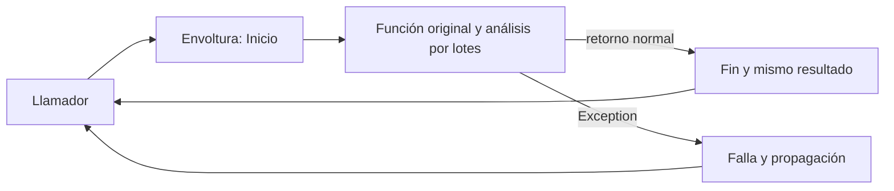

# 05.08 — Funciones como valores y decoradores

[Inicio](../../../README.md) / [Módulo 05](../README.md) / **Lección 05.08**

| Tu sesión | Qué prepararás o comprobarás |
| --- | --- |
| **Meta** | Envolver funciones conservando argumentos, resultados y errores |
| **Necesitas** | Funciones, registro y contratos; ampliación opcional |
| **Evidencia** | Envoltura comprobada y nota de momentos, metadatos y límites |

[Preparación](#antes-de-empezar) · [Material de apoyo](#material-de-apoyo) · [Ir al lab](../../../labs/05_python_applied/08_functions_decorators/README.md) · [Comprobar](#evidencia-y-criterio-de-salida)

> **Ampliación opcional:** si no eliges esta práctica, puedes ir al
> [05.11 — Cierre del proyecto Python](../11_project_closure/README.md),
> después de completar el núcleo 05.01–05.05.

<a id="propósito-y-prerrequisitos"></a>

## Propósito

Reutilizar un comportamiento alrededor de una función sin copiar su cálculo.
Primero distinguiremos una función de su resultado; después construiremos
una envoltura y leeremos la sintaxis @. Comprobaremos qué conserva y qué cambia.

## Antes de empezar

Esta sección es una **extensión opcional**. Completa
[05.05 — Tipos y contratos](../05_types_contracts/README.md) y recupera
[funciones de 01.04](../../01_python_foundations/04_functions/README.md),
[logging de 05.02](../02_configuration_logging/README.md),
[errores de 05.03](../03_errors_resources/README.md) y
[pruebas de 05.04](../04_testing/README.md).
[05.07](../07_iterators_generators/README.md) permite seguir el ejemplo por lotes
y entender el límite de los generadores. No necesitas diseñar clases de 05.06.

**Base de la extensión:** funciones como valores, argumentos y retorno de funciones.
**Práctica:** funciones anidadas, reenvío de argumentos, decorador y wraps.
**Ampliación:** orden de envolturas, firma visible y límites de caché/generadores.
No añadimos mediciones de tiempo, reintentos ni una infraestructura de plugins;
05.09 desarrollará medición. No se requieren dependencias nuevas.

<a id="objetivos-observables"></a>

## Qué vas a aprender

- Diferenciar `function` de `function(...)` al asignar o pasar un argumento.
- Leer una función que recibe otra y explicar quién la ejecuta.
- Construir una envoltura que conserva argumentos y resultado.
- Explicar cuándo se aplica @ y cuándo se ejecuta la función envuelta.
- Conservar metadatos con wraps y propagar errores sin inventar resultados.
- Conciliar el análisis instrumentado y reconocer qué significa su mensaje de fin.

## Material de apoyo

| Recurso | Para qué sirve | Uso |
| --- | --- | --- |
| [Instrumentación compartida](../01_notebook_to_modules/analisis_cartera/instrumentacion.py) | Leer la envoltura y sus responsabilidades | Para el recorrido |
| [Ejecutor instrumentado](../01_notebook_to_modules/ejecutar_decoradores.py) | Contrastar análisis y mensajes | Para el recorrido |
| [Pruebas de decoradores](../01_notebook_to_modules/pruebas_0508/) | Comprobar reenvío, metadatos y errores | Para el recorrido |

Abre los recursos cuando aparezcan en el recorrido. El paquete compartido vive
en 05.01 y se reutiliza sin copiar sus módulos; conserva las fuentes y entregas
anteriores. Lee las comprobaciones y los resultados esperados antes de ejecutar.

## 1. El nombre de una función también es un valor

```python
from analisis_cartera.contratos import coverage_pct

operation = coverage_pct
print(operation is coverage_pct)  # True
print(operation(2, 3))            # aproximadamente 66,6667
result = coverage_pct(2, 3)
print(type(result).__name__)      # float
```

`operation = coverage_pct` guarda una referencia al objeto función. Los
paréntesis de `coverage_pct(2, 3)` ejecutan la llamada y producen un resultado.
Asignar otro nombre a la función no la ejecuta ni copia su código.

Esto permite guardar funciones en variables, pasarlas como argumentos y
devolverlas desde otras funciones. Una función que recibe o devuelve funciones
se suele llamar de *orden superior*. El nombre es una descripción, no una
sintaxis especial de Python.

## 2. Pasar una operación para que otra función la use

```python
def evaluate(operation, known, total):
    return operation(known, total)

print(evaluate(coverage_pct, 0, 3))  # 0.0
print(evaluate(coverage_pct, 0, 0))  # None
```

evaluate recibe una función y la llama con los conteos. coverage_pct conserva
la validación y el cálculo de 05.05. Es un ejemplo pequeño para leer el flujo;
no hace falta añadir esa intermediaria al paquete para cada llamada aislada.

La forma correcta pasa coverage_pct, sin ejecutarla antes. Si pasaras
`coverage_pct(2, 3)` en su lugar, evaluate recibiría un número y fallaría al
intentar llamarlo. La función que recibe la operación también tiene contrato:
debe saber qué argumentos proporcionar y qué retorno espera.

Ya hay interfaces de este tipo en Python:

```python
print(sorted(["servicios", "consumo", "comercio"], key=len))
# ['consumo', 'comercio', 'servicios']
```

sorted llama a len para obtener la clave de orden. Pasamos len, no len().
El término *callback* suele referirse a una función que entregamos para que
otra parte la llame. `callable(objeto)` indica si admite llamada, pero no
demuestra que acepte esos argumentos ni que su resultado sea válido.

## 3. Una función que devuelve otra

Antes de generalizar, construyamos una envoltura para dos conteos:

```python
def announce(function):
    def wrapped(known, total):
        print("Antes")
        result = function(known, total)
        print("Después")
        return result
    return wrapped

observed = announce(coverage_pct)
print("Envoltura preparada")
print(observed(0, 3))
```

Resultado:

```text
Envoltura preparada
Antes
Después
0.0
```

announce define wrapped y la devuelve, sin ejecutarla. Al llamar observed,
wrapped utiliza la función que recibió announce. Esa referencia queda disponible
aunque announce ya haya retornado; este vínculo con nombres de un ámbito
exterior se llama *cierre* o *closure*. Aquí no creamos estado mutable global
ni necesitamos nonlocal para leer esa referencia.

Hay dos return con responsabilidades distintas: el exterior entrega la nueva
función; el interior entrega el resultado de la función original. Olvidar el
segundo haría que la llamada devolviera None aunque el cálculo fuera correcto.
Escribir `return wrapped()` en el exterior ejecutaría anticipadamente la
envoltura, en vez de entregarla para una llamada posterior.

## 4. De dos parámetros a reenvío de argumentos

El ejemplo anterior solo admite known y total. El análisis utiliza además
argumentos por nombre, como batch_size. Python permite recogerlos:

```python
def show_arguments(*args, **kwargs):
    print(args)
    print(kwargs)

show_arguments("fuentes", "2026-10-31", batch_size=7)
# ('fuentes', '2026-10-31')
# {'batch_size': 7}
```

En la definición, `*args` reúne argumentos posicionales en una tupla y
`**kwargs` reúne argumentos por nombre en un diccionario. Los nombres args
y kwargs son convenciones. El asterisco aislado de 05.05, como en
`def f(source, *, batch_size=10)`, tiene otro papel: exige nombrar los parámetros
posteriores, sin crear una tupla args.

En una llamada, los asteriscos hacen la operación complementaria:

```python
positionals = (0, 3)
keywords = {}
print(coverage_pct(*positionals, **keywords))  # 0.0
```

Una envoltura general puede recibir `*args, **kwargs` y llamar
`function(*args, **kwargs)`. No debe reemplazar cero, False o None por valores
predeterminados, omitir argumentos por nombre ni modificar una lista recibida.
La función original seguirá comprobando si esa combinación de argumentos es válida.

Reenviar no significa copiar profundamente: los objetos de los argumentos son
los mismos. Si la función original modifica uno, ese efecto sigue ocurriendo.
El decorador de esta lección no cambia esa responsabilidad.

## 5. Decorador y sintaxis @

Un decorador recibe una función y devuelve el objeto que ocupará su lugar.
Con una función decoradora llamada log_call:

```python
@log_call
def sample(known, total):
    return coverage_pct(known, total)
```

Para este caso se entiende como:

```python
def sample(known, total):
    return coverage_pct(known, total)

sample = log_call(sample)
```

Estos fragmentos muestran dos alternativas, no pasos que debas ejecutar sobre
la misma definición. El nombre sample pasa a señalar la envoltura. Al llamarlo,
se entra en ella y desde allí en la función original.

La aplicación del decorador ocurre al ejecutar la definición, normalmente
cuando se importa el módulo. El decorador podría tener efectos en ese momento;
el nuestro solo prepara la envoltura y no ejecuta el análisis ni configura logging.
Los mensajes se generan al llamar después a la función decorada.

Usar un decorador existente, como dataclass en 05.06 o uno de un framework,
no exige escribirlo. Aquí aprenderemos a crear uno para entender y comprobar
su comportamiento; sigue siendo una ampliación opcional del track.

## 6. wraps conserva información para quien lee e inspecciona

Sin ayuda, una función devuelta con nombre wrapped se presenta como wrapped,
aunque envuelva coverage_pct. Su documentación también sería la de la envoltura.
El decorador usa functools.wraps:

```python
from functools import wraps

def passthrough(function):
    @wraps(function)
    def wrapped(*args, **kwargs):
        return function(*args, **kwargs)
    return wrapped

observed = passthrough(coverage_pct)
print(observed.__name__)                    # coverage_pct
print(observed.__wrapped__ is coverage_pct)  # True
```

wraps copia metadatos como nombre, documentación y anotaciones; también establece
el enlace __wrapped__ al objeto original. `@wraps(function)` es un uso de un
decorador preparado con un argumento: wraps recibe function y devuelve el
decorador que se aplicará a wrapped. No necesitamos crear una fábrica con
parámetros para nuestro log_call.

```python
import inspect

print(inspect.signature(observed))
# (known: int, total: int) -> float | None
```

inspect.signature sigue __wrapped__ por defecto y muestra la firma original.
Si consultas `follow_wrapped=False`, verás los parámetros *args y **kwargs
de la envoltura; puede aparecer también la anotación de retorno copiada.
wraps no reescribe sus parámetros ejecutables ni hace validación de tipos.
La función original rechaza una llamada incompatible cuando se la reenviamos.
Tampoco certifica por sí solo que un checker estático comprenda la firma genérica.

Usamos anotaciones graduales: log_call y su envoltura no introducen ParamSpec
ni TypeVar. Esas herramientas pueden mejorar tipos de decoradores en una
profundización posterior, pero no son requisito para entender el flujo actual.

## 7. log_call: inicio, éxito y falla con responsabilidades claras

Abre [instrumentacion.py](../01_notebook_to_modules/analisis_cartera/instrumentacion.py).
El módulo obtiene un logger con su nombre y define log_call. Después de
comprobar qué clase de función recibe, construye esta envoltura:

```python
@wraps(function)
def wrapped(*args, **kwargs):
    LOGGER.info("Inicio: %s", function.__name__)
    try:
        result = function(*args, **kwargs)
    except Exception:
        LOGGER.warning("Falla: %s", function.__name__)
        raise
    else:
        LOGGER.info("Fin: %s", function.__name__)
        return result
```

Este es un fragmento del cuerpo del decorador: function y LOGGER pertenecen
a su contexto. Consulta el archivo completo para usarlo; no pegues ese bloque
aislado como si fuera otra función ya configurada.

| Etapa | Qué hace la envoltura | Qué conserva |
| --- | --- | --- |
| Entrada | Registra Inicio | Reenvía argumentos sin transformarlos |
| Retorno normal | Registra Fin | Devuelve el mismo objeto, también si es None |
| Exception | Registra Falla y usa raise sin argumento | Propaga la misma excepción y su causa |
| Interrupción como KeyboardInterrupt/SystemExit | Deja propagar | No anuncia éxito; puede quedar solo Inicio |

Capturamos Exception de forma amplia porque la respuesta transversal está
definida: observar y propagar. No la convertimos en una tabla vacía ni en un
valor “correcto”. El raise sin argumento mantiene el error activo; el traceback
incluye la capa adicional de la envoltura. No usamos return en finally ni
colocamos allí un mensaje de éxito, porque finally también se ejecuta al fallar.

El contrato supone un sistema de logging funcional. Un handler personalizado
que falle también podría interrumpir la llamada; este ejemplo no implementa
tolerancia a fallas del propio backend de registro. Las pruebas usan la captura
estándar de unittest para comprobar la envoltura.

Los mensajes contienen etapa y nombre de función; no vuelcan argumentos,
tablas, resultados ni mensajes de excepciones. La configuración de niveles y
destino está en la entrada ejecutar_decoradores.py, siguiendo 05.02.
Importar instrumentacion no configura la consola. Si el nivel oculta INFO,
no ver Inicio/Fin no demuestra que la función no se ejecutara.

## 8. Envolver el análisis conocido

El mismo módulo añade una entrada que delega el cálculo:

```python
@log_call
def logged_indicators(source: str | Path, cut: str | None = None, *, batch_size: int = 10) -> pd.DataFrame:
    return batch_indicators(source, cut, batch_size=batch_size)
```

La firma conserva source, corte opcional y tamaño por nombre de 05.07.
No se copia el algoritmo ni se modifican las funciones anteriores. Al llamar
logged_indicators se registran etapas alrededor de batch_indicators, que lee
los CSV, valida y devuelve los indicadores al terminar.



Sin renderizador: la envoltura recibe la llamada, anuncia el inicio, invoca
una vez al análisis y devuelve el resultado o deja subir su error. La lectura,
las reglas, el cierre de recursos y la mediana siguen en sus funciones responsables.

Fin significa “esta llamada retornó normalmente”. No acredita integridad de
cualquier entrada futura, revisión visual o aprendizaje. Tampoco sustituye las
conciliaciones ni crea el marcador de entrega de 05.03. El script nuevo no
exporta archivos; conserva fuentes y compara con el análisis completo.

## 9. Generadores: devolver no es consumir

log_call admite funciones Python normales y rechaza funciones declaradas como
generadoras. Envolver directamente iter_batches produce TypeError al decorar.
Su contrato también excluye funciones incorporadas como len y otros objetos
invocables: ser callable no basta para esta interfaz deliberadamente pequeña.
También excluye funciones async/corutinas: su ejecución requiere otro contrato,
que queda fuera de esta extensión. No necesitas aprender async para continuar.

¿Por qué? En 05.07 aprendimos que llamar a una función con yield crea un
generador, pero su cuerpo se ejecuta después, al consumirlo. Un decorador
de llamadas que anunciara Fin en ese momento no habría observado la lectura
ni los errores posteriores del recorrido.

Una función normal puede devolver un iterador y eso sí se admite. En ese caso
Fin se refiere únicamente a la devolución del objeto. La envoltura no itera,
no materializa ni cierra el resultado. Tampoco inspecciona todas las capas
que otro decorador pudiera ocultar: el rechazo de una función declarada con
yield no equivale a certificar el consumo de cualquier objeto retornado.

El mismo cuidado se aplica a la caché: guardar un iterador puede guardar un
recorrido ya consumido. Guardar un DataFrame mutable puede compartir cambios
entre llamadas. Una ruta igual tampoco implica que el CSV siga igual.
No añadimos caché ni reintentos: ambas decisiones cambian el contrato y
necesitan reglas de actualización o de repetición de efectos.

## 10. Cuándo conviene y qué revisar

Un comportamiento *transversal* aparece alrededor de operaciones distintas:
por ejemplo, registrar etapas de varias funciones. Una envoltura permite
mantener esa regla en un lugar. Para una sola llamada, registrar explícitamente
dos mensajes puede resultar más claro; decide según la necesidad.

Antes de incorporar un decorador comprueba argumentos, retorno, excepciones,
efectos, momento de ejecución y metadatos. No asumas transparencia total:
añade llamadas, registros y otra capa al traceback. Por eso usamos pruebas
además de wraps.

**Orden de aplicación, ampliación:** si se escribe @a encima de @b, se forma
`function = a(b(function))`. Al llamar, se entra primero en la envoltura exterior
a y después en b, según lo que hagan. Aplicar dos veces log_call puede generar
dos mensajes de inicio y dos de fin; no lo confundas con instrumentar dos
operaciones diferentes. No hace falta apilar decoradores para este ejemplo.

El decorador no ejecuta la función al prepararla, no repite llamadas y no
consume argumentos que sean iteradores. El cálculo conserva sus propios efectos:
si envolvieras una escritura, seguiría siendo una escritura. Las pruebas del
lab comprueban que un error no dispara una repetición accidental.

## 11. Ejecutar y comprobar

Usa el entorno elegido en [00.05](../../00_getting_started/05_environment/README.md)
con las dependencias existentes. functools, inspect y logging son biblioteca
estándar. Los recorridos empiezan en la raíz de DS Track con el entorno activo.

### PowerShell

```powershell
python -c "import sys, pandas, matplotlib, altair; print(sys.executable); print(pandas.__version__, matplotlib.__version__, altair.__version__)"
Set-Location curriculum/05_python_applied/01_notebook_to_modules
python ejecutar_decoradores.py
$LASTEXITCODE
python -m unittest discover -s pruebas_0508 -t . -p "test_*.py" -v
$LASTEXITCODE
python -m unittest discover -s . -t . -p "test_*.py" -v
$LASTEXITCODE
Set-Location ../../..
```

### Bash/Zsh

```bash
python -c "import sys, pandas, matplotlib, altair; print(sys.executable); print(pandas.__version__, matplotlib.__version__, altair.__version__)"
cd curriculum/05_python_applied/01_notebook_to_modules
python ejecutar_decoradores.py
echo $?
python -m unittest discover -s pruebas_0508 -t . -p 'test_*.py' -v
echo $?
python -m unittest discover -s . -t . -p 'test_*.py' -v
echo $?
cd ../../..
```

### CMD / Anaconda Prompt

```bat
python -c "import sys, pandas, matplotlib, altair; print(sys.executable); print(pandas.__version__, matplotlib.__version__, altair.__version__)"
cd curriculum\05_python_applied\01_notebook_to_modules
python ejecutar_decoradores.py
echo %ERRORLEVEL%
python -m unittest discover -s pruebas_0508 -t . -p "test_*.py" -v
echo %ERRORLEVEL%
python -m unittest discover -s . -t . -p "test_*.py" -v
echo %ERRORLEVEL%
cd ..\..\..
```

El [script](../01_notebook_to_modules/ejecutar_decoradores.py) muestra el nombre
logged_indicators y su firma visible. La llamada válida registra Inicio/Fin y
devuelve los indicadores originales: Todos conserva 24 registros, 21 conocidos,
mediana 2300 MXN y cobertura 87,5 %. La llamada didáctica con batch_size=0
registra Inicio/Falla, propaga ValueError y el script atiende ese error esperado.
No aparece Fin para esa llamada; no confundirlo con el Fin de la anterior.
La comparación final usa assert_frame_equal y no se exportan entregas.

La colección nueva tiene **13 métodos**; con los 61 previos son **74 métodos**
combinados. Terminan con OK y código 0. Los ejercicios personales añaden métodos;
conserva tu trabajo y revisa lo que descubrió unittest. Cero métodos no comprueba
este material.

Las pruebas usan assertLogs para capturar temporalmente registros de este logger
y assertNoLogs para comprobar ausencia de mensajes en una etapa. Esas herramientas
restauran la configuración de captura al salir del bloque. También se verifica
identidad del resultado/error, causa conservada y metadatos, no solo valores
numéricos. Las cifras de la fixture pequeña siguen siendo 5/3/1/60 para Todos;
no las confundas con la fuente original de 24 registros.

<a id="práctica-criterio-de-salida-y-continuidad"></a>

## Práctica

Si eliges esta ampliación, realiza el [lab 05.08](../../../labs/05_python_applied/08_functions_decorators/README.md) para
construir y explicar una envoltura sin cambiar el contrato del cálculo.

## Evidencia y criterio de salida

| Conserva | Comprueba | Explica |
| --- | --- | --- |
| Envoltura y casos comprobados | Argumentos, resultados y excepciones conservados | Función frente a llamada y aplicación frente a ejecución |
| Nota de metadatos y registro | Información de wraps y alcance de los mensajes | Por qué devolver un generador no demuestra haber consumido sus datos |

Puedes cerrar esta extensión cuando expliques función frente a llamada, los dos
momentos del decorador y la envoltura, reenvíes parámetros y compruebes resultados,
errores y límites.

Quien aprende realiza la práctica y explica las decisiones; su compañero revisa.
Tu compañero elige un mensaje de fin y pregunta qué trabajo terminó realmente.
Guarda evidencia, ayudas y dudas en una nota personal junto a tu práctica.
PROGRESS.md registra el desarrollo editorial, no tu expediente de aprendizaje.
No hay proyecto ni checkpoint implementado asociado en projects/; esta práctica
reutiliza el paquete educativo sin dar por completado un proyecto del catálogo.

<a id="referencias-y-atribución"></a>

## Referencias

Ejemplos propios de DS Track sobre las funciones y fuentes de 05.01–05.07.
Consulta de documentación primaria: 2026-10-15. Sintaxis compatible con Python
3.11; comprobación local con Python 3.12.12, pandas 2.3.3, Matplotlib 3.10.7
y Altair 6.3.0, sin dependencias nuevas ni ejemplos copiados de las fuentes.

- [Python: definiciones y aplicación de decoradores](https://docs.python.org/3.11/reference/compound_stmts.html#function-definitions).
- [Python: argumentos variables y desempaquetado](https://docs.python.org/3.11/tutorial/controlflow.html#arbitrary-argument-lists).
- [Python: resolución de nombres](https://docs.python.org/3.11/reference/executionmodel.html#resolution-of-names).
- [Python: functools.wraps](https://docs.python.org/3.11/library/functools.html#functools.wraps).
- [Python: inspect.signature](https://docs.python.org/3.11/library/inspect.html#inspect.signature).
- [Python: logging](https://docs.python.org/3.11/library/logging.html).
- [Python: assertLogs](https://docs.python.org/3.11/library/unittest.html#unittest.TestCase.assertLogs).

## Siguiente paso

Después de la práctica y su comprobación, la continuación del núcleo es
[05.11 — Cierre del proyecto Python](../11_project_closure/README.md).

Si eliges seguir las ampliaciones, continúa con
[05.09 — Medir antes de optimizar](../09_measure_optimize/README.md). Las ampliaciones 05.06–05.10 no bloquean el cierre ni R.

[← Módulo 05](../README.md) · [Lab 05.08](../../../labs/05_python_applied/08_functions_decorators/README.md) · [Siguiente →](../11_project_closure/README.md)
