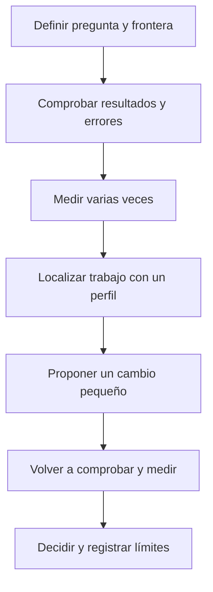

# 05.09 — Medir antes de optimizar

## Propósito, alcance y prerrequisitos

Una ejecución lenta plantea una pregunta: ¿qué trabajo está costando tiempo y
qué cambiaría al hacerlo de otra manera? En esta **extensión** aprenderás a
formular esa pregunta, conservar evidencia y decidir si una mejora compensa
su costo. Reducir tiempo sin conservar resultados, errores y reglas del análisis
no resuelve el mismo problema.

Reutiliza el paquete de [05.01](../01_notebook_to_modules/README.md), las
[pruebas de 05.04](../04_testing/README.md) y los
[contratos de 05.05](../05_types_contracts/README.md). De
[05.08](../08_functions_decorators/README.md) toma las funciones como valores;
no necesitas escribir decoradores. Para medir consumo diferido, repasa
[05.07](../07_iterators_generators/README.md). Clases y decoradores propios son
opcionales. Esta sección tampoco bloquea el cierre esencial ni el paso a R.

Al terminar podrás definir qué entra en una medición, repetir comparaciones
equivalentes, leer un perfil de llamadas, distinguir memoria trazada de memoria
total y justificar una decisión con sus límites. No se busca una marca de
velocidad ni convertir esta muestra pequeña en un sistema de alto rendimiento.

## 1. Definir la pregunta antes del reloj

Supón que el análisis tarda más de lo que esperabas. Antes de cambiarlo, escribe:

> Quiero conocer el costo de validar una lista de fechas ya preparada. Compararé
> validar cada texto con reutilizar las fechas válidas dentro de la misma llamada.
> Ambas alternativas deben contar todas las observaciones y rechazar las mismas
> entradas inválidas en la misma posición de consumo.

Eso delimita un experimento pequeño. No afirma que validar fechas sea el cuello
de botella de toda la cartera. El lector original usa pandas; las dos funciones
de este experimento son alternativas didácticas aisladas, no reemplazos de su
contrato completo. El script conserva el análisis anterior y mide sus fases
por separado para dar contexto.



Sin renderizador: primero defines el trabajo y compruebas su comportamiento;
después mides, investigas dónde se realiza, propones un cambio y repites las
comprobaciones. La decisión puede ser conservar la versión más sencilla.

### Tres fronteras del análisis conocido

El [script de esta lección](../01_notebook_to_modules/ejecutar_medicion.py)
guarda tiempos de estas llamadas:

| Etiqueta en fases.csv | Qué incluye | Qué queda fuera |
| --- | --- | --- |
| lectura_validada | read_detail: leer dos CSV, convertir, validar y unir | Resumen e indicadores |
| transformacion_preleida | summarize sobre el detalle ya leído | Leer archivos, referencia y conciliación |
| analisis_conciliado | build_analysis: lectura, resumen, referencia e indicadores conciliados | Exportar evidencia y dibujar figuras |

**Son fronteras solapadas.** La tercera incluye trabajo de las anteriores y
otras comprobaciones. No sumes las tres filas ni declares ganadora a la más
corta: realizan trabajos distintos. Sus repeticiones orientan dónde investigar;
no son una descomposición exacta de una misma ejecución. Una lectura posterior
puede beneficiarse de la caché de archivos del sistema operativo.

Si tu pregunta fuera cuánto tarda reconstruir una entrega con CSV y figura,
tendrías que incluir esas tareas y preparar destinos nuevos por ejecución.
Medir solo summarize no respondería esa pregunta.

## 2. Medir tiempo transcurrido y repetir

`time.perf_counter()` sirve para restar dos lecturas de un reloj de alta
resolución. La diferencia está en segundos e incluye esperas durante el intervalo;
no es una fecha ni tiempo exclusivo de CPU. Solo interesa la resta, no el valor
absoluto. [Referencia del reloj](https://docs.python.org/3.11/library/time.html#time.perf_counter).

Este ejemplo se ejecuta desde la carpeta del paquete, como indican los recorridos
de abajo. Prepara la entrada antes del reloj:

```python
from time import perf_counter
from analisis_cartera.medicion import validate_dates_each

dates = ["2026-09-30", "2026-10-31"] * 100
start = perf_counter()
count = validate_dates_each(dates)
seconds = perf_counter() - start
if count != len(dates):
    raise ValueError("El trabajo no conserva el conteo")
print(count, seconds)  # 200 y un tiempo que cambia entre ejecuciones.
```

La comprobación y el print quedan fuera del intervalo. Eso evita sumar el costo
de mostrar resultados, pero no permite omitir trabajo necesario. Una llamada
que solo devuelve un generador todavía no ha procesado sus registros: si la
pregunta incluye consumirlo, el consumo debe ocurrir dentro del intervalo.

Una medición puede verse afectada por otras aplicaciones, primera ejecución,
cachés, temperatura del equipo y recolección de objetos. El ayudante
`repeat_timings` realiza un calentamiento por variante, descarta su tiempo y
guarda todas las repeticiones siguientes. Alterna el orden A/B, B/A, A/B para
reducir un sesgo sistemático de posición. No elimina esas fuentes de variación
ni constituye un estudio estadístico.

Lee primero las observaciones individuales y luego mínimo, mediana y máximo.
La mediana resume el centro; el rango ayuda a detectar variación. Un mínimo
aislado no promete lo que tardará una persona. Si dos alternativas difieren
muy poco respecto a la variación, registra que el experimento no permite decidir.
No borres una repetición lenta solo para favorecer una alternativa.

### Pasar trabajo repetible al ayudante

`repeat_timings` recibe un diccionario de nombres y funciones **sin argumentos**.
Cada función cierra sobre la entrada preparada y realiza el trabajo completo:

```python
from analisis_cartera.medicion import repeat_timings, validate_dates_reusing

def each():
    return validate_dates_each(dates)

def reusing():
    return validate_dates_reusing(dates)

def check_count(result):
    if result != len(dates):
        raise ValueError("Cambió el resultado")

raw = repeat_timings({"cada_fecha": each, "reusar_fecha": reusing},
                     repeats=5, warmups=1, check=check_count)
print(raw)
```

Es continuación del ejemplo anterior. `check` se ejecuta fuera del reloj, también
en calentamientos. El ayudante guarda variante, repetición, posición y segundos;
no incluye construir la tabla, comprobar ni liberar el resultado retornado.
Una falla de la operación o de check se propaga sin devolver una tabla parcial.
Las pruebas de equivalencia complementan ese conteo: un conteo correcto por sí
solo no demuestra que se hayan aplicado las reglas.

En el script verás `lambda: read_detail(source)`: crea una función sin nombre
ni argumentos cuyo resultado es esa expresión. Equivale aquí a un `def` que
retorna read_detail(source). La llamada ocurre cuando el ayudante ejecuta la
función, no al construir el diccionario. Las funciones que capturan dates en
el script se usan dentro de cada iteración antes de cambiar esa variable.

Si necesitas un iterador, créalo **dentro** de cada función de trabajo, por ejemplo
`return validate_dates_each(iter(dates))`. Reutilizar el mismo iterador en todas
las repeticiones cronometraría una entrada agotada después de la primera.
También debes restaurar cualquier estado que una operación modifique.

## 3. Dos implementaciones con el mismo contrato

El código completo y comentado está en
[medicion.py](../01_notebook_to_modules/analisis_cartera/medicion.py).
Las funciones retornan cuántos elementos validaron:

| Regla | validate_dates_each | validate_dates_reusing |
| --- | --- | --- |
| Texto YYYY-MM-DD y fecha real | Valida cada aparición | Valida cada texto distinto |
| Entrada vacía | Retorna 0 | Retorna 0 |
| Fechas repetidas | Cuenta cada aparición | Cuenta cada aparición |
| None, número u otro tipo | TypeError | TypeError |
| Texto inválido | ValueError al encontrarlo | ValueError al encontrarlo |
| Iterador recibido | Lo consume una vez | Lo consume una vez |
| Modificar entrada / conservar caché entre llamadas | No / no | No / no |

Aunque normalize_cut admite None con otro significado en 05.05, estas funciones
lo rechazan: cada elemento debe representar una fecha presente. El mismo texto
mantiene su validez durante esta llamada; por eso puede reutilizarse su validación.
No se aplica esta idea automáticamente a consultas externas o reglas cambiantes.

La candidata utiliza un conjunto `seen`. Antes de añadir un texto, verifica su
tipo y valida la fecha; si ya estaba, evita repetir el parseo, es decir,
interpretar el texto como fecha. **Incrementa el
conteo fuera del if**, porque una fecha repetida sigue siendo una observación.
Al retornar se libera el conjunto local; la siguiente llamada comienza de nuevo.

### Tamaño y diversidad son preguntas distintas

El experimento usa listas de 48, 480 y 4800 fechas, con dos escenarios:

- **repetidas:** repite las 48 fechas del detalle original; hay dos fechas distintas.
- **distintas:** construye N días consecutivos válidos; hay N fechas distintas.

Son entradas para aislar validación. Repetir filas de la cartera crearía claves
crédito/fecha duplicadas y violaría el contrato del lector. No se presentan esas
listas como nuevas observaciones económicas ni se reemplazan las muestras previas.

Llama N al número de elementos y U al número de textos distintos. La base hace
N validaciones; la candidata hace U y consulta el conjunto para los N elementos.
Con textos cortos y consultas de conjunto de costo promedio constante, ambas
recorren N elementos; la candidata ahorra parseos si U es pequeño, pero conserva
O(U) referencias adicionales. La base no acumula un conjunto y usa memoria
auxiliar constante respecto a N. **La lista de entrada ya ocupa memoria** en
ambas, aunque quede fuera de esa cuenta auxiliar.

La notación O describe crecimiento bajo supuestos, no segundos exactos. Duplicar
N no asegura duplicar el tiempo en una muestra pequeña. Tampoco todo bucle anidado
es cuadrático: recorrer G grupos fijos y N filas crece con N si G permanece fijo;
si G también crece con N hay otra pregunta. Antes de contar bucles, define qué
crece y qué operaciones se realizan.

## 4. Memoria: actual, pico y frontera de trazado

`trace_peak` ejecuta una llamada separada con tracemalloc. Devuelve bytes de
asignaciones trazadas actuales y su máximo desde el inicio de esa sesión.
Conserva el resultado retornado hasta leer ambos valores y detiene el trazado
en finally, también ante errores. La entrada preparada antes de empezar queda
fuera de las nuevas asignaciones. No equivale a memoria total del proceso o RSS
(memoria residente que ocupa el proceso en la RAM);
las extensiones nativas pueden tener asignaciones sin registrar en tracemalloc.
[Referencia del trazado](https://docs.python.org/3.11/library/tracemalloc.html).

Para las fechas, el resultado es un entero pequeño. El conjunto temporal puede
haber desaparecido al medir memoria actual, mientras el pico conserva el aumento
durante el cálculo. Mira el pico para investigar esa acumulación; no concluyas
que no existió porque actual sea bajo. Para expresar MiB divide bytes entre
1024 ** 2 y conserva el nombre de la unidad.

Trazar añade trabajo al proceso: sus tiempos no representan el mismo experimento
sin trazado. Por eso tiempos.csv y memoria.csv provienen de llamadas distintas.
La memoria se observa una vez por variante/caso; no es una distribución de picos.
Compara solo la misma frontera y condiciones. No confundas una lista completa
con lotes de 05.07 sin incluir catálogo, claves y saldos retenidos para la mediana.

## 5. Perfil de llamadas: localizar antes de cambiar

`profile_operation` ejecuta una llamada con cProfile y escribe un informe de
pstats ordenado por tiempo acumulado. En los archivos perfil_cada_fecha.txt y
perfil_reusar_fecha.txt busca normalize_cut y sus llamadas de conversión:

| Columna | Lectura útil |
| --- | --- |
| ncalls | Cuántas llamadas observó el perfil |
| tottime | Tiempo en la función, excluidas sus llamadas a otras funciones |
| cumtime | Tiempo en la función y en las llamadas que realizó |
| percall | Cociente por llamada de la columna correspondiente |

El tiempo acumulado de una función contiene trabajo de otras filas: sumarlo
duplica trabajo. En el mayor caso repetido esperamos 4800 llamadas a normalize_cut
en la base y 2 en la candidata. Esa reducción explica una hipótesis; sus segundos
incluyen la instrumentación y no sustituyen la comparación sin perfilador.
[Referencia de cProfile y pstats](https://docs.python.org/3.11/library/profile.html).

Ejecuta estos instrumentos en un proceso de terminal sin depurador/perfilador.
Los ayudantes rechazan tracemalloc, el perfil tradicional o el espacio reservado
de perfilado de sys.monitoring si ya están ocupados; no reinician sesiones ajenas.
Esto no detecta todas las herramientas externas ni aísla la carga del equipo.

<details>
<summary>Nota de compatibilidad para quien revise los instrumentos</summary>

En CPython 3.12, cProfile utiliza sys.monitoring y no aparece necesariamente en
sys.getprofile(). El ayudante consulta el espacio PROFILER_ID cuando esa API
existe; en versiones anteriores comprueba el perfil tradicional. Solo lee el
estado, sin registrar herramientas ni cambiar eventos. No necesitas aprender
esa API para realizar la práctica. Se comprobó con el perfil realmente activo,
además del caso sys.setprofile.
[API oficial de monitoring](https://docs.python.org/3.12/library/sys.monitoring.html) y
[implementación de cProfile en CPython 3.12](https://github.com/python/cpython/blob/3.12/Modules/_lsprof.c).

</details>

## 6. Ejecutar y conservar evidencia

Usa el entorno elegido del curso que ya ejecutaba las lecciones anteriores.
No se agregan dependencias. Parte de la raíz del repositorio y elige **solo el
recorrido de tu shell**. Si experimento_01 existe, usa experimento_02: el script
rechaza sobrescribir. Abre los CSV/JSON/textos generados en tu editor después.

### PowerShell

```powershell
python --version
cd curriculum/05_python_applied/01_notebook_to_modules
python ejecutar_medicion.py --output ../09_measure_optimize/output/experimento_01 --repeats 5
$LASTEXITCODE
python -m unittest discover -s pruebas_0509 -t . -p "test_*.py" -v
$LASTEXITCODE
python -m unittest discover -s . -t . -p "test_*.py" -v
$LASTEXITCODE
cd ../../..
```

### Bash/Zsh

```bash
python --version
cd curriculum/05_python_applied/01_notebook_to_modules
python ejecutar_medicion.py --output ../09_measure_optimize/output/experimento_01 --repeats 5
echo $?
python -m unittest discover -s pruebas_0509 -t . -p 'test_*.py' -v
echo $?
python -m unittest discover -s . -t . -p 'test_*.py' -v
echo $?
cd ../../..
```

### CMD / Anaconda Prompt

```bat
python --version
cd curriculum\05_python_applied\01_notebook_to_modules
python ejecutar_medicion.py --output ..\09_measure_optimize\output\experimento_01 --repeats 5
echo %ERRORLEVEL%
python -m unittest discover -s pruebas_0509 -t . -p "test_*.py" -v
echo %ERRORLEVEL%
python -m unittest discover -s . -t . -p "test_*.py" -v
echo %ERRORLEVEL%
cd ..\..\..
```

Cada código debe ser 0 y las pruebas terminar con OK: **13 métodos nuevos y 87
combinados**, antes de tus ejercicios. Cero métodos no verifica esta colección.
No se exige que un tiempo sea menor que otro para aprobar las pruebas.

Con cinco repeticiones y las fuentes incluidas, la carpeta contiene:

| Archivo | Qué comprobar |
| --- | --- |
| tiempos.csv | 60 filas: 2 escenarios × 3 tamaños × 2 variantes × 5 repeticiones; posición y segundos |
| resumen_tiempos.csv | 12 filas con mínimo ≤ mediana ≤ máximo |
| memoria.csv | 12 observaciones, pico ≥ actual ≥ 0; bytes trazados |
| fases.csv | 15 tiempos, tres fronteras distintas × cinco; no sumarlas |
| indicadores.csv | Cinco filas: Todos y cuatro segmentos; resultado anterior conservado |
| experimento.json | Versiones efectivas, tamaños, corte, repeticiones, hashes y límites |
| perfil_cada_fecha.txt / perfil_reusar_fecha.txt | Llamadas del mayor caso repetido, con tiempos instrumentados |
| LEER.md | Cómo interpretar la carpeta y sus límites |

El script prepara listas antes de medir, comprueba conteos, compara tablas con
assert_frame_equal y revisa SHA256 de las fuentes antes/después. Todos conserva
24 registros, 21 saldos conocidos, mediana 2300 MXN y cobertura 87,5 %. Los grupos
sin saldo conocido siguen sin mediana; no se rellenan con cero. Las pruebas
incluyen vacíos, entradas inválidas y conservación de instrumentos ajenos.

La salida se escribe después del experimento, pero sus archivos no se publican
como una transacción única. Un error de escritura puede dejar carpeta parcial;
conserva el error y repite hacia otra nueva. Esto no es el cierre de entrega con
marcador de [05.03](../03_errors_resources/README.md). output está ignorado por Git.

### Una observación local, no una meta

En la revisión con Python 3.12.12 y 4800 fechas, una corrida obtuvo aproximadamente:

| Caso | Mediana base / candidata | Pico trazado base / candidata |
| --- | --- | --- |
| Dos fechas distintas | 30,0 / 0,24 ms | 1,7 / 1,7 KiB |
| Todas distintas | 30,2 / 32,4 ms | 1,5 / 160,3 KiB |

Son valores redondeados de esa corrida, con llamadas de memoria separadas.
No son salidas esperadas que debas reproducir. La evidencia permite explicar
que ahorrar parseos de fechas repetidas puede ayudar y que el conjunto cuesta
memoria con alta diversidad. No prueba una mejora equivalente del análisis
completo ni justifica reemplazar la validación de pandas con este código.

## 7. Decidir y explicar el costo

Registra pregunta/frontera, contrato conservado, entradas N/U, entorno, datos
crudos y resumen, perfil, memoria y decisión. Incluye qué quedó fuera y qué
faltaría medir para generalizar. También importan claridad, estados nuevos y
pruebas necesarias para mantener el cambio.

Por ejemplo: «En fechas muy repetidas, la candidata evitó parseos y redujo el
tiempo de esta fase. Con fechas distintas no observé esa ventaja y aumentó el
pico trazado. Conservo la implementación del análisis general hasta demostrar
que este trabajo es un costo relevante en su entrada real». Otra decisión puede
ser válida con evidencia distinta y un contrato igual de explícito.

No escribas pruebas como `tiempo_nuevo < tiempo_anterior` o «termina en 1 ms»:
fluctúan con el equipo y no comprueban reglas del análisis. Un presupuesto de
rendimiento en un producto requeriría condiciones y tolerancias propias; aquí
las pruebas protegen comportamiento, orden, fallas y limpieza de recursos.

<details>
<summary>Ampliación opcional: timeit para una función pequeña</summary>

Desde la misma sesión Python de los ejemplos, con each ya definido:

```python
import timeit

totals = timeit.repeat(each, repeat=5, number=100)
per_call = [seconds / 100 for seconds in totals]
print(per_call)
```

repeat produce cinco tiempos de bloques; cada bloque ejecuta la función cien
veces. Dividir obtiene el tiempo medio por llamada dentro de cada bloque, no
quinientas observaciones independientes. timeit desactiva temporalmente el
recolector de ciclos por defecto; nuestro ayudante no lo cambia. Sus condiciones
no son idénticas. Úsalo con trabajo repetible y conoce ese límite antes de
comparar resultados. No hace falta instalar otra herramienta.
[Referencia de timeit](https://docs.python.org/3.11/library/timeit.html).

</details>

## Práctica, criterio de salida y continuidad

Realiza el [lab 05.09](../../../labs/05_python_applied/09_measure_optimize/README.md).
Puedes cerrar esta extensión cuando delimites el trabajo, compruebes equivalencia,
interpretes repeticiones/perfil/memoria y justifiques una decisión sin prometer
velocidad universal. No hay proyecto/checkpoint implementado asociado. Registra
evidencia y dudas en PROGRESS.md; disponer del material no acredita aprendizaje.

Si continúas las ampliaciones, sigue el
[05.10 — Integración con APIs](../10_api_integration/README.md), disponible con lab.
El [cierre 05.11](../README.md#11-cierre-del-proyecto-python) sigue planificado.
Volver al [índice de Python aplicado](../README.md).

## Referencias y atribución

Ejemplos propios de DS Track sobre el paquete y fuentes existentes; documentación
primaria enlazada junto a cada instrumento. Consulta: 2026-10-15. Código con base
Python 3.11 y detección condicional de monitoring desde 3.12; comprobación local
con Python 3.12.12, pandas 2.3.3, Matplotlib 3.10.7 y Altair 6.3.0. No son
afirmaciones de últimas versiones. Sin dependencias nuevas ni capítulos copiados.
