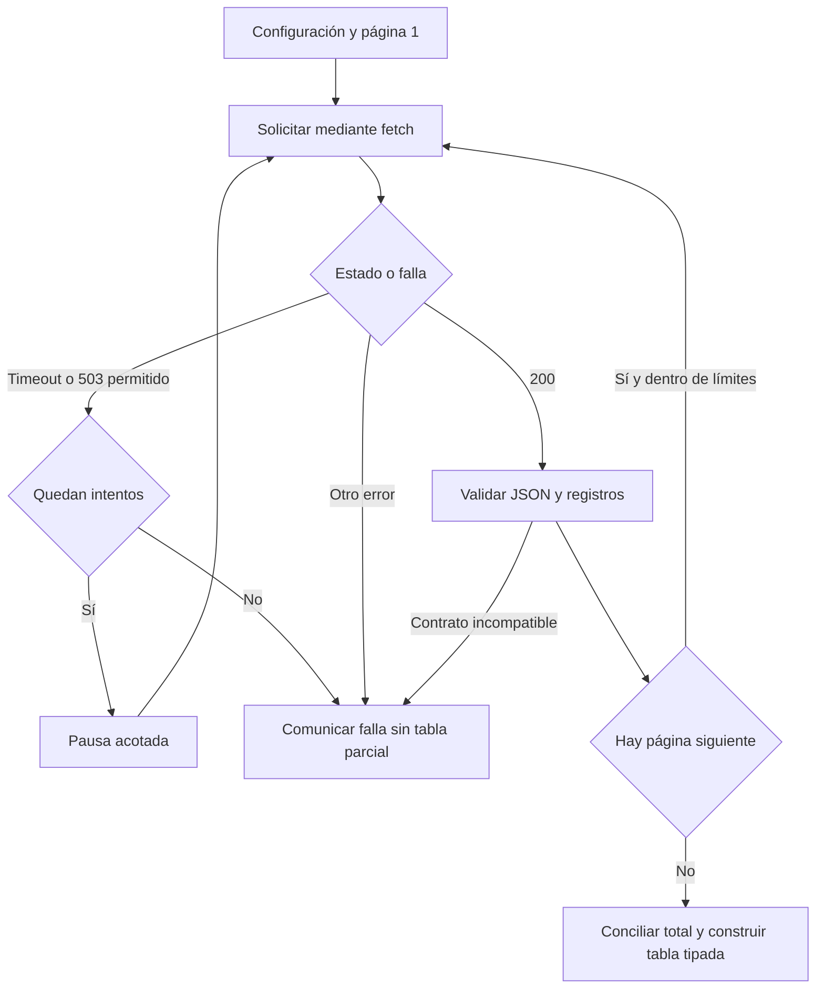

# 05.10 — Integración con APIs

## Propósito, alcance y prerrequisitos

Hasta ahora el análisis comienza en archivos locales. Una API puede ofrecer
datos mediante solicitudes a otro sistema; esa frontera introduce disponibilidad,
formatos y reglas que no controlamos. Esta **extensión** enseña a recibir páginas
de datos, validarlas y comprobar que el resultado completo puede incorporarse al
análisis conocido. Una respuesta recibida no equivale a una extracción completa.

Reutiliza el paquete de [05.01](../01_notebook_to_modules/README.md),
[configuración de 05.02](../02_configuration_logging/README.md),
[errores/recursos de 05.03](../03_errors_resources/README.md),
[pruebas de 05.04](../04_testing/README.md) y
[contratos de 05.05](../05_types_contracts/README.md). Repasa pasar funciones
como argumentos en [05.08](../08_functions_decorators/README.md) si lo necesitas;
no hace falta crear clases ni decoradores. Esta ampliación no bloquea el cierre
esencial ni R.

Al terminar podrás explicar una solicitud GET, distinguir estados HTTP de errores
de contenido, recorrer páginas con límites, justificar reintentos y producir una
tabla tipada conciliada. La práctica usa **respuestas locales simuladas**, sin
credenciales, conexión ni nuevas dependencias. El adaptador HTTPS es una ampliación
comprobada con respuestas sustitutas; no se exige un servicio real.

## 1. De una función local a una solicitud HTTP

API significa interfaz de programación de aplicaciones: un acuerdo para que un
programa interactúe con otro. No todas utilizan HTTP ni JSON. Aquí estudiamos
una API HTTP de lectura que devuelve JSON. Sus nombres de campos y paginación
son un **contrato propio de DS Track**, no una convención universal.

Una solicitud de ejemplo, sin ejecutarla, sería:

```text
GET https://ejemplo.invalid/cortes?page=2
Accept: application/json
```

El endpoint es la dirección del recurso; `page=2` es un parámetro de consulta.
GET pide una representación del recurso. Accept expresa el formato que solicita
el cliente; no garantiza que el servidor lo entregue. La respuesta tiene un
estado, cabeceras y un cuerpo. Content-Type describe el tipo de ese cuerpo.
El dominio .invalid del ejemplo no representa un servicio disponible.

| Parte | Ejemplo didáctico | Pregunta que resuelve |
| --- | --- | --- |
| Método y dirección | GET /cortes?page=2 | ¿Qué recurso/página pedimos? |
| Estado de respuesta | 200 | ¿Cómo respondió HTTP? |
| Cabecera | Content-Type: application/json | ¿Cómo declara el servidor su contenido? |
| Cuerpo | Texto con items, total, next_page | ¿Qué datos entregó? |

GET se define como un método seguro e idempotente: su intención es leer y repetir
la misma solicitud tiene el mismo efecto previsto en el servidor. Esto no promete
respuestas idénticas, ausencia de registros del servidor ni disponibilidad.
No traslades automáticamente una política de reintentos a POST o a una escritura:
podrías duplicar una operación. [Semántica de métodos HTTP](https://www.rfc-editor.org/rfc/rfc9110.html#section-9.2).

## 2. HTTP, JSON y datos son tres comprobaciones distintas

| Situación | Interpretación en esta práctica | Acción |
| --- | --- | --- |
| Timeout o conexión sin respuesta útil | Falló el transporte | Aplicar solo la política acotada descrita abajo |
| 200 | HTTP entregó una respuesta aceptada por este contrato | Comprobar tipo, JSON y esquema |
| 204 | No hay cuerpo de contenido | Rechazar: nuestro contrato requiere una página JSON |
| 400 | Solicitud incorrecta | Revisar solicitud/contrato |
| 401 / 403 | Autenticación requerida o acceso rechazado | Revisar acceso; no insistir automáticamente |
| 404 | Recurso no encontrado | Revisar dirección/recurso |
| 429 | Exceso de solicitudes | Detenerse y revisar límites/espera del proveedor |
| 503 | Servicio no disponible | Candidato a reintento limitado bajo condiciones explícitas |

La tabla resume la interpretación de estos códigos para nuestro cliente. Un 5xx
no autoriza a repetir indefinidamente. Consulta la
[definición de estados HTTP](https://www.rfc-editor.org/rfc/rfc9110.html#section-15) y
[429 y límites de solicitudes](https://www.rfc-editor.org/rfc/rfc6585.html#section-4).

Un 200 puede contener HTML de una página de acceso, JSON mal formado o campos
incompatibles. Primero comprobamos estado; después Content-Type, decodificación
y estructura. **No se sustituye una falla por una lista vacía**: esa lista podría
producir indicadores aparentemente válidos de «cero observaciones».

### Leer JSON no significa validar su significado

JSON es una representación textual. Un objeto se convierte en dict, un arreglo
en list, un texto en str y null en None. Los números sin parte fraccionaria se
leen como int; true/false se convierten en bool. Python considera bool una
subclase de int, por eso nuestras reglas lo excluyen de los conteos e importes.
[Conversión oficial de JSON a Python](https://docs.python.org/3.12/library/json.html#json.JSONDecoder).

```python
import json

page = json.loads('{"items": [], "total": 0, "next_page": null}')
print(page["items"], page["total"], page["next_page"])  # [] 0 None
```

Que el texto pueda leerse no demuestra que items sea una lista ni que total sea
un conteo. El cliente comprueba ambos. También rechaza nombres de campo repetidos
y las constantes no estándar NaN/Infinity, que json.loads puede aceptar por
defecto. No usamos eval para interpretar una respuesta. Una cadena "100" no se
convierte silenciosamente en el entero 100: cambiar la representación requiere
una regla acordada y comprobada.

## 3. El contrato de páginas y registros de esta lección

Cada página contiene exactamente tres campos:

```json
{
  "items": [
    {
      "id_credito": "001",
      "fecha_corte": "2026-10-31",
      "saldo_mxn": 0,
      "dias_atraso": null,
      "segmento": "comercio"
    }
  ],
  "next_page": null,
  "total": 1
}
```

Es una miniatura explicativa; las [muestras ejecutables](muestras/README.md)
contienen 48 observaciones en tres páginas de 16. Derivan de los CSV ya conocidos,
sin cambiar sus valores ni sustituir las muestras previas.

| Campo de registro | Regla explícita |
| --- | --- |
| id_credito | Texto presente sin espacios extremos; conservar ceros iniciales |
| fecha_corte | Texto de una fecha real YYYY-MM-DD; sin None ni formato abreviado |
| saldo_mxn | Entero de MXN no negativo dentro de Int64, o null; bool no permitido |
| dias_atraso | Entero de días no negativo dentro de Int64, o null; bool no permitido |
| segmento | comercio, consumo, educacion o servicios |

Se conserva cero como observado y null como ausencia. La clave crédito/fecha
debe ser única **en toda la extracción**, no solo dentro de cada página. El
segmento de un crédito no puede cambiar entre cortes en este contrato. Los
campos extra o faltantes se rechazan para detectar cambios del proveedor.
Una API real puede permitir extensiones: habría que definir esa política antes.

total es el número de registros de toda la extracción y debe permanecer estable.
next_page es el entero de la página siguiente o null cuando termina. Aquí
exigimos páginas 1, 2, 3… consecutivas; no aceptamos enlaces, cursores ni saltos.
Una página no final debe contener registros. Una extracción realmente vacía sí
puede ser válida: items=[], total=0 y next_page=null, con tabla vacía tipada.

Contar 48 registros no comprueba por sí solo que sean los 48 esperados. Verificamos
también claves/reglas y, en la demostración, igualdad exacta con la fuente local.
En un servicio cambiante, total estable y claves únicas tampoco garantizan una
instantánea consistente: haría falta un contrato de snapshot, versión o corte
estable proporcionado por el servidor.

## 4. Separar transporte y lógica

El código está en [api.py](../01_notebook_to_modules/analisis_cartera/api.py).
El **transporte** realiza una solicitud o entrega una respuesta simulada. La
función `fetch_detail` decide si la respuesta cumple el contrato y cómo recorrer
las páginas. Recibe una función fetch(page, timeout), como los callbacks de 05.08.



Sin renderizador: se solicita una página; algunos errores permiten repetir esa
misma página. Una respuesta aceptada se valida antes de acumular registros.
Después se avanza o se comprueba el total final. Si cualquier etapa falla, la
función lanza ApiError y no retorna el detalle incompleto. El registro puede
conservar mensajes de intentos anteriores; no son un anuncio de cierre.

El sobre que entrega fetch es un dict con status, content_type, retry_after y
body. body es texto ya decodificado en UTF-8. No es todavía el objeto JSON de
items/total/next_page. El transporte local lee un archivo; el HTTPS obtiene bytes
y los decodifica. Ambos entregan el mismo sobre a la lógica.

### Tiempo de espera, intentos y límites

[config.json](config.json) contiene valores explícitos:

| Parámetro | Valor incluido | Significado |
| --- | --- | --- |
| timeout | 5,0 s | Espera de operaciones bloqueantes del transporte HTTP |
| max_attempts | 2 | Intento inicial más, como máximo, un reintento por página |
| retry_delay | 0,25 s | Pausa fija entre intentos permitidos |
| max_pages | 3 | Detenerse si la extracción necesita una cuarta página |
| max_rows | 100 | Rechazar un total declarado superior a esta cantidad |

La política didáctica solo repite **TimeoutError** —directo o como causa de
URLError— y **503 sin Retry-After**. No repite fallas de JSON, esquema, claves,
otros estados ni otros errores de conexión como DNS. Es una selección conservadora
para estudiar el mecanismo; no una política general para cualquier proveedor.
Tras agotar intentos, falla. max_attempts y retry_delay tienen además un máximo
de 5 en este ejemplo. Los parámetros se validan antes de solicitar datos.

Retry-After puede expresar una espera en segundos o una fecha HTTP. Nuestro
cliente **se detiene** ante 503 con esa cabecera y ante 429: no implementa su
planificación ni la ignora para repetir inmediatamente. Adaptarlo exigiría leer
el contrato del proveedor y limitar la espera total.
[Referencia de Retry-After](https://www.rfc-editor.org/rfc/rfc9110.html#section-10.2.3).
Backoff exponencial y variación aleatoria de pausas quedan como profundización.

timeout no es una fecha límite de toda la descarga: puede haber varias lecturas,
páginas, intentos y pausas. La práctica tampoco garantiza memoria constante:
reúne registros, claves y segmentos antes de construir el DataFrame. Los límites
acotan este ejercicio; un cliente de producción requiere presupuestos apropiados
para su servicio y tamaño real.

### Respuestas y recursos

El adaptador HTTPS usa Request, urlencode y urlopen de la biblioteca estándar.
urlencode construye la consulta; timeout se pasa explícitamente y with cierra la
respuesta. HTTPError es también una respuesta que hay que cerrar, y se atiende
antes que otros URLError. El cuerpo se limita a 65536 bytes por respuesta,
leyendo un byte extra para detectar exceso; no se descomprime contenido.
[urllib.request](https://docs.python.org/3.12/library/urllib.request.html),
[urllib.error](https://docs.python.org/3.12/library/urllib.error.html) y
[urlencode](https://docs.python.org/3.12/library/urllib.parse.html#urllib.parse.urlencode).

Al normalizar, construimos directamente columnas pandas string e Int64.
Así no pasamos importes enteros con ausencias por float64: esa conversión
intermedia podría perder precisión en enteros grandes. Las pruebas incluyen
ese caso. [Referencia de enteros con ausencias en pandas](https://pandas.pydata.org/pandas-docs/version/2.3/user_guide/integer_na.html).
El análisis recibe una tabla ordenada por fecha/crédito con índice
nuevo y el contrato conocido; no necesita conocer cómo llegó por HTTP.

## 5. Ejecutar la simulación y las pruebas

Usa el entorno del curso que ya ejecuta el paquete; no instales otro cliente.
Parte de la raíz del repositorio, elige el recorrido de tu shell y conserva
cualquier salida previa. Si un destino existe, cambia su sufijo: no se sobrescribe.
El script no tiene modo de consulta real.

### PowerShell

```powershell
python --version
cd curriculum/05_python_applied/01_notebook_to_modules
python ejecutar_api.py --scenario correcto --output ../10_api_integration/output/correcto_01
$LASTEXITCODE
python ejecutar_api.py --scenario recuperable --output ../10_api_integration/output/recuperable_01
$LASTEXITCODE
python ejecutar_api.py --scenario error_tardio --output ../10_api_integration/output/falla_01
$LASTEXITCODE
python ejecutar_api.py --scenario json_invalido --output ../10_api_integration/output/json_01
$LASTEXITCODE
python -m unittest discover -s pruebas_0510 -t . -p "test_*.py" -v
$LASTEXITCODE
python -m unittest discover -s . -t . -p "test_*.py" -v
$LASTEXITCODE
cd ../../..
```

### Bash/Zsh

```bash
python --version
cd curriculum/05_python_applied/01_notebook_to_modules
python ejecutar_api.py --scenario correcto --output ../10_api_integration/output/correcto_01
echo $?
python ejecutar_api.py --scenario recuperable --output ../10_api_integration/output/recuperable_01
echo $?
python ejecutar_api.py --scenario error_tardio --output ../10_api_integration/output/falla_01
echo $?
python ejecutar_api.py --scenario json_invalido --output ../10_api_integration/output/json_01
echo $?
python -m unittest discover -s pruebas_0510 -t . -p 'test_*.py' -v
echo $?
python -m unittest discover -s . -t . -p 'test_*.py' -v
echo $?
cd ../../..
```

### CMD / Anaconda Prompt

```bat
python --version
cd curriculum\05_python_applied\01_notebook_to_modules
python ejecutar_api.py --scenario correcto --output ..\10_api_integration\output\correcto_01
echo %ERRORLEVEL%
python ejecutar_api.py --scenario recuperable --output ..\10_api_integration\output\recuperable_01
echo %ERRORLEVEL%
python ejecutar_api.py --scenario error_tardio --output ..\10_api_integration\output\falla_01
echo %ERRORLEVEL%
python ejecutar_api.py --scenario json_invalido --output ..\10_api_integration\output\json_01
echo %ERRORLEVEL%
python -m unittest discover -s pruebas_0510 -t . -p "test_*.py" -v
echo %ERRORLEVEL%
python -m unittest discover -s . -t . -p "test_*.py" -v
echo %ERRORLEVEL%
cd ..\..\..
```

No uses el código de salida de un comando posterior para interpretar el anterior.
Los resultados esperados son:

| Ejecución | Solicitudes | Pausas registradas | Código y resultado |
| --- | --- | --- | --- |
| correcto | Páginas 1, 2, 3 | Ninguna | 0; evidencia completa |
| recuperable | 1, 1, 2, 2, 3 | Dos de 0,25 s | 0; misma tabla/indicadores |
| error_tardio | 1, 2 | Ninguna | 1; 401 en página 2, sin carpeta de resultados |
| json_invalido | 1 | Ninguna | 1; JSON inválido, sin carpeta de resultados |
| Pruebas nuevas / combinadas | Sin red | Sin esperas reales | 0 y OK; 18 / 105 métodos |

El cliente de simulación conserva una secuencia de pasos: crea uno nuevo para
repetir. En el escenario recuperable, un 503 precede al éxito de página 1 y un
timeout precede al éxito de página 2. Inyectamos waits.append como función wait:
registra las pausas, no duerme. En una llamada normal, wait usa time.sleep.
No confundas solicitudes totales con páginas completadas.

### Evidencia generada

El [script](../01_notebook_to_modules/ejecutar_api.py) compara el detalle recibido
con read_detail, resume el corte 2026-10-31 y concilia con la referencia CSV.
Todos conserva 24 registros, 21 conocidos, mediana 2300 MXN y cobertura 87,5 %;
educacion sigue sin mediana. No concatena la API con los mismos CSV, porque
representan las mismas observaciones y se duplicarían.

Guarda detalle_api.csv (48 filas), indicadores_api.csv (cinco grupos),
conciliacion.csv (20 controles), LEER.md y ejecucion.json. El JSON final registra
configuración, solicitudes, pausas simuladas, versiones y hashes de las entradas.
Usa la escritura atómica de 05.03 para **ese archivo**; la carpeta completa sigue
pudiendo quedar parcial ante errores de escritura. Sin estado completo al final,
no declares éxito. No se genera una entrega con figura ni se acredita aprendizaje.

El registro comunica página, intento y estado, sin volcar cuerpos, identificadores,
cabeceras privadas ni credenciales. Las fuentes y muestras permanecen intactas;
output está ignorado por Git. Las pruebas de HTTP sustituyen urlopen con objetos
locales, incluidos HTTPError y lecturas interrumpidas: no hacen consultas externas.
Como ampliación de lectura de tests, patch reemplaza temporalmente el nombre
analisis_cartera.api.urlopen que usa nuestro módulo y lo restaura al salir de with.
Así podemos comprobar solicitud y cierre con bytes locales, sin intentar que un
servicio falle a propósito. [Referencia de unittest.mock.patch](https://docs.python.org/3.12/library/unittest.mock.html#unittest.mock.patch).

## 6. Ampliación opcional: adaptar a un proveedor real

Antes de conectar, consulta su documentación: recurso, parámetros, unidades,
límites, licencia, autenticación y paginación. Un cursor opaco o un enlace next
exigiría otra implementación; no lo conviertas arbitrariamente a page + 1.
Un servicio que no entrega este esquema no funcionará con fetch_detail sin una
adaptación explícita.

Para examinar la preparación del adaptador, desde la carpeta del paquete:

```python
from analisis_cartera.api import http_transport

fetch = http_transport("https://ejemplo.invalid/cortes")
print(callable(fetch))  # True; preparar la función no solicita la red.
```

No llames ese dominio de ejemplo. Para una consulta real tendrías que elegir un
endpoint documentado y autorizado con el contrato adecuado; esa ejecución es
opcional y no forma parte de la comprobación de este material. El adaptador admite
HTTPS sin consulta previa, fragmento ni credenciales en la dirección, y utiliza
las políticas normales de certificados, proxies y redirecciones de urllib.

Si otro servicio requiere un token, se obtiene y configura fuera del código,
por ejemplo mediante una variable de entorno que se explica antes de usarla.
No se incluye un token de ejemplo ejecutable ni se guarda en Git, URL o registro.
Autenticación, paginación por cursor, reanudación persistente, snapshots remotos
y planificación avanzada de reintentos quedan fuera de este cliente didáctico.

## Práctica, criterio de salida y continuidad

Realiza el [lab 05.10](../../../labs/05_python_applied/10_api_integration/README.md).
Puedes cerrar la extensión cuando distingas transporte/JSON/datos, recorras
páginas sin duplicar, compruebes equivalencia y expliques cuándo falla o se
reintenta. No hay proyecto/checkpoint implementado asociado. Registra evidencia
y dudas en PROGRESS.md; tener el material no demuestra haberlo aprendido.

La siguiente sección es el
[05.11 — Cierre del proyecto Python](../11_project_closure/README.md),
disponible con lab. Integra la reconstrucción de indicadores y figura sin
exigir todas las ampliaciones opcionales.
Volver al [índice de Python aplicado](../README.md).

## Referencias y atribución

Ejemplos y contrato propios de DS Track, con muestras derivadas de sus CSV
sintéticos conservados. Referencias primarias enlazadas junto a cada concepto.
Consulta: 2026-10-15. Biblioteca estándar con base Python 3.11; comprobación local
en Python 3.12.12 y pandas 2.3.3, sin nuevas dependencias ni cambios al lockfile.
El transporte HTTPS se verifica con sustitutos locales, no con un proveedor real.
