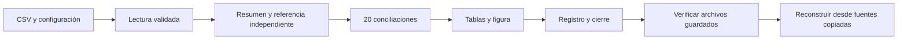

# 05.11 — Cierre del proyecto Python

## Propósito y prerrequisitos

Cerrar el módulo significa reunir las piezas que ya funcionan: entradas conocidas,
configuración, funciones, comprobaciones y figura. Otra persona debe poder ejecutar
el análisis, identificar sus resultados y reconstruirlos en una carpeta nueva.
Esta práctica integra el material; completar su desarrollo no acredita que el
estudiante haya alcanzado todavía ese criterio.

Completa el núcleo [05.01](../01_notebook_to_modules/README.md),
[05.02](../02_configuration_logging/README.md),
[05.03](../03_errors_resources/README.md),
[05.04](../04_testing/README.md) y los contratos de
[05.05](../05_types_contracts/README.md). Conserva la explicación de indicadores y
figura del [cierre 04.09](../../04_visualization_python/09_visual_closure/README.md).
Clases, lotes, decoradores, medición y APIs de 05.06–05.10 son ampliaciones: no
tienes que incorporarlas a esta entrega ni consultar un servicio real.

Al terminar podrás reconstruir indicadores y figura con una ejecución, comprobar
los archivos guardados, reconocer una entrega incompleta y explicar qué evidencia
demuestra equivalencia. No se agregan dependencias ni un segundo cálculo de la
mediana para el producto final.

## 1. Qué estamos cerrando

La unidad de observación sigue siendo **un crédito en una fecha de corte**. Las
fuentes contienen 48 observaciones en dos fechas. Para 2026-10-31 hay 24 registros
y 21 saldos conocidos. Cero es un saldo conocido; ausencia no se reemplaza por cero.
La mediana se calcula desde los saldos conocidos y la cobertura usa todos los
registros del grupo como denominador.

| Segmento | Registros | Conocidos | Mediana MXN | Cobertura % |
| --- | --- | --- | --- | --- |
| comercio | 5 | 5 | 3100 | 100 |
| consumo | 10 | 10 | 1750 | 100 |
| educacion | 3 | 0 | No definida | 0 |
| servicios | 6 | 6 | 2550 | 100 |
| Todos | 24 | 21 | 2300 | 87,5 |

Todos se calcula desde el detalle; no es el promedio de las medianas de grupos.
Las cifras son las del recorrido anterior, incluido
[SQL/pandas 03.09](../../03_sql_databases/09_pandas_sql/README.md). Compáralas con
tus evidencias anteriores y explica cualquier diferencia antes de cerrar.
La ejecución actual concilia pandas con una referencia CSV/statistics independiente;
no vuelve a modificar ni reconstruir una base SQLite existente.

La figura conserva dos preguntas: mediana del saldo conocido y cobertura. La
ausencia de mediana en educación se comunica con texto; la cobertura cero se
representa como cero observado. No se deduce dónde estarían los saldos ausentes
ni se interpreta la figura como una medida de riesgo.

## 2. Integrar mediante la entrada que ya existe

Reutilizamos ejecutar_seguro.py de 05.03: una llamada lee, valida, calcula,
concilia, guarda tablas/figuras y escribe el marcador final. No creamos un nuevo
script que copie todas sus funciones. La configuración de este cierre está en
[config.json](config.json); cut, dpi y log_level mantienen su significado de 05.02.



Sin renderizador: se valida la entrada, se contrasta el cálculo y se exporta la
entrega. Después se revisa lo que quedó realmente guardado y se ejecuta otra vez
desde sus copias de fuentes. Una falla interrumpe el recorrido; no se borra una
carpeta parcial ni se la presenta como terminada.

Las rutas source del JSON se interpretan respecto de ese archivo. --source y
--output de la terminal se interpretan respecto del directorio de trabajo y
tienen prioridad. Por eso la reconstrucción puede reutilizar el JSON y cambiar
solo fuente/destino. La carpeta de salida debe ser nueva en cada ejecución.

El entorno elegido debe ser el que ya ejecutaba el curso. Revisa versiones y
dependencias con el [recorrido de entornos 00.05](../../00_getting_started/05_environment/README.md)
si hace falta; no combines gestores ni instales otra vez por costumbre.
La configuración raíz conserva las dependencias reales del curso y su lockfile.

## 3. Ejecutar, reconstruir y comprobar una falla

Empieza en la raíz del repositorio, activa tu entorno y elige **un recorrido**.
Usa otros sufijos si ya existen entrega_01, reconstruccion_01 o parcial_01.
No se modifica la fuente original. El cierre usa Agg para guardar figuras sin
abrir ventanas, como en 05.03; no requiere un notebook con estado previo.

### PowerShell

```powershell
python --version
cd curriculum/05_python_applied/01_notebook_to_modules
python -m unittest discover -s . -t . -p "test_*.py" -v
$LASTEXITCODE
python ejecutar_seguro.py --config ../11_project_closure/config.json --output ../11_project_closure/output/entrega_01
$LASTEXITCODE
python verificar_entrega.py ../11_project_closure/output/entrega_01
$LASTEXITCODE
python ejecutar_seguro.py --config ../11_project_closure/config.json --source ../11_project_closure/output/entrega_01/fuentes --output ../11_project_closure/output/reconstruccion_01
$LASTEXITCODE
python verificar_entrega.py ../11_project_closure/output/entrega_01 --compare ../11_project_closure/output/reconstruccion_01
$LASTEXITCODE
python ejecutar_seguro.py --config ../11_project_closure/config.json --output ../11_project_closure/output/parcial_01 --simulate-failure before-close
$LASTEXITCODE
python verificar_entrega.py ../11_project_closure/output/parcial_01
$LASTEXITCODE
cd ../../..
```

### Bash/Zsh

```bash
python --version
cd curriculum/05_python_applied/01_notebook_to_modules
python -m unittest discover -s . -t . -p 'test_*.py' -v
echo $?
python ejecutar_seguro.py --config ../11_project_closure/config.json --output ../11_project_closure/output/entrega_01
echo $?
python verificar_entrega.py ../11_project_closure/output/entrega_01
echo $?
python ejecutar_seguro.py --config ../11_project_closure/config.json --source ../11_project_closure/output/entrega_01/fuentes --output ../11_project_closure/output/reconstruccion_01
echo $?
python verificar_entrega.py ../11_project_closure/output/entrega_01 --compare ../11_project_closure/output/reconstruccion_01
echo $?
python ejecutar_seguro.py --config ../11_project_closure/config.json --output ../11_project_closure/output/parcial_01 --simulate-failure before-close
echo $?
python verificar_entrega.py ../11_project_closure/output/parcial_01
echo $?
cd ../../..
```

### CMD / Anaconda Prompt

```bat
python --version
cd curriculum\05_python_applied\01_notebook_to_modules
python -m unittest discover -s . -t . -p "test_*.py" -v
echo %ERRORLEVEL%
python ejecutar_seguro.py --config ../11_project_closure/config.json --output ..\11_project_closure\output\entrega_01
echo %ERRORLEVEL%
python verificar_entrega.py ..\11_project_closure\output\entrega_01
echo %ERRORLEVEL%
python ejecutar_seguro.py --config ../11_project_closure/config.json --source ..\11_project_closure\output\entrega_01\fuentes --output ..\11_project_closure\output\reconstruccion_01
echo %ERRORLEVEL%
python verificar_entrega.py ..\11_project_closure\output\entrega_01 --compare ..\11_project_closure\output\reconstruccion_01
echo %ERRORLEVEL%
python ejecutar_seguro.py --config ../11_project_closure/config.json --output ..\11_project_closure\output\parcial_01 --simulate-failure before-close
echo %ERRORLEVEL%
python verificar_entrega.py ..\11_project_closure\output\parcial_01
echo %ERRORLEVEL%
cd ..\..\..
```

Lee cada código inmediatamente después del comando correspondiente:

| Paso | Resultado esperado |
| --- | --- |
| Pruebas combinadas | OK, 115 métodos y código 0 antes de tus ejercicios |
| Primera entrega | Código 0, aviso de cobertura parcial 21/24 y cierre.json |
| Verificación | Código 0, estado verificada, cinco tablas y 20 conciliaciones |
| Reconstrucción | Código 0, carpeta nueva desde fuentes/ de la primera entrega |
| Comparación | Código 0 y reconstruccion_equivalente |
| Simulación before-close | Código 1; carpeta conservada sin cierre.json |
| Verificar esa carpeta parcial | Código 1; no se la repara ni se declara éxito |

Cero pruebas no comprueba el material. Las diez pruebas nuevas pueden ejecutarse
por separado con `python -m unittest discover -s pruebas_0511 -t . -p "test_*.py" -v`
desde la carpeta del paquete. El aviso de cobertura parcial es una descripción
del dato y no una falla: se conservan las ausencias conocidas.

## 4. Qué contiene la entrega

| Archivos | Responsabilidad |
| --- | --- |
| fuentes/creditos.csv y fuentes/cortes.csv | Copias de las entradas usadas, con sus claves y ausencias |
| corte.csv y resumen.csv | Detalle seleccionado y resumen por segmento |
| referencia_csv.csv, indicadores.csv, conciliacion.csv | Referencia, resultado con Todos y 20 contrastes |
| matplotlib.png, matplotlib.svg, formatos.csv | Figura estática y dimensiones/tamaños declarados |
| altair.json y altair.html | Especificación y visualización HTML del mismo resumen |
| informe.md | Explicación del resultado y limitaciones |
| entrega.json y ejecucion.json | Metadatos, configuración efectiva, procedencias y versiones |
| RECONSTRUIR.md y RECONSTRUIR_SEGURO.md | Instrucciones de los consumidores anteriores; usar el recorrido integrado de esta lección |
| cierre.json | Se escribieron las etapas requeridas; revisión visual pendiente |

Con dpi=160, el PNG esperado mide 1920 × 880 píxeles. Abre PNG o SVG para revisar
la figura sin depender de red. El HTML de Altair conserva la dependencia de sus
bibliotecas externas; no se promete un HTML autónomo sin conexión. El cierre
local se puede revisar con tablas y figura estática.

Las rutas efectivas de ejecucion.json son locales y pueden incluir nombres de
carpetas personales. La evidencia permanece en output, ignorado por Git; revisa
su contenido antes de compartirla fuera de tu equipo. No publiques entornos,
cachés ni datos personales. La entrega necesita también el repositorio y un
entorno compatible: copiar solo la imagen no permite reconstruir el análisis.

## 5. Verificar lo guardado y reconocer sus límites

[auditoria.py](../01_notebook_to_modules/analisis_cartera/auditoria.py) añade una
verificación de solo lectura. No reemplaza el cálculo ni escribe un nuevo cierre.
Comprueba el marcador de 05.03 y la coherencia del corte; después usa **las fuentes
copiadas dentro de la entrega**, aunque la ruta original ya no exista.

Recalcula con build_analysis y compara las cinco tablas guardadas con ese
resultado en la frontera CSV, incluidos orden, claves y ausencias. Para ello
lee ambos lados con las mismas reglas y conserva id_credito como texto. La
igualdad del CSV no implica que el formato haya conservado todos los tipos de
Python ni el índice original. CSV es una representación; los tipos se reconstruyen.
[Referencia de assert_frame_equal](https://pandas.pydata.org/pandas-docs/version/2.3/reference/api/pandas.testing.assert_frame_equal.html).

También compara altair.json con la especificación generada desde el resumen,
comprueba tamaños de PNG/SVG, cabecera/dimensiones PNG y estructura SVG. Esto
detecta ciertos archivos alterados o truncados; **no comprueba píxel por píxel
que la imagen represente los datos**. Tampoco evalúa todos los textos del informe,
el HTML ni autentica quién creó la entrega. La revisión humana sigue siendo parte
del criterio de salida.

inspect_delivery de 05.03 comprobaba etapas y archivos presentes. Una tabla
editada después puede conservar ese marcador. verify_delivery recalcula y detecta
esa diferencia. Ni crear cierre.json a mano ni cambiar «pendiente» por «revisado»
constituye evidencia de que los datos o la figura fueron comprobados.

### Qué significa reconstrucción equivalente

compare_deliveries verifica ambas carpetas y exige el mismo corte, fuentes,
tablas y especificación Altair. Compara las fuentes mediante SHA256, una huella
de sus bytes. Sirve aquí para comprobar identidad de las copias; no es una firma
del autor ni demuestra por sí sola calidad de los datos.
[Referencia de hashlib](https://docs.python.org/3.12/library/hashlib.html).

No se exige que PNG/SVG tengan bytes idénticos: pueden variar metadatos,
renderizadores o fuentes tipográficas. Conserva versiones efectivas, compara
resultados y revisa ambas figuras. Con versiones diferentes, registra la diferencia
y reconstruye en el entorno declarado antes de interpretar una incompatibilidad.

## 6. Explicar la entrega y demostrar una regresión

La persona que revisa debe poder encontrar el comando, las fuentes, la fecha,
las reglas, los indicadores y una conclusión limitada por su cobertura. Explica
por qué 21/24 no significa 21 ceros, por qué educación no tiene mediana y por qué
Todos no se obtiene promediando medianas. Compara con tus resultados anteriores.

Las pruebas nuevas usan una muestra pequeña donde Todos es 5/3/1/60, no la cartera
de 24 registros. Generan entregas temporales y alteran sus copias para demostrar
que una tabla editada, otra fecha, una fuente modificada o una figura truncada
son detectadas. Incluyen una reconstrucción y un corte sin observaciones. Una
prueba que siempre pasa no demuestra que pudiera encontrar una regresión.

Realiza el [lab 05.11](../../../labs/05_python_applied/11_project_closure/README.md):
incluye revisión visual, reconstrucción, falla controlada y prueba propia. Conserva
la explicación de qué se comprobó automáticamente y qué revisó una persona.
No existe todavía un proyecto/checkpoint implementado asociado en projects/;
esta práctica integra el paquete educativo existente, sin inventar uno completado.

## Criterio de salida y siguiente paso

Puedes cerrar tu aprendizaje de este módulo cuando otra persona reconstruya la
entrega siguiendo tus instrucciones, los indicadores coincidan, las figuras sean
legibles y puedas demostrar que una prueba detecta una falla relevante. Registra
la evidencia en PROGRESS.md cuando esa práctica se haya revisado. Desarrollar estas
once secciones cierra la disponibilidad del material del módulo, no su aprendizaje.

El siguiente módulo es [06 — R fundamental](../../06_r_foundations/README.md).
Su [primera lección](../../06_r_foundations/01_r_session/README.md)
está disponible con script y lab. Se retoman preguntas conocidas aprendiendo el modelo
propio de R; no se exige traducir Python línea por línea ni instalar R por anticipado.
Volver al [índice de Python aplicado](../README.md).

## Referencias y atribución

Integración y ejemplos propios de DS Track sobre 05.01–05.05 y las fuentes previas.
Documentación primaria consultada: 2026-10-15, enlazada en cada comprobación y en
[guardado de Altair](https://altair-viz.github.io/user_guide/saving_charts.html).
Comprobación local con Python 3.12.12, pandas 2.3.3, Matplotlib 3.10.7 y Altair 6.3.0,
sin nuevas dependencias ni cambios al lockfile. Base de Python 3.11 conservada.
