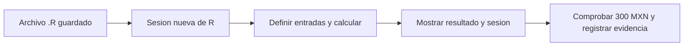

# 06.01 — R, editor, scripts y paquetes

## Propósito, prerrequisitos y objetivos

Vamos a ejecutar R y reconocer qué sesión está haciendo el trabajo. El resultado
será un script pequeño que vuelve a calcular una venta ficticia desde cero y
muestra versión, directorio y paquetes. La pregunta es familiar; aprenderemos
la forma de trabajar de R sin traducir Python línea por línea.

Completa el [cierre esencial de Python aplicado](../../05_python_applied/11_project_closure/README.md)
y conserva sus reglas de reconstrucción. Las ampliaciones 05.06–05.10 no son
prerrequisitos. Revisa [terminal y rutas 00.02](../../00_getting_started/02_terminal_paths/README.md)
si necesitas distinguir un comando del sistema de una instrucción del lenguaje.

Al terminar podrás distinguir R de su editor, ejecutar un archivo .R por completo,
identificar la sesión y explicar instalación frente a uso de paquetes. Esta
lección es esencial; RStudio es opcional. Solo utilizamos R y sus paquetes
incluidos: no necesitas instalar tidyverse ni configurar renv todavía.

## 1. R, consola, terminal y editor

R es el lenguaje y el programa que evalúa nuestras instrucciones. Una sesión es
una ejecución de ese programa, con objetos, paquetes y opciones en memoria.
RStudio es un entorno de desarrollo que ofrece editor, consola, ayuda y otros
paneles alrededor de R. Instalar RStudio no sustituye instalar R.

| Componente | Qué haces allí | Qué no demuestra por sí solo |
| --- | --- | --- |
| Editor de texto | Guardar primer_script.R | Que sus líneas se hayan ejecutado |
| Consola de R | Evaluar instrucciones y consultar resultados | Que un archivo contenga todo lo necesario |
| Terminal PowerShell/Bash/CMD | Iniciar Rscript u otros programas | Que un comando sea código R |
| Intérprete R / Rscript | Ejecutar el código usando una instalación de R | Que todas las sesiones usen la misma versión |
| RStudio | Editar, ejecutar y consultar ayuda desde una interfaz | Que RStudio y la terminal estén usando el mismo R |

El prompt `>` suele indicar que la consola de R está lista. No lo copies como
parte del código. Si aparece `+`, puede faltar una comilla o paréntesis: R espera
continuación, no te está sumando un número. En RStudio, Esc permite cancelar esa
expresión para corregirla. Limpiar la pantalla no reinicia los objetos de la sesión.

La distinción se apoya en el [flujo básico de R for Data Science, segunda edición](https://r4ds.hadley.nz/workflow-basics.html),
de Hadley Wickham, Mine Çetinkaya-Rundel y Garrett Grolemund. Aquí empezamos con
un cálculo pequeño; no se exige seguir el orden del libro ni comenzar con gráficos.

## 2. Elegir y comprobar la instalación

Si ya tienes R, comprueba cuál usas antes de instalar otra copia. En una consola
de R puedes ejecutar:

```r
R.version.string
R.home()
```

La primera instrucción muestra una descripción de la versión; R.home() indica
la instalación de esa sesión. No son el directorio donde guardas tu trabajo.
RStudio puede usar un R distinto del que encuentra la terminal. Compara estas
salidas con las del script antes de atribuir diferencias a tu código.

Si falta R, utiliza [CRAN](https://cran.r-project.org/) y elige tu sistema operativo.
En Windows está el [instalador oficial](https://cran.r-project.org/bin/windows/base/);
en macOS/Linux sigue las instrucciones correspondientes de CRAN. RStudio Desktop
es apoyo opcional desde [Posit](https://posit.co/download/rstudio-desktop/).
La práctica utiliza la instalación que elijas y sus paquetes incluidos;
no modifica esa instalación ni requiere paquetes externos.

**Referencia comprobada para esta lección:** R 4.6.1 en Windows, ya disponible
en el equipo de revisión. No se cambió Conda, PATH ni la configuración global.
La versión efectiva del estudiante se registra en su evidencia; no se fuerza
una actualización por tener otra instalación que ejecute los ejemplos. Ante
incompatibilidad, conserva el mensaje y comprueba la documentación de esa versión.

## 3. Primer cálculo: objeto, asignación y llamada

En una consola de R, ejecuta estas líneas en orden:

```r
unidades <- 4
precio_mxn <- 75
total_mxn <- unidades * precio_mxn
print(total_mxn)
```

La salida esperada es:

```text
[1] 300
```

`<-` asigna un valor a un nombre; léelo como «unidades recibe 4». `*` multiplica.
El último cálculo usa los objetos definidos antes. print es una función; los
paréntesis contienen el objeto que queremos mostrar. El prefijo [1] identifica
la posición inicial de los valores impresos, no forma parte del total ni es un error.
Los vectores y sus posiciones se desarrollarán en 06.02–06.03.

Los nombres distinguen mayúsculas: unidades y Unidades no son el mismo objeto.
Un comentario comienza con # y sirve para explicar la intención. En una llamada
como help("print", package = "base"), el signo = nombra un argumento de la
función; para nuestras asignaciones usaremos <-.

No necesitas bucles, tablas ni funciones propias para esta venta de cuatro
unidades a 75 MXN. Primero reconstruimos una instrucción completa; las ventas
con varios registros y sus tipos llegarán en las siguientes secciones.

## 4. Pasar de la consola a un archivo que se pueda repetir

Abre [primer_script.R](primer_script.R) en tu editor. Es texto guardado en UTF-8
con extensión .R, no .R.txt. Contiene todas las entradas del cálculo, print y
diagnóstico de sesión. Léelo de arriba abajo antes de ejecutarlo.



Sin renderizador: guardas el código completo, lo ejecutas en una sesión nueva,
compruebas el resultado y conservas la información del contexto que lo produjo.
No se necesita restaurar objetos anteriores.

### Desde una consola de R o RStudio

Coloca el directorio de trabajo en la raíz de tu copia del repositorio y compruébalo
con getwd(). Puedes usar `setwd("C:/ruta/a/ds_track")` en la consola, reemplazando la
ruta por la tuya; esa ruta personal no debe quedar dentro del script compartido.
En Windows, usa / o duplica cada barra inversa dentro de un texto de R.

Ahora ejecuta **en la consola de R**, no en PowerShell:

```r
getwd()
source("curriculum/06_r_foundations/01_r_session/primer_script.R", encoding = "UTF-8")
```

source lee y evalúa el archivo en esta sesión. No crea por sí mismo una sesión
nueva y puede usar objetos que ya existían. Además, su impresión automática
no es la misma que escribir expresiones sueltas en la consola; por eso el archivo
usa print explícito. [Referencia oficial de source](https://stat.ethz.ch/R-manual/R-patched/library/base/html/source.html).

En RStudio, Ctrl+Enter —Cmd+Enter en macOS— ejecuta línea/selección; el botón
Source ejecuta el archivo. Guardar no es ejecutar. Para la comprobación final,
guarda y ejecuta todo desde el principio después de Session → Restart R.
[Documentación de ejecución](https://docs.posit.co/ide/user/ide/guide/code/execution.html) y
[gestión de R en RStudio](https://docs.posit.co/ide/user/ide/guide/environments/r/managing-r.html).

### Desde una terminal: recorridos completos

Rscript ejecuta el archivo sin una consola interactiva. --vanilla evita restaurar
.RData y leer perfiles/archivos de entorno de inicio, entre otras opciones de
arranque. No aísla el sistema operativo, no fija paquetes y no borra las variables
de entorno heredadas del proceso. [Referencia de Rscript](https://stat.ethz.ch/R-manual/R-patched/library/utils/html/Rscript.html).

Parte de la raíz del repositorio y elige el recorrido de tu shell. La ruta de
Windows es la instalación comprobada; adáptala si tu versión está en otra carpeta.
Si Rscript ya resuelve a la instalación elegida, puedes usar ese comando, pero
verifica R.home() en la salida. No cambies PATH de forma global para este ejercicio.

#### PowerShell

```powershell
$rscriptCurso = "C:/Program Files/R/R-4.6.1/bin/Rscript.exe"
& $rscriptCurso --version
Get-Location
& $rscriptCurso --vanilla curriculum/06_r_foundations/01_r_session/primer_script.R
$LASTEXITCODE
& $rscriptCurso --vanilla curriculum/06_r_foundations/01_r_session/primer_script.R
$LASTEXITCODE
```

`&` ejecuta la ruta guardada en la variable, incluso con espacios. En PowerShell,
`r` suele ser un alias para historial: no lo uses para iniciar R. Si necesitas
la consola del intérprete desde esa terminal, usa R.exe o su ruta explícita.

#### Bash/Zsh

```bash
command -v Rscript
Rscript --version
pwd
Rscript --vanilla curriculum/06_r_foundations/01_r_session/primer_script.R
echo $?
Rscript --vanilla curriculum/06_r_foundations/01_r_session/primer_script.R
echo $?
```

Si command -v no encuentra Rscript, revisa la instalación elegida. Puedes usar
su ruta absoluta entre comillas en cada llamada; no introduzcas la ruta Windows
en una instalación macOS/Linux.

#### CMD / Anaconda Prompt

```bat
set "RSCRIPT_CURSO=C:\Program Files\R\R-4.6.1\bin\Rscript.exe"
"%RSCRIPT_CURSO%" --version
cd
"%RSCRIPT_CURSO%" --vanilla curriculum/06_r_foundations/01_r_session/primer_script.R
echo %ERRORLEVEL%
"%RSCRIPT_CURSO%" --vanilla curriculum/06_r_foundations/01_r_session/primer_script.R
echo %ERRORLEVEL%
```

Anaconda Prompt es una terminal; usarla no convierte automáticamente esta
instalación independiente de R en parte de un entorno Conda. No instales R ni
paquetes en base para seguir la lección.

Cada ejecución debe producir total 300 y código 0. Las rutas/versión/plataforma
pueden variar. Copia el resultado y el comando a una nota personal, por ejemplo
output/sesion_01.md creada con tu editor; conserva notas anteriores. Las rutas de
sesión pueden ser personales: output está ignorado por Git, no se publica como
evidencia del estudiante en este material.

## 5. Leer la información de sesión

El archivo utiliza estas consultas; no cambia el directorio ni configura librerías:

| Consulta | Qué indica |
| --- | --- |
| R.version.string | Versión del intérprete de esta sesión |
| getwd() | Directorio de trabajo usado para resolver rutas relativas |
| R.home() | Instalación de R que está ejecutándose |
| .libPaths() | Directorios donde R busca paquetes instalados |
| utils::packageVersion("utils") | Versión del paquete utils disponible |
| utils::sessionInfo() | R, plataforma, locale y paquetes adjuntos/cargados |

El punto de .libPaths es parte del nombre. Una biblioteca es un directorio con
paquetes, no el conjunto de objetos de tu consola. sessionInfo ayuda a explicar
una ejecución; no instala R, no guarda el script ni restaura dependencias.
Los campos Attached/loaded de su salida distinguen paquetes adjuntos de otros
espacios de nombres cargados; no hace falta memorizar todos sus nombres.
[Referencia de sessionInfo](https://stat.ethz.ch/R-manual/R-patched/library/utils/html/sessionInfo.html).

Si aparecen avisos de locale al iniciar R, conserva el aviso y registra la
configuración de la sesión. No lo confundas con un error de sintaxis ni cambies
la configuración global a ciegas. En la comprobación local se usó locale C solo
para el proceso de revisión, porque el proceso heredaba C.UTF-8 no admitido por
esa instalación Windows. El script no exige un locale ni lo modifica.

## 6. Instalar, adjuntar y utilizar un paquete

Un paquete reúne funciones, documentación y a veces datos. R ya incluye paquetes
como base, utils y stats. No hace falta descargarlos para este script.

| Acción | Función o forma | Cuándo ocurre |
| --- | --- | --- |
| Instalar archivos de un paquete | install.packages | Cuando se prepara/actualiza una biblioteca elegida |
| Adjuntar un paquete a la búsqueda de nombres | library | Cuando una sesión necesita sus nombres sin prefijo |
| Utilizar una función exportada con nombre explícito | paquete::funcion | Al llamar esa función; puede cargar su namespace sin adjuntarlo |
| Consultar la versión de un paquete disponible | utils::packageVersion | Al diagnosticar la sesión |

Por ejemplo, **en R**, puedes comprobar un paquete ya incluido:

```r
library(stats)
utils::packageVersion("stats")
help("median", package = "stats")
```

library no descarga paquetes. Un paquete instalado puede no estar adjunto en una
sesión nueva; un namespace puede estar cargado sin aparecer como package:nombre
en search(). `::` no instala nada y solo permite acceder a funciones exportadas.
[Referencia oficial de library](https://stat.ethz.ch/R-manual/R-devel/library/base/html/library.html).

La biblioteca utilizada depende de .libPaths() y de la instalación de R. Si aparece
«there is no package called …», revisa nombre, biblioteca y versión: no repitas
una instalación sin saber su destino. La documentación de
[install.packages](https://stat.ethz.ch/R-manual/R-patched/library/utils/html/install.packages.html)
explica el argumento lib. La instalación controlada y restauración de dependencias
del proyecto se desarrolla en [06.08, todavía planificada](../README.md#08-proyectos-y-dependencias-con-renv).
Aquí no ejecutamos install.packages ni añadimos requisitos de tidyverse.

## 7. Ayuda y sesión nueva como comprobación

Para leer ayuda en R, utiliza `?print` o `help("print", package = "base")`.
Revisa propósito, argumentos, resultado y ejemplos; un argumento visto en un
libro puede haber cambiado en la versión de tu paquete. Las páginas de ayuda
de la instalación se consultan con `help`, mientras las referencias web pueden
corresponder a otra versión: compara el encabezado.

Si una línea falla, conserva el mensaje completo, el código mínimo y la sesión.
«Objeto no encontrado» suele indicar un nombre diferente, orden de ejecución
incorrecto o una entrada ausente. No lo soluciones creando a mano un objeto que
el script necesita pero no define.

Un caso para razonar: si el archivo solo contiene `print(total_mxn)`, puede
funcionar en tu consola después del cálculo y fallar en Rscript --vanilla.
El resultado anterior estaba en memoria; el archivo no explicaba cómo obtenerlo.
Restaurar .RData ocultaría esa dependencia. Guarda código e inputs explícitos.

En RStudio, revisa Tools → Global Options → General: desmarca restaurar .RData
al inicio y elige Never para guardar el workspace al salir. Es una preferencia
que cambia tu forma de iniciar sesiones; comprueba su alcance antes de aplicarla.
Reiniciar R no borra archivos .RData que ya existan: no los elimines sin revisar
si contienen trabajo que quieras conservar. Para salir de una consola R sin
guardar el workspace puedes usar `q(save = "no")`.

Los [capítulos sobre scripts/proyectos](https://r4ds.hadley.nz/workflow-scripts.html)
y [cómo pedir ayuda](https://r4ds.hadley.nz/workflow-help.html) de R4DS apoyan este
flujo. No es necesario leer Advanced R ni crear un paquete para continuar.

## Práctica, criterio de salida y continuidad

Realiza el [lab 06.01](../../../labs/06_r_foundations/01_r_session/README.md).
Puedes cerrar la lección cuando ejecutes el script desde una sesión nueva,
expliques total y sesión, distingas R/editor/terminal y sepas dónde consultar
la ayuda de un paquete. No hay proyecto/checkpoint implementado asociado.
Registra evidencia real y dudas; desarrollar material no acredita aprendizaje.

Continúa con [06.02 — Objetos, vectores y tipos](../02_objects_vectors/README.md),
disponible con scripts y lab. Volver al [índice de R fundamental](../README.md).

## Referencias y atribución

Ejemplo y práctica propios de DS Track; consulta de libros y documentación:
2026-10-15. R4DS segunda edición reconoce a Wickham, Çetinkaya-Rundel y Grolemund;
la guía general de libros está en [lecturas de R](../../../docs/r-reading-guide.md).
Las referencias oficiales complementan sus ideas; no se copiaron ejercicios ni
se trata un libro o página en desarrollo como documentación de la versión local.
Script comprobado con R 4.6.1 en Windows, sin paquetes externos ni cambios a Conda.
