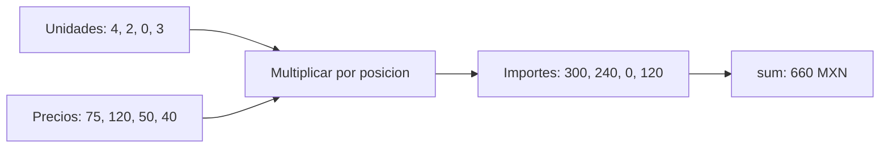

# 06.02 — Objetos, vectores y tipos

## Propósito, prerrequisitos y objetivos

En [06.01](../01_r_session/README.md) calculaste una venta de cuatro unidades a
75 MXN. Ahora representaremos cuatro ventas y preguntaremos qué hace R cuando
combina valores de tipos distintos o multiplica vectores de longitudes diferentes.
El objetivo es explicar el resultado, no solo conseguir que el programa termine.

Esta lección es esencial y utiliza únicamente R con sus paquetes incluidos.
Necesitas asignación, llamadas a funciones, print y ejecución de un archivo
completo en una sesión nueva. Reutiliza el entorno elegido en 06.01. No se instala
tidyverse ni se adelanta renv.

Al terminar podrás construir vectores atómicos con c, consultar longitud/tipo/clase,
calcular por posición y reconocer coerción y reciclaje. La selección de elementos
se desarrolla en 06.03; comparaciones/faltantes en 06.04; listas/tablas en 06.05.
No hacen falta bucles ni funciones propias para estos ejemplos.

## 1. Un nombre permite utilizar un valor

`unidades <- 4` asigna un valor a un nombre. Los objetos no quedan restringidos
para siempre al tipo de su primera asignación: una reasignación puede cambiar
el valor y también su tipo. Ese cambio puede ser un error del análisis aunque
sea válido para R.

```r
precio_mxn <- 75
print(typeof(precio_mxn))  # "double"
precio_texto <- "75"
print(typeof(precio_texto))  # "character"
```

Las comillas hacen que "75" sea texto, no un precio listo para multiplicar.
Conviene usar nombres que expresen contenido y unidad; el nombre precio_mxn no
valida que realmente contenga un número de MXN. Conserva el dato original cuando
investigues una conversión, en lugar de reemplazarlo y perder cómo llegó.

El cálculo tampoco es una fórmula que se actualice sola:

```r
unidades <- 4
precio_mxn <- 75
importe_mxn <- unidades * precio_mxn
unidades <- 6
print(importe_mxn)  # 300, calculado antes del cambio.
importe_mxn <- unidades * precio_mxn
print(importe_mxn)  # 450, después de volver a calcular.
```

Esta es otra razón para ejecutar el archivo completo en orden. No necesitas
estudiar direcciones de memoria ni entornos avanzados para reconocer ese estado.

## 2. De un valor a un vector atómico

En R, los números y textos sencillos que hemos usado son vectores de longitud
uno. `c(...)`, de combine, combina valores en un vector; `length(...)` cuenta
sus elementos. Aquí cada posición representa una venta.

```r
id_venta <- c("V001", "V002", "V003", "V004")
unidades <- c(4L, 2L, 0L, 3L)
precio_mxn <- c(75, 120, 50, 40)
print(unidades)         # [1] 4 2 0 3
print(length(unidades)) # [1] 4
print(length(75))       # [1] 1
```

Un **vector atómico** utiliza un tipo común para sus elementos. No es un
contenedor que conserve sin cambios un número, un texto y un lógico de forma
independiente. Las listas de R sí permiten estructuras heterogéneas, pero se
introducen en 06.05. No apliques automáticamente la semántica de las listas Python.

El prefijo [1] de print indica la posición del primer elemento mostrado en esa
línea. No es la longitud, no se almacena dentro del vector y no hay que escribirlo
para crear valores. La sintaxis para seleccionar posiciones llegará en 06.03.
[Referencia oficial de c](https://stat.ethz.ch/R-manual/R-patched/library/base/html/c.html) y
[length](https://stat.ethz.ch/R-manual/R-patched/library/base/html/length.html).

## 3. Tipo y clase: dos preguntas relacionadas

`typeof` describe el tipo interno; `class` describe la clase con la que se
interpreta el objeto y que puede influir en su comportamiento. En los vectores
sencillos de esta lección suelen coincidir, con una diferencia visible entre
double y numeric:

| Valores de ejemplo | typeof | class | Qué representan aquí |
| --- | --- | --- | --- |
| c(4L, 2L) | integer | integer | Cantidades enteras |
| c(75, 120) | double | numeric | Precios numéricos |
| c(TRUE, FALSE) | logical | logical | Valores de verdad |
| c("V001", "V002") | character | character | Identificadores textuales |

```r
print(typeof(4))   # "double"
print(class(4))    # "numeric"
print(typeof(4L))  # "integer"
print(class(4L))   # "integer"
```

Un literal como 4 se crea normalmente como double aunque no tenga decimales.
La L indica un literal entero. Ambos pueden representar cuatro unidades; imprimir
4 no basta para distinguir sus tipos. integer y double son tipos numéricos, pero
no todos los valores matemáticamente enteros tienen tipo integer. Un double no
equivale a un decimal de precisión fija y un integer de R tiene rango acotado;
no conviertas importes grandes a integer suponiendo que siempre caben.
[Documentación de double](https://stat.ethz.ch/R-manual/R-patched/library/base/html/double.html),
[integer](https://stat.ethz.ch/R-manual/R-patched/library/base/html/integer.html) y
[class](https://stat.ethz.ch/R-manual/R-patched/library/base/html/class.html).

TRUE y FALSE son valores lógicos, sin comillas. "TRUE" es texto. Escribe los
nombres completos: T y F pueden haberse reasignado en una sesión. Aquí solo
reconocemos su tipo; cómo construir y combinar condiciones pertenece a 06.04.
complex y raw también existen, pero no se necesitan en esta práctica.

## 4. Cálculo por posición y reducción a un total

Estos son los datos propios del ejemplo, sin reemplazar la venta previa:

| Posición | Venta | Unidades | Precio por unidad MXN | Importe MXN |
| --- | --- | --- | --- | --- |
| 1 | V001 | 4 | 75 | 300 |
| 2 | V002 | 2 | 120 | 240 |
| 3 | V003 | 0 | 50 | 0 |
| 4 | V004 | 3 | 40 | 120 |

```r
importe_mxn <- unidades * precio_mxn
print(importe_mxn)          # 300 240 0 120
print(length(importe_mxn)) # 4
total_mxn <- sum(importe_mxn)
print(total_mxn)            # 660
print(length(total_mxn))    # 1
```

Este bloque continúa los vectores de la sección 2. `*` multiplica cada posición
con la correspondiente, y `sum` reduce los cuatro importes a un total. La venta
de cero unidades sigue siendo una observación, con importe cero. No se elimina.



Sin renderizador: hay dos vectores de cuatro elementos alineados; la operación
produce cuatro importes y la suma produce un único total. No hace falta escribir
un bucle por venta para expresar esta operación vectorizada.

**Tener la misma longitud no prueba alineación.** Si cambias solo el orden de
precios, R no utiliza id_venta para volver a emparejarlos. Deben conservar el
mismo orden por construcción. Los nombres e índices se estudian en 06.03 y las
uniones por claves llegarán cuando trabajemos con tablas. Una operación por
posición no reemplaza una unión de datos.

## 5. Coerción: elegir un tipo común o convertir explícitamente

Al combinar estos vectores sencillos con c, R adapta los valores al tipo común:

```r
print(c(TRUE, 4L))          # 1 4: integer
print(typeof(c(4L, 75)))   # "double"
precios_mezclados <- c(75, "120")
print(precios_mezclados)   # "75" "120"
print(typeof(precios_mezclados)) # "character"
```

En esta familia de casos, combinar logical con integer produce integer; añadir
double produce double; añadir character produce character. TRUE pasa a 1 y FALSE
a 0 al convertirse a números. No se crean tipos separados para cada posición.
Eso no significa que los operadores aritméticos acepten cualquier texto: intentar
`precios_mezclados * 2` es un error, aunque ambos textos parezcan números.

Puedes solicitar una conversión con as.numeric, as.integer o as.character:

```r
precios_texto <- c("75", "120")
precios_numericos <- as.numeric(precios_texto)
print(precios_numericos)  # 75 120; tipo double
print(precios_texto)      # Se conserva la entrada textual.
precios_decimales <- c(75.9, 120.1)
print(as.integer(precios_decimales)) # 75 120, truncados hacia cero.
```

**Convertir no es validar.** as.integer no redondea esos precios: descarta su
parte decimal sin aviso. Convertir identificadores "001" y "010" a números pierde
ceros iniciales y cambia su representación. Si no se puede interpretar un texto,
la conversión puede introducir NA con un aviso; ese valor faltante y su tratamiento
se estudiarán en 06.04. No lo conviertas en cero ni lo elimines para seguir.

La explicación conceptual se apoya en [vectores de Advanced R, segunda edición](https://adv-r.hadley.nz/vectors-chap.html),
de Hadley Wickham, consultado como referencia puntual. No necesitas estudiar
sus secciones de atributos, sistemas de objetos ni metaprogramación para avanzar.

## 6. Reciclaje: ejecutar sin error no prueba que los datos sean correctos

En aritmética con estos vectores base de R, un vector más corto se reutiliza
hasta completar la longitud del más largo. Con un factor único puede expresar
una regla deliberada:

```r
factor_cobro <- 0.9
importe_con_descuento_mxn <- importe_mxn * factor_cobro
print(importe_con_descuento_mxn) # 270 216 0 108
print(sum(importe_con_descuento_mxn)) # 594
```

El factor 0.9 significa cobrar el 90 % de cada importe, es decir, aplicar un
descuento del 10 %. Tiene longitud uno y se utiliza en las cuatro posiciones.
Es una regla compartida declarada, no cuatro precios recibidos por accidente.

Ahora faltan dos precios:

```r
precios_incompletos <- c(75, 120)
importe_reciclado_mxn <- unidades * precios_incompletos
print(importe_reciclado_mxn) # 300 240 0 360
print(sum(importe_reciclado_mxn)) # 900, no 660.
```

R repite 75, 120, 75, 120 y **no avisa**, porque 4 es múltiplo de 2. El programa
termina, pero no responde la pregunta con nuestros precios reales. No completes
precios usando reciclaje sin una regla del análisis.

Con tres precios para cuatro ventas hay reciclaje parcial:

```r
precios_tres <- c(75, 120, 50)
print(unidades * precios_tres) # 300 240 0 225, con aviso esperado.
```

La longitud mayor no es múltiplo de la menor. R avisa, pero puede devolver un
resultado y terminar con código 0. No ocultes el aviso ni aceptes ese resultado
como correcto. La redacción del mensaje puede variar por idioma.
[Reglas oficiales de aritmética y reciclaje](https://stat.ethz.ch/R-manual/R-patched/library/base/html/Arithmetic.html).

Para esta venta, exigimos cuatro precios en el mismo orden que cuatro cantidades;
solo el factor de descuento tiene una longitud uno permitida por diseño. Revisar
length de cada entrada y la correspondencia con la muestra forma parte del cálculo.
Otras herramientas pueden imponer reglas más estrictas: no extrapoles este
comportamiento a todas las funciones de R o a paquetes futuros.

## 7. Ejecutar los archivos y leer los avisos

[ventas_vectores.R](ventas_vectores.R) contiene el cálculo completo correcto,
sus tipos/longitudes y sesión. [riesgos_vectores.R](riesgos_vectores.R) contiene
ejemplos deliberadamente incompatibles con nuestros datos: reciclaje silencioso,
reciclaje parcial con aviso, mezcla con texto y truncamiento. Sus resultados no
son otra versión aceptada de las ventas. Ambos archivos dejan intacto el ejemplo
de 06.01 y no escriben fuentes ni salidas.

Parte de la raíz del repositorio y utiliza tu R elegido. La ruta Windows es la
instalación comprobada en 06.01; adáptala si es distinta. Elige solo tu shell.

### PowerShell

```powershell
$rscriptCurso = "C:/Program Files/R/R-4.6.1/bin/Rscript.exe"
& $rscriptCurso --version
& $rscriptCurso --vanilla curriculum/06_r_foundations/02_objects_vectors/ventas_vectores.R
$LASTEXITCODE
& $rscriptCurso --vanilla curriculum/06_r_foundations/02_objects_vectors/riesgos_vectores.R
$LASTEXITCODE
```

### Bash/Zsh

```bash
command -v Rscript
Rscript --version
Rscript --vanilla curriculum/06_r_foundations/02_objects_vectors/ventas_vectores.R
echo $?
Rscript --vanilla curriculum/06_r_foundations/02_objects_vectors/riesgos_vectores.R
echo $?
```

### CMD / Anaconda Prompt

```bat
set "RSCRIPT_CURSO=C:\Program Files\R\R-4.6.1\bin\Rscript.exe"
"%RSCRIPT_CURSO%" --version
"%RSCRIPT_CURSO%" --vanilla curriculum/06_r_foundations/02_objects_vectors/ventas_vectores.R
echo %ERRORLEVEL%
"%RSCRIPT_CURSO%" --vanilla curriculum/06_r_foundations/02_objects_vectors/riesgos_vectores.R
echo %ERRORLEVEL%
```

En el archivo correcto comprueba longitud 4 en los tres vectores de entrada,
importes 300/240/0/120, total 660 y total con descuento 594.
En el archivo de riesgos espera total reciclado 900,
otro vector 300/240/0/225 con aviso y precios truncados 75/120. Código 0 indica
que R llegó al final, no que esas alternativas cumplan el contrato de ventas.
Registra versión y mensajes. No reinstales paquetes ante un problema de longitudes.

Desde una consola R situada en la raíz, también puedes utilizar
`source("curriculum/06_r_foundations/02_objects_vectors/ventas_vectores.R", encoding = "UTF-8")`.
Como en 06.01, source usa tu sesión actual; reinicia para comprobar independencia.

## 8. Vacío y precisión: dos límites que conviene reconocer

```r
sin_observaciones <- numeric(0)
print(length(sin_observaciones)) # 0
print(sum(sin_observaciones))    # 0
print(sin_observaciones * 75)    # numeric(0)
```

numeric(0) crea un vector double sin elementos. Su suma es cero, pero no describe
una venta observada de importe cero: no hay observaciones. Conserva la longitud
junto al total para distinguirlos. No se utiliza este caso para completar datos.

Como ampliación breve, prueba `0.1 + 0.2 - 0.3`. Puede aparecer un número muy
pequeño, cercano a cero: algunos decimales no se representan exactamente en double.
No resuelvas esa limitación convirtiendo todo a integer y perdiendo centavos.
Los ejemplos de control manual usan importes enteros pequeños; el redondeo y las
reglas de precisión deben definirse según la pregunta, no para esconder diferencias.

## Práctica, criterio de salida y continuidad

Realiza el [lab 06.02](../../../labs/06_r_foundations/02_objects_vectors/README.md).
Puedes cerrar la lección cuando expliques longitud/tipo/clase, calcules 660 desde
las cuatro ventas y detectes tanto el aviso como el reciclaje silencioso. Conserva
evidencia y dudas en PROGRESS.md; disponer del material no acredita aprendizaje.
No hay proyecto/checkpoint implementado asociado.

Continúa con el [plan 06.03 — Seleccionar elementos](../README.md#03-seleccionar-elementos),
todavía pendiente. Volver al [índice de R fundamental](../README.md).

## Referencias y atribución

Muestras, scripts y actividades propios de DS Track; consulta de libros y
documentación: 2026-10-15. Advanced R, segunda edición, de Hadley Wickham se usa
para las relaciones entre tipos; las operaciones se contrastan con documentación
oficial y ayuda instalada. La [guía de lecturas](../../../docs/r-reading-guide.md)
conserva el papel de R4DS y sus coautores dentro del recorrido.
Ejemplos comprobados con R 4.6.1 en Windows y paquetes incluidos, sin instalaciones.
Las páginas R-patched pueden mostrar otra versión: registra siempre la utilizada.
