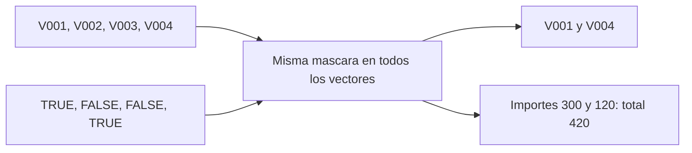

# 06.03 — Seleccionar elementos

[Inicio](../../../README.md) / [Módulo 06](../README.md) / **Lección 06.03**

| Tu sesión | Qué prepararás o comprobarás |
| --- | --- |
| **Meta** | Seleccionar elementos conservando correspondencia y estructura |
| **Necesitas** | Vectores y tipos de 06.02; sesión R nueva, sin instalaciones |
| **Evidencia** | Selecciones justificadas y comparación del original con una copia |

[Preparación](#antes-de-empezar) · [Material de apoyo](#material-de-apoyo) · [Lab 06.03](../../../labs/06_r_foundations/03_subsetting/README.md) · [Comprobar](#evidencia-y-criterio-de-salida)

<a id="propósito-prerrequisitos-y-objetivos"></a>

## Propósito

En [06.02 — Objetos, vectores y tipos](../02_objects_vectors/README.md) calculaste
cuatro ventas con total 660 MXN. Ahora seleccionaremos algunas de esas ventas
por posición, nombre y una máscara lógica. También preguntaremos qué estructura
devuelve cada operador, no solo qué número aparece en pantalla.

## Antes de empezar

Esta lección es esencial. Reutiliza c, asignación, length, typeof, class y ejecución
desde una sesión nueva de [06.01](../01_r_session/README.md). No se instalan paquetes.
Introduciremos una comparación simple y una lista mínima para entender la selección;
sus reglas completas pertenecen a 06.04–06.05. Las tablas se desarrollan en 06.05.

## Qué vas a aprender

- Seleccionar, excluir y reordenar desde la posición 1.
- Usar nombres completos y máscaras manteniendo la correspondencia.
- Distinguir `[` de `[[` y `$` por valor y estructura.
- Reconocer resultados vacíos, faltantes y errores.

## Material de apoyo

| Recurso | Para qué sirve | Uso |
| --- | --- | --- |
| [Selección de ventas](seleccionar_ventas.R) | Contrastar posiciones, nombres, máscaras y estructuras | Para el recorrido |

Abre los archivos donde se indican en el recorrido; conserva las fuentes y
guarda tus variantes y entregas en tu copia personal. Lee las comprobaciones y los resultados esperados antes de ejecutar.

## 1. La posición inicial es 1

Conservamos exactamente las cuatro observaciones anteriores:

```r
id_venta <- c("V001", "V002", "V003", "V004")
unidades <- c(4L, 2L, 0L, 3L)
precio_mxn <- c(75, 120, 50, 40)
importe_mxn <- unidades * precio_mxn
```

| Posición | Venta | Unidades | Precio MXN | Importe MXN |
| --- | --- | --- | --- | --- |
| 1 | V001 | 4 | 75 | 300 |
| 2 | V002 | 2 | 120 | 240 |
| 3 | V003 | 0 | 50 | 0 |
| 4 | V004 | 3 | 40 | 120 |

Los corchetes indican qué posiciones quieres conservar. Se abren y cierran
alrededor del índice, a continuación del vector.

```r
print(id_venta[1])           # "V001"
print(importe_mxn[c(4, 1)])  # 120 300
print(importe_mxn[c(1, 1)])  # 300 300: repetir un indice repite el valor.
```

R sigue el orden que solicitas. Pedir 4 y 1 no significa «desde 4 hasta 1»:
es elegir dos posiciones concretas. Repetir la posición 1 crea dos apariciones
en el resultado; sumarlas duplicaría esa observación respecto de la fuente.
El vector original permanece igual mientras no le asignes una modificación.

Para excluir posiciones, usa índices negativos:

```r
print(importe_mxn[-c(2, 4)]) # 300 0: excluye segunda y cuarta posiciones.
print(importe_mxn[0])       # numeric(0): ninguna posicion.
print(importe_mxn[])        # 300 240 0 120: todas las posiciones.
```

0 no selecciona el primer elemento ni el último: produce una selección vacía.
Un índice vacío entre corchetes selecciona todo. No mezcles posiciones positivas
y negativas: `importe_mxn[c(-1, 2)]` es un error, porque mezcla excluir y conservar.
Usa posiciones enteras; un índice como 1.9 se trunca y puede seleccionar la primera
posición sin aviso. No es una validación de una posición bien formada.

## 2. Nombres: etiquetas que acompañan al valor

El vector id_venta contiene identificadores, pero tenerlo cerca no pone
automáticamente etiquetas en importe_mxn. Vamos a nombrar una copia:

```r
importes_por_venta <- importe_mxn
names(importes_por_venta) <- id_venta
print(names(importes_por_venta))
print(importes_por_venta[c("V004", "V001")]) # Nombres V004/V001 y valores 120/300.
```

`names(...) <- ...` asigna etiquetas al vector. En este ejemplo hay exactamente
cuatro nombres para cuatro valores y sabemos que corresponden por posición.
Las etiquetas se conservan al seleccionar con `[`. Pedir un nombre no reordena
otros vectores ni combina archivos: no es una unión por claves.

Los nombres pueden repetirse en R; no establecen una restricción de unicidad.
Para utilizar este vector como consulta de ventas, necesitamos que los nombres
sean únicos y correspondan al dato correcto. La extracción de un nombre repetido
puede devolver solo la primera coincidencia, no todas las ventas con ese texto.
No confundas esa consulta con filtrar varias observaciones por una condición.
[Referencia oficial de names](https://stat.ethz.ch/R-manual/R-patched/library/base/html/names.html).

Con `[` los nombres se buscan completos: "V00" no abrevia "V001". Si un nombre
no existe en este vector atómico, la selección puede devolver NA sin error.
NA es un valor faltante, no cero ni una venta nueva; su tratamiento sigue en 06.04.
Comprueba que el nombre solicitado pertenece a la fuente antes de interpretarlo.

## 3. Una máscara lógica decide por posición

Una máscara es un vector de TRUE/FALSE que indica qué elementos conservar:

```r
elegidas <- c(TRUE, FALSE, FALSE, TRUE)
print(id_venta[elegidas])    # "V001" "V004"
print(importe_mxn[elegidas]) # 300 120
print(sum(importe_mxn[elegidas])) # 420
```

TRUE conserva; FALSE descarta de **esta selección**, no del archivo original.
Una máscara recorre el orden original: a diferencia del índice c(4, 1), no pide
invertir las observaciones. Exigimos una decisión para cada una de las cuatro
posiciones. La longitud correcta tampoco demuestra que la máscara represente
la pregunta adecuada: hay que explicar qué significa cada TRUE.



Sin renderizador: aplicamos la misma decisión a identificadores, cantidades y
precios/importes. Si seleccionas con índices distintos en cada vector, puedes
mezclar el precio de una venta con las unidades de otra aunque las longitudes
finales coincidan.

### Anticipo explicado: construir la máscara con una comparación

`>` compara cada cantidad con el número indicado y produce TRUE/FALSE. Usaremos
solo este caso; combinar condiciones y tratar NA pertenece a 06.04.

```r
con_unidades <- unidades > 0L
print(con_unidades)            # TRUE TRUE FALSE TRUE
print(id_venta[con_unidades])  # V001 V002 V004
print(length(id_venta[con_unidades])) # 3
print(sum(importe_mxn[con_unidades])) # 660
```

La pregunta es «ventas con unidades positivas». La venta de cero unidades sigue
siendo válida en la fuente de cuatro registros. El total continúa siendo 660,
pero ahora se describen tres ventas: **un total igual no demuestra igual selección**.
Conserva también identificadores, conteo y regla aplicada.
[Referencia de comparaciones](https://stat.ethz.ch/R-manual/R-patched/library/base/html/Comparison.html).

Una máscara corta puede reciclarse sin avisar: `importe_mxn[c(TRUE, FALSE)]`
conserva posiciones 1 y 3, con importes 300 y 0. R repite TRUE/FALSE. No adoptes
ese resultado por haber terminado con código 0. Para este análisis la máscara
debe tener longitud 4. Una máscara con NA introduce incertidumbre en la selección;
no se reemplaza por FALSE sin una regla, y se desarrollará en 06.04.

## 4. Un elemento y un subconjunto no siempre son lo mismo

En este vector atómico nombrado:

```r
print(importes_por_venta["V004"])   # Valor 120 con nombre V004.
print(importes_por_venta[["V004"]]) # Valor 120 sin nombre.
print(typeof(importes_por_venta["V004"]))   # "double"
print(typeof(importes_por_venta[["V004"]])) # "double"
```

`[` devuelve el subconjunto y conserva su etiqueta. `[[` extrae un elemento y
quita el nombre de ese elemento en este vector. Ambos resultados tienen longitud
1 y tipo double; no aparece un nuevo tipo «escalar» como requisito para el valor.
`[[` no es la forma de elegir dos posiciones de un vector atómico.

### Vista mínima de una lista para entender `$`

Necesitamos introducir el contenedor antes de utilizarlo. `list` crea componentes
que pueden guardar objetos distintos. Esta lista tiene **dos componentes**:
un vector con cuatro importes y un texto con la moneda. No es todavía una tabla.
Las listas y data frames se desarrollarán en 06.05.

```r
paquete_ventas <- list(importes = importes_por_venta, moneda = "MXN")
print(length(paquete_ventas))              # 2 componentes.
print(typeof(paquete_ventas["importes"])) # "list"
print(length(paquete_ventas["importes"])) # 1 componente, que contiene un vector.
print(typeof(paquete_ventas[["importes"]])) # "double"
print(length(paquete_ventas[["importes"]])) # 4 importes, no 1.
print(paquete_ventas$moneda)               # "MXN"
```

| Expresión sobre esta lista | Resultado | Longitud |
| --- | --- | --- |
| paquete_ventas["importes"] | Lista que conserva un componente | 1 |
| paquete_ventas[["importes"]] | Vector nombrado contenido en el componente | 4 |
| paquete_ventas$importes | Ese mismo vector, usando nombre literal | 4 |

Extraer **un componente** no significa que su contenido tenga longitud 1. La
metáfora «[[ siempre devuelve un solo número» falla con esta lista. Por su parte,
`$` no sirve para extraer de nuestros vectores atómicos: `importe_mxn$V001` es un
error, aunque pongas nombres a sus elementos.

Si el nombre está en una variable, usa `[[`:

```r
campo <- "importes"
print(paquete_ventas[[campo]]) # Busca el contenido del nombre guardado en campo.
```

`paquete_ventas$campo` buscaría literalmente un componente llamado campo. Aquí
no existe y se obtiene NULL, que indica ausencia de componente; no se sustituye
por un importe cero. Los comportamientos de NULL/NA se profundizarán en 06.04–06.05.

En las listas base de este ejemplo, `$` puede aceptar un nombre abreviado si
la coincidencia es única; no dependas de esa búsqueda parcial. Usa los nombres
completos y `[[campo]]`, cuya coincidencia por nombre es exacta por defecto.
[Referencia oficial de extracción](https://stat.ethz.ch/R-manual/R-patched/library/base/html/Extract.html).

## 5. Fronteras: vacío, faltante y error

Estas predicciones se refieren a **nuestro vector atómico de cuatro importes**;
no son reglas universales para listas, matrices u otras clases:

| Solicitud | Resultado esperado | Interpretación |
| --- | --- | --- |
| importe_mxn[0] | numeric(0) | Ninguna posición elegida |
| importe_mxn[5] | NA | Posición que no existe; no se crea una venta |
| importe_mxn[[5]] | Error | No hay un elemento para extraer |
| importes_por_venta["V999"] | NA con etiqueta faltante | Nombre no encontrado |
| importes_por_venta[["V999"]] | Error | Nombre inexistente en ese vector atómico |
| importe_mxn[c(1, 1)] | 300, 300 | Se pidió dos veces el mismo elemento |

Un vector vacío no contiene una observación de cero. Un NA no prueba saldo
cero. Y la ausencia de error no prueba que una selección sea válida. En listas,
una extracción por nombre inexistente con `[[` puede devolver NULL: el tipo de
objeto importa. Conserva la pregunta «¿qué objeto estoy seleccionando?».

## 6. Cambiar una parte en una copia

Los corchetes a la izquierda de <- indican qué parte se va a reemplazar:

```r
precios_variante <- precio_mxn
precios_variante[4] <- 60
print(precios_variante)             # 75 120 50 60
print(precio_mxn)                   # 75 120 50 40: entrada conservada.
print(sum(unidades * precios_variante)) # 720
```

Es la variante del lab 06.02, ahora con modificación de una posición. Para estos
vectores sencillos, modificar la copia no cambia el original. No generalices esta
explicación a entornos u objetos con semánticas distintas. Mantén tipo y rango de
la entrada: asignar "60" como texto puede convertir todo el vector a character,
como viste en 06.02. Escribir fuera de sus posiciones también puede extenderlo;
revisa longitud y valores después de modificar, no solo el total.

## 7. Ejecutar y comprobar

[seleccionar_ventas.R](seleccionar_ventas.R) define las cuatro ventas y muestra
selecciones por posición/nombre/máscara, la lista mínima y la variante. No escribe
archivos ni depende del estado de 06.02. Parte de la raíz del repositorio y usa
el R elegido en 06.01, sin cambiar instalaciones. Elige el recorrido de tu shell.

### Desde RStudio o el IDE elegido

Abre la carpeta del repositorio y [seleccionar_ventas.R](seleccionar_ventas.R).
Comprueba con `getwd()` que R trabaja desde la raíz de DS Track, como en
[06.01](../01_r_session/README.md#4-pasar-de-la-consola-a-un-archivo-que-se-pueda-repetir).
Lee y ejecuta bloques del archivo desde el editor; inspecciona los objetos y
contrasta lo impreso con las predicciones. Guarda tus variantes en una copia
personal. Para comprobarlas, guarda el archivo, reinicia la sesión R y ejecuta
el script completo sin recuperar objetos anteriores.

La consola R recibe instrucciones de R. Los comandos `Rscript` siguientes
pertenecen a la terminal del sistema; elige uno de los recorridos completos
como apoyo para comprobar el mismo archivo.

### PowerShell

```powershell
$rscriptCurso = "C:/Program Files/R/R-4.6.1/bin/Rscript.exe"
& $rscriptCurso --version
& $rscriptCurso --vanilla curriculum/06_r_foundations/03_subsetting/seleccionar_ventas.R
$LASTEXITCODE
```

### Bash/Zsh

```bash
command -v Rscript
Rscript --version
Rscript --vanilla curriculum/06_r_foundations/03_subsetting/seleccionar_ventas.R
echo $?
```

### CMD / Anaconda Prompt

```bat
set "RSCRIPT_CURSO=C:\Program Files\R\R-4.6.1\bin\Rscript.exe"
"%RSCRIPT_CURSO%" --version
"%RSCRIPT_CURSO%" --vanilla curriculum/06_r_foundations/03_subsetting/seleccionar_ventas.R
echo %ERRORLEVEL%
```

Adapta la ruta Windows a tu instalación si es distinta. Se espera código 0 sin
avisos de selección: posiciones 4/1 dan V004/V001 e importes 120/300; la máscara
primera/cuarta conserva V001/V004 y suma 420. Unidades positivas conserva tres
ventas y suma 660. La variante del cuarto precio produce 720; la fuente conserva
las cuatro ventas y sus precios originales. Registra también versión y sesión.

Para ejecutar desde consola R en la raíz:
`source("curriculum/06_r_foundations/03_subsetting/seleccionar_ventas.R", encoding = "UTF-8")`.
Prueba los errores del texto por separado, en la consola o en una copia personal;
no los introduzcas dentro del archivo correcto y no ocultes sus mensajes.

<details>
<summary>Ampliación opcional: conservar una dimensión</summary>

Una matriz agrupa valores del mismo tipo en filas/columnas. Para observar solo
la forma, usamos los cuatro importes en una columna. matrix construye la matriz,
ncol indica cantidad de columnas y dim consulta sus dimensiones:

```r
matriz_importes <- matrix(importe_mxn, ncol = 1)
print(dim(matriz_importes)) # 4 1
print(matriz_importes[, 1]) # Vector de cuatro valores: la dimension se simplifica.
print(dim(matriz_importes[, 1])) # NULL: ese vector ya no es matriz.
print(dim(matriz_importes[, 1, drop = FALSE])) # 4 1: conserva matriz.
```

En esta selección bidimensional, antes de la coma van filas y después columnas.
Dejar filas vacías significa todas las filas; 1 elige la primera columna.
drop = FALSE conserva dimensiones. Este ejemplo no es un data frame ni reemplaza
el modelo de ventas con columnas de tipos distintos; filas/columnas de tablas se
retomarán en 06.05. No se exige dominar matrices para continuar.
[Referencia de matrices](https://stat.ethz.ch/R-manual/R-patched/library/base/html/matrix.html).

</details>

<a id="práctica-criterio-de-salida-y-continuidad"></a>

## Práctica

Realiza el [lab 06.03](../../../labs/06_r_foundations/03_subsetting/README.md) para
predecir selecciones y comprobar identidad, tipo y longitud sin modificar la fuente.

## Evidencia y criterio de salida

| Conserva | Comprueba | Explica |
| --- | --- | --- |
| Predicciones y selecciones | Valores, tipos, longitudes y orden obtenidos | Subconjunto frente a contenido de un elemento |
| Original, copia y nota de fronteras | Correspondencia entre vectores, vacío, faltante y error | Por qué una selección válida no prueba que la pregunta sea correcta |

Puedes avanzar cuando predigas valores/tipos/longitudes, mantengas la
correspondencia de las entradas y distingas subconjunto de contenido.

Quien aprende realiza la práctica y explica las decisiones; su compañero revisa.
Tu compañero pide seleccionar las mismas ventas por nombre y por posición y explicar sus formas.
Guarda evidencia, ayudas y dudas en una nota personal junto a tu práctica.
PROGRESS.md registra desarrollo editorial, no tu expediente de aprendizaje.
No hay proyecto integrador ni checkpoint implementado asociado; las copias de
práctica no acreditan los proyectos pendientes del catálogo.

<a id="referencias-y-atribución"></a>

## Referencias

Ejemplos propios de DS Track sobre las cuatro ventas de 06.02. Consulta:
2026-10-15. [Selección en Advanced R, segunda edición](https://adv-r.hadley.nz/subsetting.html),
de Hadley Wickham, aporta el marco conceptual; no se exige todo el capítulo.
Se contrastan casos concretos con documentación oficial y R 4.6.1 local, sin
paquetes externos. Las páginas R-patched pueden describir otra versión: consulta
la ayuda instalada para el objeto y versión que utilices. La
[guía de lecturas](../../../docs/r-reading-guide.md) ubica libros y coautorías.

## Siguiente paso

Después de la práctica y su comprobación, continúa con
[06.04 — Lógica y valores faltantes](../04_logic_missing/README.md).

[← Módulo 06](../README.md) · [Lab 06.03](../../../labs/06_r_foundations/03_subsetting/README.md) · [Siguiente →](../04_logic_missing/README.md)
