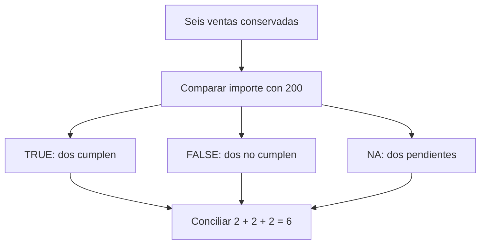

# 06.04 — Lógica y valores faltantes

[Inicio](../../../README.md) / [Módulo 06](../README.md) / **Lección 06.04**

| Tu sesión | Qué prepararás o comprobarás |
| --- | --- |
| **Meta** | Construir condiciones sin perder incertidumbre ni cobertura |
| **Necesitas** | Vectores de 06.02 y selección de 06.03; R sin paquetes nuevos |
| **Evidencia** | Tres grupos conciliados y resumen con conocidos y pendientes |

[Preparación](#antes-de-empezar) · [Material de apoyo](#material-de-apoyo) · [Lab 06.04](../../../labs/06_r_foundations/04_logic_missing/README.md) · [Comprobar](#evidencia-y-criterio-de-salida)

<a id="propósito-y-prerrequisitos"></a>

## Propósito

Una pregunta como «¿qué ventas alcanzan 200 pesos?» necesita una regla y datos
para evaluarla. Si falta un importe, todavía no sabemos si esa venta cumple.
En esta lección construiremos condiciones conservando esa incertidumbre y
calcularemos un resumen que declare cuántos valores pudo utilizar.

## Antes de empezar

**Alcance esencial.** Retoma [vectores y tipos, 06.02](../02_objects_vectors/README.md)
y [selección, 06.03](../03_subsetting/README.md): operaciones por posición,
longitudes, máscaras y modificación de una copia. Necesitas R y una sesión nueva;
RStudio es opcional. Usamos funciones incluidas con R, sin instalar paquetes.
Tablas completas se desarrollan en 06.05; funciones e `if`, en 06.06.

## Qué vas a aprender

- Construir comparaciones y combinarlas con `&`, `|` y `!`.
- Distinguir una condición por registro de una respuesta sobre todo el vector.
- Reconocer `NA`, `NaN`, `NULL` y cero, sin intercambiarlos.
- Separar cumplimiento, incumplimiento conocido y casos pendientes.
- Justificar `na.rm` con conteos y cobertura, también ante entradas vacías.

## Material de apoyo

| Recurso | Para qué sirve | Uso |
| --- | --- | --- |
| [Lógica y faltantes](logica_faltantes.R) | Evaluar condiciones y resúmenes conservando pendientes | Para el recorrido |

Abre los archivos donde se indican en el recorrido; conserva las fuentes y
guarda tus variantes y entregas en tu copia personal. Lee las comprobaciones y los resultados esperados antes de ejecutar.

## 1. Una muestra nueva que conserva las cuatro ventas anteriores

Cada posición sigue representando la misma venta en todos los vectores. Las
primeras cuatro ventas son las de 06.02; añadimos dos casos con información
pendiente. `NA` representa un valor faltante. Al combinarlo con enteros en
`unidades`, se convierte al tipo entero; en `precio_mxn`, al tipo double.

```r
id_venta <- c("V001", "V002", "V003", "V004", "V005", "V006")
unidades <- c(4L, 2L, 0L, 3L, NA, 2L)
precio_mxn <- c(75, 120, 50, 40, 100, NA)
importe_mxn <- unidades * precio_mxn
print(importe_mxn) # 300 240 0 120 NA NA
```

V003 tiene cero unidades conocidas y su importe es cero. En V005 faltan unidades;
en V006 falta precio. No sustituimos ninguno por cero: eso afirmaría algo que
la fuente no dice. La multiplicación propaga los faltantes de estos ejemplos.
Conservamos los scripts y resultados anteriores; esta muestra los amplía en otro archivo.

## 2. Comparar devuelve un vector lógico

| Operador | Pregunta | Ejemplo |
| --- | --- | --- |
| `==` | ¿Son iguales? | `unidades == 0L` |
| `!=` | ¿Son distintos? | `unidades != 0L` |
| `<`, `<=` | ¿Menor, o menor o igual? | `importe_mxn < 200` |
| `>`, `>=` | ¿Mayor, o mayor o igual? | `importe_mxn >= 200` |

`<-` asigna; `==` compara. La comparación entre un vector y el umbral escalar
repite ese único umbral para cada posición, como vimos en 06.02.

```r
cumple_umbral <- importe_mxn >= 200
print(cumple_umbral) # TRUE TRUE FALSE FALSE NA NA
print(typeof(cumple_umbral)) # "logical"
print(length(cumple_umbral)) # 6
```

Los cuatro importes conocidos producen respuestas conocidas. Un importe faltante
produce una respuesta desconocida. No interpretamos `NA` como `FALSE`.
Las comparaciones numéricas con decimales calculados pueden requerir tolerancia;
`==` no elimina el problema de precisión explicado en 06.02. Nuestros importes
pequeños enteros permiten resultados exactos en estos ejemplos.

## 3. Combinar condiciones por posición

`&` exige ambas condiciones, `|` acepta al menos una y `!` niega una condición.
Los paréntesis dejan claro qué comparación forma cada operando. Cada máscara
de este recorrido tiene la misma longitud y orden que los datos; no dependemos
del reciclaje de máscaras cortas.

```r
entre_100_y_250 <- (importe_mxn >= 100) & (importe_mxn <= 250)
print(entre_100_y_250) # FALSE TRUE FALSE TRUE NA NA
cero_o_alto <- (importe_mxn == 0) | (importe_mxn >= 200)
print(cero_o_alto) # TRUE TRUE TRUE FALSE NA NA
print(!cumple_umbral) # FALSE FALSE TRUE TRUE NA NA
```

No escribas una desigualdad encadenada como `100 <= importe_mxn <= 250`:
R no acepta esa sintaxis. Escribe las dos comparaciones y combínalas.

Con un dato desconocido, a veces el resultado sí puede decidirse:

| Expresión | Resultado | Motivo |
| --- | --- | --- |
| `FALSE & NA` | `FALSE` | Ya falla una condición necesaria |
| `TRUE & NA` | `NA` | Falta saber si se cumple la otra |
| `TRUE | NA` | `TRUE` | Ya hay una condición suficiente |
| `FALSE | NA` | `NA` | La otra todavía podría cumplirse |
| `!NA` | `NA` | Negar lo desconocido sigue siendo desconocido |

Estas son reglas de lógica con tres estados, no una orden de borrar faltantes.
Puedes reproducir cada expresión en consola. Consulta la ayuda local `?Logic`
y la [referencia oficial de operadores lógicos](https://stat.ethz.ch/R-manual/R-patched/library/base/html/Logic.html).

## 4. Detectar faltantes y conservar su identidad

`is.na(x)` devuelve una respuesta lógica por posición e identifica faltantes.
`!is.na(x)` identifica los valores presentes. La comparación `x == NA` intenta
comparar con algo desconocido y no sirve para localizarlo:

```r
print(importe_mxn == NA) # NA NA NA NA NA NA
print(is.na(importe_mxn)) # FALSE FALSE FALSE FALSE TRUE TRUE
print(is.na("NA")) # FALSE: es texto de dos letras, no el valor NA.
print(id_venta[cumple_umbral]) # "V001" "V002" NA NA
```

En la última selección, la máscara desconocida produce elementos desconocidos;
no recupera los identificadores de las ventas pendientes. Construimos tres
máscaras sin faltantes y conservamos los tres grupos:

```r
conocida <- !is.na(cumple_umbral)
cumplen <- conocida & cumple_umbral
no_cumplen <- conocida & !cumple_umbral
pendientes <- is.na(cumple_umbral)
print(id_venta[cumplen]) # "V001" "V002"
print(id_venta[no_cumplen]) # "V003" "V004"
print(id_venta[pendientes]) # "V005" "V006"
print(c(sum(cumplen), sum(no_cumplen), sum(pendientes))) # 2 2 2
```

Cuando `conocida` es falsa, `FALSE & NA` resulta falso; por eso las dos primeras
máscaras ya no tienen `NA`. La tercera conserva esos registros como pendientes.
`sum` cuenta verdaderos al sumar lógicos: `TRUE` aporta 1 y `FALSE`, 0.
Los grupos son disjuntos y sus conteos concilian: 2 + 2 + 2 = 6.
«No cumple el umbral» no significa «dato inválido»: V003 y V004 tienen importes conocidos.



Sin renderizador: cada venta recibe una de tres respuestas; guardamos sus
identificadores y conciliamos los tres conteos con la entrada original.
La [ayuda oficial de NA](https://stat.ethz.ch/R-manual/R-patched/library/base/html/NA.html)
explica la detección y la propagación de faltantes.

## 5. Resumir: declarar la cobertura antes de interpretar

`sum` suma y `mean` calcula la media aritmética. Por defecto no omiten faltantes:

```r
print(sum(importe_mxn)) # NA
print(mean(importe_mxn)) # NA
importe_conocido <- !is.na(importe_mxn)
n_conocidos <- sum(importe_conocido)
n_faltantes <- sum(!importe_conocido)
cobertura_pct <- 100 * n_conocidos / length(importe_mxn)
print(c(n_conocidos, n_faltantes)) # 4 2
print(cobertura_pct) # Aproximadamente 66.66667
suma_observada_mxn <- sum(importe_mxn, na.rm = TRUE)
media_observada_mxn <- mean(importe_mxn, na.rm = TRUE)
print(suma_observada_mxn) # 660
print(media_observada_mxn) # 165: 660 / 4, incluido el cero observado.
```

`na.rm = TRUE` pide omitir los valores faltantes **en ese cálculo**; no modifica
el vector fuente. La suma 660 corresponde a cuatro importes observados, con
dos faltantes y cobertura 4/6. El total de las seis ventas sigue desconocido.
Que 660 coincida con el total de la muestra anterior no completa las dos ventas
nuevas. La media 165 utiliza cuatro observaciones, no seis.

Incluso al contar condiciones conviene declarar los pendientes:

```r
print(sum(cumple_umbral)) # NA
print(sum(cumple_umbral, na.rm = TRUE)) # 2 cumplimientos confirmados.
print(sum(is.na(cumple_umbral))) # 2 respuestas pendientes.
```

Omitir faltantes puede ser una decisión razonable para describir lo observado;
no demuestra que esos datos representen las ventas ausentes. No imputamos cero,
no eliminamos registros de la fuente y no presentamos una suma parcial como total.
[Documentación de sum](https://stat.ethz.ch/R-manual/R-patched/library/base/html/sum.html)
y [mean](https://stat.ethz.ch/R-manual/R-patched/library/base/html/mean.html).

### Cuando no hay ningún valor conocido

`NA_real_` es un faltante de tipo double. `numeric(0)` construye un vector numérico
vacío: no hay posiciones. Son situaciones distintas, aunque ninguna permita
calcular una media observada.

```r
solo_faltantes <- c(NA_real_, NA_real_)
vacio <- numeric(0)
print(length(solo_faltantes)) # 2 registros, ambos sin valor.
print(sum(!is.na(solo_faltantes))) # 0 valores conocidos.
print(sum(solo_faltantes, na.rm = TRUE)) # 0
print(mean(solo_faltantes, na.rm = TRUE)) # NaN
print(length(vacio)) # 0 registros.
print(sum(vacio)) # 0
print(mean(vacio)) # NaN
```

R define la suma de un conjunto vacío como cero; tras omitir todos los faltantes
no quedan valores. Ese cero no acredita un importe observado. Antes de informar
un indicador, comprueba registros y valores conocidos. Para estos dos casos,
registra «sin valores observados; media no calculable», distinguiendo fuente
vacía de fuente con faltantes. La cobertura 0/2 es 0%; con cero registros, 0/0 no
define un porcentaje. Automatizaremos decisiones de este tipo con `if` en 06.06.

## 6. Una respuesta sobre todo el vector

`any` pregunta si alguna condición es verdadera; `all`, si todas lo son. Devuelven
un lógico de longitud uno. No reemplazan la máscara por registro.

```r
print(any(cumple_umbral)) # TRUE: hay cumplimientos confirmados.
print(all(cumple_umbral)) # FALSE: hay incumplimientos confirmados.
print(any(c(FALSE, NA))) # NA: todavia podria haber un TRUE.
print(all(c(TRUE, NA))) # NA: falta saber si todos cumplen.
print(any(logical(0))) # FALSE
print(all(logical(0))) # TRUE
```

`logical(0)` es un vector lógico vacío. El `TRUE` de `all` sobre un vacío no prueba
que llegaron datos. Con `na.rm = TRUE` también puedes acabar evaluando un vacío
tras quitar todos los faltantes; informa la cobertura antes de aceptar ese resultado.
[Ayuda de all](https://stat.ethz.ch/R-manual/R-patched/library/base/html/all.html)
y [any](https://stat.ethz.ch/R-manual/R-patched/library/base/html/any.html).

`&&` y `||` combinan condiciones de **longitud uno** y evalúan de izquierda a
derecha. Hacen cortocircuito: `&&` no evalúa la derecha si la izquierda ya es
`FALSE`; `||` no la evalúa si la izquierda ya es `TRUE`. Con `NA` a la izquierda
pueden necesitar la derecha para decidir, según la tabla anterior.

```r
hay_registros <- length(importe_mxn) > 0L
todos_conocidos <- all(!is.na(importe_mxn))
print(hay_registros && todos_conocidos) # FALSE
print(hay_registros || todos_conocidos) # TRUE: basta con que haya registros.
print((length(vacio) > 0L) && all(!is.na(vacio))) # FALSE
```

Aquí cada operando tiene longitud uno. Para seleccionar registros usamos `&`
y `|`; para combinar preguntas sobre el conjunto usamos `&&` y `||` cuando
sus operandos ya son escalares. En R 4.6.1, `cumple_umbral && TRUE` y
`cumple_umbral || FALSE` producen error por longitud mayor que uno. Pruébalos
por separado si quieres reconocer el mensaje; no los añadas al script correcto.
No dependas de comportamientos antiguos que solo tomaban el primer elemento.

## 7. Cero, NA, NaN y NULL responden a preguntas distintas

| Valor | Significado en estos ejemplos | Longitud | Cómo reconocerlo |
| --- | --- | --- | --- |
| `0` | Cantidad observada igual a cero | 1 | Comparación, si el dato está presente |
| `NA_real_` | Número faltante | 1 | `is.na` |
| `NaN` | Resultado numérico indefinido, como `0 / 0` | 1 | `is.nan` y también `is.na` |
| `NULL` | Ausencia de objeto/componente | 0 | `is.null` |

```r
print(is.na(c(0, NA_real_, NaN))) # FALSE TRUE TRUE
print(is.nan(c(NA_real_, NaN))) # FALSE TRUE
print(is.null(NULL)) # TRUE
print(c(75, NULL, 40)) # 75 40: NULL no reserva una posicion.
print(c(75, NA, 40)) # 75 NA 40: NA si conserva esa posicion.
```

`is.na` incluye `NaN`; si necesitas distinguir una medición ausente de un cálculo
indefinido, revisa también `is.nan` y el origen del resultado. `NULL` ya apareció
al seleccionar un componente inexistente de una lista en 06.03. No lo uses como
relleno en un vector de ventas: acorta el vector y rompe correspondencias.
[NULL en R](https://stat.ethz.ch/R-manual/R-patched/library/base/html/NULL.html).

Como ampliación breve: `1 / 0` produce `Inf`, infinito, que no es `NA`.
`is.finite` devuelve falso para `NA`, `NaN` e infinitos. Por eso «no falta»
no demuestra «válido para mi regla»: todavía hay que comprobar finitud, rangos
y unidades cuando corresponda. La validación de archivos se desarrolla en 06.07.
[Números finitos y NaN](https://stat.ethz.ch/R-manual/R-patched/library/base/html/is.finite.html).

## 8. Ejecutar el ejemplo completo

El [script logica_faltantes.R](logica_faltantes.R) integra la muestra y los
resúmenes, sin escribir archivos ni incluir errores deliberados. Desde la raíz
del repositorio, elige un solo recorrido. Ajusta la ruta de R a tu instalación;
no instales otra versión si tu entorno ya es adecuado. `--vanilla` inicia sin
restaurar una sesión guardada, como se explica en [06.01](../01_r_session/README.md).

### Desde RStudio o el IDE elegido

Abre la carpeta del repositorio y [logica_faltantes.R](logica_faltantes.R).
Comprueba con `getwd()` que R trabaja desde la raíz de DS Track, como en
[06.01](../01_r_session/README.md#4-pasar-de-la-consola-a-un-archivo-que-se-pueda-repetir).
Lee y ejecuta bloques del archivo desde el editor; inspecciona los objetos y
contrasta lo impreso con las predicciones. Guarda tus variantes en una copia
personal. Para comprobarlas, guarda el archivo, reinicia la sesión R y ejecuta
el script completo sin recuperar objetos anteriores.

La consola R recibe instrucciones de R. Los comandos `Rscript` siguientes
pertenecen a la terminal del sistema; elige uno de los recorridos completos
como apoyo para comprobar el mismo archivo.

### PowerShell

```powershell
Set-Location C:\bluepill5\Devs\ds_track
& "C:\Program Files\R\R-4.6.1\bin\Rscript.exe" --vanilla curriculum/06_r_foundations/04_logic_missing/logica_faltantes.R
$LASTEXITCODE
```

### Bash/Zsh

```bash
cd /ruta/a/ds_track
Rscript --vanilla curriculum/06_r_foundations/04_logic_missing/logica_faltantes.R
echo $?
```

### CMD / Anaconda Prompt

```bat
cd /d C:\bluepill5\Devs\ds_track
"C:\Program Files\R\R-4.6.1\bin\Rscript.exe" --vanilla curriculum/06_r_foundations/04_logic_missing/logica_faltantes.R
echo %ERRORLEVEL%
```

La ruta explícita de Windows selecciona R independiente; no requiere modificar
Anaconda ni instalar en base. En consola R, desde la raíz, puedes usar
`source("curriculum/06_r_foundations/04_logic_missing/logica_faltantes.R", encoding = "UTF-8")`.

Se espera código 0: grupos V001/V002, V003/V004 y V005/V006; conteos 2/2/2,
cuatro importes conocidos, dos faltantes, cobertura aproximada 66.67%, suma
observada 660 y media observada 165. Los `NA` y `NaN` mostrados son resultados
explicados, no errores de ejecución. Registra también versión y sesión.
No ocultes avisos inesperados: identifica su causa con ayuda de 06.01.

<a id="práctica-criterio-de-salida-y-continuidad"></a>

## Práctica

Realiza el [lab 06.04](../../../labs/06_r_foundations/04_logic_missing/README.md) para
separar cumplimiento, incumplimiento conocido y pendientes y justificar el resumen.

## Evidencia y criterio de salida

| Conserva | Comprueba | Explica |
| --- | --- | --- |
| Máscaras y tres grupos | Filas conservadas y partición completa de la entrada | Por qué una condición desconocida no equivale a FALSE |
| Resumen y casos frontera | Conocidos, pendientes, cobertura y entrada vacía | Diferencias entre NA, NaN, NULL y cero; alcance de na.rm |

Puedes avanzar cuando expliques una condición desconocida, conserves sus
registros, concilies los grupos e interpretes un resumen parcial y un caso sin observaciones.

Quien aprende realiza la práctica y explica las decisiones; su compañero revisa.
Tu compañero deja un importe pendiente y pide explicar qué puede afirmarse del total.
Guarda evidencia, ayudas y dudas en una nota personal junto a tu práctica.
PROGRESS.md registra desarrollo editorial, no tu expediente de aprendizaje.
No hay proyecto integrador ni checkpoint implementado asociado; las copias de
práctica no acreditan los proyectos pendientes del catálogo.

<a id="referencias-y-atribución"></a>

## Referencias

Ejemplos propios de DS Track; consulta: 2026-10-16. El capítulo
[Logical vectors de R for Data Science, segunda edición](https://r4ds.hadley.nz/logicals.html),
de Hadley Wickham, Mine Çetinkaya-Rundel y Garrett Grolemund, orienta preguntas
sobre condiciones y faltantes. El libro trabaja también con dplyr; esta sección
usa R base y no requiere esos paquetes ni copiar sus ejercicios.
Las referencias oficiales enlazadas sustentan las reglas; los ejemplos se
comprobaron con R 4.6.1. R-patched puede describir otra versión: contrasta con
la ayuda instalada (`?NA`, `?sum`, `?any`, `?all`) y registra tu sesión.
La [guía de lecturas](../../../docs/r-reading-guide.md) ubica libros y ediciones.

## Siguiente paso

Después de la práctica y su comprobación, continúa con
[06.05 — Listas y data frames](../05_lists_data_frames/README.md).

[← Módulo 06](../README.md) · [Lab 06.04](../../../labs/06_r_foundations/04_logic_missing/README.md) · [Siguiente →](../05_lists_data_frames/README.md)
