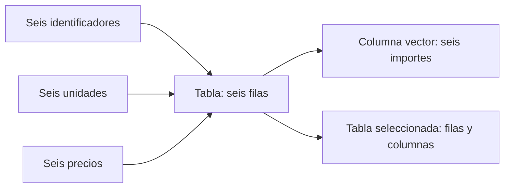

# 06.05 — Listas y data frames

## Propósito y prerrequisitos

Hasta ahora una venta ocupa la misma posición en varios vectores. Una tabla
permite consultar esa venta con sus unidades, precio e importe juntos. Antes
conoceremos las listas: pueden reunir componentes distintos sin convertirlos
todos al mismo tipo.

**Alcance esencial.** Retoma [06.02 — Vectores y tipos](../02_objects_vectors/README.md),
[06.03 — Selección](../03_subsetting/README.md) y
[06.04 — Lógica y faltantes](../04_logic_missing/README.md).
Necesitas R y una sesión nueva; RStudio es opcional. Usamos R base y utils,
incluidos con R, sin instalar paquetes. Funciones y control de flujo llegan
en 06.06; archivos, en 06.07; tibble y dplyr, en el módulo 07.

Al terminar podrás:

- Construir una lista y explicar sus componentes, nombres y longitudes.
- Construir una tabla con una venta por fila y tipos por columna.
- Inspeccionar `names`, `str`, `dim`, `nrow`, `ncol` y `length`.
- Extraer una columna como vector o conservarla como tabla.
- Seleccionar filas completas sin perder la identidad ni los pendientes.
- Modificar una copia y recalcular una columna dependiente.

## 1. Una lista reúne componentes diferentes

`list()` crea una lista. Cada componente puede contener un objeto distinto:
un texto, un vector entero o incluso otra lista. Los componentes no tienen
que compartir tipo ni longitud. Aquí describimos una venta y una nota:

```r
ficha <- list(
  id_venta = "V001",
  unidades = 4L,
  precio_mxn = 75,
  notas = c("Venta ficticia", "Precio confirmado")
)
print(typeof(ficha)) # "list"
print(length(ficha)) # 4 componentes, no cuatro ventas.
print(names(ficha)) # id_venta unidades precio_mxn notas
str(ficha)
```

En `list(id_venta = "V001")`, el nombre a la izquierda de `=` etiqueta el
componente. No crea un objeto independiente llamado `id_venta`. `str`, de
*structure*, muestra una descripción breve: `chr` significa texto, `int`
entero y `num` numérico double. En esta ficha, `notas` tiene dos elementos;
los otros componentes tienen uno.

Como vimos en 06.02, `c("V001", 4L, 75)` produce texto en todas las posiciones.
La lista conserva el entero y el número dentro de sus componentes. No conviene
aplanarla para hacer cálculos: extrae primero el componente necesario.

Reutilizamos los operadores de 06.03:

```r
str(ficha["unidades"]) # Lista de un componente que contiene el entero 4.
str(ficha[["unidades"]]) # int 4: el contenido del componente.
print(ficha$unidades) # 4
print(ficha[["notas"]][2]) # "Precio confirmado"
```

En la última expresión, primero `[["notas"]]` extrae el vector de notas;
después `[2]` selecciona su segunda posición. `$` permite escribir un nombre
literal; `[["unidades"]]` busca ese nombre exacto por defecto. Si el nombre
está en un objeto, usa `campo <- "unidades"` y `ficha[[campo]]`;
`ficha$campo` buscaría literalmente un componente llamado `campo`.

Una lista puede guardar un componente `NULL`, pero asignarle `NULL` mediante
`$` o `[[` lo elimina. No es equivalente a guardar un dato faltante:

```r
ficha_copia <- ficha
ficha_copia$precio_mxn <- NA_real_
print(length(ficha_copia)) # 4: componente presente, valor faltante.
ficha_copia$precio_mxn <- NULL
print(length(ficha_copia)) # 3: componente eliminado.
print(length(ficha)) # 4: conservamos la ficha original.
```

## 2. Construir una tabla: una fila por venta

Un `data.frame` es una estructura tabular construida sobre una lista de
columnas. En esta lección las columnas son vectores atómicos: cada una tiene
su propio tipo y todas tienen una posición por fila. Una lista general como
`ficha` no tiene esa obligación rectangular ni dos dimensiones.

Reconstruimos las seis ventas de 06.04, sin modificar su script:

```r
id_venta <- c("V001", "V002", "V003", "V004", "V005", "V006")
unidades <- c(4L, 2L, 0L, 3L, NA, 2L)
precio_mxn <- c(75, 120, 50, 40, 100, NA)
print(c(length(id_venta), length(unidades), length(precio_mxn))) # 6 6 6
ventas <- data.frame(
  id_venta = id_venta,
  unidades = unidades,
  precio_mxn = precio_mxn,
  stringsAsFactors = FALSE
)
ventas$importe_mxn <- ventas$unidades * ventas$precio_mxn
print(ventas)
```

`data.frame()` construye la tabla con pares nombre/vector. Después, la
asignación a `ventas$importe_mxn` añade una columna calculada, usando solo
columnas de esa tabla. No dependemos de que una columna recién escrita dentro
de `data.frame()` pueda usarse como variable en otro argumento.

`stringsAsFactors = FALSE` explicita que los textos se conservan como texto.
Es el valor predeterminado desde R 4.0.0; no es una novedad que haya que activar
en cada sesión. Los factores son otra representación de categorías que
estudiaremos después. Algunos pasajes de libros anteriores describen otro
valor predeterminado; comprueba la versión y `?data.frame`.

| id_venta | unidades | precio_mxn | importe_mxn |
| --- | ---: | ---: | ---: |
| V001 | 4 | 75 | 300 |
| V002 | 2 | 120 | 240 |
| V003 | 0 | 50 | 0 |
| V004 | 3 | 40 | 120 |
| V005 | NA | 100 | NA |
| V006 | 2 | NA | NA |

Cada fila representa una venta ficticia. `id_venta` es su identificador
explícito; los números que R imprime a la izquierda son etiquetas de fila,
no otra columna ni una clave de negocio. Conservamos el identificador al
seleccionar. `data.frame()` no comprueba que los identificadores sean únicos.

La construcción combina **por posición**, no busca correspondencias por clave.
Si el precio de V001 se mueve a otra posición antes de construir la tabla,
R no sabe que quedó asociado a otra venta. Longitudes iguales son necesarias
para nuestra muestra, pero no demuestran correspondencia correcta.



Sin renderizador: unimos las posiciones correspondientes de tres vectores en
una tabla. Desde ella podemos extraer un vector o seleccionar otra tabla;
elegimos la forma según lo que necesitemos hacer.

## 3. Inspeccionar antes de consultar

```r
print(typeof(ventas)) # "list": estructura subyacente.
print(class(ventas)) # "data.frame": clase del objeto.
print(names(ventas)) # Cuatro nombres de columna.
print(dim(ventas)) # 6 4: filas, columnas.
print(nrow(ventas)) # 6
print(ncol(ventas)) # 4
print(length(ventas)) # 4: cuenta columnas, no filas ni celdas.
str(ventas)
```

`str(ventas)` debe mostrar seis observaciones de cuatro variables: `id_venta`
como `chr`, `unidades` como `int`, precio e importe como `num`. Los faltantes
no eliminan filas. `typeof` y `class` responden preguntas diferentes, como
vimos en 06.02: que la estructura sea una lista no impide que tenga reglas de
tabla. Aquí `dim(ficha)` sería `NULL`; una lista ordinaria no declara filas
y columnas.

## 4. Columna vector frente a tabla de una columna

Con un solo índice, `ventas["importe_mxn"]` selecciona columnas como en una
lista, conservando el `data.frame`. `[[` extrae el contenido de una columna.
Con dos índices, la coma separa **filas, columnas**. Dejar vacío un lado
significa conservar todas las posiciones de ese eje.

| Expresión | Forma en esta muestra | Uso |
| --- | --- | --- |
| `ventas$importe_mxn` | Vector double de longitud 6 | Calcular sobre importes |
| `ventas[["importe_mxn"]]` | Vector double de longitud 6 | Extraer por nombre exacto |
| `ventas["importe_mxn"]` | Tabla 6 × 1 | Conservar estructura tabular |
| `ventas[, "importe_mxn"]` | Vector double de longitud 6 | Selección que simplifica |
| `ventas[, "importe_mxn", drop = FALSE]` | Tabla 6 × 1 | Conservar dimensiones |
| `ventas[2, , drop = FALSE]` | Tabla 1 × 4 | Consultar una venta completa |

```r
columna <- ventas[["importe_mxn"]]
tabla_columna <- ventas[, "importe_mxn", drop = FALSE]
str(columna)
str(tabla_columna)
print(dim(columna)) # NULL
print(dim(tabla_columna)) # 6 1
print(ventas[2, , drop = FALSE]) # V002, 2, 120, 240.
print(ventas[c(4, 1), c("id_venta", "importe_mxn"), drop = FALSE])
# V004 120; V001 300, en el orden solicitado.
```

`drop = FALSE` pide conservar la tabla en la selección con dos índices, incluso
si queda una sola columna. Con varias columnas, una sola fila normalmente sigue
siendo tabla, pero escribirlo explícitamente mantiene clara la intención.
Estos ejemplos no establecen reglas universales para tibble, matrices o listas.

## 5. Filtrar filas completas y conservar pendientes

Reutilizamos las máscaras de [06.04](../04_logic_missing/README.md). La máscara
se calcula desde la misma tabla que seleccionamos y tiene seis posiciones.

```r
condicion <- ventas$importe_mxn >= 200
conocida <- !is.na(condicion)
altas <- ventas[conocida & condicion, , drop = FALSE]
bajas <- ventas[conocida & !condicion, , drop = FALSE]
pendientes <- ventas[is.na(condicion), , drop = FALSE]
print(altas) # V001 y V002 con todas sus columnas.
print(bajas) # V003 y V004.
print(pendientes) # V005 y V006; conservan el dato que si se conoce.
print(c(nrow(altas), nrow(bajas), nrow(pendientes))) # 2 2 2
print(nrow(altas) + nrow(bajas) + nrow(pendientes)) # 6
```

`ventas[condicion, ]` incluiría filas desconocidas donde la máscara contiene
`NA`; no recuperaría la identidad original de esos pendientes. No es una forma
de decidir si cumplen. Conserva los pendientes con una máscara explícita.
Mover solo una columna o reutilizar una máscara tras reordenar filas puede
romper correspondencias aunque las longitudes coincidan.

Una consulta sin coincidencias sigue teniendo estructura y tipos:

```r
sin_coincidencias <- ventas[ventas$id_venta == "V999", , drop = FALSE]
print(dim(sin_coincidencias)) # 0 4
print(typeof(sin_coincidencias$unidades)) # "integer"
print(length(sin_coincidencias$importe_mxn)) # 0
print(nrow(pendientes)) # 2: tabla con faltantes, distinta de la tabla vacia.
```

Como en 06.04, `sum` de un vector vacío da cero; no prueba que se observó una
venta de importe cero. El resumen de la tabla original conserva cuatro importes
conocidos, dos faltantes, cobertura 4/6, suma observada 660 y media 165:

```r
print(sum(!is.na(ventas$importe_mxn))) # 4
print(sum(is.na(ventas$importe_mxn))) # 2
print(100 * sum(!is.na(ventas$importe_mxn)) / nrow(ventas)) # 66.66667 aprox.
print(sum(ventas$importe_mxn, na.rm = TRUE)) # 660; total completo desconocido.
print(mean(ventas$importe_mxn, na.rm = TRUE)) # 165
```

## 6. Modificar una copia: el cálculo no se actualiza solo

Supongamos que una revisión confirma una unidad en V005. La confirmación es
una variante didáctica; no autoriza imputar las demás ausencias.

```r
ventas_confirmadas <- ventas
fila_v005 <- ventas_confirmadas$id_venta == "V005"
print(sum(fila_v005)) # 1: revisamos cuantos registros vamos a modificar.
ventas_confirmadas$unidades[fila_v005] <- 1L
# importe_mxn es una columna guardada, no una formula viva de hoja de calculo.
ventas_confirmadas$importe_mxn <- ventas_confirmadas$unidades * ventas_confirmadas$precio_mxn
print(ventas_confirmadas[fila_v005, , drop = FALSE]) # V005 1 100 100
print(ventas[ventas$id_venta == "V005", , drop = FALSE]) # V005 NA 100 NA
print(sum(!is.na(ventas_confirmadas$importe_mxn))) # 5
print(sum(ventas_confirmadas$importe_mxn, na.rm = TRUE)) # 760
print(mean(ventas_confirmadas$importe_mxn, na.rm = TRUE)) # 152
```

El original conserva sus valores. Para estas listas y tablas ordinarias de R,
la asignación y la modificación de la copia permiten trabajar así; no
generalices a objetos con otras reglas de referencia. Recalcular es necesario:
cambiar unidades no vuelve a ejecutar la expresión que produjo el importe.

## 7. Errores habituales: una tabla creada no demuestra datos correctos

**Reciclaje silencioso.** El constructor puede repetir una entrada corta si
su longitud divide a la mayor. Lo mostramos en un objeto separado e incorrecto:

```r
mal_reciclada <- data.frame(
  id_venta = id_venta,
  unidades = unidades,
  precio_mxn = c(75, 120)
)
print(mal_reciclada$precio_mxn) # 75 120 75 120 75 120
```

No hubo error, pero se inventaron precios para cuatro posiciones. Comprueba
longitudes y correspondencias antes de construir; no uses este resultado para
resumir ventas. Una longitud incompatible, como cuatro precios para seis
identificadores, sí produce error. Ejecútalo **por separado**:

```r
# Error deliberado: distinta cantidad de filas, sin reciclaje compatible.
data.frame(id_venta = id_venta, precio_mxn = c(75, 120, 50, 40))
```

**Nombres y búsquedas.** `names(ventas)` es la primera comprobación de nombres.
`ventas[["importe"]]` devuelve `NULL` si ese nombre exacto no existe;
`ventas$importe` puede encontrar parcialmente `importe_mxn`. Evita depender de
esa coincidencia y escribe nombres completos. La selección tabular de una
columna inexistente produce error; también se prueba por separado:

```r
# Error deliberado: no existe esta columna.
ventas[, "importe", drop = FALSE]
```

**Eliminar frente a marcar faltante.** En una copia, `copia$columna <- NULL`
elimina la columna completa; asignarle un `NA` escalar lo repite por las filas.
No uses ninguna de esas operaciones para confirmar un único registro.

**Extensión opcional: comparar con una matriz.** `as.matrix(ventas)` convierte
esta tabla en una matriz de texto porque una de sus columnas contiene texto.
No conserva el tipo por columna. Puedes inspeccionarlo con
`str(as.matrix(ventas))`; no necesitas trabajar con matrices para avanzar.
Listas dentro de columnas, clases S3 y detalles internos quedan para ampliaciones.

## 8. Ejecutar el ejemplo completo

El [script listas_tablas.R](listas_tablas.R) reúne el recorrido correcto y la
demostración separada de reciclaje, sin errores deliberados ni escrituras.
Desde la raíz, elige un recorrido completo. Adapta las rutas a tu instalación;
no necesitas instalar otra versión ni modificar un entorno adecuado.

### PowerShell

```powershell
Set-Location C:\bluepill5\Devs\ds_track
& "C:\Program Files\R\R-4.6.1\bin\Rscript.exe" --vanilla curriculum/06_r_foundations/05_lists_data_frames/listas_tablas.R
$LASTEXITCODE
```

### Bash/Zsh

```bash
cd /ruta/a/ds_track
Rscript --vanilla curriculum/06_r_foundations/05_lists_data_frames/listas_tablas.R
echo $?
```

### CMD / Anaconda Prompt

```bat
cd /d C:\bluepill5\Devs\ds_track
"C:\Program Files\R\R-4.6.1\bin\Rscript.exe" --vanilla curriculum/06_r_foundations/05_lists_data_frames/listas_tablas.R
echo %ERRORLEVEL%
```

`--vanilla` inicia sin restaurar estado guardado; consulta [06.01](../01_r_session/README.md).
La ruta explícita selecciona R independiente, sin cambiar Conda, PATH o bibliotecas.
Se espera código 0, tabla 6 × 4, grupos 2/2/2, tabla vacía 0 × 4,
suma observada original 660 y variante 760. Registra versión y sesión;
los faltantes impresos forman parte de la muestra.

## Práctica, criterio de salida y siguiente paso

Realiza el [lab 06.05](../../../labs/06_r_foundations/05_lists_data_frames/README.md).
Puedes cerrar cuando construyas la tabla, expliques las formas obtenidas por
selección, conserves los pendientes y compruebes original y copia con resultados
manuales. No hay proyecto/checkpoint implementado asociado. Registra evidencia
real y dudas: el material disponible no acredita aprendizaje.

Sigue [06.06 — Funciones y control de flujo](../06_functions_control/README.md). Volver al [índice de R](../README.md).

## Referencias y atribución

Ejemplos propios de DS Track. Consulta: 2026-10-17.

- Hadley Wickham, *Advanced R*, segunda edición:
  [listas](https://adv-r.hadley.nz/vectors-chap.html#lists),
  [data frames](https://adv-r.hadley.nz/vectors-chap.html#data-frames-and-tibbles) y
  [selección](https://adv-r.hadley.nz/subsetting.html). Lectura puntual, sin exigir
  sus temas avanzados; se contrastó el comportamiento con R 4.6.1 instalado.
- Documentación oficial: [data.frame](https://stat.ethz.ch/R-manual/R-devel/library/base/html/data.frame.html),
  [selección de tablas](https://stat.ethz.ch/R-manual/R-devel/library/base/html/Extract.data.frame.html),
  [listas](https://stat.ethz.ch/R-manual/R-devel/library/base/html/list.html) y
  [str](https://stat.ethz.ch/R-manual/R-devel/library/utils/html/str.html).
  R-devel puede describir otra versión; consulta también `?data.frame`,
  `help("[.data.frame")`, `?list` y `?str` en tu instalación.

La [guía de lecturas R](../../../docs/r-reading-guide.md) reconoce las coautorías
de otros libros del recorrido y distingue sus ediciones.
