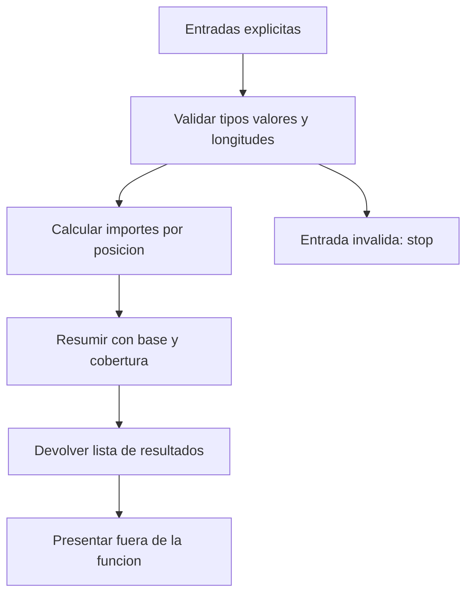

# 06.06 — Funciones y control de flujo

## Propósito y prerrequisitos

Cuando confirmamos un dato en 06.05 tuvimos que recalcular el importe y volver
a resumirlo. Una función permite dar un nombre a ese trabajo y reutilizarlo con
otras entradas. El control de flujo permite decidir qué hacer ante una entrada
vacía o incompleta y repetir un procedimiento para varias preguntas.

**Alcance esencial:** `function`, argumentos, retorno, alcance local, `if`,
validación con `stop` y repetición con `for`. `tryCatch` es una extensión breve
para una falla esperada. Necesitas [vectores y tipos, 06.02](../02_objects_vectors/README.md),
[lógica y faltantes, 06.04](../04_logic_missing/README.md) y
[listas y tablas, 06.05](../05_lists_data_frames/README.md).
Usamos R y sus paquetes incluidos, sin instalaciones. RStudio es opcional.
Archivos y validación de registros completos quedan en 06.07.

Al terminar podrás:

- Definir y llamar una función, identificando parámetros, argumentos y resultado.
- Pasar los datos necesarios sin depender de objetos ocultos de otra sesión.
- Distinguir devolver un dato de imprimirlo.
- Elegir una rama con una condición escalar conocida.
- Rechazar entradas incompatibles y conservar los `NA` permitidos.
- Usar `for` con una secuencia segura ante el vacío y reconocer cálculos vectorizados.

## 1. De una expresión a una función

Una función recibe entradas, ejecuta su cuerpo y devuelve un resultado.
Empezamos con una versión mínima para entender la sintaxis; todavía no valida
sus entradas y no será la versión que usaremos al final:

```r
importe_simple <- function(unidades, precio_mxn) {
  importe <- unidades * precio_mxn
  return(importe)
}
print(importe_simple(4L, 75)) # 300
print(importe_simple(unidades = 2L, precio_mxn = 120)) # 240
```

`function(...)` construye una función y `<-` la asocia a un nombre. Entre los
paréntesis aparecen sus **parámetros**, los nombres que usará dentro. Las llaves
`{ }` agrupan las instrucciones del **cuerpo**. Al llamar la función,
`4L` y `75` son los **argumentos**, los valores suministrados a los parámetros.
La primera llamada los asocia por posición; la segunda, por nombre completo.
Los nombres explícitos ayudan cuando una llamada tiene varias opciones.

`return(importe)` termina la llamada y entrega el objeto al código que la
invocó. Definir la función no ejecuta todavía el cálculo. Para llamarla se
escriben su nombre, paréntesis y argumentos.

R también devuelve el último valor evaluado cuando no escribimos `return`:

```r
importe_ultimo <- function(unidades, precio_mxn) {
  unidades * precio_mxn
}
importe_guardado <- importe_ultimo(4L, 75)
print(importe_guardado) # 300
```

En las funciones finales usaremos `return` para hacer visible el punto de
salida. Una función puede devolver una lista si necesitamos varios resultados.
No devuelve varias cosas independientes: devuelve un objeto lista.

### Devolver no equivale a imprimir

```r
doble <- function(x) {
  return(x * 2)
}
valor <- doble(150) # Guarda 300; no solicita imprimirlo.
print(valor)
cat("Importe calculado en MXN:\n")
print(valor)
```

En consola R una llamada sin asignación suele mostrar su resultado
automáticamente. Un archivo ejecutado con Rscript no debe depender de esa
impresión automática: escribe `print` o `cat` donde quieras comunicar algo.
`cat` concatena texto y valores; `\n` salta de línea. Que una función imprima
algo no garantiza que devuelva los datos que luego necesitas: mira su retorno.

## 2. Nombres locales y entradas explícitas

Una asignación ordinaria con `<-` dentro de una llamada crea o modifica un
nombre local a esa llamada. Aquí `subtotal` local no cambia el de fuera:

```r
subtotal <- 999
calcular_local <- function(unidades, precio_mxn) {
  subtotal <- unidades * precio_mxn
  return(subtotal)
}
print(calcular_local(4L, 75)) # 300
print(subtotal) # 999
```

R puede buscar nombres fuera del cuerpo si no son parámetros ni nombres
locales. Por eso una función que usa un precio global puede cambiar de
resultado al cambiar la sesión:

```r
precio_global <- 75
importe_dependiente <- function(unidades) {
  return(unidades * precio_global)
}
print(importe_dependiente(4L)) # 300
precio_global <- 80
print(importe_dependiente(4L)) # 320
print(calcular_local(4L, 75)) # 300: el precio se pasa expresamente.
```

Para este trabajo pasa los datos como argumentos y recibe los resultados por
retorno. Las funciones finales llaman otras funciones definidas en su archivo,
pero no buscan ventas o precios globales. No necesitamos `<<-`, entornos,
closures ni detalles de evaluación diferida para avanzar.

## 3. Decidir con if y else

`if (condicion) { ... } else { ... }` elige una rama. La condición debe ser
una respuesta de longitud uno que pueda interpretarse como verdadero o falso.
En nuestros ejemplos construimos explícitamente un lógico sin `NA`.
Escribe `} else {` en una misma línea para que funcione también al pegarlo
en consola.

```r
describir_cobertura <- function(importes) {
  if (length(importes) == 0L) {
    return("Sin registros")
  } else if (all(is.na(importes))) {
    return("Hay registros, pero ningun importe conocido")
  } else {
    return("Hay al menos un importe conocido")
  }
}
print(describir_cobertura(numeric(0))) # "Sin registros"
print(describir_cobertura(c(NA_real_, NA_real_)))
print(describir_cobertura(c(0, NA_real_)))
```

Esta función inicial solo ilustra las decisiones; la validación vendrá enseguida.
El primer `return` evita seguir cuando no hay registros. Ese orden importa:
`all(is.na(numeric(0)))` es verdadero, pero no significa que llegaron registros
con datos faltantes. El caso vacío se distingue primero, como aprendimos en 06.04.

`else if` prueba otra condición cuando la anterior fue falsa; `else` cubre el
resto. Para seleccionar una fila por cada respuesta lógica usamos máscaras,
no un `if` sobre todo el vector. Los dos ejemplos siguientes son **errores
deliberados**, para ejecutar por separado:

```r
# Error deliberado: hay dos condiciones, no una.
if (c(TRUE, FALSE)) { print("No debe elegirse una sola fila") }
```

```r
# Error deliberado: no sabemos si entrar en la rama.
if (NA) { print("La condicion debe conocerse") }
```

`&` y `|` combinan condiciones por posición; `&&` y `||` combinan preguntas
escalares con cortocircuito. Revisa [06.04](../04_logic_missing/README.md) antes
de usarlos. `ifelse` es otra función con reglas propias; no es un reemplazo
automático de `if` para estas decisiones sobre todo el conjunto.

## 4. Validar antes de transformar

Nuestro contrato acepta vectores numéricos ordinarios de enteros o doubles,
sin dimensiones, con valores no negativos. `NA` está permitido como dato
pendiente; `NaN` e infinitos se rechazan. No convertimos texto a número ni
validamos todavía una tabla completa. La correspondencia de las posiciones
sigue siendo responsabilidad de quien llama la función.

`is.numeric(x)` reconoce los números de esta práctica; no acepta texto ni
lógicos como sustitutos. Una matriz numérica también puede pasar esa prueba:
por eso añadimos `is.null(dim(x))`. `is.finite` ya apareció como ampliación en
06.04: devuelve falso ante faltantes e infinitos. Primero distinguimos `NaN`
y después los valores presentes no finitos. `any(..., na.rm = TRUE)` permite
comprobar negativos sin que los `NA` permitidos vuelvan desconocida la decisión.
Un `NA` aislado tiene tipo lógico: para una entrada numérica solo faltante usa
`NA_real_` o `NA_integer_`. En `c(100, NA)`, el faltante ya se adapta al tipo
numérico del vector, como vimos en 06.02.

```r
validar_numeros <- function(x) {
  if (!is.numeric(x) || !is.null(dim(x))) {
    stop("Se requiere un vector numerico sin dimensiones.")
  }
  if (any(is.nan(x)) || any(!is.na(x) & !is.finite(x))) {
    stop("No se permiten NaN ni infinitos.")
  }
  if (any(x < 0, na.rm = TRUE)) {
    stop("No se permiten valores negativos.")
  }
  return(x)
}
print(validar_numeros(c(0, 120, NA_real_))) # 0 120 NA
```

`stop` comunica un error y detiene la llamada; sin manejo explícito, el error
se propaga hasta detener el script con código distinto de cero. No devuelve
un importe cero ni una muestra vacía que parezca exitosa. Los mensajes de los
scripts usan caracteres simples para facilitar su lectura en distintas consolas.

El cálculo final llama esa validación y exige longitudes iguales. En este
contrato no se permite que un precio escalar se repita implícitamente:

```r
calcular_importes <- function(unidades, precio_mxn) {
  unidades <- validar_numeros(unidades)
  precio_mxn <- validar_numeros(precio_mxn)
  if (length(unidades) != length(precio_mxn)) {
    stop("Unidades y precios deben tener la misma longitud.")
  }
  importes <- as.double(unidades) * as.double(precio_mxn)
  if (any(!is.na(importes) & !is.finite(importes))) {
    stop("El producto excede el rango numerico disponible.")
  }
  return(importes)
}
print(calcular_importes(c(4L, 2L, 0L), c(75, 120, 50))) # 300 240 0
print(calcular_importes(numeric(0), numeric(0))) # numeric(0)
```

`as.double` convierte explícitamente los argumentos ya validados a double
antes de multiplicar. Evita el desbordamiento de una multiplicación entre
enteros R; no elimina los límites de double vistos en 06.02. Si el producto
de valores conocidos resulta infinito, se rechaza. Estos importes no son
aritmética decimal exacta para cualquier monto; usamos números pequeños con
resultados manuales conocidos. Para esta práctica se permiten unidades
fraccionarias: exigir unidades enteras sería otra regla de negocio.

La validación devuelve la entrada aceptada; asignarla al parámetro conserva
un nombre local. No modifica las columnas originales. Aunque las longitudes
sean iguales, la función no puede saber si alguien desordenó solo los precios.

Prueba este rechazo por separado:

```r
# Error deliberado: un precio para dos ventas; no se permite reciclar.
calcular_importes(c(2, 3), 100)
```

## 5. Un resumen que devuelve datos y declara su cobertura

Queremos automatizar lo que ya sabemos interpretar. El resumen recibirá
importes y un umbral; devolverá una lista con conteos e indicadores, sin
imprimirla. En `umbral = 200`, `200` es un argumento predeterminado: se usa
cuando la llamada no suministra otro. El umbral debe ser un único número
conocido, finito y no negativo, incluso si no hay registros.

| Entrada | Registros / conocidos | Cobertura | Suma observada / media | Total completo |
| --- | --- | --- | --- | --- |
| Seis ventas de la práctica | 6 / 4 | 66.67% aprox. | 660 / 165 | NA |
| `numeric(0)` | 0 / 0 | NA | NA / NA | NA |
| Dos `NA_real_` | 2 / 0 | 0% | NA / NA | NA |
| Un cero observado | 1 / 1 | 100% | 0 / 0 | 0 |

En la primera fila solo cuatro importes están conocidos. El contrato del resumen informa
`NA_real_` si no hay valores observados, aunque `sum(numeric(0))` dé cero.
No cambiamos la definición de `sum`: elegimos qué indicador comunicar.
La cobertura no se calcula con denominador cero. El total completo solo se
informa si hay registros y todos sus importes son conocidos.

```r
resumir_importes <- function(importes, umbral = 200) {
  importes <- validar_numeros(importes)
  umbral <- validar_numeros(umbral)
  if (length(umbral) != 1L || any(is.na(umbral))) {
    stop("El umbral debe ser un numero conocido de longitud uno.")
  }
  n_registros <- length(importes)
  n_conocidos <- sum(!is.na(importes))
  n_faltantes <- sum(is.na(importes))
  cobertura_pct <- NA_real_
  suma_observada_mxn <- NA_real_
  media_observada_mxn <- NA_real_
  total_mxn <- NA_real_
  if (n_registros > 0L) {
    cobertura_pct <- 100 * n_conocidos / n_registros
  }
  if (n_conocidos > 0L) {
    suma_observada_mxn <- sum(importes, na.rm = TRUE)
    if (!is.finite(suma_observada_mxn)) {
      stop("La suma excede el rango numerico disponible.")
    }
    media_observada_mxn <- mean(importes, na.rm = TRUE)
  }
  if (n_registros > 0L && n_conocidos == n_registros) {
    total_mxn <- suma_observada_mxn
  }
  condicion <- importes >= umbral
  conocida <- !is.na(condicion)
  return(list(
    n_registros = n_registros,
    n_conocidos = n_conocidos,
    n_faltantes = n_faltantes,
    cobertura_pct = cobertura_pct,
    suma_observada_mxn = suma_observada_mxn,
    media_observada_mxn = media_observada_mxn,
    total_mxn = total_mxn,
    n_cumplen = sum(conocida & condicion),
    n_no_cumplen = sum(conocida & !condicion),
    n_pendientes = sum(!conocida)
  ))
}
```

Lee el cuerpo por partes: valida entradas, cuenta, prepara faltantes de salida,
calcula indicadores solo con base suficiente y devuelve la lista. La comprobación
de suma finita evita informar un desbordamiento como importe válido. Las máscaras
finales son las de 06.04 y mantienen pendientes separados de incumplimientos.
Los tres conteos deben sumar `n_registros`.

Ahora usamos las mismas ventas, en una muestra nueva y con precios explícitos:

```r
ventas <- data.frame(
  id_venta = c("V001", "V002", "V003", "V004", "V005", "V006"),
  unidades = c(4L, 2L, 0L, 3L, NA, 2L),
  precio_mxn = c(75, 120, 50, 40, 100, NA),
  stringsAsFactors = FALSE
)
ventas$importe_mxn <- calcular_importes(ventas$unidades, ventas$precio_mxn)
resultado <- resumir_importes(ventas$importe_mxn)
cat("Resumen de importes observados, en MXN:\n")
print(resultado)
print(resumir_importes(ventas$importe_mxn, umbral = 100)$n_cumplen) # 3
```

La asignación guarda datos y la presentación sucede después. La función no
escribe archivos ni usa `print` o `cat`. Otra persona puede consultar
`resultado$n_conocidos` sin volver a calcular o extraer números de un mensaje.
Con el umbral predeterminado: 2 cumplen, 2 no cumplen y 2 pendientes.



Sin renderizador: las entradas aceptadas se transforman y resumen; una entrada
incompatible detiene el cálculo. Los datos devueltos se presentan en otro paso.
Validar números no demuestra claves únicas, calidad de archivos ni correspondencia.

## 6. Repetir con for sin perder el caso vacío

La multiplicación `unidades * precio_mxn` ya opera sobre todo el vector; no
necesita un ciclo por venta. Un `for` sí puede expresar que repetimos una
consulta completa para distintos umbrales:

```r
umbrales <- c(100, 200, 300)
conteos <- integer(length(umbrales))
for (i in seq_along(umbrales)) {
  resumen_i <- resumir_importes(ventas$importe_mxn, umbral = umbrales[i])
  conteos[i] <- resumen_i$n_cumplen
}
print(data.frame(umbral = umbrales, n_cumplen = conteos)) # 3, 2, 1
```

`integer(n)` reserva un vector de `n` ceros enteros para los conteos.
`seq_along(umbrales)` produce sus posiciones; `for` asigna cada posición a `i`
y ejecuta el cuerpo. Guardamos el resultado en la posición correspondiente,
en lugar de sobrescribir un único conteo sin conservar los anteriores.
Para recorrer `nrow(tabla)` posiciones también puedes usar `seq_len(nrow(tabla))`.

```r
umbrales_vacios <- numeric(0)
conteos_vacios <- integer(length(umbrales_vacios))
for (i in seq_along(umbrales_vacios)) {
  conteos_vacios[i] <- resumir_importes(ventas$importe_mxn, umbral = umbrales_vacios[i])$n_cumplen
}
print(length(conteos_vacios)) # 0: el cuerpo no se ejecuta.
print(seq_len(0)) # integer(0)
print(1:0) # 1 0: no es una secuencia vacia.
```

`:` construye una secuencia entre extremos, incluso descendente; por eso
`1:length(x)` falla como idea cuando `length(x)` es cero. Usa `seq_along(x)`
o `seq_len(n)`. Un `for` no crea por sí solo un ámbito local independiente:
`i` y `resumen_i` pueden quedar definidos tras el ciclo; no dependas de ellos
fuera ni de que existan si el ciclo no se ejecutó.

Vectorizar o repetir se decide por la tarea y por claridad; no medimos una
mejora de rendimiento aquí. `while`, `repeat`, `break`, `next`, `apply` y purrr
no son necesarios para esta práctica.

## 7. Extensión: reconocer una falla esperada con tryCatch

Primero deja que los errores sean visibles. Cuando una actividad espera una
entrada incompatible y necesita mostrar su diagnóstico sin terminar todo el
recorrido, `tryCatch` permite delimitar qué expresión se intenta:

```r
intento <- tryCatch(
  {
    valor <- calcular_importes(c(2, 3), 100)
    list(ok = TRUE, valor = valor, mensaje = NULL)
  },
  error = function(e) {
    list(ok = FALSE, valor = NULL, mensaje = conditionMessage(e))
  }
)
print(intento$ok) # FALSE
print(intento$valor) # NULL: no hubo un importe calculado con exito.
print(intento$mensaje) # "Unidades y precios deben tener la misma longitud."
```

El bloque protegido intenta calcular y devolver un estado exitoso. Si falla,
`error = function(e)` define la función que recibirá el objeto del error;
`conditionMessage(e)` obtiene su mensaje. El valor devuelto por esa función
queda en `intento`. No se reanuda el cálculo desde la línea que falló.

Este manejador captura cualquier error dentro del bloque, no distingue por sí
solo datos incorrectos de un defecto del programa. Aquí lo acotamos a una
demostración conocida. No envuelvas todo el análisis para seguir con cero,
`NULL` o una tabla vacía como si hubiera funcionado. La lógica principal de
validación, cálculo y resumen deja propagar los errores. Los avisos tampoco
son automáticamente errores; no los ocultes para obtener una salida limpia.

## 8. Ejecutar y comprobar desde una sesión nueva

[funciones_ventas.R](funciones_ventas.R) solo define las tres funciones finales;
cargarlo no calcula ventas ni imprime resúmenes.
[ejecutar_funciones.R](ejecutar_funciones.R) carga esas definiciones, construye
la muestra, llama las funciones y presenta resultados. Esta separación permite
reutilizar las funciones en el lab sin ejecutar toda la demostración.

Desde la raíz, elige un recorrido completo y adapta las rutas a tu instalación.
`--vanilla` se explica en [06.01](../01_r_session/README.md); no necesitas
otra instalación ni cambiar un entorno adecuado.

### PowerShell

```powershell
Set-Location C:\bluepill5\Devs\ds_track
& "C:\Program Files\R\R-4.6.1\bin\Rscript.exe" --vanilla curriculum/06_r_foundations/06_functions_control/ejecutar_funciones.R
$LASTEXITCODE
```

### Bash/Zsh

```bash
cd /ruta/a/ds_track
Rscript --vanilla curriculum/06_r_foundations/06_functions_control/ejecutar_funciones.R
echo $?
```

### CMD / Anaconda Prompt

```bat
cd /d C:\bluepill5\Devs\ds_track
"C:\Program Files\R\R-4.6.1\bin\Rscript.exe" --vanilla curriculum/06_r_foundations/06_functions_control/ejecutar_funciones.R
echo %ERRORLEVEL%
```

La ruta explícita elige R independiente, sin modificar Conda, PATH o bibliotecas.
Se espera código 0: importes `300 240 0 120 NA NA`, resumen 6/4/2 con suma
observada 660 y media 165, total `NA`, conteos por umbral 3/2/1, fronteras
explicadas y variante V005 con suma 760 y media 152. El intento de la extensión
se informa como fallido y se maneja deliberadamente; los errores sueltos de la
lección deben fallar si se ejecutan por separado. No los añadas al script correcto.

## Práctica, criterio de salida y continuidad

Realiza el [lab 06.06](../../../labs/06_r_foundations/06_functions_control/README.md).
Cierra cuando puedas explicar parámetros/argumentos/retorno, separar presentación,
justificar las ramas con vacío/faltantes y comprobar cálculos, errores y fuentes
intactas en una sesión nueva. No hay proyecto/checkpoint implementado asociado.
Registra evidencia real y dudas; disponer del material no acredita aprendizaje.

Sigue el [plan 06.07 — Archivos y validación básica](../README.md#07-archivos-y-validacion-basica),
todavía pendiente. Volver al [índice de R](../README.md).

## Referencias y atribución

Ejemplos propios de DS Track. Consulta: 2026-10-17; comprobados con R 4.6.1.

- Hadley Wickham, Mine Çetinkaya-Rundel y Garrett Grolemund,
  [Functions, R for Data Science, segunda edición](https://r4ds.hadley.nz/functions.html):
  lectura selectiva de funciones que reciben vectores y devuelven resultados.
  Sus ejemplos con tidyverse no son dependencias de esta lección en R base.
- Hadley Wickham, *Advanced R*, segunda edición:
  [funciones](https://adv-r.hadley.nz/functions.html) y
  [control de flujo](https://adv-r.hadley.nz/control-flow.html), como consulta
  puntual; no se exige leer sus capítulos avanzados.
- R oficial: [control de flujo](https://stat.ethz.ch/R-manual/R-devel/library/base/html/Control.html),
  [stop](https://stat.ethz.ch/R-manual/R-devel/library/base/html/stop.html),
  [secuencias](https://stat.ethz.ch/R-manual/R-devel/library/base/html/seq.html),
  [números](https://stat.ethz.ch/R-manual/R-devel/library/base/html/numeric.html) y
  [manejo de condiciones](https://stat.ethz.ch/R-manual/R-devel/library/base/html/conditions.html).
  R-devel puede describir otra versión; contrasta con `help("function")`,
  `help("if")`, `?stop`, `?seq_along` y `?tryCatch` en la ayuda instalada.

Consulta también la [guía de lecturas R](../../../docs/r-reading-guide.md).
