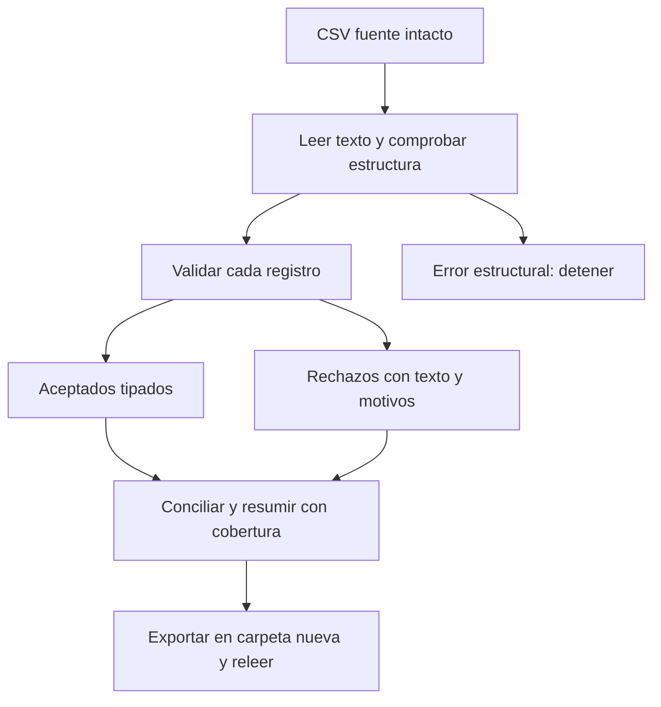

# 06.07 — Archivos y validación básica

[Inicio](../../../README.md) / [Módulo 06](../README.md) / **Lección 06.07**

| Tu sesión | Qué prepararás o comprobarás |
| --- | --- |
| **Meta** | Validar un CSV conservando originales, rechazos y cobertura |
| **Necesitas** | Tablas y funciones de 06.05–06.06; R base y utils |
| **Evidencia** | Entrega releída con aceptados, rechazos y conteos conciliados |

[Preparación](#antes-de-empezar) · [Material de apoyo](#material-de-apoyo) · [Lab 06.07](../../../labs/06_r_foundations/07_files_validation/README.md) · [Comprobar](#evidencia-y-criterio-de-salida)

<a id="propósito-y-prerrequisitos"></a>

## Propósito

Una tabla escrita dentro de un script ya tiene tipos elegidos por quien la
construyó. Un CSV contiene texto: leerlo no demuestra que sus identificadores,
números o faltantes cumplan nuestras reglas. En esta lección conservaremos la
entrada, separaremos aceptados y rechazos y comprobaremos lo que exportamos.

## Antes de empezar

**Alcance esencial.** Retoma [06.05 — Tablas](../05_lists_data_frames/README.md)
y [06.06 — Funciones y control](../06_functions_control/README.md): selección,
copias, argumentos, `if`, ciclos y errores. Usamos R base, utils y las funciones
del curso, sin paquetes externos. RStudio es opcional; renv llega en 06.08 y
readr en el módulo 07. Esta práctica utiliza ventas ficticias, no datos reales.

## Qué vas a aprender

- Resolver rutas relativas desde la raíz del repositorio.
- Declarar separador, decimal, codificación, columnas y marcadores de faltantes.
- Conservar texto antes de convertir números y distinguir ausencia de invalidez.
- Separar registros aceptados y rechazados con posición y motivos.
- Conciliar conteos e indicadores y exportar CSV sin nombres de fila accidentales.
- Volver a leer una entrega y conservar la fuente y las entregas previas.

## Material de apoyo

| Recurso | Para qué sirve | Uso |
| --- | --- | --- |
| [CSV de ventas ficticias](ventas_entrada.csv) | Examinar textos y contrato antes de convertir | Para el recorrido |
| [Funciones de archivos](funciones_archivos.R) | Leer, validar y exportar con motivos | Para el recorrido |
| [Funciones de ventas](../06_functions_control/funciones_ventas.R) | Reutilizar cálculo y resumen con cobertura | Para el recorrido |
| [Ejecutor de archivos](ejecutar_archivos.R) | Seguir el flujo completo con salida en carpeta nueva | Para el recorrido |

Abre los archivos donde se indican en el recorrido; conserva las fuentes y
guarda tus variantes y entregas en tu copia personal. Lee las comprobaciones y los resultados esperados antes de ejecutar.

## 1. Rutas: desde dónde busca R

Una ruta relativa se interpreta desde el directorio de trabajo de la sesión,
no automáticamente desde la carpeta del script. Ejecutaremos todo desde la
raíz de DS Track, como en [06.01](../01_r_session/README.md).

```r
print(getwd())
carpeta_leccion <- file.path("curriculum", "06_r_foundations", "07_files_validation")
entrada <- file.path(carpeta_leccion, "ventas_entrada.csv")
print(file.exists(entrada)) # TRUE si estas en la raiz.
```

`getwd()` consulta el directorio actual; `file.path` combina sus componentes
con el separador adecuado. `/` también funciona en rutas R de Windows.
En una cadena, una barra inversa introduce escapes: evita copiar una ruta de
Windows sin adaptar sus barras. Si `file.exists` da falso, revisa el directorio
y la ruta antes de intentar convertir datos. El recorrido de terminal al final
te sitúa en la raíz sin que los scripts cambien de directorio a escondidas.

## 2. Contrato del CSV y de cada venta

La [muestra ventas_entrada.csv](ventas_entrada.csv) conserva las primeras seis
ventas de 06.04–06.06 y añade ocho registros para practicar calidad. Es otra
muestra; no modifica las anteriores. Tiene 14 registros de datos y una cabecera.

| Campo | Entrada textual | Regla de esta práctica |
| --- | --- | --- |
| `id_venta` | Identificador | `V` mayúscula y tres dígitos; único en toda la entrada |
| `unidades` | Decimal con punto o faltante | No negativo; permite fracciones |
| `precio_mxn` | Decimal con punto o faltante | No negativo, finito; importe en MXN |
| `nota` | Texto | Se conserva, incluidas comas entre comillas, acentos y texto vacío |

El archivo usa UTF-8, coma entre campos, punto decimal y comillas dobles para
encerrar un campo que contiene coma. Por ejemplo, `"México, mostrador"` es
**un campo**, no dos. Su cabecera tiene exactamente los cuatro nombres de la
tabla, en ese orden. Requerimos un registro por línea física, sin líneas vacías
ni saltos dentro de un campo, y archivo terminado con salto de línea.
CSV más generales pueden permitir campos multilínea; este lector didáctico
los rechaza explícitamente. No es un lector universal.

Solo `""` (campo vacío) y el texto `"NA"` significan faltante en las columnas
numéricas. En `nota`, `NA` sigue siendo texto. Los números admiten uno o más
dígitos y, opcionalmente, punto seguido de dígitos: `0`, `25.5` y `004` son
válidos; `dos`, `-1`, `Inf`, `NaN`, `1e2`, `+3`, `2,5` y espacios alrededor
no lo son. No recortamos ni convertimos formatos distintos sin una regla.
Esta elección es más estrecha que los números que R puede interpretar.

Un faltante permitido no vuelve inválida una fila: V005 y V006 seguirán
aceptadas con importe pendiente. Si un identificador válido se repite,
**rechazamos todas sus apariciones**, aunque una tenga otro problema. No
conservamos arbitrariamente la primera ni sumamos registros duplicados.

El producto de unidades y precio conocidos también debe ser finito. Como en
06.06, usamos double: no promete precisión decimal exacta para cualquier
monto. Son ejemplos pequeños comprobables, no un sistema contable.

## 3. Leer todo como texto antes de decidir

```r
crudos <- read.csv(
  entrada, header = TRUE, sep = ",", dec = ".", quote = "\"",
  colClasses = "character", na.strings = character(0),
  stringsAsFactors = FALSE, check.names = FALSE, row.names = NULL,
  strip.white = FALSE, fill = FALSE, blank.lines.skip = FALSE,
  comment.char = "", fileEncoding = "UTF-8"
)
print(names(crudos))
print(dim(crudos)) # 14 4
str(crudos) # Las cuatro columnas son texto.
print(crudos[c(5, 7, 8), , drop = FALSE])
```

`read.csv` pertenece a utils, incluido con R. Recibe opciones de `read.table`:

- `header = TRUE` toma la primera fila como nombres. `sep`, `dec` y `quote`
  declaran separador, decimal y comillas. Al leer todo como texto, la posterior
  conversión aplica nuestra regla numérica; `dec` no convierte esas columnas.
- `colClasses = "character"` evita inferir tipos. `na.strings = character(0)`
  evita transformar marcadores a `NA` de R durante la lectura textual.
- `check.names = FALSE` conserva los nombres recibidos para poder comprobarlos;
  `row.names = NULL` evita adoptar una columna como identificador de filas.
- `strip.white = FALSE` conserva espacios; `fill = FALSE` evita rellenar campos
  incompletos; `blank.lines.skip = FALSE` no omite líneas vacías.
- `comment.char = ""` evita interpretar parte del texto como comentario.
  `fileEncoding = "UTF-8"` declara la codificación de los bytes del archivo.

Leer con tipos inferidos puede convertir un identificador numérico a número
y perder ceros iniciales; convertir directamente una columna que contiene
`dos` puede detener la lectura sin generar una tabla de rechazos. El texto
conservado permite documentar qué llegó. No conserva la sintaxis de comillas
del CSV: conserva el contenido de sus campos; el archivo original sigue intacto.

### Comprobar estructura antes de validar filas

El [lector leer_ventas](funciones_archivos.R) añade dos comprobaciones al
ejemplo anterior. `count.fields` cuenta campos respetando comillas y exige
cuatro por registro; una línea vacía, fila incompleta o campo multilínea no
cumple este contrato. `anyNA(campos)` pregunta si los conteos contienen algún
faltante, como ocurre al contar un registro multilínea.
`identical(names(crudos), esperadas)` exige nombres y
orden exactos. También rechaza una entrada que no sea archivo existente.

El `tryCatch` de la lectura convierte cualquier aviso del lector en error con
su mensaje: no seguimos con una lectura que haya informado problemas, por
ejemplo codificación incompatible. Se explica como extensión en
[06.06](../06_functions_control/README.md); aquí la política es detenerse y
conservar el diagnóstico. No se reemplaza el resultado por una tabla vacía.
Las comprobaciones estructurales no garantizan que cada dato sea válido.

La codificación del archivo y el locale de la sesión son distintos. Si la
lectura con acentos falla, registra `Sys.getlocale("LC_CTYPE")`: un locale
`C` puede no representar esos caracteres al convertir la entrada. En Windows
se comprobó una sesión con `en_US.UTF-8`. Para diagnosticar en una consola R
de práctica puedes usar `Sys.setlocale("LC_CTYPE", "en_US.UTF-8")`, comprobar
que devuelve ese locale y repetir la lectura; si no se admite, consulta la
configuración de tu instalación. Este ajuste afecta a esa sesión, no a la
configuración global de Windows. No es necesario si tu sesión ya admite UTF-8;
los scripts no cambian locale ni ocultan los avisos del inicio.

Si falla la estructura del archivo, se detiene el recorrido antes de crear
una salida. Si la estructura es correcta y falla una regla de un registro,
podemos conservar ese registro en `rechazos` con su motivo.

## 4. Convertir solo después de comprobar el formato

```r
source("curriculum/06_r_foundations/06_functions_control/funciones_ventas.R", encoding = "UTF-8")
source("curriculum/06_r_foundations/07_files_validation/funciones_archivos.R", encoding = "UTF-8")
crudos <- leer_ventas(entrada)
conversion <- convertir_numeros(c("4", "0", "", "NA", "dos", "-1", "25.5"))
print(conversion$valores) # 4 0 NA NA NA NA 25.5
print(conversion$invalido) # FALSE FALSE FALSE FALSE TRUE TRUE FALSE
print(conversion$faltante) # FALSE FALSE TRUE TRUE FALSE FALSE FALSE
```

El mismo `NA` en `valores` puede provenir de un faltante permitido o de un
texto inválido. Por eso guardamos también las máscaras y el texto de origen.
Convertir y luego mirar solo `is.na` perdería esa distinción.

En el archivo de funciones, `grepl` pregunta si cada texto cumple un patrón:
`^[0-9]+([.][0-9]+)?$`. `^` y `$` marcan el inicio y final; `[0-9]+` exige uno
o más dígitos; el grupo entre paréntesis representa punto y dígitos, y `?`
lo hace opcional. Es una expresión regular pequeña para este formato concreto;
no necesitas estudiar todas las expresiones regulares para avanzar.

`rep(NA_real_, length(texto))` prepara un número faltante por posición.
Solo `!faltante & formato` se convierte con `as.double`. Si un número escrito
con muchos dígitos excede el rango y se convierte a infinito, también se marca
inválido. No ocultamos avisos de conversiones incorrectas con
`suppressWarnings`: evitamos convertir los formatos que no admitimos.

`convertir_numeros` recibe texto conservado sin `NA` de R. Un `NA` de R en
esa entrada indicaría que ya perdimos el marcador original y se rechaza.

## 5. Reglas por registro y motivos conservados

```r
revision <- validar_registros(crudos)
print(revision$aceptados)
print(revision$rechazos)
print(revision$controles) # 14 entradas, 8 aceptados, 6 rechazos.
```

La función [validar_registros](funciones_archivos.R) usa las condiciones y
listas aprendidas en 06.04–06.06. Lee su cuerpo por partes:

1. Comprueba con `is.data.frame` que recibe una tabla y después exige el esquema
   esperado y columnas textuales sin `NA` de R.
2. Convierte unidades y precios conservando sus máscaras de invalidez.
3. Comprueba identificadores con `grepl("^V[0-9]{3}$", ...)`.
4. Usa `duplicated(id)` y `duplicated(id, fromLast = TRUE)` para identificar
   **todas** las apariciones repetidas, incluidas las primeras.
5. Recorre las posiciones con `seq_len(nrow(crudos))` y reúne los motivos.
   `paste(razones, collapse = ";")` los une en un texto; sin motivos queda `""`.
6. Construye tablas separadas y comprueba aceptados + rechazos = entrada.

Los aceptados contienen unidades, precio e importe como double. Los rechazos
conservan el texto recibido, no solo el resultado fallido de convertirlo.
`fila_origen` identifica la posición del registro de datos: 1 corresponde a
la primera venta, línea física 2 porque hay cabecera. Al admitir un registro
por línea, esta relación es directa. Si un registro tiene varios problemas,
sus motivos se unen y el registro se cuenta una sola vez.

| Registro de datos | Identificador | Motivo esperado |
| --- | --- | --- |
| 8 | V008 | `unidades_invalidas` por `dos` |
| 9 | V009 | `unidades_invalidas` por `-1` |
| 10 y 11 | V010 | `id_repetido` en ambas apariciones |
| 12 | vacío | `id_invalido` |
| 13 | V013 | `precio_invalido` por `Inf` |

Los aceptados son V001–V007 y V014. V005/V006 siguen incompletas; V003 conserva
el cero. La nota de V007 conserva `México, mostrador` como un solo texto.
Rechazado significa que no cumple **estas reglas**, no que conozcamos el valor
correcto para reemplazarlo. Conservamos todas las filas de la fuente.



Sin renderizador: una estructura incompatible detiene la lectura. Una tabla
legible se divide en aceptados y rechazos; ambos conteos deben reconstruir
la entrada antes de presentar indicadores o crear archivos.

## 6. Conciliar conteos e indicadores

```r
resumen <- resumir_importes(revision$aceptados$importe_mxn)
print(resumen)
print(revision$controles$n_aceptados + revision$controles$n_rechazados) # 14
```

La suma observada corresponde solo a aceptados con importe conocido, no a
todo el archivo: seis importes `300, 240, 0, 120, 80, 25.5` suman **765.5 MXN**.
Su media es aproximadamente **127.5833 MXN**. Hay ocho aceptados, seis importes
conocidos y dos pendientes: cobertura **75%** sobre aceptados. No se imputan
ceros. Con umbral 200: dos cumplen, cuatro no cumplen y dos pendientes.
El total de los ocho aceptados sigue desconocido; seis registros rechazados
no participan en ese resumen. Informa ambos denominadores: 8/14 aceptados y
6/8 importes observados, no solo «75% de los datos».

Un CSV con solo cabecera es una entrada sin registros: 0 aceptados y 0 rechazos;
la cobertura y los indicadores sin base son `NA`. Una tabla con todos sus
registros rechazados también produce cero aceptados, pero sus conteos de
entrada y rechazos son distintos. El resumen reutiliza la política de 06.06.

## 7. Exportar sin sobrescribir y sin columna de índice accidental

```r
destino <- file.path(carpeta_leccion, "output", "primera_revision")
carpeta <- exportar_revision(revision, resumen, destino)
print(list.files(carpeta)) # aceptados.csv, controles.csv, rechazos.csv, resumen.csv
```

`dir.create` crea la carpeta; `recursive = TRUE` permite crear el directorio
intermedio `output`. La función exige que el destino no exista, incluso si
está vacío. Si ya ejecutaste el recorrido, usa otra carpeta, por ejemplo
`segunda_revision`. No borres la entrega anterior para que el ejemplo funcione.

La escritura usa `write.csv(tabla, ruta, row.names = FALSE, na = "NA",
fileEncoding = "UTF-8")`. `row.names = FALSE` evita exportar las etiquetas
de fila como una columna adicional. `fila_origen` sí es una columna deliberada
para trazabilidad; no es un índice accidental. `as.data.frame(resumen)` convierte
la lista de indicadores escalares de 06.06 en una tabla de una fila.

`write.csv` fija coma y punto decimal. En otros flujos, `read.csv2`/`write.csv2`
usan por defecto punto y coma y coma decimal: no los intercambies sin revisar
el contrato. Cambiar la extensión a `.csv` no cambia separador ni codificación.
No abras y vuelvas a guardar la fuente con otra aplicación para «arreglarla»
sin conservar qué cambió; esa edición podría modificar separadores o tipos.

Las cuatro escrituras no forman una transacción: una falla puede dejar una
carpeta parcial. El script comunica el error y no la presenta como entrega
comprobada. Conserva esa carpeta para revisar y usa un destino nuevo tras
resolver la causa; esta lección no implementa publicación atómica de carpetas.

## 8. Releer lo escrito: el archivo no conserva tipos de R

```r
releidos <- read.csv(file.path(carpeta, "aceptados.csv"),
                      colClasses = "character", na.strings = character(0),
                      check.names = FALSE, fileEncoding = "UTF-8")
print(names(releidos)) # Seis columnas; ninguna extra de nombres de fila.
print(dim(releidos)) # 8 6
print(releidos$nota[releidos$id_venta == "V007"]) # "México, mostrador"
```

CSV guarda texto y estructura de campos, no clases R. Releer con inferencia
puede dar tipos distintos, sobre todo con tablas vacías o columnas sin valores.
El script completo comprueba nombres, número de filas, identidad, notas,
importes y resumen tras releer. No basta con que aparezca un archivo en disco.

Para los importes exportados interpreta el marcador `NA` solo en esa columna,
lo cambia a `NA_character_` y convierte con `as.double`. No aplica nuestra
gramática de entrada al archivo producido por R: `write.csv` puede elegir
notación científica para números grandes o pequeños. Cualquier aviso de esa
conversión detiene la comprobación. Las notas se comparan como texto, de modo
que una nota literal `NA` no se convierta a faltante por accidente.

`isTRUE(all.equal(a, b, tolerance = 1e-12))` compara números calculados con
tolerancia por su representación double; `identical` comprueba nombres y
textos exactos. Es una comprobación numérica, no precisión monetaria ilimitada.
El verificador didáctico del script no audita cada campo de los cuatro archivos:
también revisa las tablas de rechazos y controles al realizar el lab.

## 9. Ejecutar el recorrido completo

[funciones_archivos.R](funciones_archivos.R) solo define lector, conversión,
validación y exportación. [ejecutar_archivos.R](ejecutar_archivos.R) carga las
funciones 06.06/06.07, lee, valida, resume, exporta y comprueba. No se lee ni
escribe nada al cargar solo las definiciones. Desde la raíz, elige un recorrido.

### Desde RStudio o el IDE elegido

Trabaja con la carpeta del repositorio abierta y comprueba con `getwd()` la
raíz de DS Track. Abre [ejecutar_archivos.R](ejecutar_archivos.R) y consulta
las funciones enlazadas. Ejecuta bloques para inspeccionar `crudos`, `revision`
y `resumen` antes de exportar. Para tus variantes guarda una copia personal del
ejecutor: conserva la entrada original y ajusta en esa copia `destino` a una
carpeta que todavía no exista. Las rutas se resuelven desde la raíz comprobada,
no desde donde guardaste la copia del script.

Para la comprobación final guarda la copia, reinicia R y ejecuta todo el archivo.
Si ya exportaste al explorar, elige otro destino antes de repetir: no borres ni
sobrescribas la entrega anterior. Relee y concilia como indica el recorrido.
Los comandos siguientes van en la terminal del sistema, no en la consola R.

### PowerShell

```powershell
Set-Location C:\bluepill5\Devs\ds_track
& "C:\Program Files\R\R-4.6.1\bin\Rscript.exe" --vanilla curriculum/06_r_foundations/07_files_validation/ejecutar_archivos.R
$LASTEXITCODE
```

### Bash/Zsh

```bash
cd /ruta/a/ds_track
Rscript --vanilla curriculum/06_r_foundations/07_files_validation/ejecutar_archivos.R
echo $?
```

### CMD / Anaconda Prompt

```bat
cd /d C:\bluepill5\Devs\ds_track
"C:\Program Files\R\R-4.6.1\bin\Rscript.exe" --vanilla curriculum/06_r_foundations/07_files_validation/ejecutar_archivos.R
echo %ERRORLEVEL%
```

Adapta la ruta de R a tu instalación; no modifiques Conda ni instales otra
versión si tu entorno es adecuado. Se espera código 0, conteos 14/8/6,
resumen 8/6/2, cobertura 75%, suma observada 765.5 y total `NA`.

Para usar otra entrada o conservar una ejecución anterior, el script recibe
**dos argumentos juntos**, después de su ruta: entrada y carpeta nueva.
`commandArgs(trailingOnly = TRUE)` obtiene esos textos; no mezcla opciones de
Rscript con ellos. Un ejemplo completo en PowerShell:

```powershell
Set-Location C:\bluepill5\Devs\ds_track
& "C:\Program Files\R\R-4.6.1\bin\Rscript.exe" --vanilla curriculum/06_r_foundations/07_files_validation/ejecutar_archivos.R curriculum/06_r_foundations/07_files_validation/ventas_entrada.csv curriculum/06_r_foundations/07_files_validation/output/segunda_revision
$LASTEXITCODE
```

### Bash/Zsh con argumentos

```bash
cd /ruta/a/ds_track
Rscript --vanilla curriculum/06_r_foundations/07_files_validation/ejecutar_archivos.R curriculum/06_r_foundations/07_files_validation/ventas_entrada.csv curriculum/06_r_foundations/07_files_validation/output/segunda_revision
echo $?
```

### CMD / Anaconda Prompt con argumentos

```bat
cd /d C:\bluepill5\Devs\ds_track
"C:\Program Files\R\R-4.6.1\bin\Rscript.exe" --vanilla curriculum/06_r_foundations/07_files_validation/ejecutar_archivos.R curriculum/06_r_foundations/07_files_validation/ventas_entrada.csv curriculum/06_r_foundations/07_files_validation/output/segunda_revision
echo %ERRORLEVEL%
```

Pon entre comillas cualquier ruta que contenga espacios. Los scripts registran
versión y sesión, sin cambiar locale ni bibliotecas. `output/` está ignorado
por Git: conserva tu evidencia local sin agregarla por la fuerza al repositorio.

<a id="práctica-criterio-de-salida-y-continuidad"></a>

## Práctica

Realiza el [lab 06.07](../../../labs/06_r_foundations/07_files_validation/README.md) para
validar textos, conciliar aceptados y rechazos y releer la entrega sin sobrescribir.

## Evidencia y criterio de salida

| Conserva | Comprueba | Explica |
| --- | --- | --- |
| Fuente y entrega con aceptados/rechazos | Conteos conciliados, textos y motivos recuperables | Contrato, marcadores y separación entre ausencia e invalidez |
| Resumen y comprobación tras relectura | Cobertura e indicadores; fuente y entregas previas intactas | Por qué exportar no demuestra que el archivo guardado sea correcto |

Puedes avanzar cuando justifiques el contrato, recuperes textos rechazados,
concilies conteos, interpretes cobertura y compruebes la exportación sin alterar
fuentes ni entregas previas.

Quien aprende realiza la práctica y explica las decisiones; su compañero revisa.
Tu compañero elige un rechazo y pide rastrearlo hasta el texto original y su motivo.
Guarda evidencia, ayudas y dudas en una nota personal junto a tu práctica.
PROGRESS.md registra desarrollo editorial, no tu expediente de aprendizaje.
No hay proyecto integrador ni checkpoint implementado asociado; las copias de
práctica no acreditan los proyectos pendientes del catálogo.

<a id="referencias-y-atribución"></a>

## Referencias

Ejemplos propios de DS Track. Consulta: 2026-10-17; comprobados con R 4.6.1.

- Hadley Wickham, Mine Çetinkaya-Rundel y Garrett Grolemund,
  [Data import, R for Data Science, segunda edición](https://r4ds.hadley.nz/data-import.html):
  apoyo para contratos de columnas, tipos y faltantes. El libro usa readr;
  aquí adaptamos el recorrido a R base sin instalar tidyverse.
- Documentación oficial: [read.table/read.csv](https://stat.ethz.ch/R-manual/R-devel/library/utils/html/read.table.html),
  [write.table/write.csv](https://stat.ethz.ch/R-manual/R-devel/library/utils/html/write.table.html),
  [count.fields](https://stat.ethz.ch/R-manual/R-devel/library/utils/html/count.fields.html),
  [archivos](https://stat.ethz.ch/R-manual/R-devel/library/base/html/files.html),
  [duplicated](https://stat.ethz.ch/R-manual/R-devel/library/base/html/duplicated.html) y
  [patrones](https://stat.ethz.ch/R-manual/R-devel/library/base/html/grep.html).
  R-devel puede describir otra versión: contrasta con `?read.csv`, `?write.csv`,
  `?count.fields`, `?duplicated` y `?grepl` en la ayuda instalada.

La [guía de lecturas R](../../../docs/r-reading-guide.md) ubica libros y ediciones.

## Siguiente paso

Después de la práctica y su comprobación, continúa con
[06.08 — Proyectos y dependencias con renv](../08_projects_renv/README.md).

[← Módulo 06](../README.md) · [Lab 06.07](../../../labs/06_r_foundations/07_files_validation/README.md) · [Siguiente →](../08_projects_renv/README.md)
