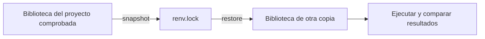

# 06.08 — Proyectos y dependencias con renv

## Propósito y prerrequisitos

En 06.07 conservamos datos, código y resultados. Para repetir el análisis en
otra carpeta o computadora también necesitamos saber qué paquetes utilizó.
`renv` registra versiones de paquetes y ayuda a restaurarlas en una biblioteca
del proyecto. Después comprobaremos que el análisis conserva sus resultados.

**Alcance de práctica.** Necesitas [06.06 — Funciones](../06_functions_control/README.md)
y [06.07 — Archivos y validación](../07_files_validation/README.md), rutas,
sesiones nuevas y las diferencias entre instalar y usar un paquete de
[06.01](../01_r_session/README.md). RStudio es opcional. Consulta también
[entornos y dependencias del nivel 0](../../00_getting_started/05_environment/README.md).
El resultado es una copia autocontenida de práctica, no el proyecto integrador
03_portfolio_analysis_r ni un checkpoint acreditado.

Al terminar podrás:

- Distinguir proyecto, intérprete R, biblioteca, paquete y estado de sesión.
- Preparar una carpeta con datos, código y archivos de dependencias.
- Activar renv, restaurar y comprobar sus versiones y rutas.
- Explicar la dirección de `snapshot` y `restore`.
- Reconstruir en otra copia sin transferir paquetes instalados ni `.RData`.
- Comprobar resultados y reconocer límites de reproducibilidad.

## 1. Qué conserva cada pieza

| Pieza | Qué representa | Qué no reemplaza |
| --- | --- | --- |
| Carpeta del proyecto | Código, datos e instrucciones relacionados | Instalación de R |
| Intérprete R | Programa que ejecuta los archivos `.R` | Paquetes de cada análisis |
| Paquete | Funciones y otros recursos instalables, como withr | Código propio del análisis |
| Biblioteca de paquetes | Carpeta donde hay paquetes instalados | Registro portable de versiones |
| `renv.lock` | Metadatos para restaurar versiones y sus fuentes | Datos, código o archivos de paquetes |
| `.RData` | Objetos guardados de una sesión | Instrucciones para reconstruirlos |
| `sessionInfo()` | Diagnóstico de la ejecución actual | Lockfile ni restauración |

En R, `library(withr)` carga un **paquete**; `.libPaths()` muestra las rutas de
las **bibliotecas** donde se buscan paquetes. No son entornos virtuales de
Python ni «entornos de evaluación» de R. Un entorno de evaluación relaciona
nombres y objetos, como los nombres locales estudiados en 06.06.

`renv` administra paquetes dentro del R que ya ejecutaste. Registra la versión
de R, pero no la instala ni cambia el intérprete elegido por tu comando.
El proyecto se comprobó con **R 4.6.1, renv 1.3.1 y withr 3.0.3**: son
referencias verificadas, no afirmaciones sobre versiones futuras o más recientes.

## 2. Una dependencia pequeña con un propósito visible

El análisis conserva las ventas y las funciones de 06.06/06.07. Añadimos
`withr` para presentar el resumen con una opción temporal y devolverla después
a su valor anterior:

```r
# Dentro de la copia preparada, despues de restaurar y activar su perfil.
digitos_antes <- getOption("digits")
withr::with_options(list(digits = 4), print(c(media_mxn = 765.5 / 6)))
print(identical(getOption("digits"), digitos_antes)) # TRUE
```

`paquete::funcion` utiliza una función sin adjuntar todo el paquete, como en
06.01. `digits = 4` controla **cifras significativas de presentación**, no
cuatro decimales ni una regla para redondear dinero. El dato calculado sigue
siendo 765.5/6; el CSV conserva el valor sin aplicar ese redondeo de pantalla.
withr restaura la opción incluso al salir con error; no cambia los datos.

Se podría imprimir sin este paquete. Aquí su propósito es practicar una
dependencia real con efecto pequeño y comprobable. No instalamos tidyverse,
herramientas de compilación ni paquetes de una lección posterior.

## 3. Preparar una copia autocontenida

El [preparador](preparar_proyecto.R), ejecutado desde la raíz de DS Track,
crea por defecto `output/ventas_renv` dentro de esta lección. Copia:

```text
ventas_renv/
├── README.md
├── DESCRIPTION
├── renv.lock
├── .Rprofile
├── .gitignore
├── restaurar.R
├── ejecutar.R
├── analisis.R
├── R/
│   ├── funciones_ventas.R
│   └── funciones_archivos.R
├── datos/
│   └── ventas_entrada.csv
└── renv/
    ├── activate.R
    └── settings.json
```

La [plantilla](plantilla/README.md) guarda los archivos nuevos y el lockfile.
El preparador toma las funciones y el CSV de sus lecciones originales, para
no mantener otra copia manual de esas fuentes en Git. Comprueba que existen
y exige un destino nuevo; no activa ni instala paquetes. Si una copia falla,
conserva la carpeta parcial, revisa el error y prepara otro destino.

En la carpeta **preparada**, las rutas del análisis son `R/...` y `datos/...`.
Ya no dependen de subir hacia otras lecciones ni de una ruta personal. Esa
carpeta se puede transferir fuera de DS Track conservando solo las fuentes.
No ejecutes la plantilla directamente: todavía le faltan esas copias.

### Archivos que conviene reconocer

- `DESCRIPTION` declara `withr` en `Imports`. Es una declaración de dependencia
  del proyecto; no convierte esta carpeta en un paquete R que debas publicar.
- `renv.lock` contiene JSON generado por renv: versión de R, repositorio y
  metadatos de paquetes. Puedes inspeccionarlo, pero no necesitas editarlo a mano.
- `renv/activate.R` es el activador generado por renv. Puede descargar e instalar
  la versión de renv requerida si aún no está disponible en la copia.
- `renv/settings.json` conserva ajustes del proyecto. Usamos snapshot **explicit**:
  se parte de lo declarado en `DESCRIPTION`, con sus dependencias y renv.
- `.Rprofile` es código de inicio. En esta práctica configura rutas locales
  antes de llamar al activador. No se instala un perfil en la raíz de DS Track.

El perfil dirige el estado a `.renv-local/`, incluido el sandbox de paquetes
base, y desactiva la caché compartida. Los paquetes del análisis se instalan
en `renv/library/...`, con subcarpetas según plataforma y versión de R.
Se conservan las bibliotecas del sistema sin instalar en ellas.
En otras configuraciones renv puede compartir cachés; esa no es la opción
de esta práctica. Las variables de `Sys.setenv` afectan al proceso R y sus
hijos, no modifican permanentemente Windows, Conda o PATH.

## 4. Activar, restaurar y comprobar son pasos distintos

**Activar** selecciona las bibliotecas del proyecto. **Restaurar** instala las
versiones del lockfile que falten o difieran. **Comprobar** revisa estado,
versiones, rutas y resultados. Una carpeta creada no acredita esos tres pasos.

En [06.01](../01_r_session/README.md) usamos `--vanilla` para evitar estado
oculto. Esa opción también omite la carga automática de `.Rprofile`. Por eso
`restaurar.R` y `ejecutar.R` hacen explícitamente `source(".Rprofile")` antes
de usar renv. No dependemos de que el editor haya activado algo antes.

El [restaurador](plantilla/restaurar.R) llama `renv::restore(prompt = FALSE)`.
En esta práctica aceptas esa restauración al ejecutar el archivo: puede usar
Internet, descargar renv/withr e instalarlos **localmente en la copia**.
No basta con leer la lección para que se instale algo. Revisa el lockfile
primero; `prompt = FALSE` evita otra pregunta interactiva en el script.

En una consola R nueva, ya situada dentro del proyecto preparado, el núcleo
del recorrido es:

```r
source(".Rprofile")
renv::restore() # En consola, revisa y responde a la propuesta cuando aparezca.
estado <- renv::status()
print(estado$synchronized) # TRUE si no hay desajustes.
print(.libPaths())
print(find.package("withr"))
print(utils::packageVersion("withr")) # 3.0.3
print(R.version.string)
```

`find.package` localiza la instalación elegida. La primera biblioteca y la
ruta de withr deben pertenecer a esta copia; el sandbox también queda bajo
`.renv-local`. `status` revisa el entorno según el lockfile y las dependencias
declaradas; no prueba el análisis ni sus datos.

No uses `install.packages` sin saber qué biblioteca está activa. Si ya tenías
los paquetes correctos en el proyecto, `restore` no exige reinstalarlos.
Una restauración puede necesitar repositorios accesibles; la caché local ayuda
en algunas repeticiones, pero este proyecto no promete restauración sin red.

## 5. Ejecutar y conservar resultados

`ejecutar.R` activa el perfil, exige un estado sincronizado y carga el análisis.
`analisis.R` valida el mismo CSV de 14 registros y exporta una carpeta nueva.
Antes comprueba con `renv::project()` que esta carpeta es el proyecto activo:
encontrar withr en otra biblioteca de la computadora no sustituye la activación.
Reutiliza las funciones de 06.07: la fuente y los rechazos se conservan, y
los faltantes no se imputan. Escribe también `sesion.txt` con `sessionInfo()`.

Esperamos **14 entradas = 8 aceptados + 6 rechazos**, seis importes conocidos
de ocho aceptados, cobertura **75%**, suma observada **765.5 MXN**, media
765.5/6 y total completo `NA`. Con umbral 200: grupos 2/4/2. La media impresa
con cuatro cifras significativas puede verse como 127.6; no reemplaza la media
guardada en `resumen.csv`.

Conserva las salidas de una ejecución y usa otra carpeta para repetir, por
ejemplo `output/segunda_revision`. Una carpeta existente se rechaza. Como
en 06.07, las escrituras no hacen transaccional toda la entrega: una falla
puede dejar salida parcial, y debe revisarse como tal.

## 6. Recorridos completos desde terminal

Adapta la ruta del repositorio y de R a tu instalación; no necesitas otro R
si el que usas es adecuado. Cada recorrido prepara una copia, entra en ella,
restaura y ejecuta. Si el destino ya existe, conserva esa copia y elige otro
pasando una ruta nueva al preparador, como se hace en la reconstrucción del lab.

### PowerShell

```powershell
Set-Location C:\bluepill5\Devs\ds_track
& "C:\Program Files\R\R-4.6.1\bin\Rscript.exe" --vanilla curriculum/06_r_foundations/08_projects_renv/preparar_proyecto.R
Set-Location curriculum/06_r_foundations/08_projects_renv/output/ventas_renv
& "C:\Program Files\R\R-4.6.1\bin\Rscript.exe" --vanilla restaurar.R
$LASTEXITCODE
& "C:\Program Files\R\R-4.6.1\bin\Rscript.exe" --vanilla ejecutar.R
$LASTEXITCODE
```

### Bash/Zsh

```bash
cd /ruta/a/ds_track
Rscript --vanilla curriculum/06_r_foundations/08_projects_renv/preparar_proyecto.R
cd curriculum/06_r_foundations/08_projects_renv/output/ventas_renv
Rscript --vanilla restaurar.R
echo $?
Rscript --vanilla ejecutar.R
echo $?
```

### CMD / Anaconda Prompt

```bat
cd /d C:\bluepill5\Devs\ds_track
"C:\Program Files\R\R-4.6.1\bin\Rscript.exe" --vanilla curriculum/06_r_foundations/08_projects_renv/preparar_proyecto.R
cd curriculum\06_r_foundations\08_projects_renv\output\ventas_renv
"C:\Program Files\R\R-4.6.1\bin\Rscript.exe" --vanilla restaurar.R
echo %ERRORLEVEL%
"C:\Program Files\R\R-4.6.1\bin\Rscript.exe" --vanilla ejecutar.R
echo %ERRORLEVEL%
```

Se esperan códigos 0 después de restaurar y ejecutar. En Anaconda Prompt,
la ruta explícita selecciona R independiente; no instala paquetes en Conda.
No sigas con el análisis si la restauración falló. Si aparecen avisos de locale,
regístralos y revisa la explicación de [UTF-8 en 06.07](../07_files_validation/README.md#3-leer-todo-como-texto-antes-de-decidir):
el lockfile no configura ese aspecto de la sesión.

## 7. Snapshot y restore tienen direcciones opuestas



Sin renderizador: `snapshot` registra la biblioteca actual en un archivo;
`restore` utiliza ese archivo para preparar una biblioteca. Después se ejecuta
el análisis para comprobar que la reconstrucción conserva resultados.

En consola R desde la copia activa, después de comprobar el análisis:

```r
renv::status()
renv::snapshot() # Revisa la propuesta antes de aceptarla.
renv::status()
```

Con las mismas versiones y el mismo R, no debería haber cambios relevantes.
Snapshot no guarda objetos de consola, CSV ni resultados. Tampoco instala
paquetes que falten para arreglar una ejecución rota. Si el lockfile describe
el entorno conocido y la biblioteca se alteró, la operación apropiada es
`restore`, no registrar a ciegas el estado incorrecto.

En este proyecto `snapshot.type` es `explicit`: si más adelante añades una
dependencia real, debes declararla en `DESCRIPTION`, instalarla en la biblioteca
activa, comprobar el código y entonces ejecutar `snapshot`. No basta con
escribir una llamada nueva en un script y suponer que se registrará sola.
Las dependencias base de R no se instalan desde CRAN como si fueran paquetes
externos del lockfile; forman parte del intérprete que se registra por separado.

### Un proyecto nuevo frente a uno recibido

`renv::init()` inicia el uso de renv en un proyecto que todavía no lo tiene:
prepara biblioteca, perfil y registro. `renv::init(bare = TRUE)` permite partir
sin instalar automáticamente las dependencias detectadas. No lo ejecutamos
sobre la copia recibida para reconstruirla: ya tiene su lockfile y activador,
y queremos respetarlos con `restore`.

La plantilla se generó con `init`, instalación local de withr 3.0.3 y snapshot
explícito. El lockfile y `activate.R` se conservaron desde la herramienta, no
se inventaron como ejemplo de texto. Reutilizaremos la organización al llegar
a tidyverse, sin instalar sus paquetes en esta lección.

## 8. Qué transferir y qué comprobar en otra copia

Transfiere el código, los datos sintéticos permitidos, `DESCRIPTION`,
`renv.lock`, `.Rprofile`, `renv/activate.R`, `renv/settings.json` e instrucciones.
Incluye `.gitignore` para conservar las exclusiones de esa copia. No transfieras
`renv/library`, `.renv-local`, `output`, `.RData`, `.Rhistory` ni cachés como
si fueran las fuentes del proyecto.

El preparador vuelve a crear esas fuentes en otra carpeta sin bibliotecas.
Restaurar y ejecutar allí comprueba que no dependemos de los objetos de otra
sesión o de la biblioteca del primer proyecto. Compara aceptados, rechazos,
controles e indicadores; las rutas y el texto de `sesion.txt` pueden diferir
sin cambiar los resultados numéricos. Conserva los datos de origen intactos.

Usar dos carpetas en la misma computadora comprueba reconstrucción local;
no acredita ejecución en todos los sistemas. R, sistema operativo, locale,
compiladores y bibliotecas del sistema pueden afectar una restauración.
Una versión o un binario pueden dejar de estar disponibles en el repositorio;
si hace falta compilar desde fuentes, podrían existir requisitos adicionales.
No instales herramientas globales por anticipación: conserva el error y revisa
su causa. Un lockfile reduce incertidumbre sobre paquetes, no garantiza por
sí solo reproducibilidad completa ni resultados correctos.

`sessionInfo()` puede incluir rutas locales en ciertos diagnósticos. Conserva
la evidencia en `output/` y revisa su contenido antes de compartirla; la
plantilla y el lockfile no contienen rutas personales.

## Práctica, criterio de salida y continuidad

Realiza el [lab 06.08](../../../labs/06_r_foundations/08_projects_renv/README.md).
Puedes cerrar al restaurar una copia sin bibliotecas, verificar sus rutas y
versiones, ejecutar desde una sesión nueva y conciliar resultados con otra
copia. Explica también cuándo usar snapshot y qué no conserva renv.
No hay proyecto/checkpoint integrador implementado asociado. Registra evidencia
real: preparar material no acredita aprendizaje del estudiante.

Sigue el [plan 06.09 — Reproducir un resultado conocido](../README.md#09-reproducir-un-resultado-conocido),
todavía pendiente. Volver al [índice de R](../README.md).

## Referencias y atribución

Ejemplos propios de DS Track; consulta: 2026-10-17. Verificados con R 4.6.1,
renv 1.3.1 y withr 3.0.3 en Windows, sin instalar en bibliotecas globales.

- Kevin Ushey y Hadley Wickham, [introducción oficial a renv](https://rstudio.github.io/renv/articles/renv.html).
  Referencias de [init](https://rstudio.github.io/renv/reference/init.html),
  [restore](https://rstudio.github.io/renv/reference/restore.html),
  [snapshot](https://rstudio.github.io/renv/reference/snapshot.html),
  [status](https://rstudio.github.io/renv/reference/status.html) y
  [rutas](https://rstudio.github.io/renv/reference/paths.html).
- [with_options de withr](https://withr.r-lib.org/reference/with_options.html),
  de los autores del paquete r-lib; el efecto temporal se contrasta con su
  [ficha CRAN](https://cran.r-project.org/package=withr) y la ayuda instalada.
- Hadley Wickham, Mine Çetinkaya-Rundel y Garrett Grolemund,
  [Workflow: scripts and projects, R4DS segunda edición](https://r4ds.hadley.nz/workflow-scripts.html).
  Apoyo para trabajar desde una carpeta y reconstruir con archivos; no requiere
  adoptar todos los paquetes del libro.

El activador incluido es código generado por renv. La
[guía de lecturas R](../../../docs/r-reading-guide.md) ubica libros y ediciones.
