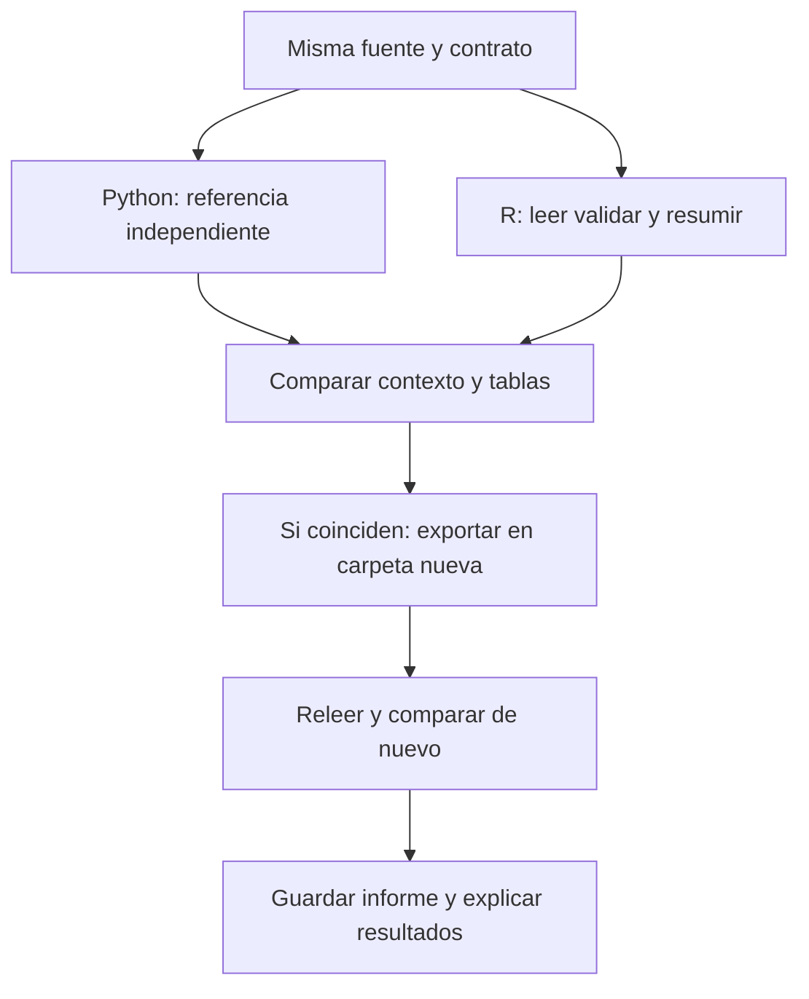

# 06.09 — Reproducir un resultado conocido

## Propósito y prerrequisitos

El cierre de R fundamental reúne lectura, tipos, faltantes, funciones y
reconstrucción. Resolveremos la misma pregunta en Python y R: ¿qué ventas
cumplen nuestras reglas, qué registros requieren revisión y qué importes
conocemos? Compararemos el detalle y las reglas, además de una suma.

**Alcance de cierre.** Necesitas [06.06 — Funciones](../06_functions_control/README.md),
[06.07 — Archivos y validación](../07_files_validation/README.md) y
[06.08 — Proyecto con renv](../08_projects_renv/README.md). Retoma también el
método de [validación en Python 01.06](../../01_python_foundations/06_validation_summary/README.md):
entrada conservada, aceptados/rechazos y conciliación. No se exige completar
las ampliaciones opcionales del módulo 05.

Usamos Python 3.11 o posterior con biblioteca estándar y el entorno R ya
fijado en 06.08. No hay dependencias nuevas ni gráficos en este cierre; la
primera figura R llegará en el módulo 07. RStudio sigue siendo opcional.
No hay proyecto/checkpoint integrador implementado asociado.

Al terminar podrás:

- Declarar una pregunta, población y contrato común antes de comparar lenguajes.
- Calcular en R desde datos y funciones explícitos, en una sesión nueva.
- Conciliar filas, rechazos, faltantes, conteos e indicadores con una referencia Python.
- Explicar una diferencia de representación sin confundirla con cambio de valor.
- Detectar una referencia antigua y una exportación alterada sin repararlas silenciosamente.
- Justificar qué evidencia permite continuar a tidyverse.

## 1. La misma pregunta requiere el mismo contrato

El ejemplo Python 01.06 usa `producto`, unidades enteras positivas y precio
entero. La práctica R de 06.07 usa identificadores, permite cero/fracciones y
conserva faltantes permitidos. Aplicar ambos contratos al mismo archivo no
produciría resultados comparables. **No modificamos 01.06 ni sus resultados.**

La [referencia Python de este cierre](referencia_python.py) adapta ese método
al contrato explícito de [06.07](../07_files_validation/README.md#2-contrato-del-csv-y-de-cada-venta).
Se ejecuta primero sobre la misma copia del CSV y calcula sus resultados;
no lee salidas de R ni contiene una lista fija de totales para aprobarlo.
Comprobamos además los valores esperados a mano.

| Aspecto | Acuerdo de este cierre |
| --- | --- |
| Población y unidad | Las 14 ventas de ventas_entrada.csv; una fila por registro de entrada |
| Corte | No hay columna temporal: se compara esta muestra completa, sin inventar una fecha de corte |
| Clave | V mayúscula y tres dígitos; rechazar todas las apariciones de una clave válida repetida |
| Números de entrada | Decimales no negativos con punto, sin signo/exponente/espacios; finitos |
| Ausencia numérica | Campo vacío o texto NA; permitido y conservado como importe pendiente |
| Motivos de rechazo | Mismos nombres y orden; una fila puede tener varios motivos, pero se cuenta una vez |
| Condición | Importe conocido mayor o igual que 200 MXN |
| Resumen | Solo aceptados; declarar conocidos, faltantes y cobertura antes de suma/media |
| Sin base | Vacío o todos faltantes: indicadores no calculables ausentes; cero observado sigue siendo cero |

La muestra conserva las seis ventas iniciales de R y los ocho casos de calidad
de 06.07. Incluye acentos y una coma entre comillas. Su contrato de archivo
es UTF-8 con cabecera, un registro por línea y salto final; no construimos un
lector universal de cualquier variante CSV.

## 2. Dos implementaciones sobre las mismas entradas

Python usa `csv` para campos, un diccionario para contar identificadores,
listas de registros y un recorrido que acumula motivos. `None` representa
un número ausente en sus objetos. `math.isfinite` rechaza infinitos y
`math.fsum` suma los importes conocidos. Las funciones y el bloque `main`
permiten importar la referencia sin ejecutar las lecturas ni escrituras del análisis.

R reutiliza las funciones comprobadas de 06.06/06.07: vectores, máscaras,
tablas con tipos por columna y resumen con cobertura. Los `NA_real_`
representan números faltantes. El cierre no traduce las líneas de Python:
compara lo que significa y produce cada solución.

La referencia Python usa la biblioteca estándar, sin pandas ni paquetes que
instalar. El análisis R conserva renv 1.3.1/withr 3.0.3 y el lockfile de 06.08.
withr solo modifica temporalmente la presentación, sin redondear los datos.

El [preparador preparar_cierre.R](preparar_cierre.R) crea una carpeta nueva
autocontenida. Toma perfil, lockfile y restaurador de 06.08, funciones de
06.06/06.07 y el mismo CSV; agrega referencia Python, comparador y scripts del
cierre. Las fuentes anteriores quedan intactas. La copia no depende de rutas
hacia otras lecciones después de prepararla.

No necesitas otra biblioteca por cada ejercicio: aquí la copia nueva permite
comprobar el cierre conservando la práctica anterior. No se inicializa renv
en la raíz de DS Track. El preparador solo copia archivos; `restaurar.R`
puede descargar las versiones ya fijadas e instalarlas localmente si faltan.

## 3. Representaciones distintas, significado comparable

| En memoria Python | En memoria R | En los CSV de intercambio |
| --- | --- | --- |
| `str` | `character` | Campo textual; se conserva su contenido |
| `int` de conteo | Conteo numérico conocido | Entero decimal, comprobado exactamente |
| `float` | `double` | Número decimal o científico; se relee como número |
| `None` numérico | `NA_real_` | Marcador literal `NA` solo en columnas numéricas |
| Lista de diccionarios | `data.frame` | Cabecera y filas con el mismo orden acordado |

Una nota cuyo contenido sea `NA` sigue siendo texto; no se convierte a
faltante por aplicarle indiscriminadamente una regla numérica. Los rechazos
conservan lo que llegó: por ejemplo, `dos` no desaparece tras convertirse a NA.

No exigimos que todos los CSV tengan los mismos bytes: Python puede escribir
`4.0` y R `4`, y las comillas también pueden diferir. Sí exigimos los mismos
nombres y orden de columnas, las mismas filas en el orden de entrada y los
mismos contenidos. `fila_origen` conserva la posición del registro de datos;
no es el número de fila impreso por R.

Para números de esta muestra pequeña aceptamos diferencia absoluta de hasta
**1e-9**: `abs(valor_r - valor_python) <= 1e-9`. `abs` da el valor absoluto.
Los conteos y posiciones se comparan **exactamente**, sin tolerancia; textos
y máscaras de faltantes también. No basta con que dos medias impresas como
127.6 se parezcan. Tampoco se admite reemplazar NA por cero, aunque una suma
observada coincida.

Es una regla de comparación para estos ejemplos double/float, no una garantía
de precisión monetaria para cualquier monto. Revisa los límites de
[06.02](../02_objects_vectors/README.md) antes de generalizar.

## 4. Fijar la referencia Python y reconocer resultados esperados

Desde la copia preparada se ejecuta primero `referencia_python.py`. Sus
argumentos son entrada y carpeta nueva de salida. Guarda:

- `aceptados.csv`: registros tipados, con posiciones e importes.
- `rechazos.csv`: texto de origen y motivos.
- `controles.csv`: entrada, aceptados y rechazados.
- `resumen.csv`: indicadores con sus bases y pendientes.
- `contexto.csv`: versión del contrato, huella de fuente, umbral y versión Python.

`hashlib.md5` en Python y `tools::md5sum` en R calculan una huella de los
bytes de entrada. Sirve para detectar una referencia antigua o de otra
fuente; no es una firma de autenticidad. Incluso un cambio de salto de línea
puede cambiar la huella: ambos lenguajes deben leer la misma copia del archivo.
No arregles `contexto.csv` a mano para forzar una coincidencia; genera una
referencia nueva después de decidir y documentar un cambio legítimo.

Los valores manuales de control son:

| Comprobación | Resultado esperado |
| --- | --- |
| Entrada / aceptados / rechazos | 14 / 8 / 6 |
| Posiciones rechazadas | 8, 9, 10, 11, 12, 13 |
| Clave repetida | Las dos apariciones de V010, rechazadas |
| Importes conocidos / pendientes de aceptados | 6 / 2 |
| Suma observada | 300 + 240 + 0 + 120 + 80 + 25.5 = 765.5 MXN |
| Media observada | 765.5 / 6, aproximadamente 127.5833333 MXN |
| Cobertura | 6/8 = 75% sobre aceptados |
| Total completo de aceptados | Desconocido: NA en R, None en Python |
| Cumplen / no cumplen / pendientes con umbral 200 | 2 / 4 / 2 |

Los seis rechazos no participan en esa suma. Informa también 8/14 registros
aceptados; aceptación y cobertura responden preguntas diferentes.

## 5. Calcular, comparar, exportar y releer

[ejecutar_cierre.R](ejecutar_cierre.R) activa explícitamente el perfil local
porque `--vanilla` omite perfiles automáticos. Exige un entorno sincronizado,
lee la fuente y usa las funciones anteriores. Después:

1. Comprueba contrato, umbral y huella de la referencia Python.
2. Compara en memoria las cuatro tablas R con las tablas Python.
3. Solo si coinciden, exporta en una carpeta nueva, sin modificar la fuente.
4. Relee los CSV R y vuelve a compararlos con Python.
5. Escribe `sesion_r.txt` y al final `conciliacion.csv` con los controles aprobados.

Un desacuerdo previo a exportar no crea la entrega R. Un error durante la
escritura o relectura puede dejar una carpeta parcial; se conserva para revisar.
Las escrituras no son una transacción y no prometemos publicación atómica.

El [comparador](comparar_resultados.R) separa texto, conteos y números
aproximados. `numero_exportado` interpreta el marcador NA y rechaza conversiones
que creen faltantes inesperados o infinitos. `comparar_tabla` comprueba esquema,
filas y cada columna completa; `comparar_con_python` comprueba contexto y tablas.
`rbind` une filas de las tablas pequeñas de controles; no recalcula indicadores.
`%in%` pregunta si un nombre pertenece al conjunto de columnas numéricas.

Se obtienen **36 controles por etapa**: tres de contexto y 33 de las cuatro
tablas —esquema, cantidad de filas y columnas—. Hay una etapa de memoria y
otra de CSV guardado: **72 controles**. El número de controles no es el de
ventas ni una calificación. Una entrada vacía también necesita esquema,
conteos y faltantes correctos.



Sin renderizador: ambos lenguajes leen la misma fuente. Comparamos sus
resultados antes de exportar y comprobamos después lo realmente guardado.
El informe documenta comprobaciones; la explicación del estudiante sigue
siendo necesaria.

## 6. Recorrido completo por terminal

Desde la raíz de DS Track, elige un recorrido. Usa tu Python 3.11 o posterior
ya elegido y adapta la ruta de R. No cambies ni instales un entorno global
para esta actividad. La copia reutiliza el lockfile de 06.08.

### PowerShell

```powershell
Set-Location C:\bluepill5\Devs\ds_track
python --version
& "C:\Program Files\R\R-4.6.1\bin\Rscript.exe" --vanilla curriculum/06_r_foundations/09_known_result/preparar_cierre.R
Set-Location curriculum/06_r_foundations/09_known_result/output/cierre_ventas
python referencia_python.py datos/ventas_entrada.csv output/referencia_python
$LASTEXITCODE
& "C:\Program Files\R\R-4.6.1\bin\Rscript.exe" --vanilla restaurar.R
$LASTEXITCODE
& "C:\Program Files\R\R-4.6.1\bin\Rscript.exe" --vanilla ejecutar_cierre.R
$LASTEXITCODE
& "C:\Program Files\R\R-4.6.1\bin\Rscript.exe" --vanilla verificar_cierre.R
$LASTEXITCODE
```

### Bash/Zsh

```bash
cd /ruta/a/ds_track
python3 --version
Rscript --vanilla curriculum/06_r_foundations/09_known_result/preparar_cierre.R
cd curriculum/06_r_foundations/09_known_result/output/cierre_ventas
python3 referencia_python.py datos/ventas_entrada.csv output/referencia_python
echo $?
Rscript --vanilla restaurar.R
echo $?
Rscript --vanilla ejecutar_cierre.R
echo $?
Rscript --vanilla verificar_cierre.R
echo $?
```

### CMD / Anaconda Prompt

```bat
cd /d C:\bluepill5\Devs\ds_track
python --version
"C:\Program Files\R\R-4.6.1\bin\Rscript.exe" --vanilla curriculum/06_r_foundations/09_known_result/preparar_cierre.R
cd curriculum\06_r_foundations\09_known_result\output\cierre_ventas
python referencia_python.py datos/ventas_entrada.csv output/referencia_python
echo %ERRORLEVEL%
"C:\Program Files\R\R-4.6.1\bin\Rscript.exe" --vanilla restaurar.R
echo %ERRORLEVEL%
"C:\Program Files\R\R-4.6.1\bin\Rscript.exe" --vanilla ejecutar_cierre.R
echo %ERRORLEVEL%
"C:\Program Files\R\R-4.6.1\bin\Rscript.exe" --vanilla verificar_cierre.R
echo %ERRORLEVEL%
```

Se esperan códigos 0 y 72 controles. Si un paso falla, revisa el mensaje antes
de continuar. Mantén la explicación de [UTF-8 y locale de 06.07](../07_files_validation/README.md#3-leer-todo-como-texto-antes-de-decidir):
el lockfile no configura el locale. No repitas sobre los mismos destinos
para sobrescribirlos; elige otras carpetas o prepara otra copia.

Para variantes, Python recibe entrada y carpeta nueva. Los dos scripts de
cierre R reciben **tres argumentos juntos**: entrada, carpeta de referencia
y entrega R. Dentro de la copia, por ejemplo:

```text
python referencia_python.py datos/ventas_confirmadas.csv output/python_confirmadas
Rscript --vanilla ejecutar_cierre.R datos/ventas_confirmadas.csv output/python_confirmadas output/r_confirmadas
Rscript --vanilla verificar_cierre.R datos/ventas_confirmadas.csv output/python_confirmadas output/r_confirmadas
```

Es la misma forma de llamada en los tres shells; en Windows antepone la ruta
del ejecutable R de los recorridos anteriores. El lab construye esa variante
antes de usarla. Pon entre comillas las rutas con espacios.

## 7. Verificar sin reparar una entrega

[verificar_cierre.R](verificar_cierre.R) usa solo R incluido: recalcula desde
la entrada y compara tanto ese cálculo como los CSV guardados con Python.
No instala, activa renv, escribe informes, corrige archivos ni completa una
entrega parcial. Imprime el número de controles y la versión efectiva de R.
Exige que existan las cuatro tablas, el registro de sesión y el informe final:
una entrega que no llegó a escribirlos permanece incompleta.

Si alguien cambia un importe guardado, una clave, un motivo o un conteo,
la verificación debe fallar. Si la referencia es de una fuente anterior,
falla la huella. Conservar el informe antiguo no basta: vuelve a verificar
los archivos actuales. El verificador no certifica el contenido histórico
de `sesion_r.txt` ni toma el informe previo como prueba de corrección.

Dos implementaciones pueden coincidir con una regla mal elegida. Por eso
conservamos las cuentas manuales y justificamos población, clave, faltantes
y denominadores. La comparación es evidencia de equivalencia bajo un contrato,
no una demostración de calidad para cualquier problema.

## Práctica, cierre del módulo y continuidad

Realiza el [lab 06.09](../../../labs/06_r_foundations/09_known_result/README.md).
El criterio de salida del módulo es ejecutar desde una sesión nueva, explicar
el modelo de vectores/tablas y faltantes, conciliar conteos e indicadores con
Python y conservar instrucciones que permitan reconstruirlo.

Las nueve secciones de R fundamental tienen material, pero esa disponibilidad
no acredita aprendizaje ni completa proyectos pendientes. Conserva evidencia
y dudas en PROGRESS.md solo después de realizar y explicar las prácticas.

Continúa con [07.01 — Tibbles, importación y pipes](../../07_tidyverse/01_tibbles_import_pipes/README.md),
ya disponible con lab. Extiende el mismo proyecto renv y retoma la cartera
ficticia conocida; la primera figura llegará en 07.10.
Volver al [índice de R fundamental](../README.md).

## Referencias y atribución

Ejemplos propios de DS Track; consulta: 2026-10-17. Comprobados con R 4.6.1,
Python 3.12.12 y el lockfile renv/withr de 06.08.

- Hadley Wickham, Mine Çetinkaya-Rundel y Garrett Grolemund,
  [Workflow: scripts and projects de R4DS, segunda edición](https://r4ds.hadley.nz/workflow-scripts.html):
  reconstruir desde archivos en sesiones nuevas, sin depender de objetos ocultos.
- R oficial: [all.equal](https://stat.ethz.ch/R-manual/R-devel/library/base/html/all.equal.html)
  para contrastar comparación aproximada frente a exacta y
  [md5sum](https://stat.ethz.ch/R-manual/R-devel/library/tools/html/md5sum.html).
  Este comparador usa tolerancia absoluta explícita; no adopta silenciosamente
  la tolerancia relativa predeterminada de all.equal.
- Python oficial: [csv](https://docs.python.org/3.11/library/csv.html),
  [math.fsum/isfinite](https://docs.python.org/3.11/library/math.html) y
  [hashlib](https://docs.python.org/3.11/library/hashlib.html).
  Consulta puntual de APIs incluidas; no se requieren paquetes externos Python.

La [guía de lecturas R](../../../docs/r-reading-guide.md) ubica libros y ediciones.
