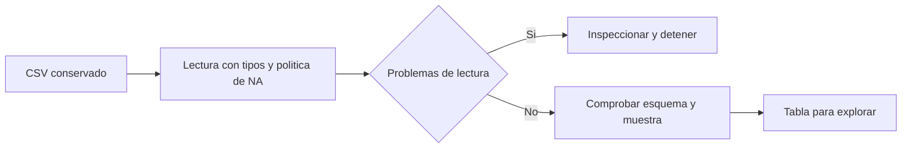

# 07.01 — Tibbles, importación y pipes

## Propósito y prerrequisitos

**Alcance esencial.** Cargar una tabla, explicar sus tipos y leer una secuencia
de llamadas antes de transformarla. Completa el [cierre 06.09](../../06_r_foundations/09_known_result/README.md)
y conserva la carpeta de práctica con renv. Retoma [tablas y extracción 06.05](../../06_r_foundations/05_lists_data_frames/README.md)
y [archivos 06.07](../../06_r_foundations/07_files_validation/README.md).

Al terminar podrás:

- Distinguir una tibble, sus columnas y su representación impresa.
- Importar un CSV con readr declarando identificadores, números y faltantes.
- Inspeccionar problemas de interpretación antes de analizar una tabla.
- Explicar un pipe nativo y escribir su llamada equivalente sin pipe.
- Comprobar filas, tipos y valores conocidos conservando la fuente.

tidyverse es una familia de paquetes relacionados. Hoy usamos **readr 2.2.0**
para lectura y **tibble 3.3.1** para tablas; son las versiones comprobadas con
R 4.6.1, no una promesa de ser las más recientes. No necesitas instalar el
metapaquete tidyverse. dplyr empieza en 07.02; la primera figura llegará en
07.10. Esta práctica no tiene proyecto/checkpoint integrador implementado.

## 1. Volver a una tabla conocida

Reutilizamos sin modificar el [CSV de pandas 02.02](../../02_pandas/02_read_inspect_export/cartera_demo.csv)
y su [diccionario original](../../02_pandas/02_read_inspect_export/README.md#1-una-muestra-nueva-y-su-diccionario).
Son seis observaciones ficticias de créditos al corte 2026-09-30: una fila es
un crédito en ese corte, no una persona ni una venta. Empezamos con esta muestra
pequeña para revisar cada valor; muestras mayores llegarán cuando ayuden a explorar.

| Campo | Tipo en esta lectura | Significado y contrato |
| --- | --- | --- |
| id_credito | character | Identificador de texto; conservar 001–006 |
| segmento | character | Categoría; comercio, local es un único campo entre comillas |
| fecha_corte | character | Texto AAAA-MM-DD; interpretar fechas se desarrolla en 07.09 |
| saldo_mxn | double | Saldo en MXN, pesos enteros en esta muestra; cero es conocido |
| dias_atraso | integer | Días registrados; vacío en 005 significa desconocido |

El CSV usa coma, punto decimal y UTF-8. Acordamos interpretar campos vacíos y
el marcador NA como ausencia. Esa política afecta también a columnas de texto:
si NA fuera un identificador legítimo, tendríamos que cambiarla. Aquí no lo es.
No sustituimos desconocidos por cero ni deducimos riesgo de estas columnas.

## 2. Preparar la práctica desde RStudio o tu IDE

En [06.08](../../06_r_foundations/08_projects_renv/README.md) aprendiste la diferencia
entre declarar, instalar y registrar dependencias. Ahora las necesitamos:
[DESCRIPTION](DESCRIPTION) añade readr/tibble a withr; [renv.lock](renv.lock)
registra sus versiones y dependencias transitivas. Que aparezca magrittr en el
lockfile no obliga a usar su pipe. El operador nativo pertenece a R.

[preparar_tidyverse.R](preparar_tidyverse.R) define una función que recibe la
carpeta **existente** de 06.09. Respalda DESCRIPTION/renv.lock en respaldo_06_09/,
actualiza esos dos metadatos y copia el CSV, funciones y ejecutor nuevos. No instala paquetes ni
reemplaza funciones, datos de ventas o resultados anteriores. Rechaza destinos
propios ocupados o una segunda preparación para evitar sobrescribir tu trabajo.
Es una copia por pasos: un fallo puede dejar preparación parcial; conserva la
carpeta y revisa el respaldo. No se anuncia como operación atómica.

Después restauras la biblioteca **del mismo proyecto**, sin renv::init() ni una
biblioteca nueva por ejercicio. Esto incorpora las dependencias de 07.01, sin
instalar en bibliotecas globales. El lockfile de la lección 06.08 permanece igual.
Si vuelves a las versiones de 06, usa ambos metadatos respaldados y restaura;
volver a ejecutar restaurar.R con el lockfile de 07 mantiene el estado de 07.

### A. Preparar los archivos una sola vez

Trabaja en RStudio; si usas otro IDE, abre la carpeta y utiliza su sesión de R.
**Console** ejecuta código R; **Terminal** ejecuta comandos del sistema. En este
recorrido usamos Console y el editor de scripts, sin abrir Terminal.

Si ya preparaste 07.01, pasa directamente a B. En caso contrario, sitúa la
sesión en la raíz de DS Track: en RStudio, **Session > Set Working Directory >
Choose Directory…** y elige la carpeta del repositorio. Comprueba allí:

```r
getwd()
stopifnot(file.exists("curriculum/07_tidyverse/01_tibbles_import_pipes/preparar_tidyverse.R"))
source("curriculum/07_tidyverse/01_tibbles_import_pipes/preparar_tidyverse.R")
destino <- preparar_tidyverse(
  "curriculum/06_r_foundations/09_known_result/output/cierre_ventas"
)
```

source carga la definición; la llamada preparar_tidyverse realiza la copia.
El destino mostrado es el de 06.09: reemplázalo si tu práctica tiene otra ruta.
Si todavía no existe, completa primero la preparación de 06.09. No ejecutes
el preparador una segunda vez sobre el mismo destino.

### B. Abrir la carpeta de práctica como proyecto

Abre el archivo .Rproj de **la práctica** si ya existe. Si no existe, usa
**File > New Project > Existing Directory**, elige cierre_ventas (o tu destino)
y crea el proyecto sobre esa carpeta. No elijas New Directory ni inicialices
renv otra vez: los datos y la biblioteca ya pertenecen a esa práctica.
El archivo .Rproj organiza la apertura en RStudio; no sustituye renv.lock.
En otro IDE, abre esa misma carpeta y una sesión R con ella como directorio.

Comprueba en Console que getwd() termina en la carpeta de práctica y que
file.exists("renv.lock") devuelve TRUE. A partir de aquí, las rutas parten
de esa carpeta, **no de la raíz de DS Track ni de output/**.

En Console, ejecuta una vez tras actualizar los metadatos:

```r
source("restaurar.R")
```

El restaurador activa .Rprofile y puede descargar e instalar en la biblioteca
local. Si ya está sincronizada, comprueba el estado sin reinstalar. Al volver
a estudiar, basta con abrir el proyecto y comprobar renv::status(); restaura
solo si falta sincronizar. No uses objetos guardados de una sesión anterior
para sustituir los pasos del script.

### C. Escribir y ejecutar por bloques

Con **File > New File > R Script**, crea un script y guárdalo en la práctica.
Escribe los ejemplos allí para conservarlos. Para ejecutar una línea o una
selección, usa **Run** o Ctrl+Enter (Cmd+Enter en macOS). Si una llamada ocupa
varias líneas, ejecuta la expresión completa y observa su resultado en Console.

Empieza tu script con este bloque, que también funciona tras reiniciar R:

```r
source(".Rprofile")
stopifnot(isTRUE(renv::status()$synchronized))
source("R/funciones_importacion.R", encoding = "UTF-8")
```

Usaremos `paquete::función`: carga la función desde ese paquete sin adjuntar
todos sus nombres a la sesión. Evita dudas sobre qué read_csv o tibble se usa.

## 3. Una tibble sigue siendo una tabla de columnas

```r
mini <- tibble::tibble(
  id_credito = c("001", "002"),
  saldo_mxn = c(1000, 1500)
)
class(mini)                        # tbl_df, tbl, data.frame
typeof(mini[["saldo_mxn"]])        # double: tipo del vector
mini["saldo_mxn"]                  # tabla de 2 filas y 1 columna
mini[["saldo_mxn"]]                # vector de longitud 2
```

Observa mini en **Environment** y, si quieres explorar la tabla, ejecuta
`View(mini)` desde Console o abre el objeto en el visor. Es una ayuda visual:
los controles de filas, tipos y valores siguen escritos en el script. No
incluyas View en el script de comprobación completa, porque abre una interfaz.

Como una data.frame, es una lista de columnas de igual longitud y cada columna
conserva su tipo. Su impresión muestra tamaño, tipos y una vista limitada según
el espacio disponible; no es una captura de todas las filas. `<chr>`, `<dbl>`
e `<int>` describen texto, double y entero. Una impresión abreviada no elimina
registros ni redondea los valores almacenados.

| Operación | data.frame base | tibble |
| --- | --- | --- |
| tabla[, "saldo_mxn"] | Puede simplificar a vector | Conserva tabla |
| tabla[["saldo_mxn"]] | Extrae vector | Extrae vector |
| tabla["saldo_mxn"] | Conserva tabla | Conserva tabla |
| $ con nombre incompleto | Puede coincidir parcialmente | No coincide parcialmente; avisa si falta |
| Construcción con longitudes 2 y 4 | Puede reciclar | Error; solo recicla longitud 1 |

Usa nombres completos y `[[ ]]` si necesitas un vector. Una tibble no comprueba
claves únicas, saldos válidos o fechas reales. `tibble::as_tibble(tabla_base)`
convierte el contenedor; no limpia valores ni recupera ceros de identificadores
que ya se interpretaron como números. Relee la fuente con el tipo correcto.

## 4. Importar significa interpretar

En la carpeta de práctica preparada:

```r
cartera <- readr::read_csv(
  "datos/cartera_demo.csv",
  col_types = tipos_cartera(),
  locale = readr::locale(encoding = "UTF-8", decimal_mark = "."),
  na = c("", "NA"), trim_ws = FALSE,
  name_repair = "check_unique", skip_empty_rows = FALSE,
  lazy = FALSE, show_col_types = FALSE, progress = FALSE
)
readr::problems(cartera)
readr::stop_for_problems(cartera)
```

`tipos_cartera()` devuelve una especificación construida con `readr::cols()`:
col_character para los tres textos, col_double para saldo y col_integer para
atraso. Está en [funciones_importacion.R](funciones_importacion.R). A diferencia
de `read.csv` base, `read_csv` de readr devuelve una tibble; sus argumentos son
distintos y no se intercambian automáticamente.

Sin col_types, readr infiere tipos a partir de una muestra: cómodo para explorar,
insuficiente como contrato. show_col_types = FALSE solo oculta el mensaje sobre
tipos, no valida nada ni elimina advertencias de parseo. lazy = FALSE realiza la
lectura ahora; trim_ws = FALSE conserva espacios; skip_empty_rows = FALSE evita
omitir silenciosamente filas vacías. name_repair impide reparar nombres duplicados
sin decisión. La función leer_cartera comprueba además los cinco nombres **en orden**.

No basta con que la llamada termine. Un texto incompatible puede producir NA
y una advertencia. `problems()` devuelve una tabla con posición, columna, valor
esperado/recibido y archivo; no elimina filas ni genera por sí sola un registro
de rechazos de negocio. `stop_for_problems()` detiene el flujo si hay problemas.
Nuestro lector lo aplica antes de devolver datos para analizarlos.



Sin renderizador: conservamos el CSV, interpretamos campos, revisamos problemas
y después comprobamos el esquema y los valores conocidos. Leer sin problemas
solo supera esa primera etapa; las reglas de calidad se desarrollan en 07.04.

### Error deliberado, aislado de la fuente

```r
ensayo <- readr::read_csv(
  I("id_credito,saldo_mxn\n001,mil\n"),
  col_types = readr::cols(id_credito = readr::col_character(),
                          saldo_mxn = readr::col_double()),
  show_col_types = FALSE, lazy = FALSE
)
readr::problems(ensayo)          # un problema: mil no es un double
is.na(ensayo[["saldo_mxn"]])     # TRUE, creado por fallo de interpretación
```

I() indica texto CSV literal; no crea un archivo. La advertencia es esperada.
Ejecuta aparte `readr::stop_for_problems(ensayo)`: debe dar error. Aquí el NA
resultante tiene un origen diferente al campo vacío permitido de 005. No
continúes usando ensayo como si fueran datos comprobados. Un saldo -10 puede
leerse sin problemas como double y aun requerir rechazo según una regla de
negocio: parsear correctamente no equivale a validar el dominio.

## 5. Leer una secuencia con el pipe nativo

```r
cartera <- leer_cartera("datos/cartera_demo.csv")
vista <- cartera |> head(2)
cantidad <- cartera |> head(2) |> nrow()
stopifnot(identical(vista, head(cartera, 2)), cantidad == 2L)
```

Lee: toma cartera, pasa su resultado a head con 2 filas y pasa esa tabla a nrow.
`x |> f(y)` equivale a `f(x, y)` en estos ejemplos; la secuencia anterior se
escribe `nrow(head(cartera, 2))`. Los paréntesis de cada llamada son necesarios.
El pipe no guarda cambios en cartera ni escribe archivos. `<-` guarda el
resultado en un nombre; si no asignas, solo obtienes el valor de la expresión.
Una función que escribe o modifica estado mantiene esos efectos aunque uses pipe.

El resultado de nrow es un entero, no una tabla: antes de añadir otro paso,
comprueba qué recibe la función siguiente. No todas las funciones esperan los
datos en su primer argumento; hoy elegimos llamadas compatibles. Los marcadores
para otros argumentos se estudiarán cuando sean necesarios.

`|>` está incluido desde R 4.1. Puedes encontrar `%>%` en libros anteriores:
requiere un paquete como magrittr y sus reglas difieren. Lo reconocemos para
leer material antiguo; usamos solo el pipe nativo en esta práctica.

## 6. Comprobar antes de continuar

```r
comprobar_muestra(cartera)
dim(cartera)                           # 6 5
print(cartera, n = 6, width = Inf)      # mostrar toda esta muestra pequeña
sum(cartera[["saldo_mxn"]])            # 6000, con los seis saldos conocidos
sum(is.na(cartera[["dias_atraso"]]))    # 1
cartera |> head(2) |> nrow()           # 2; cartera aún tiene 6 filas
```

Esperamos identificadores 001–006, saldo cero en 004, atraso desconocido en 005,
segmento con coma en 002 y educación con acento en 005. La cobertura de saldo
es 6/6; la de atraso, 5/6. No sumamos atrasos ni inventamos una media de riesgo.
[importar_cartera.R](importar_cartera.R) reúne esos controles, imprime versiones
y comprueba la huella del CSV antes/después. Ábrelo desde Files para leer sus
bloques. Guarda tu trabajo, usa **Session > Restart R** y ejecútalo completo con
**Source** o con `source("importar_cartera.R", encoding = "UTF-8")` en Console.
Así compruebas que se reconstruye sin objetos creados manualmente. Reiniciar
vacía los objetos de la sesión; limpiar Console solo quita el texto visible.
La comprobación no exporta
ni limpia. El control de muestra exige estos seis registros; leer_cartera puede
leer otras tablas con ese esquema, sin certificar su calidad.

Errores habituales: confundir una vista con la tabla completa, usar inferencia
para una clave, silenciar advertencias, confundir NA permitido con parseo fallido,
o llamar al script desde una carpeta distinta. Revisa ruta, tipos y problemas
antes de cambiar datos. Si modificas una entrada para probar, crea otra copia.

## Práctica, criterio de salida y siguiente paso

Realiza el [lab 07.01](../../../labs/07_tidyverse/01_tibbles_import_pipes/README.md).
Puedes avanzar cuando reconstruyas la carga desde una sesión nueva, expliques
los tipos y la forma de la tabla, traduzcas el pipe a llamadas y justifiques el
faltante sin alterar la fuente. Conserva script y explicación como evidencia;
la existencia del material no acredita el aprendizaje.

<a id="comprobacion-opcional-desde-terminal"></a>

### Comprobación opcional desde terminal

Puedes completar esta lección desde el IDE. Si quieres comprobar también la
ejecución fuera de él o preparar una automatización, abre una terminal **en la
raíz de la práctica ya preparada y restaurada**. No copies estos comandos en
Console de R. Rscript --vanilla inicia otro proceso sin restaurar el workspace;
el ejecutor activa explícitamente el perfil local. Esta alternativa no cambia
el criterio de salida.

<details>
<summary>Ejecutar el script con Rscript (opcional)</summary>

#### PowerShell

```powershell
Rscript --vanilla importar_cartera.R
```

#### Bash/Zsh

```bash
Rscript --vanilla importar_cartera.R
```

#### CMD / Anaconda Prompt

```bat
Rscript --vanilla importar_cartera.R
```

</details>

Siguiente: [07.02 — Seleccionar, filtrar y ordenar](../02_select_filter_sort/README.md),
con lección y lab disponibles. Volver al [índice del módulo](../README.md).

## Referencias y atribución

Ejemplos propios sobre la muestra de DS Track. Consulta: 2026-10-17;
R 4.6.1, readr 2.2.0 y tibble 3.3.1 comprobados localmente.

- Hadley Wickham, Mine Çetinkaya-Rundel y Garrett Grolemund,
  [R for Data Science, segunda edición: Data import](https://r4ds.hadley.nz/data-import.html).
  Adaptamos sus ideas de tipos, faltantes y pipes al recorrido ya estudiado.
- readr: [read_csv y argumentos](https://readr.tidyverse.org/reference/read_delim.html)
  y [problems / stop_for_problems](https://readr.tidyverse.org/reference/problems.html).
- tibble: [construcción](https://tibble.tidyverse.org/reference/tibble.html) y
  [extracción](https://tibble.tidyverse.org/reference/subsetting.html).
- R oficial: [pipe nativo](https://stat.ethz.ch/R-manual/R-devel/library/base/html/pipeOp.html).
  La ayuda instalada de R 4.6.1 confirma las llamadas utilizadas.
- [Guía de lecturas y coautorías](../../../docs/r-reading-guide.md).
- Posit: [proyectos en RStudio](https://support.posit.co/hc/en-us/articles/200526207-Using-RStudio-Projects),
  [ejecución de scripts](https://support.posit.co/hc/en-us/articles/200484448-Editing-and-Executing-Code-in-the-RStudio-IDE)
  y [directorio de trabajo](https://support.posit.co/hc/en-us/articles/200711843-Working-Directories-and-Workspaces-in-the-RStudio-IDE).
  Menús y atajos contrastados con su documentación; otros IDE pueden variar.
