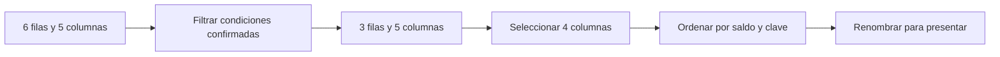

# 07.02 — Seleccionar, filtrar y ordenar

[Inicio](../../../README.md) / [Módulo 07](../README.md) / **Lección 07.02**

| Tu sesión | Qué prepararás o comprobarás |
| --- | --- |
| **Meta** | Elegir columnas y filas con orden y desempate verificables |
| **Necesitas** | 07.01 preparada en el mismo proyecto; condiciones y selección base |
| **Evidencia** | Selección justificada con pendientes, empates y vacío comprobados |

[Preparación](#antes-de-empezar) · [Material de apoyo](#material-de-apoyo) · [Lab 07.02](../../../labs/07_tidyverse/02_select_filter_sort/README.md) · [Comprobar](#evidencia-y-criterio-de-salida)

<a id="propósito-y-prerrequisitos"></a>

## Propósito

**Alcance esencial.** Obtener un subconjunto verificable y explicar por qué
entró cada fila.

## Antes de empezar

Completa [07.01 — Tibbles, importación y pipes](../01_tibbles_import_pipes/README.md)
y conserva el mismo proyecto renv. Retoma [condiciones y NA de 06.04](../../06_r_foundations/04_logic_missing/README.md)
y la [selección base de 06.05](../../06_r_foundations/05_lists_data_frames/README.md).

Trabajamos en RStudio o tu IDE, por bloques y después con el script completo.
Usamos **dplyr 1.2.1**, comprobado con R 4.6.1; la versión queda registrada,
sin afirmar que sea la más reciente. No necesitamos mutate, group_by, uniones
ni gráficos todavía. El proyecto/checkpoints integradores siguen pendientes.

## Qué vas a aprender

- Elegir y renombrar columnas sin confundir esas operaciones con filtrar filas.
- Combinar condiciones y explicar qué conserva filter cuando aparece NA.
- Ordenar con una dirección y un desempate explícitos.
- Conservar identificadores y comprobar un resultado vacío.
- Reconstruir el script desde el IDE y comparar con la selección conocida de pandas.

## Material de apoyo

| Recurso | Para qué sirve | Uso |
| --- | --- | --- |
| [Preparador](preparar_seleccion.R) | Respaldar 07.01 e incorporar dplyr al mismo proyecto | Para el recorrido |
| [Dependencias](DESCRIPTION) | Consultar la declaración de dplyr | Para el recorrido |
| [Lockfile](renv.lock) | Restaurar el estado registrado | Para el recorrido |
| [Ejecutor](seleccionar_cartera.R) | Comprobar selección, orden y fronteras | Para el recorrido |
| [Diccionario de la muestra](../../02_pandas/02_read_inspect_export/README.md#1-una-muestra-nueva-y-su-diccionario) | Revisar campos y unidad de observación | Para el recorrido |

Los enlaces permiten consultar las fuentes. Sigue el preparador una sola vez
para incorporar el material al mismo proyecto de práctica; después abre allí
los scripts desde el IDE. La sección de preparación distingue la raíz de DS Track
de la raíz de esa práctica y explica cuándo restaurar dependencias.

## 1. La pregunta antes de los verbos

Retomamos sin cambios datos/cartera_demo.csv de tu práctica y su
[diccionario de pandas 02.02](../../02_pandas/02_read_inspect_export/README.md#1-una-muestra-nueva-y-su-diccionario).
Son seis créditos ficticios observados en 2026-09-30. La unidad sigue siendo
crédito por corte; id_credito se conserva como texto, saldo está en MXN y
atraso en días. La fecha sigue como texto hasta 07.09.

Pregunta: **¿qué registros tienen saldo mayor o igual a 500 MXN y atraso
mayor o igual a 5 días?** La regla incluye ambas fronteras. Pedimos condiciones
confirmadas; un atraso desconocido no se interpreta como cero ni como cumplimiento.
Este recorte sirve para practicar selección, no constituye una calificación de riesgo.

Antes de ejecutar, revisa las seis filas:

| ID | Saldo ≥ 500 | Atraso ≥ 5 | Ambas condiciones |
| --- | --- | --- | --- |
| 001 | TRUE | FALSE | FALSE |
| 002 | TRUE | TRUE | TRUE |
| 003 | TRUE | TRUE | TRUE |
| 004 | FALSE | FALSE | FALSE |
| 005 | TRUE | NA | NA |
| 006 | TRUE | TRUE | TRUE |

El resultado esperado contiene 002, 003 y 006. 001/004 no cumplen; 005 queda
pendiente. La separación explica las seis entradas sin modificar ninguna.

## 2. Incorporar dplyr en el mismo proyecto

Este paquete aporta verbos para operar sobre tablas. [DESCRIPTION](DESCRIPTION)
añade dplyr a las dependencias de 07.01 y [renv.lock](renv.lock) registra el
estado comprobado. Solo se incorporan dplyr 1.2.1 y su dependencia nueva
generics 0.1.4; las versiones de readr, tibble, withr y renv se conservan.

### Preparación, una sola vez desde R

Guarda tus scripts. Si ya preparaste 07.02, pasa a la carga. De lo contrario,
sitúa temporalmente la sesión en la raíz de DS Track, como en la
[preparación de 07.01](../01_tibbles_import_pipes/README.md#a-preparar-los-archivos-una-sola-vez).
Ejecuta en **Console de R**, no en Terminal:

```r
source("curriculum/07_tidyverse/02_select_filter_sort/preparar_seleccion.R")
destino <- preparar_seleccion(
  "curriculum/06_r_foundations/09_known_result/output/cierre_ventas"
)
```

Usa la ruta de tu práctica si es distinta. source solo carga la función;
la llamada prepara el material. [El preparador](preparar_seleccion.R) exige
07.01, respalda DESCRIPTION/renv.lock en respaldo_07_01/, actualiza ambos y
copia seleccionar_cartera.R. No instala ni reemplaza el lector, CSV o scripts
anteriores. Rechaza archivos ocupados y una segunda preparación. Si falla a
mitad de la copia, conserva el respaldo y revisa; no es una operación atómica.

Vuelve a abrir **el mismo .Rproj de la práctica** o esa carpeta en tu IDE y
reinicia R. Desde su raíz, ejecuta en Console:

```r
source("restaurar.R")
```

Puede descargar paquetes en la biblioteca local. No reinicialices renv ni
instales en una biblioteca global. En sesiones posteriores comprueba el estado;
si está sincronizado, no necesitas restaurar de nuevo. La versión de 07.01
permanece en su lección y en el respaldo de metadatos.

### Cargar en un script del IDE

Crea un script propio y guárdalo, por ejemplo, como output/mi_seleccion.R
dentro de la práctica. El directorio de trabajo debe seguir siendo la raíz
de esa práctica, aunque el script esté en output/. Comienza con:

```r
source(".Rprofile")
stopifnot(isTRUE(renv::status()$synchronized))
source("R/funciones_importacion.R", encoding = "UTF-8")
cartera <- leer_cartera("datos/cartera_demo.csv")
comprobar_muestra(cartera)
original <- cartera
```

Ejecuta cada bloque con Run y observa objetos en Environment. `dplyr::`
identifica el paquete sin adjuntar todos sus nombres; evita confundir filter
con otras funciones de igual nombre. Dentro de estos verbos, los nombres de
columna se buscan en la tabla, por eso escribimos saldo_mxn sin cartera$.
Fuera de esas llamadas seguimos extrayendo columnas con $ o [[ ]]. Esta
comodidad no convierte cualquier función R en un verbo de dplyr.

## 3. select elige columnas; rename cambia sus nombres

```r
columnas <- cartera |>
  dplyr::select(id_credito, segmento, saldo_mxn, dias_atraso)
con_otro_nombre <- columnas |> dplyr::rename(saldo_pesos = saldo_mxn)
stopifnot(nrow(columnas) == 6L,
          identical(names(con_otro_nombre),
                    c("id_credito", "segmento", "saldo_pesos", "dias_atraso")))
```

select devuelve las columnas pedidas en ese orden. Aquí retira fecha_corte,
pero no retira filas. rename escribe **nombre nuevo = nombre anterior**:
cambia la etiqueta, no convierte unidades ni calcula valores. 1000 MXN sigue
siendo 1000 MXN. cartera y columnas conservan sus nombres porque guardamos
el resultado en otro objeto.

También puedes excluir una columna con select(-fecha_corte). Al empezar,
preferimos listar las que necesitamos para hacer visible el esquema final.
No quites dias_atraso antes de filtrar por ella. Conserva id_credito: la
posición de una fila cambiará al ordenar y no sustituye su identidad.
Las selecciones por patrones o listas de nombres se ampliarán cuando hagan falta.

## 4. filter conserva condiciones verdaderas

```r
confirmados <- cartera |>
  dplyr::filter(saldo_mxn >= 500, dias_atraso >= 5)
equivalente <- cartera |>
  dplyr::filter((saldo_mxn >= 500) & (dias_atraso >= 5))
stopifnot(identical(confirmados, equivalente),
          identical(confirmados$id_credito, c("002", "003", "006")))
```

Las condiciones separadas por coma se combinan con **Y**. Para **O**, usa `|`:
filter((saldo_mxn >= 500) | (dias_atraso >= 5)) produce aquí cinco filas,
incluida 005 porque su saldo sí cumple. Los paréntesis hacen visible cada
comparación. Usa & y | para condiciones por fila; && y || son operadores
escalares y no corresponden a esta selección vectorizada. `==` compara;
`=` se utiliza para argumentos con nombre, como en rename, no como comparación.

filter conserva solo TRUE; FALSE y NA no entran. Eso no convierte NA en FALSE
en la fuente. Tampoco limpia ni elimina físicamente registros del archivo.
Conserva las columnas y el orden relativo de las filas que sí entran.

### No cumplir y no poder evaluar son distintos

```r
no_cumplen <- cartera |>
  dplyr::filter(!(saldo_mxn >= 500 & dias_atraso >= 5))
pendientes <- cartera |>
  dplyr::filter(is.na(saldo_mxn >= 500 & dias_atraso >= 5))
stopifnot(identical(no_cumplen$id_credito, c("001", "004")),
          identical(pendientes$id_credito, "005"),
          nrow(confirmados) + nrow(no_cumplen) + nrow(pendientes) == 6L)
```

Negar la condición no recupera automáticamente a 005: !NA sigue siendo NA.
Por eso conservamos las filas con condición desconocida aparte. Evaluamos
la condición **completa**, no solo si hay un campo faltante: FALSE & NA es
FALSE, así que un saldo conocido menor de 500 ya permite concluir que no
cumple ambas condiciones, incluso con atraso ausente. Retoma la lógica de 06.04.

Para preguntar solo por ausencia de atraso, escribe filter(is.na(dias_atraso)).
No uses dias_atraso == NA: comparar con un desconocido no detecta la ausencia.
Esta lección separa resultados de una pregunta; aceptación/rechazo por reglas
de calidad se desarrollará en 07.04.

## 5. arrange ordena; desc cambia la dirección

```r
seleccion <- confirmados |>
  dplyr::select(id_credito, segmento, saldo_mxn, dias_atraso) |>
  dplyr::arrange(dplyr::desc(saldo_mxn), id_credito)
print(seleccion, n = 6, width = Inf)
presentacion <- seleccion |> dplyr::rename(saldo_pesos = saldo_mxn)
```

arrange ordena de menor a mayor por defecto. desc(saldo_mxn) pide mayor a
menor; id_credito ascendente resuelve empates. No reduce filas ni agrupa.
Estas tablas están en memoria y sin agrupar; las reglas de agrupación se
estudiarán en 07.05. En tablas locales, NA queda al final incluso con desc.
Los criterios de orden de texto y bases remotas pueden diferir; aquí el
desempate usa identificadores ASCII de ancho fijo, no etiquetas con acentos.

| id_credito | segmento | saldo_mxn | dias_atraso |
| --- | --- | --- | --- |
| 002 | comercio, local | 1500 | 10 |
| 003 | servicios | 750 | 45 |
| 006 | servicios | 500 | 5 |

El subtotal es 2750 MXN y los tres saldos están presentes. Son **3/6 créditos**
de la muestra, con cobertura de saldo **3/3 dentro del subconjunto**. No lo
presentes como saldo total de la cartera: 6000 MXN corresponde a las seis filas.

El orden de los pasos depende de lo que necesita cada función:



Sin renderizador: filtramos usando columnas presentes, elegimos el esquema,
ordenamos y después cambiamos el nombre para presentar. Cada flecha devuelve
una tabla. No todas las secuencias son intercambiables: si renombras saldo_mxn,
los pasos posteriores deben usar su nombre nuevo.

## 6. Vacíos y comprobaciones

```r
sin_coincidencias <- cartera |>
  dplyr::filter(saldo_mxn > 10000) |>
  dplyr::select(id_credito, segmento, saldo_mxn, dias_atraso) |>
  dplyr::arrange(dplyr::desc(saldo_mxn), id_credito)
stopifnot(identical(dim(sin_coincidencias), c(0L, 4L)),
          identical(names(sin_coincidencias), names(seleccion)),
          identical(cartera, original))
```

Un resultado de cero filas puede ser correcto. Conserva nombres y tipos de
columnas; no inventes un primer crédito ni interpretes sum(numeric(0)) como
saldo observado de una población con datos. Primero informa que no hubo
coincidencias. [El ejecutor seleccionar_cartera.R](seleccionar_cartera.R)
comprueba claves, esquema, valores, tipos del vacío, conciliación 3 + 2 + 1,
objeto original y huella del CSV. No exporta ni modifica la entrada.

### Comparar el significado con pandas y SQL

La [selección de pandas 02.03](../../02_pandas/03_select_filter_sort/README.md)
usa el mismo CSV, umbrales y desempate: 002/003/006 y 2750 MXN. El nombre de
las funciones cambia; la pregunta y la población deben coincidir.

| Intención | dplyr | pandas 02.03 | SQL |
| --- | --- | --- | --- |
| Columnas | select | lista de columnas en loc | SELECT |
| Condiciones confirmadas | filter con & | máscara con fillna(False) | WHERE con AND |
| Nombre de presentación | rename(nuevo = anterior) | rename(columns=...) | AS |
| Orden | arrange(desc(saldo), id) | sort_values con direcciones | ORDER BY saldo DESC, id ASC |

Si una tabla SQL cartera contiene **estas mismas seis observaciones y tipos**,
el recorte se expresa así, como repasaste en [03.02](../../03_sql_databases/02_first_queries/README.md):

```sql
SELECT id_credito, segmento, saldo_mxn, dias_atraso
FROM cartera
WHERE saldo_mxn >= 500 AND dias_atraso >= 5
ORDER BY saldo_mxn DESC, id_credito ASC;
```

Es una comparación de lectura; no supone que exista esa tabla en las bases
anteriores ni requiere ejecutar SQL en el lab R. WHERE tampoco incluye una
condición desconocida por NULL. Para comparar resultados usa claves, valores,
orden y faltantes; ni el índice pandas ni los números impresos de fila son claves.
La revisión del material contrasta R, pandas y SQLite sobre el mismo CSV.

<a id="práctica-criterio-de-salida-y-siguiente-paso"></a>

## Práctica

Realiza el [lab 07.02](../../../labs/07_tidyverse/02_select_filter_sort/README.md).
Para comprobar sin estado oculto, guarda el script, usa Session > Restart R
y ejecuta desde Console `source("seleccionar_cartera.R", encoding = "UTF-8")`
o el script propio completo. Mantén la raíz de la práctica como directorio.
No hace falta usar Terminal; el recorrido de Run/Source es el de 07.01.

Consulta [seleccionar_cartera.R](seleccionar_cartera.R) como referencia del recorrido completo;
trabaja con su copia preparada dentro del proyecto, manteniendo su raíz como
directorio al ejecutar.

## Evidencia y criterio de salida

| Conserva | Comprueba | Explica |
| --- | --- | --- |
| Script y selección | IDs 002/003/006 y 2750 MXN; orden y desempate explícitos | Elegir columnas frente a filtrar filas |
| Pendientes y casos frontera | Partición 3/2/1, empates e intervalo vacío | Qué conserva filter ante TRUE, FALSE y NA |

Puedes avanzar cuando justifiques cada fila incluida, separes las pendientes,
expliques el desempate y el vacío y reconstruyas sin modificar la fuente.

Quien aprende realiza la práctica y explica las decisiones; su compañero revisa.
Tu compañero introduce un empate y pide justificar el orden final sin depender del orden de entrada.
Guarda evidencia, ayudas y dudas en una nota personal junto a tu práctica.
PROGRESS.md registra desarrollo editorial, no tu expediente de aprendizaje.
El proyecto integrador y sus checkpoints siguen pendientes; disponer de
lecciones y scripts no acredita haber completado el aprendizaje.

<a id="referencias-y-atribución"></a>

## Referencias

Ejemplos propios sobre la cartera ficticia de DS Track. Consulta: 2026-10-17.
R 4.6.1/dplyr 1.2.1 comprobados localmente; las APIs futuras se contrastarán.

- Hadley Wickham, Mine Çetinkaya-Rundel y Garrett Grolemund,
  [R for Data Science, segunda edición: Data transformation](https://r4ds.hadley.nz/data-transform.html).
- Referencia oficial de dplyr: [select](https://dplyr.tidyverse.org/reference/select.html),
  [rename](https://dplyr.tidyverse.org/reference/rename.html),
  [filter](https://dplyr.tidyverse.org/reference/filter.html) y
  [arrange](https://dplyr.tidyverse.org/reference/arrange.html).
  Consulta centrada en tablas locales sin agrupar; no se exige estudiar toda la API.
- [Guía de lecturas y coautorías](../../../docs/r-reading-guide.md).

## Siguiente paso

Después de la práctica y su comprobación, continúa con
[07.03 — Transformar columnas](../03_transform_columns/README.md).

[← Módulo 07](../README.md) · [Lab 07.02](../../../labs/07_tidyverse/02_select_filter_sort/README.md) · [Siguiente →](../03_transform_columns/README.md)
