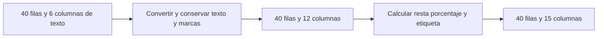

# 07.03 — Transformar columnas

[Inicio](../../../README.md) / [Módulo 07](../README.md) / **Lección 07.03**

| Tu sesión | Qué prepararás o comprobarás |
| --- | --- |
| **Meta** | Crear columnas con reglas, tipos y denominadores explícitos |
| **Necesitas** | 07.02 y mismo lockfile; vectores, faltantes y funciones |
| **Evidencia** | Columnas derivadas con originales y marcas de conversión conservados |

[Preparación](#antes-de-empezar) · [Material de apoyo](#material-de-apoyo) · [Lab 07.03](../../../labs/07_tidyverse/03_transform_columns/README.md) · [Comprobar](#evidencia-y-criterio-de-salida)

<a id="propósito-prerrequisitos-y-objetivos"></a>

## Propósito

**Alcance esencial.** Crear cantidades y etiquetas cuya regla puedas explicar,
sin perder los datos que las originaron.

## Antes de empezar

Completa [07.02 — Seleccionar, filtrar
y ordenar](../02_select_filter_sort/README.md). Retoma [vectores y coerción de
06.02](../../06_r_foundations/02_objects_vectors/README.md), [NA de 06.04](../../06_r_foundations/04_logic_missing/README.md)
y [funciones de 06.06](../../06_r_foundations/06_functions_control/README.md).

Usa **RStudio o tu IDE**, el mismo proyecto renv y las versiones de 07.02:
R 4.6.1, dplyr 1.2.1, readr 2.2.0 y tibble 3.3.1 comprobados. **No hay paquetes
ni lockfile nuevos.** Trabajamos con tablas locales sin agrupar. La validación
de registros se desarrolla en 07.04; resúmenes por grupo en 07.05.
El proyecto/checkpoints integradores siguen pendientes.

Puedes dividir la lección en dos sesiones: ejemplos pequeños (3–5) y aplicación
de conversiones e indicadores (6–9). No hace falta memorizar todo el script.

## Qué vas a aprender

- Crear columnas con mutate y operaciones sobre vectores completos.
- Usar if_else y case_when con tipos, faltantes y prioridades explícitos.
- Conservar el texto original y distinguir ausencia de conversión incompatible.
- Calcular una resta y un porcentaje sin inventar datos ni dividir entre cero.
- Comprobar filas, tipos e indicadores sobre la misma base de observaciones.

## Material de apoyo

| Recurso | Para qué sirve | Uso |
| --- | --- | --- |
| [Preparador](preparar_transformacion.R) | Copiar funciones, ejecutor y muestra sin cambiar dependencias | Para el recorrido |
| [CSV de 40 registros](../../02_pandas/04_types_calculated_columns/cartera_conversion.csv) | Examinar textos, ausencias y conversiones de la muestra | Para el recorrido |
| [Funciones](funciones_transformacion.R) | Seguir conversiones con marcas y cálculo de indicadores | Para el recorrido |
| [Ejecutor](transformar_cartera.R) | Reconstruir tipos, claves y controles | Para el recorrido |

Los enlaces permiten consultar las fuentes. Sigue el preparador una sola vez
para incorporar el material al mismo proyecto de práctica; después abre allí
los scripts desde el IDE. La sección de preparación distingue la raíz de DS Track
de la raíz de esa práctica y explica cuándo restaurar dependencias.

## 1. Dos muestras con propósitos distintos

Primero retomamos las seis observaciones de cartera de 07.01–07.02. Después
usamos las **40 filas sintéticas** de [pandas 02.04](../../02_pandas/04_types_calculated_columns/README.md),
sin alterar esa muestra ni sus resultados. Es otro archivo: no reemplaza las
seis filas previas. Una fila sigue siendo un crédito ficticio en el corte
2026-09-30; no son datos personales ni movimientos reales.

| Campo del archivo de 40 filas | Lectura inicial | Contrato del ejemplo |
| --- | --- | --- |
| id_credito | Texto | Conservar 001–040; no es una cantidad |
| segmento | Texto | Categoría ficticia, sin normalizar aquí |
| fecha_corte | Texto | AAAA-MM-DD; interpretación de fechas en 07.09 |
| saldo_mxn | Texto por interpretar | Pesos enteros pequeños; puede faltar o ser incompatible |
| pago_mxn | Texto por interpretar | Pesos enteros pequeños; puede faltar o ser incompatible |
| dias_atraso | Texto por interpretar | Días completos; 3.5 no cumple el tipo requerido |

La resta saldo − pago es solo un ejercicio aritmético: no modela intereses o
amortización. El porcentaje significa pago / saldo × 100 cuando saldo > 0.
Las etiquetas de atraso son didácticas, no una evaluación de riesgo.
El [diccionario de 02.04](../../02_pandas/04_types_calculated_columns/README.md#1-una-muestra-más-amplia-para-explorar)
describe las entradas y sus excepciones.

## 2. Preparar archivos desde el IDE, sin reinstalar

Guarda tus scripts. Solo para copiar el material nuevo, sitúa temporalmente
la sesión en la raíz de DS Track como en la [preparación de 07.01](../01_tibbles_import_pipes/README.md#a-preparar-los-archivos-una-sola-vez).
En **Console de R**, ejecuta una vez:

```r
source("curriculum/07_tidyverse/03_transform_columns/preparar_transformacion.R")
destino <- preparar_transformacion(
  "curriculum/06_r_foundations/09_known_result/output/cierre_ventas"
)
```

Usa la ruta de tu práctica si es distinta. source define la función; la llamada
copia [funciones_transformacion.R](funciones_transformacion.R),
[transformar_cartera.R](transformar_cartera.R) y el CSV de 40 filas a la práctica.
[El preparador](preparar_transformacion.R) exige 07.02, no sobrescribe archivos
ocupados y deja DESCRIPTION, renv.lock y biblioteca intactos. Una copia fallida
puede quedar parcial: conserva los archivos y revisa antes de repetir.
Si ya preparaste 07.03, omite este paso.

Vuelve a abrir **el mismo proyecto de práctica**, reinicia R y conserva su raíz
como directorio de trabajo. No crees otro proyecto o entorno. Comprueba el
estado; restaura según 07.02 solo si falta sincronizar. Crea un script propio,
por ejemplo output/mis_columnas.R, y comienza con:

```r
source(".Rprofile")
stopifnot(isTRUE(renv::status()$synchronized))
source("R/funciones_importacion.R", encoding = "UTF-8")
source("R/funciones_transformacion.R", encoding = "UTF-8")
cartera <- leer_cartera("datos/cartera_demo.csv")
comprobar_muestra(cartera)
original_seis <- cartera
```

Ejecuta por bloques con Run y observa los objetos en Environment o el visor.
Console recibe expresiones R; no necesitamos Terminal. Los scripts guardan
los pasos; los objetos de la sesión son resultados que podremos reconstruir.

## 3. mutate calcula por columna

```r
ejemplo <- cartera |>
  dplyr::mutate(
    saldo_miles_mxn = saldo_mxn / 1000,
    moneda = "MXN"
  )
print(ejemplo, n = 6, width = Inf)
stopifnot(identical(dim(ejemplo), c(6L, 7L)), identical(cartera, original_seis))
```

La expresión saldo_mxn / 1000 opera sobre el vector de seis saldos. No hay que
escribir una instrucción por crédito. La columna nueva conserva la correspondencia
con cada fila: para 001, 1000 MXN se representan como 1 en **miles de MXN**.
El nombre incluye la unidad; no confundas 1 con un saldo de un peso.

mutate devuelve otra tabla con el mismo número y orden de filas. Conserva las
columnas originales por defecto y añade las nuevas. Cada expresión debe producir
un valor por fila o un único valor que se repite: moneda = "MXN" se recicla a
las seis filas. Un vector externo de longitud 2 no se recicla a una tabla de 6.
Las columnas pueden tener tipos distintos: saldo_miles_mxn es double y moneda
character. Retoma la diferencia entre tabla y vector de 07.01.

Si escribes mutate(saldo_mxn = saldo_mxn / 1000), reemplazas esa columna en el
**resultado**. Si luego asignas cartera <- ..., reemplazas el objeto asociado
a ese nombre; el archivo CSV no cambia por esa asignación. Aquí conservamos
columnas de origen y guardamos cálculos en otro objeto para poder revisarlos.

Las columnas nuevas están disponibles para las expresiones siguientes dentro
de la misma llamada. Por ejemplo, una presentación redondeada puede construirse
después de saldo_miles_mxn. Redondear para mostrar no mejora la precisión del
valor; no redondearemos los porcentajes antes de comprobarlos.

## 4. if_else: elegir un resultado por fila

Ya conoces if para tomar una decisión escalar. if_else se aplica a un **vector
lógico** y elige entre dos valores, conservando la posición de cada elemento.
Para etiquetar atraso desde 30 días inclusive:

```r
binaria <- cartera |>
  dplyr::mutate(
    desde_30 = dias_atraso >= 30L,
    etiqueta = dplyr::if_else(
      desde_30, "30 dias o mas", "menos de 30 dias",
      missing = "sin dato evaluable"
    )
  )
print(binaria |> dplyr::select(id_credito, dias_atraso, desde_30, etiqueta), n = 6)
```

El primer argumento es la condición, el segundo corresponde a TRUE y el tercero
a FALSE. missing define la salida cuando la condición es NA. En 005 sigue
faltando dias_atraso: la etiqueta hace visible esa ausencia, **no convierte los
días en un número conocido**. Si omites missing, esa salida será un NA del tipo
de las otras ramas.

Los resultados deben admitir un tipo común. Dos textos producen character;
1L y 0L producen integer. Mezclar "sí" con 0 no representa una regla de tipos
coherente y da error. Usa NA_integer_, NA_real_ o NA_character_ cuando quieras
expresar el tipo de un faltante. Tampoco uses if(dias_atraso >= 30): if espera
una sola condición, no una columna completa.

## 5. case_when: varias reglas y su prioridad

Una clasificación puede requerir más de dos condiciones. Cada fórmula
`condición ~ resultado` se lee «si cumple esta condición, asigna este valor».
Para cada fila se utiliza **la primera condición verdadera**:

```r
clasificada <- cartera |>
  dplyr::mutate(
    estado_atraso = dplyr::case_when(
      is.na(dias_atraso) ~ "sin dato evaluable",
      dias_atraso >= 30L ~ "30 dias o mas",
      .default = "menos de 30 dias"
    )
  )
stopifnot(identical(clasificada$estado_atraso, binaria$etiqueta))
```

is.na se evalúa antes de la regla numérica; .default cubre lo que no coincidió
con ninguna condición. Un NA en una condición no constituye una coincidencia.
Si usaras solo dias_atraso >= 30 y .default = "menos de 30 dias", los días
desconocidos caerían también en esa etiqueta: por eso necesitamos la primera
regla. .default no significa por sí solo «los datos conocidos restantes».

El orden importa cuando las condiciones se superponen. Si la primera fuera
dias_atraso >= 0, capturaría también 30 y 60, y una regla posterior >= 30 no
llegaría a aplicarse a esas filas. Escribe primero la regla que debe tener
prioridad y prueba los límites 29/30/31, además de NA.

Esta clasificación agrupa cualquier número menor de 30 en la misma etiqueta,
incluidos negativos si se los pasáramos. **Clasificar no acredita validez.**
La muestra utiliza días no negativos; las reglas de aceptación, rechazo y
motivos vendrán en 07.04. No ocultamos un dato inválido detrás de una etiqueta.

## 6. Texto, número y entero requerido son etapas diferentes

Ahora cambiamos de archivo a datos/cartera_conversion.csv, con 40 filas. La
[función leer_texto_conversion](funciones_transformacion.R) declara las seis
columnas como character. En este archivo **solo el vacío significa ausencia**;
NA, error, pendiente o no_dato como textos presentes deben revisarse. Esta
política es distinta de la muestra de seis filas: no la cambies por inercia.

```r
entrada <- leer_texto_conversion("datos/cartera_conversion.csv")
original_cuarenta <- entrada
print(vapply(entrada, typeof, character(1)))
texto <- c("1250", "error", NA_character_, "3.5")
numero <- readr::parse_double(texto, na = "", trim_ws = FALSE)
print(numero)
print(readr::problems(numero))
```

parse_double interpreta el vector; no crea una columna automáticamente. El
texto error provoca una advertencia y un NA; el NA que ya existía permanece.
3.5 es un double válido, pero no un entero de días completos. El aviso es
esperado en este ensayo: obsérvalo y revisa problems, sin silenciarlo.

En 07.01 deteníamos la lectura si fallaba la interpretación de una tabla
supuestamente tipada. Aquí leemos bien **texto** y después auditamos su conversión:
permitimos continuar solo porque conservamos el original y marcamos cada
incompatibilidad. No asumimos que una advertencia sea irrelevante. Conservamos
los valores de los campos interpretados por el lector CSV; comillas y demás
detalles del archivo siguen disponibles en la fuente intacta.

### El contrato del conversor de esta práctica

[convertir_entero](funciones_transformacion.R) recibe texto y devuelve una lista
con valor, incompatible y problemas. Su secuencia es:

1. Interpretar con parse_double y conservar el detalle de problemas del lector.
2. Exigir un número finito, sin parte fraccionaria y dentro del rango integer de R.
3. Convertir **solo** los valores que cumplen; los demás quedan como NA_integer_.
4. Marcar incompatible cuando había texto presente que no cumple ese contrato.

```r
conversion <- convertir_entero(texto)
print(conversion$valor)          # 1250, NA, NA, NA
print(conversion$incompatible)   # FALSE, TRUE, FALSE, TRUE
print(conversion$problemas)      # error fallo al parsear; 3.5 se interpreto bien
```

El helper usa is.finite para excluir Inf/NaN y `numero %% 1 == 0` para exigir
parte fraccionaria cero. El operador %% calcula el resto. Comprueba el rango
antes de as.integer: esa función puede truncar 3.5 a 3 y perder información.
Aquí 3.5 queda incompatible; no lo redondeamos. Un texto 3.0 sí representa un
valor entero. Un número negativo puede cumplir el tipo aunque incumpla una regla
de dominio posterior.

El rango utilizable elegido es −2147483647 a 2147483647, expresado con
.Machine$integer.max. Es suficiente para la muestra; no equivale a Int64 de
pandas ni es una representación universal de dinero. La muestra usa pesos
enteros pequeños; aceptar centavos o importes mayores exigiría otro contrato.
No interpretamos símbolos monetarios o separadores de miles automáticamente.

## 7. Conservar origen y calcular con mutate

[transformar_columnas](funciones_transformacion.R) recorre tres **nombres de
columnas**, no 40 filas. Para cada uno conserva _texto, aplica convertir_entero
y añade _incompatible. El texto y las marcas permiten investigar por qué falta
un número, sin borrar el registro.



Sin renderizador: las conversiones añaden seis columnas de origen/marcas y
los tres cálculos completan las quince. En ninguna etapa se pierden filas.

```r
resultado <- transformar_columnas(entrada)
print(resultado |> dplyr::select(id_credito, saldo_mxn, saldo_mxn_texto,
                                 saldo_mxn_incompatible) |> head(6))
stopifnot(identical(dim(resultado), c(40L, 15L)),
          identical(entrada, original_cuarenta))
```

Dentro de la función, después de convertir las tres columnas, el cálculo es:

```r
# resultado ya contiene cantidades, no las seis columnas de texto de entrada.
recalculado <- resultado |>
  dplyr::mutate(
    saldo_despues_pago_mxn = as.double(saldo_mxn) - pago_mxn,
    porcentaje_pago = pago_mxn /
      dplyr::if_else(saldo_mxn > 0, as.double(saldo_mxn), NA_real_) * 100
  )
stopifnot(identical(recalculado$porcentaje_pago, resultado$porcentaje_pago))
```

Para 001: 1250 − 100 = 1150 MXN y 100 / 1250 × 100 = 8 %. Para 002:
1500 − 200 = 1300 MXN. Los operandos salen de la misma tabla y se combinan
por posición; R no alinea vectores por un índice como las Series de pandas.
No mezcles una columna reordenada por separado con otra: preserva la clave
y la correspondencia. Las uniones se desarrollan en 07.06.

Convertimos saldo a double antes de restar para que la operación no desborde
el tipo integer. Con estos enteros pequeños, la resta es exacta. Los porcentajes
pueden tener aproximación binaria; redondea una presentación si lo necesitas,
sin sustituir el valor que se va a comprobar.

## 8. El denominador se define antes de dividir

La expresión if_else construye el **denominador**, no el porcentaje:
saldo positivo → saldo; cero, negativo o desconocido → NA_real_. Solo después
se realiza la división. No confiamos en que una condición impida evaluar una
operación peligrosa: if_else y case_when pueden evaluar expresiones de ramas
que finalmente no se seleccionan.

Para 028, saldo y pago son cero: la resta vale 0, pero el porcentaje es NA.
0/0 no proporciona un porcentaje observado de 0 %. Si falta pago, falta la resta
y el porcentaje; si falta solo atraso, esos cálculos pueden seguir siendo
evaluables. Un problema en una columna no invalida automáticamente todos los
indicadores de la fila.

| ID | Caso relevante | Consecuencia |
| --- | --- | --- |
| 005 | Saldo vacío | Ausente, no incompatible; resta y porcentaje NA |
| 009 | Pago pendiente | Incompatible; texto conservado y cálculos NA |
| 014 | Saldo error | Incompatible; no se convierte en cero |
| 018 | Atraso vacío | Etiqueta sin dato evaluable; resta 5200 MXN posible |
| 023 | Atraso 3.5 | Numérico, incompatible con entero; resta 6450 MXN posible |
| 028 | Saldo/pago 0/0 | Resta 0, porcentaje NA |
| 033 | Pago vacío | Ausente; no equivalente a pago cero |
| 038 | Atraso no_dato | Incompatible; resta 10200 MXN posible |

Un pago mayor que saldo produciría resta negativa y porcentaje mayor de 100.
La aritmética no los recorta a cero o a 100; decidir cómo tratar ese caso requiere
una regla de dominio. Tampoco sumes porcentajes individuales para obtener un
porcentaje de toda la cartera: sus denominadores son distintos.

## 9. Comprobar con las mismas filas

```r
base_resta <- resultado |> dplyr::filter(!is.na(saldo_despues_pago_mxn))
stopifnot(nrow(base_resta) == 36L,
          sum(base_resta$saldo_mxn) == 217750,
          sum(base_resta$pago_mxn) == 6600,
          sum(base_resta$saldo_despues_pago_mxn) == 211150,
          sum(!is.na(resultado$porcentaje_pago)) == 35L)
```

Hay 36 restas evaluables de 40, excluyendo 005/009/014/033 para **ese cálculo**.
Sobre las mismas 36 filas, 217750 − 6600 = 211150 MXN. No restes la suma de
todos los pagos conocidos de la suma de todos los saldos conocidos: corresponden
a bases diferentes. Las 40 filas se conservan en resultado.

La clasificación tiene 21 casos de 30 días o más, 16 de menos de 30 y 3 sin
dato evaluable. Ese texto no borra el origen: uno estaba vacío y dos eran
incompatibles. Hay 35 porcentajes evaluables; el saldo cero excluye uno más
que la resta. En una tabla vacía o con todos los operandos desconocidos,
informa que no hay base evaluable antes de interpretar una suma como dato.

La revisión contrasta las 40 filas con [pandas 02.04](../../02_pandas/04_types_calculated_columns/README.md):
claves, textos, marcas, faltantes, restas, porcentajes y etiquetas. Coinciden
para este contrato y rango; los tipos integer de R e Int64 de pandas no se
presentan como intercambiables para cualquier entrada. En porcentajes, la
revisión admite diferencia absoluta de hasta 1e-10 puntos porcentuales por
representación numérica; no admite cambiar un faltante por cero. Retoma la
[comparación de 06.09](../../06_r_foundations/09_known_result/README.md).
No necesitas ejecutar Python para completar la lección.

<a id="práctica-criterio-de-salida-y-siguiente-paso"></a>

## Práctica

Realiza el [lab 07.03](../../../labs/07_tidyverse/03_transform_columns/README.md).
Guarda tu script y el ensayo de error en archivos separados. Usa Session >
Restart R y ejecuta desde Console, en la raíz de la práctica,
`source("transformar_cartera.R", encoding = "UTF-8")`. Las tres advertencias
por error/pendiente/no_dato son esperadas; revisa las marcas, no las ocultes.
El script comprueba cifras, claves y huella de fuente; no exporta.

Consulta [transformar_cartera.R](transformar_cartera.R) como referencia del recorrido completo;
trabaja con su copia preparada dentro del proyecto, manteniendo su raíz como
directorio al ejecutar.

## Evidencia y criterio de salida

| Conserva | Comprueba | Explica |
| --- | --- | --- |
| Script y columnas con origen | 40 × 15; 36 restas y 35 porcentajes válidos | Prioridad de reglas, tipos y diferencia entre ausencia e invalidez |
| Nota de denominadores y controles | Misma base de filas; 211150 MXN conciliados | Por qué no imputar, truncar ni dividir entre cero |

Puedes avanzar cuando expliques unidades, tipos, prioridad, NA y denominador,
reconstruyas los cálculos y concilies la misma base sin alterar entradas.
across queda como ampliación posterior y no bloquea avanzar.

Quien aprende realiza la práctica y explica las decisiones; su compañero revisa.
Tu compañero elige un porcentaje pendiente y pide explicar qué condición impidió calcularlo.
Guarda evidencia, ayudas y dudas en una nota personal junto a tu práctica.
PROGRESS.md registra desarrollo editorial, no tu expediente de aprendizaje.
El proyecto integrador y sus checkpoints siguen pendientes; disponer de
lecciones y scripts no acredita haber completado el aprendizaje.

<a id="referencias-y-atribución"></a>

## Referencias

Ejemplos propios sobre datos de DS Track; consulta: 2026-10-17. Funciones
contrastadas con la ayuda instalada de R 4.6.1/dplyr 1.2.1/readr 2.2.0.

- Hadley Wickham, Mine Çetinkaya-Rundel y Garrett Grolemund, R4DS segunda edición:
  [Numbers](https://r4ds.hadley.nz/numbers.html) y
  [Logical vectors](https://r4ds.hadley.nz/logicals.html).
- dplyr: [mutate](https://dplyr.tidyverse.org/reference/mutate.html),
  [if_else](https://dplyr.tidyverse.org/reference/if_else.html) y
  [case_when](https://dplyr.tidyverse.org/reference/case_when.html).
- readr: [parse_double y otros parsers](https://readr.tidyverse.org/reference/parse_atomic.html)
  y [problems](https://readr.tidyverse.org/reference/problems.html).
- [Guía de lecturas y coautorías](../../../docs/r-reading-guide.md).

## Siguiente paso

Después de la práctica y su comprobación, continúa con
[07.04 — Faltantes, duplicados y calidad](../04_missing_duplicates_quality/README.md).

[← Módulo 07](../README.md) · [Lab 07.03](../../../labs/07_tidyverse/03_transform_columns/README.md) · [Siguiente →](../04_missing_duplicates_quality/README.md)
