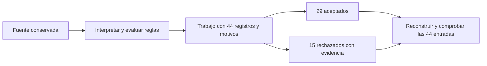

# 07.04 — Faltantes, duplicados y calidad

[Inicio](../../../README.md) / [Módulo 07](../README.md) / **Lección 07.04**

| Tu sesión | Qué prepararás o comprobarás |
| --- | --- |
| **Meta** | Separar registros válidos y rechazados conservando todos los motivos |
| **Necesitas** | 07.03 preparada; condiciones, claves y validación de registros |
| **Evidencia** | Partición completa con originales, banderas e incidencias conciliados |

[Preparación](#antes-de-empezar) · [Material de apoyo](#material-de-apoyo) · [Lab 07.04](../../../labs/07_tidyverse/04_missing_duplicates_quality/README.md) · [Comprobar](#evidencia-y-criterio-de-salida)

<a id="propósito-prerrequisitos-y-objetivos"></a>

## Propósito

**Alcance esencial.** Separar registros que cumplen un contrato de los que
requieren revisión, conservando origen y motivos.

## Antes de empezar

Completa
[07.03 — Transformar columnas](../03_transform_columns/README.md) y retoma
[condiciones con NA de 07.02](../02_select_filter_sort/README.md). La práctica
amplía el método de [validación 06.07](../../06_r_foundations/07_files_validation/README.md)
y lo compara con [pandas 02.05](../../02_pandas/05_missing_duplicates_rules/README.md).

Trabaja en RStudio o tu IDE, con el mismo proyecto y lockfile de 07.02:
R 4.6.1, dplyr 1.2.1, readr 2.2.0 y tibble 3.3.1 comprobados. No hay paquetes
nuevos. Esta lección produce tablas en memoria y un script reproducible;
no exige exportarlas. Agrupar y resumir por segmento llegará en 07.05.
El proyecto/checkpoints integradores siguen pendientes.

## Qué vas a aprender

- Distinguir ausencia, cero y conversión incompatible, además de una fila ausente.
- Definir una clave y diferenciar repetición exacta de repetición por clave.
- Explicar por qué distinct no decide qué versión es correcta.
- Aplicar reglas por registro y conservar **todos** sus motivos de rechazo.
- Comprobar la partición completa y conciliar lo interpretable sin imputar cero.

## Material de apoyo

| Recurso | Para qué sirve | Uso |
| --- | --- | --- |
| [Preparador](preparar_calidad.R) | Añadir funciones y muestra al mismo proyecto | Para el recorrido |
| [CSV de calidad](../../02_pandas/05_missing_duplicates_rules/cartera_calidad.csv) | Inspeccionar las 44 entradas antes de validar | Para el recorrido |
| [Funciones](funciones_calidad.R) | Revisar reglas, banderas y conservación de motivos | Para el recorrido |
| [Ejecutor](revisar_calidad.R) | Reconstruir y conciliar la partición | Para el recorrido |

Los enlaces permiten consultar las fuentes. Sigue el preparador una sola vez
para incorporar el material al mismo proyecto de práctica; después abre allí
los scripts desde el IDE. La sección de preparación distingue la raíz de DS Track
de la raíz de esa práctica y explica cuándo restaurar dependencias.

## 1. Acordar reglas antes de «limpiar»

Reutilizamos [cartera_calidad.csv de pandas 02.05](../../02_pandas/05_missing_duplicates_rules/cartera_calidad.csv):
**44 registros sintéticos**, derivados de las 40 filas de 07.03, con dos cambios
y cuatro filas adicionales. Las muestras de seis y 40 filas siguen intactas.
Cada registro pretende representar un crédito en una fecha de corte. El
[diccionario de seis campos](../../02_pandas/04_types_calculated_columns/README.md#1-una-muestra-más-amplia-para-explorar)
se conserva: identificadores/textos, saldo y pago en pesos enteros pequeños,
y atraso en días completos. La fecha todavía se lee como texto.

La clave acordada es **id_credito + fecha_corte**. El mismo crédito en otro
corte no sería por sí solo una repetición. Este es el contrato didáctico:

| Aspecto | Regla | Si se incumple |
| --- | --- | --- |
| Presencia | Los seis campos son obligatorios | Rechazar por campo ausente |
| Tipo | Saldo, pago y días interpretables como enteros finitos en el rango de 07.03 | Conservar texto y marcar incompatibilidad |
| Rango | Las tres cantidades deben ser no negativas | Marcar cada negativo |
| Catálogo | consumo, servicios, comercio o educacion, exactamente | Marcar categoría fuera de catálogo |
| Relación | pago_mxn ≤ saldo_mxn | Rechazar si el pago supera al saldo |
| Clave | ID y corte presentes; combinación única | Apartar todas las apariciones de una clave repetida |

Aceptado significa **que pasó estas reglas**, no que comprobamos todo lo
posible. No validamos aún el calendario de fecha_corte ni el formato del ID,
ni normalizamos espacios, mayúsculas o acentos. Un espacio no se interpreta
automáticamente como campo vacío. Texto y fechas se profundizan en 07.08–07.09.
Las reglas no pretenden describir cualquier sistema crediticio.

En 07.03 calculábamos sobre datos interpretables; podíamos conservar una resta
negativa para revisarla. Ahora decidimos qué registros cumplen este contrato.
Una operación numérica posible no garantiza que el registro sea aceptable.

## 2. Preparar y abrir desde el IDE

Guarda tus scripts. Una sola vez, sitúa temporalmente la sesión en la raíz de
DS Track, como en la [preparación de 07.01](../01_tibbles_import_pipes/README.md#a-preparar-los-archivos-una-sola-vez).
En Console de R, no en Terminal:

```r
source("curriculum/07_tidyverse/04_missing_duplicates_quality/preparar_calidad.R")
destino <- preparar_calidad(
  "curriculum/06_r_foundations/09_known_result/output/cierre_ventas"
)
```

Usa la ruta de tu práctica si es distinta. source define la función; la llamada
añade funciones, ejecutor y CSV de 44 filas al mismo proyecto. El
[preparador](preparar_calidad.R) exige 07.03, no sobrescribe archivos existentes
y no cambia metadatos o biblioteca. Si falla una copia, conserva lo que haya
quedado y revisa antes de repetir. Omite este paso si ya preparaste 07.04.

Vuelve a abrir el mismo proyecto de práctica y reinicia R. Conserva su raíz
como directorio aunque guardes el script propio en output/mi_calidad.R.
Comprueba el estado; restaura según 07.02 solo si falta sincronizar. Inicio:

```r
source(".Rprofile")
stopifnot(isTRUE(renv::status()$synchronized))
source("R/funciones_transformacion.R", encoding = "UTF-8")
source("R/funciones_calidad.R", encoding = "UTF-8")
fuente <- leer_texto_conversion("datos/cartera_calidad.csv")
original <- fuente
```

Ejecuta bloques con Run e inspecciona fuente en Environment o el visor.
Seguimos leyendo seis columnas de texto; solo el vacío del CSV representa
ausencia. La función de lectura es la de 07.03 y sirve también para este
archivo porque conserva el esquema. Aún no hemos convertido ni descartado filas.

## 3. Una ausencia no es cero ni cualquier NA

```r
print(vapply(fuente, function(x) sum(is.na(x)), integer(1)))
con_saldo_presente <- fuente |> dplyr::filter(!is.na(saldo_mxn))
```

is.na devuelve una máscara. El recorte de ejemplo retira el saldo vacío de
005, pero conserva el texto error de 014: **tener texto no significa tener
una cantidad válida**. No usamos ese recorte como proceso de calidad porque
perdería un registro sin explicar su destino.

| Caso | Ejemplo | Evidencia que conservar |
| --- | --- | --- |
| Cero conocido | 028: saldo 0/pago 0 | Números presentes; pasan rango y relación |
| Ausente en origen | 005: saldo vacío | Marca saldo_mxn_ausente |
| Texto no interpretable | 014: saldo error | Texto y marca saldo_mxn_incompatible |
| Tipo incompatible | 023: días 3.5 | Texto conservado, sin truncar a 3 |

Después de convertir, vacío y error pueden quedar como NA. Por eso las reglas
de ausencia se construyen sobre **fuente**, antes de convertir, y las de
incompatibilidad usan el conversor de 07.03. No intentes inferir el origen
mirando solo los números finales.

### Ausencia explícita y combinación ausente

Un NA ocupa una celda de una fila existente. Si esperabas otra combinación de
crédito/corte pero no llegó ninguna fila, no hay una celda sobre la que is.na
pueda operar. Ejemplo conceptual: si B aparece en septiembre con saldo NA,
su importe está explícitamente ausente; si esperabas además a B en octubre y
no hay fila, falta una observación completa. Necesitas declarar la población
y cortes esperados antes de detectar esa ausencia. Completar combinaciones y
examinar relaciones llegará en 07.06–07.07; no inventamos filas o ceros aquí.

## 4. Primero la clave, después las repeticiones

duplicated marca las apariciones ya vistas al recorrer un vector o las filas
de una tabla. fromLast = TRUE recorre desde el final; combinar ambos resultados
marca **todas las apariciones involucradas**, incluida la primera:

```r
claves <- fuente[c("id_credito", "fecha_corte")]
clave_presente <- !is.na(fuente$id_credito) & !is.na(fuente$fecha_corte)
repetida <- clave_presente &
  (duplicated(claves) | duplicated(claves, fromLast = TRUE))
exacta <- duplicated(fuente) | duplicated(fuente, fromLast = TRUE)
stopifnot(sum(repetida) == 4L, sum(exacta) == 2L)
print(fuente[repetida, ])
```

Usamos una tabla con ambas columnas de clave: no concatenamos textos que
pudieran producir colisiones. Los campos incompletos se rechazan por ausencia;
no los tratamos como una identidad completa repetida, aunque duplicated pueda
comparar sus NA.

| Registros en la entrada | Situación | Decisión |
| --- | --- | --- |
| 1 y 41, ID 001 | Los seis campos coinciden | Ambas filas involucradas |
| 2 y 42, ID 002 | Misma clave; pagos 200 y 250 | Ambas versiones requieren revisión |
| 44 | Falta ID | Rechazo por ausencia, sin adjudicar una identidad |

Son dos filas en repetición exacta y cuatro en claves repetidas, agrupadas
en dos claves. No son cuatro copias adicionales ni cuatro claves distintas.
Revisamos duplicados sobre las seis columnas originales: añadir primero un
número distinto a cada registro haría que ya no hubiera filas totalmente iguales.

### Qué hace distinct y qué decisión no puede tomar

```r
sin_exactos <- fuente |> dplyr::distinct()
una_por_clave <- fuente |>
  dplyr::distinct(id_credito, fecha_corte, .keep_all = TRUE)
stopifnot(nrow(sin_exactos) == 43L, nrow(una_por_clave) == 42L)
```

Sin indicar columnas, distinct conserva una fila por combinación de todos
los valores. Con las dos columnas de clave y .keep_all = TRUE conserva los
demás campos de la **primera** aparición. No determina cuál es correcta,
más reciente o autorizada. Si inviertes las filas de 002, podría conservar
el otro pago. Aquí son ejemplos de reducción, no nuestras tablas aceptadas.

distinct es útil para explorar valores observados o construir una lista de
combinaciones cuando esa es la pregunta. No lo usamos para esconder el
conflicto de una clave ni, después, para compensar una unión que multiplicó filas.
Nuestra regla aparta todas las apariciones repetidas, sin sumar ni elegir pagos.

## 5. Banderas de incumplimiento y todos los motivos

La [función evaluar_calidad](funciones_calidad.R) conserva numero_registro,
posición 1–44 en **esta carga**. No es clave de negocio ni necesariamente un
número de línea física del CSV; un campo entre comillas puede contener saltos.
Al ordenar los resultados, ese número permite volver al registro de origen.

```r
revision <- evaluar_calidad(fuente)
trabajo <- revision$trabajo
banderas <- revision$banderas
print(trabajo |> dplyr::select(numero_registro, id_credito, motivos), n = 44, width = Inf)
```

Las tres advertencias conocidas de conversión (error, pendiente y no_dato)
son esperadas; se conservan los textos y motivos. trabajo contiene cantidades
interpretadas, sus tres compañeros _texto, motivos y resta. Las 44 filas
siguen presentes. banderas contiene **15 columnas lógicas**, una por regla;
TRUE significa incumplimiento confirmado y FALSE que esa regla no confirmó falla.
La fila i de banderas corresponde al numero_registro i de trabajo. No ordenes
o filtres esas banderas por separado y después las asignes a otras filas.

```r
print(banderas |> dplyr::select(saldo_mxn_ausente, saldo_mxn_incompatible,
                               saldo_mxn_negativo, pago_supera_saldo, clave_repetida))
incumplimientos_por_registro <- rowSums(as.matrix(banderas))
stopifnot(sum(incumplimientos_por_registro) == 19,
          sum(incumplimientos_por_registro > 0) == 15L)
```

as.matrix reúne aquí columnas del mismo tipo lógico en una matriz; rowSums
suma por fila, donde TRUE cuenta como 1. El vector resultante cuenta reglas
incumplidas por registro. Las 19 incidencias corresponden a 15 registros:
**incidencias no equivale a filas**. No hacen falta agrupaciones para esta revisión.

### Por qué convertir NA a FALSE solo en las banderas

Si falta saldo, saldo < 0 y pago > saldo quedan desconocidos. No confirmamos
esas fallas, pero saldo_mxn_ausente ya obliga al rechazo. Por eso el programa
convierte una bandera NA a FALSE con `!is.na(regla) & regla`; **no rellena
cantidades**. Esta política solo funciona porque también hay reglas para
ausencias e incompatibilidades en todos los campos requeridos.

Sin esas reglas, descartar lo desconocido podría aceptar información no
evaluable. Retoma 07.02: negar una condición con NA no recupera todos los
registros. Aquí las banderas finales no contienen NA y cada fila queda en una parte.

### Todos los motivos, no solo el primero

En el registro 43, saldo −100, pago −50 y días −1 incumplen tres rangos.
Además, −50 > −100 confirma pago_supera_saldo: **cuatro motivos**.
En el registro 44 faltan ID y segmento: dos motivos.

case_when elige la primera coincidencia y servía para una etiqueta en 07.03.
Aquí eso ocultaría otros incumplimientos. motivos_de_banderas recorre los
nombres de reglas y añade cada nombre verdadero, separado por `; `, en un
orden fijo. El ciclo recorre reglas y opera sobre vectores, no decide una
fila manualmente. Un motivo vacío significa que ninguna regla falló.

## 6. Partir sin perder ni duplicar registros

```r
aceptados <- revision$aceptados
rechazados <- revision$rechazados
comprobar_particion(trabajo, aceptados, rechazados, banderas)
stopifnot(nrow(aceptados) == 29L, nrow(rechazados) == 15L,
          all(aceptados$motivos == ""), all(rechazados$motivos != ""),
          identical(fuente, original))
```

Ambas partes conservan el esquema de trabajo, textos y numero_registro.
El helper comprueba motivos frente a banderas, claves aceptadas completas y
únicas y la correspondencia exacta de registros. Contar 44 = 29 + 15 no basta:
podrías haber perdido una fila y duplicado otra. También las reconstruimos.

bind_rows **apila filas** de tablas, emparejando columnas por nombre. No es
una unión por clave; esa operación se desarrolla en 07.06. Aquí exigimos el
mismo esquema antes de apilar, ordenamos por numero_registro y comparamos
valores y tipos de todas las columnas:

```r
juntos <- dplyr::bind_rows(aceptados, rechazados) |>
  dplyr::arrange(numero_registro)
stopifnot(identical(as.list(juntos), as.list(trabajo)))
```

as.list representa cada tabla como su lista de columnas; la comparación se
concentra en valores/tipos y orden, sin depender de atributos internos del
lector CSV. La partición comprueba conservación; la corrección de cada regla
se comprueba además con ejemplos y fronteras. Ningún control aislado demuestra
que el contrato cubra todas las necesidades posibles.

## 7. Conciliar lo conocido y declarar lo que falta

```r
print(revision$controles, width = Inf)
```

| Parte | Registros | Saldos interpretados | Sin interpretar | Saldo observado MXN |
| --- | --- | --- | --- | --- |
| Entrada | 44 | 42 | 2 | 234900 |
| Aceptados | 29 | 29 | 0 | 177250 |
| Rechazados | 15 | 13 | 2 | 57650 |

234900 = 177250 + 57650 es una identidad entre valores interpretables de los
**registros de entrada**, incluyendo repeticiones y negativos. No es un saldo
depurado de créditos únicos ni un total completo de todas las cantidades:
faltan dos saldos. Los aceptados suman 177250 sobre 29/29 saldos conocidos.
Conciliar las partes no recupera los importes ausentes de 005 y 014.

suma_observada devuelve NA si no hay cantidades observadas: una parte vacía
o todos los saldos sin interpretar no justifican mostrar un cero medido.
Un saldo cero real sí cuenta como dato conocido. El control de partición
revisa también cuántos saldos interpretables se conservan, no solo su suma.

La revisión del material compara todas las filas, motivos y banderas con
[pandas 02.05](../../02_pandas/05_missing_duplicates_rules/README.md), bajo
el mismo contrato y rango de cantidades pequeñas. Las diferencias entre
integer de R e Int64 de pandas siguen siendo las de 07.03. No necesitas
ejecutar Python para completar esta lección.

## 8. Reemplazar o eliminar requiere evidencia

coalesce elige el primer valor no faltante en cada posición. Solo para
discutir una política, en un objeto separado:

```r
# Ejemplo de una suposicion; NO forma parte de evaluar_calidad.
pago_supuesto <- dplyr::coalesce(trabajo$pago_mxn, 0L)
```

Eso haría que el pago vacío y el texto pendiente convertido a NA parezcan
pagos cero. No aporta evidencia de que no hubo pago. No usamos pago_supuesto
para aceptar registros, ni modificamos fuente. Una imputación requeriría una
regla respaldada, su marca y conservar el valor original. Del mismo modo,
filtrar ausencias o usar distinct no conserva por sí solo lo que se apartó.



Sin renderizador: fuente intacta, evaluación de todas las filas, dos partes
con evidencia y reconstrucción completa. Los rechazos se conservan para
investigar o corregir con evidencia; no se consideran basura que deba borrarse.

<a id="práctica-criterio-de-salida-y-siguiente-paso"></a>

## Práctica

Realiza el [lab 07.04](../../../labs/07_tidyverse/04_missing_duplicates_quality/README.md).
Guarda el script propio y, tras Session > Restart R, ejecuta desde Console
`source("revisar_calidad.R", encoding = "UTF-8")` en la raíz de la práctica.
Las advertencias de conversión se leen y justifican. El ejecutor comprueba
fuente/huella, cifras y motivos; no exporta ni modifica los CSV anteriores.

Consulta [revisar_calidad.R](revisar_calidad.R) como referencia del recorrido completo;
trabaja con su copia preparada dentro del proyecto, manteniendo su raíz como
directorio al ejecutar.

## Evidencia y criterio de salida

| Conserva | Comprueba | Explica |
| --- | --- | --- |
| Script y partes reconstruidas | 44 entradas = 29 aceptadas + 15 rechazadas; 19 incidencias | Por qué un registro puede tener varios motivos |
| Originales, banderas y resumen | Todas las apariciones de claves repetidas apartadas; cobertura explícita | Ausencia frente a cero, conversión incompatible y registro ausente |

Puedes avanzar cuando expliques el contrato, distingas ausencia y duplicidad,
conserves todos los motivos y reconstruyas aceptados/rechazados sin perder registros.

Quien aprende realiza la práctica y explica las decisiones; su compañero revisa.
Tu compañero señala una clave repetida y pide mostrar todas sus apariciones y motivos.
Guarda evidencia, ayudas y dudas en una nota personal junto a tu práctica.
PROGRESS.md registra desarrollo editorial, no tu expediente de aprendizaje.
El proyecto integrador y sus checkpoints siguen pendientes; disponer de
lecciones y scripts no acredita haber completado el aprendizaje.

<a id="referencias-y-atribución"></a>

## Referencias

Ejemplos propios con datos sintéticos de DS Track. Revisión: 2026-10-18;
R 4.6.1/dplyr 1.2.1 comprobados con ayuda instalada y ejecución local.

- Hadley Wickham, Mine Çetinkaya-Rundel y Garrett Grolemund,
  [R for Data Science, segunda edición: Missing values](https://r4ds.hadley.nz/missing-values.html).
- dplyr: [distinct](https://dplyr.tidyverse.org/reference/distinct.html),
  [coalesce](https://dplyr.tidyverse.org/reference/coalesce.html) y
  [bind_rows](https://dplyr.tidyverse.org/reference/bind_rows.html).
- R oficial: [duplicated](https://stat.ethz.ch/R-manual/R-devel/library/base/html/duplicated.html)
  y [rowSums](https://stat.ethz.ch/R-manual/R-devel/library/base/html/colSums.html).
- [Guía de lecturas y coautorías](../../../docs/r-reading-guide.md).

## Siguiente paso

Después de la práctica y su comprobación, continúa con
[07.05 — Agrupar y resumir](../05_group_summarize/README.md).

[← Módulo 07](../README.md) · [Lab 07.04](../../../labs/07_tidyverse/04_missing_duplicates_quality/README.md) · [Siguiente →](../05_group_summarize/README.md)
