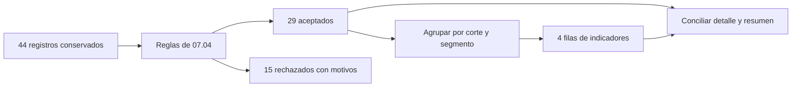

# 07.05 — Agrupar y resumir

[Inicio](../../../README.md) / [Módulo 07](../README.md) / **Lección 07.05**

| Tu sesión | Qué prepararás o comprobarás |
| --- | --- |
| **Meta** | Resumir por grupos con población, cobertura y denominadores claros |
| **Necesitas** | 07.04 y su lab; columnas y resúmenes con cobertura |
| **Evidencia** | Resumen conciliado con el detalle y casos mínimos de NA/cero/vacío |

[Preparación](#antes-de-empezar) · [Material de apoyo](#material-de-apoyo) · [Lab 07.05](../../../labs/07_tidyverse/05_group_summarize/README.md) · [Comprobar](#evidencia-y-criterio-de-salida)

<a id="propósito-prerrequisitos-y-objetivos"></a>

## Propósito

**Alcance esencial.** Pasar de registros a indicadores por grupo y demostrar
qué población y denominador describe cada cifra.

## Antes de empezar

Completa
[07.04 — Faltantes, duplicados y calidad](../04_missing_duplicates_quality/README.md)
y su lab. Retoma [mutate de 07.03](../03_transform_columns/README.md) y
[resúmenes con cobertura de 06.04](../../06_r_foundations/04_logic_missing/README.md).
La comparación conceptual es con [pandas 02.07](../../02_pandas/07_group_summarize/README.md);
su CSV de 48 filas pertenece a otra muestra y no se usa en este ejercicio.

Trabaja en el mismo proyecto RStudio/IDE con el lockfile de 07.02: R 4.6.1,
dplyr 1.2.1, readr 2.2.0 y tibble 3.3.1. No se añaden paquetes ni CSV.
Las tablas se calculan en memoria; el resultado reproducible es tu script.
La primera figura permanece en 07.10; el proyecto integrador sigue pendiente.

## Qué vas a aprender

- Definir la unidad del detalle y la del resumen.
- Usar group_by, summarise y n para obtener una fila por grupo.
- Inspeccionar y quitar agrupaciones antes de calcular un porcentaje global.
- Distinguir registros, datos conocidos, casos confirmados y grupos vacíos.
- Conciliar sumas, conteos, tasas y promedios con sus denominadores.

## Material de apoyo

| Recurso | Para qué sirve | Uso |
| --- | --- | --- |
| [Preparador](preparar_resumen.R) | Añadir dos archivos sin paquetes ni CSV nuevos | Para el recorrido |
| [Funciones de resumen](funciones_resumen.R) | Inspeccionar agrupación, cobertura y denominadores | Para el recorrido |
| [Ejecutor](resumir_cartera.R) | Reconstruir aceptados y comprobar indicadores | Para el recorrido |
| [Calidad compartida](../04_missing_duplicates_quality/funciones_calidad.R) | Recuperar la partición de la misma fuente | Para el recorrido |

Los enlaces permiten consultar las fuentes. Sigue el preparador una sola vez
para incorporar el material al mismo proyecto de práctica; después abre allí
los scripts desde el IDE. La sección de preparación distingue la raíz de DS Track
de la raíz de esa práctica y explica cuándo restaurar dependencias.

## 1. Una pregunta y dos unidades

**Pregunta:** en los aceptados de 07.04, ¿cuántos registros, cuánto saldo y qué
proporción de atrasos de al menos 30 días hay por corte y segmento?
El umbral es didáctico, no una clasificación crediticia oficial.

El detalle tiene una fila por **crédito + corte**. El resumen tendrá una fila
por **corte + segmento**. Agregar reduce el detalle: el resumen ya no permite
identificar qué crédito tenía cada saldo. Conserva ambos objetos.



Sin renderizador: las 44 entradas producen 29 aceptados y 15 rechazos
conservados; solo los 29 aceptados forman los cuatro grupos del resumen.
Agrupar no comprueba ni corrige duplicados. Si repites un registro, podrías
inflar saldo y conteo en la misma proporción y aun así obtener un promedio plausible.

En esta muestra solo hay un corte, 2026-09-30. Conservamos fecha_corte en las
claves para no mezclar fotografías cuando existan varios períodos. El número
de observaciones crédito/corte no equivale necesariamente a personas ni a
créditos distintos en todo un histórico. Sumar saldos de varios cortes tampoco
representaría el saldo de una única fecha.

## 2. Preparar y reconstruir desde RStudio/IDE

Guarda tus scripts. Desde la raíz de DS Track, en **Console de R**, carga el
preparador y llámalo una vez, como en [07.01](../01_tibbles_import_pipes/README.md#a-preparar-los-archivos-una-sola-vez):

```r
source("curriculum/07_tidyverse/05_group_summarize/preparar_resumen.R")
destino <- preparar_resumen(
  "curriculum/06_r_foundations/09_known_result/output/cierre_ventas"
)
```

Usa la ruta de tu práctica si es distinta. Debe tener preparada 07.04.
[preparar_resumen.R](preparar_resumen.R) añade exactamente dos archivos:
R/funciones_resumen.R y resumir_cartera.R. Conserva datos, scripts previos,
metadatos, biblioteca y salidas; no sobrescribe archivos existentes. Si ya
preparaste 07.05, omite este paso. Una copia parcial requiere revisar la
carpeta antes de volver a intentar.

Vuelve a abrir el proyecto de práctica y reinicia R. Crea output/mi_resumen.R
en el editor; mantén la raíz del proyecto como directorio de trabajo. Ejecuta
los bloques con Run e inspecciona los objetos en Environment o en el visor.
En Console, getwd() permite comprobar dónde estás. Inicio del script:

```r
source(".Rprofile")
stopifnot(isTRUE(renv::status()$synchronized))
source("R/funciones_transformacion.R", encoding = "UTF-8")
source("R/funciones_calidad.R", encoding = "UTF-8")
source("R/funciones_resumen.R", encoding = "UTF-8")
fuente <- leer_texto_conversion("datos/cartera_calidad.csv")
original <- fuente
revision <- evaluar_calidad(fuente)
detalle <- revision$aceptados
detalle_original <- detalle
stopifnot(nrow(detalle) == 29L, nrow(revision$rechazados) == 15L)
```

Las advertencias de error, pendiente y no_dato son las conversiones conocidas
de 07.04; sus registros se conservan en rechazados. No uses trabajo como si
fuera la población aceptada ni elimines advertencias para ocultar el problema.
Si falta sincronizar el entorno, revisa [07.02](../02_select_filter_sort/README.md);
no reinstales paquetes por preparar esta lección.

## 3. Agrupar conserva filas; resumir cambia la forma

Empieza contando, antes de calcular dinero o tasas:

```r
agrupado <- detalle |> dplyr::group_by(fecha_corte, segmento)
dplyr::group_vars(agrupado)
conteos <- agrupado |>
  dplyr::summarise(registros = dplyr::n(), .groups = "drop")
print(conteos)
stopifnot(nrow(agrupado) == 29L, nrow(conteos) == 4L,
          sum(conteos$registros) == 29L)
```

group_by añade la regla «calcula dentro de cada combinación de corte y
segmento». No crea cuatro archivos ni suma todavía. group_vars devuelve los
nombres de las columnas que forman esa regla. summarise construye otra tabla:
las claves del grupo y los indicadores que nombremos. registros es un nombre
de salida elegido por nosotros; n() cuenta las filas del grupo actual, sin
recibir una columna. Se usa dentro de verbos como summarise o mutate.

| Operación | Qué mide | ¿Una fila con saldo NA cuenta? |
| --- | --- | --- |
| n() | Registros del grupo | Sí |
| sum(!is.na(saldo_mxn)) | Saldos conocidos | No |
| n_distinct(id_credito) | IDs distintos del grupo | Sí, si el ID está presente |

n_distinct cuenta valores distintos; no demuestra que no existan repeticiones.
Aquí ID/corte ya es único y completo. En un grupo de un corte, IDs distintos
y filas coinciden. En varios cortes, el mismo ID puede aparecer varias veces.
Los conteos distintos no siempre se pueden sumar entre grupos.
Por defecto n_distinct incluye NA como un valor distinto; na.rm = TRUE lo
excluye. Nuestra clave no admite ausencias, por lo que esa elección no cambia
el conteo de IDs en este detalle.

Los conteos esperados, en orden explícito, son comercio 8, consumo 5,
educacion 10 y servicios 6. El orden de presentación se pide con arrange;
agrupar no significa ordenar por saldo ni seleccionar los mayores.

## 4. Construir indicadores y nombrar la base

Lee [funciones_resumen.R](funciones_resumen.R) por partes. La función pública
resumir_grupos hace dos etapas: resumir cantidades y calcular indicadores
sobre ese resumen. Esta es la primera, reproducida para comprenderla:

```r
bases <- detalle |>
  dplyr::group_by(fecha_corte, segmento) |>
  dplyr::summarise(
    registros = dplyr::n(),
    saldos_conocidos = sum(!is.na(saldo_mxn)),
    saldo_observado_mxn = suma_observada(saldo_mxn),
    atrasos_conocidos = sum(!is.na(dias_atraso)),
    atrasos_30_confirmados = sum(dias_atraso >= 30L, na.rm = TRUE),
    .groups = "drop"
  )
```

Cada expresión devuelve **un valor por grupo**. sum sobre un vector lógico
cuenta TRUE: confirma cuántos atrasos alcanzan 30 días. na.rm = TRUE excluye
las evaluaciones desconocidas de esa suma; no las convierte en casos conocidos
sin atraso. Mostraremos también cuántas evaluaciones existen.

suma_observada, definida en 07.04, devuelve NA si no hay ningún valor conocido;
en otro caso suma solo lo observado como double. Evita presentar como cero
medido un grupo sin importes conocidos y mantiene un tipo double estable.
sum de R ya promueve una suma integer a double si hace falta; aquí la conversión
explícita conserva el mismo tipo incluso en grupos con importes pequeños.
No reutilizamos saldo_mxn como nombre de salida: eso reemplazaría la columna
disponible para expresiones posteriores de summarise en tablas locales.

```r
resumen <- resumir_grupos(detalle)
comprobar_resumen(detalle, resumen)
print(resumen, width = Inf)
```

| Segmento | Registros | Saldo observado MXN | Atrasos ≥ 30 | Atrasos conocidos |
| --- | ---: | ---: | ---: | ---: |
| comercio | 8 | 47000 | 5 | 8 |
| consumo | 5 | 35250 | 3 | 5 |
| educacion | 10 | 57000 | 6 | 10 |
| servicios | 6 | 38000 | 4 | 6 |
| Conjunto aceptado | 29 | 177250 | 18 | 29 |

Todos los saldos y atrasos de aceptados son conocidos: cobertura 100 %.
saldo_total_mxn coincide aquí con saldo_observado_mxn. Los 177250 MXN describen
los **aceptados**, no toda la entrada de 44 registros ni la cartera real.

| Indicador | Cálculo y significado |
| --- | --- |
| cobertura_saldo_pct | Saldos conocidos / registros × 100 |
| saldo_promedio_conocido_mxn | Saldo observado / saldos conocidos |
| saldo_total_mxn | Suma completa del grupo, solo si todos sus saldos se conocen |
| cobertura_atraso_pct | Atrasos conocidos / registros × 100 |
| atraso_30_pct_conocidos | Casos confirmados ≥ 30 / atrasos conocidos × 100 |

En la función, if_else sustituye un denominador sin evaluaciones por NA_real_
**antes** de dividir. Así un grupo sin datos conocidos produce un indicador NA,
en lugar de una división entre cero. Es la misma precaución de 07.03.

En servicios: 4/6 × 100 ≈ 66.67 %. El porcentaje global es 18/29 × 100 ≈
62.07 %. No promedies las cuatro tasas: sus denominadores son diferentes.
Para reconstruir la tasa global, suma numeradores y denominadores del mismo
universo. Para el promedio de saldo: 177250/29 ≈ 6112.07 MXN, no la media
simple de los cuatro promedios. Conserva precisión; redondea solo al presentar.

## 5. La agrupación también afecta al paso siguiente

Con dos claves, summarise sin .groups conserva por defecto la primera y avisa.
En esta muestra solo hay un corte: eso puede ocultar un error de denominador.
Usaremos dos cortes en una demostración mínima, independiente de la cartera:

```r
demostracion <- tibble::tibble(
  corte = c("A", "A", "B", "B"),
  segmento = c("x", "y", "x", "y"),
  importe = c(10, 30, 20, 20)
)
persistente <- demostracion |>
  dplyr::group_by(corte, segmento) |>
  dplyr::summarise(importe_grupo = sum(importe))
stopifnot(identical(dplyr::group_vars(persistente), "corte"))
por_corte <- persistente |>
  dplyr::mutate(porcentaje = importe_grupo / sum(importe_grupo) * 100)
global <- persistente |>
  dplyr::ungroup() |>
  dplyr::mutate(porcentaje = importe_grupo / sum(importe_grupo) * 100)
print(por_corte)
print(global)
```

por_corte da 25, 75, 50, 50: cada corte suma 100 %. global da 12.5, 37.5,
25, 25: el conjunto completo suma 100 %. Ambos cálculos son posibles; hay
que declarar cuál responde la pregunta. Estas letras e importes son una
demostración aritmética, no saldos de varios cortes que debamos sumar.

Usamos .groups = "drop" en la función para devolver una tabla sin agrupación.
La opción "keep" la conservaría y "drop_last" quitaría solo la última clave.
ungroup quita la regla sin borrar las columnas ni cambiar sus valores.
Un nuevo group_by reemplaza las claves previas por defecto; para este curso
es más claro declarar siempre todas las claves necesarias.

La agrupación afecta también a mutate y filter: por ejemplo, comparar con
mean(saldo_mxn) en filter sobre una tabla agrupada usa la media de cada grupo.
Inspecciona group_vars antes de atribuir un resultado extraño a los datos.

## 6. Faltantes: otra muestra para aprender sus efectos

Los aceptados no tienen faltantes bajo el contrato de 07.04. Para practicar
cobertura creamos una **muestra analítica independiente** que sí los permite.
No sustituye el CSV ni cambia la decisión sobre los rechazos.

```r
mini <- tibble::tibble(
  id_credito = c("M1", "M2", "M3", "M4", "M5", "M6"),
  fecha_corte = rep("2026-09-30", 6),
  segmento = c("a", "a", "b", "b", "c", NA_character_),
  saldo_mxn = c(100L, NA_integer_, 0L, NA_integer_, NA_integer_, 50L),
  dias_atraso = c(30L, NA_integer_, 0L, 60L, NA_integer_, 30L)
)
mini_resumen <- resumir_grupos(mini)
comprobar_resumen(mini, mini_resumen)
print(mini_resumen, width = Inf)
```

| Grupo | Registros | Saldos conocidos | Suma observada | Promedio conocido | Total completo | Tasa ≥ 30 entre conocidos |
| --- | ---: | ---: | ---: | ---: | ---: | ---: |
| a | 2 | 1 | 100 | 100 | NA | 100 % (1/1) |
| b | 2 | 1 | 0 | 0 | NA | 50 % (1/2) |
| c | 1 | 0 | NA | NA | NA | NA (0 conocidos) |
| NA | 1 | 1 | 50 | 50 | 50 | 100 % (1/1) |

En a, cobertura de atraso 1/2 = 50 %: la tasa 100 % describe solo al único
caso evaluable, no a las dos filas. En b hay un saldo cero **observado**;
la segunda cantidad ausente impide conocer el total. En c no hay saldo ni
atraso evaluable. Se registran cero casos **confirmados**, pero la tasa es NA:
no hay denominador conocido. Esto no afirma que todos estén al corriente.

El grupo NA conserva M6: no conocemos su segmento. En tablas locales, group_by
incluye las claves NA; .drop no sirve para excluirlas. La cobertura del conjunto
es 3/6 en saldo y 4/6 en atraso; suma observada 150 MXN, total completo desconocido.
La tasa conjunta es 3/4 = 75 %, no 3/6 como si los desconocidos fueran FALSE.

La función acepta texto en las claves, ID/corte completo y único y cantidades
enteras finitas no negativas dentro del rango de 07.03; admite NA en segmento,
saldo y atraso. No interpreta fechas ni normaliza categorías. Es un contrato
analítico; úsalo después de decidir la población y sus reglas. En el recorrido
principal esa decisión sigue siendo evaluar_calidad(fuente)$aceptados.

## 7. Tabla vacía, grupo ausente y grupo sin valores

Son situaciones diferentes. Una categoría sin registros no aparece como fila
al agrupar una columna de texto. Un grupo con filas pero todas sus cantidades
NA sí aparece, como c. Un detalle sin filas produce cero grupos:

```r
vacio <- resumir_grupos(mini[0, ])
stopifnot(nrow(vacio) == 0L, identical(names(vacio), names(mini_resumen)))
sin_grupos <- mini[0, ] |>
  dplyr::summarise(registros = dplyr::n(), saldo = suma_observada(saldo_mxn))
stopifnot(nrow(sin_grupos) == 1L, sin_grupos$registros == 0L,
          is.na(sin_grupos$saldo))
```

Sin claves de agrupación, summarise responde una pregunta sobre el conjunto y
devuelve una fila incluso en vacío. n = 0 expresa ausencia de registros; NA
expresa que no hay importes observados bajo nuestra política.

**Ampliación opcional:** .drop = FALSE conserva grupos vacíos de niveles de
factores. Un factor declara categorías posibles mediante levels; lo estudiaremos
en [07.08](../README.md#08-texto-categorias-y-factores). Solo para ver la diferencia:

```r
catalogo_demo <- tibble::tibble(
  segmento = factor("a", levels = c("a", "sin_registros")),
  saldo_mxn = 0L
)
con_vacios <- catalogo_demo |>
  dplyr::group_by(segmento, .drop = FALSE) |>
  dplyr::summarise(registros = dplyr::n(),
                   saldo_observado_mxn = suma_observada(saldo_mxn), .groups = "drop")
stopifnot(identical(con_vacios$registros, c(1L, 0L)),
          identical(con_vacios$saldo_observado_mxn, c(0, NA_real_)))
```

El catálogo declarado conserva sin_registros con n = 0; no inventa créditos
ni mide saldo cero. Esta demostración no se pasa a resumir_grupos, cuyo contrato
de claves usa texto. No se requiere aprender factores para completar el lab.

## 8. Conciliar y explicar los límites

```r
comprobar_resumen(detalle, resumen)
stopifnot(
  sum(resumen$registros) == 29L,
  sum(resumen$saldo_observado_mxn) == 177250,
  sum(resumen$atrasos_30_confirmados) == 18L,
  identical(fuente, original), identical(detalle, detalle_original),
  length(dplyr::group_vars(resumen)) == 0L
)
tasa_global <- sum(resumen$atrasos_30_confirmados) /
  sum(resumen$atrasos_conocidos) * 100
promedio_global <- sum(resumen$saldo_observado_mxn) /
  sum(resumen$saldos_conocidos)
```

comprobar_resumen recalcula desde el detalle y compara claves, columnas, tipos
y valores, en el orden declarado. Detecta incluso dos cambios de grupo que se
compensen en la suma global. Es un control de coherencia; por sí solo no es una
segunda implementación independiente de la fórmula.

La revisión de autoría también concilia claves, faltantes, conteos e indicadores
con pandas 2.3.3 sobre **estos mismos 29 aceptados**, además de la muestra mini.
No compara con los resultados de la cartera de 48 filas de pandas 02.07.
No necesitas ejecutar Python para completar esta sección.

Un resumen correcto conserva los conteos e importes observados de su base.
No recupera los 15 rechazos, no prueba que no falten créditos en la fuente y
no demuestra causalidad entre segmento y atraso.

<a id="práctica-criterio-de-salida-y-siguiente-paso"></a>

## Práctica

Realiza el [lab 07.05](../../../labs/07_tidyverse/05_group_summarize/README.md).
Puedes dividir la sesión en agrupación (1–3) y denominadores/comprobación (4–6).
Guarda output/mi_resumen.R, usa Session > Restart R y ejecuta desde Console:

```r
source("output/mi_resumen.R", encoding = "UTF-8")
source("resumir_cartera.R", encoding = "UTF-8")
```

También puedes usar Source en el archivo abierto manteniendo la raíz de la
práctica como directorio. No se necesita Terminal. El script completo debe
reconstruir las tablas y controles sin objetos de una sesión anterior.

Consulta [resumir_cartera.R](resumir_cartera.R) como referencia del recorrido completo;
trabaja con su copia preparada dentro del proyecto, manteniendo su raíz como
directorio al ejecutar.

## Evidencia y criterio de salida

| Conserva | Comprueba | Explica |
| --- | --- | --- |
| Script y resumen por segmento | 29 aceptados, cuatro grupos, 177250 MXN y 18 atrasos ≥ 30 | Unidad del detalle frente a unidad del resumen |
| Casos mínimos y nota de denominadores | Estado de agrupación; conocidos, pendientes y grupos vacíos | Diferencias entre cero, NA y ausencia de registros |

Puedes avanzar cuando expliques la unidad del resumen, justifiques cada
denominador, distingas cero/NA/vacío y concilies con el detalle desde una sesión nueva.

Quien aprende realiza la práctica y explica las decisiones; su compañero revisa.
Tu compañero pide rastrear el denominador de una tasa hasta las filas que lo componen.
Guarda evidencia, ayudas y dudas en una nota personal junto a tu práctica.
PROGRESS.md registra desarrollo editorial, no tu expediente de aprendizaje.
El proyecto integrador y sus checkpoints siguen pendientes; disponer de
lecciones y scripts no acredita haber completado el aprendizaje.

<a id="referencias-y-atribución"></a>

## Referencias

Ejemplos propios con datos sintéticos de DS Track. Consulta: 2026-10-19;
referencias contrastadas con ayuda instalada y ejecución en R 4.6.1/dplyr 1.2.1.

- Hadley Wickham, Mine Çetinkaya-Rundel y Garrett Grolemund,
  [R for Data Science, segunda edición: Data transformation](https://r4ds.hadley.nz/data-transform.html).
- dplyr: [group_by/ungroup y .drop](https://dplyr.tidyverse.org/reference/group_by.html),
  [summarise y .groups](https://dplyr.tidyverse.org/reference/summarise.html),
  [datos agrupados](https://dplyr.tidyverse.org/articles/grouping.html),
  [n y contexto de grupo](https://dplyr.tidyverse.org/reference/context.html) y
  [n_distinct](https://dplyr.tidyverse.org/reference/n_distinct.html).
- R oficial: [sum y conjunto vacío](https://stat.ethz.ch/R-manual/R-devel/library/base/html/sum.html).
- [Lecturas y coautorías del recorrido](../../../docs/r-reading-guide.md).

## Siguiente paso

Después de la práctica y su comprobación, continúa con
[07.06 — Unir tablas](../06_join_tables/README.md).

[← Módulo 07](../README.md) · [Lab 07.05](../../../labs/07_tidyverse/05_group_summarize/README.md) · [Siguiente →](../06_join_tables/README.md)
