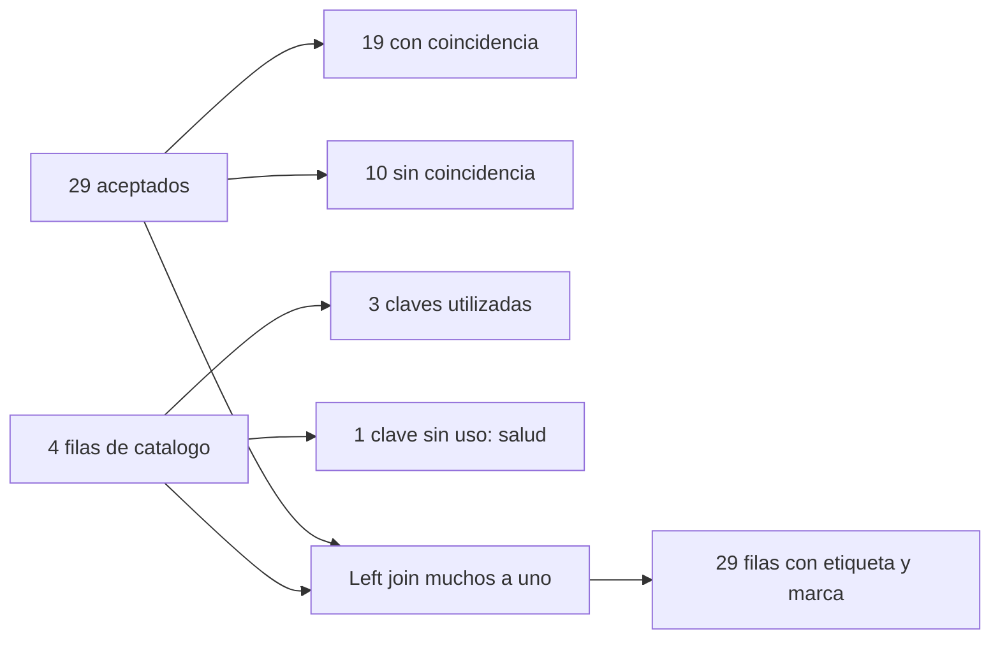

# 07.06 — Unir tablas

[Inicio](../../../README.md) / [Módulo 07](../README.md) / **Lección 07.06**

| Tu sesión | Qué prepararás o comprobarás |
| --- | --- |
| **Meta** | Agregar etiquetas sin multiplicar registros ni perder población |
| **Necesitas** | 07.05 preparada y aceptados de 07.04; claves y relaciones |
| **Evidencia** | Unión con identidad, cardinalidad y cobertura verificadas |

[Preparación](#antes-de-empezar) · [Material de apoyo](#material-de-apoyo) · [Lab 07.06](../../../labs/07_tidyverse/06_join_tables/README.md) · [Comprobar](#evidencia-y-criterio-de-salida)

<a id="propósito-prerrequisitos-y-objetivos"></a>

## Propósito

**Alcance esencial.** Agregar información de un catálogo sin multiplicar
registros ni perder saldos inadvertidamente.

## Antes de empezar

Completa
[07.05 — Agrupar y resumir](../05_group_summarize/README.md) y su lab; conserva
los aceptados y rechazos de [07.04](../04_missing_duplicates_quality/README.md).
Retoma el significado relacional de las [uniones SQL de 03.05](../../03_sql_databases/05_joins/README.md).

Trabaja en el mismo proyecto RStudio/IDE con el lockfile de 07.02: R 4.6.1,
dplyr 1.2.1, readr 2.2.0 y tibble 3.3.1. No hay paquetes nuevos. Añadimos
un CSV sintético pequeño; las fuentes anteriores y sus resultados se conservan.
No se pide exportar ni graficar. El proyecto/checkpoint integrador sigue pendiente.

## Qué vas a aprender

- Distinguir la clave de cada tabla de las columnas utilizadas para unirlas.
- Elegir left_join o inner_join según qué población necesitas conservar.
- Usar semi_join y anti_join para investigar coincidencias en ambos sentidos.
- Declarar la cardinalidad y una política para claves ausentes.
- Detectar multiplicaciones y comprobar identidad, importes y cobertura.

## Material de apoyo

| Recurso | Para qué sirve | Uso |
| --- | --- | --- |
| [Preparador](preparar_uniones.R) | Añadir funciones, ejecutor y catálogo sin dependencias nuevas | Para el recorrido |
| [Catálogo](catalogo_etiquetas.csv) | Inspeccionar claves, etiquetas ausentes y filas sin uso | Para el recorrido |
| [Funciones de unión](funciones_uniones.R) | Leer validación de catálogo y controles de cardinalidad | Para el recorrido |
| [Ejecutor](unir_cartera.R) | Reconstruir coincidencias y no coincidentes | Para el recorrido |

Los enlaces permiten consultar las fuentes. Sigue el preparador una sola vez
para incorporar el material al mismo proyecto de práctica; después abre allí
los scripts desde el IDE. La sección de preparación distingue la raíz de DS Track
de la raíz de esa práctica y explica cuándo restaurar dependencias.

## 1. Relacionar por clave, no por posición

Una unión busca qué filas corresponden entre dos tablas. Si agregas etiquetas
por posición visual, invertir el orden del catálogo podría asignarlas a otro
segmento. Una clave hace explícita la correspondencia.

La pregunta de esta práctica es: **¿qué etiqueta del catálogo corresponde al
segmento de cada crédito aceptado y qué casos requieren revisar el catálogo?**

| Tabla | Unidad de una fila | Clave de la tabla | Clave para esta unión |
| --- | --- | --- | --- |
| Detalle aceptado | Un crédito en un corte | id_credito + fecha_corte | segmento |
| Catálogo estático | Una etiqueta de segmento | segmento | segmento |

segmento puede aparecer en muchos créditos: eso es normal en el detalle.
No es su clave única. Para cada uno esperamos **como máximo una coincidencia**
en el catálogo. Esta relación se llama **muchos a uno**, desde el detalle hacia
el catálogo. Tener cero coincidencias es otro problema: cobertura, no multiplicidad.

En [07.04](../04_missing_duplicates_quality/README.md) bind_rows reunía filas
de aceptados y rechazados con el mismo esquema. Aquí buscamos coincidencias
y agregamos columnas. Un join no apila automáticamente dos cortes ni valida
por sí solo la unicidad de la cartera.

## 2. Entradas: una ausencia deliberada y otra distinta

Reutilizamos los **29 aceptados de las 44 entradas de 07.04**. Su saldo es
177250 MXN y todas las claves ID/corte son completas y únicas. Los 15 rechazos
se conservan; la unión no vuelve a decidir su aceptación.

[catalogo_etiquetas.csv](catalogo_etiquetas.csv) contiene:

| segmento | etiqueta_segmento |
| --- | --- |
| comercio | Comercio ficticio |
| consumo | Consumo ficticio |
| servicios | Campo vacío: etiqueta desconocida |
| salud | Salud ficticia |

El CSV tiene dos columnas de texto. segmento es obligatorio, no vacío y único;
etiqueta_segmento admite ausencia. El lector transforma su campo vacío en NA,
conserva espacios y no normaliza texto. El contrato se explica antes de usarlo:

- educacion aparece en el detalle, pero falta en el catálogo.
- servicios sí tiene una fila de catálogo, aunque no conocemos su etiqueta.
- salud está en el catálogo, pero no aparece en los aceptados.

Son decisiones didácticas, no datos que debamos «arreglar» con una etiqueta
inventada. Este catálogo no reemplaza el catálogo de aceptación de 07.04.
Que un registro haya pasado esas reglas no demuestra que toda tabla auxiliar
contenga su segmento.

El catálogo se considera estático. Si la etiqueta dependiera del corte,
necesitarías otra clave o una regla de vigencia antes de unir. No inferimos
correspondencias históricas ni corregimos fechas en esta lección.

## 3. Preparar y abrir en RStudio/IDE

Guarda tus scripts. Una sola vez, desde la raíz de DS Track y en **Console de R**:

```r
source("curriculum/07_tidyverse/06_join_tables/preparar_uniones.R")
destino <- preparar_uniones(
  "curriculum/06_r_foundations/09_known_result/output/cierre_ventas"
)
```

Usa la ruta de tu práctica si es distinta; requiere 07.05 preparada.
[preparar_uniones.R](preparar_uniones.R) añade exactamente tres archivos:
R/funciones_uniones.R, unir_cartera.R y datos/catalogo_etiquetas.csv. No cambia
metadatos ni biblioteca y no sobrescribe archivos existentes. Omite el paso
si ya preparaste 07.06; ante una copia parcial, revisa lo conservado antes de repetir.
El flujo de apertura y preparación está en [07.01](../01_tibbles_import_pipes/README.md#a-preparar-los-archivos-una-sola-vez).

Abre nuevamente el proyecto de práctica y reinicia R. Comprueba getwd() en
Console; debe ser la raíz de esa práctica. Crea output/mis_uniones.R en el
editor y ejecuta los bloques con Run, inspeccionando sus tablas en el visor.
No escribas estos bloques en la pestaña Terminal. Inicio:

```r
source(".Rprofile")
stopifnot(isTRUE(renv::status()$synchronized))
source("R/funciones_transformacion.R", encoding = "UTF-8")
source("R/funciones_calidad.R", encoding = "UTF-8")
source("R/funciones_resumen.R", encoding = "UTF-8")
source("R/funciones_uniones.R", encoding = "UTF-8")
rutas <- c("datos/cartera_calidad.csv", "datos/catalogo_etiquetas.csv")
huellas <- tools::md5sum(rutas)
fuente <- leer_texto_conversion(rutas[1])
original <- fuente
revision <- evaluar_calidad(fuente)
detalle <- revision$aceptados
detalle_original <- detalle
catalogo <- leer_catalogo(rutas[2])
catalogo_original <- catalogo
stopifnot(nrow(detalle) == 29L, nrow(revision$rechazados) == 15L)
```

Las advertencias de conversión de error, pendiente y no_dato son las conocidas
de 07.04; sus registros permanecen en rechazados. Si falta sincronizar el
entorno, revisa [07.02](../02_select_filter_sort/README.md), sin reinstalar por
preparar esta sección. leer_catalogo valida esquema, tipos, problemas de lectura
y unicidad incluso de claves que no se utilicen.

## 4. Empezar por las coincidencias

Antes de agregar columnas, pregunta qué filas tienen correspondencia:

```r
con_catalogo <- dplyr::semi_join(detalle, catalogo,
                                by = "segmento", na_matches = "never")
sin_catalogo <- dplyr::anti_join(detalle, catalogo,
                                by = "segmento", na_matches = "never")
catalogo_sin_uso <- dplyr::anti_join(catalogo, detalle,
                                    by = "segmento", na_matches = "never")
stopifnot(nrow(con_catalogo) == 19L, nrow(sin_catalogo) == 10L,
          identical(catalogo_sin_uso$segmento, "salud"))
```

semi_join conserva las filas de la tabla izquierda que encuentran coincidencia;
anti_join conserva las que no la encuentran. Ambos mantienen sus columnas.
No añaden etiquetas ni multiplican una fila porque haya varias coincidencias
a la derecha. Tampoco eliminan duplicados que ya existieran a la izquierda.

El tercer cálculo invierte las tablas: busca filas de **catálogo** sin crédito
asociado. No responde la misma pregunta que sin_catalogo.



Sin renderizador: 29 = 19 + 10 en el detalle; 4 = 3 + 1 en el catálogo.
Los conteos de ambas tablas tienen unidades diferentes; no debes sumar 29 y 4
como si fueran 33 créditos.

## 5. left_join conserva el detalle; inner_join cambia la base

La tabla izquierda es el primer argumento, también llamado x; la derecha es
el segundo, y. Esas posiciones determinan qué conserva una unión izquierda.

```r
marcado <- catalogo |> dplyr::mutate(en_catalogo = TRUE)
ampliado_manual <- detalle |>
  dplyr::left_join(marcado, by = "segmento", na_matches = "never",
                   relationship = "many-to-one") |>
  dplyr::mutate(en_catalogo = dplyr::coalesce(en_catalogo, FALSE))
solo_coincidencias <- dplyr::inner_join(
  detalle, catalogo, by = "segmento", na_matches = "never",
  relationship = "many-to-one"
)
stopifnot(nrow(ampliado_manual) == 29L, nrow(solo_coincidencias) == 19L,
          suma_observada(ampliado_manual$saldo_mxn) == 177250,
          suma_observada(solo_coincidencias$saldo_mxn) == 120250)
```

| Operación | Qué devuelve aquí | Riesgo que revisar |
| --- | --- | --- |
| left_join | Los 29 aceptados y dos columnas adicionales | Varias coincidencias pueden repetir filas |
| inner_join | Los 19 aceptados que encuentran catálogo y la etiqueta | Se apartan 10 registros y 57000 MXN |
| semi_join | Esos mismos 19 registros, solo con columnas originales | No agrega información del catálogo |
| anti_join | Los 10 sin catálogo, con columnas originales | Conserva la evidencia de cobertura incompleta |

Un inner join no es una limpieza adicional automática. Contesta sobre una
subpoblación. Si lo usas, conserva y explica qué se apartó. right_join y full_join
amplían qué filas de la derecha se conservan; pueden estudiarse después. Para
agregar este catálogo al detalle, left_join expresa directamente nuestra intención.

by = "segmento" declara la igualdad entre columnas del mismo nombre. Si omites
by, dplyr utiliza las columnas comunes: una nueva columna compartida podría
cambiar la unión sin que cambie tu pregunta. Declarar las claves evita esa
dependencia accidental. No se relacionan filas por el índice ni por su posición.

Para nombres distintos puedes usar un vector nombrado; a la izquierda del signo
= se escribe el nombre en el detalle y a la derecha el del catálogo:

```r
catalogo_otro_nombre <- catalogo |> dplyr::rename(clave_segmento = segmento)
equivalente <- dplyr::left_join(
  detalle, catalogo_otro_nombre, by = c("segmento" = "clave_segmento"),
  na_matches = "never", relationship = "many-to-one"
)
stopifnot(identical(as.list(equivalente),
                    as.list(dplyr::select(ampliado_manual, -en_catalogo))))
```

join_by(segmento) es otra forma de declarar esa igualdad; no necesitas usar ambas
sintaxis para cerrar el lab. Si hay columnas homónimas fuera de la clave, dplyr
las distingue con sufijos .x y .y. Revisa qué significa cada una antes de calcular.
Nuestra función rechaza un detalle que ya tenga etiqueta_segmento o en_catalogo,
para evitar confundir una unión anterior con la nueva.

## 6. Encontrar una fila no garantiza conocer su etiqueta

En el catálogo agregamos en_catalogo = TRUE **antes** de unir. Una falta de
coincidencia introduce NA en esa marca; coalesce la convierte a FALSE.
Esta política solo describe existencia de una coincidencia: no imputa saldos,
atrasos ni etiquetas. La etiqueta desconocida permanece NA.

```r
resultado <- unir_catalogo(detalle, catalogo)
comprobar_union(detalle, catalogo, resultado)
ampliado <- resultado$ampliado
print(resultado$controles, width = Inf)
print(ampliado |> dplyr::select(id_credito, segmento, etiqueta_segmento, en_catalogo),
      n = 29, width = Inf)
stopifnot(sum(!ampliado$en_catalogo) == 10L,
          sum(ampliado$en_catalogo & is.na(ampliado$etiqueta_segmento)) == 6L)
```

| Situación | en_catalogo | etiqueta_segmento | Registros |
| --- | --- | --- | ---: |
| comercio o consumo | TRUE | Texto conocido | 13 |
| servicios | TRUE | NA | 6 |
| educacion | FALSE | NA | 10 |

Si buscaras ausencias solo con is.na(etiqueta_segmento), contarías 16 registros,
mezclando dos problemas distintos. La cobertura del catálogo es 19/29 ≈ 65.52 %;
la cobertura de etiqueta conocida es 13/29 ≈ 44.83 %. La cobertura del saldo
permanece 29/29. Cada indicador necesita su propia definición y denominador.

El contrato de [funciones_uniones.R](funciones_uniones.R) reutiliza la validación
analítica de 07.05 y exige numero_registro entero, positivo y único como rastro
de cada fila. Admite segmentos NA en un detalle analítico independiente: quedarán
sin coincidencia. El catálogo exige clave completa y única. En el recorrido
principal solo se pasa revision$aceptados, sin relajar las reglas de 07.04.

## 7. Cardinalidad: cuántas coincidencias puede tener una fila

| relationship desde x hacia y | Límite por fila de x | Límite por fila de y |
| --- | --- | --- |
| "one-to-one" | A lo sumo una coincidencia | A lo sumo una coincidencia |
| "many-to-one" | A lo sumo una coincidencia | Puede tener varias |
| "one-to-many" | Puede tener varias | A lo sumo una coincidencia |
| "many-to-many" | No impone ese control | No impone ese control |

La relación se refiere a **coincidencias**, no garantiza que todas las claves
del catálogo sean únicas o se utilicen. Por eso validamos también la tabla
completa, incluso una repetición de salud, que aquí no coincidiría con ningún crédito.
Declarar many-to-many no comprueba que la multiplicación sea correcta.

Para ver el daño, crea una copia que repite comercio y haz una unión sin contrato.
Es un ensayo incorrecto separado del resultado principal; la advertencia es esperada:

```r
catalogo_repetido <- dplyr::bind_rows(catalogo, catalogo[1, ])
inflado <- dplyr::left_join(detalle, catalogo_repetido,
                           by = "segmento", na_matches = "never")
stopifnot(nrow(inflado) == 37L, suma_observada(inflado$saldo_mxn) == 224250)
```

Los ocho créditos de comercio encuentran dos filas cada uno: aportan 16 filas
en vez de ocho. El saldo aumenta 47000 MXN sin que exista un crédito nuevo.
Las demás 21 filas se conservan: 16 + 21 = 37. Una agregación posterior sumaría
esas repeticiones. No recupera el detalle original.

Fuera de tu script correcto, comprueba el **error esperado** al exigir muchos a uno:

```r
# ERROR ESPERADO: ejecutar por separado.
dplyr::left_join(detalle, catalogo_repetido, by = "segmento",
                  na_matches = "never", relationship = "many-to-one")
```

La ausencia de advertencias no demuestra unicidad. En uniones por igualdad,
dplyr advierte por defecto sobre muchos a muchos, pero una relación uno a
muchos también puede ampliar filas sin esa advertencia. Valida el contrato
esperado. No uses distinct, multiple = "first" ni "any" para elegir una
etiqueta arbitraria; primero necesitas evidencia para resolver la repetición.

## 8. Claves incompletas en dos sentidos

**Falta una columna de la clave.** Si relacionas dos fotografías por ID y omites
el corte, cada fila puede coincidir con la fotografía de otra fecha. Demostración
mínima independiente, sin cambiar las 29 filas principales:

```r
fotografias <- tibble::tibble(id = c("A", "A"), corte = c("sept", "oct"),
                              saldo = c(100, 80))
estados <- tibble::tibble(id = c("A", "A"), corte = c("sept", "oct"),
                          estado = c("anterior", "actual"))
cruzado <- dplyr::left_join(fotografias, estados, by = "id")
correcto <- dplyr::left_join(fotografias, estados, by = c("id", "corte"),
                             relationship = "one-to-one", na_matches = "never")
stopifnot(nrow(cruzado) == 4L, nrow(correcto) == 2L,
          identical(correcto$estado, c("anterior", "actual")))
```

La primera unión advierte y genera 2 × 2 combinaciones. La segunda exige
igualdad simultánea en ID y corte. Los nombres sept/oct son texto ilustrativo,
no fechas interpretadas. En la práctica de catálogo, segmento sí es suficiente
porque declaramos una etiqueta estática por segmento.

**Falta el valor de la clave.** En tablas locales dplyr puede emparejar NA con
NA de forma predeterminada. Un desconocido no identifica necesariamente al
mismo segmento desconocido en otra tabla. Compara políticas explícitas:

```r
claves_demo <- tibble::tibble(segmento = c("comercio", NA_character_))
catalogo_demo <- tibble::tibble(segmento = c("comercio", NA_character_),
                               etiqueta = c("Conocida", "No asignar por ausencia"))
na_igual <- dplyr::left_join(claves_demo, catalogo_demo, by = "segmento",
                            na_matches = "na", relationship = "many-to-one")
na_separado <- dplyr::left_join(claves_demo, catalogo_demo, by = "segmento",
                               na_matches = "never", relationship = "many-to-one")
stopifnot(na_igual$etiqueta[2] == "No asignar por ausencia",
          is.na(na_separado$etiqueta[2]))
```

Esta muestra solo demuestra la API; nuestro lector rechaza un catálogo con
clave NA. Elegimos na_matches = "never" también en semi/anti, para que todas
las preguntas usen la misma política. Una igualdad SQL ordinaria tampoco
empareja NULL con NULL; otras condiciones SQL pueden elegir otra semántica.
Los espacios y mayúsculas son otro problema: no se corrigen al unir por igualdad.

## 9. Cardinalidad y cobertura requieren controles distintos

relationship no exige que haya una coincidencia. Para los 10 créditos sin
catálogo usamos anti_join. Si el objetivo exigiera cobertura completa, ese
resultado tendría que estar vacío antes de continuar. Aquí se conserva y explica.

**Ampliación opcional:** unmatched = "error" controla claves cuyas filas se
perderían por el tipo de join. En un left_join revisa la derecha: nuestra fila
salud causaría error. No exige que educacion encuentre catálogo, porque sus
filas de la izquierda se conservan. En un inner_join revisa ambos lados y
puede configurarse por separado para cada tabla. No reemplaza a anti_join ni
a la política de cobertura acordada.

```r
comprobar_union(detalle, catalogo, resultado)
stopifnot(
  identical(resultado$controles$registros, c(29L, 19L, 10L)),
  identical(resultado$controles$saldo_observado_mxn, c(177250, 120250, 57000)),
  identical(as.list(resumir_grupos(ampliado)), as.list(resumir_grupos(detalle))),
  identical(fuente, original), identical(detalle, detalle_original),
  identical(catalogo, catalogo_original), identical(huellas, tools::md5sum(rutas))
)
```

La función devuelve ampliado, con_catalogo, sin_catalogo, catalogo_sin_uso y
controles. La comprobación recalcula esas partes y compara claves, columnas,
tipos, orden y valores; además exige que todas las columnas originales sigan
intactas y que las dos partes reconstruyan el detalle. No basta que coincida
la suma: podrías haber cambiado dos etiquetas o compensado dos saldos.

Recalcular con la misma función es una comprobación de coherencia. La revisión
de autoría añade una conciliación independiente con pandas y SQLite sobre
estos mismos aceptados y catálogo; comprueba también las políticas de NA.
No necesitas instalar clientes SQL de R ni ejecutar Python para cerrar la sección.
La [lección pandas 02.08](../../02_pandas/08_combine_tables/README.md) explica una
pregunta similar con otra muestra: no intercambies sus cifras con estas.

<a id="práctica-criterio-de-salida-y-siguiente-paso"></a>

## Práctica

Realiza el [lab 07.06](../../../labs/07_tidyverse/06_join_tables/README.md).
Puedes dividir la sesión en claves/coincidencias (1–3) y cardinalidad/controles (4–6).
Guarda output/mis_uniones.R con el recorrido correcto y los errores esperados
aparte. Tras Session > Restart R, desde Console en la raíz de la práctica:

```r
source("output/mis_uniones.R", encoding = "UTF-8")
source("unir_cartera.R", encoding = "UTF-8")
```

También puedes usar Source desde el editor manteniendo ese directorio. Las
tablas deben reconstruirse sin objetos previos; las advertencias didácticas
se explican. No hace falta Terminal ni recuperar un workspace guardado.

Consulta [unir_cartera.R](unir_cartera.R) como referencia del recorrido completo;
trabaja con su copia preparada dentro del proyecto, manteniendo su raíz como
directorio al ejecutar.

## Evidencia y criterio de salida

| Conserva | Comprueba | Explica |
| --- | --- | --- |
| Script, detalle y unión | 29 filas y 177250 MXN conservados; 19 coincidencias y 10 sin catálogo | Elección de left/inner y población que conserva cada unión |
| Controles de claves y etiquetas | Seis etiquetas desconocidas aun con coincidencia; política NA | Cardinalidad frente a cobertura; duplicados incluso sin uso |

Puedes avanzar cuando justifiques las claves, controles la cardinalidad,
conserves los no coincidentes y compruebes filas, importes y etiquetas desde una sesión nueva.

Quien aprende realiza la práctica y explica las decisiones; su compañero revisa.
Tu compañero añade una clave repetida sin uso al catálogo y pide explicar por qué también debe revisarse.
Guarda evidencia, ayudas y dudas en una nota personal junto a tu práctica.
PROGRESS.md registra desarrollo editorial, no tu expediente de aprendizaje.
El proyecto integrador y sus checkpoints siguen pendientes; disponer de
lecciones y scripts no acredita haber completado el aprendizaje.

<a id="referencias-y-atribución"></a>

## Referencias

Ejemplos propios con datos sintéticos de DS Track. Consulta: 2026-10-19;
documentación contrastada con ayuda instalada y ejecución en R 4.6.1/dplyr 1.2.1.

- Hadley Wickham, Mine Çetinkaya-Rundel y Garrett Grolemund,
  [R for Data Science, segunda edición: Joins](https://r4ds.hadley.nz/joins.html).
- dplyr: [uniones que agregan columnas](https://dplyr.tidyverse.org/reference/mutate-joins.html),
  [semi_join y anti_join](https://dplyr.tidyverse.org/reference/filter-joins.html),
  [especificaciones join_by](https://dplyr.tidyverse.org/reference/join_by.html) y
  [operaciones entre dos tablas](https://dplyr.tidyverse.org/articles/two-table.html).
- SQLite: [SELECT y procesamiento de joins](https://www.sqlite.org/lang_select.html).
- [Guía de lecturas y coautorías](../../../docs/r-reading-guide.md).

## Siguiente paso

Después de la práctica y su comprobación, continúa con
[07.07 — Datos ordenados y reshape](../07_tidy_reshape/README.md).

[← Módulo 07](../README.md) · [Lab 07.06](../../../labs/07_tidyverse/06_join_tables/README.md) · [Siguiente →](../07_tidy_reshape/README.md)
