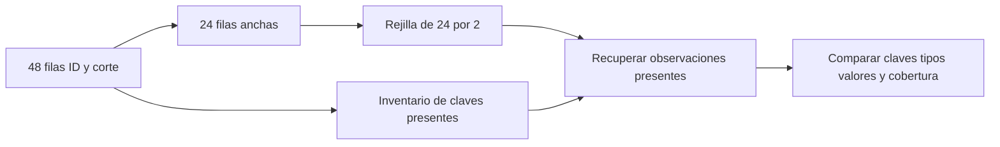

# 07.07 — Datos ordenados y reshape

## Propósito, prerrequisitos y objetivos

**Alcance de práctica.** Cambiar entre formato largo y ancho sin confundir
reorganización con agregación. Completa [07.06 — Unir tablas](../06_join_tables/README.md)
y su lab; retoma [cobertura y denominadores de 07.05](../05_group_summarize/README.md).

Al terminar podrás:

- Definir qué representa una fila antes y después de un cambio de forma.
- Elegir claves y columnas para pivot_wider y pivot_longer.
- Detectar combinaciones repetidas antes de asignar un valor a una celda.
- Distinguir un saldo NA registrado de una combinación sin observación.
- Comprobar una vuelta largo → ancho → largo por claves, tipos, valores y cobertura.

El recorrido principal usa RStudio/IDE y el mismo proyecto renv. Incorporamos
**tidyr 1.3.2** mediante un lockfile generado y restaurado: añade purrr 1.2.2,
stringr 1.6.0 y stringi 1.8.9 como dependencias; conserva las versiones previas.
R 4.6.1, dplyr 1.2.1 y readr 2.2.0 se mantienen. No se instala todo tidyverse.
La primera figura permanece en 07.10; el proyecto integrador sigue pendiente.

## 1. «Ordenados» habla de estructura, no de ordenar filas

En datos ordenados, cada columna representa una variable y cada fila una
observación; distintas unidades de observación pueden necesitar tablas distintas.
Esto no significa ordenar de menor a mayor: arrange cambia el orden de las
filas, mientras que un pivot cambia dónde se guardan variables y valores.

Para esta pregunta, una observación es un **crédito en un corte**. El saldo
depende de ambas partes de la clave. El formato largo permite filtrar o resumir
por corte; el ancho facilita comparar dos cortes lado a lado:

| id_credito | corte | saldo_mxn |
| --- | --- | ---: |
| A | 2026-09-30 | 100 |
| A | 2026-10-31 | 80 |
| B | 2026-09-30 | NA |

| id_credito | saldo_2026-09-30 | saldo_2026-10-31 |
| --- | ---: | ---: |
| A | 100 | 80 |
| B | NA | NA |

El ancho no es incorrecto por ser ancho: responde a otra necesidad de lectura.
Pero sus dos NA de B no cuentan la misma historia. Septiembre tiene una
observación con importe desconocido; octubre no tiene observación en esta muestra.
Para distinguirlas al volver a largo necesitamos conservar las claves presentes.

## 2. Fuente y alcance de lo que reconstruimos

Reutilizamos [cartera_resumen.csv de pandas 02.07](../../02_pandas/07_group_summarize/cartera_resumen.csv),
también usada en [pandas 02.09](../../02_pandas/09_reshape_tables/README.md):
**48 observaciones de 24 créditos ficticios en dos cortes**. Es una muestra
analítica distinta de los 29 aceptados de 07.04–07.06. No añadimos un segundo
corte inventado a esos aceptados ni mezclamos sus indicadores.

| Campo fuente | Tipo leído en R | Ausencia permitida |
| --- | --- | --- |
| id_credito | character | No |
| segmento | character | Sí |
| fecha_corte | character, dos etiquetas ISO conocidas | No |
| saldo_mxn | integer no negativo | Sí |
| dias_atraso | integer no negativo | Sí |

El contrato analítico de esta fuente permite ausencias que 07.04 rechazaba.
No cambiamos retroactivamente aquellas reglas. Las fechas siguen siendo texto;
las usaremos como etiquetas exactas, sin calcular duraciones. Su interpretación
temporal se desarrolla en [07.09](../README.md#09-fechas-y-cortes).

La práctica conserva una **proyección de tres campos**: id_credito, corte y
saldo_mxn. corte es el nuevo nombre de fecha_corte, no una conversión de tipo.
La vuelta reconstruye esa proyección; no recupera segmento ni dias_atraso,
porque no se incluyeron. La fuente completa se mantiene en otro objeto y en disco.

Cada corte tiene 24 observaciones, 21 saldos conocidos y tres NA. Las sumas
observadas son 47200 y 46700 MXN respectivamente, con cobertura 21/24 = 87.5 %.
No sumes ambas fotografías para presentarlas como el saldo de una única fecha.

## 3. Preparar el mismo proyecto y restaurar tidyr

Guarda los scripts. Una sola vez, desde la raíz de DS Track en **Console de R**:

```r
source("curriculum/07_tidyverse/07_tidy_reshape/preparar_formas.R")
destino <- preparar_formas(
  "curriculum/06_r_foundations/09_known_result/output/cierre_ventas"
)
```

Usa la ruta de tu práctica si es distinta; debe tener 07.06 preparada.
[preparar_formas.R](preparar_formas.R) respalda DESCRIPTION y renv.lock en
respaldo_07_06/, actualiza esos dos archivos y añade funciones, ejecutor y
datos/cartera_formas.csv, copia exacta de la fuente de pandas. No instala ni
reemplaza datos, funciones o resultados de otras lecciones. Rechaza archivos
ocupados y una segunda preparación. No es una operación atómica: ante copia
parcial, conserva el respaldo y revisa antes de volver a intentar.

Abre de nuevo el **mismo proyecto** de práctica y reinicia R. Desde su raíz,
en Console, restaura el nuevo lockfile:

```r
source("restaurar.R")
```

Puede descargar paquetes a la biblioteca local de esa práctica. No inicialices
renv en la raíz del curso ni instales en una biblioteca global o en Conda.
En sesiones posteriores basta comprobar renv::status(); si está sincronizado,
no hace falta restaurar otra vez. El recorrido de apertura del proyecto está
en [07.01](../01_tibbles_import_pipes/README.md#a-preparar-los-archivos-una-sola-vez).

Crea output/mis_formas.R en el editor. Mantén la raíz de la práctica como
directorio, aunque el script esté en output/. Ejecuta por bloques con Run e
inspecciona las tablas en Environment/visor. Inicio:

```r
source(".Rprofile")
stopifnot(isTRUE(renv::status()$synchronized))
source("R/funciones_calidad.R", encoding = "UTF-8")
source("R/funciones_formas.R", encoding = "UTF-8")
ruta <- "datos/cartera_formas.csv"
huella <- tools::md5sum(ruta)
fuente <- leer_fuente_formas(ruta)
original <- fuente
largo <- fuente |> dplyr::select(id_credito, corte = fecha_corte, saldo_mxn)
claves_presentes <- largo |> dplyr::select(id_credito, corte)
stopifnot(identical(dim(largo), c(48L, 3L)))
```

El lector detiene problemas de parseo, esquema y cantidades fuera del contrato.
Los seis saldos NA son ausencias permitidas, no errores silenciados. La lista
de claves presentes es información explícita: conservarla permite reconstruir
una entrada incompleta sin inventar observaciones.

## 4. Una celda necesita una clave única

Para ensanchar, una fila será un ID; las etiquetas de corte darán nombre a
las columnas y el saldo ocupará sus celdas:

```r
ancho_manual <- largo |>
  tidyr::pivot_wider(id_cols = id_credito, names_from = corte,
                     values_from = saldo_mxn, names_prefix = "saldo_", names_sort = TRUE) |>
  dplyr::arrange(id_credito)
ancho <- largo_a_ancho(largo)
stopifnot(identical(as.list(ancho_manual), as.list(ancho)),
          identical(dim(ancho), c(24L, 3L)))
```

| Argumento | Decisión de esta práctica |
| --- | --- |
| id_cols | ID identifica la fila del ancho |
| names_from | Los valores de corte pasan a nombres de columnas |
| values_from | saldo_mxn aporta los valores de las celdas |
| names_prefix | saldo_ aclara qué medida contiene cada columna |
| names_sort | Ordenar las columnas generadas por sus etiquetas |

Declara id_cols: si dejas otras columnas como identificadores por defecto,
puedes obtener una fila por ID y segmento, en lugar de una por ID. Cambiar
segmento entre cortes produciría filas distintas. Por eso seleccionamos primero
la proyección que queremos comparar.

La clave de celda es **ID + corte** y debe ser única, incluso si una repetición
trae el mismo saldo. Nuestra función valida esa condición antes del pivot.
Además conserva las dos columnas acordadas en entradas vacías o con un solo
corte: crea la columna que falte con NA_integer_, sin afirmar que existieron filas.

Los nombres con guiones son válidos como etiquetas de columna. Para extraer
una de ellas con texto, utiliza [[, visto en [06.03](../../06_r_foundations/03_subsetting/README.md):

```r
saldo_septiembre <- ancho[["saldo_2026-09-30"]]
stopifnot(is.integer(saldo_septiembre), sum(!is.na(saldo_septiembre)) == 21L)
```

La función también usa all_of(columnas_ancho): selecciona exactamente los
nombres contenidos en ese vector y falla si falta alguno. No convierte tipos
ni selecciona por coincidencias parciales de texto.

## 5. Volver a largo conserva NA por defecto

```r
rejilla <- ancho |>
  tidyr::pivot_longer(
    cols = dplyr::all_of(columnas_ancho[-1]),
    names_to = "corte", names_prefix = "saldo_", values_to = "saldo_mxn",
    values_ptypes = list(saldo_mxn = integer()), values_drop_na = FALSE
  ) |>
  dplyr::arrange(id_credito, corte)
recuperado <- recuperar_saldos(ancho, claves_presentes)
comprobar_formas(largo, ancho, claves_presentes, recuperado)
stopifnot(nrow(rejilla) == 48L, sum(is.na(rejilla$saldo_mxn)) == 6L)
```

cols selecciona solo las dos columnas de saldo. names_to recibe sus nombres,
names_prefix retira saldo_ y values_to recibe sus valores. Las columnas no
seleccionadas, aquí ID, se repiten para identificar cada observación.
values_ptypes comprueba un tipo esperado mediante un vector vacío integer();
no sirve para justificar truncar importes. El contrato de las funciones exige
integer tanto antes como después. La combinación de columnas incompatibles,
como saldo y texto de segmento, necesita otro diseño, no una conversión forzada.

Cada ID produce dos filas en esta rejilla, incluso con celdas NA. Después,
recuperar_saldos conserva por semi_join solo las claves que existían antes.
En la muestra completa las 48 combinaciones ya estaban presentes. Ordenamos
por ID/corte antes de comparar: comprobamos correspondencias, no el orden
accidental en que aparecieron las filas del CSV.



Sin renderizador: conserva las claves del largo, transforma a ancho, despliega
sus dos columnas y recupera las filas que estaban en el inventario. En la
muestra completa la rejilla tiene 48 filas; con huecos puede tener más filas
que las observaciones originales, como veremos a continuación.

No despliegues también dias_atraso como si fueran pesos. En una tabla de
medidas necesitarías conservar el nombre de la variable y su unidad. La
sentinela .value permite diseños con varias columnas de valores; es una
ampliación posterior, no un requisito de este ejercicio.

## 6. NA explícito y combinación ausente no son equivalentes

La muestra principal tiene ambos cortes para todos los IDs. Esta demostración
independiente introduce huecos de combinación sin modificar esa fuente:

```r
mini <- tibble::tibble(
  id_credito = c("A", "A", "B", "C"),
  corte = c("2026-09-30", "2026-10-31", "2026-09-30", "2026-10-31"),
  saldo_mxn = c(100L, 80L, NA_integer_, 0L)
)
mini_claves <- mini |> dplyr::select(id_credito, corte)
mini_ancho <- largo_a_ancho(mini)
mini_rejilla <- ancho_a_rejilla(mini_ancho)
mini_recuperado <- recuperar_saldos(mini_ancho, mini_claves)
comprobar_formas(mini, mini_ancho, mini_claves, mini_recuperado)
stopifnot(nrow(mini_rejilla) == 6L, nrow(mini_recuperado) == 4L,
          sum(is.na(mini_rejilla$saldo_mxn)) == 3L,
          sum(is.na(mini_recuperado$saldo_mxn)) == 1L)
```

| Combinación | ¿Existía una fila? | Saldo en el ancho |
| --- | --- | --- |
| B/septiembre | Sí, con saldo desconocido | NA |
| B/octubre | No | NA |
| C/septiembre | No | NA |
| C/octubre | Sí, con cero observado | 0 |

Un ancho de saldos sin inventario de claves no distingue los tres NA. La vuelta
sin inventario produce una rejilla de seis combinaciones: dos no son observaciones
de la entrada. Conservar las claves presentes es parte de la entrega si necesitas
reconstruir un detalle incompleto. No las deduzcas a partir del saldo.

```r
sin_na <- mini_ancho |>
  tidyr::pivot_longer(cols = dplyr::all_of(columnas_ancho[-1]),
                      names_to = "corte", names_prefix = "saldo_",
                      values_to = "saldo_mxn", values_drop_na = TRUE)
relleno <- mini |>
  tidyr::pivot_wider(id_cols = id_credito, names_from = corte,
                     values_from = saldo_mxn, names_prefix = "saldo_", values_fill = 0L)
stopifnot(nrow(sin_na) == 3L,
          is.na(relleno[["saldo_2026-09-30"]][relleno$id_credito == "B"]),
          relleno[["saldo_2026-10-31"]][relleno$id_credito == "B"] == 0L)
```

values_drop_na = TRUE también elimina B/septiembre, que sí tenía una fila:
se pierde evidencia de su saldo desconocido. values_fill = 0L rellena las
combinaciones sin valor de entrada, como B/octubre; no reemplaza ese NA
explícito de B/septiembre. Ninguna de esas decisiones se usa en nuestro
recorrido de reconstrucción. Un hueco no demuestra un saldo cero.

## 7. Pivotar no debe elegir ni sumar repeticiones sin una regla

Observa qué pasa si repetimos A/septiembre en una copia. El pivot sin validación
advierte y genera columnas de listas, porque hay más de un valor para una celda:

```r
repetido <- dplyr::bind_rows(mini, mini[1, ])
ambiguo <- tidyr::pivot_wider(repetido, id_cols = id_credito, names_from = corte,
                              values_from = saldo_mxn, names_prefix = "saldo_")
stopifnot(any(vapply(ambiguo, is.list, logical(1))))
```

Una columna de listas puede guardar varios valores dentro de una celda; no
es el vector de saldos integer que esperamos. Es una señal para revisar la
unidad y las claves. A diferencia del pivot de pandas, tidyr no tiene por qué
fallar por defecto ante esta ambigüedad; nuestra validación sí debe detenerla.

En un bloque separado, comprueba el **error esperado** y déjalo fuera del
script de reconstrucción correcta:

```r
# ERROR ESPERADO: ejecutar por separado.
largo_a_ancho(repetido)
```

values_fn = sum podría sumar los dos 100 de A/septiembre y mostrar 200; eso
es una agregación, no recuperar el dato original. values_fn = list conserva
la multiplicidad, pero cambia el contrato de celdas. distinct tampoco decide
cuál registro debía existir. Si tus filas fueran pagos legítimos de una misma
fecha, tendrías que definir esa unidad y agregar con reglas explícitas antes
de pivotar; aquí cada fila ya representa un saldo de crédito/corte.

## 8. Comparar datos e indicadores en la misma base

```r
controles <- control_por_corte(recuperado)
print(controles, width = Inf)
stopifnot(identical(controles$registros, c(24L, 24L)),
          identical(controles$conocidos, c(21L, 21L)),
          identical(controles$saldo_observado_mxn, c(47200, 46700)),
          identical(fuente, original), identical(huella, tools::md5sum(ruta)))
```

comprobar_formas compara las tres columnas completas en orden canónico,
incluidos tipos y posiciones de NA; también revisa el ancho y el inventario,
y concilia conteos, cobertura e importes por corte. Una suma global igual
podría ocultar un saldo trasladado a otro crédito o una clave ausente reemplazada
por otra. Un resumen por corte es útil, pero no sustituye comparar cada dato.

Los 47200 y 46700 MXN son sumas observadas, no saldos completos: faltan tres
importes en cada corte. La diferencia entre sumas observadas no demuestra un
cambio de saldo de la misma población con cantidades completas. Si comparas
créditos entre fechas, declara la base común y su cobertura antes de interpretar.

La revisión de autoría concilia la proyección y el cambio de forma con pandas
2.3.3 sobre este mismo CSV, además de los huecos de la muestra mini. No compara
con los 177250 MXN de otra muestra. Los controles R son de coherencia y vuelta;
la implementación pandas aporta una comprobación independiente. No necesitas
ejecutar Python para cerrar esta práctica.

## Práctica, criterio de salida y siguiente paso

Realiza el [lab 07.07](../../../labs/07_tidyverse/07_tidy_reshape/README.md).
Puedes dividir la sesión en cambio de forma (1–3) y ausencias/comprobación (4–6).
Guarda output/mis_formas.R con los bloques correctos, dejando el error esperado
aparte. Usa Session > Restart R, y desde Console en la raíz de la práctica:

```r
source("output/mis_formas.R", encoding = "UTF-8")
source("cambiar_forma.R", encoding = "UTF-8")
```

También puedes usar Source desde el editor manteniendo ese directorio. Debe
funcionar sin objetos anteriores ni un workspace recuperado. No hace falta
Terminal ni exportar CSV para demostrar el cambio de forma.

Puedes avanzar cuando justifiques las claves, conserves NA y combinaciones
presentes y reconstruyas los tres campos con indicadores conciliados desde
una sesión nueva. Registra evidencia y dudas; material disponible no acredita
aprendizaje. No hay checkpoint integrador implementado asociado.

Siguiente: [07.08 — Texto, categorías y factores](../README.md#08-texto-categorias-y-factores),
todavía planificada. Volver al [índice del módulo](../README.md).

## Referencias y atribución

Ejemplos propios adaptados al recorrido DS Track. Consulta: 2026-10-19;
documentación contrastada con ayuda instalada y ejecución R 4.6.1/tidyr 1.3.2.

- Hadley Wickham, Mine Çetinkaya-Rundel y Garrett Grolemund,
  [R for Data Science, segunda edición: Data tidying](https://r4ds.hadley.nz/data-tidy.html).
- tidyr: [pivot_wider](https://tidyr.tidyverse.org/reference/pivot_wider.html),
  [pivot_longer](https://tidyr.tidyverse.org/reference/pivot_longer.html) y
  [Pivoting](https://tidyr.tidyverse.org/articles/pivot.html).
- renv: [introducción y restauración](https://rstudio.github.io/renv/articles/renv.html).
- [Guía de lecturas y coautorías](../../../docs/r-reading-guide.md).
